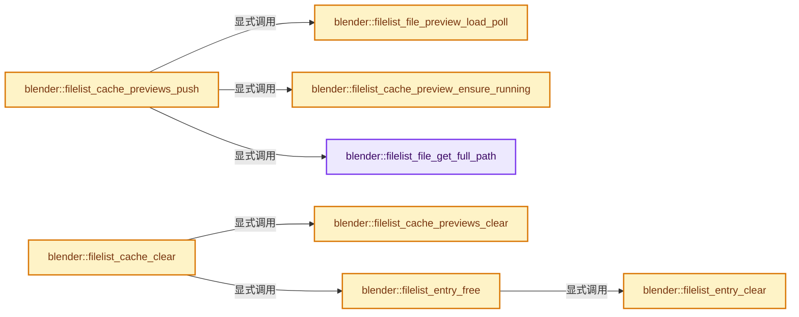
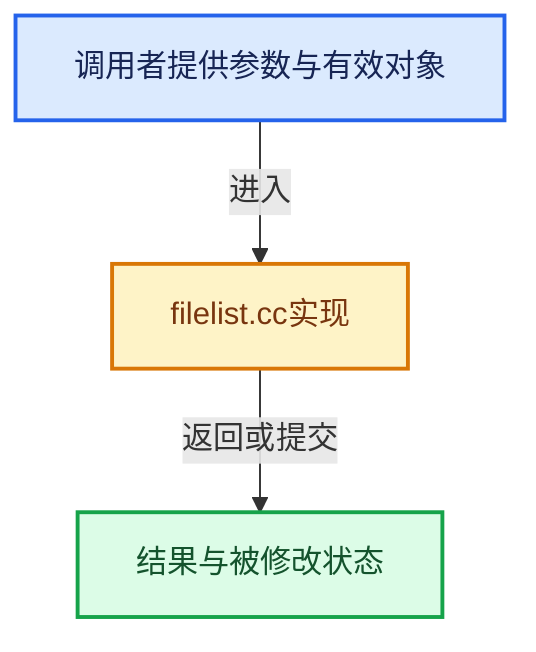

# 实现依赖专题：source/blender/editors/space_file/filelist/filelist.cc

[实现依赖导航](../../../../README.md) · [符号索引](../../../../../00-课程指南/02-源码与提交索引/符号依赖与实现索引.md)

本专题从正文实际调用进入，集中保存共享实现。函数有稳定锚点，可从调用处直接跳到对应完整函数；递归与互相调用通过回链组织。

## 本文件的实现关系






## 完整成员与函数实现

<a id="f-ce95e03bd044641b"></a>

### `blender::filelist_file_get_full_path`

实现位置：[source/blender/editors/space_file/filelist/filelist.cc](../../../../../../../../../source/blender/editors/space_file/filelist/filelist.cc) · L247—L259。

接口参数：

- `const FileList *filelist`
- `const FileDirEntry *file`
- `char r_filepath[FILE_MAX_LIBEXTRA]`

**教学注释版**

<!-- annotated:a86b9b6af6e7f9 -->

```cpp
void filelist_file_get_full_path(const FileList *filelist,
                                 const FileDirEntry *file,
                                 char r_filepath[FILE_MAX_LIBEXTRA])
{
  if (file->asset) {
    const std::string asset_path = file->asset->full_path();
    BLI_strncpy(r_filepath, asset_path.c_str(), FILE_MAX_LIBEXTRA);
    return;
  }

  const char *root = filelist_dir(filelist);
  BLI_path_join(r_filepath, FILE_MAX_LIBEXTRA, root, file->relpath);
}
```

<details>
<summary>核对原始源码：source/blender/editors/space_file/filelist/filelist.cc · L247—L259</summary>

<!-- original:a86b9b6af6e7f9:source/blender/editors/space_file/filelist/filelist.cc:247:259 -->

```cpp
void filelist_file_get_full_path(const FileList *filelist,
                                 const FileDirEntry *file,
                                 char r_filepath[FILE_MAX_LIBEXTRA])
{
  if (file->asset) {
    const std::string asset_path = file->asset->full_path();
    BLI_strncpy(r_filepath, asset_path.c_str(), FILE_MAX_LIBEXTRA);
    return;
  }

  const char *root = filelist_dir(filelist);
  BLI_path_join(r_filepath, FILE_MAX_LIBEXTRA, root, file->relpath);
}
```

</details>

**继续追踪实现**

- `file->asset->full_path` → [调用协议](../../../../../00-课程指南/01-路线与规范/模板宏与动态分派协议.md)：接收对象类型依赖auto、返回值或模板实例；不按同名猜测目标。调用位置L252。
- `BLI_strncpy` → [blender::BLI_strncpy · L70](../../../../01-BLI基础库/intern/string.cc.md#f-6324147b0d116da1)。
- `asset_path.c_str` → [外部契约](https://eel.is/c++draft/)：这个边界按实际表达式及所属类型核对参数、返回值、寿命与失败行为。这里提供接口入口，不声称已解释该第三方版本的内部实现。
- `filelist_dir` → [blender::filelist_dir · L1123](filelist.cc.md#f-623ccbeac36c86e9)。
- `BLI_path_join` → [BLI_path_join · L386](../../../../01-BLI基础库/BLI_path_utils.hh.md#m-f3b1183fb80c)。宏定义由构建条件选择。

<a id="f-a37ffa638527706d"></a>

### `blender::filelist_entry_clear`

实现位置：[source/blender/editors/space_file/filelist/filelist.cc](../../../../../../../../../source/blender/editors/space_file/filelist/filelist.cc) · L459—L478。

接口参数：

- `FileDirEntry *entry`

**教学注释版**

<!-- annotated:faa6429b93d29b -->

```cpp
static void filelist_entry_clear(FileDirEntry *entry)
{
  if (entry->name && ((entry->flags & FILE_ENTRY_NAME_FREE) != 0)) {
    MEM_delete(const_cast<char *>(entry->name));
  }
  if (entry->relpath) {
    MEM_delete(entry->relpath);
  }
  if (entry->redirection_path) {
    MEM_delete(entry->redirection_path);
  }
  if (entry->preview_icon_id &&
      /* Online assets previews are managed by the general UI preview system, not the file browser
       * one. Don't mess with them. */
      ((entry->typeflag & FILE_TYPE_ASSET_ONLINE) == 0))
  {
    BKE_icon_delete(entry->preview_icon_id);
    entry->preview_icon_id = 0;
  }
}
```

<details>
<summary>核对原始源码：source/blender/editors/space_file/filelist/filelist.cc · L459—L478</summary>

<!-- original:faa6429b93d29b:source/blender/editors/space_file/filelist/filelist.cc:459:478 -->

```cpp
static void filelist_entry_clear(FileDirEntry *entry)
{
  if (entry->name && ((entry->flags & FILE_ENTRY_NAME_FREE) != 0)) {
    MEM_delete(const_cast<char *>(entry->name));
  }
  if (entry->relpath) {
    MEM_delete(entry->relpath);
  }
  if (entry->redirection_path) {
    MEM_delete(entry->redirection_path);
  }
  if (entry->preview_icon_id &&
      /* Online assets previews are managed by the general UI preview system, not the file browser
       * one. Don't mess with them. */
      ((entry->typeflag & FILE_TYPE_ASSET_ONLINE) == 0))
  {
    BKE_icon_delete(entry->preview_icon_id);
    entry->preview_icon_id = 0;
  }
}
```

</details>

**沿实际写入检查状态**

- `entry->preview_icon_id = 0;`

**继续追踪实现**

- `MEM_delete` → [MEM_delete · L400](../../../../07-Intern运行时与平台/guardedalloc/MEM_guardedalloc.h.md#f-9049ffdd1682887c)。
- `BKE_icon_delete` → [blender::BKE_icon_delete · L545](../../../../02-BKE几何与数据/intern/icons.cc.md#f-d7e7f833e5762709)。

<a id="f-cc020bbdbac300d4"></a>

### `blender::filelist_entry_free`

实现位置：[source/blender/editors/space_file/filelist/filelist.cc](../../../../../../../../../source/blender/editors/space_file/filelist/filelist.cc) · L480—L484。

接口参数：

- `FileDirEntry *entry`

**教学注释版**

<!-- annotated:149ef30fc6720a -->

```cpp
static void filelist_entry_free(FileDirEntry *entry)
{
  filelist_entry_clear(entry);
  MEM_delete(entry);
}
```

<details>
<summary>核对原始源码：source/blender/editors/space_file/filelist/filelist.cc · L480—L484</summary>

<!-- original:149ef30fc6720a:source/blender/editors/space_file/filelist/filelist.cc:480:484 -->

```cpp
static void filelist_entry_free(FileDirEntry *entry)
{
  filelist_entry_clear(entry);
  MEM_delete(entry);
}
```

</details>

**继续追踪实现**

- `filelist_entry_clear` → [blender::filelist_entry_clear · L459](filelist.cc.md#f-a37ffa638527706d)。
- `MEM_delete` → [MEM_delete · L400](../../../../07-Intern运行时与平台/guardedalloc/MEM_guardedalloc.h.md#f-9049ffdd1682887c)。

<a id="f-22381ff66a875b20"></a>

### `blender::filelist_cache_preview_ensure_running`

实现位置：[source/blender/editors/space_file/filelist/filelist.cc](../../../../../../../../../source/blender/editors/space_file/filelist/filelist.cc) · L628—L637。

接口参数：

- `FileListEntryCache *cache`

**教学注释版**

<!-- annotated:11bc64877e1610 -->

```cpp
static void filelist_cache_preview_ensure_running(FileListEntryCache *cache)
{
  if (!cache->previews_pool) {
    cache->previews_pool = BLI_task_pool_create_background(cache, TASK_PRIORITY_LOW);
    cache->previews_done = BLI_thread_queue_init();
    cache->previews_todo_count = 0;

    IMB_thumb_locks_acquire();
  }
}
```

<details>
<summary>核对原始源码：source/blender/editors/space_file/filelist/filelist.cc · L628—L637</summary>

<!-- original:11bc64877e1610:source/blender/editors/space_file/filelist/filelist.cc:628:637 -->

```cpp
static void filelist_cache_preview_ensure_running(FileListEntryCache *cache)
{
  if (!cache->previews_pool) {
    cache->previews_pool = BLI_task_pool_create_background(cache, TASK_PRIORITY_LOW);
    cache->previews_done = BLI_thread_queue_init();
    cache->previews_todo_count = 0;

    IMB_thumb_locks_acquire();
  }
}
```

</details>

**沿实际写入检查状态**

- `cache->previews_pool = BLI_task_pool_create_background(cache, TASK_PRIORITY_LOW);`
- `cache->previews_done = BLI_thread_queue_init();`
- `cache->previews_todo_count = 0;`

**继续追踪实现**

- `BLI_task_pool_create_background` → [BLI_task_pool_create_background · L409](../../../../../11-Depsgraph与并行任务系统/07-任务池与TBB接入.md#f-abf2820e6cdcaec7)。
- `BLI_thread_queue_init` → [BLI_thread_queue_init · L627](../../../../01-BLI基础库/intern/threads.cc.md#f-898f4610019583c0)。
- `IMB_thumb_locks_acquire` → [blender::IMB_thumb_locks_acquire · L793](../../../imbuf/intern/thumbs.cc.md#f-2c3908c2570f3a28)。

<a id="f-370963d4c358e1c4"></a>

### `blender::filelist_cache_previews_clear`

实现位置：[source/blender/editors/space_file/filelist/filelist.cc](../../../../../../../../../source/blender/editors/space_file/filelist/filelist.cc) · L639—L664。

接口参数：

- `FileListEntryCache *cache`

**教学注释版**

<!-- annotated:f0abe9cffb9576 -->

```cpp
static void filelist_cache_previews_clear(FileListEntryCache *cache)
{
  if (cache->previews_pool) {
    cache->previews_cancel_token.cancel();
    BLI_task_pool_work_and_wait(cache->previews_pool);

    for (FileDirEntry &entry : cache->cached_entries) {
      entry.flags &= ~FILE_ENTRY_PREVIEW_LOADING;
    }

    FileListEntryPreview *preview;
    while ((preview = static_cast<FileListEntryPreview *>(
                BLI_thread_queue_pop_timeout(cache->previews_done, 0))))
    {
      // printf("%s: DONE %d - %s - %p\n", __func__, preview->index, preview->path,
      // preview->img);
      BLI_assert((preview->flags & FILE_TYPE_ASSET_ONLINE) == 0);
      if (preview->icon_id) {
        BKE_icon_delete(preview->icon_id);
      }
      MEM_delete(preview);
    }
    cache->previews_todo_count = 0;
    cache->previews_cancel_token.reset();
  }
}
```

<details>
<summary>核对原始源码：source/blender/editors/space_file/filelist/filelist.cc · L639—L664</summary>

<!-- original:f0abe9cffb9576:source/blender/editors/space_file/filelist/filelist.cc:639:664 -->

```cpp
static void filelist_cache_previews_clear(FileListEntryCache *cache)
{
  if (cache->previews_pool) {
    cache->previews_cancel_token.cancel();
    BLI_task_pool_work_and_wait(cache->previews_pool);

    for (FileDirEntry &entry : cache->cached_entries) {
      entry.flags &= ~FILE_ENTRY_PREVIEW_LOADING;
    }

    FileListEntryPreview *preview;
    while ((preview = static_cast<FileListEntryPreview *>(
                BLI_thread_queue_pop_timeout(cache->previews_done, 0))))
    {
      // printf("%s: DONE %d - %s - %p\n", __func__, preview->index, preview->path,
      // preview->img);
      BLI_assert((preview->flags & FILE_TYPE_ASSET_ONLINE) == 0);
      if (preview->icon_id) {
        BKE_icon_delete(preview->icon_id);
      }
      MEM_delete(preview);
    }
    cache->previews_todo_count = 0;
    cache->previews_cancel_token.reset();
  }
}
```

</details>

**沿实际写入检查状态**

- `entry.flags &= ~FILE_ENTRY_PREVIEW_LOADING;`
- `cache->previews_todo_count = 0;`

**继续追踪实现**

- `cache->previews_cancel_token.cancel` → [调用协议](../../../../../00-课程指南/01-路线与规范/模板宏与动态分派协议.md)：接收对象类型依赖auto、返回值或模板实例；不按同名猜测目标。调用位置L642。
- `BLI_task_pool_work_and_wait` → [BLI_task_pool_work_and_wait · L455](../../../../../11-Depsgraph与并行任务系统/07-任务池与TBB接入.md#f-cece9e6aa22a9121)。
- `BLI_thread_queue_pop_timeout` → [BLI_thread_queue_pop_timeout · L787](../../../../01-BLI基础库/intern/threads.cc.md#f-6ed3dc73fc73dc9a)。
- `BLI_assert` → [BLI_assert · L48](../../../../01-BLI基础库/BLI_assert.hh.md#m-57a88495704d)；[BLI_assert · L63](../../../../01-BLI基础库/BLI_assert.hh.md#m-d07050020cb5)。宏定义由构建条件选择。
- `BKE_icon_delete` → [blender::BKE_icon_delete · L545](../../../../02-BKE几何与数据/intern/icons.cc.md#f-d7e7f833e5762709)。
- `MEM_delete` → [MEM_delete · L400](../../../../07-Intern运行时与平台/guardedalloc/MEM_guardedalloc.h.md#f-9049ffdd1682887c)。
- `cache->previews_cancel_token.reset` → [调用协议](../../../../../00-课程指南/01-路线与规范/模板宏与动态分派协议.md)：接收对象类型依赖auto、返回值或模板实例；不按同名猜测目标。调用位置L662。

<a id="f-db0ebfbc88460b02"></a>

### `blender::filelist_file_preview_load_poll`

实现位置：[source/blender/editors/space_file/filelist/filelist.cc](../../../../../../../../../source/blender/editors/space_file/filelist/filelist.cc) · L690—L720。

接口参数：

- `const FileDirEntry *entry`

**教学注释版**

<!-- annotated:c343305fd0bb75 -->

```cpp
static bool filelist_file_preview_load_poll(const FileDirEntry *entry)
{
  if (entry->flags & (FILE_ENTRY_INVALID_PREVIEW | FILE_ENTRY_PREVIEW_LOADING)) {
    return false;
  }

  if (!(entry->typeflag &
        (FILE_TYPE_IMAGE | FILE_TYPE_MOVIE | FILE_TYPE_FTFONT | FILE_TYPE_OBJECT_IO |
         FILE_TYPE_BLENDER | FILE_TYPE_BLENDER_BACKUP | FILE_TYPE_BLENDERLIB)))
  {
    return false;
  }

  /* If we know this is an external ID without a preview, skip loading the preview. Can save quite
   * some time in heavy files, because otherwise for each missing preview and for each preview
   * reload, we'd reopen the .blend to look for the preview. */
  if ((entry->typeflag & FILE_TYPE_BLENDERLIB) &&
      (entry->flags & FILE_ENTRY_BLENDERLIB_NO_PREVIEW))
  {
    return false;
  }

  /* External ID that is also a directory is never previewed. */
  if ((entry->typeflag & (FILE_TYPE_BLENDERLIB | FILE_TYPE_DIR)) ==
      (FILE_TYPE_BLENDERLIB | FILE_TYPE_DIR))
  {
    return false;
  }

  return true;
}
```

<details>
<summary>核对原始源码：source/blender/editors/space_file/filelist/filelist.cc · L690—L720</summary>

<!-- original:c343305fd0bb75:source/blender/editors/space_file/filelist/filelist.cc:690:720 -->

```cpp
static bool filelist_file_preview_load_poll(const FileDirEntry *entry)
{
  if (entry->flags & (FILE_ENTRY_INVALID_PREVIEW | FILE_ENTRY_PREVIEW_LOADING)) {
    return false;
  }

  if (!(entry->typeflag &
        (FILE_TYPE_IMAGE | FILE_TYPE_MOVIE | FILE_TYPE_FTFONT | FILE_TYPE_OBJECT_IO |
         FILE_TYPE_BLENDER | FILE_TYPE_BLENDER_BACKUP | FILE_TYPE_BLENDERLIB)))
  {
    return false;
  }

  /* If we know this is an external ID without a preview, skip loading the preview. Can save quite
   * some time in heavy files, because otherwise for each missing preview and for each preview
   * reload, we'd reopen the .blend to look for the preview. */
  if ((entry->typeflag & FILE_TYPE_BLENDERLIB) &&
      (entry->flags & FILE_ENTRY_BLENDERLIB_NO_PREVIEW))
  {
    return false;
  }

  /* External ID that is also a directory is never previewed. */
  if ((entry->typeflag & (FILE_TYPE_BLENDERLIB | FILE_TYPE_DIR)) ==
      (FILE_TYPE_BLENDERLIB | FILE_TYPE_DIR))
  {
    return false;
  }

  return true;
}
```

</details>

**结果出口**

- `return false;`
- `return true;`

**继续追踪实现**

本实现没有需要继续展开的显式调用；检查返回表达式、对象转换和调用者前置条件。

<a id="f-489d3d0da9f9fb83"></a>

### `blender::filelist_cache_previews_push`

实现位置：[source/blender/editors/space_file/filelist/filelist.cc](../../../../../../../../../source/blender/editors/space_file/filelist/filelist.cc) · L754—L820。

接口参数：

- `FileList *filelist`
- `FileDirEntry *entry`
- `const int index`

**教学注释版**

<!-- annotated:d55767d5afa8bc -->

```cpp
static bool filelist_cache_previews_push(FileList *filelist, FileDirEntry *entry, const int index)
{
  FileListEntryCache *cache = filelist->filelist_cache;

  BLI_assert(cache->flags & FLC_PREVIEWS_ACTIVE);

  if (entry->preview_icon_id) {
    return false;
  }

  if (entry->typeflag & FILE_TYPE_ASSET_ONLINE) {
    /* Online assets use the UI system for async preview loading (see #PreviewLoadJob)
     * instead of the file browser one. */
    return false;
  }

  if (!filelist_file_preview_load_poll(entry)) {
    return false;
  }

  FileListInternEntry *intern_entry = filelist->filelist_intern.filtered[index];
  const PreviewImage *preview_in_memory = intern_entry->local_data.preview_image;
  if (preview_in_memory && !BKE_previewimg_is_finished(preview_in_memory, ICON_SIZE_PREVIEW)) {
    /* Nothing to set yet. Wait for next call. */
    return false;
  }

  filelist_cache_preview_ensure_running(cache);
  entry->flags |= FILE_ENTRY_PREVIEW_LOADING;

  FileListEntryPreview *preview = MEM_new_zeroed<FileListEntryPreview>(__func__);
  preview->index = index;
  preview->flags = entry->typeflag;
  preview->icon_id = 0;

  if (preview_in_memory) {
    /* TODO(mano-wii): No need to use the thread API here. */
    BLI_assert(!BKE_previewimg_is_rendering(preview_in_memory, ICON_SIZE_PREVIEW));
    preview->filepath[0] = '\0';
    ImBuf *imbuf = BKE_previewimg_to_imbuf(preview_in_memory, ICON_SIZE_PREVIEW);
    if (imbuf) {
      preview->icon_id = BKE_icon_imbuf_create(imbuf);
    }
    BLI_thread_queue_push(cache->previews_done, preview, BLI_THREAD_QUEUE_WORK_PRIORITY_NORMAL);
  }
  else {
    if (entry->redirection_path) {
      BLI_strncpy(preview->filepath, entry->redirection_path, FILE_MAXDIR);
    }
    else {
      filelist_file_get_full_path(filelist, entry, preview->filepath);
    }
    // printf("%s: %d - %s\n", __func__, preview->index, preview->filepath);

    FileListEntryPreviewTaskData *preview_taskdata = MEM_new_zeroed<FileListEntryPreviewTaskData>(
        __func__);
    preview_taskdata->preview = preview;
    BLI_task_pool_push(cache->previews_pool,
                       filelist_cache_preview_runf,
                       preview_taskdata,
                       true,
                       filelist_cache_preview_freef);
  }
  cache->previews_todo_count++;

  return true;
}
```

<details>
<summary>核对原始源码：source/blender/editors/space_file/filelist/filelist.cc · L754—L820</summary>

<!-- original:d55767d5afa8bc:source/blender/editors/space_file/filelist/filelist.cc:754:820 -->

```cpp
static bool filelist_cache_previews_push(FileList *filelist, FileDirEntry *entry, const int index)
{
  FileListEntryCache *cache = filelist->filelist_cache;

  BLI_assert(cache->flags & FLC_PREVIEWS_ACTIVE);

  if (entry->preview_icon_id) {
    return false;
  }

  if (entry->typeflag & FILE_TYPE_ASSET_ONLINE) {
    /* Online assets use the UI system for async preview loading (see #PreviewLoadJob)
     * instead of the file browser one. */
    return false;
  }

  if (!filelist_file_preview_load_poll(entry)) {
    return false;
  }

  FileListInternEntry *intern_entry = filelist->filelist_intern.filtered[index];
  const PreviewImage *preview_in_memory = intern_entry->local_data.preview_image;
  if (preview_in_memory && !BKE_previewimg_is_finished(preview_in_memory, ICON_SIZE_PREVIEW)) {
    /* Nothing to set yet. Wait for next call. */
    return false;
  }

  filelist_cache_preview_ensure_running(cache);
  entry->flags |= FILE_ENTRY_PREVIEW_LOADING;

  FileListEntryPreview *preview = MEM_new_zeroed<FileListEntryPreview>(__func__);
  preview->index = index;
  preview->flags = entry->typeflag;
  preview->icon_id = 0;

  if (preview_in_memory) {
    /* TODO(mano-wii): No need to use the thread API here. */
    BLI_assert(!BKE_previewimg_is_rendering(preview_in_memory, ICON_SIZE_PREVIEW));
    preview->filepath[0] = '\0';
    ImBuf *imbuf = BKE_previewimg_to_imbuf(preview_in_memory, ICON_SIZE_PREVIEW);
    if (imbuf) {
      preview->icon_id = BKE_icon_imbuf_create(imbuf);
    }
    BLI_thread_queue_push(cache->previews_done, preview, BLI_THREAD_QUEUE_WORK_PRIORITY_NORMAL);
  }
  else {
    if (entry->redirection_path) {
      BLI_strncpy(preview->filepath, entry->redirection_path, FILE_MAXDIR);
    }
    else {
      filelist_file_get_full_path(filelist, entry, preview->filepath);
    }
    // printf("%s: %d - %s\n", __func__, preview->index, preview->filepath);

    FileListEntryPreviewTaskData *preview_taskdata = MEM_new_zeroed<FileListEntryPreviewTaskData>(
        __func__);
    preview_taskdata->preview = preview;
    BLI_task_pool_push(cache->previews_pool,
                       filelist_cache_preview_runf,
                       preview_taskdata,
                       true,
                       filelist_cache_preview_freef);
  }
  cache->previews_todo_count++;

  return true;
}
```

</details>

**沿实际写入检查状态**

- `entry->flags |= FILE_ENTRY_PREVIEW_LOADING;`
- `preview->index = index;`
- `preview->flags = entry->typeflag;`
- `preview->icon_id = 0;`
- `preview->filepath[0] = '\0';`
- `preview->icon_id = BKE_icon_imbuf_create(imbuf);`
- `preview_taskdata->preview = preview;`

**结果出口**

- `return false;`
- `return true;`

**继续追踪实现**

- `BLI_assert` → [BLI_assert · L48](../../../../01-BLI基础库/BLI_assert.hh.md#m-57a88495704d)；[BLI_assert · L63](../../../../01-BLI基础库/BLI_assert.hh.md#m-d07050020cb5)。宏定义由构建条件选择。
- `filelist_file_preview_load_poll` → [blender::filelist_file_preview_load_poll · L690](filelist.cc.md#f-db0ebfbc88460b02)。
- `BKE_previewimg_is_finished` → [blender::BKE_previewimg_is_finished · L572](../../../../02-BKE几何与数据/intern/preview_image.cc.md#f-44c6110ce91fc877)。
- `filelist_cache_preview_ensure_running` → [blender::filelist_cache_preview_ensure_running · L628](filelist.cc.md#f-22381ff66a875b20)。
- `MEM_new_zeroed<FileListEntryPreview>` → [MEM_new_zeroed · L550](../../../../07-Intern运行时与平台/guardedalloc/MEM_guardedalloc.h.md#f-eeb1e2a7f57dd231)；[MEM_new_zeroed · L114](../../../../07-Intern运行时与平台/guardedalloc/intern/mallocn.cc.md#f-e04cf01c64c8b180)。同名重载需按实参类型选择。
- `BKE_previewimg_is_rendering` → [blender::BKE_previewimg_is_rendering · L567](../../../../02-BKE几何与数据/intern/preview_image.cc.md#f-208c013147c7e028)。
- `BKE_previewimg_to_imbuf` → [blender::BKE_previewimg_to_imbuf · L477](../../../../02-BKE几何与数据/intern/preview_image.cc.md#f-26704433d845b626)。
- `BKE_icon_imbuf_create` → [blender::BKE_icon_imbuf_create · L387](../../../../02-BKE几何与数据/intern/icons.cc.md#f-1f065dc71aafb016)。
- `BLI_thread_queue_push` → [BLI_thread_queue_push · L648](../../../../01-BLI基础库/intern/threads.cc.md#f-07282fc3aa368002)。
- `BLI_strncpy` → [blender::BLI_strncpy · L70](../../../../01-BLI基础库/intern/string.cc.md#f-6324147b0d116da1)。
- `filelist_file_get_full_path` → [blender::filelist_file_get_full_path · L247](filelist.cc.md#f-ce95e03bd044641b)。
- `MEM_new_zeroed<FileListEntryPreviewTaskData>` → [MEM_new_zeroed · L550](../../../../07-Intern运行时与平台/guardedalloc/MEM_guardedalloc.h.md#f-eeb1e2a7f57dd231)；[MEM_new_zeroed · L114](../../../../07-Intern运行时与平台/guardedalloc/intern/mallocn.cc.md#f-e04cf01c64c8b180)。同名重载需按实参类型选择。
- `BLI_task_pool_push` → [BLI_task_pool_push · L446](../../../../../11-Depsgraph与并行任务系统/07-任务池与TBB接入.md#f-16c248b3ea6653d2)。

<a id="f-71aa87c0c8ec8f3d"></a>

### `blender::filelist_cache_clear`

实现位置：[source/blender/editors/space_file/filelist/filelist.cc](../../../../../../../../../source/blender/editors/space_file/filelist/filelist.cc) · L846—L874。

接口参数：

- `FileListEntryCache *cache`
- `size_t new_size`

**教学注释版**

<!-- annotated:a6b99c627bf62e -->

```cpp
void filelist_cache_clear(FileListEntryCache *cache, size_t new_size)
{
  filelist_cache_previews_clear(cache);

  cache->block_cursor = cache->block_start_index = cache->block_center_index =
      cache->block_end_index = 0;
  if (new_size != cache->size) {
    cache->block_entries = static_cast<FileDirEntry **>(
        MEM_realloc_uninitialized(cache->block_entries, sizeof(*cache->block_entries) * new_size));
  }

  cache->misc_entries.clear();
  cache->misc_entries.reserve(new_size);
  if (new_size != cache->size) {
    cache->misc_entries_indices = static_cast<int *>(MEM_realloc_uninitialized(
        cache->misc_entries_indices, sizeof(*cache->misc_entries_indices) * new_size));
  }
  std::fill_n(cache->misc_entries_indices, new_size, -1);

  cache->uids.clear();
  cache->uids.reserve(new_size * 2);

  cache->size = new_size;

  for (FileDirEntry &entry : cache->cached_entries.items_mutable()) {
    filelist_entry_free(&entry);
  }
  cache->cached_entries.clear_no_delete();
}
```

<details>
<summary>核对原始源码：source/blender/editors/space_file/filelist/filelist.cc · L846—L874</summary>

<!-- original:a6b99c627bf62e:source/blender/editors/space_file/filelist/filelist.cc:846:874 -->

```cpp
void filelist_cache_clear(FileListEntryCache *cache, size_t new_size)
{
  filelist_cache_previews_clear(cache);

  cache->block_cursor = cache->block_start_index = cache->block_center_index =
      cache->block_end_index = 0;
  if (new_size != cache->size) {
    cache->block_entries = static_cast<FileDirEntry **>(
        MEM_realloc_uninitialized(cache->block_entries, sizeof(*cache->block_entries) * new_size));
  }

  cache->misc_entries.clear();
  cache->misc_entries.reserve(new_size);
  if (new_size != cache->size) {
    cache->misc_entries_indices = static_cast<int *>(MEM_realloc_uninitialized(
        cache->misc_entries_indices, sizeof(*cache->misc_entries_indices) * new_size));
  }
  std::fill_n(cache->misc_entries_indices, new_size, -1);

  cache->uids.clear();
  cache->uids.reserve(new_size * 2);

  cache->size = new_size;

  for (FileDirEntry &entry : cache->cached_entries.items_mutable()) {
    filelist_entry_free(&entry);
  }
  cache->cached_entries.clear_no_delete();
}
```

</details>

**沿实际写入检查状态**

- `cache->block_cursor = cache->block_start_index = cache->block_center_index =`
- `cache->block_end_index = 0;`
- `cache->block_entries = static_cast<FileDirEntry **>(`
- `cache->misc_entries_indices = static_cast<int *>(MEM_realloc_uninitialized(`
- `cache->size = new_size;`

**继续追踪实现**

- `filelist_cache_previews_clear` → [blender::filelist_cache_previews_clear · L639](filelist.cc.md#f-370963d4c358e1c4)。
- `MEM_realloc_uninitialized` → [MEM_realloc_uninitialized · L118](../../../../07-Intern运行时与平台/guardedalloc/MEM_guardedalloc.h.md#m-813b7cd3fcff)。宏定义由构建条件选择。
- `cache->misc_entries.clear` → [调用协议](../../../../../00-课程指南/01-路线与规范/模板宏与动态分派协议.md)：接收对象类型依赖auto、返回值或模板实例；不按同名猜测目标。调用位置L857。
- `cache->misc_entries.reserve` → [调用协议](../../../../../00-课程指南/01-路线与规范/模板宏与动态分派协议.md)：接收对象类型依赖auto、返回值或模板实例；不按同名猜测目标。调用位置L858。
- `std::fill_n` → [外部契约](https://eel.is/c++draft/)：这个边界按实际表达式及所属类型核对参数、返回值、寿命与失败行为。这里提供接口入口，不声称已解释该第三方版本的内部实现。
- `cache->uids.clear` → [调用协议](../../../../../00-课程指南/01-路线与规范/模板宏与动态分派协议.md)：接收对象类型依赖auto、返回值或模板实例；不按同名猜测目标。调用位置L865。
- `cache->uids.reserve` → [调用协议](../../../../../00-课程指南/01-路线与规范/模板宏与动态分派协议.md)：接收对象类型依赖auto、返回值或模板实例；不按同名猜测目标。调用位置L866。
- `cache->cached_entries.items_mutable` → [调用协议](../../../../../00-课程指南/01-路线与规范/模板宏与动态分派协议.md)：接收对象类型依赖auto、返回值或模板实例；不按同名猜测目标。调用位置L870。
- `filelist_entry_free` → [blender::filelist_entry_free · L480](filelist.cc.md#f-cc020bbdbac300d4)。
- `cache->cached_entries.clear_no_delete` → [调用协议](../../../../../00-课程指南/01-路线与规范/模板宏与动态分派协议.md)：接收对象类型依赖auto、返回值或模板实例；不按同名猜测目标。调用位置L873。

<a id="f-623ccbeac36c86e9"></a>

### `blender::filelist_dir`

实现位置：[source/blender/editors/space_file/filelist/filelist.cc](../../../../../../../../../source/blender/editors/space_file/filelist/filelist.cc) · L1123—L1126。

接口参数：

- `const FileList *filelist`

**教学注释版**

<!-- annotated:4b8ec5c2b07734 -->

```cpp
const char *filelist_dir(const FileList *filelist)
{
  return filelist->filelist.root;
}
```

<details>
<summary>核对原始源码：source/blender/editors/space_file/filelist/filelist.cc · L1123—L1126</summary>

<!-- original:4b8ec5c2b07734:source/blender/editors/space_file/filelist/filelist.cc:1123:1126 -->

```cpp
const char *filelist_dir(const FileList *filelist)
{
  return filelist->filelist.root;
}
```

</details>

**结果出口**

- `return filelist->filelist.root;`

**继续追踪实现**

本实现没有需要继续展开的显式调用；检查返回表达式、对象转换和调用者前置条件。

<a id="f-d0cb29aff350f457"></a>

### `blender::filelist_entry_glob_tag`

实现位置：[source/blender/editors/space_file/filelist/filelist.cc](../../../../../../../../../source/blender/editors/space_file/filelist/filelist.cc) · L1158—L1174。

接口参数：

- `FileListInternEntry *entry`
- `const char *filter_glob`

**教学注释版**

<!-- annotated:1f2999b3e5d19c -->

```cpp
void filelist_entry_glob_tag(FileListInternEntry *entry, const char *filter_glob)
{
  entry->typeflag &= ~FILE_TYPE_OPERATOR;

  if (entry->typeflag & (FILE_TYPE_DIR | FILE_TYPE_BLENDERLIB)) {
    return;
  }
  if (filter_glob[0] == '\0') {
    return;
  }

  /* Aliases & shortcuts match their target, its extension may differ from the link. */
  const char *path = entry->redirection_path ? entry->redirection_path : entry->relpath;
  if (BLI_path_extension_check_glob(path, filter_glob)) {
    entry->typeflag |= FILE_TYPE_OPERATOR;
  }
}
```

<details>
<summary>核对原始源码：source/blender/editors/space_file/filelist/filelist.cc · L1158—L1174</summary>

<!-- original:1f2999b3e5d19c:source/blender/editors/space_file/filelist/filelist.cc:1158:1174 -->

```cpp
void filelist_entry_glob_tag(FileListInternEntry *entry, const char *filter_glob)
{
  entry->typeflag &= ~FILE_TYPE_OPERATOR;

  if (entry->typeflag & (FILE_TYPE_DIR | FILE_TYPE_BLENDERLIB)) {
    return;
  }
  if (filter_glob[0] == '\0') {
    return;
  }

  /* Aliases & shortcuts match their target, its extension may differ from the link. */
  const char *path = entry->redirection_path ? entry->redirection_path : entry->relpath;
  if (BLI_path_extension_check_glob(path, filter_glob)) {
    entry->typeflag |= FILE_TYPE_OPERATOR;
  }
}
```

</details>

**沿实际写入检查状态**

- `entry->typeflag &= ~FILE_TYPE_OPERATOR;`
- `entry->typeflag |= FILE_TYPE_OPERATOR;`

**继续追踪实现**

- `BLI_path_extension_check_glob` → [BLI_path_extension_check_glob · L1520](../../../../01-BLI基础库/intern/path_utils.cc.md#f-0c5b9f6d51702d62)。

<a id="f-f463116e8b88e4a7"></a>

### `blender::filelist_reset_glob`

实现位置：[source/blender/editors/space_file/filelist/filelist.cc](../../../../../../../../../source/blender/editors/space_file/filelist/filelist.cc) · L1176—L1183。

接口参数：

- `FileList *filelist`

**教学注释版**

<!-- annotated:292707834ef791 -->

```cpp
void filelist_reset_glob(FileList *filelist)
{
  for (FileListInternEntry &entry : filelist->filelist_intern.entries) {
    filelist_entry_glob_tag(&entry, filelist->filter_glob);
  }

  filelist->flags &= ~FL_NEED_RESET_GLOB;
}
```

<details>
<summary>核对原始源码：source/blender/editors/space_file/filelist/filelist.cc · L1176—L1183</summary>

<!-- original:292707834ef791:source/blender/editors/space_file/filelist/filelist.cc:1176:1183 -->

```cpp
void filelist_reset_glob(FileList *filelist)
{
  for (FileListInternEntry &entry : filelist->filelist_intern.entries) {
    filelist_entry_glob_tag(&entry, filelist->filter_glob);
  }

  filelist->flags &= ~FL_NEED_RESET_GLOB;
}
```

</details>

**沿实际写入检查状态**

- `filelist->flags &= ~FL_NEED_RESET_GLOB;`

**继续追踪实现**

- `filelist_entry_glob_tag` → [blender::filelist_entry_glob_tag · L1158](filelist.cc.md#f-d0cb29aff350f457)。

<a id="f-9e573cfe94f425e4"></a>

### `blender::filelist_needs_force_reset`

实现位置：[source/blender/editors/space_file/filelist/filelist.cc](../../../../../../../../../source/blender/editors/space_file/filelist/filelist.cc) · L1197—L1200。

接口参数：

- `const FileList *filelist`

**教学注释版**

<!-- annotated:f70fc3522253f0 -->

```cpp
bool filelist_needs_force_reset(const FileList *filelist)
{
  return (filelist->flags & (FL_FORCE_RESET | FL_FORCE_RESET_MAIN_FILES)) != 0;
}
```

<details>
<summary>核对原始源码：source/blender/editors/space_file/filelist/filelist.cc · L1197—L1200</summary>

<!-- original:f70fc3522253f0:source/blender/editors/space_file/filelist/filelist.cc:1197:1200 -->

```cpp
bool filelist_needs_force_reset(const FileList *filelist)
{
  return (filelist->flags & (FL_FORCE_RESET | FL_FORCE_RESET_MAIN_FILES)) != 0;
}
```

</details>

**结果出口**

- `return (filelist->flags & (FL_FORCE_RESET | FL_FORCE_RESET_MAIN_FILES)) != 0;`

**继续追踪实现**

本实现没有需要继续展开的显式调用；检查返回表达式、对象转换和调用者前置条件。

<a id="f-ad613cec2ca6b7d4"></a>

### `blender::filelist_files_ensure`

实现位置：[source/blender/editors/space_file/filelist/filelist.cc](../../../../../../../../../source/blender/editors/space_file/filelist/filelist.cc) · L1235—L1243。

接口参数：

- `FileList *filelist`

**教学注释版**

<!-- annotated:1dff1766263dde -->

```cpp
int filelist_files_ensure(FileList *filelist)
{
  if (!filelist_needs_force_reset(filelist) || !filelist_needs_reading(filelist)) {
    filelist_sort(filelist);
    filelist_filter(filelist);
  }

  return filelist->filelist.entries_filtered_num;
}
```

<details>
<summary>核对原始源码：source/blender/editors/space_file/filelist/filelist.cc · L1235—L1243</summary>

<!-- original:1dff1766263dde:source/blender/editors/space_file/filelist/filelist.cc:1235:1243 -->

```cpp
int filelist_files_ensure(FileList *filelist)
{
  if (!filelist_needs_force_reset(filelist) || !filelist_needs_reading(filelist)) {
    filelist_sort(filelist);
    filelist_filter(filelist);
  }

  return filelist->filelist.entries_filtered_num;
}
```

</details>

**结果出口**

- `return filelist->filelist.entries_filtered_num;`

**继续追踪实现**

- `filelist_needs_force_reset` → [blender::filelist_needs_force_reset · L1197](filelist.cc.md#f-9e573cfe94f425e4)。
- `filelist_needs_reading` → [blender::filelist_needs_reading · L1981](filelist.cc.md#f-1b6d341ff518ae07)。
- `filelist_sort` → [blender::filelist_sort · L306](filelist_sort.cc.md#f-0ba21d437da1774c)。
- `filelist_filter` → [blender::filelist_filter · L312](filelist_filter.cc.md#f-d42e97017104b9c1)。

<a id="f-400fe057ae57c5df"></a>

### `blender::filelist_file_create_entry`

实现位置：[source/blender/editors/space_file/filelist/filelist.cc](../../../../../../../../../source/blender/editors/space_file/filelist/filelist.cc) · L1245—L1287。

接口参数：

- `FileList *filelist`
- `const int index`

**教学注释版**

<!-- annotated:ec2de2bf4292b3 -->

```cpp
static FileDirEntry *filelist_file_create_entry(FileList *filelist, const int index)
{
  FileListInternEntry *entry = filelist->filelist_intern.filtered[index];
  FileListEntryCache *cache = filelist->filelist_cache;
  FileDirEntry *ret;

  ret = MEM_new<FileDirEntry>(__func__);

  ret->size = uint64_t(entry->st.st_size);
  ret->time = int64_t(entry->st.st_mtime);

  ret->relpath = BLI_strdup(entry->relpath);
  if (entry->free_name) {
    ret->name = BLI_strdup(entry->name);
    ret->flags |= FILE_ENTRY_NAME_FREE;
  }
  else {
    ret->name = entry->name;
  }
  ret->uid = entry->uid;
  ret->blentype = entry->blentype;
  ret->typeflag = entry->typeflag;
  ret->attributes = entry->attributes;
  if (entry->redirection_path) {
    ret->redirection_path = BLI_strdup(entry->redirection_path);
  }
  ret->id = entry->local_data.id;
  ret->asset = entry->get_asset();
  /* For some file types the preview is already available. */
  if (entry->local_data.preview_image &&
      BKE_previewimg_is_finished(entry->local_data.preview_image, ICON_SIZE_PREVIEW))
  {
    ImBuf *ibuf = BKE_previewimg_to_imbuf(entry->local_data.preview_image, ICON_SIZE_PREVIEW);
    if (ibuf) {
      ret->preview_icon_id = BKE_icon_imbuf_create(ibuf);
    }
  }
  if (entry->blenderlib_has_no_preview) {
    ret->flags |= FILE_ENTRY_BLENDERLIB_NO_PREVIEW;
  }
  BLI_addtail(&cache->cached_entries, ret);
  return ret;
}
```

<details>
<summary>核对原始源码：source/blender/editors/space_file/filelist/filelist.cc · L1245—L1287</summary>

<!-- original:ec2de2bf4292b3:source/blender/editors/space_file/filelist/filelist.cc:1245:1287 -->

```cpp
static FileDirEntry *filelist_file_create_entry(FileList *filelist, const int index)
{
  FileListInternEntry *entry = filelist->filelist_intern.filtered[index];
  FileListEntryCache *cache = filelist->filelist_cache;
  FileDirEntry *ret;

  ret = MEM_new<FileDirEntry>(__func__);

  ret->size = uint64_t(entry->st.st_size);
  ret->time = int64_t(entry->st.st_mtime);

  ret->relpath = BLI_strdup(entry->relpath);
  if (entry->free_name) {
    ret->name = BLI_strdup(entry->name);
    ret->flags |= FILE_ENTRY_NAME_FREE;
  }
  else {
    ret->name = entry->name;
  }
  ret->uid = entry->uid;
  ret->blentype = entry->blentype;
  ret->typeflag = entry->typeflag;
  ret->attributes = entry->attributes;
  if (entry->redirection_path) {
    ret->redirection_path = BLI_strdup(entry->redirection_path);
  }
  ret->id = entry->local_data.id;
  ret->asset = entry->get_asset();
  /* For some file types the preview is already available. */
  if (entry->local_data.preview_image &&
      BKE_previewimg_is_finished(entry->local_data.preview_image, ICON_SIZE_PREVIEW))
  {
    ImBuf *ibuf = BKE_previewimg_to_imbuf(entry->local_data.preview_image, ICON_SIZE_PREVIEW);
    if (ibuf) {
      ret->preview_icon_id = BKE_icon_imbuf_create(ibuf);
    }
  }
  if (entry->blenderlib_has_no_preview) {
    ret->flags |= FILE_ENTRY_BLENDERLIB_NO_PREVIEW;
  }
  BLI_addtail(&cache->cached_entries, ret);
  return ret;
}
```

</details>

**沿实际写入检查状态**

- `ret = MEM_new<FileDirEntry>(__func__);`
- `ret->size = uint64_t(entry->st.st_size);`
- `ret->time = int64_t(entry->st.st_mtime);`
- `ret->relpath = BLI_strdup(entry->relpath);`
- `ret->name = BLI_strdup(entry->name);`
- `ret->flags |= FILE_ENTRY_NAME_FREE;`
- `ret->name = entry->name;`
- `ret->uid = entry->uid;`
- `ret->blentype = entry->blentype;`
- `ret->typeflag = entry->typeflag;`
- `ret->attributes = entry->attributes;`
- `ret->redirection_path = BLI_strdup(entry->redirection_path);`
- `ret->id = entry->local_data.id;`
- `ret->asset = entry->get_asset();`
- `ret->preview_icon_id = BKE_icon_imbuf_create(ibuf);`
- `ret->flags |= FILE_ENTRY_BLENDERLIB_NO_PREVIEW;`

**结果出口**

- `return ret;`

**继续追踪实现**

- `MEM_new<FileDirEntry>` → [MEM_new · L351](../../../../07-Intern运行时与平台/guardedalloc/MEM_guardedalloc.h.md#f-115f9b6784f89912)。
- `BLI_strdup` → [blender::BLI_strdup · L43](../../../../01-BLI基础库/intern/string.cc.md#f-7e6d5c696c20c0e1)。
- `entry->get_asset` → [blender::FileListInternEntry::get_asset · L98](filelist_intern.hh.md#f-dc9b7c618de7c189)。
- `BKE_previewimg_is_finished` → [blender::BKE_previewimg_is_finished · L572](../../../../02-BKE几何与数据/intern/preview_image.cc.md#f-44c6110ce91fc877)。
- `BKE_previewimg_to_imbuf` → [blender::BKE_previewimg_to_imbuf · L477](../../../../02-BKE几何与数据/intern/preview_image.cc.md#f-26704433d845b626)。
- `BKE_icon_imbuf_create` → [blender::BKE_icon_imbuf_create · L387](../../../../02-BKE几何与数据/intern/icons.cc.md#f-1f065dc71aafb016)。
- `BLI_addtail` → [blender::BLI_addtail · L118](../../../../01-BLI基础库/intern/listbase.cc.md#f-4fb027713fa3115b)。

<a id="f-f0cbb8e83d603d62"></a>

### `blender::filelist_file_release_entry`

实现位置：[source/blender/editors/space_file/filelist/filelist.cc](../../../../../../../../../source/blender/editors/space_file/filelist/filelist.cc) · L1289—L1293。

接口参数：

- `FileList *filelist`
- `FileDirEntry *entry`

**教学注释版**

<!-- annotated:56f53db0884ca6 -->

```cpp
static void filelist_file_release_entry(FileList *filelist, FileDirEntry *entry)
{
  BLI_remlink(&filelist->filelist_cache->cached_entries, entry);
  filelist_entry_free(entry);
}
```

<details>
<summary>核对原始源码：source/blender/editors/space_file/filelist/filelist.cc · L1289—L1293</summary>

<!-- original:56f53db0884ca6:source/blender/editors/space_file/filelist/filelist.cc:1289:1293 -->

```cpp
static void filelist_file_release_entry(FileList *filelist, FileDirEntry *entry)
{
  BLI_remlink(&filelist->filelist_cache->cached_entries, entry);
  filelist_entry_free(entry);
}
```

</details>

**继续追踪实现**

- `BLI_remlink` → [blender::BLI_remlink · L138](../../../../01-BLI基础库/intern/listbase.cc.md#f-120d80f281ca4cb7)。
- `filelist_entry_free` → [blender::filelist_entry_free · L480](filelist.cc.md#f-cc020bbdbac300d4)。

<a id="f-2e7fa72665b6fe57"></a>

### `blender::filelist_cache_file_lookup`

实现位置：[source/blender/editors/space_file/filelist/filelist.cc](../../../../../../../../../source/blender/editors/space_file/filelist/filelist.cc) · L1295—L1305。

接口参数：

- `FileListEntryCache *cache`
- `const int index`

**教学注释版**

<!-- annotated:e7617a4c17f10f -->

```cpp
static FileDirEntry *filelist_cache_file_lookup(FileListEntryCache *cache, const int index)
{
  /* If the file is cached, we can get it from either the block or the misc entry storage. */

  if (index >= cache->block_start_index && index < cache->block_end_index) {
    const int idx = (index - cache->block_start_index + cache->block_cursor) % cache->size;
    return cache->block_entries[idx];
  }

  return cache->misc_entries.lookup_default(index, nullptr);
}
```

<details>
<summary>核对原始源码：source/blender/editors/space_file/filelist/filelist.cc · L1295—L1305</summary>

<!-- original:e7617a4c17f10f:source/blender/editors/space_file/filelist/filelist.cc:1295:1305 -->

```cpp
static FileDirEntry *filelist_cache_file_lookup(FileListEntryCache *cache, const int index)
{
  /* If the file is cached, we can get it from either the block or the misc entry storage. */

  if (index >= cache->block_start_index && index < cache->block_end_index) {
    const int idx = (index - cache->block_start_index + cache->block_cursor) % cache->size;
    return cache->block_entries[idx];
  }

  return cache->misc_entries.lookup_default(index, nullptr);
}
```

</details>

**结果出口**

- `return cache->block_entries[idx];`
- `return cache->misc_entries.lookup_default(index, nullptr);`

**继续追踪实现**

- `cache->misc_entries.lookup_default` → [调用协议](../../../../../00-课程指南/01-路线与规范/模板宏与动态分派协议.md)：接收对象类型依赖auto、返回值或模板实例；不按同名猜测目标。调用位置L1304。

<a id="f-e1f9ae94e85b5794"></a>

### `blender::filelist_file_ex`

实现位置：[source/blender/editors/space_file/filelist/filelist.cc](../../../../../../../../../source/blender/editors/space_file/filelist/filelist.cc) · L1307—L1347。

接口参数：

- `FileList *filelist`
- `const int index`
- `const bool use_request`

**教学注释版**

<!-- annotated:d5c561602f3a8c -->

```cpp
FileDirEntry *filelist_file_ex(FileList *filelist, const int index, const bool use_request)
{
  FileDirEntry *ret = nullptr;
  FileListEntryCache *cache = filelist->filelist_cache;
  int old_index;

  if ((index < 0) || (index >= filelist->filelist.entries_filtered_num)) {
    return ret;
  }

  if ((ret = filelist_cache_file_lookup(cache, index))) {
    return ret;
  }

  if (!use_request) {
    return nullptr;
  }

  //  printf("requesting file %d (not yet cached)\n", index);

  /* Else, we have to add new entry to 'misc' cache - and possibly make room for it first! */
  ret = filelist_file_create_entry(filelist, index);
  old_index = cache->misc_entries_indices[cache->misc_cursor];
  if (FileDirEntry *old = cache->misc_entries.pop_default(old_index, nullptr)) {
    cache->uids.remove(old->uid);
    filelist_file_release_entry(filelist, old);
  }
  cache->misc_entries.add(index, ret);
  cache->uids.add(ret->uid, ret);

  cache->misc_entries_indices[cache->misc_cursor] = index;
  cache->misc_cursor = (cache->misc_cursor + 1) % cache->size;

#if 0 /* Actually no, only block cached entries should have preview IMHO. */
  if (cache->previews_pool) {
    filelist_cache_previews_push(filelist, ret, index);
  }
#endif

  return ret;
}
```

<details>
<summary>核对原始源码：source/blender/editors/space_file/filelist/filelist.cc · L1307—L1347</summary>

<!-- original:d5c561602f3a8c:source/blender/editors/space_file/filelist/filelist.cc:1307:1347 -->

```cpp
FileDirEntry *filelist_file_ex(FileList *filelist, const int index, const bool use_request)
{
  FileDirEntry *ret = nullptr;
  FileListEntryCache *cache = filelist->filelist_cache;
  int old_index;

  if ((index < 0) || (index >= filelist->filelist.entries_filtered_num)) {
    return ret;
  }

  if ((ret = filelist_cache_file_lookup(cache, index))) {
    return ret;
  }

  if (!use_request) {
    return nullptr;
  }

  //  printf("requesting file %d (not yet cached)\n", index);

  /* Else, we have to add new entry to 'misc' cache - and possibly make room for it first! */
  ret = filelist_file_create_entry(filelist, index);
  old_index = cache->misc_entries_indices[cache->misc_cursor];
  if (FileDirEntry *old = cache->misc_entries.pop_default(old_index, nullptr)) {
    cache->uids.remove(old->uid);
    filelist_file_release_entry(filelist, old);
  }
  cache->misc_entries.add(index, ret);
  cache->uids.add(ret->uid, ret);

  cache->misc_entries_indices[cache->misc_cursor] = index;
  cache->misc_cursor = (cache->misc_cursor + 1) % cache->size;

#if 0 /* Actually no, only block cached entries should have preview IMHO. */
  if (cache->previews_pool) {
    filelist_cache_previews_push(filelist, ret, index);
  }
#endif

  return ret;
}
```

</details>

**沿实际写入检查状态**

- `ret = filelist_file_create_entry(filelist, index);`
- `old_index = cache->misc_entries_indices[cache->misc_cursor];`
- `cache->misc_entries_indices[cache->misc_cursor] = index;`
- `cache->misc_cursor = (cache->misc_cursor + 1) % cache->size;`

**结果出口**

- `return ret;`
- `return nullptr;`

**继续追踪实现**

- `filelist_cache_file_lookup` → [blender::filelist_cache_file_lookup · L1295](filelist.cc.md#f-2e7fa72665b6fe57)。
- `filelist_file_create_entry` → [blender::filelist_file_create_entry · L1245](filelist.cc.md#f-400fe057ae57c5df)。
- `cache->misc_entries.pop_default` → [调用协议](../../../../../00-课程指南/01-路线与规范/模板宏与动态分派协议.md)：接收对象类型依赖auto、返回值或模板实例；不按同名猜测目标。调用位置L1330。
- `cache->uids.remove` → [调用协议](../../../../../00-课程指南/01-路线与规范/模板宏与动态分派协议.md)：接收对象类型依赖auto、返回值或模板实例；不按同名猜测目标。调用位置L1331。
- `filelist_file_release_entry` → [blender::filelist_file_release_entry · L1289](filelist.cc.md#f-f0cbb8e83d603d62)。
- `cache->misc_entries.add` → [调用协议](../../../../../00-课程指南/01-路线与规范/模板宏与动态分派协议.md)：接收对象类型依赖auto、返回值或模板实例；不按同名猜测目标。调用位置L1334。
- `cache->uids.add` → [调用协议](../../../../../00-课程指南/01-路线与规范/模板宏与动态分派协议.md)：接收对象类型依赖auto、返回值或模板实例；不按同名猜测目标。调用位置L1335。
- `filelist_cache_previews_push` → [blender::filelist_cache_previews_push · L754](filelist.cc.md#f-489d3d0da9f9fb83)。

<a id="f-c3d979d39b65aa7d"></a>

### `blender::filelist_file`

实现位置：[source/blender/editors/space_file/filelist/filelist.cc](../../../../../../../../../source/blender/editors/space_file/filelist/filelist.cc) · L1349—L1352。

接口参数：

- `FileList *filelist`
- `int index`

**教学注释版**

<!-- annotated:19c3c2c146f443 -->

```cpp
FileDirEntry *filelist_file(FileList *filelist, int index)
{
  return filelist_file_ex(filelist, index, true);
}
```

<details>
<summary>核对原始源码：source/blender/editors/space_file/filelist/filelist.cc · L1349—L1352</summary>

<!-- original:19c3c2c146f443:source/blender/editors/space_file/filelist/filelist.cc:1349:1352 -->

```cpp
FileDirEntry *filelist_file(FileList *filelist, int index)
{
  return filelist_file_ex(filelist, index, true);
}
```

</details>

**结果出口**

- `return filelist_file_ex(filelist, index, true);`

**继续追踪实现**

- `filelist_file_ex` → [blender::filelist_file_ex · L1307](filelist.cc.md#f-e1f9ae94e85b5794)。

<a id="f-ea91c03889ea9b16"></a>

### `blender::file_is_blend_backup`

实现位置：[source/blender/editors/space_file/filelist/filelist.cc](../../../../../../../../../source/blender/editors/space_file/filelist/filelist.cc) · L1825—L1850。

接口参数：

- `const char *str`

**教学注释版**

<!-- annotated:e63c41219963ad -->

```cpp
static bool file_is_blend_backup(const char *str)
{
  const size_t a = strlen(str);
  size_t b = 7;
  bool retval = false;

  if (a == 0 || b >= a) {
    /* pass */
  }
  else {
    const char *loc;

    if (a > b + 1) {
      b++;
    }

    /* allow .blend1 .blend2 .blend32 */
    loc = BLI_strcasestr(str + a - b, ".blend");

    if (loc) {
      retval = true;
    }
  }

  return retval;
}
```

<details>
<summary>核对原始源码：source/blender/editors/space_file/filelist/filelist.cc · L1825—L1850</summary>

<!-- original:e63c41219963ad:source/blender/editors/space_file/filelist/filelist.cc:1825:1850 -->

```cpp
static bool file_is_blend_backup(const char *str)
{
  const size_t a = strlen(str);
  size_t b = 7;
  bool retval = false;

  if (a == 0 || b >= a) {
    /* pass */
  }
  else {
    const char *loc;

    if (a > b + 1) {
      b++;
    }

    /* allow .blend1 .blend2 .blend32 */
    loc = BLI_strcasestr(str + a - b, ".blend");

    if (loc) {
      retval = true;
    }
  }

  return retval;
}
```

</details>

**沿实际写入检查状态**

- `loc = BLI_strcasestr(str + a - b, ".blend");`
- `retval = true;`

**结果出口**

- `return retval;`

**继续追踪实现**

- `strlen` → [外部契约](https://eel.is/c++draft/)：这个边界按实际表达式及所属类型核对参数、返回值、寿命与失败行为。这里提供接口入口，不声称已解释该第三方版本的内部实现。
- `BLI_strcasestr` → [blender::BLI_strcasestr · L558](../../../../01-BLI基础库/intern/string.cc.md#f-4da372dc496a9c1f)。

<a id="f-532ed80303ec706b"></a>

### `blender::ED_path_extension_type`

实现位置：[source/blender/editors/space_file/filelist/filelist.cc](../../../../../../../../../source/blender/editors/space_file/filelist/filelist.cc) · L1852—L1944。

接口参数：

- `const char *path`

**教学注释版**

<!-- annotated:b512c9c54a7354 -->

```cpp
int ED_path_extension_type(const char *path)
{
  /* ATTENTION: Never return OR'ed bit-flags here, always return a single enum value! Some code
   * using this may do `ELEM()`-like checks. */

  if (BKE_blendfile_extension_check(path)) {
    return FILE_TYPE_BLENDER;
  }
  if (file_is_blend_backup(path)) {
    return FILE_TYPE_BLENDER_BACKUP;
  }
#ifdef __APPLE__
  if (BLI_path_extension_check_n(path,
                                 /* Application bundle */
                                 ".app",
                                 /* Safari in-progress/paused download */
                                 ".download",
                                 nullptr))
  {
    return FILE_TYPE_BUNDLE;
  }
#endif
  if (BLI_path_extension_check(path, ".py")) {
    return FILE_TYPE_PYSCRIPT;
  }
  if (BLI_path_extension_check_n(path,
                                 ".txt",
                                 ".glsl",
                                 ".osl",
                                 ".data",
                                 ".pov",
                                 ".ini",
                                 ".mcr",
                                 ".inc",
                                 ".fountain",
                                 ".toml",
                                 nullptr))
  {
    return FILE_TYPE_TEXT;
  }

  /* NOTE: While `.ttc` & `.otc` files can be loaded, only a single "face" is supported,
   * users will have to extract bold/italic etc manually for Blender to use them, see #44254. */
  if (BLI_path_extension_check_n(path, ".ttf", ".pfb", ".otf", ".woff", ".woff2", nullptr)) {
    return FILE_TYPE_FTFONT;
  }
  if (BLI_path_extension_check(path, ".btx")) {
    return FILE_TYPE_BTX;
  }
  if (BLI_path_extension_check(path, ".abc")) {
    return FILE_TYPE_ALEMBIC;
  }
  if (BLI_path_extension_check_n(path, ".usd", ".usda", ".usdc", ".usdz", nullptr)) {
    return FILE_TYPE_USD;
  }
  if (BLI_path_extension_check(path, ".vdb")) {
    return FILE_TYPE_VOLUME;
  }
  if (BLI_path_extension_check(path, ".zip")) {
    return FILE_TYPE_ARCHIVE;
  }
  if (BLI_path_extension_check_n(path,
                                 ".obj",
                                 ".mtl",
                                 ".3ds",
                                 ".fbx",
                                 ".glb",
                                 ".gltf",
                                 ".svg",
                                 ".pdf",
                                 ".ply",
                                 ".stl",
                                 nullptr))
  {
    return FILE_TYPE_OBJECT_IO;
  }
  if (BLI_path_extension_check_array(path, imb_ext_image)) {
    return FILE_TYPE_IMAGE;
  }
  if (BLI_path_extension_check(path, ".ogg")) {
    if (MOV_is_movie_file(path)) {
      return FILE_TYPE_MOVIE;
    }
    return FILE_TYPE_SOUND;
  }
  if (BLI_path_extension_check_array(path, imb_ext_movie)) {
    return FILE_TYPE_MOVIE;
  }
  if (BLI_path_extension_check_array(path, imb_ext_audio)) {
    return FILE_TYPE_SOUND;
  }
  return 0;
}
```

<details>
<summary>核对原始源码：source/blender/editors/space_file/filelist/filelist.cc · L1852—L1944</summary>

<!-- original:b512c9c54a7354:source/blender/editors/space_file/filelist/filelist.cc:1852:1944 -->

```cpp
int ED_path_extension_type(const char *path)
{
  /* ATTENTION: Never return OR'ed bit-flags here, always return a single enum value! Some code
   * using this may do `ELEM()`-like checks. */

  if (BKE_blendfile_extension_check(path)) {
    return FILE_TYPE_BLENDER;
  }
  if (file_is_blend_backup(path)) {
    return FILE_TYPE_BLENDER_BACKUP;
  }
#ifdef __APPLE__
  if (BLI_path_extension_check_n(path,
                                 /* Application bundle */
                                 ".app",
                                 /* Safari in-progress/paused download */
                                 ".download",
                                 nullptr))
  {
    return FILE_TYPE_BUNDLE;
  }
#endif
  if (BLI_path_extension_check(path, ".py")) {
    return FILE_TYPE_PYSCRIPT;
  }
  if (BLI_path_extension_check_n(path,
                                 ".txt",
                                 ".glsl",
                                 ".osl",
                                 ".data",
                                 ".pov",
                                 ".ini",
                                 ".mcr",
                                 ".inc",
                                 ".fountain",
                                 ".toml",
                                 nullptr))
  {
    return FILE_TYPE_TEXT;
  }

  /* NOTE: While `.ttc` & `.otc` files can be loaded, only a single "face" is supported,
   * users will have to extract bold/italic etc manually for Blender to use them, see #44254. */
  if (BLI_path_extension_check_n(path, ".ttf", ".pfb", ".otf", ".woff", ".woff2", nullptr)) {
    return FILE_TYPE_FTFONT;
  }
  if (BLI_path_extension_check(path, ".btx")) {
    return FILE_TYPE_BTX;
  }
  if (BLI_path_extension_check(path, ".abc")) {
    return FILE_TYPE_ALEMBIC;
  }
  if (BLI_path_extension_check_n(path, ".usd", ".usda", ".usdc", ".usdz", nullptr)) {
    return FILE_TYPE_USD;
  }
  if (BLI_path_extension_check(path, ".vdb")) {
    return FILE_TYPE_VOLUME;
  }
  if (BLI_path_extension_check(path, ".zip")) {
    return FILE_TYPE_ARCHIVE;
  }
  if (BLI_path_extension_check_n(path,
                                 ".obj",
                                 ".mtl",
                                 ".3ds",
                                 ".fbx",
                                 ".glb",
                                 ".gltf",
                                 ".svg",
                                 ".pdf",
                                 ".ply",
                                 ".stl",
                                 nullptr))
  {
    return FILE_TYPE_OBJECT_IO;
  }
  if (BLI_path_extension_check_array(path, imb_ext_image)) {
    return FILE_TYPE_IMAGE;
  }
  if (BLI_path_extension_check(path, ".ogg")) {
    if (MOV_is_movie_file(path)) {
      return FILE_TYPE_MOVIE;
    }
    return FILE_TYPE_SOUND;
  }
  if (BLI_path_extension_check_array(path, imb_ext_movie)) {
    return FILE_TYPE_MOVIE;
  }
  if (BLI_path_extension_check_array(path, imb_ext_audio)) {
    return FILE_TYPE_SOUND;
  }
  return 0;
}
```

</details>

**结果出口**

- `return FILE_TYPE_BLENDER;`
- `return FILE_TYPE_BLENDER_BACKUP;`
- `return FILE_TYPE_BUNDLE;`
- `return FILE_TYPE_PYSCRIPT;`
- `return FILE_TYPE_TEXT;`
- `return FILE_TYPE_FTFONT;`
- `return FILE_TYPE_BTX;`
- `return FILE_TYPE_ALEMBIC;`
- `return FILE_TYPE_USD;`
- `return FILE_TYPE_VOLUME;`
- `return FILE_TYPE_ARCHIVE;`
- `return FILE_TYPE_OBJECT_IO;`
- `return FILE_TYPE_IMAGE;`
- `return FILE_TYPE_MOVIE;`
- `return FILE_TYPE_SOUND;`
- `return 0;`

**继续追踪实现**

- `BKE_blendfile_extension_check` → [blender::BKE_blendfile_extension_check · L88](../../../../02-BKE几何与数据/intern/blendfile.cc.md#f-fe93e843ac753cce)。
- `file_is_blend_backup` → [blender::file_is_blend_backup · L1825](filelist.cc.md#f-ea91c03889ea9b16)。
- `BLI_path_extension_check_n` → [BLI_path_extension_check_n · L1483](../../../../01-BLI基础库/intern/path_utils.cc.md#f-5f4ad72908476cfd)。
- `BLI_path_extension_check` → [BLI_path_extension_check · L1478](../../../../01-BLI基础库/intern/path_utils.cc.md#f-592869c7e73e0de7)。
- `BLI_path_extension_check_array` → [BLI_path_extension_check_array · L1505](../../../../01-BLI基础库/intern/path_utils.cc.md#f-6c9c1f20eacc5647)。
- `MOV_is_movie_file` → [blender::MOV_is_movie_file · L608](../../../imbuf/movie/intern/movie_util.cc.md#f-4ffa8689509dcf0f)。

<a id="f-1b6d341ff518ae07"></a>

### `blender::filelist_needs_reading`

实现位置：[source/blender/editors/space_file/filelist/filelist.cc](../../../../../../../../../source/blender/editors/space_file/filelist/filelist.cc) · L1981—L1985。

接口参数：

- `const FileList *filelist`

**教学注释版**

<!-- annotated:0141b6b5d50749 -->

```cpp
int filelist_needs_reading(const FileList *filelist)
{
  return (filelist->filelist.entries_num == FILEDIR_NBR_ENTRIES_UNSET) ||
         filelist_needs_force_reset(filelist);
}
```

<details>
<summary>核对原始源码：source/blender/editors/space_file/filelist/filelist.cc · L1981—L1985</summary>

<!-- original:0141b6b5d50749:source/blender/editors/space_file/filelist/filelist.cc:1981:1985 -->

```cpp
int filelist_needs_reading(const FileList *filelist)
{
  return (filelist->filelist.entries_num == FILEDIR_NBR_ENTRIES_UNSET) ||
         filelist_needs_force_reset(filelist);
}
```

</details>

**结果出口**

- `return (filelist->filelist.entries_num == FILEDIR_NBR_ENTRIES_UNSET) ||`

**继续追踪实现**

- `filelist_needs_force_reset` → [blender::filelist_needs_force_reset · L1197](filelist.cc.md#f-9e573cfe94f425e4)。

<a id="f-92f107907e1665de"></a>

### `blender::filelist_entry_is_selected`

实现位置：[source/blender/editors/space_file/filelist/filelist.cc](../../../../../../../../../source/blender/editors/space_file/filelist/filelist.cc) · L2097—L2108。

接口参数：

- `FileList *filelist`
- `const int index`

**教学注释版**

<!-- annotated:2f57257aef65f9 -->

```cpp
bool filelist_entry_is_selected(FileList *filelist, const int index)
{
  BLI_assert(index >= 0 && index < filelist->filelist.entries_filtered_num);
  FileListInternEntry *intern_entry = filelist->filelist_intern.filtered[index];

  /* BLI_ghash_lookup returns nullptr if not found, which gets mapped to 0, which gets mapped to
   * "not selected". */
  const eDirEntry_SelectFlag selection_state = eDirEntry_SelectFlag(POINTER_AS_UINT(
      BLI_ghash_lookup(filelist->selection_state, POINTER_FROM_UINT(intern_entry->uid))));

  return selection_state != 0;
}
```

<details>
<summary>核对原始源码：source/blender/editors/space_file/filelist/filelist.cc · L2097—L2108</summary>

<!-- original:2f57257aef65f9:source/blender/editors/space_file/filelist/filelist.cc:2097:2108 -->

```cpp
bool filelist_entry_is_selected(FileList *filelist, const int index)
{
  BLI_assert(index >= 0 && index < filelist->filelist.entries_filtered_num);
  FileListInternEntry *intern_entry = filelist->filelist_intern.filtered[index];

  /* BLI_ghash_lookup returns nullptr if not found, which gets mapped to 0, which gets mapped to
   * "not selected". */
  const eDirEntry_SelectFlag selection_state = eDirEntry_SelectFlag(POINTER_AS_UINT(
      BLI_ghash_lookup(filelist->selection_state, POINTER_FROM_UINT(intern_entry->uid))));

  return selection_state != 0;
}
```

</details>

**结果出口**

- `return selection_state != 0;`

**继续追踪实现**

- `BLI_assert` → [BLI_assert · L48](../../../../01-BLI基础库/BLI_assert.hh.md#m-57a88495704d)；[BLI_assert · L63](../../../../01-BLI基础库/BLI_assert.hh.md#m-d07050020cb5)。宏定义由构建条件选择。
- `eDirEntry_SelectFlag` → [blender::eDirEntry_SelectFlag](../../../makesdna/DNA_space_enums.h.md#t-5ea57712cb35)。
- `POINTER_AS_UINT` → [POINTER_AS_UINT · L325](../../../../01-BLI基础库/BLI_utildefines.hh.md#m-c3ae6b4f740d)。宏定义由构建条件选择。
- `BLI_ghash_lookup` → [blender::BLI_ghash_lookup · L735](../../../../01-BLI基础库/intern/BLI_ghash.cc.md#f-8937b91445541501)。
- `POINTER_FROM_UINT` → [POINTER_FROM_UINT · L324](../../../../01-BLI基础库/BLI_utildefines.hh.md#m-58aeca9d3c02)。宏定义由构建条件选择。

<a id="f-503b3d8cf728197d"></a>

### `blender::filelist_islibrary`

实现位置：[source/blender/editors/space_file/filelist/filelist.cc](../../../../../../../../../source/blender/editors/space_file/filelist/filelist.cc) · L2120—L2126。

接口参数：

- `FileList *filelist`
- `char *dir`
- `char **r_group`

**教学注释版**

<!-- annotated:b1d4a6c7e92c72 -->

```cpp
bool filelist_islibrary(FileList *filelist, char *dir, char **r_group)
{
  if (filelist->asset_library) {
    return true;
  }
  return BKE_blendfile_library_path_explode(filelist->filelist.root, dir, r_group, nullptr);
}
```

<details>
<summary>核对原始源码：source/blender/editors/space_file/filelist/filelist.cc · L2120—L2126</summary>

<!-- original:b1d4a6c7e92c72:source/blender/editors/space_file/filelist/filelist.cc:2120:2126 -->

```cpp
bool filelist_islibrary(FileList *filelist, char *dir, char **r_group)
{
  if (filelist->asset_library) {
    return true;
  }
  return BKE_blendfile_library_path_explode(filelist->filelist.root, dir, r_group, nullptr);
}
```

</details>

**结果出口**

- `return true;`
- `return BKE_blendfile_library_path_explode(filelist->filelist.root, dir, r_group, nullptr);`

**继续追踪实现**

- `BKE_blendfile_library_path_explode` → [blender::BKE_blendfile_library_path_explode · L94](../../../../02-BKE几何与数据/intern/blendfile.cc.md#f-51da01625288f1a6)。
