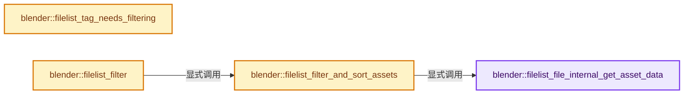
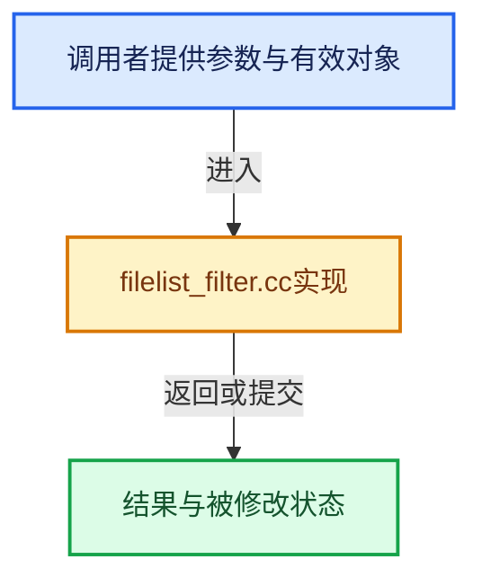

# 实现依赖专题：source/blender/editors/space_file/filelist/filelist_filter.cc

[实现依赖导航](../../../../README.md) · [符号索引](../../../../../00-课程指南/02-源码与提交索引/符号依赖与实现索引.md)

本专题从正文实际调用进入，集中保存共享实现。函数有稳定锚点，可从调用处直接跳到对应完整函数；递归与互相调用通过回链组织。

## 本文件的实现关系






## 完整成员与函数实现

<a id="f-82e50b1babfedd74"></a>

### `blender::filelist_file_internal_get_asset_data`

实现位置：[source/blender/editors/space_file/filelist/filelist_filter.cc](../../../../../../../../../source/blender/editors/space_file/filelist/filelist_filter.cc) · L159—L165。

接口参数：

- `const FileListInternEntry *file`

**教学注释版**

<!-- annotated:8037e38102d3bb -->

```cpp
static AssetMetaData *filelist_file_internal_get_asset_data(const FileListInternEntry *file)
{
  if (asset_system::AssetRepresentation *asset = file->get_asset()) {
    return &asset->get_metadata();
  }
  return nullptr;
}
```

<details>
<summary>核对原始源码：source/blender/editors/space_file/filelist/filelist_filter.cc · L159—L165</summary>

<!-- original:8037e38102d3bb:source/blender/editors/space_file/filelist/filelist_filter.cc:159:165 -->

```cpp
static AssetMetaData *filelist_file_internal_get_asset_data(const FileListInternEntry *file)
{
  if (asset_system::AssetRepresentation *asset = file->get_asset()) {
    return &asset->get_metadata();
  }
  return nullptr;
}
```

</details>

**结果出口**

- `return &asset->get_metadata();`
- `return nullptr;`

**继续追踪实现**

- `file->get_asset` → [blender::FileListInternEntry::get_asset · L98](filelist_intern.hh.md#f-dc9b7c618de7c189)。
- `asset->get_metadata` → [blender::asset_system::AssetRepresentation::get_metadata · L150](../../../asset_system/intern/asset_representation.cc.md#f-4b8fbe5b18300046)。

<a id="f-f74de92cdfddabd8"></a>

### `blender::filelist_tag_needs_filtering`

实现位置：[source/blender/editors/space_file/filelist/filelist_filter.cc](../../../../../../../../../source/blender/editors/space_file/filelist/filelist_filter.cc) · L241—L244。

接口参数：

- `FileList *filelist`

**教学注释版**

<!-- annotated:ad02ccbb0e4125 -->

```cpp
void filelist_tag_needs_filtering(FileList *filelist)
{
  filelist->flags |= FL_NEED_FILTERING;
}
```

<details>
<summary>核对原始源码：source/blender/editors/space_file/filelist/filelist_filter.cc · L241—L244</summary>

<!-- original:ad02ccbb0e4125:source/blender/editors/space_file/filelist/filelist_filter.cc:241:244 -->

```cpp
void filelist_tag_needs_filtering(FileList *filelist)
{
  filelist->flags |= FL_NEED_FILTERING;
}
```

</details>

**沿实际写入检查状态**

- `filelist->flags |= FL_NEED_FILTERING;`

**继续追踪实现**

本实现没有需要继续展开的显式调用；检查返回表达式、对象转换和调用者前置条件。

<a id="f-39b1736d240b3a38"></a>

### `blender::filelist_filter_and_sort_assets`

实现位置：[source/blender/editors/space_file/filelist/filelist_filter.cc](../../../../../../../../../source/blender/editors/space_file/filelist/filelist_filter.cc) · L251—L310。

接口参数：

- `FileList *filelist`
- `FileListInternEntry **entries_to_filter`
- `int entries_num`

**教学注释版**

<!-- annotated:08388117a51183 -->

```cpp
static void filelist_filter_and_sort_assets(FileList *filelist,
                                            FileListInternEntry **entries_to_filter,
                                            int entries_num)
{
  const FileListFilter &filter = filelist->filter_data;
  if (filter.filter_search[0] == '\0') {
    /* No search text, just copy over the pre-filtered list. */
    if (filelist->filelist_intern.filtered) {
      MEM_delete(filelist->filelist_intern.filtered);
    }
    filelist->filelist_intern.filtered = static_cast<FileListInternEntry **>(MEM_new_uninitialized(
        sizeof(*filelist->filelist_intern.filtered) * size_t(entries_num), __func__));
    // [讲解] memcpy：复制字节，源与目标不应重叠。类型生命周期、对齐和可复制表示须由调用者证明，不是任意对象的复制构造。
    memcpy(filelist->filelist_intern.filtered,
           entries_to_filter,
           sizeof(*filelist->filelist_intern.filtered) * size_t(entries_num));
    filelist->filelist.entries_filtered_num = entries_num;
    return;
  }

  /* `filter->filter_search` contains "*the search text*". */
  char filter_search_buf[sizeof(FileListFilter::filter_search)];
  const size_t string_length = STRNCPY_RLEN(filter_search_buf, filter.filter_search);

  /* When doing a name comparison, get rid of the leading/trailing asterisks. */
  filter_search_buf[string_length - 1] = '\0';
  const char *search_str = filter_search_buf + 1;

  string_search::StringSearch<FileListInternEntry> search(nullptr,
                                                          string_search::MainWordsHeuristic::All);

  for (int i = 0; i < entries_num; i++) {
    FileListInternEntry *file = entries_to_filter[i];
    const AssetMetaData *asset_data = filelist_file_internal_get_asset_data(file);
    if (asset_data) {
      std::string searchable_string = file->name;
      for (const AssetTag &asset_tag : asset_data->tags) {
        searchable_string += " ";
        searchable_string += asset_tag.name;
      }
      search.add(searchable_string, file);
    }
    else {
      search.add(file->name, file);
    }
  }

  const Vector<FileListInternEntry *> results = search.query(search_str);

  if (filelist->filelist_intern.filtered) {
    MEM_delete(filelist->filelist_intern.filtered);
  }

  // [讲解] results.size：用end_减begin_得到活元素数量。
  const int num_filtered = results.size();
  filelist->filelist_intern.filtered = static_cast<FileListInternEntry **>(MEM_new_uninitialized(
      sizeof(*filelist->filelist_intern.filtered) * size_t(num_filtered), __func__));
  for (int i = 0; i < num_filtered; i++) {
    filelist->filelist_intern.filtered[i] = results[i];
  }
  filelist->filelist.entries_filtered_num = num_filtered;
}
```

<details>
<summary>核对原始源码：source/blender/editors/space_file/filelist/filelist_filter.cc · L251—L310</summary>

<!-- original:08388117a51183:source/blender/editors/space_file/filelist/filelist_filter.cc:251:310 -->

```cpp
static void filelist_filter_and_sort_assets(FileList *filelist,
                                            FileListInternEntry **entries_to_filter,
                                            int entries_num)
{
  const FileListFilter &filter = filelist->filter_data;
  if (filter.filter_search[0] == '\0') {
    /* No search text, just copy over the pre-filtered list. */
    if (filelist->filelist_intern.filtered) {
      MEM_delete(filelist->filelist_intern.filtered);
    }
    filelist->filelist_intern.filtered = static_cast<FileListInternEntry **>(MEM_new_uninitialized(
        sizeof(*filelist->filelist_intern.filtered) * size_t(entries_num), __func__));
    memcpy(filelist->filelist_intern.filtered,
           entries_to_filter,
           sizeof(*filelist->filelist_intern.filtered) * size_t(entries_num));
    filelist->filelist.entries_filtered_num = entries_num;
    return;
  }

  /* `filter->filter_search` contains "*the search text*". */
  char filter_search_buf[sizeof(FileListFilter::filter_search)];
  const size_t string_length = STRNCPY_RLEN(filter_search_buf, filter.filter_search);

  /* When doing a name comparison, get rid of the leading/trailing asterisks. */
  filter_search_buf[string_length - 1] = '\0';
  const char *search_str = filter_search_buf + 1;

  string_search::StringSearch<FileListInternEntry> search(nullptr,
                                                          string_search::MainWordsHeuristic::All);

  for (int i = 0; i < entries_num; i++) {
    FileListInternEntry *file = entries_to_filter[i];
    const AssetMetaData *asset_data = filelist_file_internal_get_asset_data(file);
    if (asset_data) {
      std::string searchable_string = file->name;
      for (const AssetTag &asset_tag : asset_data->tags) {
        searchable_string += " ";
        searchable_string += asset_tag.name;
      }
      search.add(searchable_string, file);
    }
    else {
      search.add(file->name, file);
    }
  }

  const Vector<FileListInternEntry *> results = search.query(search_str);

  if (filelist->filelist_intern.filtered) {
    MEM_delete(filelist->filelist_intern.filtered);
  }

  const int num_filtered = results.size();
  filelist->filelist_intern.filtered = static_cast<FileListInternEntry **>(MEM_new_uninitialized(
      sizeof(*filelist->filelist_intern.filtered) * size_t(num_filtered), __func__));
  for (int i = 0; i < num_filtered; i++) {
    filelist->filelist_intern.filtered[i] = results[i];
  }
  filelist->filelist.entries_filtered_num = num_filtered;
}
```

</details>

**沿实际写入检查状态**

- `filelist->filelist_intern.filtered = static_cast<FileListInternEntry **>(MEM_new_uninitialized(`
- `filelist->filelist.entries_filtered_num = entries_num;`
- `searchable_string += " ";`
- `searchable_string += asset_tag.name;`
- `filelist->filelist_intern.filtered[i] = results[i];`
- `filelist->filelist.entries_filtered_num = num_filtered;`

**继续追踪实现**

- `MEM_delete` → [MEM_delete · L400](../../../../07-Intern运行时与平台/guardedalloc/MEM_guardedalloc.h.md#f-9049ffdd1682887c)。
- `MEM_new_uninitialized` → [MEM_new_uninitialized · L590](../../../../07-Intern运行时与平台/guardedalloc/MEM_guardedalloc.h.md#f-c773b2e5b8fe70e4)；[MEM_new_uninitialized · L124](../../../../07-Intern运行时与平台/guardedalloc/intern/mallocn.cc.md#f-28a7e00a1e67f699)。同名重载需按实参类型选择。
- `memcpy` → [外部契约](https://eel.is/c++draft/cstring.syn)：复制字节，源与目标不应重叠。类型生命周期、对齐和可复制表示须由调用者证明，不是任意对象的复制构造。
- `STRNCPY_RLEN` → [STRNCPY_RLEN · L600](../../../../01-BLI基础库/BLI_string.hh.md#m-81329fe9f9ee)。宏定义由构建条件选择。
- `filelist_file_internal_get_asset_data` → [blender::filelist_file_internal_get_asset_data · L159](filelist_filter.cc.md#f-82e50b1babfedd74)。
- `search.add` → [blender::string_search::StringSearch::add · L104](../../../../01-BLI基础库/BLI_string_search.hh.md#f-a2bbb2225e838611)。
- `search.query` → [blender::string_search::StringSearch::query · L113](../../../../01-BLI基础库/BLI_string_search.hh.md#f-b4f03185a23db961)。
- `results.size` → [blender::Vector::size · L780](../../../../../01-基础容器与现代CPP/11-Vector插入删除与重排.md#f-714773731767349c)。

<a id="f-d42e97017104b9c1"></a>

### `blender::filelist_filter`

实现位置：[source/blender/editors/space_file/filelist/filelist_filter.cc](../../../../../../../../../source/blender/editors/space_file/filelist/filelist_filter.cc) · L312—L375。

接口参数：

- `FileList *filelist`

**教学注释版**

<!-- annotated:5d9add414b538e -->

```cpp
void filelist_filter(FileList *filelist)
{
  int num_filtered = 0;
  const int num_files = filelist->filelist.entries_num;
  FileListInternEntry **filtered_tmp;

  if (ELEM(filelist->filelist.entries_num, FILEDIR_NBR_ENTRIES_UNSET, 0)) {
    return;
  }

  if (!(filelist->flags & FL_NEED_FILTERING)) {
    /* Assume it has already been filtered, nothing else to do! */
    return;
  }

  if (filelist->flags & FL_NEED_RESET_GLOB) {
    filelist_reset_glob(filelist);
  }

  filelist->filter_data.flags &= ~FLF_HIDE_LIB_DIR;
  if (filelist->max_recursion) {
    /* Never show lib ID 'categories' directories when we are in 'flat' mode, unless
     * root path is a blend file. */
    char dir[FILE_MAX_LIBEXTRA];
    if (!filelist_islibrary(filelist, dir, nullptr)) {
      filelist->filter_data.flags |= FLF_HIDE_LIB_DIR;
    }
  }

  if (filelist->prepare_filter_fn) {
    filelist->prepare_filter_fn(filelist, &filelist->filter_data);
  }

  filtered_tmp = MEM_new_array_uninitialized<FileListInternEntry *>(num_files, __func__);

  /* Filter remap & count how many files are left after filter in a single loop. */
  for (FileListInternEntry &file : filelist->filelist_intern.entries) {
    if (filelist->filter_fn(&file, filelist->filelist.root, &filelist->filter_data)) {
      filtered_tmp[num_filtered++] = &file;
    }
  }

  if (filelist->tags & FILELIST_TAGS_APPLY_FUZZY_SEARCH) {
    filelist_filter_and_sort_assets(filelist, filtered_tmp, num_filtered);
  }
  else {
    if (filelist->filelist_intern.filtered) {
      MEM_delete(filelist->filelist_intern.filtered);
    }
    filelist->filelist_intern.filtered = MEM_new_array_uninitialized<FileListInternEntry *>(
        num_filtered, __func__);
    // [讲解] memcpy：复制字节，源与目标不应重叠。类型生命周期、对齐和可复制表示须由调用者证明，不是任意对象的复制构造。
    memcpy(filelist->filelist_intern.filtered,
           filtered_tmp,
           sizeof(*filelist->filelist_intern.filtered) * size_t(num_filtered));
    filelist->filelist.entries_filtered_num = num_filtered;
  }

  //  printf("Filtered: %d over %d entries\n", num_filtered, filelist->filelist.entries_num);

  filelist_cache_clear(filelist->filelist_cache, filelist->filelist_cache->size);
  filelist->flags &= ~FL_NEED_FILTERING;

  MEM_delete(filtered_tmp);
}
```

<details>
<summary>核对原始源码：source/blender/editors/space_file/filelist/filelist_filter.cc · L312—L375</summary>

<!-- original:5d9add414b538e:source/blender/editors/space_file/filelist/filelist_filter.cc:312:375 -->

```cpp
void filelist_filter(FileList *filelist)
{
  int num_filtered = 0;
  const int num_files = filelist->filelist.entries_num;
  FileListInternEntry **filtered_tmp;

  if (ELEM(filelist->filelist.entries_num, FILEDIR_NBR_ENTRIES_UNSET, 0)) {
    return;
  }

  if (!(filelist->flags & FL_NEED_FILTERING)) {
    /* Assume it has already been filtered, nothing else to do! */
    return;
  }

  if (filelist->flags & FL_NEED_RESET_GLOB) {
    filelist_reset_glob(filelist);
  }

  filelist->filter_data.flags &= ~FLF_HIDE_LIB_DIR;
  if (filelist->max_recursion) {
    /* Never show lib ID 'categories' directories when we are in 'flat' mode, unless
     * root path is a blend file. */
    char dir[FILE_MAX_LIBEXTRA];
    if (!filelist_islibrary(filelist, dir, nullptr)) {
      filelist->filter_data.flags |= FLF_HIDE_LIB_DIR;
    }
  }

  if (filelist->prepare_filter_fn) {
    filelist->prepare_filter_fn(filelist, &filelist->filter_data);
  }

  filtered_tmp = MEM_new_array_uninitialized<FileListInternEntry *>(num_files, __func__);

  /* Filter remap & count how many files are left after filter in a single loop. */
  for (FileListInternEntry &file : filelist->filelist_intern.entries) {
    if (filelist->filter_fn(&file, filelist->filelist.root, &filelist->filter_data)) {
      filtered_tmp[num_filtered++] = &file;
    }
  }

  if (filelist->tags & FILELIST_TAGS_APPLY_FUZZY_SEARCH) {
    filelist_filter_and_sort_assets(filelist, filtered_tmp, num_filtered);
  }
  else {
    if (filelist->filelist_intern.filtered) {
      MEM_delete(filelist->filelist_intern.filtered);
    }
    filelist->filelist_intern.filtered = MEM_new_array_uninitialized<FileListInternEntry *>(
        num_filtered, __func__);
    memcpy(filelist->filelist_intern.filtered,
           filtered_tmp,
           sizeof(*filelist->filelist_intern.filtered) * size_t(num_filtered));
    filelist->filelist.entries_filtered_num = num_filtered;
  }

  //  printf("Filtered: %d over %d entries\n", num_filtered, filelist->filelist.entries_num);

  filelist_cache_clear(filelist->filelist_cache, filelist->filelist_cache->size);
  filelist->flags &= ~FL_NEED_FILTERING;

  MEM_delete(filtered_tmp);
}
```

</details>

**沿实际写入检查状态**

- `filelist->filter_data.flags &= ~FLF_HIDE_LIB_DIR;`
- `filelist->filter_data.flags |= FLF_HIDE_LIB_DIR;`
- `filtered_tmp = MEM_new_array_uninitialized<FileListInternEntry *>(num_files, __func__);`
- `filelist->filelist_intern.filtered = MEM_new_array_uninitialized<FileListInternEntry *>(`
- `filelist->filelist.entries_filtered_num = num_filtered;`
- `filelist->flags &= ~FL_NEED_FILTERING;`

**继续追踪实现**

- `ELEM` → [ELEM · L88](../../../../07-Intern运行时与平台/ghost/intern/GHOST_utildefines.hh.md#m-d28724a15928)；[ELEM · L135](../../../../01-BLI基础库/BLI_utildefines.hh.md#m-d6572de7cae0)。宏定义由构建条件选择。
- `filelist_reset_glob` → [blender::filelist_reset_glob · L1176](filelist.cc.md#f-f463116e8b88e4a7)。
- `filelist_islibrary` → [blender::filelist_islibrary · L2120](filelist.cc.md#f-503b3d8cf728197d)。
- `filelist->prepare_filter_fn` → [调用协议](../../../../../00-课程指南/01-路线与规范/模板宏与动态分派协议.md)：由接收对象具体类型或运行时策略提供实现。调用位置L342。
- `MEM_new_array_uninitialized<FileListInternEntry *>` → [MEM_new_array_uninitialized · L608](../../../../07-Intern运行时与平台/guardedalloc/MEM_guardedalloc.h.md#f-b7103eae8eb57b05)；[MEM_new_array_uninitialized · L129](../../../../07-Intern运行时与平台/guardedalloc/intern/mallocn.cc.md#f-bf6ef4ddcfb6e5df)。同名重载需按实参类型选择。
- `filelist->filter_fn` → [调用协议](../../../../../00-课程指南/01-路线与规范/模板宏与动态分派协议.md)：由接收对象具体类型或运行时策略提供实现。调用位置L349。
- `filelist_filter_and_sort_assets` → [blender::filelist_filter_and_sort_assets · L251](filelist_filter.cc.md#f-39b1736d240b3a38)。
- `MEM_delete` → [MEM_delete · L400](../../../../07-Intern运行时与平台/guardedalloc/MEM_guardedalloc.h.md#f-9049ffdd1682887c)。
- `memcpy` → [外部契约](https://eel.is/c++draft/cstring.syn)：复制字节，源与目标不应重叠。类型生命周期、对齐和可复制表示须由调用者证明，不是任意对象的复制构造。
- `filelist_cache_clear` → [blender::filelist_cache_clear · L846](filelist.cc.md#f-71aa87c0c8ec8f3d)。
