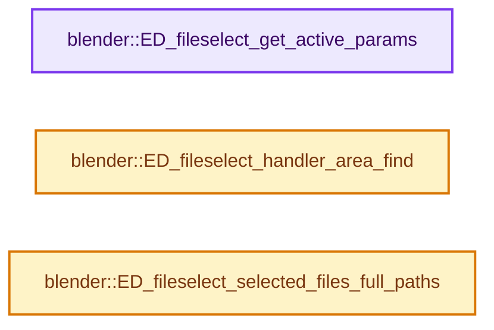
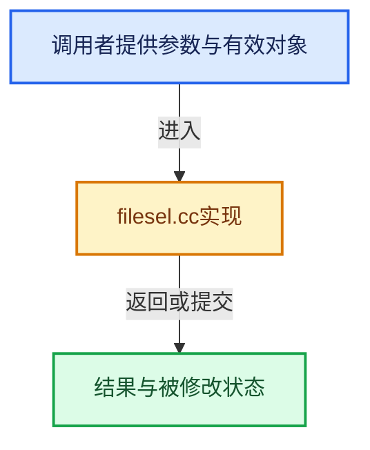

# 实现依赖专题：source/blender/editors/space_file/filesel.cc

[实现依赖导航](../../../README.md) · [符号索引](../../../../00-课程指南/02-源码与提交索引/符号依赖与实现索引.md)

本专题从正文实际调用进入，集中保存共享实现。函数有稳定锚点，可从调用处直接跳到对应完整函数；递归与互相调用通过回链组织。

## 本文件的实现关系






## 完整成员与函数实现

<a id="f-9217c2f34d65ea86"></a>

### `blender::ED_fileselect_get_active_params`

实现位置：[source/blender/editors/space_file/filesel.cc](../../../../../../../../source/blender/editors/space_file/filesel.cc) · L392—L408。

接口参数：

- `const SpaceFile *sfile`

**教学注释版**

<!-- annotated:274d3736cc159d -->

```cpp
FileSelectParams *ED_fileselect_get_active_params(const SpaceFile *sfile)
{
  if (!sfile) {
    /* Sometimes called in poll before space type was checked. */
    return nullptr;
  }

  switch (eFileBrowse_Mode(sfile->browse_mode)) {
    case FILE_BROWSE_MODE_FILES:
      return sfile->params;
    case FILE_BROWSE_MODE_ASSETS:
      return reinterpret_cast<FileSelectParams *>(sfile->asset_params);
  }

  BLI_assert_msg(0, "Invalid browse mode set in file space.");
  return nullptr;
}
```

<details>
<summary>核对原始源码：source/blender/editors/space_file/filesel.cc · L392—L408</summary>

<!-- original:274d3736cc159d:source/blender/editors/space_file/filesel.cc:392:408 -->

```cpp
FileSelectParams *ED_fileselect_get_active_params(const SpaceFile *sfile)
{
  if (!sfile) {
    /* Sometimes called in poll before space type was checked. */
    return nullptr;
  }

  switch (eFileBrowse_Mode(sfile->browse_mode)) {
    case FILE_BROWSE_MODE_FILES:
      return sfile->params;
    case FILE_BROWSE_MODE_ASSETS:
      return reinterpret_cast<FileSelectParams *>(sfile->asset_params);
  }

  BLI_assert_msg(0, "Invalid browse mode set in file space.");
  return nullptr;
}
```

</details>

**结果出口**

- `return nullptr;`
- `return sfile->params;`
- `return reinterpret_cast<FileSelectParams *>(sfile->asset_params);`

**继续追踪实现**

- `eFileBrowse_Mode` → [blender::eFileBrowse_Mode](../../makesdna/DNA_space_enums.h.md#t-646d2f640782)。
- `BLI_assert_msg` → [BLI_assert_msg · L55](../../../01-BLI基础库/BLI_assert.hh.md#m-695eed20dceb)；[BLI_assert_msg · L64](../../../01-BLI基础库/BLI_assert.hh.md#m-7de5563de4db)。宏定义由构建条件选择。

<a id="f-918bfd797ef25cd9"></a>

### `blender::ED_fileselect_handler_area_find`

实现位置：[source/blender/editors/space_file/filesel.cc](../../../../../../../../source/blender/editors/space_file/filesel.cc) · L1472—L1487。

接口参数：

- `const wmWindow *win`
- `const wmOperator *file_operator`

**教学注释版**

<!-- annotated:402bd6f0643185 -->

```cpp
ScrArea *ED_fileselect_handler_area_find(const wmWindow *win, const wmOperator *file_operator)
{
  bScreen *screen = WM_window_get_active_screen(win);

  ED_screen_areas_iter (win, screen, area) {
    if (area->spacetype == SPACE_FILE) {
      SpaceFile *sfile = area->spacedata.first_as<SpaceFile>();

      if (sfile->op == file_operator) {
        return area;
      }
    }
  }

  return nullptr;
}
```

<details>
<summary>核对原始源码：source/blender/editors/space_file/filesel.cc · L1472—L1487</summary>

<!-- original:402bd6f0643185:source/blender/editors/space_file/filesel.cc:1472:1487 -->

```cpp
ScrArea *ED_fileselect_handler_area_find(const wmWindow *win, const wmOperator *file_operator)
{
  bScreen *screen = WM_window_get_active_screen(win);

  ED_screen_areas_iter (win, screen, area) {
    if (area->spacetype == SPACE_FILE) {
      SpaceFile *sfile = area->spacedata.first_as<SpaceFile>();

      if (sfile->op == file_operator) {
        return area;
      }
    }
  }

  return nullptr;
}
```

</details>

**结果出口**

- `return area;`
- `return nullptr;`

**继续追踪实现**

- `WM_window_get_active_screen` → [blender::WM_window_get_active_screen · L3442](../../windowmanager/intern/wm_window.cc.md#f-54952b6e38dc8344)。
- `area->spacedata.first_as<SpaceFile>` → [调用协议](../../../../00-课程指南/01-路线与规范/模板宏与动态分派协议.md)：接收对象类型依赖auto、返回值或模板实例；不按同名猜测目标。调用位置L1478。

<a id="f-c61dc3125dacc7aa"></a>

### `blender::ED_fileselect_selected_files_full_paths`

实现位置：[source/blender/editors/space_file/filesel.cc](../../../../../../../../source/blender/editors/space_file/filesel.cc) · L1526—L1538。

接口参数：

- `const SpaceFile *sfile`

**教学注释版**

<!-- annotated:609a50fdeed104 -->

```cpp
Vector<std::string> ED_fileselect_selected_files_full_paths(const SpaceFile *sfile)
{
  Vector<std::string> paths;
  char path[FILE_MAX_LIBEXTRA];
  for (const int i : IndexRange(filelist_files_ensure(sfile->files))) {
    if (filelist_entry_is_selected(sfile->files, i)) {
      const FileDirEntry *entry = filelist_file(sfile->files, i);
      filelist_file_get_full_path(sfile->files, entry, path);
      // [讲解] paths.append：在尾部建立新元素，必要时先扩大存储。
      paths.append(path);
    }
  }
  return paths;
}
```

<details>
<summary>核对原始源码：source/blender/editors/space_file/filesel.cc · L1526—L1538</summary>

<!-- original:609a50fdeed104:source/blender/editors/space_file/filesel.cc:1526:1538 -->

```cpp
Vector<std::string> ED_fileselect_selected_files_full_paths(const SpaceFile *sfile)
{
  Vector<std::string> paths;
  char path[FILE_MAX_LIBEXTRA];
  for (const int i : IndexRange(filelist_files_ensure(sfile->files))) {
    if (filelist_entry_is_selected(sfile->files, i)) {
      const FileDirEntry *entry = filelist_file(sfile->files, i);
      filelist_file_get_full_path(sfile->files, entry, path);
      paths.append(path);
    }
  }
  return paths;
}
```

</details>

**结果出口**

- `return paths;`

**继续追踪实现**

- `IndexRange` → [blender::IndexRange](../../../01-BLI基础库/BLI_index_range.hh.md#t-caa3466d6776)；[blender::gpu::shader::parser::IndexRange](../../gpu/shader_tool/utils.hh.md#t-82d2bd4ea71c)；[blender::IndexRange](../../makesdna/DNA_node_types.h.md#t-0448cc889d39)。
- `filelist_files_ensure` → [blender::filelist_files_ensure · L1235](filelist/filelist.cc.md#f-ad613cec2ca6b7d4)。
- `filelist_entry_is_selected` → [blender::filelist_entry_is_selected · L2097](filelist/filelist.cc.md#f-92f107907e1665de)。
- `filelist_file` → [blender::filelist_file · L1349](filelist/filelist.cc.md#f-c3d979d39b65aa7d)。
- `filelist_file_get_full_path` → [blender::filelist_file_get_full_path · L247](filelist/filelist.cc.md#f-ce95e03bd044641b)。
- `paths.append` → [blender::Vector::append · L498](../../../../01-基础容器与现代CPP/11-Vector插入删除与重排.md#f-5bde268a69e443ec)；[blender::Vector::append · L502](../../../../01-基础容器与现代CPP/11-Vector插入删除与重排.md#f-591e0b15e6308532)。同名重载需按实参类型选择。
