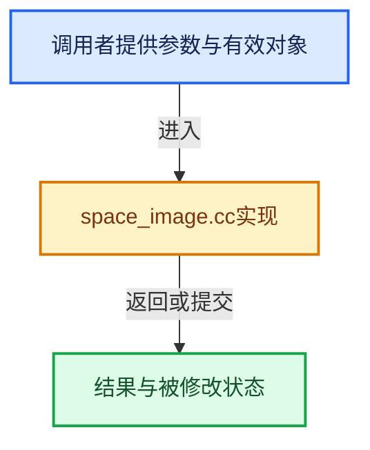

# 实现依赖专题：source/blender/editors/space_image/space_image.cc

[实现依赖导航](../../../README.md) · [符号索引](../../../../00-课程指南/02-源码与提交索引/符号依赖与实现索引.md)

本专题从正文实际调用进入，集中保存共享实现。函数有稳定锚点，可从调用处直接跳到对应完整函数；递归与互相调用通过回链组织。

## 本文件的实现关系





## 完整成员与函数实现

<a id="f-1748a1a548c795cd"></a>

### `blender::ED_image_buttons_contexts`

实现位置：[source/blender/editors/space_image/space_image.cc](../../../../../../../../source/blender/editors/space_image/space_image.cc) · L992—L1015。

接口参数：

- `const bContext *C`

**教学注释版**

<!-- annotated:d5c14b768caadb -->

```cpp
std::array<const char *, 4> ED_image_buttons_contexts(const bContext *C)
{
  const enum eContextObjectMode mode = CTX_data_mode_enum(C);
  std::array<const char *, 4> contexts_base = {nullptr};

  const char **contexts = contexts_base.data();

  SpaceImage *sima = CTX_wm_space_image(C);
  switch (sima->mode) {
    case SI_MODE_VIEW:
      break;
    case SI_MODE_PAINT:
      ARRAY_SET_ITEMS(contexts, ".paint_common_2d", ".imagepaint_2d");
      break;
    case SI_MODE_MASK:
      break;
    case SI_MODE_UV:
      if (mode == CTX_MODE_EDIT_MESH) {
        ARRAY_SET_ITEMS(contexts, ".uv_sculpt");
      }
      break;
  }
  return contexts_base;
}
```

<details>
<summary>核对原始源码：source/blender/editors/space_image/space_image.cc · L992—L1015</summary>

<!-- original:d5c14b768caadb:source/blender/editors/space_image/space_image.cc:992:1015 -->

```cpp
std::array<const char *, 4> ED_image_buttons_contexts(const bContext *C)
{
  const enum eContextObjectMode mode = CTX_data_mode_enum(C);
  std::array<const char *, 4> contexts_base = {nullptr};

  const char **contexts = contexts_base.data();

  SpaceImage *sima = CTX_wm_space_image(C);
  switch (sima->mode) {
    case SI_MODE_VIEW:
      break;
    case SI_MODE_PAINT:
      ARRAY_SET_ITEMS(contexts, ".paint_common_2d", ".imagepaint_2d");
      break;
    case SI_MODE_MASK:
      break;
    case SI_MODE_UV:
      if (mode == CTX_MODE_EDIT_MESH) {
        ARRAY_SET_ITEMS(contexts, ".uv_sculpt");
      }
      break;
  }
  return contexts_base;
}
```

</details>

**结果出口**

- `return contexts_base;`

**继续追踪实现**

- `CTX_data_mode_enum` → [blender::CTX_data_mode_enum · L1495](../../../02-BKE几何与数据/intern/context.cc.md#f-b33bca83bf05ef47)。
- `contexts_base.data` → [外部契约](https://eel.is/c++draft/)：这个边界按实际表达式及所属类型核对参数、返回值、寿命与失败行为。这里提供接口入口，不声称已解释该第三方版本的内部实现。
- `CTX_wm_space_image` → [blender::CTX_wm_space_image · L1040](../../../02-BKE几何与数据/intern/context.cc.md#f-298ffbf670ec655c)。
- `ARRAY_SET_ITEMS` → [ARRAY_SET_ITEMS · L304](../../../01-BLI基础库/BLI_utildefines.hh.md#m-80336b50a95e)。宏定义由构建条件选择。
