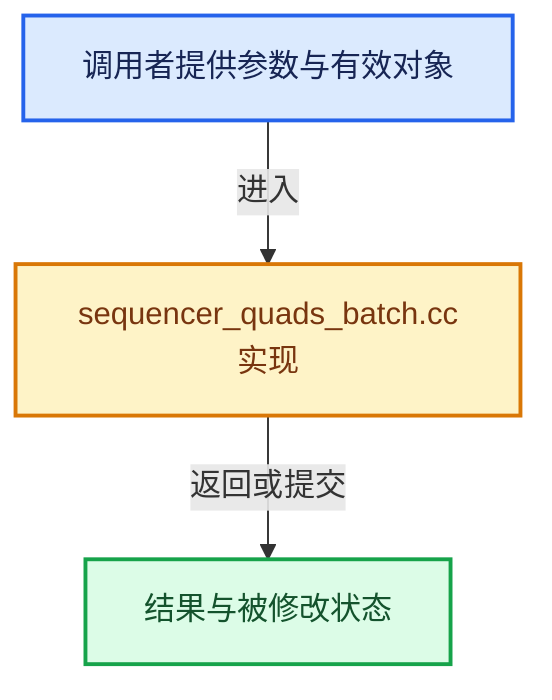

# 实现依赖专题：source/blender/editors/space_sequencer/sequencer_quads_batch.cc

[实现依赖导航](../../../README.md) · [符号索引](../../../../00-课程指南/02-源码与提交索引/符号依赖与实现索引.md)

本专题从正文实际调用进入，集中保存共享实现。函数有稳定锚点，可从调用处直接跳到对应完整函数；递归与互相调用通过回链组织。

## 本文件的实现关系





## 完整成员与函数实现

<a id="f-0009e5a5ac3c4c0c"></a>

### `blender::ed::vse::SeqQuadsBatch::draw`

实现位置：[source/blender/editors/space_sequencer/sequencer_quads_batch.cc](../../../../../../../../source/blender/editors/space_sequencer/sequencer_quads_batch.cc) · L72—L88。

**教学注释版**

<!-- annotated:b09f8ac35b7df7 -->

```cpp
void SeqQuadsBatch::draw()
{
  if (quads_num > 0) {
    GPU_vertbuf_tag_dirty(vbo_quads);
    GPU_vertbuf_use(vbo_quads);
    GPU_batch_draw_range(batch_quads, 0, quads_num * 6);
    quads_num = 0;
    verts_quads = nullptr;
  }
  if (lines_num > 0) {
    GPU_vertbuf_tag_dirty(vbo_lines);
    GPU_vertbuf_use(vbo_lines);
    GPU_batch_draw_range(batch_lines, 0, lines_num * 2);
    lines_num = 0;
    verts_lines = nullptr;
  }
}
```

<details>
<summary>核对原始源码：source/blender/editors/space_sequencer/sequencer_quads_batch.cc · L72—L88</summary>

<!-- original:b09f8ac35b7df7:source/blender/editors/space_sequencer/sequencer_quads_batch.cc:72:88 -->

```cpp
void SeqQuadsBatch::draw()
{
  if (quads_num > 0) {
    GPU_vertbuf_tag_dirty(vbo_quads);
    GPU_vertbuf_use(vbo_quads);
    GPU_batch_draw_range(batch_quads, 0, quads_num * 6);
    quads_num = 0;
    verts_quads = nullptr;
  }
  if (lines_num > 0) {
    GPU_vertbuf_tag_dirty(vbo_lines);
    GPU_vertbuf_use(vbo_lines);
    GPU_batch_draw_range(batch_lines, 0, lines_num * 2);
    lines_num = 0;
    verts_lines = nullptr;
  }
}
```

</details>

**沿实际写入检查状态**

- `quads_num = 0;`
- `verts_quads = nullptr;`
- `lines_num = 0;`
- `verts_lines = nullptr;`

**继续追踪实现**

- `GPU_vertbuf_tag_dirty` → [blender::GPU_vertbuf_tag_dirty · L285](../../gpu/intern/gpu_vertex_buffer.cc.md#f-9fdbfbaeef33be26)。
- `GPU_vertbuf_use` → [blender::GPU_vertbuf_use · L295](../../gpu/intern/gpu_vertex_buffer.cc.md#f-f2ce61da8df3615a)。
- `GPU_batch_draw_range` → [blender::GPU_batch_draw_range · L404](../../gpu/intern/gpu_batch.cc.md#f-edb47c5804c26da5)。

<a id="f-5a9e67bc5ed846f0"></a>

### `blender::ed::vse::SeqQuadsBatch::add_quad`

实现位置：[source/blender/editors/space_sequencer/sequencer_quads_batch.cc](../../../../../../../../source/blender/editors/space_sequencer/sequencer_quads_batch.cc) · L90—L122。

接口参数：

- `float x1`
- `float y1`
- `float x2`
- `float y2`
- `float x3`
- `float y3`
- `float x4`
- `float y4`
- `const uchar color1[4]`
- `const uchar color2[4]`
- `const uchar color3[4]`
- `const uchar color4[4]`

**教学注释版**

<!-- annotated:152b9725351bf9 -->

```cpp
void SeqQuadsBatch::add_quad(float x1,
                             float y1,
                             float x2,
                             float y2,
                             float x3,
                             float y3,
                             float x4,
                             float y4,
                             const uchar color1[4],
                             const uchar color2[4],
                             const uchar color3[4],
                             const uchar color4[4])
{
  if (quads_num >= MAX_QUADS) {
    draw();
  }
  if (quads_num == 0) {
    verts_quads = vbo_quads->data<ColorVertex>().data();
    BLI_assert(verts_quads != nullptr);
  }

  ColorVertex v0 = {float2(x1, y1), color1};
  ColorVertex v1 = {float2(x2, y2), color2};
  ColorVertex v2 = {float2(x3, y3), color3};
  ColorVertex v3 = {float2(x4, y4), color4};

  *verts_quads++ = v0;
  *verts_quads++ = v1;
  *verts_quads++ = v2;
  *verts_quads++ = v3;

  quads_num++;
}
```

<details>
<summary>核对原始源码：source/blender/editors/space_sequencer/sequencer_quads_batch.cc · L90—L122</summary>

<!-- original:152b9725351bf9:source/blender/editors/space_sequencer/sequencer_quads_batch.cc:90:122 -->

```cpp
void SeqQuadsBatch::add_quad(float x1,
                             float y1,
                             float x2,
                             float y2,
                             float x3,
                             float y3,
                             float x4,
                             float y4,
                             const uchar color1[4],
                             const uchar color2[4],
                             const uchar color3[4],
                             const uchar color4[4])
{
  if (quads_num >= MAX_QUADS) {
    draw();
  }
  if (quads_num == 0) {
    verts_quads = vbo_quads->data<ColorVertex>().data();
    BLI_assert(verts_quads != nullptr);
  }

  ColorVertex v0 = {float2(x1, y1), color1};
  ColorVertex v1 = {float2(x2, y2), color2};
  ColorVertex v2 = {float2(x3, y3), color3};
  ColorVertex v3 = {float2(x4, y4), color4};

  *verts_quads++ = v0;
  *verts_quads++ = v1;
  *verts_quads++ = v2;
  *verts_quads++ = v3;

  quads_num++;
}
```

</details>

**沿实际写入检查状态**

- `verts_quads = vbo_quads->data<ColorVertex>().data();`

**继续追踪实现**

- `draw` → [blender::ed::vse::SeqQuadsBatch::draw · L72](sequencer_quads_batch.cc.md#f-0009e5a5ac3c4c0c)。
- `vbo_quads->data<ColorVertex>().data` → [调用协议](../../../../00-课程指南/01-路线与规范/模板宏与动态分派协议.md)：接收对象类型依赖auto、返回值或模板实例；不按同名猜测目标。调用位置L107。
- `vbo_quads->data<ColorVertex>` → [调用协议](../../../../00-课程指南/01-路线与规范/模板宏与动态分派协议.md)：接收对象类型依赖auto、返回值或模板实例；不按同名猜测目标。调用位置L107。
- `BLI_assert` → [BLI_assert · L48](../../../01-BLI基础库/BLI_assert.hh.md#m-57a88495704d)；[BLI_assert · L63](../../../01-BLI基础库/BLI_assert.hh.md#m-d07050020cb5)。宏定义由构建条件选择。
- `float2` → [float2::float2 · L45](../../../07-Intern运行时与平台/sky/source/sky_math.h.md#f-04c2783f21f996aa)；[float2::float2 · L47](../../../07-Intern运行时与平台/sky/source/sky_math.h.md#f-dba79c4c10e5ea46)；[float2::float2 · L49](../../../07-Intern运行时与平台/sky/source/sky_math.h.md#f-920ca90efa37bf0b)；[float2::float2 · L51](../../../07-Intern运行时与平台/sky/source/sky_math.h.md#f-4b3fbf848d719a63)；[float2::float2 · L53](../../../07-Intern运行时与平台/sky/source/sky_math.h.md#f-9b2acd8475cc2843)；[float2::float2 · L55](../../../07-Intern运行时与平台/sky/source/sky_math.h.md#f-1e9233a9a231be51)。同名重载需按实参类型选择。
