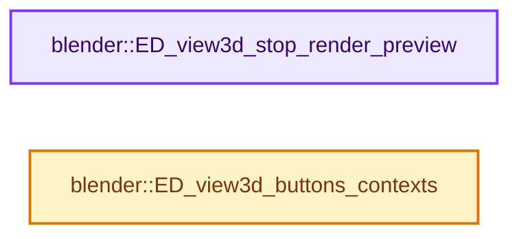
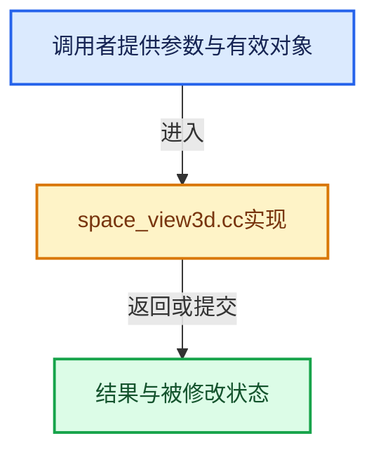

# 实现依赖专题：source/blender/editors/space_view3d/space_view3d.cc

[实现依赖导航](../../../README.md) · [符号索引](../../../../00-课程指南/02-源码与提交索引/符号依赖与实现索引.md)

本专题从正文实际调用进入，集中保存共享实现。函数有稳定锚点，可从调用处直接跳到对应完整函数；递归与互相调用通过回链组织。

## 本文件的实现关系






## 完整成员与函数实现

<a id="f-d629e08515440c80"></a>

### `blender::ED_view3d_stop_render_preview`

实现位置：[source/blender/editors/space_view3d/space_view3d.cc](../../../../../../../../source/blender/editors/space_view3d/space_view3d.cc) · L162—L182。

接口参数：

- `wmWindowManager *wm`
- `ARegion *region`

**教学注释版**

<!-- annotated:d2eaaa492579df -->

```cpp
void ED_view3d_stop_render_preview(wmWindowManager *wm, ARegion *region)
{
  RegionView3D *rv3d = static_cast<RegionView3D *>(region->regiondata);

  if (rv3d->view_render) {
#ifdef WITH_PYTHON
    BPy_BEGIN_ALLOW_THREADS;
#endif

    WM_jobs_kill_type(wm, nullptr, WM_JOB_TYPE_RENDER_PREVIEW);

#ifdef WITH_PYTHON
    BPy_END_ALLOW_THREADS;
#endif

    DRW_engine_external_free(rv3d);
  }

  /* A bit overkill but this make sure the viewport is reset completely. (fclem) */
  WM_draw_region_free(region);
}
```

<details>
<summary>核对原始源码：source/blender/editors/space_view3d/space_view3d.cc · L162—L182</summary>

<!-- original:d2eaaa492579df:source/blender/editors/space_view3d/space_view3d.cc:162:182 -->

```cpp
void ED_view3d_stop_render_preview(wmWindowManager *wm, ARegion *region)
{
  RegionView3D *rv3d = static_cast<RegionView3D *>(region->regiondata);

  if (rv3d->view_render) {
#ifdef WITH_PYTHON
    BPy_BEGIN_ALLOW_THREADS;
#endif

    WM_jobs_kill_type(wm, nullptr, WM_JOB_TYPE_RENDER_PREVIEW);

#ifdef WITH_PYTHON
    BPy_END_ALLOW_THREADS;
#endif

    DRW_engine_external_free(rv3d);
  }

  /* A bit overkill but this make sure the viewport is reset completely. (fclem) */
  WM_draw_region_free(region);
}
```

</details>

**继续追踪实现**

- `WM_jobs_kill_type` → [blender::WM_jobs_kill_type · L642](../../windowmanager/intern/wm_jobs.cc.md#f-6c8270668d007352)。
- `DRW_engine_external_free` → [blender::DRW_engine_external_free · L527](../../draw/engines/external/external_engine.cc.md#f-bbed69fd4769790f)。
- `WM_draw_region_free` → [blender::WM_draw_region_free · L1773](../../windowmanager/intern/wm_draw.cc.md#f-c681b37646206f41)。

<a id="f-79b3af431743ae46"></a>

### `blender::ED_view3d_buttons_contexts`

实现位置：[source/blender/editors/space_view3d/space_view3d.cc](../../../../../../../../source/blender/editors/space_view3d/space_view3d.cc) · L1200—L1313。

接口参数：

- `const bContext *C`

**教学注释版**

<!-- annotated:f3f13afb0eec22 -->

```cpp
std::array<const char *, 4> ED_view3d_buttons_contexts(const bContext *C)
{
  const enum eContextObjectMode mode = CTX_data_mode_enum(C);

  std::array<const char *, 4> contexts_base = {nullptr};
  contexts_base[0] = CTX_data_mode_string(C);

  const char **contexts = &contexts_base[1];

  switch (mode) {
    case CTX_MODE_EDIT_MESH:
      ARRAY_SET_ITEMS(contexts, ".mesh_edit");
      break;
    case CTX_MODE_EDIT_CURVE:
      ARRAY_SET_ITEMS(contexts, ".curve_edit");
      break;
    case CTX_MODE_EDIT_CURVES:
      ARRAY_SET_ITEMS(contexts, ".curves_edit");
      break;
    case CTX_MODE_EDIT_SURFACE:
      ARRAY_SET_ITEMS(contexts, ".curve_edit");
      break;
    case CTX_MODE_EDIT_TEXT:
      ARRAY_SET_ITEMS(contexts, ".text_edit");
      break;
    case CTX_MODE_EDIT_ARMATURE:
      ARRAY_SET_ITEMS(contexts, ".armature_edit");
      break;
    case CTX_MODE_EDIT_METABALL:
      ARRAY_SET_ITEMS(contexts, ".mball_edit");
      break;
    case CTX_MODE_EDIT_LATTICE:
      ARRAY_SET_ITEMS(contexts, ".lattice_edit");
      break;
    case CTX_MODE_EDIT_GREASE_PENCIL:
      ARRAY_SET_ITEMS(contexts, ".grease_pencil_edit");
      break;
    case CTX_MODE_PAINT_GREASE_PENCIL:
      ARRAY_SET_ITEMS(contexts, ".grease_pencil_paint");
      break;
    case CTX_MODE_SCULPT_GREASE_PENCIL:
      ARRAY_SET_ITEMS(contexts, ".grease_pencil_sculpt");
      break;
    case CTX_MODE_WEIGHT_GREASE_PENCIL:
      ARRAY_SET_ITEMS(contexts, ".greasepencil_weight");
      break;
    case CTX_MODE_VERTEX_GREASE_PENCIL:
      ARRAY_SET_ITEMS(contexts, ".greasepencil_vertex");
      break;
    case CTX_MODE_EDIT_POINTCLOUD:
      ARRAY_SET_ITEMS(contexts, ".pointcloud_edit");
      break;
    case CTX_MODE_POSE:
      ARRAY_SET_ITEMS(contexts, ".posemode");
      break;
    case CTX_MODE_SCULPT:
      ARRAY_SET_ITEMS(contexts, ".paint_common", ".sculpt_mode");
      break;
    case CTX_MODE_PAINT_WEIGHT:
      ARRAY_SET_ITEMS(contexts, ".paint_common", ".weightpaint");
      break;
    case CTX_MODE_PAINT_VERTEX:
      ARRAY_SET_ITEMS(contexts, ".paint_common", ".vertexpaint");
      break;
    case CTX_MODE_PAINT_TEXTURE:
      ARRAY_SET_ITEMS(contexts, ".paint_common", ".imagepaint");
      break;
    case CTX_MODE_PARTICLE:
      ARRAY_SET_ITEMS(contexts, ".paint_common", ".particlemode");
      break;
    case CTX_MODE_OBJECT:
      ARRAY_SET_ITEMS(contexts, ".objectmode");
      break;
    case CTX_MODE_PAINT_GPENCIL_LEGACY:
      ARRAY_SET_ITEMS(contexts, ".greasepencil_paint");
      break;
    case CTX_MODE_SCULPT_GPENCIL_LEGACY:
      ARRAY_SET_ITEMS(contexts, ".greasepencil_sculpt");
      break;
    case CTX_MODE_WEIGHT_GPENCIL_LEGACY:
      ARRAY_SET_ITEMS(contexts, ".greasepencil_weight");
      break;
    case CTX_MODE_VERTEX_GPENCIL_LEGACY:
      ARRAY_SET_ITEMS(contexts, ".greasepencil_vertex");
      break;
    case CTX_MODE_SCULPT_CURVES:
      ARRAY_SET_ITEMS(contexts, ".paint_common", ".curves_sculpt");
      break;
    default:
      break;
  }

  switch (mode) {
    case CTX_MODE_PAINT_GPENCIL_LEGACY:
      ARRAY_SET_ITEMS(contexts, ".greasepencil_paint");
      break;
    case CTX_MODE_SCULPT_GPENCIL_LEGACY:
      ARRAY_SET_ITEMS(contexts, ".greasepencil_sculpt");
      break;
    case CTX_MODE_WEIGHT_GPENCIL_LEGACY:
      ARRAY_SET_ITEMS(contexts, ".greasepencil_weight");
      break;
    case CTX_MODE_EDIT_GPENCIL_LEGACY:
      ARRAY_SET_ITEMS(contexts, ".greasepencil_edit");
      break;
    case CTX_MODE_VERTEX_GPENCIL_LEGACY:
      ARRAY_SET_ITEMS(contexts, ".greasepencil_vertex");
      break;
    default:
      break;
  }

  return contexts_base;
}
```

<details>
<summary>核对原始源码：source/blender/editors/space_view3d/space_view3d.cc · L1200—L1313</summary>

<!-- original:f3f13afb0eec22:source/blender/editors/space_view3d/space_view3d.cc:1200:1313 -->

```cpp
std::array<const char *, 4> ED_view3d_buttons_contexts(const bContext *C)
{
  const enum eContextObjectMode mode = CTX_data_mode_enum(C);

  std::array<const char *, 4> contexts_base = {nullptr};
  contexts_base[0] = CTX_data_mode_string(C);

  const char **contexts = &contexts_base[1];

  switch (mode) {
    case CTX_MODE_EDIT_MESH:
      ARRAY_SET_ITEMS(contexts, ".mesh_edit");
      break;
    case CTX_MODE_EDIT_CURVE:
      ARRAY_SET_ITEMS(contexts, ".curve_edit");
      break;
    case CTX_MODE_EDIT_CURVES:
      ARRAY_SET_ITEMS(contexts, ".curves_edit");
      break;
    case CTX_MODE_EDIT_SURFACE:
      ARRAY_SET_ITEMS(contexts, ".curve_edit");
      break;
    case CTX_MODE_EDIT_TEXT:
      ARRAY_SET_ITEMS(contexts, ".text_edit");
      break;
    case CTX_MODE_EDIT_ARMATURE:
      ARRAY_SET_ITEMS(contexts, ".armature_edit");
      break;
    case CTX_MODE_EDIT_METABALL:
      ARRAY_SET_ITEMS(contexts, ".mball_edit");
      break;
    case CTX_MODE_EDIT_LATTICE:
      ARRAY_SET_ITEMS(contexts, ".lattice_edit");
      break;
    case CTX_MODE_EDIT_GREASE_PENCIL:
      ARRAY_SET_ITEMS(contexts, ".grease_pencil_edit");
      break;
    case CTX_MODE_PAINT_GREASE_PENCIL:
      ARRAY_SET_ITEMS(contexts, ".grease_pencil_paint");
      break;
    case CTX_MODE_SCULPT_GREASE_PENCIL:
      ARRAY_SET_ITEMS(contexts, ".grease_pencil_sculpt");
      break;
    case CTX_MODE_WEIGHT_GREASE_PENCIL:
      ARRAY_SET_ITEMS(contexts, ".greasepencil_weight");
      break;
    case CTX_MODE_VERTEX_GREASE_PENCIL:
      ARRAY_SET_ITEMS(contexts, ".greasepencil_vertex");
      break;
    case CTX_MODE_EDIT_POINTCLOUD:
      ARRAY_SET_ITEMS(contexts, ".pointcloud_edit");
      break;
    case CTX_MODE_POSE:
      ARRAY_SET_ITEMS(contexts, ".posemode");
      break;
    case CTX_MODE_SCULPT:
      ARRAY_SET_ITEMS(contexts, ".paint_common", ".sculpt_mode");
      break;
    case CTX_MODE_PAINT_WEIGHT:
      ARRAY_SET_ITEMS(contexts, ".paint_common", ".weightpaint");
      break;
    case CTX_MODE_PAINT_VERTEX:
      ARRAY_SET_ITEMS(contexts, ".paint_common", ".vertexpaint");
      break;
    case CTX_MODE_PAINT_TEXTURE:
      ARRAY_SET_ITEMS(contexts, ".paint_common", ".imagepaint");
      break;
    case CTX_MODE_PARTICLE:
      ARRAY_SET_ITEMS(contexts, ".paint_common", ".particlemode");
      break;
    case CTX_MODE_OBJECT:
      ARRAY_SET_ITEMS(contexts, ".objectmode");
      break;
    case CTX_MODE_PAINT_GPENCIL_LEGACY:
      ARRAY_SET_ITEMS(contexts, ".greasepencil_paint");
      break;
    case CTX_MODE_SCULPT_GPENCIL_LEGACY:
      ARRAY_SET_ITEMS(contexts, ".greasepencil_sculpt");
      break;
    case CTX_MODE_WEIGHT_GPENCIL_LEGACY:
      ARRAY_SET_ITEMS(contexts, ".greasepencil_weight");
      break;
    case CTX_MODE_VERTEX_GPENCIL_LEGACY:
      ARRAY_SET_ITEMS(contexts, ".greasepencil_vertex");
      break;
    case CTX_MODE_SCULPT_CURVES:
      ARRAY_SET_ITEMS(contexts, ".paint_common", ".curves_sculpt");
      break;
    default:
      break;
  }

  switch (mode) {
    case CTX_MODE_PAINT_GPENCIL_LEGACY:
      ARRAY_SET_ITEMS(contexts, ".greasepencil_paint");
      break;
    case CTX_MODE_SCULPT_GPENCIL_LEGACY:
      ARRAY_SET_ITEMS(contexts, ".greasepencil_sculpt");
      break;
    case CTX_MODE_WEIGHT_GPENCIL_LEGACY:
      ARRAY_SET_ITEMS(contexts, ".greasepencil_weight");
      break;
    case CTX_MODE_EDIT_GPENCIL_LEGACY:
      ARRAY_SET_ITEMS(contexts, ".greasepencil_edit");
      break;
    case CTX_MODE_VERTEX_GPENCIL_LEGACY:
      ARRAY_SET_ITEMS(contexts, ".greasepencil_vertex");
      break;
    default:
      break;
  }

  return contexts_base;
}
```

</details>

**沿实际写入检查状态**

- `contexts_base[0] = CTX_data_mode_string(C);`

**结果出口**

- `return contexts_base;`

**继续追踪实现**

- `CTX_data_mode_enum` → [blender::CTX_data_mode_enum · L1495](../../../02-BKE几何与数据/intern/context.cc.md#f-b33bca83bf05ef47)。
- `CTX_data_mode_string` → [blender::CTX_data_mode_string · L1539](../../../02-BKE几何与数据/intern/context.cc.md#f-68dabb93b6b028b1)。
- `ARRAY_SET_ITEMS` → [ARRAY_SET_ITEMS · L304](../../../01-BLI基础库/BLI_utildefines.hh.md#m-80336b50a95e)。宏定义由构建条件选择。
