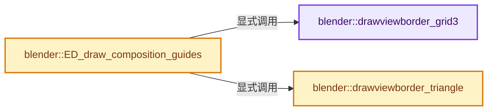
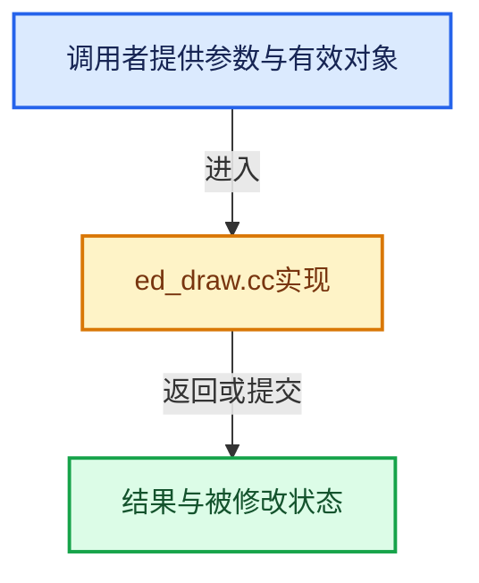

# 实现依赖专题：source/blender/editors/util/ed_draw.cc

[实现依赖导航](../../../README.md) · [符号索引](../../../../00-课程指南/02-源码与提交索引/符号依赖与实现索引.md)

本专题从正文实际调用进入，集中保存共享实现。函数有稳定锚点，可从调用处直接跳到对应完整函数；递归与互相调用通过回链组织。

## 本文件的实现关系






## 完整成员与函数实现

<a id="f-f9114317cfbe93eb"></a>

### `blender::drawviewborder_grid3`

实现位置：[source/blender/editors/util/ed_draw.cc](../../../../../../../../source/blender/editors/util/ed_draw.cc) · L1117—L1141。

接口参数：

- `uint shdr_pos`
- `rctf rect`
- `float fac`

**教学注释版**

<!-- annotated:abe0435bd18a9a -->

```cpp
static void drawviewborder_grid3(uint shdr_pos, rctf rect, float fac)
{
  float x3, y3, x4, y4;

  x3 = rect.xmin + fac * (rect.xmax - rect.xmin);
  y3 = rect.ymin + fac * (rect.ymax - rect.ymin);
  x4 = rect.xmin + (1.0f - fac) * (rect.xmax - rect.xmin);
  y4 = rect.ymin + (1.0f - fac) * (rect.ymax - rect.ymin);

  immBegin(GPU_PRIM_LINES, 8);

  immVertex2f(shdr_pos, rect.xmin, y3);
  immVertex2f(shdr_pos, rect.xmax, y3);

  immVertex2f(shdr_pos, rect.xmin, y4);
  immVertex2f(shdr_pos, rect.xmax, y4);

  immVertex2f(shdr_pos, x3, rect.ymin);
  immVertex2f(shdr_pos, x3, rect.ymax);

  immVertex2f(shdr_pos, x4, rect.ymin);
  immVertex2f(shdr_pos, x4, rect.ymax);

  immEnd();
}
```

<details>
<summary>核对原始源码：source/blender/editors/util/ed_draw.cc · L1117—L1141</summary>

<!-- original:abe0435bd18a9a:source/blender/editors/util/ed_draw.cc:1117:1141 -->

```cpp
static void drawviewborder_grid3(uint shdr_pos, rctf rect, float fac)
{
  float x3, y3, x4, y4;

  x3 = rect.xmin + fac * (rect.xmax - rect.xmin);
  y3 = rect.ymin + fac * (rect.ymax - rect.ymin);
  x4 = rect.xmin + (1.0f - fac) * (rect.xmax - rect.xmin);
  y4 = rect.ymin + (1.0f - fac) * (rect.ymax - rect.ymin);

  immBegin(GPU_PRIM_LINES, 8);

  immVertex2f(shdr_pos, rect.xmin, y3);
  immVertex2f(shdr_pos, rect.xmax, y3);

  immVertex2f(shdr_pos, rect.xmin, y4);
  immVertex2f(shdr_pos, rect.xmax, y4);

  immVertex2f(shdr_pos, x3, rect.ymin);
  immVertex2f(shdr_pos, x3, rect.ymax);

  immVertex2f(shdr_pos, x4, rect.ymin);
  immVertex2f(shdr_pos, x4, rect.ymax);

  immEnd();
}
```

</details>

**沿实际写入检查状态**

- `x3 = rect.xmin + fac * (rect.xmax - rect.xmin);`
- `y3 = rect.ymin + fac * (rect.ymax - rect.ymin);`
- `x4 = rect.xmin + (1.0f - fac) * (rect.xmax - rect.xmin);`
- `y4 = rect.ymin + (1.0f - fac) * (rect.ymax - rect.ymin);`

**继续追踪实现**

- `immBegin` → [blender::immBegin · L202](../../gpu/intern/gpu_immediate.cc.md#f-d20e080325dd293f)。
- `immVertex2f` → [blender::immVertex2f · L539](../../gpu/intern/gpu_immediate.cc.md#f-c5aa0ff286be3978)。
- `immEnd` → [blender::immEnd · L252](../../gpu/intern/gpu_immediate.cc.md#f-ef4c47367ce69810)。

<a id="f-0c8a4bda7260d8af"></a>

### `blender::drawviewborder_triangle`

实现位置：[source/blender/editors/util/ed_draw.cc](../../../../../../../../source/blender/editors/util/ed_draw.cc) · L1144—L1194。

接口参数：

- `uint shdr_pos`
- `rctf rect`
- `const bool golden`
- `const char dir`

**教学注释版**

<!-- annotated:362237ce9f9d14 -->

```cpp
static void drawviewborder_triangle(uint shdr_pos, rctf rect, const bool golden, const char dir)
{
  float ofs;
  float w = rect.xmax - rect.xmin;
  float h = rect.ymax - rect.ymin;

  immBegin(GPU_PRIM_LINES, 6);

  if (w > h) {
    if (golden) {
      ofs = w * (1.0f - M_GOLDEN_RATIO_CONJUGATE);
    }
    else {
      ofs = h * (h / w);
    }
    if (dir == 'B') {
      std::swap(rect.ymin, rect.ymax);
    }

    immVertex2f(shdr_pos, rect.xmin, rect.ymin);
    immVertex2f(shdr_pos, rect.xmax, rect.ymax);

    immVertex2f(shdr_pos, rect.xmax, rect.ymin);
    immVertex2f(shdr_pos, rect.xmin + (w - ofs), rect.ymax);

    immVertex2f(shdr_pos, rect.xmin, rect.ymax);
    immVertex2f(shdr_pos, rect.xmin + ofs, rect.ymin);
  }
  else {
    if (golden) {
      ofs = h * (1.0f - M_GOLDEN_RATIO_CONJUGATE);
    }
    else {
      ofs = w * (w / h);
    }
    if (dir == 'B') {
      std::swap(rect.xmin, rect.xmax);
    }

    immVertex2f(shdr_pos, rect.xmin, rect.ymin);
    immVertex2f(shdr_pos, rect.xmax, rect.ymax);

    immVertex2f(shdr_pos, rect.xmax, rect.ymin);
    immVertex2f(shdr_pos, rect.xmin, rect.ymin + ofs);

    immVertex2f(shdr_pos, rect.xmin, rect.ymax);
    immVertex2f(shdr_pos, rect.xmax, rect.ymin + (h - ofs));
  }

  immEnd();
}
```

<details>
<summary>核对原始源码：source/blender/editors/util/ed_draw.cc · L1144—L1194</summary>

<!-- original:362237ce9f9d14:source/blender/editors/util/ed_draw.cc:1144:1194 -->

```cpp
static void drawviewborder_triangle(uint shdr_pos, rctf rect, const bool golden, const char dir)
{
  float ofs;
  float w = rect.xmax - rect.xmin;
  float h = rect.ymax - rect.ymin;

  immBegin(GPU_PRIM_LINES, 6);

  if (w > h) {
    if (golden) {
      ofs = w * (1.0f - M_GOLDEN_RATIO_CONJUGATE);
    }
    else {
      ofs = h * (h / w);
    }
    if (dir == 'B') {
      std::swap(rect.ymin, rect.ymax);
    }

    immVertex2f(shdr_pos, rect.xmin, rect.ymin);
    immVertex2f(shdr_pos, rect.xmax, rect.ymax);

    immVertex2f(shdr_pos, rect.xmax, rect.ymin);
    immVertex2f(shdr_pos, rect.xmin + (w - ofs), rect.ymax);

    immVertex2f(shdr_pos, rect.xmin, rect.ymax);
    immVertex2f(shdr_pos, rect.xmin + ofs, rect.ymin);
  }
  else {
    if (golden) {
      ofs = h * (1.0f - M_GOLDEN_RATIO_CONJUGATE);
    }
    else {
      ofs = w * (w / h);
    }
    if (dir == 'B') {
      std::swap(rect.xmin, rect.xmax);
    }

    immVertex2f(shdr_pos, rect.xmin, rect.ymin);
    immVertex2f(shdr_pos, rect.xmax, rect.ymax);

    immVertex2f(shdr_pos, rect.xmax, rect.ymin);
    immVertex2f(shdr_pos, rect.xmin, rect.ymin + ofs);

    immVertex2f(shdr_pos, rect.xmin, rect.ymax);
    immVertex2f(shdr_pos, rect.xmax, rect.ymin + (h - ofs));
  }

  immEnd();
}
```

</details>

**沿实际写入检查状态**

- `ofs = w * (1.0f - M_GOLDEN_RATIO_CONJUGATE);`
- `ofs = h * (h / w);`
- `ofs = h * (1.0f - M_GOLDEN_RATIO_CONJUGATE);`
- `ofs = w * (w / h);`

**继续追踪实现**

- `immBegin` → [blender::immBegin · L202](../../gpu/intern/gpu_immediate.cc.md#f-d20e080325dd293f)。
- `std::swap` → [外部契约](https://eel.is/c++draft/)：这个边界按实际表达式及所属类型核对参数、返回值、寿命与失败行为。这里提供接口入口，不声称已解释该第三方版本的内部实现。
- `immVertex2f` → [blender::immVertex2f · L539](../../gpu/intern/gpu_immediate.cc.md#f-c5aa0ff286be3978)。
- `immEnd` → [blender::immEnd · L252](../../gpu/intern/gpu_immediate.cc.md#f-ef4c47367ce69810)。

<a id="f-5d3a743b24ed1e01"></a>

### `blender::ED_draw_composition_guides`

实现位置：[source/blender/editors/util/ed_draw.cc](../../../../../../../../source/blender/editors/util/ed_draw.cc) · L1196—L1255。

接口参数：

- `uint shdr_pos`
- `eCompositionGuideFlags flag`
- `const rctf *rect`
- `const float color[4]`

**教学注释版**

<!-- annotated:cdc8c70f384152 -->

```cpp
void ED_draw_composition_guides(uint shdr_pos,
                                eCompositionGuideFlags flag,
                                const rctf *rect,
                                const float color[4])
{
  immUniformColor4fv(color);

  if (flag & COMPOSITION_GUIDES_CENTER) {
    float xmid, ymid;

    xmid = rect->xmin + 0.5f * (rect->xmax - rect->xmin);
    ymid = rect->ymin + 0.5f * (rect->ymax - rect->ymin);

    immBegin(GPU_PRIM_LINES, 4);

    immVertex2f(shdr_pos, rect->xmin, ymid);
    immVertex2f(shdr_pos, rect->xmax, ymid);

    immVertex2f(shdr_pos, xmid, rect->ymin);
    immVertex2f(shdr_pos, xmid, rect->ymax);

    immEnd();
  }

  if (flag & COMPOSITION_GUIDES_CENTER_DIAG) {
    immBegin(GPU_PRIM_LINES, 4);

    immVertex2f(shdr_pos, rect->xmin, rect->ymin);
    immVertex2f(shdr_pos, rect->xmax, rect->ymax);

    immVertex2f(shdr_pos, rect->xmin, rect->ymax);
    immVertex2f(shdr_pos, rect->xmax, rect->ymin);

    immEnd();
  }

  if (flag & COMPOSITION_GUIDES_THIRDS) {
    drawviewborder_grid3(shdr_pos, *rect, 1.0f / 3.0f);
  }

  if (flag & COMPOSITION_GUIDES_GOLDEN) {
    drawviewborder_grid3(shdr_pos, *rect, 1.0f - M_GOLDEN_RATIO_CONJUGATE);
  }

  if (flag & COMPOSITION_GUIDES_GOLDEN_TRI_A) {
    drawviewborder_triangle(shdr_pos, *rect, false, 'A');
  }

  if (flag & COMPOSITION_GUIDES_GOLDEN_TRI_B) {
    drawviewborder_triangle(shdr_pos, *rect, false, 'B');
  }

  if (flag & COMPOSITION_GUIDES_HARMONY_TRI_A) {
    drawviewborder_triangle(shdr_pos, *rect, true, 'A');
  }

  if (flag & COMPOSITION_GUIDES_HARMONY_TRI_B) {
    drawviewborder_triangle(shdr_pos, *rect, true, 'B');
  }
}
```

<details>
<summary>核对原始源码：source/blender/editors/util/ed_draw.cc · L1196—L1255</summary>

<!-- original:cdc8c70f384152:source/blender/editors/util/ed_draw.cc:1196:1255 -->

```cpp
void ED_draw_composition_guides(uint shdr_pos,
                                eCompositionGuideFlags flag,
                                const rctf *rect,
                                const float color[4])
{
  immUniformColor4fv(color);

  if (flag & COMPOSITION_GUIDES_CENTER) {
    float xmid, ymid;

    xmid = rect->xmin + 0.5f * (rect->xmax - rect->xmin);
    ymid = rect->ymin + 0.5f * (rect->ymax - rect->ymin);

    immBegin(GPU_PRIM_LINES, 4);

    immVertex2f(shdr_pos, rect->xmin, ymid);
    immVertex2f(shdr_pos, rect->xmax, ymid);

    immVertex2f(shdr_pos, xmid, rect->ymin);
    immVertex2f(shdr_pos, xmid, rect->ymax);

    immEnd();
  }

  if (flag & COMPOSITION_GUIDES_CENTER_DIAG) {
    immBegin(GPU_PRIM_LINES, 4);

    immVertex2f(shdr_pos, rect->xmin, rect->ymin);
    immVertex2f(shdr_pos, rect->xmax, rect->ymax);

    immVertex2f(shdr_pos, rect->xmin, rect->ymax);
    immVertex2f(shdr_pos, rect->xmax, rect->ymin);

    immEnd();
  }

  if (flag & COMPOSITION_GUIDES_THIRDS) {
    drawviewborder_grid3(shdr_pos, *rect, 1.0f / 3.0f);
  }

  if (flag & COMPOSITION_GUIDES_GOLDEN) {
    drawviewborder_grid3(shdr_pos, *rect, 1.0f - M_GOLDEN_RATIO_CONJUGATE);
  }

  if (flag & COMPOSITION_GUIDES_GOLDEN_TRI_A) {
    drawviewborder_triangle(shdr_pos, *rect, false, 'A');
  }

  if (flag & COMPOSITION_GUIDES_GOLDEN_TRI_B) {
    drawviewborder_triangle(shdr_pos, *rect, false, 'B');
  }

  if (flag & COMPOSITION_GUIDES_HARMONY_TRI_A) {
    drawviewborder_triangle(shdr_pos, *rect, true, 'A');
  }

  if (flag & COMPOSITION_GUIDES_HARMONY_TRI_B) {
    drawviewborder_triangle(shdr_pos, *rect, true, 'B');
  }
}
```

</details>

**沿实际写入检查状态**

- `xmid = rect->xmin + 0.5f * (rect->xmax - rect->xmin);`
- `ymid = rect->ymin + 0.5f * (rect->ymax - rect->ymin);`

**继续追踪实现**

- `immUniformColor4fv` → [blender::immUniformColor4fv · L664](../../gpu/intern/gpu_immediate.cc.md#f-f598e90144bdeef6)。
- `immBegin` → [blender::immBegin · L202](../../gpu/intern/gpu_immediate.cc.md#f-d20e080325dd293f)。
- `immVertex2f` → [blender::immVertex2f · L539](../../gpu/intern/gpu_immediate.cc.md#f-c5aa0ff286be3978)。
- `immEnd` → [blender::immEnd · L252](../../gpu/intern/gpu_immediate.cc.md#f-ef4c47367ce69810)。
- `drawviewborder_grid3` → [blender::drawviewborder_grid3 · L1117](ed_draw.cc.md#f-f9114317cfbe93eb)。
- `drawviewborder_triangle` → [blender::drawviewborder_triangle · L1144](ed_draw.cc.md#f-0c8a4bda7260d8af)。
