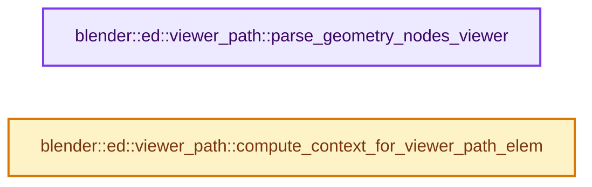

# 实现依赖专题：source/blender/editors/util/ed_viewer_path.cc

[实现依赖导航](../../../README.md) · [符号索引](../../../../00-课程指南/02-源码与提交索引/符号依赖与实现索引.md)

本专题从正文实际调用进入，集中保存共享实现。函数有稳定锚点，可从调用处直接跳到对应完整函数；递归与互相调用通过回链组织。

## 本文件的实现关系




## 完整成员与函数实现

<a id="f-5350c0559a2e6690"></a>

### `blender::ed::viewer_path::parse_geometry_nodes_viewer`

实现位置：[source/blender/editors/util/ed_viewer_path.cc](../../../../../../../../source/blender/editors/util/ed_viewer_path.cc) · L227—L281。

接口参数：

- `const ViewerPath &viewer_path`

**教学注释版**

<!-- annotated:1976351d3833b0 -->

```cpp
std::optional<ViewerPathForGeometryNodesViewer> parse_geometry_nodes_viewer(
    const ViewerPath &viewer_path)
{
  Vector<const ViewerPathElem *, 16> elems_vec;
  for (const ViewerPathElem &item : viewer_path.path) {
    // [讲解] elems_vec.append：在尾部建立新元素，必要时先扩大存储。
    elems_vec.append(&item);
  }

  // [讲解] elems_vec.size：用end_减begin_得到活元素数量。
  if (elems_vec.size() < 3) {
    /* Need at least the object, modifier and viewer node name. */
    return std::nullopt;
  }
  Span<const ViewerPathElem *> remaining_elems = elems_vec;
  const ViewerPathElem &id_elem = *remaining_elems[0];
  if (id_elem.type != VIEWER_PATH_ELEM_TYPE_ID) {
    return std::nullopt;
  }
  ID *root_id = reinterpret_cast<const IDViewerPathElem &>(id_elem).id;
  if (root_id == nullptr) {
    return std::nullopt;
  }
  if (GS(root_id->name) != ID_OB) {
    return std::nullopt;
  }
  Object *root_ob = reinterpret_cast<Object *>(root_id);
  // [讲解] remaining_elems.drop_front：从两端裁去或选取一定数量元素形成新视图。
  remaining_elems = remaining_elems.drop_front(1);
  const ViewerPathElem &modifier_elem = *remaining_elems[0];
  if (modifier_elem.type != VIEWER_PATH_ELEM_TYPE_MODIFIER) {
    return std::nullopt;
  }
  const int modifier_uid =
      reinterpret_cast<const ModifierViewerPathElem &>(modifier_elem).modifier_uid;

  remaining_elems = remaining_elems.drop_front(1);
  Vector<const ViewerPathElem *> node_path;
  // [讲解] remaining_elems.drop_back：从两端裁去或选取一定数量元素形成新视图。
  for (const ViewerPathElem *elem : remaining_elems.drop_back(1)) {
    if (!ELEM(elem->type,
              VIEWER_PATH_ELEM_TYPE_GROUP_NODE,
              VIEWER_PATH_ELEM_TYPE_SIMULATION_ZONE,
              VIEWER_PATH_ELEM_TYPE_REPEAT_ZONE,
              VIEWER_PATH_ELEM_TYPE_FOREACH_GEOMETRY_ELEMENT_ZONE,
              VIEWER_PATH_ELEM_TYPE_EVALUATE_CLOSURE))
    {
      return std::nullopt;
    }
    node_path.append(elem);
  }
  // [讲解] remaining_elems.last：按视图边界访问元素。
  const ViewerPathElem *last_elem = remaining_elems.last();
  if (last_elem->type != VIEWER_PATH_ELEM_TYPE_VIEWER_NODE) {
    return std::nullopt;
  }
  const int32_t viewer_node_id =
      reinterpret_cast<const ViewerNodeViewerPathElem *>(last_elem)->node_id;
  return ViewerPathForGeometryNodesViewer{root_ob, modifier_uid, node_path, viewer_node_id};
}
```

<details>
<summary>核对原始源码：source/blender/editors/util/ed_viewer_path.cc · L227—L281</summary>

<!-- original:1976351d3833b0:source/blender/editors/util/ed_viewer_path.cc:227:281 -->

```cpp
std::optional<ViewerPathForGeometryNodesViewer> parse_geometry_nodes_viewer(
    const ViewerPath &viewer_path)
{
  Vector<const ViewerPathElem *, 16> elems_vec;
  for (const ViewerPathElem &item : viewer_path.path) {
    elems_vec.append(&item);
  }

  if (elems_vec.size() < 3) {
    /* Need at least the object, modifier and viewer node name. */
    return std::nullopt;
  }
  Span<const ViewerPathElem *> remaining_elems = elems_vec;
  const ViewerPathElem &id_elem = *remaining_elems[0];
  if (id_elem.type != VIEWER_PATH_ELEM_TYPE_ID) {
    return std::nullopt;
  }
  ID *root_id = reinterpret_cast<const IDViewerPathElem &>(id_elem).id;
  if (root_id == nullptr) {
    return std::nullopt;
  }
  if (GS(root_id->name) != ID_OB) {
    return std::nullopt;
  }
  Object *root_ob = reinterpret_cast<Object *>(root_id);
  remaining_elems = remaining_elems.drop_front(1);
  const ViewerPathElem &modifier_elem = *remaining_elems[0];
  if (modifier_elem.type != VIEWER_PATH_ELEM_TYPE_MODIFIER) {
    return std::nullopt;
  }
  const int modifier_uid =
      reinterpret_cast<const ModifierViewerPathElem &>(modifier_elem).modifier_uid;

  remaining_elems = remaining_elems.drop_front(1);
  Vector<const ViewerPathElem *> node_path;
  for (const ViewerPathElem *elem : remaining_elems.drop_back(1)) {
    if (!ELEM(elem->type,
              VIEWER_PATH_ELEM_TYPE_GROUP_NODE,
              VIEWER_PATH_ELEM_TYPE_SIMULATION_ZONE,
              VIEWER_PATH_ELEM_TYPE_REPEAT_ZONE,
              VIEWER_PATH_ELEM_TYPE_FOREACH_GEOMETRY_ELEMENT_ZONE,
              VIEWER_PATH_ELEM_TYPE_EVALUATE_CLOSURE))
    {
      return std::nullopt;
    }
    node_path.append(elem);
  }
  const ViewerPathElem *last_elem = remaining_elems.last();
  if (last_elem->type != VIEWER_PATH_ELEM_TYPE_VIEWER_NODE) {
    return std::nullopt;
  }
  const int32_t viewer_node_id =
      reinterpret_cast<const ViewerNodeViewerPathElem *>(last_elem)->node_id;
  return ViewerPathForGeometryNodesViewer{root_ob, modifier_uid, node_path, viewer_node_id};
}
```

</details>

**沿实际写入检查状态**

- `remaining_elems = remaining_elems.drop_front(1);`

**结果出口**

- `return std::nullopt;`
- `return ViewerPathForGeometryNodesViewer{root_ob, modifier_uid, node_path, viewer_node_id};`

**继续追踪实现**

- `elems_vec.append` → [blender::Vector::append · L498](../../../../01-基础容器与现代CPP/11-Vector插入删除与重排.md#f-5bde268a69e443ec)；[blender::Vector::append · L502](../../../../01-基础容器与现代CPP/11-Vector插入删除与重排.md#f-591e0b15e6308532)。同名重载需按实参类型选择。
- `elems_vec.size` → [blender::Vector::size · L780](../../../../01-基础容器与现代CPP/11-Vector插入删除与重排.md#f-714773731767349c)。
- `GS` → [blender::GS · L410](../../makesdna/DNA_ID.h.md#f-c3ff509f79f21b05)。
- `remaining_elems.drop_front` → [blender::Span::drop_front · L175](../../../../01-基础容器与现代CPP/05-Span只读连续视图.md#f-932897accbde3413)。
- `remaining_elems.drop_back` → [blender::Span::drop_back · L186](../../../../01-基础容器与现代CPP/05-Span只读连续视图.md#f-fbabd5706815d493)。
- `ELEM` → [ELEM · L88](../../../07-Intern运行时与平台/ghost/intern/GHOST_utildefines.hh.md#m-d28724a15928)；[ELEM · L135](../../../01-BLI基础库/BLI_utildefines.hh.md#m-d6572de7cae0)。宏定义由构建条件选择。
- `node_path.append` → [blender::Vector::append · L498](../../../../01-基础容器与现代CPP/11-Vector插入删除与重排.md#f-5bde268a69e443ec)；[blender::Vector::append · L502](../../../../01-基础容器与现代CPP/11-Vector插入删除与重排.md#f-591e0b15e6308532)。同名重载需按实参类型选择。
- `remaining_elems.last` → [blender::Span::last · L329](../../../../01-基础容器与现代CPP/05-Span只读连续视图.md#f-a92146c285596891)。

<a id="f-45f0afd937ff2004"></a>

### `blender::ed::viewer_path::compute_context_for_viewer_path_elem`

实现位置：[source/blender/editors/util/ed_viewer_path.cc](../../../../../../../../source/blender/editors/util/ed_viewer_path.cc) · L522—L577。

接口参数：

- `const ViewerPathElem &elem_generic`
- `bke::ComputeContextCache &compute_context_cache`
- `const ComputeContext *parent_compute_context`

**教学注释版**

<!-- annotated:fd39e2d8cd6218 -->

```cpp
[[nodiscard]] const ComputeContext *compute_context_for_viewer_path_elem(
    const ViewerPathElem &elem_generic,
    bke::ComputeContextCache &compute_context_cache,
    const ComputeContext *parent_compute_context)
{
  switch (ViewerPathElemType(elem_generic.type)) {
    case VIEWER_PATH_ELEM_TYPE_VIEWER_NODE: {
      return nullptr;
    }
    case VIEWER_PATH_ELEM_TYPE_ID: {
      const auto &elem = reinterpret_cast<const IDViewerPathElem &>(elem_generic);
      if (elem.id == nullptr) {
        return nullptr;
      }
      return &compute_context_cache.for_data_block(parent_compute_context, *elem.id);
    }
    case VIEWER_PATH_ELEM_TYPE_MODIFIER: {
      const auto &elem = reinterpret_cast<const ModifierViewerPathElem &>(elem_generic);
      return &compute_context_cache.for_geometry_nodes_modifier(parent_compute_context,
                                                                elem.modifier_uid);
    }
    case VIEWER_PATH_ELEM_TYPE_GROUP_NODE: {
      const auto &elem = reinterpret_cast<const GroupNodeViewerPathElem &>(elem_generic);
      return &compute_context_cache.for_group_node(parent_compute_context, elem.node_id);
    }
    case VIEWER_PATH_ELEM_TYPE_SIMULATION_ZONE: {
      const auto &elem = reinterpret_cast<const SimulationZoneViewerPathElem &>(elem_generic);
      return &compute_context_cache.for_simulation_zone(parent_compute_context,
                                                        elem.sim_output_node_id);
    }
    case VIEWER_PATH_ELEM_TYPE_REPEAT_ZONE: {
      const auto &elem = reinterpret_cast<const RepeatZoneViewerPathElem &>(elem_generic);
      return &compute_context_cache.for_repeat_zone(
          parent_compute_context, elem.repeat_output_node_id, elem.iteration);
    }
    case VIEWER_PATH_ELEM_TYPE_FOREACH_GEOMETRY_ELEMENT_ZONE: {
      const auto &elem = reinterpret_cast<const ForeachGeometryElementZoneViewerPathElem &>(
          elem_generic);
      return &compute_context_cache.for_foreach_geometry_element_zone(
          parent_compute_context, elem.zone_output_node_id, elem.index);
    }
    case VIEWER_PATH_ELEM_TYPE_EVALUATE_CLOSURE: {
      const auto &elem = reinterpret_cast<const EvaluateClosureNodeViewerPathElem &>(elem_generic);
      std::optional<nodes::ClosureSourceLocation> source_location;
      if (elem.source_node_tree) {
        source_location = nodes::ClosureSourceLocation{
            elem.source_node_tree,
            elem.source_output_node_id,
            parent_compute_context ? parent_compute_context->hash() : ComputeContextHash{}};
      }
      return &compute_context_cache.for_evaluate_closure(
          parent_compute_context, elem.evaluate_node_id, nullptr, source_location);
    }
  }
  return nullptr;
}
```

<details>
<summary>核对原始源码：source/blender/editors/util/ed_viewer_path.cc · L522—L577</summary>

<!-- original:fd39e2d8cd6218:source/blender/editors/util/ed_viewer_path.cc:522:577 -->

```cpp
[[nodiscard]] const ComputeContext *compute_context_for_viewer_path_elem(
    const ViewerPathElem &elem_generic,
    bke::ComputeContextCache &compute_context_cache,
    const ComputeContext *parent_compute_context)
{
  switch (ViewerPathElemType(elem_generic.type)) {
    case VIEWER_PATH_ELEM_TYPE_VIEWER_NODE: {
      return nullptr;
    }
    case VIEWER_PATH_ELEM_TYPE_ID: {
      const auto &elem = reinterpret_cast<const IDViewerPathElem &>(elem_generic);
      if (elem.id == nullptr) {
        return nullptr;
      }
      return &compute_context_cache.for_data_block(parent_compute_context, *elem.id);
    }
    case VIEWER_PATH_ELEM_TYPE_MODIFIER: {
      const auto &elem = reinterpret_cast<const ModifierViewerPathElem &>(elem_generic);
      return &compute_context_cache.for_geometry_nodes_modifier(parent_compute_context,
                                                                elem.modifier_uid);
    }
    case VIEWER_PATH_ELEM_TYPE_GROUP_NODE: {
      const auto &elem = reinterpret_cast<const GroupNodeViewerPathElem &>(elem_generic);
      return &compute_context_cache.for_group_node(parent_compute_context, elem.node_id);
    }
    case VIEWER_PATH_ELEM_TYPE_SIMULATION_ZONE: {
      const auto &elem = reinterpret_cast<const SimulationZoneViewerPathElem &>(elem_generic);
      return &compute_context_cache.for_simulation_zone(parent_compute_context,
                                                        elem.sim_output_node_id);
    }
    case VIEWER_PATH_ELEM_TYPE_REPEAT_ZONE: {
      const auto &elem = reinterpret_cast<const RepeatZoneViewerPathElem &>(elem_generic);
      return &compute_context_cache.for_repeat_zone(
          parent_compute_context, elem.repeat_output_node_id, elem.iteration);
    }
    case VIEWER_PATH_ELEM_TYPE_FOREACH_GEOMETRY_ELEMENT_ZONE: {
      const auto &elem = reinterpret_cast<const ForeachGeometryElementZoneViewerPathElem &>(
          elem_generic);
      return &compute_context_cache.for_foreach_geometry_element_zone(
          parent_compute_context, elem.zone_output_node_id, elem.index);
    }
    case VIEWER_PATH_ELEM_TYPE_EVALUATE_CLOSURE: {
      const auto &elem = reinterpret_cast<const EvaluateClosureNodeViewerPathElem &>(elem_generic);
      std::optional<nodes::ClosureSourceLocation> source_location;
      if (elem.source_node_tree) {
        source_location = nodes::ClosureSourceLocation{
            elem.source_node_tree,
            elem.source_output_node_id,
            parent_compute_context ? parent_compute_context->hash() : ComputeContextHash{}};
      }
      return &compute_context_cache.for_evaluate_closure(
          parent_compute_context, elem.evaluate_node_id, nullptr, source_location);
    }
  }
  return nullptr;
}
```

</details>

**沿实际写入检查状态**

- `source_location = nodes::ClosureSourceLocation{`

**结果出口**

- `return nullptr;`
- `return &compute_context_cache.for_data_block(parent_compute_context, *elem.id);`
- `return &compute_context_cache.for_geometry_nodes_modifier(parent_compute_context,`
- `return &compute_context_cache.for_group_node(parent_compute_context, elem.node_id);`
- `return &compute_context_cache.for_simulation_zone(parent_compute_context,`
- `return &compute_context_cache.for_repeat_zone(`
- `return &compute_context_cache.for_foreach_geometry_element_zone(`
- `return &compute_context_cache.for_evaluate_closure(`

**继续追踪实现**

- `ViewerPathElemType` → [blender::ViewerPathElemType](../../makesdna/DNA_viewer_path_types.h.md#t-2a310f00002f)。
- `compute_context_cache.for_data_block` → [blender::bke::ComputeContextCache::for_data_block · L292](../../../02-BKE几何与数据/intern/compute_contexts.cc.md#f-e018edb6791310c0)；[blender::bke::ComputeContextCache::for_data_block · L301](../../../02-BKE几何与数据/intern/compute_contexts.cc.md#f-f443c09ac8446ed0)。同名重载需按实参类型选择。
- `compute_context_cache.for_geometry_nodes_modifier` → [blender::bke::ComputeContextCache::for_geometry_nodes_modifier · L314](../../../02-BKE几何与数据/intern/compute_contexts.cc.md#f-0611ac92ae7cd3e8)；[blender::bke::ComputeContextCache::for_geometry_nodes_modifier · L322](../../../02-BKE几何与数据/intern/compute_contexts.cc.md#f-9a6e3ad85b57e5b9)。同名重载需按实参类型选择。
- `compute_context_cache.for_group_node` → [blender::bke::ComputeContextCache::for_group_node · L360](../../../02-BKE几何与数据/intern/compute_contexts.cc.md#f-e682e12ad78f58a0)。
- `compute_context_cache.for_simulation_zone` → [blender::bke::ComputeContextCache::for_simulation_zone · L369](../../../02-BKE几何与数据/intern/compute_contexts.cc.md#f-0923b6080a4968ba)；[blender::bke::ComputeContextCache::for_simulation_zone · L378](../../../02-BKE几何与数据/intern/compute_contexts.cc.md#f-011b757f77eed842)。同名重载需按实参类型选择。
- `compute_context_cache.for_repeat_zone` → [blender::bke::ComputeContextCache::for_repeat_zone · L387](../../../02-BKE几何与数据/intern/compute_contexts.cc.md#f-8ff2c2bf4820c044)；[blender::bke::ComputeContextCache::for_repeat_zone · L398](../../../02-BKE几何与数据/intern/compute_contexts.cc.md#f-603cb5361feedd9b)。同名重载需按实参类型选择。
- `compute_context_cache.for_foreach_geometry_element_zone` → [blender::bke::for_foreach_geometry_element_zone · L408](../../../02-BKE几何与数据/intern/compute_contexts.cc.md#f-76ee6329b9b0d44e)；[blender::bke::for_foreach_geometry_element_zone · L420](../../../02-BKE几何与数据/intern/compute_contexts.cc.md#f-976cb54ce4a8bf38)。同名重载需按实参类型选择。
- `parent_compute_context->hash` → [blender::ComputeContext::hash · L111](../../../01-BLI基础库/BLI_compute_context.hh.md#f-12bb4fe289dd6f55)。
- `compute_context_cache.for_evaluate_closure` → [blender::bke::ComputeContextCache::for_evaluate_closure · L432](../../../02-BKE几何与数据/intern/compute_contexts.cc.md#f-afbd4184debda39b)。
