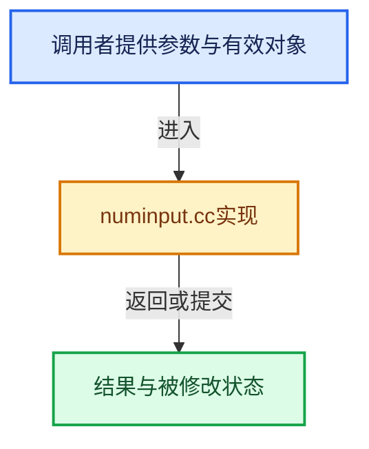

# 实现依赖专题：source/blender/editors/util/numinput.cc

[实现依赖导航](../../../README.md) · [符号索引](../../../../00-课程指南/02-源码与提交索引/符号依赖与实现索引.md)

本专题从正文实际调用进入，集中保存共享实现。函数有稳定锚点，可从调用处直接跳到对应完整函数；递归与互相调用通过回链组织。

## 本文件的实现关系





## 完整成员与函数实现

<a id="f-eb074a556ea2273a"></a>

### `blender::user_string_to_number`

实现位置：[source/blender/editors/util/numinput.cc](../../../../../../../../source/blender/editors/util/numinput.cc) · L284—L331。

接口参数：

- `bContext *C`
- `const char *str`
- `const UnitSettings &unit`
- `int type`
- `double *r_value`
- `double *r_value_no_units`
- `const bool use_single_line_error`
- `char **r_error`

**教学注释版**

<!-- annotated:7fd193c98c549d -->

```cpp
bool user_string_to_number(bContext *C,
                           const char *str,
                           const UnitSettings &unit,
                           int type,
                           double *r_value,
                           double *r_value_no_units,
                           const bool use_single_line_error,
                           char **r_error)
{
#ifdef WITH_PYTHON
  BPy_RunErrInfo err_info{};
  err_info.use_single_line_error = use_single_line_error;
  err_info.r_string = r_error;

  const double unit_scale = BKE_unit_value_scale(unit, type, 1.0);
  if (BKE_unit_string_contains_unit(str, type)) {
    char str_unit_convert[256];
    STRNCPY_UTF8(str_unit_convert, str);
    BKE_unit_replace_string(
        str_unit_convert, sizeof(str_unit_convert), str, unit_scale, unit.system, type);

    bool success = BPY_run_string_as_number(C, nullptr, str_unit_convert, &err_info, r_value);
    if (r_value_no_units) {
      /* When explicit units are in the string, the pre-scale value isn't directly recoverable.
       * Store the post-conversion value; callers relying on integer detection will naturally
       * reject non-integer results (e.g. "90deg" evaluates to ~1.5708 radians). */
      *r_value_no_units = *r_value;
    }
    return success;
  }

  bool success = BPY_run_string_as_number(C, nullptr, str, &err_info, r_value);
  if (r_value_no_units) {
    *r_value_no_units = *r_value;
  }
  *r_value = BKE_unit_apply_preferred_unit(unit, type, *r_value);
  *r_value /= unit_scale;
  return success;

#else
  UNUSED_VARS(C, unit, type, use_single_line_error, r_error);
  *r_value = atof(str);
  if (r_value_no_units) {
    *r_value_no_units = *r_value;
  }
  return true;
#endif
}
```

<details>
<summary>核对原始源码：source/blender/editors/util/numinput.cc · L284—L331</summary>

<!-- original:7fd193c98c549d:source/blender/editors/util/numinput.cc:284:331 -->

```cpp
bool user_string_to_number(bContext *C,
                           const char *str,
                           const UnitSettings &unit,
                           int type,
                           double *r_value,
                           double *r_value_no_units,
                           const bool use_single_line_error,
                           char **r_error)
{
#ifdef WITH_PYTHON
  BPy_RunErrInfo err_info{};
  err_info.use_single_line_error = use_single_line_error;
  err_info.r_string = r_error;

  const double unit_scale = BKE_unit_value_scale(unit, type, 1.0);
  if (BKE_unit_string_contains_unit(str, type)) {
    char str_unit_convert[256];
    STRNCPY_UTF8(str_unit_convert, str);
    BKE_unit_replace_string(
        str_unit_convert, sizeof(str_unit_convert), str, unit_scale, unit.system, type);

    bool success = BPY_run_string_as_number(C, nullptr, str_unit_convert, &err_info, r_value);
    if (r_value_no_units) {
      /* When explicit units are in the string, the pre-scale value isn't directly recoverable.
       * Store the post-conversion value; callers relying on integer detection will naturally
       * reject non-integer results (e.g. "90deg" evaluates to ~1.5708 radians). */
      *r_value_no_units = *r_value;
    }
    return success;
  }

  bool success = BPY_run_string_as_number(C, nullptr, str, &err_info, r_value);
  if (r_value_no_units) {
    *r_value_no_units = *r_value;
  }
  *r_value = BKE_unit_apply_preferred_unit(unit, type, *r_value);
  *r_value /= unit_scale;
  return success;

#else
  UNUSED_VARS(C, unit, type, use_single_line_error, r_error);
  *r_value = atof(str);
  if (r_value_no_units) {
    *r_value_no_units = *r_value;
  }
  return true;
#endif
}
```

</details>

**沿实际写入检查状态**

- `err_info.use_single_line_error = use_single_line_error;`
- `err_info.r_string = r_error;`

**结果出口**

- `return success;`
- `return true;`

**继续追踪实现**

- `BKE_unit_value_scale` → [blender::BKE_unit_value_scale · L1963](../../../02-BKE几何与数据/intern/unit.cc.md#f-34b02f8fa2a9867e)。
- `BKE_unit_string_contains_unit` → [blender::BKE_unit_string_contains_unit · L2388](../../../02-BKE几何与数据/intern/unit.cc.md#f-26b6903a5e86de4e)。
- `STRNCPY_UTF8` → [STRNCPY_UTF8 · L335](../../../01-BLI基础库/BLI_string_utf8.hh.md#m-222967f0ab6a)。宏定义由构建条件选择。
- `BKE_unit_replace_string` → [blender::BKE_unit_replace_string · L2414](../../../02-BKE几何与数据/intern/unit.cc.md#f-411a022183e36a7a)。
- `BPY_run_string_as_number` → [blender::BPY_run_string_as_number · L533](../../python/intern/bpy_interface_run.cc.md#f-18aaf6ea1496ba0b)。
- `BKE_unit_apply_preferred_unit` → [blender::BKE_unit_apply_preferred_unit · L2402](../../../02-BKE几何与数据/intern/unit.cc.md#f-c1fc329f91f0e3a5)。
- `UNUSED_VARS` → [UNUSED_VARS · L522](../../../01-BLI基础库/BLI_utildefines.hh.md#m-013582537634)；[UNUSED_VARS · L41](../../gpu/GPU_shader_shared_utils.hh.md#m-05d9d7a33da0)；[UNUSED_VARS · L62](../../gpu/GPU_shader_shared_utils.hh.md#m-e12c683a4aca)。宏定义由构建条件选择。
- `atof` → [调用协议](../../../../00-课程指南/01-路线与规范/模板宏与动态分派协议.md)：函数指针、局部可调用对象或未展开的宏；必须结合调用者环境。调用位置L325。
