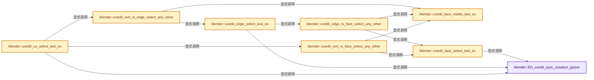
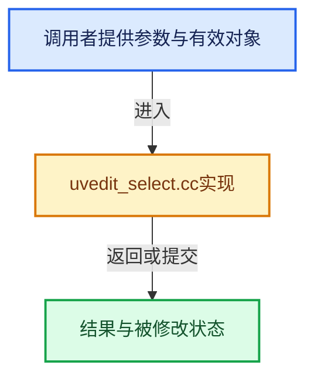

# 实现依赖专题：source/blender/editors/uvedit/uvedit_select.cc

[实现依赖导航](../../../README.md) · [符号索引](../../../../00-课程指南/02-源码与提交索引/符号依赖与实现索引.md)

本专题从正文实际调用进入，集中保存共享实现。函数有稳定锚点，可从调用处直接跳到对应完整函数；递归与互相调用通过回链组织。

## 本文件的实现关系






## 完整成员与函数实现

<a id="f-16701a60da97485b"></a>

### `blender::ED_uvedit_sync_uvselect_ignore`

实现位置：[source/blender/editors/uvedit/uvedit_select.cc](../../../../../../../../source/blender/editors/uvedit/uvedit_select.cc) · L251—L259。

接口参数：

- `const ToolSettings *ts`

**教学注释版**

<!-- annotated:89963ab02cb7be -->

```cpp
bool ED_uvedit_sync_uvselect_ignore(const ToolSettings *ts)
{
  BLI_assert(ts->uv_flag & UV_FLAG_SELECT_SYNC);
  if (ts->uv_sticky == UV_STICKY_VERT) {
    /* In this case use the original mesh selection. */
    return true;
  }
  return false;
}
```

<details>
<summary>核对原始源码：source/blender/editors/uvedit/uvedit_select.cc · L251—L259</summary>

<!-- original:89963ab02cb7be:source/blender/editors/uvedit/uvedit_select.cc:251:259 -->

```cpp
bool ED_uvedit_sync_uvselect_ignore(const ToolSettings *ts)
{
  BLI_assert(ts->uv_flag & UV_FLAG_SELECT_SYNC);
  if (ts->uv_sticky == UV_STICKY_VERT) {
    /* In this case use the original mesh selection. */
    return true;
  }
  return false;
}
```

</details>

**结果出口**

- `return true;`
- `return false;`

**继续追踪实现**

- `BLI_assert` → [BLI_assert · L48](../../../01-BLI基础库/BLI_assert.hh.md#m-57a88495704d)；[BLI_assert · L63](../../../01-BLI基础库/BLI_assert.hh.md#m-d07050020cb5)。宏定义由构建条件选择。

<a id="f-d73fb9d823545e58"></a>

### `blender::uvedit_face_visible_test_ex`

实现位置：[source/blender/editors/uvedit/uvedit_select.cc](../../../../../../../../source/blender/editors/uvedit/uvedit_select.cc) · L415—L421。

接口参数：

- `const ToolSettings *ts`
- `const BMFace *efa`

**教学注释版**

<!-- annotated:cbbd2b6e941125 -->

```cpp
bool uvedit_face_visible_test_ex(const ToolSettings *ts, const BMFace *efa)
{
  if (ts->uv_flag & UV_FLAG_SELECT_SYNC) {
    return (BM_elem_flag_test(efa, BM_ELEM_HIDDEN) == 0);
  }
  return (BM_elem_flag_test(efa, BM_ELEM_HIDDEN) == 0 && BM_elem_flag_test(efa, BM_ELEM_SELECT));
}
```

<details>
<summary>核对原始源码：source/blender/editors/uvedit/uvedit_select.cc · L415—L421</summary>

<!-- original:cbbd2b6e941125:source/blender/editors/uvedit/uvedit_select.cc:415:421 -->

```cpp
bool uvedit_face_visible_test_ex(const ToolSettings *ts, const BMFace *efa)
{
  if (ts->uv_flag & UV_FLAG_SELECT_SYNC) {
    return (BM_elem_flag_test(efa, BM_ELEM_HIDDEN) == 0);
  }
  return (BM_elem_flag_test(efa, BM_ELEM_HIDDEN) == 0 && BM_elem_flag_test(efa, BM_ELEM_SELECT));
}
```

</details>

**结果出口**

- `return (BM_elem_flag_test(efa, BM_ELEM_HIDDEN) == 0);`
- `return (BM_elem_flag_test(efa, BM_ELEM_HIDDEN) == 0 && BM_elem_flag_test(efa, BM_ELEM_SELECT));`

**继续追踪实现**

- `BM_elem_flag_test` → [BM_elem_flag_test · L21](../../bmesh/intern/bmesh_inline.hh.md#m-2431d1179b41)。宏定义由构建条件选择。

<a id="f-de42c8e97b3369b1"></a>

### `blender::uvedit_face_select_test_ex`

实现位置：[source/blender/editors/uvedit/uvedit_select.cc](../../../../../../../../source/blender/editors/uvedit/uvedit_select.cc) · L427—L454。

接口参数：

- `const ToolSettings *ts`
- `const BMesh *bm`
- `const BMFace *efa`

**教学注释版**

<!-- annotated:e484d3e1f021d1 -->

```cpp
bool uvedit_face_select_test_ex(const ToolSettings *ts, const BMesh *bm, const BMFace *efa)
{
  if (ts->uv_flag & UV_FLAG_SELECT_SYNC) {
    if (bm->uv_select_sync_valid == false || ED_uvedit_sync_uvselect_ignore(ts)) {
      return BM_elem_flag_test(efa, BM_ELEM_SELECT);
    }
    /* Caller checks for visibility. */
    BLI_assert(!BM_elem_flag_test(efa, BM_ELEM_HIDDEN));
    return BM_elem_flag_test(efa, BM_ELEM_SELECT_UV);
  }

  if (ts->uv_selectmode == UV_SELECT_FACE) {
    if (!BM_elem_flag_test(efa, BM_ELEM_SELECT_UV)) {
      return false;
    }
    return true;
  }
  const char hflag_test = (ts->uv_selectmode & UV_SELECT_VERT) ? BM_ELEM_SELECT_UV :
                                                                 BM_ELEM_SELECT_UV_EDGE;
  const BMLoop *l_first = BM_FACE_FIRST_LOOP(efa);
  const BMLoop *l_iter = l_first;
  do {
    if (!BM_elem_flag_test(l_iter, hflag_test)) {
      return false;
    }
  } while ((l_iter = l_iter->next) != l_first);
  return true;
}
```

<details>
<summary>核对原始源码：source/blender/editors/uvedit/uvedit_select.cc · L427—L454</summary>

<!-- original:e484d3e1f021d1:source/blender/editors/uvedit/uvedit_select.cc:427:454 -->

```cpp
bool uvedit_face_select_test_ex(const ToolSettings *ts, const BMesh *bm, const BMFace *efa)
{
  if (ts->uv_flag & UV_FLAG_SELECT_SYNC) {
    if (bm->uv_select_sync_valid == false || ED_uvedit_sync_uvselect_ignore(ts)) {
      return BM_elem_flag_test(efa, BM_ELEM_SELECT);
    }
    /* Caller checks for visibility. */
    BLI_assert(!BM_elem_flag_test(efa, BM_ELEM_HIDDEN));
    return BM_elem_flag_test(efa, BM_ELEM_SELECT_UV);
  }

  if (ts->uv_selectmode == UV_SELECT_FACE) {
    if (!BM_elem_flag_test(efa, BM_ELEM_SELECT_UV)) {
      return false;
    }
    return true;
  }
  const char hflag_test = (ts->uv_selectmode & UV_SELECT_VERT) ? BM_ELEM_SELECT_UV :
                                                                 BM_ELEM_SELECT_UV_EDGE;
  const BMLoop *l_first = BM_FACE_FIRST_LOOP(efa);
  const BMLoop *l_iter = l_first;
  do {
    if (!BM_elem_flag_test(l_iter, hflag_test)) {
      return false;
    }
  } while ((l_iter = l_iter->next) != l_first);
  return true;
}
```

</details>

**结果出口**

- `return BM_elem_flag_test(efa, BM_ELEM_SELECT);`
- `return BM_elem_flag_test(efa, BM_ELEM_SELECT_UV);`
- `return false;`
- `return true;`

**继续追踪实现**

- `ED_uvedit_sync_uvselect_ignore` → [blender::ED_uvedit_sync_uvselect_ignore · L251](uvedit_select.cc.md#f-16701a60da97485b)。
- `BM_elem_flag_test` → [BM_elem_flag_test · L21](../../bmesh/intern/bmesh_inline.hh.md#m-2431d1179b41)。宏定义由构建条件选择。
- `BLI_assert` → [BLI_assert · L48](../../../01-BLI基础库/BLI_assert.hh.md#m-57a88495704d)；[BLI_assert · L63](../../../01-BLI基础库/BLI_assert.hh.md#m-d07050020cb5)。宏定义由构建条件选择。
- `BM_FACE_FIRST_LOOP` → [BM_FACE_FIRST_LOOP · L697](../../bmesh/bmesh_class.hh.md#m-c7e10ffb38e6)；[BM_FACE_FIRST_LOOP · L699](../../bmesh/bmesh_class.hh.md#m-76a054cc4770)。宏定义由构建条件选择。

<a id="f-06e34e6cf42e735d"></a>

### `blender::uvedit_edge_select_test_ex`

实现位置：[source/blender/editors/uvedit/uvedit_select.cc](../../../../../../../../source/blender/editors/uvedit/uvedit_select.cc) · L616—L664。

接口参数：

- `const ToolSettings *ts`
- `const BMesh *bm`
- `const BMLoop *l`
- `const BMUVOffsets &offsets`

**教学注释版**

<!-- annotated:b4090bfed69465 -->

```cpp
bool uvedit_edge_select_test_ex(const ToolSettings *ts,
                                const BMesh *bm,
                                const BMLoop *l,
                                const BMUVOffsets &offsets)
{
  if (ts->uv_flag & UV_FLAG_SELECT_SYNC) {
    if ((bm->uv_select_sync_valid == false) && (ts->selectmode == SCE_SELECT_FACE)) {
      /* Face only is a special case that can respect sticky modes. */
      switch (ts->uv_sticky) {
        case UV_STICKY_LOCATION: {
          if (BM_elem_flag_test(l->f, BM_ELEM_SELECT)) {
            return true;
          }
          if (uvedit_edge_is_face_select_any_other(ts, bm, l, offsets)) {
            return true;
          }
          return false;
        }
        case UV_STICKY_DISABLE: {
          return BM_elem_flag_test_bool(l->f, BM_ELEM_SELECT);
        }
        default: {
          /* #UV_STICKY_VERT */
          return BM_elem_flag_test_bool(l->e, BM_ELEM_SELECT);
        }
      }
      BLI_assert_unreachable();
    }

    if (bm->uv_select_sync_valid == false || ED_uvedit_sync_uvselect_ignore(ts)) {
      if (ts->selectmode & SCE_SELECT_FACE) {
        return BM_elem_flag_test(l->f, BM_ELEM_SELECT);
      }
      if ((ts->selectmode & ~SCE_SELECT_FACE) == SCE_SELECT_EDGE) {
        return BM_elem_flag_test(l->e, BM_ELEM_SELECT);
      }
      return BM_elem_flag_test(l->v, BM_ELEM_SELECT) &&
             BM_elem_flag_test(l->next->v, BM_ELEM_SELECT);
    }

    return BM_elem_flag_test(l, BM_ELEM_SELECT_UV_EDGE);
  }

  if (ts->uv_selectmode & UV_SELECT_VERT) {
    return uvedit_vert_select_get_no_sync(ts, bm, l) &&
           uvedit_vert_select_get_no_sync(ts, bm, l->next);
  }
  return uvedit_edge_select_get_no_sync(ts, bm, l);
}
```

<details>
<summary>核对原始源码：source/blender/editors/uvedit/uvedit_select.cc · L616—L664</summary>

<!-- original:b4090bfed69465:source/blender/editors/uvedit/uvedit_select.cc:616:664 -->

```cpp
bool uvedit_edge_select_test_ex(const ToolSettings *ts,
                                const BMesh *bm,
                                const BMLoop *l,
                                const BMUVOffsets &offsets)
{
  if (ts->uv_flag & UV_FLAG_SELECT_SYNC) {
    if ((bm->uv_select_sync_valid == false) && (ts->selectmode == SCE_SELECT_FACE)) {
      /* Face only is a special case that can respect sticky modes. */
      switch (ts->uv_sticky) {
        case UV_STICKY_LOCATION: {
          if (BM_elem_flag_test(l->f, BM_ELEM_SELECT)) {
            return true;
          }
          if (uvedit_edge_is_face_select_any_other(ts, bm, l, offsets)) {
            return true;
          }
          return false;
        }
        case UV_STICKY_DISABLE: {
          return BM_elem_flag_test_bool(l->f, BM_ELEM_SELECT);
        }
        default: {
          /* #UV_STICKY_VERT */
          return BM_elem_flag_test_bool(l->e, BM_ELEM_SELECT);
        }
      }
      BLI_assert_unreachable();
    }

    if (bm->uv_select_sync_valid == false || ED_uvedit_sync_uvselect_ignore(ts)) {
      if (ts->selectmode & SCE_SELECT_FACE) {
        return BM_elem_flag_test(l->f, BM_ELEM_SELECT);
      }
      if ((ts->selectmode & ~SCE_SELECT_FACE) == SCE_SELECT_EDGE) {
        return BM_elem_flag_test(l->e, BM_ELEM_SELECT);
      }
      return BM_elem_flag_test(l->v, BM_ELEM_SELECT) &&
             BM_elem_flag_test(l->next->v, BM_ELEM_SELECT);
    }

    return BM_elem_flag_test(l, BM_ELEM_SELECT_UV_EDGE);
  }

  if (ts->uv_selectmode & UV_SELECT_VERT) {
    return uvedit_vert_select_get_no_sync(ts, bm, l) &&
           uvedit_vert_select_get_no_sync(ts, bm, l->next);
  }
  return uvedit_edge_select_get_no_sync(ts, bm, l);
}
```

</details>

**结果出口**

- `return true;`
- `return false;`
- `return BM_elem_flag_test_bool(l->f, BM_ELEM_SELECT);`
- `return BM_elem_flag_test_bool(l->e, BM_ELEM_SELECT);`
- `return BM_elem_flag_test(l->f, BM_ELEM_SELECT);`
- `return BM_elem_flag_test(l->e, BM_ELEM_SELECT);`
- `return BM_elem_flag_test(l->v, BM_ELEM_SELECT) &&`
- `return BM_elem_flag_test(l, BM_ELEM_SELECT_UV_EDGE);`
- `return uvedit_vert_select_get_no_sync(ts, bm, l) &&`
- `return uvedit_edge_select_get_no_sync(ts, bm, l);`

**继续追踪实现**

- `BM_elem_flag_test` → [BM_elem_flag_test · L21](../../bmesh/intern/bmesh_inline.hh.md#m-2431d1179b41)。宏定义由构建条件选择。
- `uvedit_edge_is_face_select_any_other` → [blender::uvedit_edge_is_face_select_any_other · L1733](uvedit_select.cc.md#f-494299741045848c)。
- `BM_elem_flag_test_bool` → [BM_elem_flag_test_bool · L22](../../bmesh/intern/bmesh_inline.hh.md#m-a8ef8d976b74)。宏定义由构建条件选择。
- `BLI_assert_unreachable` → [BLI_assert_unreachable · L77](../../../01-BLI基础库/BLI_assert.hh.md#m-7a2d91a67d8e)。宏定义由构建条件选择。
- `ED_uvedit_sync_uvselect_ignore` → [blender::ED_uvedit_sync_uvselect_ignore · L251](uvedit_select.cc.md#f-16701a60da97485b)。
- `uvedit_vert_select_get_no_sync` → [blender::uvedit_vert_select_get_no_sync · L1826](uvedit_select.cc.md#f-144580c819044a99)。
- `uvedit_edge_select_get_no_sync` → [blender::uvedit_edge_select_get_no_sync · L1832](uvedit_select.cc.md#f-cb258a9b1cbda03e)。

<a id="f-e6b14094fd82e971"></a>

### `blender::uvedit_uv_select_test_ex`

实现位置：[source/blender/editors/uvedit/uvedit_select.cc](../../../../../../../../source/blender/editors/uvedit/uvedit_select.cc) · L892—L970。

接口参数：

- `const ToolSettings *ts`
- `const BMesh *bm`
- `const BMLoop *l`
- `const BMUVOffsets &offsets`

**教学注释版**

<!-- annotated:955d6e6eb2063f -->

```cpp
bool uvedit_uv_select_test_ex(const ToolSettings *ts,
                              const BMesh *bm,
                              const BMLoop *l,
                              const BMUVOffsets &offsets)
{
  if (ts->uv_flag & UV_FLAG_SELECT_SYNC) {

    if ((bm->uv_select_sync_valid == false) && (ts->selectmode == SCE_SELECT_FACE)) {
      /* Face only is a special case that can respect sticky modes. */
      switch (ts->uv_sticky) {
        case UV_STICKY_LOCATION: {
          if (BM_elem_flag_test(l->f, BM_ELEM_SELECT)) {
            return true;
          }
          if (uvedit_vert_is_face_select_any_other(ts, bm, l, offsets)) {
            return true;
          }
          return false;
        }
        case UV_STICKY_DISABLE: {
          return BM_elem_flag_test_bool(l->f, BM_ELEM_SELECT);
        }
        default: {
          /* #UV_STICKY_VERT */
          return BM_elem_flag_test_bool(l->v, BM_ELEM_SELECT);
        }
      }
      BLI_assert_unreachable();
    }

    if (bm->uv_select_sync_valid) {
      /* Pass. */
    }
    else if ((ts->selectmode & ~SCE_SELECT_FACE) == SCE_SELECT_EDGE) {
      /* Edge/Face is a special case that can respect sticky modes. */
      switch (ts->uv_sticky) {
        case UV_STICKY_LOCATION: {
          if (BM_elem_flag_test(l->f, BM_ELEM_SELECT)) {
            return true;
          }
          if (uvedit_vert_is_edge_select_any_other(ts, bm, l, offsets)) {
            return true;
          }
          return false;
        }
        case UV_STICKY_DISABLE: {
          return BM_elem_flag_test(l->e, BM_ELEM_SELECT) ||
                 BM_elem_flag_test(l->prev->e, BM_ELEM_SELECT);
        }
        default: {
          /* #UV_STICKY_VERT */
          return BM_elem_flag_test_bool(l->v, BM_ELEM_SELECT);
        }
      }
      BLI_assert_unreachable();
    }

    if (bm->uv_select_sync_valid == false || ED_uvedit_sync_uvselect_ignore(ts)) {
      if (ts->selectmode & SCE_SELECT_FACE) {
        return BM_elem_flag_test_bool(l->f, BM_ELEM_SELECT);
      }
      if (ts->selectmode & SCE_SELECT_EDGE) {
        /* Are you looking for `uvedit_edge_select_test(...)` instead? */
      }
      return BM_elem_flag_test_bool(l->v, BM_ELEM_SELECT);
    }
    return BM_elem_flag_test_bool(l, BM_ELEM_SELECT_UV);
  }

  if (ts->selectmode & SCE_SELECT_FACE) {
    /* Are you looking for `uvedit_face_select_test(...)` instead? */
  }

  if (ts->selectmode & SCE_SELECT_EDGE) {
    /* Are you looking for `uvedit_edge_select_test(...)` instead? */
  }

  return uvedit_vert_select_get_no_sync(ts, bm, l);
}
```

<details>
<summary>核对原始源码：source/blender/editors/uvedit/uvedit_select.cc · L892—L970</summary>

<!-- original:955d6e6eb2063f:source/blender/editors/uvedit/uvedit_select.cc:892:970 -->

```cpp
bool uvedit_uv_select_test_ex(const ToolSettings *ts,
                              const BMesh *bm,
                              const BMLoop *l,
                              const BMUVOffsets &offsets)
{
  if (ts->uv_flag & UV_FLAG_SELECT_SYNC) {

    if ((bm->uv_select_sync_valid == false) && (ts->selectmode == SCE_SELECT_FACE)) {
      /* Face only is a special case that can respect sticky modes. */
      switch (ts->uv_sticky) {
        case UV_STICKY_LOCATION: {
          if (BM_elem_flag_test(l->f, BM_ELEM_SELECT)) {
            return true;
          }
          if (uvedit_vert_is_face_select_any_other(ts, bm, l, offsets)) {
            return true;
          }
          return false;
        }
        case UV_STICKY_DISABLE: {
          return BM_elem_flag_test_bool(l->f, BM_ELEM_SELECT);
        }
        default: {
          /* #UV_STICKY_VERT */
          return BM_elem_flag_test_bool(l->v, BM_ELEM_SELECT);
        }
      }
      BLI_assert_unreachable();
    }

    if (bm->uv_select_sync_valid) {
      /* Pass. */
    }
    else if ((ts->selectmode & ~SCE_SELECT_FACE) == SCE_SELECT_EDGE) {
      /* Edge/Face is a special case that can respect sticky modes. */
      switch (ts->uv_sticky) {
        case UV_STICKY_LOCATION: {
          if (BM_elem_flag_test(l->f, BM_ELEM_SELECT)) {
            return true;
          }
          if (uvedit_vert_is_edge_select_any_other(ts, bm, l, offsets)) {
            return true;
          }
          return false;
        }
        case UV_STICKY_DISABLE: {
          return BM_elem_flag_test(l->e, BM_ELEM_SELECT) ||
                 BM_elem_flag_test(l->prev->e, BM_ELEM_SELECT);
        }
        default: {
          /* #UV_STICKY_VERT */
          return BM_elem_flag_test_bool(l->v, BM_ELEM_SELECT);
        }
      }
      BLI_assert_unreachable();
    }

    if (bm->uv_select_sync_valid == false || ED_uvedit_sync_uvselect_ignore(ts)) {
      if (ts->selectmode & SCE_SELECT_FACE) {
        return BM_elem_flag_test_bool(l->f, BM_ELEM_SELECT);
      }
      if (ts->selectmode & SCE_SELECT_EDGE) {
        /* Are you looking for `uvedit_edge_select_test(...)` instead? */
      }
      return BM_elem_flag_test_bool(l->v, BM_ELEM_SELECT);
    }
    return BM_elem_flag_test_bool(l, BM_ELEM_SELECT_UV);
  }

  if (ts->selectmode & SCE_SELECT_FACE) {
    /* Are you looking for `uvedit_face_select_test(...)` instead? */
  }

  if (ts->selectmode & SCE_SELECT_EDGE) {
    /* Are you looking for `uvedit_edge_select_test(...)` instead? */
  }

  return uvedit_vert_select_get_no_sync(ts, bm, l);
}
```

</details>

**结果出口**

- `return true;`
- `return false;`
- `return BM_elem_flag_test_bool(l->f, BM_ELEM_SELECT);`
- `return BM_elem_flag_test_bool(l->v, BM_ELEM_SELECT);`
- `return BM_elem_flag_test(l->e, BM_ELEM_SELECT) ||`
- `return BM_elem_flag_test_bool(l, BM_ELEM_SELECT_UV);`
- `return uvedit_vert_select_get_no_sync(ts, bm, l);`

**继续追踪实现**

- `BM_elem_flag_test` → [BM_elem_flag_test · L21](../../bmesh/intern/bmesh_inline.hh.md#m-2431d1179b41)。宏定义由构建条件选择。
- `uvedit_vert_is_face_select_any_other` → [blender::uvedit_vert_is_face_select_any_other · L1757](uvedit_select.cc.md#f-1975566706f07c75)。
- `BM_elem_flag_test_bool` → [BM_elem_flag_test_bool · L22](../../bmesh/intern/bmesh_inline.hh.md#m-a8ef8d976b74)。宏定义由构建条件选择。
- `BLI_assert_unreachable` → [BLI_assert_unreachable · L77](../../../01-BLI基础库/BLI_assert.hh.md#m-7a2d91a67d8e)。宏定义由构建条件选择。
- `uvedit_vert_is_edge_select_any_other` → [blender::uvedit_vert_is_edge_select_any_other · L1703](uvedit_select.cc.md#f-d2edb57d73e345b6)。
- `ED_uvedit_sync_uvselect_ignore` → [blender::ED_uvedit_sync_uvselect_ignore · L251](uvedit_select.cc.md#f-16701a60da97485b)。
- `uvedit_vert_select_get_no_sync` → [blender::uvedit_vert_select_get_no_sync · L1826](uvedit_select.cc.md#f-144580c819044a99)。

<a id="f-d2edb57d73e345b6"></a>

### `blender::uvedit_vert_is_edge_select_any_other`

实现位置：[source/blender/editors/uvedit/uvedit_select.cc](../../../../../../../../source/blender/editors/uvedit/uvedit_select.cc) · L1703—L1731。

接口参数：

- `const ToolSettings *ts`
- `const BMesh *bm`
- `const BMLoop *l`
- `const BMUVOffsets &offsets`

**教学注释版**

<!-- annotated:34e7e311bdda54 -->

```cpp
bool uvedit_vert_is_edge_select_any_other(const ToolSettings *ts,
                                          const BMesh *bm,
                                          const BMLoop *l,
                                          const BMUVOffsets &offsets)
{
  BLI_assert(offsets.uv >= 0);
  BMEdge *e_iter = l->e;
  do {
    BMLoop *l_radial_iter = e_iter->l;
    if (!l_radial_iter) {
      continue; /* Skip wire edges with no loops. */
    }
    do {
      if (!uvedit_face_visible_test_ex(ts, l_radial_iter->f)) {
        continue;
      }
      /* Use #l_other to check if the uvs are connected (share the same uv coordinates)
       * and #l_radial_iter for the actual edge selection test. */
      BMLoop *l_other = (l_radial_iter->v != l->v) ? l_radial_iter->next : l_radial_iter;
      if (BM_loop_uv_share_vert_check(l, l_other, offsets.uv) &&
          uvedit_edge_select_test_ex(ts, bm, l_radial_iter, offsets))
      {
        return true;
      }
    } while ((l_radial_iter = l_radial_iter->radial_next) != e_iter->l);
  } while ((e_iter = BM_DISK_EDGE_NEXT(e_iter, l->v)) != l->e);

  return false;
}
```

<details>
<summary>核对原始源码：source/blender/editors/uvedit/uvedit_select.cc · L1703—L1731</summary>

<!-- original:34e7e311bdda54:source/blender/editors/uvedit/uvedit_select.cc:1703:1731 -->

```cpp
bool uvedit_vert_is_edge_select_any_other(const ToolSettings *ts,
                                          const BMesh *bm,
                                          const BMLoop *l,
                                          const BMUVOffsets &offsets)
{
  BLI_assert(offsets.uv >= 0);
  BMEdge *e_iter = l->e;
  do {
    BMLoop *l_radial_iter = e_iter->l;
    if (!l_radial_iter) {
      continue; /* Skip wire edges with no loops. */
    }
    do {
      if (!uvedit_face_visible_test_ex(ts, l_radial_iter->f)) {
        continue;
      }
      /* Use #l_other to check if the uvs are connected (share the same uv coordinates)
       * and #l_radial_iter for the actual edge selection test. */
      BMLoop *l_other = (l_radial_iter->v != l->v) ? l_radial_iter->next : l_radial_iter;
      if (BM_loop_uv_share_vert_check(l, l_other, offsets.uv) &&
          uvedit_edge_select_test_ex(ts, bm, l_radial_iter, offsets))
      {
        return true;
      }
    } while ((l_radial_iter = l_radial_iter->radial_next) != e_iter->l);
  } while ((e_iter = BM_DISK_EDGE_NEXT(e_iter, l->v)) != l->e);

  return false;
}
```

</details>

**结果出口**

- `return true;`
- `return false;`

**继续追踪实现**

- `BLI_assert` → [BLI_assert · L48](../../../01-BLI基础库/BLI_assert.hh.md#m-57a88495704d)；[BLI_assert · L63](../../../01-BLI基础库/BLI_assert.hh.md#m-d07050020cb5)。宏定义由构建条件选择。
- `uvedit_face_visible_test_ex` → [blender::uvedit_face_visible_test_ex · L415](uvedit_select.cc.md#f-d73fb9d823545e58)。
- `BM_loop_uv_share_vert_check` → [blender::BM_loop_uv_share_vert_check · L156](../../bmesh/intern/bmesh_query_uv.cc.md#f-a7d1cd6d1336772b)。
- `uvedit_edge_select_test_ex` → [blender::uvedit_edge_select_test_ex · L616](uvedit_select.cc.md#f-06e34e6cf42e735d)。
- `BM_DISK_EDGE_NEXT` → [BM_DISK_EDGE_NEXT · L702](../../bmesh/bmesh_class.hh.md#m-5b55b3533de2)。宏定义由构建条件选择。

<a id="f-494299741045848c"></a>

### `blender::uvedit_edge_is_face_select_any_other`

实现位置：[source/blender/editors/uvedit/uvedit_select.cc](../../../../../../../../source/blender/editors/uvedit/uvedit_select.cc) · L1733—L1755。

接口参数：

- `const ToolSettings *ts`
- `const BMesh *bm`
- `const BMLoop *l`
- `const BMUVOffsets &offsets`

**教学注释版**

<!-- annotated:c61b5412a3e7b3 -->

```cpp
bool uvedit_edge_is_face_select_any_other(const ToolSettings *ts,
                                          const BMesh *bm,
                                          const BMLoop *l,
                                          const BMUVOffsets &offsets)
{
  BLI_assert(offsets.uv >= 0);
  BMLoop *l_radial_iter = l->radial_next;
  if (l_radial_iter == l) {
    return false;
  }
  do {
    if (!uvedit_face_visible_test_ex(ts, l_radial_iter->f)) {
      continue;
    }
    if (BM_loop_uv_share_edge_check(l, l_radial_iter, offsets.uv) &&
        uvedit_face_select_test_ex(ts, bm, l_radial_iter->f))
    {
      return true;
    }
  } while ((l_radial_iter = l_radial_iter->radial_next) != l);

  return false;
}
```

<details>
<summary>核对原始源码：source/blender/editors/uvedit/uvedit_select.cc · L1733—L1755</summary>

<!-- original:c61b5412a3e7b3:source/blender/editors/uvedit/uvedit_select.cc:1733:1755 -->

```cpp
bool uvedit_edge_is_face_select_any_other(const ToolSettings *ts,
                                          const BMesh *bm,
                                          const BMLoop *l,
                                          const BMUVOffsets &offsets)
{
  BLI_assert(offsets.uv >= 0);
  BMLoop *l_radial_iter = l->radial_next;
  if (l_radial_iter == l) {
    return false;
  }
  do {
    if (!uvedit_face_visible_test_ex(ts, l_radial_iter->f)) {
      continue;
    }
    if (BM_loop_uv_share_edge_check(l, l_radial_iter, offsets.uv) &&
        uvedit_face_select_test_ex(ts, bm, l_radial_iter->f))
    {
      return true;
    }
  } while ((l_radial_iter = l_radial_iter->radial_next) != l);

  return false;
}
```

</details>

**结果出口**

- `return false;`
- `return true;`

**继续追踪实现**

- `BLI_assert` → [BLI_assert · L48](../../../01-BLI基础库/BLI_assert.hh.md#m-57a88495704d)；[BLI_assert · L63](../../../01-BLI基础库/BLI_assert.hh.md#m-d07050020cb5)。宏定义由构建条件选择。
- `uvedit_face_visible_test_ex` → [blender::uvedit_face_visible_test_ex · L415](uvedit_select.cc.md#f-d73fb9d823545e58)。
- `BM_loop_uv_share_edge_check` → [blender::BM_loop_uv_share_edge_check · L143](../../bmesh/intern/bmesh_query_uv.cc.md#f-ac1414bcb4207e6b)。
- `uvedit_face_select_test_ex` → [blender::uvedit_face_select_test_ex · L427](uvedit_select.cc.md#f-de42c8e97b3369b1)。

<a id="f-1975566706f07c75"></a>

### `blender::uvedit_vert_is_face_select_any_other`

实现位置：[source/blender/editors/uvedit/uvedit_select.cc](../../../../../../../../source/blender/editors/uvedit/uvedit_select.cc) · L1757—L1776。

接口参数：

- `const ToolSettings *ts`
- `const BMesh *bm`
- `const BMLoop *l`
- `const BMUVOffsets &offsets`

**教学注释版**

<!-- annotated:0113a225382fbb -->

```cpp
bool uvedit_vert_is_face_select_any_other(const ToolSettings *ts,
                                          const BMesh *bm,
                                          const BMLoop *l,
                                          const BMUVOffsets &offsets)
{
  BLI_assert(offsets.uv >= 0);
  BMIter liter;
  BMLoop *l_iter;
  BM_ITER_ELEM (l_iter, &liter, l->v, BM_LOOPS_OF_VERT) {
    if (!uvedit_face_visible_test_ex(ts, l_iter->f) || (l_iter->f == l->f)) {
      continue;
    }
    if (BM_loop_uv_share_vert_check(l, l_iter, offsets.uv) &&
        uvedit_face_select_test_ex(ts, bm, l_iter->f))
    {
      return true;
    }
  }
  return false;
}
```

<details>
<summary>核对原始源码：source/blender/editors/uvedit/uvedit_select.cc · L1757—L1776</summary>

<!-- original:0113a225382fbb:source/blender/editors/uvedit/uvedit_select.cc:1757:1776 -->

```cpp
bool uvedit_vert_is_face_select_any_other(const ToolSettings *ts,
                                          const BMesh *bm,
                                          const BMLoop *l,
                                          const BMUVOffsets &offsets)
{
  BLI_assert(offsets.uv >= 0);
  BMIter liter;
  BMLoop *l_iter;
  BM_ITER_ELEM (l_iter, &liter, l->v, BM_LOOPS_OF_VERT) {
    if (!uvedit_face_visible_test_ex(ts, l_iter->f) || (l_iter->f == l->f)) {
      continue;
    }
    if (BM_loop_uv_share_vert_check(l, l_iter, offsets.uv) &&
        uvedit_face_select_test_ex(ts, bm, l_iter->f))
    {
      return true;
    }
  }
  return false;
}
```

</details>

**结果出口**

- `return true;`
- `return false;`

**继续追踪实现**

- `BLI_assert` → [BLI_assert · L48](../../../01-BLI基础库/BLI_assert.hh.md#m-57a88495704d)；[BLI_assert · L63](../../../01-BLI基础库/BLI_assert.hh.md#m-d07050020cb5)。宏定义由构建条件选择。
- `BM_ITER_ELEM` → [BM_ITER_ELEM · L97](../../bmesh/intern/bmesh_iterators.hh.md#m-751d15be7ee4)。宏定义由构建条件选择。
- `uvedit_face_visible_test_ex` → [blender::uvedit_face_visible_test_ex · L415](uvedit_select.cc.md#f-d73fb9d823545e58)。
- `BM_loop_uv_share_vert_check` → [blender::BM_loop_uv_share_vert_check · L156](../../bmesh/intern/bmesh_query_uv.cc.md#f-a7d1cd6d1336772b)。
- `uvedit_face_select_test_ex` → [blender::uvedit_face_select_test_ex · L427](uvedit_select.cc.md#f-de42c8e97b3369b1)。

<a id="f-144580c819044a99"></a>

### `blender::uvedit_vert_select_get_no_sync`

实现位置：[source/blender/editors/uvedit/uvedit_select.cc](../../../../../../../../source/blender/editors/uvedit/uvedit_select.cc) · L1826—L1831。

接口参数：

- `const ToolSettings *ts`
- `const BMesh *bm`
- `const BMLoop *l`

**教学注释版**

<!-- annotated:0d51ca9e23fac6 -->

```cpp
bool uvedit_vert_select_get_no_sync(const ToolSettings *ts, const BMesh *bm, const BMLoop *l)
{
  BLI_assert(bm && (ts->uv_flag & UV_FLAG_SELECT_SYNC) == 0);
  UNUSED_VARS_NDEBUG(ts, bm);
  return BM_elem_flag_test_bool(l, BM_ELEM_SELECT_UV);
}
```

<details>
<summary>核对原始源码：source/blender/editors/uvedit/uvedit_select.cc · L1826—L1831</summary>

<!-- original:0d51ca9e23fac6:source/blender/editors/uvedit/uvedit_select.cc:1826:1831 -->

```cpp
bool uvedit_vert_select_get_no_sync(const ToolSettings *ts, const BMesh *bm, const BMLoop *l)
{
  BLI_assert(bm && (ts->uv_flag & UV_FLAG_SELECT_SYNC) == 0);
  UNUSED_VARS_NDEBUG(ts, bm);
  return BM_elem_flag_test_bool(l, BM_ELEM_SELECT_UV);
}
```

</details>

**结果出口**

- `return BM_elem_flag_test_bool(l, BM_ELEM_SELECT_UV);`

**继续追踪实现**

- `BLI_assert` → [BLI_assert · L48](../../../01-BLI基础库/BLI_assert.hh.md#m-57a88495704d)；[BLI_assert · L63](../../../01-BLI基础库/BLI_assert.hh.md#m-d07050020cb5)。宏定义由构建条件选择。
- `UNUSED_VARS_NDEBUG` → [UNUSED_VARS_NDEBUG · L526](../../../01-BLI基础库/BLI_utildefines.hh.md#m-fea439f7d366)；[UNUSED_VARS_NDEBUG · L528](../../../01-BLI基础库/BLI_utildefines.hh.md#m-a8f8cfac06c0)。宏定义由构建条件选择。
- `BM_elem_flag_test_bool` → [BM_elem_flag_test_bool · L22](../../bmesh/intern/bmesh_inline.hh.md#m-a8ef8d976b74)。宏定义由构建条件选择。

<a id="f-cb258a9b1cbda03e"></a>

### `blender::uvedit_edge_select_get_no_sync`

实现位置：[source/blender/editors/uvedit/uvedit_select.cc](../../../../../../../../source/blender/editors/uvedit/uvedit_select.cc) · L1832—L1837。

接口参数：

- `const ToolSettings *ts`
- `const BMesh *bm`
- `const BMLoop *l`

**教学注释版**

<!-- annotated:03c430d2703edd -->

```cpp
bool uvedit_edge_select_get_no_sync(const ToolSettings *ts, const BMesh *bm, const BMLoop *l)
{
  BLI_assert(bm && (ts->uv_flag & UV_FLAG_SELECT_SYNC) == 0);
  UNUSED_VARS_NDEBUG(ts, bm);
  return BM_elem_flag_test_bool(l, BM_ELEM_SELECT_UV_EDGE);
}
```

<details>
<summary>核对原始源码：source/blender/editors/uvedit/uvedit_select.cc · L1832—L1837</summary>

<!-- original:03c430d2703edd:source/blender/editors/uvedit/uvedit_select.cc:1832:1837 -->

```cpp
bool uvedit_edge_select_get_no_sync(const ToolSettings *ts, const BMesh *bm, const BMLoop *l)
{
  BLI_assert(bm && (ts->uv_flag & UV_FLAG_SELECT_SYNC) == 0);
  UNUSED_VARS_NDEBUG(ts, bm);
  return BM_elem_flag_test_bool(l, BM_ELEM_SELECT_UV_EDGE);
}
```

</details>

**结果出口**

- `return BM_elem_flag_test_bool(l, BM_ELEM_SELECT_UV_EDGE);`

**继续追踪实现**

- `BLI_assert` → [BLI_assert · L48](../../../01-BLI基础库/BLI_assert.hh.md#m-57a88495704d)；[BLI_assert · L63](../../../01-BLI基础库/BLI_assert.hh.md#m-d07050020cb5)。宏定义由构建条件选择。
- `UNUSED_VARS_NDEBUG` → [UNUSED_VARS_NDEBUG · L526](../../../01-BLI基础库/BLI_utildefines.hh.md#m-fea439f7d366)；[UNUSED_VARS_NDEBUG · L528](../../../01-BLI基础库/BLI_utildefines.hh.md#m-a8f8cfac06c0)。宏定义由构建条件选择。
- `BM_elem_flag_test_bool` → [BM_elem_flag_test_bool · L22](../../bmesh/intern/bmesh_inline.hh.md#m-a8ef8d976b74)。宏定义由构建条件选择。
