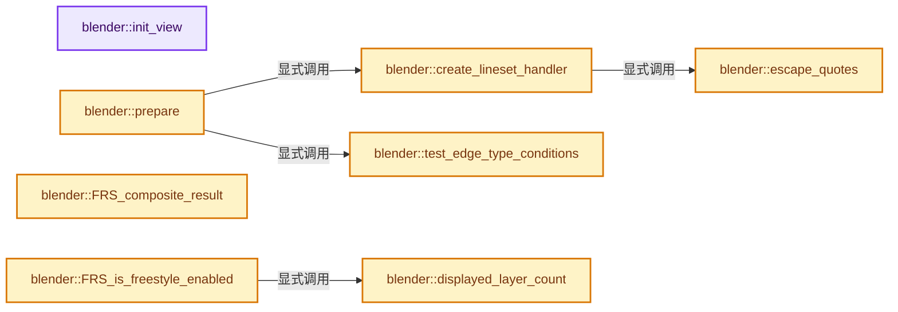
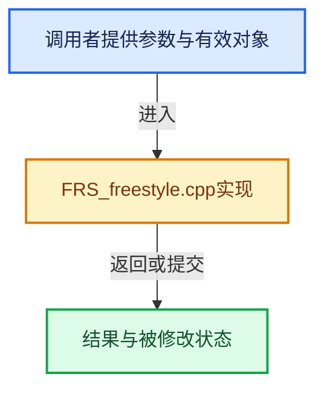

# 实现依赖专题：source/blender/freestyle/intern/blender_interface/FRS_freestyle.cpp

[实现依赖导航](../../../../README.md) · [符号索引](../../../../../00-课程指南/02-源码与提交索引/符号依赖与实现索引.md)

本专题从正文实际调用进入，集中保存共享实现。函数有稳定锚点，可从调用处直接跳到对应完整函数；递归与互相调用通过回链组织。

## 本文件的实现关系






## 完整成员与函数实现

<a id="f-a916dbf76b8e0de1"></a>

### `blender::init_view`

实现位置：[source/blender/freestyle/intern/blender_interface/FRS_freestyle.cpp](../../../../../../../../../source/blender/freestyle/intern/blender_interface/FRS_freestyle.cpp) · L125—L164。

接口参数：

- `Render *re`

**教学注释版**

<!-- annotated:f2f3cbcb678fd7 -->

```cpp
static void init_view(Render *re)
{
  int width = re->winx;
  int height = re->winy;
  int xmin = re->disprect.xmin;
  int ymin = re->disprect.ymin;
  int xmax = re->disprect.xmax;
  int ymax = re->disprect.ymax;

  float thickness = 1.0f;
  switch (re->scene->r.line_thickness_mode) {
    case R_LINE_THICKNESS_ABSOLUTE:
      thickness = re->scene->r.unit_line_thickness * (re->r.size / 100.0f);
      break;
    case R_LINE_THICKNESS_RELATIVE:
      thickness = height / 480.0f;
      break;
  }

  g_freestyle.viewport[0] = 0;
  g_freestyle.viewport[1] = 0;
  g_freestyle.viewport[2] = width;
  g_freestyle.viewport[3] = height;

  view->setWidth(width);
  view->setHeight(height);
  view->setBorder(xmin, ymin, xmax, ymax);
  view->setThickness(thickness);

  if (G.debug & G_DEBUG_FREESTYLE) {
    cout << "\n===  Dimensions of the 2D image coordinate system  ===" << endl;
    cout << "Width  : " << width << endl;
    cout << "Height : " << height << endl;
    if (re->r.mode & R_BORDER) {
      cout << "Border : (" << xmin << ", " << ymin << ") - (" << xmax << ", " << ymax << ")"
           << endl;
    }
    cout << "Unit line thickness : " << thickness << " pixel(s)" << endl;
  }
}
```

<details>
<summary>核对原始源码：source/blender/freestyle/intern/blender_interface/FRS_freestyle.cpp · L125—L164</summary>

<!-- original:f2f3cbcb678fd7:source/blender/freestyle/intern/blender_interface/FRS_freestyle.cpp:125:164 -->

```cpp
static void init_view(Render *re)
{
  int width = re->winx;
  int height = re->winy;
  int xmin = re->disprect.xmin;
  int ymin = re->disprect.ymin;
  int xmax = re->disprect.xmax;
  int ymax = re->disprect.ymax;

  float thickness = 1.0f;
  switch (re->scene->r.line_thickness_mode) {
    case R_LINE_THICKNESS_ABSOLUTE:
      thickness = re->scene->r.unit_line_thickness * (re->r.size / 100.0f);
      break;
    case R_LINE_THICKNESS_RELATIVE:
      thickness = height / 480.0f;
      break;
  }

  g_freestyle.viewport[0] = 0;
  g_freestyle.viewport[1] = 0;
  g_freestyle.viewport[2] = width;
  g_freestyle.viewport[3] = height;

  view->setWidth(width);
  view->setHeight(height);
  view->setBorder(xmin, ymin, xmax, ymax);
  view->setThickness(thickness);

  if (G.debug & G_DEBUG_FREESTYLE) {
    cout << "\n===  Dimensions of the 2D image coordinate system  ===" << endl;
    cout << "Width  : " << width << endl;
    cout << "Height : " << height << endl;
    if (re->r.mode & R_BORDER) {
      cout << "Border : (" << xmin << ", " << ymin << ") - (" << xmax << ", " << ymax << ")"
           << endl;
    }
    cout << "Unit line thickness : " << thickness << " pixel(s)" << endl;
  }
}
```

</details>

**沿实际写入检查状态**

- `thickness = re->scene->r.unit_line_thickness * (re->r.size / 100.0f);`
- `thickness = height / 480.0f;`
- `g_freestyle.viewport[0] = 0;`
- `g_freestyle.viewport[1] = 0;`
- `g_freestyle.viewport[2] = width;`
- `g_freestyle.viewport[3] = height;`

**继续追踪实现**

- `view->setWidth` → [调用协议](../../../../../00-课程指南/01-路线与规范/模板宏与动态分派协议.md)：接收对象类型依赖auto、返回值或模板实例；不按同名猜测目标。调用位置L149。
- `view->setHeight` → [调用协议](../../../../../00-课程指南/01-路线与规范/模板宏与动态分派协议.md)：接收对象类型依赖auto、返回值或模板实例；不按同名猜测目标。调用位置L150。
- `view->setBorder` → [调用协议](../../../../../00-课程指南/01-路线与规范/模板宏与动态分派协议.md)：接收对象类型依赖auto、返回值或模板实例；不按同名猜测目标。调用位置L151。
- `view->setThickness` → [调用协议](../../../../../00-课程指南/01-路线与规范/模板宏与动态分派协议.md)：接收对象类型依赖auto、返回值或模板实例；不按同名猜测目标。调用位置L152。

<a id="f-0e58d5c85ee0d38f"></a>

### `blender::escape_quotes`

实现位置：[source/blender/freestyle/intern/blender_interface/FRS_freestyle.cpp](../../../../../../../../../source/blender/freestyle/intern/blender_interface/FRS_freestyle.cpp) · L166—L178。

接口参数：

- `char *name`

**教学注释版**

<!-- annotated:ce59880a2350c9 -->

```cpp
static char *escape_quotes(char *name)
{
  char *s = MEM_new_array_uninitialized<char>(strlen(name) * 2 + 1, "escape_quotes");
  char *p = s;
  while (*name) {
    if (*name == '\'') {
      *(p++) = '\\';
    }
    *(p++) = *(name++);
  }
  *p = '\0';
  return s;
}
```

<details>
<summary>核对原始源码：source/blender/freestyle/intern/blender_interface/FRS_freestyle.cpp · L166—L178</summary>

<!-- original:ce59880a2350c9:source/blender/freestyle/intern/blender_interface/FRS_freestyle.cpp:166:178 -->

```cpp
static char *escape_quotes(char *name)
{
  char *s = MEM_new_array_uninitialized<char>(strlen(name) * 2 + 1, "escape_quotes");
  char *p = s;
  while (*name) {
    if (*name == '\'') {
      *(p++) = '\\';
    }
    *(p++) = *(name++);
  }
  *p = '\0';
  return s;
}
```

</details>

**结果出口**

- `return s;`

**继续追踪实现**

- `MEM_new_array_uninitialized<char>` → [MEM_new_array_uninitialized · L608](../../../../07-Intern运行时与平台/guardedalloc/MEM_guardedalloc.h.md#f-b7103eae8eb57b05)；[MEM_new_array_uninitialized · L129](../../../../07-Intern运行时与平台/guardedalloc/intern/mallocn.cc.md#f-bf6ef4ddcfb6e5df)。同名重载需按实参类型选择。
- `strlen` → [外部契约](https://eel.is/c++draft/)：这个边界按实际表达式及所属类型核对参数、返回值、寿命与失败行为。这里提供接口入口，不声称已解释该第三方版本的内部实现。

<a id="f-fd4b5cc565a6a989"></a>

### `blender::create_lineset_handler`

实现位置：[source/blender/freestyle/intern/blender_interface/FRS_freestyle.cpp](../../../../../../../../../source/blender/freestyle/intern/blender_interface/FRS_freestyle.cpp) · L180—L189。

接口参数：

- `char *layer_name`
- `char *lineset_name`

**教学注释版**

<!-- annotated:85cef7590ba74d -->

```cpp
static char *create_lineset_handler(char *layer_name, char *lineset_name)
{
  const char *fmt = "__import__('parameter_editor').process('%s', '%s')\n";
  char *s1 = escape_quotes(layer_name);
  char *s2 = escape_quotes(lineset_name);
  char *text = BLI_sprintfN(fmt, s1, s2);
  MEM_delete(s1);
  MEM_delete(s2);
  return text;
}
```

<details>
<summary>核对原始源码：source/blender/freestyle/intern/blender_interface/FRS_freestyle.cpp · L180—L189</summary>

<!-- original:85cef7590ba74d:source/blender/freestyle/intern/blender_interface/FRS_freestyle.cpp:180:189 -->

```cpp
static char *create_lineset_handler(char *layer_name, char *lineset_name)
{
  const char *fmt = "__import__('parameter_editor').process('%s', '%s')\n";
  char *s1 = escape_quotes(layer_name);
  char *s2 = escape_quotes(lineset_name);
  char *text = BLI_sprintfN(fmt, s1, s2);
  MEM_delete(s1);
  MEM_delete(s2);
  return text;
}
```

</details>

**结果出口**

- `return text;`

**继续追踪实现**

- `escape_quotes` → [blender::escape_quotes · L166](FRS_freestyle.cpp.md#f-0e58d5c85ee0d38f)。
- `BLI_sprintfN` → [blender::BLI_sprintfN · L296](../../../../01-BLI基础库/intern/string.cc.md#f-bfbc2f7076298fc0)。
- `MEM_delete` → [MEM_delete · L400](../../../../07-Intern运行时与平台/guardedalloc/MEM_guardedalloc.h.md#f-9049ffdd1682887c)。

<a id="f-356b6fc5b2e72ee8"></a>

### `blender::test_edge_type_conditions`

实现位置：[source/blender/freestyle/intern/blender_interface/FRS_freestyle.cpp](../../../../../../../../../source/blender/freestyle/intern/blender_interface/FRS_freestyle.cpp) · L196—L275。

接口参数：

- `edge_type_condition *conditions`
- `int num_edge_types`
- `bool logical_and`
- `int target`
- `bool distinct`

**教学注释版**

<!-- annotated:5bd6158cea08b9 -->

```cpp
static bool test_edge_type_conditions(edge_type_condition *conditions,
                                      int num_edge_types,
                                      bool logical_and,
                                      int target,
                                      bool distinct)
{
  int target_condition = 0;
  int num_non_target_positive_conditions = 0;
  int num_non_target_negative_conditions = 0;

  for (int i = 0; i < num_edge_types; i++) {
    if (conditions[i].edge_type == target) {
      target_condition = conditions[i].value;
    }
    else if (conditions[i].value > 0) {
      ++num_non_target_positive_conditions;
    }
    else if (conditions[i].value < 0) {
      ++num_non_target_negative_conditions;
    }
  }
  if (distinct) {
    // In this case, the 'target' edge type is assumed to appear on distinct edge
    // of its own and never together with other edge types.
    if (logical_and) {
      if (num_non_target_positive_conditions > 0) {
        return false;
      }
      if (target_condition > 0) {
        return true;
      }
      if (target_condition < 0) {
        return false;
      }
      if (num_non_target_negative_conditions > 0) {
        return true;
      }
    }
    else {
      if (target_condition > 0) {
        return true;
      }
      if (num_non_target_negative_conditions > 0) {
        return true;
      }
      if (target_condition < 0) {
        return false;
      }
      if (num_non_target_positive_conditions > 0) {
        return false;
      }
    }
  }
  else {
    // In this case, the 'target' edge type may appear together with other edge types.
    if (target_condition > 0) {
      return true;
    }
    if (target_condition < 0) {
      return true;
    }
    if (logical_and) {
      if (num_non_target_positive_conditions > 0) {
        return false;
      }
      if (num_non_target_negative_conditions > 0) {
        return true;
      }
    }
    else {
      if (num_non_target_negative_conditions > 0) {
        return true;
      }
      if (num_non_target_positive_conditions > 0) {
        return false;
      }
    }
  }
  return true;
}
```

<details>
<summary>核对原始源码：source/blender/freestyle/intern/blender_interface/FRS_freestyle.cpp · L196—L275</summary>

<!-- original:5bd6158cea08b9:source/blender/freestyle/intern/blender_interface/FRS_freestyle.cpp:196:275 -->

```cpp
static bool test_edge_type_conditions(edge_type_condition *conditions,
                                      int num_edge_types,
                                      bool logical_and,
                                      int target,
                                      bool distinct)
{
  int target_condition = 0;
  int num_non_target_positive_conditions = 0;
  int num_non_target_negative_conditions = 0;

  for (int i = 0; i < num_edge_types; i++) {
    if (conditions[i].edge_type == target) {
      target_condition = conditions[i].value;
    }
    else if (conditions[i].value > 0) {
      ++num_non_target_positive_conditions;
    }
    else if (conditions[i].value < 0) {
      ++num_non_target_negative_conditions;
    }
  }
  if (distinct) {
    // In this case, the 'target' edge type is assumed to appear on distinct edge
    // of its own and never together with other edge types.
    if (logical_and) {
      if (num_non_target_positive_conditions > 0) {
        return false;
      }
      if (target_condition > 0) {
        return true;
      }
      if (target_condition < 0) {
        return false;
      }
      if (num_non_target_negative_conditions > 0) {
        return true;
      }
    }
    else {
      if (target_condition > 0) {
        return true;
      }
      if (num_non_target_negative_conditions > 0) {
        return true;
      }
      if (target_condition < 0) {
        return false;
      }
      if (num_non_target_positive_conditions > 0) {
        return false;
      }
    }
  }
  else {
    // In this case, the 'target' edge type may appear together with other edge types.
    if (target_condition > 0) {
      return true;
    }
    if (target_condition < 0) {
      return true;
    }
    if (logical_and) {
      if (num_non_target_positive_conditions > 0) {
        return false;
      }
      if (num_non_target_negative_conditions > 0) {
        return true;
      }
    }
    else {
      if (num_non_target_negative_conditions > 0) {
        return true;
      }
      if (num_non_target_positive_conditions > 0) {
        return false;
      }
    }
  }
  return true;
}
```

</details>

**沿实际写入检查状态**

- `target_condition = conditions[i].value;`

**结果出口**

- `return false;`
- `return true;`

**继续追踪实现**

本实现没有需要继续展开的显式调用；检查返回表达式、对象转换和调用者前置条件。

<a id="f-d976415d29d34853"></a>

### `blender::prepare`

实现位置：[source/blender/freestyle/intern/blender_interface/FRS_freestyle.cpp](../../../../../../../../../source/blender/freestyle/intern/blender_interface/FRS_freestyle.cpp) · L277—L471。

接口参数：

- `Render *re`
- `ViewLayer *view_layer`
- `Depsgraph *depsgraph`

**教学注释版**

<!-- annotated:d3f103f4276ef1 -->

```cpp
static void prepare(Render *re, ViewLayer *view_layer, Depsgraph *depsgraph)
{
  // load mesh
  re->i.infostr = RPT_("Freestyle: Mesh loading");
  re->display->stats_draw(&re->i);
  re->i.infostr = nullptr;
  if (controller->LoadMesh(re, view_layer, depsgraph)) {
    /* Returns if scene cannot be loaded or if empty. */
    return;
  }
  if (re->display->test_break()) {
    return;
  }

  // add style modules
  FreestyleConfig *config = &view_layer->freestyle_config;

  if (G.debug & G_DEBUG_FREESTYLE) {
    cout << "\n===  Rendering options  ===" << endl;
  }
  int layer_count = 0;

  switch (config->mode) {
    case FREESTYLE_CONTROL_SCRIPT_MODE:
      if (G.debug & G_DEBUG_FREESTYLE) {
        cout << "Modules :" << endl;
      }
      for (FreestyleModuleConfig &module_conf : config->modules) {
        if (module_conf.script && module_conf.is_displayed) {
          const char *id_name = module_conf.script->id.name + 2;
          if (G.debug & G_DEBUG_FREESTYLE) {
            cout << "  " << layer_count + 1 << ": " << id_name;
            if (module_conf.script->filepath) {
              cout << " (" << module_conf.script->filepath << ")";
            }
            cout << endl;
          }
          controller->InsertStyleModule(layer_count, id_name, module_conf.script);
          controller->toggleLayer(layer_count, true);
          layer_count++;
        }
      }
      if (G.debug & G_DEBUG_FREESTYLE) {
        cout << endl;
      }
      controller->setComputeRidgesAndValleysFlag(
          (config->flags & FREESTYLE_RIDGES_AND_VALLEYS_FLAG) ? true : false);
      controller->setComputeSuggestiveContoursFlag(
          (config->flags & FREESTYLE_SUGGESTIVE_CONTOURS_FLAG) ? true : false);
      controller->setComputeMaterialBoundariesFlag(
          (config->flags & FREESTYLE_MATERIAL_BOUNDARIES_FLAG) ? true : false);
      break;
    case FREESTYLE_CONTROL_EDITOR_MODE:
      int use_ridges_and_valleys = 0;
      int use_suggestive_contours = 0;
      int use_material_boundaries = 0;
      edge_type_condition conditions[] = {
          {FREESTYLE_FE_SILHOUETTE, 0},
          {FREESTYLE_FE_BORDER, 0},
          {FREESTYLE_FE_CREASE, 0},
          {FREESTYLE_FE_RIDGE_VALLEY, 0},
          {FREESTYLE_FE_SUGGESTIVE_CONTOUR, 0},
          {FREESTYLE_FE_MATERIAL_BOUNDARY, 0},
          {FREESTYLE_FE_CONTOUR, 0},
          {FREESTYLE_FE_EXTERNAL_CONTOUR, 0},
          {FREESTYLE_FE_EDGE_MARK, 0},
      };
      int num_edge_types = ARRAY_SIZE(conditions);
      if (G.debug & G_DEBUG_FREESTYLE) {
        cout << "Linesets:" << endl;
      }
      for (FreestyleLineSet &lineset : config->linesets) {
        if (lineset.flags & FREESTYLE_LINESET_ENABLED) {
          if (G.debug & G_DEBUG_FREESTYLE) {
            cout << "  " << layer_count + 1 << ": " << lineset.name << " - "
                 << (lineset.linestyle ? (lineset.linestyle->id.name + 2) : "<null>") << endl;
          }
          char *buffer = create_lineset_handler(view_layer->name, lineset.name);
          controller->InsertStyleModule(layer_count, lineset.name, buffer);
          controller->toggleLayer(layer_count, true);
          MEM_delete(buffer);
          if (!(lineset.selection & FREESTYLE_SEL_EDGE_TYPES) || !lineset.edge_types) {
            ++use_ridges_and_valleys;
            ++use_suggestive_contours;
            ++use_material_boundaries;
          }
          else {
            // conditions for feature edge selection by edge types
            for (int i = 0; i < num_edge_types; i++) {
              if (!(lineset.edge_types & conditions[i].edge_type)) {
                conditions[i].value = 0;  // no condition specified
              }
              else if (!(lineset.exclude_edge_types & conditions[i].edge_type)) {
                conditions[i].value = 1;  // condition: X
              }
              else {
                conditions[i].value = -1;  // condition: NOT X
              }
            }
            // logical operator for the selection conditions
            bool logical_and = ((lineset.flags & FREESTYLE_LINESET_FE_AND) != 0);
            // negation operator
            if (lineset.flags & FREESTYLE_LINESET_FE_NOT) {
              // convert an Exclusive condition into an
              // Inclusive equivalent using De Morgan's laws:
              // - NOT (X OR Y) --> (NOT X) AND (NOT Y)
              // - NOT (X AND Y) --> (NOT X) OR (NOT Y)
              for (int i = 0; i < num_edge_types; i++) {
                conditions[i].value *= -1;
              }
              logical_and = !logical_and;
            }
            if (test_edge_type_conditions(
                    conditions, num_edge_types, logical_and, FREESTYLE_FE_RIDGE_VALLEY, true))
            {
              ++use_ridges_and_valleys;
            }
            if (test_edge_type_conditions(conditions,
                                          num_edge_types,
                                          logical_and,
                                          FREESTYLE_FE_SUGGESTIVE_CONTOUR,
                                          true))
            {
              ++use_suggestive_contours;
            }
            if (test_edge_type_conditions(
                    conditions, num_edge_types, logical_and, FREESTYLE_FE_MATERIAL_BOUNDARY, true))
            {
              ++use_material_boundaries;
            }
          }
          layer_count++;
        }
      }
      controller->setComputeRidgesAndValleysFlag(use_ridges_and_valleys > 0);
      controller->setComputeSuggestiveContoursFlag(use_suggestive_contours > 0);
      controller->setComputeMaterialBoundariesFlag(use_material_boundaries > 0);
      break;
  }

  // set parameters
  controller->setSphereRadius(config->sphere_radius);
  controller->setSuggestiveContourKrDerivativeEpsilon(config->dkr_epsilon);
  controller->setFaceSmoothness((config->flags & FREESTYLE_FACE_SMOOTHNESS_FLAG) ? true : false);
  controller->setCreaseAngle(RAD2DEGF(config->crease_angle));
  controller->setVisibilityAlgo((config->flags & FREESTYLE_CULLING) ?
                                    FREESTYLE_ALGO_CULLED_ADAPTIVE_CUMULATIVE :
                                    FREESTYLE_ALGO_ADAPTIVE_CUMULATIVE);

  if (G.debug & G_DEBUG_FREESTYLE) {
    cout << "Crease angle : " << controller->getCreaseAngle() << endl;
    cout << "Sphere radius : " << controller->getSphereRadius() << endl;
    cout << "Face smoothness : " << (controller->getFaceSmoothness() ? "enabled" : "disabled")
         << endl;
    cout << "Ridges and valleys : "
         << (controller->getComputeRidgesAndValleysFlag() ? "enabled" : "disabled") << endl;
    cout << "Suggestive contours : "
         << (controller->getComputeSuggestiveContoursFlag() ? "enabled" : "disabled") << endl;
    cout << "Suggestive contour Kr derivative epsilon : "
         << controller->getSuggestiveContourKrDerivativeEpsilon() << endl;
    cout << "Material boundaries : "
         << (controller->getComputeMaterialBoundariesFlag() ? "enabled" : "disabled") << endl;
    cout << endl;
  }

  // set diffuse and z depth passes
  RenderLayer *rl = RE_GetRenderLayer(re->result, view_layer->name);
  bool diffuse = false, z = false;
  for (RenderPass &rpass : rl->passes) {
    float *rpass_buffer_data = rpass.ibuf->float_data_for_write();
    if (STREQ(rpass.name, RE_PASSNAME_DIFFUSE_COLOR)) {
      controller->setPassDiffuse(rpass_buffer_data, rpass.rectx, rpass.recty);
      diffuse = true;
    }
    if (STREQ(rpass.name, RE_PASSNAME_DEPTH)) {
      controller->setPassZ(rpass_buffer_data, rpass.rectx, rpass.recty);
      z = true;
    }
  }
  if (G.debug & G_DEBUG_FREESTYLE) {
    cout << "Passes :" << endl;
    cout << "  Diffuse = " << (diffuse ? "enabled" : "disabled") << endl;
    cout << "  Z = " << (z ? "enabled" : "disabled") << endl;
  }

  if (controller->hitViewMapCache()) {
    return;
  }

  // compute view map
  re->i.infostr = RPT_("Freestyle: View map creation");
  re->display->stats_draw(&re->i);
  re->i.infostr = nullptr;
  controller->ComputeViewMap();
}
```

<details>
<summary>核对原始源码：source/blender/freestyle/intern/blender_interface/FRS_freestyle.cpp · L277—L471</summary>

<!-- original:d3f103f4276ef1:source/blender/freestyle/intern/blender_interface/FRS_freestyle.cpp:277:471 -->

```cpp
static void prepare(Render *re, ViewLayer *view_layer, Depsgraph *depsgraph)
{
  // load mesh
  re->i.infostr = RPT_("Freestyle: Mesh loading");
  re->display->stats_draw(&re->i);
  re->i.infostr = nullptr;
  if (controller->LoadMesh(re, view_layer, depsgraph)) {
    /* Returns if scene cannot be loaded or if empty. */
    return;
  }
  if (re->display->test_break()) {
    return;
  }

  // add style modules
  FreestyleConfig *config = &view_layer->freestyle_config;

  if (G.debug & G_DEBUG_FREESTYLE) {
    cout << "\n===  Rendering options  ===" << endl;
  }
  int layer_count = 0;

  switch (config->mode) {
    case FREESTYLE_CONTROL_SCRIPT_MODE:
      if (G.debug & G_DEBUG_FREESTYLE) {
        cout << "Modules :" << endl;
      }
      for (FreestyleModuleConfig &module_conf : config->modules) {
        if (module_conf.script && module_conf.is_displayed) {
          const char *id_name = module_conf.script->id.name + 2;
          if (G.debug & G_DEBUG_FREESTYLE) {
            cout << "  " << layer_count + 1 << ": " << id_name;
            if (module_conf.script->filepath) {
              cout << " (" << module_conf.script->filepath << ")";
            }
            cout << endl;
          }
          controller->InsertStyleModule(layer_count, id_name, module_conf.script);
          controller->toggleLayer(layer_count, true);
          layer_count++;
        }
      }
      if (G.debug & G_DEBUG_FREESTYLE) {
        cout << endl;
      }
      controller->setComputeRidgesAndValleysFlag(
          (config->flags & FREESTYLE_RIDGES_AND_VALLEYS_FLAG) ? true : false);
      controller->setComputeSuggestiveContoursFlag(
          (config->flags & FREESTYLE_SUGGESTIVE_CONTOURS_FLAG) ? true : false);
      controller->setComputeMaterialBoundariesFlag(
          (config->flags & FREESTYLE_MATERIAL_BOUNDARIES_FLAG) ? true : false);
      break;
    case FREESTYLE_CONTROL_EDITOR_MODE:
      int use_ridges_and_valleys = 0;
      int use_suggestive_contours = 0;
      int use_material_boundaries = 0;
      edge_type_condition conditions[] = {
          {FREESTYLE_FE_SILHOUETTE, 0},
          {FREESTYLE_FE_BORDER, 0},
          {FREESTYLE_FE_CREASE, 0},
          {FREESTYLE_FE_RIDGE_VALLEY, 0},
          {FREESTYLE_FE_SUGGESTIVE_CONTOUR, 0},
          {FREESTYLE_FE_MATERIAL_BOUNDARY, 0},
          {FREESTYLE_FE_CONTOUR, 0},
          {FREESTYLE_FE_EXTERNAL_CONTOUR, 0},
          {FREESTYLE_FE_EDGE_MARK, 0},
      };
      int num_edge_types = ARRAY_SIZE(conditions);
      if (G.debug & G_DEBUG_FREESTYLE) {
        cout << "Linesets:" << endl;
      }
      for (FreestyleLineSet &lineset : config->linesets) {
        if (lineset.flags & FREESTYLE_LINESET_ENABLED) {
          if (G.debug & G_DEBUG_FREESTYLE) {
            cout << "  " << layer_count + 1 << ": " << lineset.name << " - "
                 << (lineset.linestyle ? (lineset.linestyle->id.name + 2) : "<null>") << endl;
          }
          char *buffer = create_lineset_handler(view_layer->name, lineset.name);
          controller->InsertStyleModule(layer_count, lineset.name, buffer);
          controller->toggleLayer(layer_count, true);
          MEM_delete(buffer);
          if (!(lineset.selection & FREESTYLE_SEL_EDGE_TYPES) || !lineset.edge_types) {
            ++use_ridges_and_valleys;
            ++use_suggestive_contours;
            ++use_material_boundaries;
          }
          else {
            // conditions for feature edge selection by edge types
            for (int i = 0; i < num_edge_types; i++) {
              if (!(lineset.edge_types & conditions[i].edge_type)) {
                conditions[i].value = 0;  // no condition specified
              }
              else if (!(lineset.exclude_edge_types & conditions[i].edge_type)) {
                conditions[i].value = 1;  // condition: X
              }
              else {
                conditions[i].value = -1;  // condition: NOT X
              }
            }
            // logical operator for the selection conditions
            bool logical_and = ((lineset.flags & FREESTYLE_LINESET_FE_AND) != 0);
            // negation operator
            if (lineset.flags & FREESTYLE_LINESET_FE_NOT) {
              // convert an Exclusive condition into an
              // Inclusive equivalent using De Morgan's laws:
              // - NOT (X OR Y) --> (NOT X) AND (NOT Y)
              // - NOT (X AND Y) --> (NOT X) OR (NOT Y)
              for (int i = 0; i < num_edge_types; i++) {
                conditions[i].value *= -1;
              }
              logical_and = !logical_and;
            }
            if (test_edge_type_conditions(
                    conditions, num_edge_types, logical_and, FREESTYLE_FE_RIDGE_VALLEY, true))
            {
              ++use_ridges_and_valleys;
            }
            if (test_edge_type_conditions(conditions,
                                          num_edge_types,
                                          logical_and,
                                          FREESTYLE_FE_SUGGESTIVE_CONTOUR,
                                          true))
            {
              ++use_suggestive_contours;
            }
            if (test_edge_type_conditions(
                    conditions, num_edge_types, logical_and, FREESTYLE_FE_MATERIAL_BOUNDARY, true))
            {
              ++use_material_boundaries;
            }
          }
          layer_count++;
        }
      }
      controller->setComputeRidgesAndValleysFlag(use_ridges_and_valleys > 0);
      controller->setComputeSuggestiveContoursFlag(use_suggestive_contours > 0);
      controller->setComputeMaterialBoundariesFlag(use_material_boundaries > 0);
      break;
  }

  // set parameters
  controller->setSphereRadius(config->sphere_radius);
  controller->setSuggestiveContourKrDerivativeEpsilon(config->dkr_epsilon);
  controller->setFaceSmoothness((config->flags & FREESTYLE_FACE_SMOOTHNESS_FLAG) ? true : false);
  controller->setCreaseAngle(RAD2DEGF(config->crease_angle));
  controller->setVisibilityAlgo((config->flags & FREESTYLE_CULLING) ?
                                    FREESTYLE_ALGO_CULLED_ADAPTIVE_CUMULATIVE :
                                    FREESTYLE_ALGO_ADAPTIVE_CUMULATIVE);

  if (G.debug & G_DEBUG_FREESTYLE) {
    cout << "Crease angle : " << controller->getCreaseAngle() << endl;
    cout << "Sphere radius : " << controller->getSphereRadius() << endl;
    cout << "Face smoothness : " << (controller->getFaceSmoothness() ? "enabled" : "disabled")
         << endl;
    cout << "Ridges and valleys : "
         << (controller->getComputeRidgesAndValleysFlag() ? "enabled" : "disabled") << endl;
    cout << "Suggestive contours : "
         << (controller->getComputeSuggestiveContoursFlag() ? "enabled" : "disabled") << endl;
    cout << "Suggestive contour Kr derivative epsilon : "
         << controller->getSuggestiveContourKrDerivativeEpsilon() << endl;
    cout << "Material boundaries : "
         << (controller->getComputeMaterialBoundariesFlag() ? "enabled" : "disabled") << endl;
    cout << endl;
  }

  // set diffuse and z depth passes
  RenderLayer *rl = RE_GetRenderLayer(re->result, view_layer->name);
  bool diffuse = false, z = false;
  for (RenderPass &rpass : rl->passes) {
    float *rpass_buffer_data = rpass.ibuf->float_data_for_write();
    if (STREQ(rpass.name, RE_PASSNAME_DIFFUSE_COLOR)) {
      controller->setPassDiffuse(rpass_buffer_data, rpass.rectx, rpass.recty);
      diffuse = true;
    }
    if (STREQ(rpass.name, RE_PASSNAME_DEPTH)) {
      controller->setPassZ(rpass_buffer_data, rpass.rectx, rpass.recty);
      z = true;
    }
  }
  if (G.debug & G_DEBUG_FREESTYLE) {
    cout << "Passes :" << endl;
    cout << "  Diffuse = " << (diffuse ? "enabled" : "disabled") << endl;
    cout << "  Z = " << (z ? "enabled" : "disabled") << endl;
  }

  if (controller->hitViewMapCache()) {
    return;
  }

  // compute view map
  re->i.infostr = RPT_("Freestyle: View map creation");
  re->display->stats_draw(&re->i);
  re->i.infostr = nullptr;
  controller->ComputeViewMap();
}
```

</details>

**沿实际写入检查状态**

- `re->i.infostr = RPT_("Freestyle: Mesh loading");`
- `re->i.infostr = nullptr;`
- `conditions[i].value = 0;  // no condition specified`
- `conditions[i].value = 1;  // condition: X`
- `conditions[i].value = -1;  // condition: NOT X`
- `conditions[i].value *= -1;`
- `logical_and = !logical_and;`
- `diffuse = true;`
- `z = true;`
- `re->i.infostr = RPT_("Freestyle: View map creation");`

**继续追踪实现**

- `RPT_` → [RPT_ · L51](../../../blentranslation/BLT_translation.hh.md#m-c13f94a1a934)。宏定义由构建条件选择。
- `re->display->stats_draw` → [调用协议](../../../../../00-课程指南/01-路线与规范/模板宏与动态分派协议.md)：接收对象类型依赖auto、返回值或模板实例；不按同名猜测目标。调用位置L281。
- `controller->LoadMesh` → [调用协议](../../../../../00-课程指南/01-路线与规范/模板宏与动态分派协议.md)：接收对象类型依赖auto、返回值或模板实例；不按同名猜测目标。调用位置L283。
- `re->display->test_break` → [调用协议](../../../../../00-课程指南/01-路线与规范/模板宏与动态分派协议.md)：接收对象类型依赖auto、返回值或模板实例；不按同名猜测目标。调用位置L287。
- `controller->InsertStyleModule` → [调用协议](../../../../../00-课程指南/01-路线与规范/模板宏与动态分派协议.md)：接收对象类型依赖auto、返回值或模板实例；不按同名猜测目标。调用位置L314。
- `controller->toggleLayer` → [调用协议](../../../../../00-课程指南/01-路线与规范/模板宏与动态分派协议.md)：接收对象类型依赖auto、返回值或模板实例；不按同名猜测目标。调用位置L315。
- `controller->setComputeRidgesAndValleysFlag` → [调用协议](../../../../../00-课程指南/01-路线与规范/模板宏与动态分派协议.md)：接收对象类型依赖auto、返回值或模板实例；不按同名猜测目标。调用位置L322。
- `controller->setComputeSuggestiveContoursFlag` → [调用协议](../../../../../00-课程指南/01-路线与规范/模板宏与动态分派协议.md)：接收对象类型依赖auto、返回值或模板实例；不按同名猜测目标。调用位置L324。
- `controller->setComputeMaterialBoundariesFlag` → [调用协议](../../../../../00-课程指南/01-路线与规范/模板宏与动态分派协议.md)：接收对象类型依赖auto、返回值或模板实例；不按同名猜测目标。调用位置L326。
- `ARRAY_SIZE` → [blender::ARRAY_SIZE · L608](../../../../01-BLI基础库/BLI_utildefines.hh.md#f-eaec3a7e47b85c7c)。
- `create_lineset_handler` → [blender::create_lineset_handler · L180](FRS_freestyle.cpp.md#f-fd4b5cc565a6a989)。
- `MEM_delete` → [MEM_delete · L400](../../../../07-Intern运行时与平台/guardedalloc/MEM_guardedalloc.h.md#f-9049ffdd1682887c)。
- `test_edge_type_conditions` → [blender::test_edge_type_conditions · L196](FRS_freestyle.cpp.md#f-356b6fc5b2e72ee8)。
- `controller->setSphereRadius` → [调用协议](../../../../../00-课程指南/01-路线与规范/模板宏与动态分派协议.md)：接收对象类型依赖auto、返回值或模板实例；不按同名猜测目标。调用位置L418。
- `controller->setSuggestiveContourKrDerivativeEpsilon` → [调用协议](../../../../../00-课程指南/01-路线与规范/模板宏与动态分派协议.md)：接收对象类型依赖auto、返回值或模板实例；不按同名猜测目标。调用位置L419。
- `controller->setFaceSmoothness` → [调用协议](../../../../../00-课程指南/01-路线与规范/模板宏与动态分派协议.md)：接收对象类型依赖auto、返回值或模板实例；不按同名猜测目标。调用位置L420。
- `controller->setCreaseAngle` → [调用协议](../../../../../00-课程指南/01-路线与规范/模板宏与动态分派协议.md)：接收对象类型依赖auto、返回值或模板实例；不按同名猜测目标。调用位置L421。
- `RAD2DEGF` → [RAD2DEGF · L74](../../../../01-BLI基础库/BLI_math_constants.hh.md#m-cc180957cc06)；[RAD2DEGF · L16](../../../../07-Intern运行时与平台/cycles/app/cycles_xml.h.md#m-fc8274f087d2)。宏定义由构建条件选择。
- `controller->setVisibilityAlgo` → [调用协议](../../../../../00-课程指南/01-路线与规范/模板宏与动态分派协议.md)：接收对象类型依赖auto、返回值或模板实例；不按同名猜测目标。调用位置L422。
- `controller->getCreaseAngle` → [调用协议](../../../../../00-课程指南/01-路线与规范/模板宏与动态分派协议.md)：接收对象类型依赖auto、返回值或模板实例；不按同名猜测目标。调用位置L427。
- `controller->getSphereRadius` → [调用协议](../../../../../00-课程指南/01-路线与规范/模板宏与动态分派协议.md)：接收对象类型依赖auto、返回值或模板实例；不按同名猜测目标。调用位置L428。
- `controller->getFaceSmoothness` → [调用协议](../../../../../00-课程指南/01-路线与规范/模板宏与动态分派协议.md)：接收对象类型依赖auto、返回值或模板实例；不按同名猜测目标。调用位置L429。
- `controller->getComputeRidgesAndValleysFlag` → [调用协议](../../../../../00-课程指南/01-路线与规范/模板宏与动态分派协议.md)：接收对象类型依赖auto、返回值或模板实例；不按同名猜测目标。调用位置L432。
- `controller->getComputeSuggestiveContoursFlag` → [调用协议](../../../../../00-课程指南/01-路线与规范/模板宏与动态分派协议.md)：接收对象类型依赖auto、返回值或模板实例；不按同名猜测目标。调用位置L434。
- `controller->getSuggestiveContourKrDerivativeEpsilon` → [调用协议](../../../../../00-课程指南/01-路线与规范/模板宏与动态分派协议.md)：接收对象类型依赖auto、返回值或模板实例；不按同名猜测目标。调用位置L436。
- `controller->getComputeMaterialBoundariesFlag` → [调用协议](../../../../../00-课程指南/01-路线与规范/模板宏与动态分派协议.md)：接收对象类型依赖auto、返回值或模板实例；不按同名猜测目标。调用位置L438。
- `RE_GetRenderLayer` → [blender::RE_GetRenderLayer · L249](../../../render/intern/pipeline.cc.md#f-96213b04c74f7e5d)。
- `rpass.ibuf->float_data_for_write` → [调用协议](../../../../../00-课程指南/01-路线与规范/模板宏与动态分派协议.md)：接收对象类型依赖auto、返回值或模板实例；不按同名猜测目标。调用位置L446。
- `STREQ` → [STREQ · L112](../../../../07-Intern运行时与平台/ghost/intern/GHOST_utildefines.hh.md#m-9549fb6aafd2)；[STREQ · L451](../../../../01-BLI基础库/BLI_utildefines.hh.md#m-c7b745bcfad2)；[STREQ · L55](../../../../07-Intern运行时与平台/clog/clog.cc.md#m-96e78f386894)。宏定义由构建条件选择。
- `controller->setPassDiffuse` → [调用协议](../../../../../00-课程指南/01-路线与规范/模板宏与动态分派协议.md)：接收对象类型依赖auto、返回值或模板实例；不按同名猜测目标。调用位置L448。
- `controller->setPassZ` → [调用协议](../../../../../00-课程指南/01-路线与规范/模板宏与动态分派协议.md)：接收对象类型依赖auto、返回值或模板实例；不按同名猜测目标。调用位置L452。
- `controller->hitViewMapCache` → [调用协议](../../../../../00-课程指南/01-路线与规范/模板宏与动态分派协议.md)：接收对象类型依赖auto、返回值或模板实例；不按同名猜测目标。调用位置L462。
- `controller->ComputeViewMap` → [调用协议](../../../../../00-课程指南/01-路线与规范/模板宏与动态分派协议.md)：接收对象类型依赖auto、返回值或模板实例；不按同名猜测目标。调用位置L470。

<a id="f-5091017b8a3b8f66"></a>

### `blender::FRS_composite_result`

实现位置：[source/blender/freestyle/intern/blender_interface/FRS_freestyle.cpp](../../../../../../../../../source/blender/freestyle/intern/blender_interface/FRS_freestyle.cpp) · L473—L550。

接口参数：

- `Render *re`
- `ViewLayer *view_layer`
- `Render *freestyle_render`

**教学注释版**

<!-- annotated:db211d2e2663bf -->

```cpp
void FRS_composite_result(Render *re, ViewLayer *view_layer, Render *freestyle_render)
{
  if (freestyle_render == nullptr || freestyle_render->result == nullptr) {
    if (view_layer->freestyle_config.flags & FREESTYLE_AS_RENDER_PASS) {
      // Create a blank render pass output.
      RE_create_render_pass(
          re->result, RE_PASSNAME_FREESTYLE, 4, "RGBA", view_layer->name, re->viewname, true);
    }
    return;
  }

  RenderLayer *rl = render_get_single_layer(freestyle_render, freestyle_render->result);
  if (!rl) {
    if (G.debug & G_DEBUG_FREESTYLE) {
      cout << "No source render layer to composite" << endl;
    }
    return;
  }

  const float *src = RE_RenderLayerGetPass(rl, RE_PASSNAME_COMBINED, freestyle_render->viewname);
  if (!src) {
    if (G.debug & G_DEBUG_FREESTYLE) {
      cout << "No source result image to composite" << endl;
    }
    return;
  }
#if 0
  if (G.debug & G_DEBUG_FREESTYLE) {
    cout << "src: " << rl->rectx << " x " << rl->recty << endl;
  }
#endif

  rl = RE_GetRenderLayer(re->result, view_layer->name);
  if (!rl) {
    if (G.debug & G_DEBUG_FREESTYLE) {
      cout << "No destination render layer to composite to" << endl;
    }
    return;
  }

  const char *dest_pass;
  if (view_layer->freestyle_config.flags & FREESTYLE_AS_RENDER_PASS) {
    RE_create_render_pass(
        re->result, RE_PASSNAME_FREESTYLE, 4, "RGBA", view_layer->name, re->viewname, true);
    dest_pass = RE_PASSNAME_FREESTYLE;
  }
  else {
    dest_pass = RE_PASSNAME_COMBINED;
  }

  ImBuf *dest_ibuf = RE_RenderLayerGetPassImBuf(rl, dest_pass, re->viewname);
  float *dest = (dest_ibuf) ? dest_ibuf->float_data_for_write() : nullptr;
  if (!dest) {
    if (G.debug & G_DEBUG_FREESTYLE) {
      cout << "No destination result image to composite to" << endl;
    }
    return;
  }
#if 0
  if (G.debug & G_DEBUG_FREESTYLE) {
    cout << "dest: " << rl->rectx << " x " << rl->recty << endl;
  }
#endif

  const int rectx = re->rectx;
  const int recty = re->recty;
  for (int y = 0; y < recty; y++) {
    for (int x = 0; x < rectx; x++) {
      const float *pixSrc = src + 4 * (rectx * y + x);
      if (pixSrc[3] > 0.0) {
        float *pixDest = dest + 4 * (rectx * y + x);
        blend_color_mix_float(pixDest, pixDest, pixSrc);
      }
    }
  }

  IMB_partial_update_mark_full(dest_ibuf);
}
```

<details>
<summary>核对原始源码：source/blender/freestyle/intern/blender_interface/FRS_freestyle.cpp · L473—L550</summary>

<!-- original:db211d2e2663bf:source/blender/freestyle/intern/blender_interface/FRS_freestyle.cpp:473:550 -->

```cpp
void FRS_composite_result(Render *re, ViewLayer *view_layer, Render *freestyle_render)
{
  if (freestyle_render == nullptr || freestyle_render->result == nullptr) {
    if (view_layer->freestyle_config.flags & FREESTYLE_AS_RENDER_PASS) {
      // Create a blank render pass output.
      RE_create_render_pass(
          re->result, RE_PASSNAME_FREESTYLE, 4, "RGBA", view_layer->name, re->viewname, true);
    }
    return;
  }

  RenderLayer *rl = render_get_single_layer(freestyle_render, freestyle_render->result);
  if (!rl) {
    if (G.debug & G_DEBUG_FREESTYLE) {
      cout << "No source render layer to composite" << endl;
    }
    return;
  }

  const float *src = RE_RenderLayerGetPass(rl, RE_PASSNAME_COMBINED, freestyle_render->viewname);
  if (!src) {
    if (G.debug & G_DEBUG_FREESTYLE) {
      cout << "No source result image to composite" << endl;
    }
    return;
  }
#if 0
  if (G.debug & G_DEBUG_FREESTYLE) {
    cout << "src: " << rl->rectx << " x " << rl->recty << endl;
  }
#endif

  rl = RE_GetRenderLayer(re->result, view_layer->name);
  if (!rl) {
    if (G.debug & G_DEBUG_FREESTYLE) {
      cout << "No destination render layer to composite to" << endl;
    }
    return;
  }

  const char *dest_pass;
  if (view_layer->freestyle_config.flags & FREESTYLE_AS_RENDER_PASS) {
    RE_create_render_pass(
        re->result, RE_PASSNAME_FREESTYLE, 4, "RGBA", view_layer->name, re->viewname, true);
    dest_pass = RE_PASSNAME_FREESTYLE;
  }
  else {
    dest_pass = RE_PASSNAME_COMBINED;
  }

  ImBuf *dest_ibuf = RE_RenderLayerGetPassImBuf(rl, dest_pass, re->viewname);
  float *dest = (dest_ibuf) ? dest_ibuf->float_data_for_write() : nullptr;
  if (!dest) {
    if (G.debug & G_DEBUG_FREESTYLE) {
      cout << "No destination result image to composite to" << endl;
    }
    return;
  }
#if 0
  if (G.debug & G_DEBUG_FREESTYLE) {
    cout << "dest: " << rl->rectx << " x " << rl->recty << endl;
  }
#endif

  const int rectx = re->rectx;
  const int recty = re->recty;
  for (int y = 0; y < recty; y++) {
    for (int x = 0; x < rectx; x++) {
      const float *pixSrc = src + 4 * (rectx * y + x);
      if (pixSrc[3] > 0.0) {
        float *pixDest = dest + 4 * (rectx * y + x);
        blend_color_mix_float(pixDest, pixDest, pixSrc);
      }
    }
  }

  IMB_partial_update_mark_full(dest_ibuf);
}
```

</details>

**沿实际写入检查状态**

- `rl = RE_GetRenderLayer(re->result, view_layer->name);`
- `dest_pass = RE_PASSNAME_FREESTYLE;`
- `dest_pass = RE_PASSNAME_COMBINED;`

**继续追踪实现**

- `RE_create_render_pass` → [blender::RE_create_render_pass · L392](../../../render/intern/render_result.cc.md#f-0a4f88ff7a3c4795)。
- `render_get_single_layer` → [blender::render_get_single_layer · L270](../../../render/intern/pipeline.cc.md#f-7c41acb0cbe00d0b)。
- `RE_RenderLayerGetPass` → [blender::RE_RenderLayerGetPass · L243](../../../render/intern/pipeline.cc.md#f-e04ae8eebc5a9f52)。
- `RE_GetRenderLayer` → [blender::RE_GetRenderLayer · L249](../../../render/intern/pipeline.cc.md#f-96213b04c74f7e5d)。
- `RE_RenderLayerGetPassImBuf` → [blender::RE_RenderLayerGetPassImBuf · L237](../../../render/intern/pipeline.cc.md#f-59dc32f25a302596)。
- `dest_ibuf->float_data_for_write` → [blender::ImBuf::float_data_for_write · L79](../../../imbuf/intern/allocimbuf.cc.md#f-1956ac4db88ed3eb)。
- `blend_color_mix_float` → [blender::blend_color_mix_float · L601](../../../../01-BLI基础库/intern/math_color_blend_inline.cc.md#f-6146c61e8b9f6052)。
- `IMB_partial_update_mark_full` → [blender::IMB_partial_update_mark_full · L410](../../../imbuf/intern/partial_update.cc.md#f-7ee797d1ebd80468)。

<a id="f-3be0c2cfc99669e4"></a>

### `blender::displayed_layer_count`

实现位置：[source/blender/freestyle/intern/blender_interface/FRS_freestyle.cpp](../../../../../../../../../source/blender/freestyle/intern/blender_interface/FRS_freestyle.cpp) · L552—L573。

接口参数：

- `ViewLayer *view_layer`

**教学注释版**

<!-- annotated:417e0f4ac8bf9d -->

```cpp
static int displayed_layer_count(ViewLayer *view_layer)
{
  int count = 0;

  switch (view_layer->freestyle_config.mode) {
    case FREESTYLE_CONTROL_SCRIPT_MODE:
      for (FreestyleModuleConfig &module : view_layer->freestyle_config.modules) {
        if (module.script && module.is_displayed) {
          count++;
        }
      }
      break;
    case FREESTYLE_CONTROL_EDITOR_MODE:
      for (FreestyleLineSet &lineset : view_layer->freestyle_config.linesets) {
        if (lineset.flags & FREESTYLE_LINESET_ENABLED) {
          count++;
        }
      }
      break;
  }
  return count;
}
```

<details>
<summary>核对原始源码：source/blender/freestyle/intern/blender_interface/FRS_freestyle.cpp · L552—L573</summary>

<!-- original:417e0f4ac8bf9d:source/blender/freestyle/intern/blender_interface/FRS_freestyle.cpp:552:573 -->

```cpp
static int displayed_layer_count(ViewLayer *view_layer)
{
  int count = 0;

  switch (view_layer->freestyle_config.mode) {
    case FREESTYLE_CONTROL_SCRIPT_MODE:
      for (FreestyleModuleConfig &module : view_layer->freestyle_config.modules) {
        if (module.script && module.is_displayed) {
          count++;
        }
      }
      break;
    case FREESTYLE_CONTROL_EDITOR_MODE:
      for (FreestyleLineSet &lineset : view_layer->freestyle_config.linesets) {
        if (lineset.flags & FREESTYLE_LINESET_ENABLED) {
          count++;
        }
      }
      break;
  }
  return count;
}
```

</details>

**结果出口**

- `return count;`

**继续追踪实现**

本实现没有需要继续展开的显式调用；检查返回表达式、对象转换和调用者前置条件。

<a id="f-6ad8a1a9d6661644"></a>

### `blender::FRS_is_freestyle_enabled`

实现位置：[source/blender/freestyle/intern/blender_interface/FRS_freestyle.cpp](../../../../../../../../../source/blender/freestyle/intern/blender_interface/FRS_freestyle.cpp) · L575—L579。

接口参数：

- `ViewLayer *view_layer`

**教学注释版**

<!-- annotated:9f875d84cfd2a9 -->

```cpp
int FRS_is_freestyle_enabled(ViewLayer *view_layer)
{
  return ((view_layer->flag & VIEW_LAYER_RENDER) && (view_layer->flag & VIEW_LAYER_FREESTYLE) &&
          displayed_layer_count(view_layer) > 0);
}
```

<details>
<summary>核对原始源码：source/blender/freestyle/intern/blender_interface/FRS_freestyle.cpp · L575—L579</summary>

<!-- original:9f875d84cfd2a9:source/blender/freestyle/intern/blender_interface/FRS_freestyle.cpp:575:579 -->

```cpp
int FRS_is_freestyle_enabled(ViewLayer *view_layer)
{
  return ((view_layer->flag & VIEW_LAYER_RENDER) && (view_layer->flag & VIEW_LAYER_FREESTYLE) &&
          displayed_layer_count(view_layer) > 0);
}
```

</details>

**结果出口**

- `return ((view_layer->flag & VIEW_LAYER_RENDER) && (view_layer->flag & VIEW_LAYER_FREESTYLE) &&`

**继续追踪实现**

- `displayed_layer_count` → [blender::displayed_layer_count · L552](FRS_freestyle.cpp.md#f-3be0c2cfc99669e4)。

<a id="f-c2361ba2ec80c33b"></a>

### `blender::FRS_init_stroke_renderer`

实现位置：[source/blender/freestyle/intern/blender_interface/FRS_freestyle.cpp](../../../../../../../../../source/blender/freestyle/intern/blender_interface/FRS_freestyle.cpp) · L581—L593。

接口参数：

- `Render *re`

**教学注释版**

<!-- annotated:866a04a32c15eb -->

```cpp
void FRS_init_stroke_renderer(Render *re)
{
  if (G.debug & G_DEBUG_FREESTYLE) {
    cout << endl;
    cout << "#===============================================================" << endl;
    cout << "#  Freestyle" << endl;
    cout << "#===============================================================" << endl;
  }

  init_view(re);

  controller->ResetRenderCount();
}
```

<details>
<summary>核对原始源码：source/blender/freestyle/intern/blender_interface/FRS_freestyle.cpp · L581—L593</summary>

<!-- original:866a04a32c15eb:source/blender/freestyle/intern/blender_interface/FRS_freestyle.cpp:581:593 -->

```cpp
void FRS_init_stroke_renderer(Render *re)
{
  if (G.debug & G_DEBUG_FREESTYLE) {
    cout << endl;
    cout << "#===============================================================" << endl;
    cout << "#  Freestyle" << endl;
    cout << "#===============================================================" << endl;
  }

  init_view(re);

  controller->ResetRenderCount();
}
```

</details>

**继续追踪实现**

- `init_view` → [blender::init_view · L125](FRS_freestyle.cpp.md#f-a916dbf76b8e0de1)。
- `controller->ResetRenderCount` → [调用协议](../../../../../00-课程指南/01-路线与规范/模板宏与动态分派协议.md)：接收对象类型依赖auto、返回值或模板实例；不按同名猜测目标。调用位置L592。

<a id="f-b881333a157a53dc"></a>

### `blender::FRS_begin_stroke_rendering`

实现位置：[source/blender/freestyle/intern/blender_interface/FRS_freestyle.cpp](../../../../../../../../../source/blender/freestyle/intern/blender_interface/FRS_freestyle.cpp) · L595—L595。

接口参数：

- `Render *`

**教学注释版**

<!-- annotated:24657eb5896f06 -->

```cpp
void FRS_begin_stroke_rendering(Render * /*re*/) {}
```

<details>
<summary>核对原始源码：source/blender/freestyle/intern/blender_interface/FRS_freestyle.cpp · L595—L595</summary>

<!-- original:24657eb5896f06:source/blender/freestyle/intern/blender_interface/FRS_freestyle.cpp:595:595 -->

```cpp
void FRS_begin_stroke_rendering(Render * /*re*/) {}
```

</details>

**继续追踪实现**

本实现没有需要继续展开的显式调用；检查返回表达式、对象转换和调用者前置条件。

<a id="f-445a4f3bf8e1c099"></a>

### `blender::FRS_do_stroke_rendering`

实现位置：[source/blender/freestyle/intern/blender_interface/FRS_freestyle.cpp](../../../../../../../../../source/blender/freestyle/intern/blender_interface/FRS_freestyle.cpp) · L597—L664。

接口参数：

- `Render *re`
- `ViewLayer *view_layer`

**教学注释版**

<!-- annotated:d738177ef815bc -->

```cpp
void FRS_do_stroke_rendering(Render *re, ViewLayer *view_layer)
{
  RenderMonitor monitor(re);
  controller->setRenderMonitor(&monitor);
  controller->setViewMapCache(
      (view_layer->freestyle_config.flags & FREESTYLE_VIEW_MAP_CACHE) ? true : false);

  if (G.debug & G_DEBUG_FREESTYLE) {
    cout << endl;
    cout << "----------------------------------------------------------" << endl;
    cout << "|  " << (re->scene->id.name + 2) << "|" << view_layer->name << endl;
    cout << "----------------------------------------------------------" << endl;
  }

  /* Create depsgraph and evaluate scene. */
  ViewLayer *scene_view_layer = (ViewLayer *)BLI_findstring(
      &re->scene->view_layers, view_layer->name, offsetof(ViewLayer, name));
  Depsgraph *depsgraph = DEG_graph_new(re->main, re->scene, scene_view_layer, DAG_EVAL_RENDER);
  BKE_scene_graph_update_for_newframe(depsgraph);

  /* Init camera
   * Objects are transformed into camera coordinate system, therefore the camera position
   * is zero and the model-view matrix is the identity matrix. */
  Object *ob_camera_orig = RE_GetCamera(re);
  Object *ob_camera_eval = DEG_get_evaluated(depsgraph, ob_camera_orig);
  zero_v3(g_freestyle.viewpoint);
  unit_m4(g_freestyle.mv);
  RE_GetCameraWindow(re, ob_camera_eval, g_freestyle.proj);

  // prepare Freestyle:
  //   - load mesh
  //   - add style modules
  //   - set parameters
  //   - compute view map
  prepare(re, view_layer, depsgraph);

  if (re->display->test_break()) {
    controller->CloseFile();
    if (G.debug & G_DEBUG_FREESTYLE) {
      cout << "Break" << endl;
    }
  }
  else {
    // render and composite Freestyle result
    if (controller->_ViewMap) {
      // render strokes
      re->i.infostr = RPT_("Freestyle: Stroke rendering");
      re->display->stats_draw(&re->i);
      re->i.infostr = nullptr;
      g_freestyle.scene = DEG_get_evaluated_scene(depsgraph);
      int strokeCount = controller->DrawStrokes();
      Render *freestyle_render = nullptr;
      if (strokeCount > 0) {
        freestyle_render = controller->RenderStrokes(re, true);
      }
      controller->CloseFile();
      g_freestyle.scene = nullptr;

      // composite result
      FRS_composite_result(re, view_layer, freestyle_render);
      if (freestyle_render) {
        RE_FreeRender(freestyle_render);
      }
    }
  }

  DEG_graph_free(depsgraph);
}
```

<details>
<summary>核对原始源码：source/blender/freestyle/intern/blender_interface/FRS_freestyle.cpp · L597—L664</summary>

<!-- original:d738177ef815bc:source/blender/freestyle/intern/blender_interface/FRS_freestyle.cpp:597:664 -->

```cpp
void FRS_do_stroke_rendering(Render *re, ViewLayer *view_layer)
{
  RenderMonitor monitor(re);
  controller->setRenderMonitor(&monitor);
  controller->setViewMapCache(
      (view_layer->freestyle_config.flags & FREESTYLE_VIEW_MAP_CACHE) ? true : false);

  if (G.debug & G_DEBUG_FREESTYLE) {
    cout << endl;
    cout << "----------------------------------------------------------" << endl;
    cout << "|  " << (re->scene->id.name + 2) << "|" << view_layer->name << endl;
    cout << "----------------------------------------------------------" << endl;
  }

  /* Create depsgraph and evaluate scene. */
  ViewLayer *scene_view_layer = (ViewLayer *)BLI_findstring(
      &re->scene->view_layers, view_layer->name, offsetof(ViewLayer, name));
  Depsgraph *depsgraph = DEG_graph_new(re->main, re->scene, scene_view_layer, DAG_EVAL_RENDER);
  BKE_scene_graph_update_for_newframe(depsgraph);

  /* Init camera
   * Objects are transformed into camera coordinate system, therefore the camera position
   * is zero and the model-view matrix is the identity matrix. */
  Object *ob_camera_orig = RE_GetCamera(re);
  Object *ob_camera_eval = DEG_get_evaluated(depsgraph, ob_camera_orig);
  zero_v3(g_freestyle.viewpoint);
  unit_m4(g_freestyle.mv);
  RE_GetCameraWindow(re, ob_camera_eval, g_freestyle.proj);

  // prepare Freestyle:
  //   - load mesh
  //   - add style modules
  //   - set parameters
  //   - compute view map
  prepare(re, view_layer, depsgraph);

  if (re->display->test_break()) {
    controller->CloseFile();
    if (G.debug & G_DEBUG_FREESTYLE) {
      cout << "Break" << endl;
    }
  }
  else {
    // render and composite Freestyle result
    if (controller->_ViewMap) {
      // render strokes
      re->i.infostr = RPT_("Freestyle: Stroke rendering");
      re->display->stats_draw(&re->i);
      re->i.infostr = nullptr;
      g_freestyle.scene = DEG_get_evaluated_scene(depsgraph);
      int strokeCount = controller->DrawStrokes();
      Render *freestyle_render = nullptr;
      if (strokeCount > 0) {
        freestyle_render = controller->RenderStrokes(re, true);
      }
      controller->CloseFile();
      g_freestyle.scene = nullptr;

      // composite result
      FRS_composite_result(re, view_layer, freestyle_render);
      if (freestyle_render) {
        RE_FreeRender(freestyle_render);
      }
    }
  }

  DEG_graph_free(depsgraph);
}
```

</details>

**沿实际写入检查状态**

- `re->i.infostr = RPT_("Freestyle: Stroke rendering");`
- `re->i.infostr = nullptr;`
- `g_freestyle.scene = DEG_get_evaluated_scene(depsgraph);`
- `freestyle_render = controller->RenderStrokes(re, true);`
- `g_freestyle.scene = nullptr;`

**继续追踪实现**

- `controller->setRenderMonitor` → [调用协议](../../../../../00-课程指南/01-路线与规范/模板宏与动态分派协议.md)：接收对象类型依赖auto、返回值或模板实例；不按同名猜测目标。调用位置L600。
- `controller->setViewMapCache` → [调用协议](../../../../../00-课程指南/01-路线与规范/模板宏与动态分派协议.md)：接收对象类型依赖auto、返回值或模板实例；不按同名猜测目标。调用位置L601。
- `BLI_findstring` → [blender::BLI_findstring · L615](../../../../01-BLI基础库/intern/listbase.cc.md#f-d913b13b2651348e)。
- `DEG_graph_new` → [blender::DEG_graph_new · L279](../../../../06-Depsgraph依赖图/intern/depsgraph.cc.md#f-11a9e5374e07d3c0)。
- `BKE_scene_graph_update_for_newframe` → [blender::BKE_scene_graph_update_for_newframe · L2963](../../../../02-BKE几何与数据/intern/scene.cc.md#f-27c598ccfc7fc374)。
- `RE_GetCamera` → [blender::RE_GetCamera · L31](../../../render/intern/initrender.cc.md#f-c1bdb70ff4bf97c0)。
- `DEG_get_evaluated` → [blender::DEG_get_evaluated · L106](../../../../06-Depsgraph依赖图/DEG_depsgraph_query.hh.md#f-e70143fa875363bf)；[blender::DEG_get_evaluated · L112](../../../../06-Depsgraph依赖图/DEG_depsgraph_query.hh.md#f-129df72cfb5a1bad)。同名重载需按实参类型选择。
- `zero_v3` → [blender::zero_v3 · L26](../../../../01-BLI基础库/intern/math_vector_inline.cc.md#f-13235b08fdecb098)。
- `unit_m4` → [blender::unit_m4 · L55](../../../../01-BLI基础库/intern/math_matrix_c.cc.md#f-e6cd812aae119176)。
- `RE_GetCameraWindow` → [blender::RE_GetCameraWindow · L62](../../../render/intern/initrender.cc.md#f-01c1ec9fe7ee7242)。
- `prepare` → [blender::prepare · L277](FRS_freestyle.cpp.md#f-d976415d29d34853)。
- `re->display->test_break` → [调用协议](../../../../../00-课程指南/01-路线与规范/模板宏与动态分派协议.md)：接收对象类型依赖auto、返回值或模板实例；不按同名猜测目标。调用位置L633。
- `controller->CloseFile` → [调用协议](../../../../../00-课程指南/01-路线与规范/模板宏与动态分派协议.md)：接收对象类型依赖auto、返回值或模板实例；不按同名猜测目标。调用位置L634。
- `RPT_` → [RPT_ · L51](../../../blentranslation/BLT_translation.hh.md#m-c13f94a1a934)。宏定义由构建条件选择。
- `re->display->stats_draw` → [调用协议](../../../../../00-课程指南/01-路线与规范/模板宏与动态分派协议.md)：接收对象类型依赖auto、返回值或模板实例；不按同名猜测目标。调用位置L644。
- `DEG_get_evaluated_scene` → [blender::DEG_get_evaluated_scene · L212](../../../../06-Depsgraph依赖图/intern/depsgraph_query.cc.md#f-be7729d26a71d3fd)。
- `controller->DrawStrokes` → [调用协议](../../../../../00-课程指南/01-路线与规范/模板宏与动态分派协议.md)：接收对象类型依赖auto、返回值或模板实例；不按同名猜测目标。调用位置L647。
- `controller->RenderStrokes` → [调用协议](../../../../../00-课程指南/01-路线与规范/模板宏与动态分派协议.md)：接收对象类型依赖auto、返回值或模板实例；不按同名猜测目标。调用位置L650。
- `FRS_composite_result` → [blender::FRS_composite_result · L473](FRS_freestyle.cpp.md#f-5091017b8a3b8f66)。
- `RE_FreeRender` → [blender::RE_FreeRender · L547](../../../render/intern/pipeline.cc.md#f-45f9ccdefe880e91)。
- `DEG_graph_free` → [blender::DEG_graph_free · L307](../../../../06-Depsgraph依赖图/intern/depsgraph.cc.md#f-85cbdc7eccf6ba7e)。

<a id="f-413a1d64cfa2d19c"></a>

### `blender::FRS_end_stroke_rendering`

实现位置：[source/blender/freestyle/intern/blender_interface/FRS_freestyle.cpp](../../../../../../../../../source/blender/freestyle/intern/blender_interface/FRS_freestyle.cpp) · L666—L670。

接口参数：

- `Render *`

**教学注释版**

<!-- annotated:00aea4f8e6bfbb -->

```cpp
void FRS_end_stroke_rendering(Render * /*re*/)
{
  // clear canvas
  controller->Clear();
}
```

<details>
<summary>核对原始源码：source/blender/freestyle/intern/blender_interface/FRS_freestyle.cpp · L666—L670</summary>

<!-- original:00aea4f8e6bfbb:source/blender/freestyle/intern/blender_interface/FRS_freestyle.cpp:666:670 -->

```cpp
void FRS_end_stroke_rendering(Render * /*re*/)
{
  // clear canvas
  controller->Clear();
}
```

</details>

**继续追踪实现**

- `controller->Clear` → [调用协议](../../../../../00-课程指南/01-路线与规范/模板宏与动态分派协议.md)：接收对象类型依赖auto、返回值或模板实例；不按同名猜测目标。调用位置L669。
