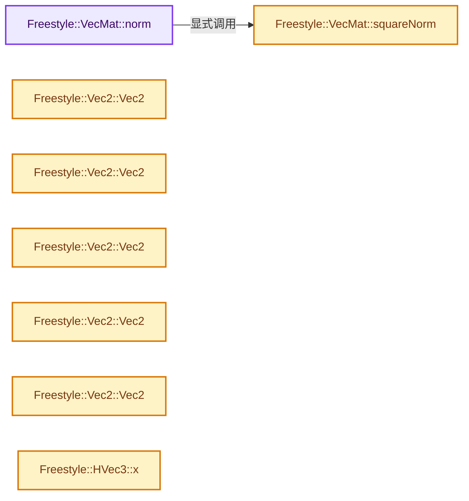
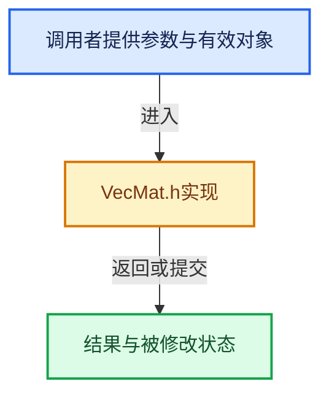

# 实现依赖专题：source/blender/freestyle/intern/geometry/VecMat.h

[实现依赖导航](../../../../README.md) · [符号索引](../../../../../00-课程指南/02-源码与提交索引/符号依赖与实现索引.md)

本专题从正文实际调用进入，集中保存共享实现。函数有稳定锚点，可从调用处直接跳到对应完整函数；递归与互相调用通过回链组织。

## 本文件的实现关系






## 完整成员与函数实现

<a id="f-0254de55a1b6b2a1"></a>

### `Freestyle::VecMat::norm`

实现位置：[source/blender/freestyle/intern/geometry/VecMat.h](../../../../../../../../../source/blender/freestyle/intern/geometry/VecMat.h) · L92—L95。

**教学注释版**

<!-- annotated:9685a3f81d8c39 -->

```cpp
  inline value_type norm() const
  {
    return (T)sqrt((float)squareNorm());
  }
```

<details>
<summary>核对原始源码：source/blender/freestyle/intern/geometry/VecMat.h · L92—L95</summary>

<!-- original:9685a3f81d8c39:source/blender/freestyle/intern/geometry/VecMat.h:92:95 -->

```cpp
  inline value_type norm() const
  {
    return (T)sqrt((float)squareNorm());
  }
```

</details>

**结果出口**

- `return (T)sqrt((float)squareNorm());`

**继续追踪实现**

- `sqrt` → [外部契约](https://eel.is/c++draft/)：这个边界按实际表达式及所属类型核对参数、返回值、寿命与失败行为。这里提供接口入口，不声称已解释该第三方版本的内部实现。
- `squareNorm` → [Freestyle::VecMat::squareNorm · L97](VecMat.h.md#f-78bc34679cc3ee0c)。

<a id="f-78bc34679cc3ee0c"></a>

### `Freestyle::VecMat::squareNorm`

实现位置：[source/blender/freestyle/intern/geometry/VecMat.h](../../../../../../../../../source/blender/freestyle/intern/geometry/VecMat.h) · L97—L100。

**教学注释版**

<!-- annotated:2d6201d088e56f -->

```cpp
  inline value_type squareNorm() const
  {
    return (*this) * (*this);
  }
```

<details>
<summary>核对原始源码：source/blender/freestyle/intern/geometry/VecMat.h · L97—L100</summary>

<!-- original:2d6201d088e56f:source/blender/freestyle/intern/geometry/VecMat.h:97:100 -->

```cpp
  inline value_type squareNorm() const
  {
    return (*this) * (*this);
  }
```

</details>

**结果出口**

- `return (*this) * (*this);`

**继续追踪实现**

本实现没有需要继续展开的显式调用；检查返回表达式、对象转换和调用者前置条件。

<a id="f-e0992110aa25b92a"></a>

### `Freestyle::Vec2::Vec2`

实现位置：[source/blender/freestyle/intern/geometry/VecMat.h](../../../../../../../../../source/blender/freestyle/intern/geometry/VecMat.h) · L278—L278。

**教学注释版**

<!-- annotated:2a833aa8852341 -->

```cpp
  inline Vec2() : Vec<T, 2>() {}
```

<details>
<summary>核对原始源码：source/blender/freestyle/intern/geometry/VecMat.h · L278—L278</summary>

<!-- original:2a833aa8852341:source/blender/freestyle/intern/geometry/VecMat.h:278:278 -->

```cpp
  inline Vec2() : Vec<T, 2>() {}
```

</details>

**继续追踪实现**

本实现没有需要继续展开的显式调用；检查返回表达式、对象转换和调用者前置条件。

<a id="f-d88a57e4af5d25d7"></a>

### `Freestyle::Vec2::Vec2`

实现位置：[source/blender/freestyle/intern/geometry/VecMat.h](../../../../../../../../../source/blender/freestyle/intern/geometry/VecMat.h) · L280—L280。

接口参数：

- `const U tab[2]`

**教学注释版**

<!-- annotated:11a330cde73d9e -->

```cpp
  template<class U> explicit inline Vec2(const U tab[2]) : Vec<T, 2>(tab) {}
```

<details>
<summary>核对原始源码：source/blender/freestyle/intern/geometry/VecMat.h · L280—L280</summary>

<!-- original:11a330cde73d9e:source/blender/freestyle/intern/geometry/VecMat.h:280:280 -->

```cpp
  template<class U> explicit inline Vec2(const U tab[2]) : Vec<T, 2>(tab) {}
```

</details>

**继续追踪实现**

本实现没有需要继续展开的显式调用；检查返回表达式、对象转换和调用者前置条件。

<a id="f-2271937e9313e6c4"></a>

### `Freestyle::Vec2::Vec2`

实现位置：[source/blender/freestyle/intern/geometry/VecMat.h](../../../../../../../../../source/blender/freestyle/intern/geometry/VecMat.h) · L282—L282。

接口参数：

- `const std::vector<U> &tab`

**教学注释版**

<!-- annotated:547c5e6755200d -->

```cpp
  template<class U> explicit inline Vec2(const std::vector<U> &tab) : Vec<T, 2>(tab) {}
```

<details>
<summary>核对原始源码：source/blender/freestyle/intern/geometry/VecMat.h · L282—L282</summary>

<!-- original:547c5e6755200d:source/blender/freestyle/intern/geometry/VecMat.h:282:282 -->

```cpp
  template<class U> explicit inline Vec2(const std::vector<U> &tab) : Vec<T, 2>(tab) {}
```

</details>

**继续追踪实现**

本实现没有需要继续展开的显式调用；检查返回表达式、对象转换和调用者前置条件。

<a id="f-bff63ebe954f0177"></a>

### `Freestyle::Vec2::Vec2`

实现位置：[source/blender/freestyle/intern/geometry/VecMat.h](../../../../../../../../../source/blender/freestyle/intern/geometry/VecMat.h) · L284—L284。

接口参数：

- `const Vec<U, 2> &v`

**教学注释版**

<!-- annotated:34a90db2b0e294 -->

```cpp
  template<class U> inline Vec2(const Vec<U, 2> &v) : Vec<T, 2>(v) {}
```

<details>
<summary>核对原始源码：source/blender/freestyle/intern/geometry/VecMat.h · L284—L284</summary>

<!-- original:34a90db2b0e294:source/blender/freestyle/intern/geometry/VecMat.h:284:284 -->

```cpp
  template<class U> inline Vec2(const Vec<U, 2> &v) : Vec<T, 2>(v) {}
```

</details>

**继续追踪实现**

本实现没有需要继续展开的显式调用；检查返回表达式、对象转换和调用者前置条件。

<a id="f-b28833246d8a3906"></a>

### `Freestyle::Vec2::Vec2`

实现位置：[source/blender/freestyle/intern/geometry/VecMat.h](../../../../../../../../../source/blender/freestyle/intern/geometry/VecMat.h) · L286—L290。

接口参数：

- `const value_type x`
- `const value_type y = 0`

**教学注释版**

<!-- annotated:c2c13c0db07f33 -->

```cpp
  inline Vec2(const value_type x, const value_type y = 0) : Vec<T, 2>()
  {
    this->_coord[0] = (T)x;
    this->_coord[1] = (T)y;
  }
```

<details>
<summary>核对原始源码：source/blender/freestyle/intern/geometry/VecMat.h · L286—L290</summary>

<!-- original:c2c13c0db07f33:source/blender/freestyle/intern/geometry/VecMat.h:286:290 -->

```cpp
  inline Vec2(const value_type x, const value_type y = 0) : Vec<T, 2>()
  {
    this->_coord[0] = (T)x;
    this->_coord[1] = (T)y;
  }
```

</details>

**沿实际写入检查状态**

- `this->_coord[0] = (T)x;`
- `this->_coord[1] = (T)y;`

**继续追踪实现**

本实现没有需要继续展开的显式调用；检查返回表达式、对象转换和调用者前置条件。

<a id="f-4a521a64892c2bde"></a>

### `Freestyle::HVec3::x`

实现位置：[source/blender/freestyle/intern/geometry/VecMat.h](../../../../../../../../../source/blender/freestyle/intern/geometry/VecMat.h) · L442—L445。

**教学注释版**

<!-- annotated:9480a5605d8d4e -->

```cpp
  inline value_type x() const
  {
    return this->_coord[0] / this->_coord[3];
  }
```

<details>
<summary>核对原始源码：source/blender/freestyle/intern/geometry/VecMat.h · L442—L445</summary>

<!-- original:9480a5605d8d4e:source/blender/freestyle/intern/geometry/VecMat.h:442:445 -->

```cpp
  inline value_type x() const
  {
    return this->_coord[0] / this->_coord[3];
  }
```

</details>

**结果出口**

- `return this->_coord[0] / this->_coord[3];`

**继续追踪实现**

本实现没有需要继续展开的显式调用；检查返回表达式、对象转换和调用者前置条件。

<a id="f-f15720be1798bee9"></a>

### `Freestyle::HVec3::y`

实现位置：[source/blender/freestyle/intern/geometry/VecMat.h](../../../../../../../../../source/blender/freestyle/intern/geometry/VecMat.h) · L447—L450。

**教学注释版**

<!-- annotated:caf95a190a7946 -->

```cpp
  inline value_type y() const
  {
    return this->_coord[1] / this->_coord[3];
  }
```

<details>
<summary>核对原始源码：source/blender/freestyle/intern/geometry/VecMat.h · L447—L450</summary>

<!-- original:caf95a190a7946:source/blender/freestyle/intern/geometry/VecMat.h:447:450 -->

```cpp
  inline value_type y() const
  {
    return this->_coord[1] / this->_coord[3];
  }
```

</details>

**结果出口**

- `return this->_coord[1] / this->_coord[3];`

**继续追踪实现**

本实现没有需要继续展开的显式调用；检查返回表达式、对象转换和调用者前置条件。

<a id="f-c2ec9e774b9e2b48"></a>

### `Freestyle::HVec3::z`

实现位置：[source/blender/freestyle/intern/geometry/VecMat.h](../../../../../../../../../source/blender/freestyle/intern/geometry/VecMat.h) · L452—L455。

**教学注释版**

<!-- annotated:bef6bb5a6e90da -->

```cpp
  inline value_type z() const
  {
    return this->_coord[2] / this->_coord[3];
  }
```

<details>
<summary>核对原始源码：source/blender/freestyle/intern/geometry/VecMat.h · L452—L455</summary>

<!-- original:bef6bb5a6e90da:source/blender/freestyle/intern/geometry/VecMat.h:452:455 -->

```cpp
  inline value_type z() const
  {
    return this->_coord[2] / this->_coord[3];
  }
```

</details>

**结果出口**

- `return this->_coord[2] / this->_coord[3];`

**继续追踪实现**

本实现没有需要继续展开的显式调用；检查返回表达式、对象转换和调用者前置条件。

<a id="f-f638e524b840d3a3"></a>

### `Freestyle::Vec3::Vec3`

实现位置：[source/blender/freestyle/intern/geometry/VecMat.h](../../../../../../../../../source/blender/freestyle/intern/geometry/VecMat.h) · L467—L467。

**教学注释版**

<!-- annotated:5cb501d76d495c -->

```cpp
  inline Vec3() : Vec<T, 3>() {}
```

<details>
<summary>核对原始源码：source/blender/freestyle/intern/geometry/VecMat.h · L467—L467</summary>

<!-- original:5cb501d76d495c:source/blender/freestyle/intern/geometry/VecMat.h:467:467 -->

```cpp
  inline Vec3() : Vec<T, 3>() {}
```

</details>

**继续追踪实现**

本实现没有需要继续展开的显式调用；检查返回表达式、对象转换和调用者前置条件。

<a id="f-f1892000970ed549"></a>

### `Freestyle::Vec3::Vec3`

实现位置：[source/blender/freestyle/intern/geometry/VecMat.h](../../../../../../../../../source/blender/freestyle/intern/geometry/VecMat.h) · L469—L469。

接口参数：

- `const U tab[3]`

**教学注释版**

<!-- annotated:ac92f75bdc294e -->

```cpp
  template<class U> explicit inline Vec3(const U tab[3]) : Vec<T, 3>(tab) {}
```

<details>
<summary>核对原始源码：source/blender/freestyle/intern/geometry/VecMat.h · L469—L469</summary>

<!-- original:ac92f75bdc294e:source/blender/freestyle/intern/geometry/VecMat.h:469:469 -->

```cpp
  template<class U> explicit inline Vec3(const U tab[3]) : Vec<T, 3>(tab) {}
```

</details>

**继续追踪实现**

本实现没有需要继续展开的显式调用；检查返回表达式、对象转换和调用者前置条件。

<a id="f-0809236593253ce3"></a>

### `Freestyle::Vec3::Vec3`

实现位置：[source/blender/freestyle/intern/geometry/VecMat.h](../../../../../../../../../source/blender/freestyle/intern/geometry/VecMat.h) · L471—L471。

接口参数：

- `const std::vector<U> &tab`

**教学注释版**

<!-- annotated:cd73e4da1c18f0 -->

```cpp
  template<class U> explicit inline Vec3(const std::vector<U> &tab) : Vec<T, 3>(tab) {}
```

<details>
<summary>核对原始源码：source/blender/freestyle/intern/geometry/VecMat.h · L471—L471</summary>

<!-- original:cd73e4da1c18f0:source/blender/freestyle/intern/geometry/VecMat.h:471:471 -->

```cpp
  template<class U> explicit inline Vec3(const std::vector<U> &tab) : Vec<T, 3>(tab) {}
```

</details>

**继续追踪实现**

本实现没有需要继续展开的显式调用；检查返回表达式、对象转换和调用者前置条件。

<a id="f-8ac324e90d5afbaf"></a>

### `Freestyle::Vec3::Vec3`

实现位置：[source/blender/freestyle/intern/geometry/VecMat.h](../../../../../../../../../source/blender/freestyle/intern/geometry/VecMat.h) · L473—L473。

接口参数：

- `const Vec<U, 3> &v`

**教学注释版**

<!-- annotated:cad04c253ee6bb -->

```cpp
  template<class U> inline Vec3(const Vec<U, 3> &v) : Vec<T, 3>(v) {}
```

<details>
<summary>核对原始源码：source/blender/freestyle/intern/geometry/VecMat.h · L473—L473</summary>

<!-- original:cad04c253ee6bb:source/blender/freestyle/intern/geometry/VecMat.h:473:473 -->

```cpp
  template<class U> inline Vec3(const Vec<U, 3> &v) : Vec<T, 3>(v) {}
```

</details>

**继续追踪实现**

本实现没有需要继续展开的显式调用；检查返回表达式、对象转换和调用者前置条件。

<a id="f-ba623196212c3e1e"></a>

### `Freestyle::Vec3::Vec3`

实现位置：[source/blender/freestyle/intern/geometry/VecMat.h](../../../../../../../../../source/blender/freestyle/intern/geometry/VecMat.h) · L475—L480。

接口参数：

- `const HVec3<U> &v`

**教学注释版**

<!-- annotated:7d80997d00e291 -->

```cpp
  template<class U> inline Vec3(const HVec3<U> &v)
  {
    this->_coord[0] = (T)v.x();
    this->_coord[1] = (T)v.y();
    this->_coord[2] = (T)v.z();
  }
```

<details>
<summary>核对原始源码：source/blender/freestyle/intern/geometry/VecMat.h · L475—L480</summary>

<!-- original:7d80997d00e291:source/blender/freestyle/intern/geometry/VecMat.h:475:480 -->

```cpp
  template<class U> inline Vec3(const HVec3<U> &v)
  {
    this->_coord[0] = (T)v.x();
    this->_coord[1] = (T)v.y();
    this->_coord[2] = (T)v.z();
  }
```

</details>

**沿实际写入检查状态**

- `this->_coord[0] = (T)v.x();`
- `this->_coord[1] = (T)v.y();`
- `this->_coord[2] = (T)v.z();`

**继续追踪实现**

- `v.x` → [Freestyle::HVec3::x · L442](VecMat.h.md#f-4a521a64892c2bde)。
- `v.y` → [Freestyle::HVec3::y · L447](VecMat.h.md#f-f15720be1798bee9)。
- `v.z` → [Freestyle::HVec3::z · L452](VecMat.h.md#f-c2ec9e774b9e2b48)。

<a id="f-55c941be1f69bc9b"></a>

### `Freestyle::Vec3::Vec3`

实现位置：[source/blender/freestyle/intern/geometry/VecMat.h](../../../../../../../../../source/blender/freestyle/intern/geometry/VecMat.h) · L482—L487。

接口参数：

- `const value_type x`
- `const value_type y = 0`
- `const value_type z = 0`

**教学注释版**

<!-- annotated:aacd8678b951be -->

```cpp
  inline Vec3(const value_type x, const value_type y = 0, const value_type z = 0) : Vec<T, 3>()
  {
    this->_coord[0] = x;
    this->_coord[1] = y;
    this->_coord[2] = z;
  }
```

<details>
<summary>核对原始源码：source/blender/freestyle/intern/geometry/VecMat.h · L482—L487</summary>

<!-- original:aacd8678b951be:source/blender/freestyle/intern/geometry/VecMat.h:482:487 -->

```cpp
  inline Vec3(const value_type x, const value_type y = 0, const value_type z = 0) : Vec<T, 3>()
  {
    this->_coord[0] = x;
    this->_coord[1] = y;
    this->_coord[2] = z;
  }
```

</details>

**沿实际写入检查状态**

- `this->_coord[0] = x;`
- `this->_coord[1] = y;`
- `this->_coord[2] = z;`

**继续追踪实现**

本实现没有需要继续展开的显式调用；检查返回表达式、对象转换和调用者前置条件。
