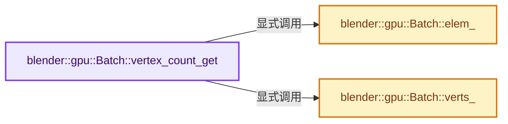
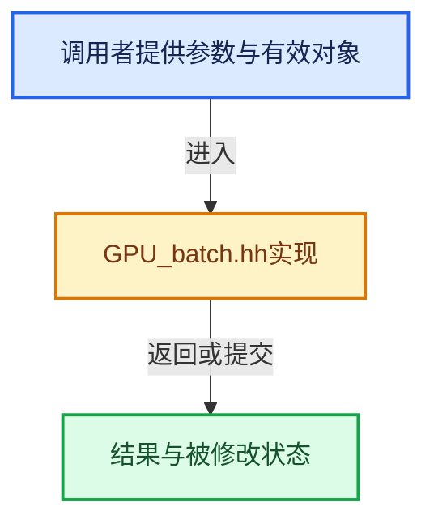

# 实现依赖专题：source/blender/gpu/GPU_batch.hh

[实现依赖导航](../../README.md) · [符号索引](../../../00-课程指南/02-源码与提交索引/符号依赖与实现索引.md)

本专题从正文实际调用进入，集中保存共享实现。函数有稳定锚点，可从调用处直接跳到对应完整函数；递归与互相调用通过回链组织。

## 本文件的实现关系






## 相关类型布局与成员入口

<a id="t-69ee9e6aa2b8"></a>

### `blender::GPUBatchFlag`

原始声明：[source/blender/gpu/GPU_batch.hh](../../../../../../../source/blender/gpu/GPU_batch.hh) · L39—L56。

以下保留类的数据声明与编译条件，成员函数实现通过后面的精确链接阅读。

<!-- annotated:1f3d0f7a0b81f4 -->

```cpp
enum GPUBatchFlag {
  /** Invalid default state. */
  GPU_BATCH_INVALID = 0,

  /** gpu::VertBuf ownership. (One bit per vbo) */
  GPU_BATCH_OWNS_VBO = (1 << 0),
  GPU_BATCH_OWNS_VBO_MAX = (GPU_BATCH_OWNS_VBO << (GPU_BATCH_VBO_MAX_LEN - 1)),
  GPU_BATCH_OWNS_VBO_ANY = ((GPU_BATCH_OWNS_VBO << GPU_BATCH_VBO_MAX_LEN) - 1),
  /** gpu::IndexBuf ownership. */
  GPU_BATCH_OWNS_INDEX = (GPU_BATCH_OWNS_VBO_MAX << 1),

  /** Has been initialized. At least one VBO is set. */
  GPU_BATCH_INIT = (1 << 26),
  /** Batch is initialized but its VBOs are still being populated. (optional) */
  GPU_BATCH_BUILDING = (1 << 26),
  /** Cached data need to be rebuild. (VAO, PSO, ...) */
  GPU_BATCH_DIRTY = (1 << 27),
};
```

<details>
<summary>核对原始源码：source/blender/gpu/GPU_batch.hh · L39—L56</summary>

<!-- original:1f3d0f7a0b81f4:source/blender/gpu/GPU_batch.hh:39:56 -->

```cpp
enum GPUBatchFlag {
  /** Invalid default state. */
  GPU_BATCH_INVALID = 0,

  /** gpu::VertBuf ownership. (One bit per vbo) */
  GPU_BATCH_OWNS_VBO = (1 << 0),
  GPU_BATCH_OWNS_VBO_MAX = (GPU_BATCH_OWNS_VBO << (GPU_BATCH_VBO_MAX_LEN - 1)),
  GPU_BATCH_OWNS_VBO_ANY = ((GPU_BATCH_OWNS_VBO << GPU_BATCH_VBO_MAX_LEN) - 1),
  /** gpu::IndexBuf ownership. */
  GPU_BATCH_OWNS_INDEX = (GPU_BATCH_OWNS_VBO_MAX << 1),

  /** Has been initialized. At least one VBO is set. */
  GPU_BATCH_INIT = (1 << 26),
  /** Batch is initialized but its VBOs are still being populated. (optional) */
  GPU_BATCH_BUILDING = (1 << 26),
  /** Cached data need to be rebuild. (VAO, PSO, ...) */
  GPU_BATCH_DIRTY = (1 << 27),
};
```

</details>


<a id="m-b63ee847b9c3"></a>

## 宏 `GPU_batch_create`

<!-- annotated:902b6c33be4b7e -->

```cpp
#define GPU_batch_create(primitive_type, vertex_buf, index_buf) \
  GPU_batch_create_ex(primitive_type, vertex_buf, index_buf, (GPUBatchFlag)0)

```

<details>
<summary>核对原始源码：source/blender/gpu/GPU_batch.hh · L143—L145</summary>

<!-- original:902b6c33be4b7e:source/blender/gpu/GPU_batch.hh:143:145 -->

```cpp
#define GPU_batch_create(primitive_type, vertex_buf, index_buf) \
  GPU_batch_create_ex(primitive_type, vertex_buf, index_buf, (GPUBatchFlag)0)

```

</details>

宏在预处理阶段展开，参数替换、重复求值和条件编译应直接从该定义检查。与普通函数不同，宏不会自动提供参数类型检查；构建配置选择哪个定义需结合外围条件。

<a id="m-04fad60448ed"></a>

## 宏 `GPU_batch_init`

<!-- annotated:2a45accead0de3 -->

```cpp
#define GPU_batch_init(batch, primitive_type, vertex_buf, index_buf) \
  GPU_batch_init_ex(batch, primitive_type, vertex_buf, index_buf, (GPUBatchFlag)0)

```

<details>
<summary>核对原始源码：source/blender/gpu/GPU_batch.hh · L161—L163</summary>

<!-- original:2a45accead0de3:source/blender/gpu/GPU_batch.hh:161:163 -->

```cpp
#define GPU_batch_init(batch, primitive_type, vertex_buf, index_buf) \
  GPU_batch_init_ex(batch, primitive_type, vertex_buf, index_buf, (GPUBatchFlag)0)

```

</details>

宏在预处理阶段展开，参数替换、重复求值和条件编译应直接从该定义检查。与普通函数不同，宏不会自动提供参数类型检查；构建配置选择哪个定义需结合外围条件。

<a id="m-cfd466eaf4c6"></a>

## 宏 `GPU_BATCH_CLEAR_SAFE`

<!-- annotated:0841757cfa1047 -->

```cpp
#define GPU_BATCH_CLEAR_SAFE(batch) \
  do { \
    if (batch != nullptr) { \
      GPU_batch_clear(batch); \
      GPU_batch_zero(batch); \
    } \
  } while (0)

```

<details>
<summary>核对原始源码：source/blender/gpu/GPU_batch.hh · L185—L192</summary>

<!-- original:0841757cfa1047:source/blender/gpu/GPU_batch.hh:185:192 -->

```cpp
#define GPU_BATCH_CLEAR_SAFE(batch) \
  do { \
    if (batch != nullptr) { \
      GPU_batch_clear(batch); \
      GPU_batch_zero(batch); \
    } \
  } while (0)

```

</details>

宏在预处理阶段展开，参数替换、重复求值和条件编译应直接从该定义检查。与普通函数不同，宏不会自动提供参数类型检查；构建配置选择哪个定义需结合外围条件。

<a id="m-167d477926a1"></a>

## 宏 `GPU_BATCH_DISCARD_SAFE`

<!-- annotated:8877e277aad029 -->

```cpp
#define GPU_BATCH_DISCARD_SAFE(batch) \
  do { \
    if (batch != nullptr) { \
      GPU_batch_discard(batch); \
      batch = nullptr; \
    } \
  } while (0)

```

<details>
<summary>核对原始源码：source/blender/gpu/GPU_batch.hh · L199—L206</summary>

<!-- original:8877e277aad029:source/blender/gpu/GPU_batch.hh:199:206 -->

```cpp
#define GPU_BATCH_DISCARD_SAFE(batch) \
  do { \
    if (batch != nullptr) { \
      GPU_batch_discard(batch); \
      batch = nullptr; \
    } \
  } while (0)

```

</details>

宏在预处理阶段展开，参数替换、重复求值和条件编译应直接从该定义检查。与普通函数不同，宏不会自动提供参数类型检查；构建配置选择哪个定义需结合外围条件。

<a id="m-97bf204d309c"></a>

## 宏 `GPU_batch_uniform_1i`

<!-- annotated:e4b12ba63d9ca8 -->

```cpp
#define GPU_batch_uniform_1i(batch, name, x) GPU_shader_uniform_1i((batch)->shader, name, x);
#define GPU_batch_uniform_1b(batch, name, x) GPU_shader_uniform_1b((batch)->shader, name, x);
```

<details>
<summary>核对原始源码：source/blender/gpu/GPU_batch.hh · L265—L266</summary>

<!-- original:e4b12ba63d9ca8:source/blender/gpu/GPU_batch.hh:265:266 -->

```cpp
#define GPU_batch_uniform_1i(batch, name, x) GPU_shader_uniform_1i((batch)->shader, name, x);
#define GPU_batch_uniform_1b(batch, name, x) GPU_shader_uniform_1b((batch)->shader, name, x);
```

</details>

宏在预处理阶段展开，参数替换、重复求值和条件编译应直接从该定义检查。与普通函数不同，宏不会自动提供参数类型检查；构建配置选择哪个定义需结合外围条件。

<a id="m-13cc70bfc150"></a>

## 宏 `GPU_batch_texture_bind`

<!-- annotated:17eede0c468cae -->

```cpp
#define GPU_batch_texture_bind(batch, name, tex) \
  GPU_texture_bind(tex, GPU_shader_get_sampler_binding((batch)->shader, name));

```

<details>
<summary>核对原始源码：source/blender/gpu/GPU_batch.hh · L284—L286</summary>

<!-- original:17eede0c468cae:source/blender/gpu/GPU_batch.hh:284:286 -->

```cpp
#define GPU_batch_texture_bind(batch, name, tex) \
  GPU_texture_bind(tex, GPU_shader_get_sampler_binding((batch)->shader, name));

```

</details>

宏在预处理阶段展开，参数替换、重复求值和条件编译应直接从该定义检查。与普通函数不同，宏不会自动提供参数类型检查；构建配置选择哪个定义需结合外围条件。

## 完整成员与函数实现

<a id="f-c7fdf1501bdfe4e1"></a>

### `blender::gpu::Batch::vertex_count_get`

实现位置：[source/blender/gpu/GPU_batch.hh](../../../../../../../source/blender/gpu/GPU_batch.hh) · L99—L105。

**教学注释版**

<!-- annotated:f47a7eacd91d8a -->

```cpp
  uint32_t vertex_count_get() const
  {
    if (elem) {
      return elem_()->index_len_get();
    }
    return verts_(0)->vertex_len;
  }
```

<details>
<summary>核对原始源码：source/blender/gpu/GPU_batch.hh · L99—L105</summary>

<!-- original:f47a7eacd91d8a:source/blender/gpu/GPU_batch.hh:99:105 -->

```cpp
  uint32_t vertex_count_get() const
  {
    if (elem) {
      return elem_()->index_len_get();
    }
    return verts_(0)->vertex_len;
  }
```

</details>

**结果出口**

- `return elem_()->index_len_get();`
- `return verts_(0)->vertex_len;`

**继续追踪实现**

- `elem_()->index_len_get` → [调用协议](../../../00-课程指南/01-路线与规范/模板宏与动态分派协议.md)：接收对象类型依赖auto、返回值或模板实例；不按同名猜测目标。调用位置L102。
- `elem_` → [blender::gpu::Batch::elem_ · L108](GPU_batch.hh.md#f-51b3281ff9d64251)。
- `verts_` → [blender::gpu::Batch::verts_ · L112](GPU_batch.hh.md#f-a72b4703a9ecfaf9)。

<a id="f-51b3281ff9d64251"></a>

### `blender::gpu::Batch::elem_`

实现位置：[source/blender/gpu/GPU_batch.hh](../../../../../../../source/blender/gpu/GPU_batch.hh) · L108—L111。

**教学注释版**

<!-- annotated:7d59fba5a73fde -->

```cpp
  IndexBuf *elem_() const
  {
    return elem;
  }
```

<details>
<summary>核对原始源码：source/blender/gpu/GPU_batch.hh · L108—L111</summary>

<!-- original:7d59fba5a73fde:source/blender/gpu/GPU_batch.hh:108:111 -->

```cpp
  IndexBuf *elem_() const
  {
    return elem;
  }
```

</details>

**结果出口**

- `return elem;`

**继续追踪实现**

本实现没有需要继续展开的显式调用；检查返回表达式、对象转换和调用者前置条件。

<a id="f-a72b4703a9ecfaf9"></a>

### `blender::gpu::Batch::verts_`

实现位置：[source/blender/gpu/GPU_batch.hh](../../../../../../../source/blender/gpu/GPU_batch.hh) · L112—L115。

接口参数：

- `const int index`

**教学注释版**

<!-- annotated:886e44ae737678 -->

```cpp
  VertBuf *verts_(const int index) const
  {
    return verts[index];
  }
```

<details>
<summary>核对原始源码：source/blender/gpu/GPU_batch.hh · L112—L115</summary>

<!-- original:886e44ae737678:source/blender/gpu/GPU_batch.hh:112:115 -->

```cpp
  VertBuf *verts_(const int index) const
  {
    return verts[index];
  }
```

</details>

**结果出口**

- `return verts[index];`

**继续追踪实现**

本实现没有需要继续展开的显式调用；检查返回表达式、对象转换和调用者前置条件。
