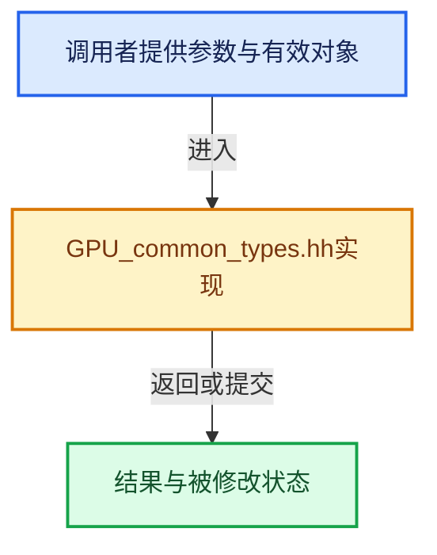

# 实现依赖专题：source/blender/gpu/GPU_common_types.hh

[实现依赖导航](../../README.md) · [符号索引](../../../00-课程指南/02-源码与提交索引/符号依赖与实现索引.md)

本专题从正文实际调用进入，集中保存共享实现。函数有稳定锚点，可从调用处直接跳到对应完整函数；递归与互相调用通过回链组织。

## 本文件的实现关系





## 相关类型布局与成员入口

<a id="t-5085282c1968"></a>

### `blender::gpu::shader::Type`

原始声明：[source/blender/gpu/GPU_common_types.hh](../../../../../../../source/blender/gpu/GPU_common_types.hh) · L94—L134。

以下保留类的数据声明与编译条件，成员函数实现通过后面的精确链接阅读。

<!-- annotated:9fa193fb225b13 -->

```cpp
enum class Type : int8_t {
  /* Types supported natively across all GPU back-ends. */
  float_t = 0,
  float2_t,
  float3_t,
  float4_t,
  float3x3_t,
  float4x4_t,
  uint_t,
  uint2_t,
  uint3_t,
  uint4_t,
  int_t,
  int2_t,
  int3_t,
  int4_t,
  bool_t,
  /* Additionally supported types to enable data optimization and native
   * support in some GPU back-ends.
   * NOTE: These types must be representable in all APIs. E.g. `VEC3_101010I2` is aliased as vec3
   * in the GL back-end, as implicit type conversions from packed normal attribute data to vec3 is
   * supported. UCHAR/CHAR types are natively supported in Metal and can be used to avoid
   * additional data conversions for `GPU_COMP_U8` vertex attributes. */
  float3_10_10_10_2_t,
  uchar_t,
  uchar2_t,
  uchar3_t,
  uchar4_t,
  char_t,
  char2_t,
  char3_t,
  char4_t,
  ushort_t,
  ushort2_t,
  ushort3_t,
  ushort4_t,
  short_t,
  short2_t,
  short3_t,
  short4_t
};
```

<details>
<summary>核对原始源码：source/blender/gpu/GPU_common_types.hh · L94—L134</summary>

<!-- original:9fa193fb225b13:source/blender/gpu/GPU_common_types.hh:94:134 -->

```cpp
enum class Type : int8_t {
  /* Types supported natively across all GPU back-ends. */
  float_t = 0,
  float2_t,
  float3_t,
  float4_t,
  float3x3_t,
  float4x4_t,
  uint_t,
  uint2_t,
  uint3_t,
  uint4_t,
  int_t,
  int2_t,
  int3_t,
  int4_t,
  bool_t,
  /* Additionally supported types to enable data optimization and native
   * support in some GPU back-ends.
   * NOTE: These types must be representable in all APIs. E.g. `VEC3_101010I2` is aliased as vec3
   * in the GL back-end, as implicit type conversions from packed normal attribute data to vec3 is
   * supported. UCHAR/CHAR types are natively supported in Metal and can be used to avoid
   * additional data conversions for `GPU_COMP_U8` vertex attributes. */
  float3_10_10_10_2_t,
  uchar_t,
  uchar2_t,
  uchar3_t,
  uchar4_t,
  char_t,
  char2_t,
  char3_t,
  char4_t,
  ushort_t,
  ushort2_t,
  ushort3_t,
  ushort4_t,
  short_t,
  short2_t,
  short3_t,
  short4_t
};
```

</details>


<a id="t-8b4628c1c185"></a>

### `blender::gpu::shader::SpecializationConstant::Value`

原始声明：[source/blender/gpu/GPU_common_types.hh](../../../../../../../source/blender/gpu/GPU_common_types.hh) · L189—L205。

以下保留类的数据声明与编译条件，成员函数实现通过后面的精确链接阅读。

<!-- annotated:a641bd12a81483 -->

```cpp
  struct Value {
    union {
      uint32_t u;
      int32_t i;
      float f;
    };

```

<details>
<summary>核对原始源码：source/blender/gpu/GPU_common_types.hh · L189—L195</summary>

<!-- original:a641bd12a81483:source/blender/gpu/GPU_common_types.hh:189:195 -->

```cpp
  struct Value {
    union {
      uint32_t u;
      int32_t i;
      float f;
    };

```

</details>

<!-- annotated:e066cbd3f0cf4e -->

```cpp

```

<details>
<summary>核对原始源码：source/blender/gpu/GPU_common_types.hh · L200—L200</summary>

<!-- original:e066cbd3f0cf4e:source/blender/gpu/GPU_common_types.hh:200:200 -->

```cpp

```

</details>

<!-- annotated:79e46107662fea -->

```cpp
  };
```

<details>
<summary>核对原始源码：source/blender/gpu/GPU_common_types.hh · L205—L205</summary>

<!-- original:79e46107662fea:source/blender/gpu/GPU_common_types.hh:205:205 -->

```cpp
  };
```

</details>


## 完整成员与函数实现
