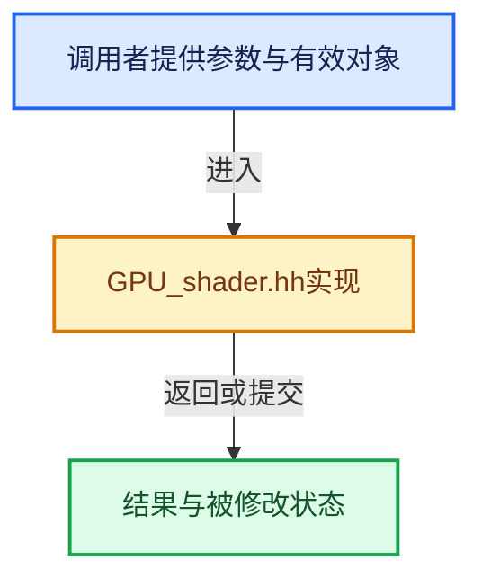

# 实现依赖专题：source/blender/gpu/GPU_shader.hh

[实现依赖导航](../../README.md) · [符号索引](../../../00-课程指南/02-源码与提交索引/符号依赖与实现索引.md)

本专题从正文实际调用进入，集中保存共享实现。函数有稳定锚点，可从调用处直接跳到对应完整函数；递归与互相调用通过回链组织。

## 本文件的实现关系





## 相关类型布局与成员入口

<a id="t-b407b22f09f3"></a>

### `blender::GPUUniformBuiltin`

原始声明：[source/blender/gpu/GPU_shader.hh](../../../../../../../source/blender/gpu/GPU_shader.hh) · L370—L391。

以下保留类的数据声明与编译条件，成员函数实现通过后面的精确链接阅读。

<!-- annotated:079ba17a3660d6 -->

```cpp
enum GPUUniformBuiltin {
  GPU_UNIFORM_MODEL = 0,      /* mat4 ModelMatrix */
  GPU_UNIFORM_VIEW,           /* mat4 ViewMatrix */
  GPU_UNIFORM_MODELVIEW,      /* mat4 ModelViewMatrix */
  GPU_UNIFORM_PROJECTION,     /* mat4 ProjectionMatrix */
  GPU_UNIFORM_VIEWPROJECTION, /* mat4 ViewProjectionMatrix */
  GPU_UNIFORM_MVP,            /* mat4 ModelViewProjectionMatrix */

  GPU_UNIFORM_MODEL_INV,          /* mat4 ModelMatrixInverse */
  GPU_UNIFORM_VIEW_INV,           /* mat4 ViewMatrixInverse */
  GPU_UNIFORM_MODELVIEW_INV,      /* mat4 ModelViewMatrixInverse */
  GPU_UNIFORM_PROJECTION_INV,     /* mat4 ProjectionMatrixInverse */
  GPU_UNIFORM_VIEWPROJECTION_INV, /* mat4 ViewProjectionMatrixInverse */

  GPU_UNIFORM_NORMAL,     /* mat3 NormalMatrix */
  GPU_UNIFORM_CLIPPLANES, /* vec4 WorldClipPlanes[] */

  GPU_UNIFORM_COLOR,              /* vec4 color */
  GPU_UNIFORM_BASE_INSTANCE,      /* int baseInstance */
  GPU_UNIFORM_SRGB_TRANSFORM,     /* bool srgbTarget */
  GPU_UNIFORM_SCENE_LINEAR_XFORM, /* float3x3 gpu_scene_linear_to_xyz */
};
```

<details>
<summary>核对原始源码：source/blender/gpu/GPU_shader.hh · L370—L391</summary>

<!-- original:079ba17a3660d6:source/blender/gpu/GPU_shader.hh:370:391 -->

```cpp
enum GPUUniformBuiltin {
  GPU_UNIFORM_MODEL = 0,      /* mat4 ModelMatrix */
  GPU_UNIFORM_VIEW,           /* mat4 ViewMatrix */
  GPU_UNIFORM_MODELVIEW,      /* mat4 ModelViewMatrix */
  GPU_UNIFORM_PROJECTION,     /* mat4 ProjectionMatrix */
  GPU_UNIFORM_VIEWPROJECTION, /* mat4 ViewProjectionMatrix */
  GPU_UNIFORM_MVP,            /* mat4 ModelViewProjectionMatrix */

  GPU_UNIFORM_MODEL_INV,          /* mat4 ModelMatrixInverse */
  GPU_UNIFORM_VIEW_INV,           /* mat4 ViewMatrixInverse */
  GPU_UNIFORM_MODELVIEW_INV,      /* mat4 ModelViewMatrixInverse */
  GPU_UNIFORM_PROJECTION_INV,     /* mat4 ProjectionMatrixInverse */
  GPU_UNIFORM_VIEWPROJECTION_INV, /* mat4 ViewProjectionMatrixInverse */

  GPU_UNIFORM_NORMAL,     /* mat3 NormalMatrix */
  GPU_UNIFORM_CLIPPLANES, /* vec4 WorldClipPlanes[] */

  GPU_UNIFORM_COLOR,              /* vec4 color */
  GPU_UNIFORM_BASE_INSTANCE,      /* int baseInstance */
  GPU_UNIFORM_SRGB_TRANSFORM,     /* bool srgbTarget */
  GPU_UNIFORM_SCENE_LINEAR_XFORM, /* float3x3 gpu_scene_linear_to_xyz */
};
```

</details>


## 完整成员与函数实现

<a id="f-3e863f1deccb97e7"></a>

### `blender::gpu::StaticShader::move`

实现位置：[source/blender/gpu/GPU_shader.hh](../../../../../../../source/blender/gpu/GPU_shader.hh) · L451—L461。

接口参数：

- `StaticShader &&other`

**教学注释版**

<!-- annotated:f7ab1346f61283 -->

```cpp
  void move(StaticShader &&other)
  {
    std::scoped_lock lock1(mutex_);
    std::scoped_lock lock2(other.mutex_);
    BLI_assert(shader_ == nullptr && info_name_.empty());
    std::swap(info_name_, other.info_name_);
    /* No std::swap support for atomics. */
    // [讲解] shader_.exchange：这个边界按实际表达式及所属类型核对参数、返回值、寿命与失败行为。这里提供接口入口，不声称已解释该第三方版本的内部实现。
    shader_.exchange(other.shader_.exchange(shader_));
    failed_.exchange(other.failed_.exchange(failed_));
    std::swap(compilation_handle_, other.compilation_handle_);
  }
```

<details>
<summary>核对原始源码：source/blender/gpu/GPU_shader.hh · L451—L461</summary>

<!-- original:f7ab1346f61283:source/blender/gpu/GPU_shader.hh:451:461 -->

```cpp
  void move(StaticShader &&other)
  {
    std::scoped_lock lock1(mutex_);
    std::scoped_lock lock2(other.mutex_);
    BLI_assert(shader_ == nullptr && info_name_.empty());
    std::swap(info_name_, other.info_name_);
    /* No std::swap support for atomics. */
    shader_.exchange(other.shader_.exchange(shader_));
    failed_.exchange(other.failed_.exchange(failed_));
    std::swap(compilation_handle_, other.compilation_handle_);
  }
```

</details>

**继续追踪实现**

- `BLI_assert` → [BLI_assert · L48](../../01-BLI基础库/BLI_assert.hh.md#m-57a88495704d)；[BLI_assert · L63](../../01-BLI基础库/BLI_assert.hh.md#m-d07050020cb5)。宏定义由构建条件选择。
- `info_name_.empty` → [外部契约](https://eel.is/c++draft/)：这个边界按实际表达式及所属类型核对参数、返回值、寿命与失败行为。这里提供接口入口，不声称已解释该第三方版本的内部实现。
- `std::swap` → [外部契约](https://eel.is/c++draft/)：这个边界按实际表达式及所属类型核对参数、返回值、寿命与失败行为。这里提供接口入口，不声称已解释该第三方版本的内部实现。
- `shader_.exchange` → [外部契约](https://eel.is/c++draft/)：这个边界按实际表达式及所属类型核对参数、返回值、寿命与失败行为。这里提供接口入口，不声称已解释该第三方版本的内部实现。
- `other.shader_.exchange` → [调用协议](../../../00-课程指南/01-路线与规范/模板宏与动态分派协议.md)：接收对象类型依赖auto、返回值或模板实例；不按同名猜测目标。调用位置L458。
- `failed_.exchange` → [外部契约](https://eel.is/c++draft/)：这个边界按实际表达式及所属类型核对参数、返回值、寿命与失败行为。这里提供接口入口，不声称已解释该第三方版本的内部实现。
- `other.failed_.exchange` → [调用协议](../../../00-课程指南/01-路线与规范/模板宏与动态分派协议.md)：接收对象类型依赖auto、返回值或模板实例；不按同名猜测目标。调用位置L459。
