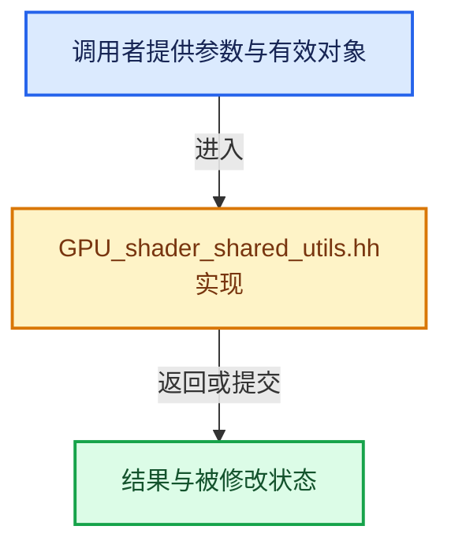

# 实现依赖专题：source/blender/gpu/GPU_shader_shared_utils.hh

[实现依赖导航](../../README.md) · [符号索引](../../../00-课程指南/02-源码与提交索引/符号依赖与实现索引.md)

本专题从正文实际调用进入，集中保存共享实现。函数有稳定锚点，可从调用处直接跳到对应完整函数；递归与互相调用通过回链组织。

## 本文件的实现关系





<a id="m-84775b53af8c"></a>

## 宏 `BLI_STATIC_ASSERT`

<!-- annotated:967b1769db8337 -->

```cpp
#  define BLI_STATIC_ASSERT(cond, msg)
#  define BLI_STATIC_ASSERT_ALIGN(type_, align_)
```

<details>
<summary>核对原始源码：source/blender/gpu/GPU_shader_shared_utils.hh · L37—L38</summary>

<!-- original:967b1769db8337:source/blender/gpu/GPU_shader_shared_utils.hh:37:38 -->

```cpp
#  define BLI_STATIC_ASSERT(cond, msg)
#  define BLI_STATIC_ASSERT_ALIGN(type_, align_)
```

</details>

宏在预处理阶段展开，参数替换、重复求值和条件编译应直接从该定义检查。与普通函数不同，宏不会自动提供参数类型检查；构建配置选择哪个定义需结合外围条件。

<a id="m-05d9d7a33da0"></a>

## 宏 `UNUSED_VARS`

<!-- annotated:5d908891e077ea -->

```cpp
#  define UNUSED_VARS(a) (void)a
/* Math function renaming. */
```

<details>
<summary>核对原始源码：source/blender/gpu/GPU_shader_shared_utils.hh · L41—L42</summary>

<!-- original:5d908891e077ea:source/blender/gpu/GPU_shader_shared_utils.hh:41:42 -->

```cpp
#  define UNUSED_VARS(a) (void)a
/* Math function renaming. */
```

</details>

宏在预处理阶段展开，参数替换、重复求值和条件编译应直接从该定义检查。与普通函数不同，宏不会自动提供参数类型检查；构建配置选择哪个定义需结合外围条件。

<a id="m-25d02fd11b3b"></a>

## 宏 `cosf`

<!-- annotated:62ce448c39d569 -->

```cpp
#  define cosf cos
#  define sinf sin
```

<details>
<summary>核对原始源码：source/blender/gpu/GPU_shader_shared_utils.hh · L43—L44</summary>

<!-- original:62ce448c39d569:source/blender/gpu/GPU_shader_shared_utils.hh:43:44 -->

```cpp
#  define cosf cos
#  define sinf sin
```

</details>

宏在预处理阶段展开，参数替换、重复求值和条件编译应直接从该定义检查。与普通函数不同，宏不会自动提供参数类型检查；构建配置选择哪个定义需结合外围条件。

<a id="m-a916f31e38c4"></a>

## 宏 `sinf`

<!-- annotated:a9c322fb8c25cb -->

```cpp
#  define sinf sin
#  define tanf tan
```

<details>
<summary>核对原始源码：source/blender/gpu/GPU_shader_shared_utils.hh · L44—L45</summary>

<!-- original:a9c322fb8c25cb:source/blender/gpu/GPU_shader_shared_utils.hh:44:45 -->

```cpp
#  define sinf sin
#  define tanf tan
```

</details>

宏在预处理阶段展开，参数替换、重复求值和条件编译应直接从该定义检查。与普通函数不同，宏不会自动提供参数类型检查；构建配置选择哪个定义需结合外围条件。

<a id="m-47237e652f9a"></a>

## 宏 `tanf`

<!-- annotated:4cae6f5e1c7076 -->

```cpp
#  define tanf tan
#  define acosf acos
```

<details>
<summary>核对原始源码：source/blender/gpu/GPU_shader_shared_utils.hh · L45—L46</summary>

<!-- original:4cae6f5e1c7076:source/blender/gpu/GPU_shader_shared_utils.hh:45:46 -->

```cpp
#  define tanf tan
#  define acosf acos
```

</details>

宏在预处理阶段展开，参数替换、重复求值和条件编译应直接从该定义检查。与普通函数不同，宏不会自动提供参数类型检查；构建配置选择哪个定义需结合外围条件。

<a id="m-68745dafe7bd"></a>

## 宏 `acosf`

<!-- annotated:969dfb4a83fea2 -->

```cpp
#  define acosf acos
#  define asinf asin
```

<details>
<summary>核对原始源码：source/blender/gpu/GPU_shader_shared_utils.hh · L46—L47</summary>

<!-- original:969dfb4a83fea2:source/blender/gpu/GPU_shader_shared_utils.hh:46:47 -->

```cpp
#  define acosf acos
#  define asinf asin
```

</details>

宏在预处理阶段展开，参数替换、重复求值和条件编译应直接从该定义检查。与普通函数不同，宏不会自动提供参数类型检查；构建配置选择哪个定义需结合外围条件。

<a id="m-8482af44681f"></a>

## 宏 `asinf`

<!-- annotated:4ffc25633490fd -->

```cpp
#  define asinf asin
#  define atanf atan
```

<details>
<summary>核对原始源码：source/blender/gpu/GPU_shader_shared_utils.hh · L47—L48</summary>

<!-- original:4ffc25633490fd:source/blender/gpu/GPU_shader_shared_utils.hh:47:48 -->

```cpp
#  define asinf asin
#  define atanf atan
```

</details>

宏在预处理阶段展开，参数替换、重复求值和条件编译应直接从该定义检查。与普通函数不同，宏不会自动提供参数类型检查；构建配置选择哪个定义需结合外围条件。

<a id="m-1866f68d50ab"></a>

## 宏 `atanf`

<!-- annotated:a3207350701659 -->

```cpp
#  define atanf atan
#  define floorf floor
```

<details>
<summary>核对原始源码：source/blender/gpu/GPU_shader_shared_utils.hh · L48—L49</summary>

<!-- original:a3207350701659:source/blender/gpu/GPU_shader_shared_utils.hh:48:49 -->

```cpp
#  define atanf atan
#  define floorf floor
```

</details>

宏在预处理阶段展开，参数替换、重复求值和条件编译应直接从该定义检查。与普通函数不同，宏不会自动提供参数类型检查；构建配置选择哪个定义需结合外围条件。

<a id="m-e7115fdd7560"></a>

## 宏 `floorf`

<!-- annotated:c0fa8fd3710227 -->

```cpp
#  define floorf floor
#  define ceilf ceil
```

<details>
<summary>核对原始源码：source/blender/gpu/GPU_shader_shared_utils.hh · L49—L50</summary>

<!-- original:c0fa8fd3710227:source/blender/gpu/GPU_shader_shared_utils.hh:49:50 -->

```cpp
#  define floorf floor
#  define ceilf ceil
```

</details>

宏在预处理阶段展开，参数替换、重复求值和条件编译应直接从该定义检查。与普通函数不同，宏不会自动提供参数类型检查；构建配置选择哪个定义需结合外围条件。

<a id="m-9a3148f04496"></a>

## 宏 `ceilf`

<!-- annotated:bec64bb4b013e1 -->

```cpp
#  define ceilf ceil
#  define sqrtf sqrt
```

<details>
<summary>核对原始源码：source/blender/gpu/GPU_shader_shared_utils.hh · L50—L51</summary>

<!-- original:bec64bb4b013e1:source/blender/gpu/GPU_shader_shared_utils.hh:50:51 -->

```cpp
#  define ceilf ceil
#  define sqrtf sqrt
```

</details>

宏在预处理阶段展开，参数替换、重复求值和条件编译应直接从该定义检查。与普通函数不同，宏不会自动提供参数类型检查；构建配置选择哪个定义需结合外围条件。

<a id="m-84f40d996637"></a>

## 宏 `expf`

<!-- annotated:e3243d1c542ded -->

```cpp
#  define expf exp

```

<details>
<summary>核对原始源码：source/blender/gpu/GPU_shader_shared_utils.hh · L52—L53</summary>

<!-- original:e3243d1c542ded:source/blender/gpu/GPU_shader_shared_utils.hh:52:53 -->

```cpp
#  define expf exp

```

</details>

宏在预处理阶段展开，参数替换、重复求值和条件编译应直接从该定义检查。与普通函数不同，宏不会自动提供参数类型检查；构建配置选择哪个定义需结合外围条件。

<a id="m-4227322768f0"></a>

## 宏 `BLI_STATIC_ASSERT`

<!-- annotated:cf09b48edab40e -->

```cpp
#  define BLI_STATIC_ASSERT(cond, msg)
#  define BLI_STATIC_ASSERT_ALIGN(type_, align_)
```

<details>
<summary>核对原始源码：source/blender/gpu/GPU_shader_shared_utils.hh · L58—L59</summary>

<!-- original:cf09b48edab40e:source/blender/gpu/GPU_shader_shared_utils.hh:58:59 -->

```cpp
#  define BLI_STATIC_ASSERT(cond, msg)
#  define BLI_STATIC_ASSERT_ALIGN(type_, align_)
```

</details>

宏在预处理阶段展开，参数替换、重复求值和条件编译应直接从该定义检查。与普通函数不同，宏不会自动提供参数类型检查；构建配置选择哪个定义需结合外围条件。

<a id="m-e12c683a4aca"></a>

## 宏 `UNUSED_VARS`

<!-- annotated:8625b26ebad6c0 -->

```cpp
#  define UNUSED_VARS(a)
/* Math function renaming. */
```

<details>
<summary>核对原始源码：source/blender/gpu/GPU_shader_shared_utils.hh · L62—L63</summary>

<!-- original:8625b26ebad6c0:source/blender/gpu/GPU_shader_shared_utils.hh:62:63 -->

```cpp
#  define UNUSED_VARS(a)
/* Math function renaming. */
```

</details>

宏在预处理阶段展开，参数替换、重复求值和条件编译应直接从该定义检查。与普通函数不同，宏不会自动提供参数类型检查；构建配置选择哪个定义需结合外围条件。

<a id="m-698fc51ccda3"></a>

## 宏 `cosf`

<!-- annotated:55e45d10b4f960 -->

```cpp
#  define cosf cos
#  define sinf sin
```

<details>
<summary>核对原始源码：source/blender/gpu/GPU_shader_shared_utils.hh · L64—L65</summary>

<!-- original:55e45d10b4f960:source/blender/gpu/GPU_shader_shared_utils.hh:64:65 -->

```cpp
#  define cosf cos
#  define sinf sin
```

</details>

宏在预处理阶段展开，参数替换、重复求值和条件编译应直接从该定义检查。与普通函数不同，宏不会自动提供参数类型检查；构建配置选择哪个定义需结合外围条件。

<a id="m-268edbf6d41e"></a>

## 宏 `sinf`

<!-- annotated:5cb3f2ade0b2c2 -->

```cpp
#  define sinf sin
#  define tanf tan
```

<details>
<summary>核对原始源码：source/blender/gpu/GPU_shader_shared_utils.hh · L65—L66</summary>

<!-- original:5cb3f2ade0b2c2:source/blender/gpu/GPU_shader_shared_utils.hh:65:66 -->

```cpp
#  define sinf sin
#  define tanf tan
```

</details>

宏在预处理阶段展开，参数替换、重复求值和条件编译应直接从该定义检查。与普通函数不同，宏不会自动提供参数类型检查；构建配置选择哪个定义需结合外围条件。

<a id="m-ec729c327d58"></a>

## 宏 `tanf`

<!-- annotated:67d604852ec694 -->

```cpp
#  define tanf tan
#  define acosf acos
```

<details>
<summary>核对原始源码：source/blender/gpu/GPU_shader_shared_utils.hh · L66—L67</summary>

<!-- original:67d604852ec694:source/blender/gpu/GPU_shader_shared_utils.hh:66:67 -->

```cpp
#  define tanf tan
#  define acosf acos
```

</details>

宏在预处理阶段展开，参数替换、重复求值和条件编译应直接从该定义检查。与普通函数不同，宏不会自动提供参数类型检查；构建配置选择哪个定义需结合外围条件。

<a id="m-a19449c3be49"></a>

## 宏 `acosf`

<!-- annotated:99dadd3e0dd8ac -->

```cpp
#  define acosf acos
#  define asinf asin
```

<details>
<summary>核对原始源码：source/blender/gpu/GPU_shader_shared_utils.hh · L67—L68</summary>

<!-- original:99dadd3e0dd8ac:source/blender/gpu/GPU_shader_shared_utils.hh:67:68 -->

```cpp
#  define acosf acos
#  define asinf asin
```

</details>

宏在预处理阶段展开，参数替换、重复求值和条件编译应直接从该定义检查。与普通函数不同，宏不会自动提供参数类型检查；构建配置选择哪个定义需结合外围条件。

<a id="m-8f1d94fadcd2"></a>

## 宏 `asinf`

<!-- annotated:56cf588e5eb08f -->

```cpp
#  define asinf asin
#  define atanf atan
```

<details>
<summary>核对原始源码：source/blender/gpu/GPU_shader_shared_utils.hh · L68—L69</summary>

<!-- original:56cf588e5eb08f:source/blender/gpu/GPU_shader_shared_utils.hh:68:69 -->

```cpp
#  define asinf asin
#  define atanf atan
```

</details>

宏在预处理阶段展开，参数替换、重复求值和条件编译应直接从该定义检查。与普通函数不同，宏不会自动提供参数类型检查；构建配置选择哪个定义需结合外围条件。

<a id="m-37b533001f22"></a>

## 宏 `atanf`

<!-- annotated:ec589078946aac -->

```cpp
#  define atanf atan
#  define floorf floor
```

<details>
<summary>核对原始源码：source/blender/gpu/GPU_shader_shared_utils.hh · L69—L70</summary>

<!-- original:ec589078946aac:source/blender/gpu/GPU_shader_shared_utils.hh:69:70 -->

```cpp
#  define atanf atan
#  define floorf floor
```

</details>

宏在预处理阶段展开，参数替换、重复求值和条件编译应直接从该定义检查。与普通函数不同，宏不会自动提供参数类型检查；构建配置选择哪个定义需结合外围条件。

<a id="m-aee5f6a438e4"></a>

## 宏 `floorf`

<!-- annotated:579f9881bd00ac -->

```cpp
#  define floorf floor
#  define ceilf ceil
```

<details>
<summary>核对原始源码：source/blender/gpu/GPU_shader_shared_utils.hh · L70—L71</summary>

<!-- original:579f9881bd00ac:source/blender/gpu/GPU_shader_shared_utils.hh:70:71 -->

```cpp
#  define floorf floor
#  define ceilf ceil
```

</details>

宏在预处理阶段展开，参数替换、重复求值和条件编译应直接从该定义检查。与普通函数不同，宏不会自动提供参数类型检查；构建配置选择哪个定义需结合外围条件。

<a id="m-a5269177f54f"></a>

## 宏 `ceilf`

<!-- annotated:fbdb31d82d0e64 -->

```cpp
#  define ceilf ceil
#  define sqrtf sqrt
```

<details>
<summary>核对原始源码：source/blender/gpu/GPU_shader_shared_utils.hh · L71—L72</summary>

<!-- original:fbdb31d82d0e64:source/blender/gpu/GPU_shader_shared_utils.hh:71:72 -->

```cpp
#  define ceilf ceil
#  define sqrtf sqrt
```

</details>

宏在预处理阶段展开，参数替换、重复求值和条件编译应直接从该定义检查。与普通函数不同，宏不会自动提供参数类型检查；构建配置选择哪个定义需结合外围条件。

<a id="m-396d23c747d0"></a>

## 宏 `expf`

<!-- annotated:22f64b7997c94f -->

```cpp
#  define expf exp

```

<details>
<summary>核对原始源码：source/blender/gpu/GPU_shader_shared_utils.hh · L73—L74</summary>

<!-- original:22f64b7997c94f:source/blender/gpu/GPU_shader_shared_utils.hh:73:74 -->

```cpp
#  define expf exp

```

</details>

宏在预处理阶段展开，参数替换、重复求值和条件编译应直接从该定义检查。与普通函数不同，宏不会自动提供参数类型检查；构建配置选择哪个定义需结合外围条件。

## 完整成员与函数实现
