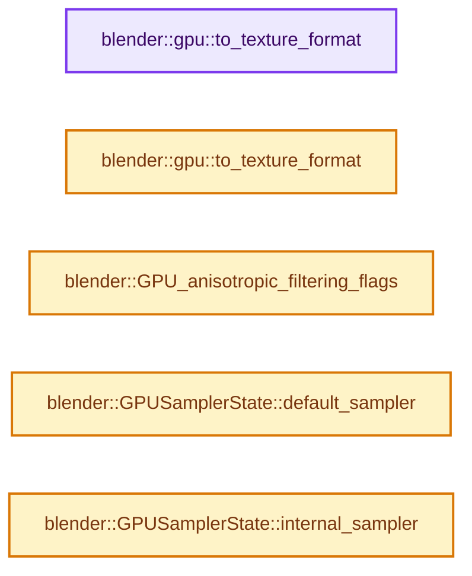
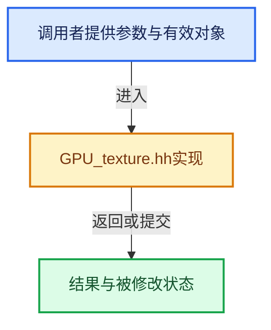

# 实现依赖专题：source/blender/gpu/GPU_texture.hh

[实现依赖导航](../../README.md) · [符号索引](../../../00-课程指南/02-源码与提交索引/符号依赖与实现索引.md)

本专题从正文实际调用进入，集中保存共享实现。函数有稳定锚点，可从调用处直接跳到对应完整函数；递归与互相调用通过回链组织。

## 本文件的实现关系






## 相关类型布局与成员入口

<a id="t-31de3fcff2f7"></a>

### `blender::gpu::TextureFormat`

原始声明：[source/blender/gpu/GPU_texture.hh](../../../../../../../source/blender/gpu/GPU_texture.hh) · L41—L130。

以下保留类的数据声明与编译条件，成员函数实现通过后面的精确链接阅读。

<!-- annotated:ac01c238bd380d -->

```cpp
enum class TextureFormat : uint8_t {
  Invalid = 0,

#define DECLARE(a, b, c, blender_enum, d, e, f, g, h) blender_enum = int(DataFormat::blender_enum),

#define GPU_TEXTURE_FORMAT_EXPAND(impl) \
  SNORM_8_(impl) \
  SNORM_8_8_(impl) \
  SNORM_8_8_8_(impl) /* TODO(fclem): Incompatible with metal, to remove. */ \
  SNORM_8_8_8_8_(impl) \
\
  SNORM_16_(impl) \
  SNORM_16_16_(impl) \
  SNORM_16_16_16_(impl) /* TODO(fclem): Incompatible with metal, to remove. */ \
  SNORM_16_16_16_16_(impl) \
\
  UNORM_8_(impl) \
  UNORM_8_8_(impl) \
  UNORM_8_8_8_(impl) /* TODO(fclem): Incompatible with metal, to remove. */ \
  UNORM_8_8_8_8_(impl) \
\
  UNORM_16_(impl) \
  UNORM_16_16_(impl) \
  UNORM_16_16_16_(impl) /* TODO(fclem): Incompatible with metal, to remove. */ \
  UNORM_16_16_16_16_(impl) \
\
  SINT_8_(impl) \
  SINT_8_8_(impl) \
  SINT_8_8_8_(impl) /* TODO(fclem): Incompatible with metal, to remove. */ \
  SINT_8_8_8_8_(impl) \
\
  SINT_16_(impl) \
  SINT_16_16_(impl) \
  SINT_16_16_16_(impl) /* TODO(fclem): Incompatible with metal, to remove. */ \
  SINT_16_16_16_16_(impl) \
\
  SINT_32_(impl) \
  SINT_32_32_(impl) \
  SINT_32_32_32_(impl) /* TODO(fclem): Incompatible with metal, to remove. */ \
  SINT_32_32_32_32_(impl) \
\
  UINT_8_(impl) \
  UINT_8_8_(impl) \
  UINT_8_8_8_(impl) /* TODO(fclem): Incompatible with metal, to remove. */ \
  UINT_8_8_8_8_(impl) \
\
  UINT_16_(impl) \
  UINT_16_16_(impl) \
  UINT_16_16_16_(impl) /* TODO(fclem): Incompatible with metal, to remove. */ \
  UINT_16_16_16_16_(impl) \
\
  UINT_32_(impl) \
  UINT_32_32_(impl) \
  UINT_32_32_32_(impl) /* TODO(fclem): Incompatible with metal, to remove. */ \
  UINT_32_32_32_32_(impl) \
\
  SFLOAT_16_(impl) \
  SFLOAT_16_16_(impl) \
  SFLOAT_16_16_16_(impl) /* TODO(fclem): Incompatible with metal, to remove. */ \
  SFLOAT_16_16_16_16_(impl) \
\
  SFLOAT_32_(impl) \
  SFLOAT_32_32_(impl) \
  SFLOAT_32_32_32_(impl) /* TODO(fclem): Incompatible with metal, to remove. */ \
  SFLOAT_32_32_32_32_(impl) \
\
  UNORM_10_10_10_2_(impl) \
  UINT_10_10_10_2_(impl) \
\
  UFLOAT_11_11_10_(impl) \
  UFLOAT_9_9_9_EXP_5_(impl) \
\
  UNORM_16_DEPTH_(impl) \
  SFLOAT_32_DEPTH_(impl) \
  SFLOAT_32_DEPTH_UINT_8_(impl) \
\
  SRGBA_8_8_8_(impl) /* TODO(fclem): Incompatible with metal, to remove. */ \
  SRGBA_8_8_8_8_(impl) \
\
  SNORM_DXT1_(impl) \
  SNORM_DXT3_(impl) \
  SNORM_DXT5_(impl) \
  SRGB_DXT1_(impl) \
  SRGB_DXT3_(impl) \
  SRGB_DXT5_(impl)

  GPU_TEXTURE_FORMAT_EXPAND(DECLARE)

#undef DECLARE
};
```

<details>
<summary>核对原始源码：source/blender/gpu/GPU_texture.hh · L41—L130</summary>

<!-- original:ac01c238bd380d:source/blender/gpu/GPU_texture.hh:41:130 -->

```cpp
enum class TextureFormat : uint8_t {
  Invalid = 0,

#define DECLARE(a, b, c, blender_enum, d, e, f, g, h) blender_enum = int(DataFormat::blender_enum),

#define GPU_TEXTURE_FORMAT_EXPAND(impl) \
  SNORM_8_(impl) \
  SNORM_8_8_(impl) \
  SNORM_8_8_8_(impl) /* TODO(fclem): Incompatible with metal, to remove. */ \
  SNORM_8_8_8_8_(impl) \
\
  SNORM_16_(impl) \
  SNORM_16_16_(impl) \
  SNORM_16_16_16_(impl) /* TODO(fclem): Incompatible with metal, to remove. */ \
  SNORM_16_16_16_16_(impl) \
\
  UNORM_8_(impl) \
  UNORM_8_8_(impl) \
  UNORM_8_8_8_(impl) /* TODO(fclem): Incompatible with metal, to remove. */ \
  UNORM_8_8_8_8_(impl) \
\
  UNORM_16_(impl) \
  UNORM_16_16_(impl) \
  UNORM_16_16_16_(impl) /* TODO(fclem): Incompatible with metal, to remove. */ \
  UNORM_16_16_16_16_(impl) \
\
  SINT_8_(impl) \
  SINT_8_8_(impl) \
  SINT_8_8_8_(impl) /* TODO(fclem): Incompatible with metal, to remove. */ \
  SINT_8_8_8_8_(impl) \
\
  SINT_16_(impl) \
  SINT_16_16_(impl) \
  SINT_16_16_16_(impl) /* TODO(fclem): Incompatible with metal, to remove. */ \
  SINT_16_16_16_16_(impl) \
\
  SINT_32_(impl) \
  SINT_32_32_(impl) \
  SINT_32_32_32_(impl) /* TODO(fclem): Incompatible with metal, to remove. */ \
  SINT_32_32_32_32_(impl) \
\
  UINT_8_(impl) \
  UINT_8_8_(impl) \
  UINT_8_8_8_(impl) /* TODO(fclem): Incompatible with metal, to remove. */ \
  UINT_8_8_8_8_(impl) \
\
  UINT_16_(impl) \
  UINT_16_16_(impl) \
  UINT_16_16_16_(impl) /* TODO(fclem): Incompatible with metal, to remove. */ \
  UINT_16_16_16_16_(impl) \
\
  UINT_32_(impl) \
  UINT_32_32_(impl) \
  UINT_32_32_32_(impl) /* TODO(fclem): Incompatible with metal, to remove. */ \
  UINT_32_32_32_32_(impl) \
\
  SFLOAT_16_(impl) \
  SFLOAT_16_16_(impl) \
  SFLOAT_16_16_16_(impl) /* TODO(fclem): Incompatible with metal, to remove. */ \
  SFLOAT_16_16_16_16_(impl) \
\
  SFLOAT_32_(impl) \
  SFLOAT_32_32_(impl) \
  SFLOAT_32_32_32_(impl) /* TODO(fclem): Incompatible with metal, to remove. */ \
  SFLOAT_32_32_32_32_(impl) \
\
  UNORM_10_10_10_2_(impl) \
  UINT_10_10_10_2_(impl) \
\
  UFLOAT_11_11_10_(impl) \
  UFLOAT_9_9_9_EXP_5_(impl) \
\
  UNORM_16_DEPTH_(impl) \
  SFLOAT_32_DEPTH_(impl) \
  SFLOAT_32_DEPTH_UINT_8_(impl) \
\
  SRGBA_8_8_8_(impl) /* TODO(fclem): Incompatible with metal, to remove. */ \
  SRGBA_8_8_8_8_(impl) \
\
  SNORM_DXT1_(impl) \
  SNORM_DXT3_(impl) \
  SNORM_DXT5_(impl) \
  SRGB_DXT1_(impl) \
  SRGB_DXT3_(impl) \
  SRGB_DXT5_(impl)

  GPU_TEXTURE_FORMAT_EXPAND(DECLARE)

#undef DECLARE
};
```

</details>


<a id="m-fa9785b115fa"></a>

## 宏 `GPU_TEXTURE_FREE_SAFE`

<!-- annotated:67a728fe939696 -->

```cpp
#define GPU_TEXTURE_FREE_SAFE(texture) \
  do { \
    if (texture != nullptr) { \
      blender::GPU_texture_free(texture); \
      texture = nullptr; \
    } \
  } while (0)

```

<details>
<summary>核对原始源码：source/blender/gpu/GPU_texture.hh · L902—L909</summary>

<!-- original:67a728fe939696:source/blender/gpu/GPU_texture.hh:902:909 -->

```cpp
#define GPU_TEXTURE_FREE_SAFE(texture) \
  do { \
    if (texture != nullptr) { \
      blender::GPU_texture_free(texture); \
      texture = nullptr; \
    } \
  } while (0)

```

</details>

宏在预处理阶段展开，参数替换、重复求值和条件编译应直接从该定义检查。与普通函数不同，宏不会自动提供参数类型检查；构建配置选择哪个定义需结合外围条件。

## 完整成员与函数实现

<a id="f-bf764cadc2e1a38f"></a>

### `blender::gpu::to_texture_format`

实现位置：[source/blender/gpu/GPU_texture.hh](../../../../../../../source/blender/gpu/GPU_texture.hh) · L203—L206。

接口参数：

- `TextureTargetFormat format`

**教学注释版**

<!-- annotated:d819bc95ee41ae -->

```cpp
constexpr TextureFormat to_texture_format(TextureTargetFormat format)
{
  return TextureFormat(int(format));
}
```

<details>
<summary>核对原始源码：source/blender/gpu/GPU_texture.hh · L203—L206</summary>

<!-- original:d819bc95ee41ae:source/blender/gpu/GPU_texture.hh:203:206 -->

```cpp
constexpr TextureFormat to_texture_format(TextureTargetFormat format)
{
  return TextureFormat(int(format));
}
```

</details>

**结果出口**

- `return TextureFormat(int(format));`

**继续追踪实现**

- `TextureFormat` → [blender::gpu::TextureFormat](GPU_texture.hh.md#t-31de3fcff2f7)。

<a id="f-b8a7d42ff73eb4b9"></a>

### `blender::gpu::to_texture_format`

实现位置：[source/blender/gpu/GPU_texture.hh](../../../../../../../source/blender/gpu/GPU_texture.hh) · L268—L271。

接口参数：

- `TextureWriteFormat format`

**教学注释版**

<!-- annotated:55bb1a596714a1 -->

```cpp
constexpr TextureFormat to_texture_format(TextureWriteFormat format)
{
  return TextureFormat(int(format));
}
```

<details>
<summary>核对原始源码：source/blender/gpu/GPU_texture.hh · L268—L271</summary>

<!-- original:55bb1a596714a1:source/blender/gpu/GPU_texture.hh:268:271 -->

```cpp
constexpr TextureFormat to_texture_format(TextureWriteFormat format)
{
  return TextureFormat(int(format));
}
```

</details>

**结果出口**

- `return TextureFormat(int(format));`

**继续追踪实现**

- `TextureFormat` → [blender::gpu::TextureFormat](GPU_texture.hh.md#t-31de3fcff2f7)。

<a id="f-9944b6e810410f4a"></a>

### `blender::GPU_anisotropic_filtering_flags`

实现位置：[source/blender/gpu/GPU_texture.hh](../../../../../../../source/blender/gpu/GPU_texture.hh) · L340—L358。

接口参数：

- `int anisotropic_samples`

**教学注释版**

<!-- annotated:2c67506361e134 -->

```cpp
static inline GPUSamplerFiltering GPU_anisotropic_filtering_flags(int anisotropic_samples)
{
  if (anisotropic_samples <= 1) {
    return GPU_SAMPLER_FILTERING_DEFAULT;
  }

  if (IndexRange::from_begin_end_inclusive(2, 3).contains(anisotropic_samples)) {
    return GPU_SAMPLER_FILTERING_ANISOTROPIC_2;
  }
  else if (IndexRange::from_begin_end_inclusive(4, 7).contains(anisotropic_samples)) {
    return GPU_SAMPLER_FILTERING_ANISOTROPIC_4;
  }
  else if (IndexRange::from_begin_end_inclusive(8, 15).contains(anisotropic_samples)) {
    return GPU_SAMPLER_FILTERING_ANISOTROPIC_8;
  }

  /* 16 or higher. */
  return GPU_SAMPLER_FILTERING_ANISOTROPIC_16;
}
```

<details>
<summary>核对原始源码：source/blender/gpu/GPU_texture.hh · L340—L358</summary>

<!-- original:2c67506361e134:source/blender/gpu/GPU_texture.hh:340:358 -->

```cpp
static inline GPUSamplerFiltering GPU_anisotropic_filtering_flags(int anisotropic_samples)
{
  if (anisotropic_samples <= 1) {
    return GPU_SAMPLER_FILTERING_DEFAULT;
  }

  if (IndexRange::from_begin_end_inclusive(2, 3).contains(anisotropic_samples)) {
    return GPU_SAMPLER_FILTERING_ANISOTROPIC_2;
  }
  else if (IndexRange::from_begin_end_inclusive(4, 7).contains(anisotropic_samples)) {
    return GPU_SAMPLER_FILTERING_ANISOTROPIC_4;
  }
  else if (IndexRange::from_begin_end_inclusive(8, 15).contains(anisotropic_samples)) {
    return GPU_SAMPLER_FILTERING_ANISOTROPIC_8;
  }

  /* 16 or higher. */
  return GPU_SAMPLER_FILTERING_ANISOTROPIC_16;
}
```

</details>

**结果出口**

- `return GPU_SAMPLER_FILTERING_DEFAULT;`
- `return GPU_SAMPLER_FILTERING_ANISOTROPIC_2;`
- `return GPU_SAMPLER_FILTERING_ANISOTROPIC_4;`
- `return GPU_SAMPLER_FILTERING_ANISOTROPIC_8;`
- `return GPU_SAMPLER_FILTERING_ANISOTROPIC_16;`

**继续追踪实现**

- `IndexRange::from_begin_end_inclusive(2, 3).contains` → [调用协议](../../../00-课程指南/01-路线与规范/模板宏与动态分派协议.md)：接收对象类型依赖auto、返回值或模板实例；不按同名猜测目标。调用位置L346。
- `IndexRange::from_begin_end_inclusive` → [blender::IndexRange::from_begin_end_inclusive · L83](../../../01-基础容器与现代CPP/04-IndexRange连续整数区间.md#f-66cc5b933b552ea1)。
- `IndexRange::from_begin_end_inclusive(4, 7).contains` → [调用协议](../../../00-课程指南/01-路线与规范/模板宏与动态分派协议.md)：接收对象类型依赖auto、返回值或模板实例；不按同名猜测目标。调用位置L349。
- `IndexRange::from_begin_end_inclusive(8, 15).contains` → [调用协议](../../../00-课程指南/01-路线与规范/模板宏与动态分派协议.md)：接收对象类型依赖auto、返回值或模板实例；不按同名猜测目标。调用位置L352。

<a id="f-c7a2363cd391bd35"></a>

### `blender::GPUSamplerState::default_sampler`

实现位置：[source/blender/gpu/GPU_texture.hh](../../../../../../../source/blender/gpu/GPU_texture.hh) · L505—L512。

**教学注释版**

<!-- annotated:37da07b9851acd -->

```cpp
  static constexpr GPUSamplerState default_sampler()
  {
    return {GPU_SAMPLER_FILTERING_DEFAULT,
            GPU_SAMPLER_EXTEND_MODE_EXTEND,
            GPU_SAMPLER_EXTEND_MODE_EXTEND,
            GPU_SAMPLER_CUSTOM_COMPARE,
            GPU_SAMPLER_STATE_TYPE_PARAMETERS};
  }
```

<details>
<summary>核对原始源码：source/blender/gpu/GPU_texture.hh · L505—L512</summary>

<!-- original:37da07b9851acd:source/blender/gpu/GPU_texture.hh:505:512 -->

```cpp
  static constexpr GPUSamplerState default_sampler()
  {
    return {GPU_SAMPLER_FILTERING_DEFAULT,
            GPU_SAMPLER_EXTEND_MODE_EXTEND,
            GPU_SAMPLER_EXTEND_MODE_EXTEND,
            GPU_SAMPLER_CUSTOM_COMPARE,
            GPU_SAMPLER_STATE_TYPE_PARAMETERS};
  }
```

</details>

**结果出口**

- `return {GPU_SAMPLER_FILTERING_DEFAULT,`

**继续追踪实现**

本实现没有需要继续展开的显式调用；检查返回表达式、对象转换和调用者前置条件。

<a id="f-3e0da63b622aa843"></a>

### `blender::GPUSamplerState::internal_sampler`

实现位置：[source/blender/gpu/GPU_texture.hh](../../../../../../../source/blender/gpu/GPU_texture.hh) · L522—L529。

**教学注释版**

<!-- annotated:ee2c3d0978ea11 -->

```cpp
  static constexpr GPUSamplerState internal_sampler()
  {
    return {GPU_SAMPLER_FILTERING_DEFAULT,
            GPU_SAMPLER_EXTEND_MODE_EXTEND,
            GPU_SAMPLER_EXTEND_MODE_EXTEND,
            GPU_SAMPLER_CUSTOM_COMPARE,
            GPU_SAMPLER_STATE_TYPE_INTERNAL};
  }
```

<details>
<summary>核对原始源码：source/blender/gpu/GPU_texture.hh · L522—L529</summary>

<!-- original:ee2c3d0978ea11:source/blender/gpu/GPU_texture.hh:522:529 -->

```cpp
  static constexpr GPUSamplerState internal_sampler()
  {
    return {GPU_SAMPLER_FILTERING_DEFAULT,
            GPU_SAMPLER_EXTEND_MODE_EXTEND,
            GPU_SAMPLER_EXTEND_MODE_EXTEND,
            GPU_SAMPLER_CUSTOM_COMPARE,
            GPU_SAMPLER_STATE_TYPE_INTERNAL};
  }
```

</details>

**结果出口**

- `return {GPU_SAMPLER_FILTERING_DEFAULT,`

**继续追踪实现**

本实现没有需要继续展开的显式调用；检查返回表达式、对象转换和调用者前置条件。
