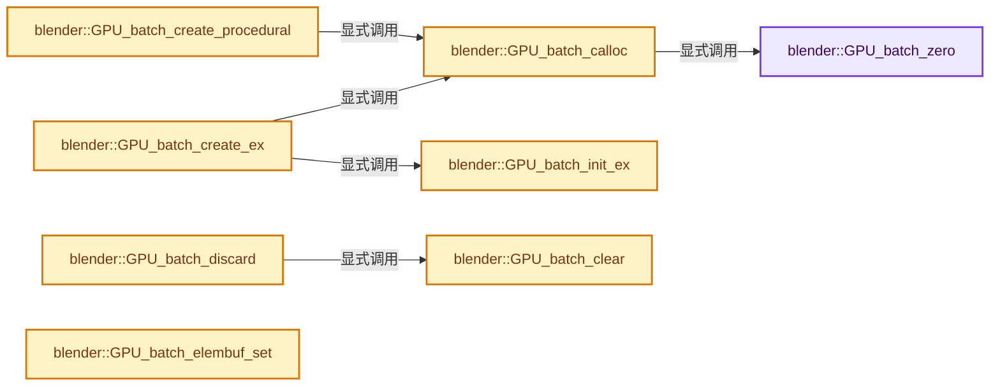
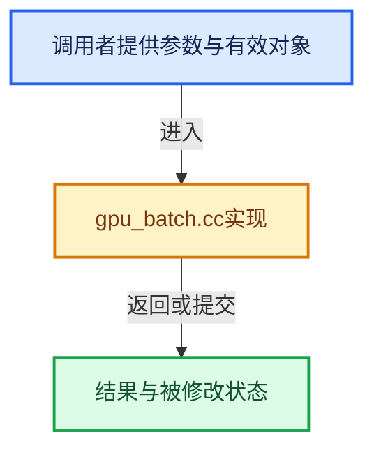

# 实现依赖专题：source/blender/gpu/intern/gpu_batch.cc

[实现依赖导航](../../../README.md) · [符号索引](../../../../00-课程指南/02-源码与提交索引/符号依赖与实现索引.md)

本专题从正文实际调用进入，集中保存共享实现。函数有稳定锚点，可从调用处直接跳到对应完整函数；递归与互相调用通过回链组织。

## 本文件的实现关系






## 完整成员与函数实现

<a id="f-801f05676aa7b447"></a>

### `blender::GPU_batch_zero`

实现位置：[source/blender/gpu/intern/gpu_batch.cc](../../../../../../../../source/blender/gpu/intern/gpu_batch.cc) · L36—L44。

接口参数：

- `Batch *batch`

**教学注释版**

<!-- annotated:bc29c948afd058 -->

```cpp
void GPU_batch_zero(Batch *batch)
{
  std::fill_n(batch->verts, ARRAY_SIZE(batch->verts), nullptr);
  batch->elem = nullptr;
  batch->flag = GPUBatchFlag(0);
  batch->prim_type = GPUPrimType(0);
  batch->shader = nullptr;
  batch->procedural_vertices = -1;
}
```

<details>
<summary>核对原始源码：source/blender/gpu/intern/gpu_batch.cc · L36—L44</summary>

<!-- original:bc29c948afd058:source/blender/gpu/intern/gpu_batch.cc:36:44 -->

```cpp
void GPU_batch_zero(Batch *batch)
{
  std::fill_n(batch->verts, ARRAY_SIZE(batch->verts), nullptr);
  batch->elem = nullptr;
  batch->flag = GPUBatchFlag(0);
  batch->prim_type = GPUPrimType(0);
  batch->shader = nullptr;
  batch->procedural_vertices = -1;
}
```

</details>

**沿实际写入检查状态**

- `batch->elem = nullptr;`
- `batch->flag = GPUBatchFlag(0);`
- `batch->prim_type = GPUPrimType(0);`
- `batch->shader = nullptr;`
- `batch->procedural_vertices = -1;`

**继续追踪实现**

- `std::fill_n` → [外部契约](https://eel.is/c++draft/)：这个边界按实际表达式及所属类型核对参数、返回值、寿命与失败行为。这里提供接口入口，不声称已解释该第三方版本的内部实现。
- `ARRAY_SIZE` → [blender::ARRAY_SIZE · L608](../../../01-BLI基础库/BLI_utildefines.hh.md#f-eaec3a7e47b85c7c)。
- `GPUBatchFlag` → [blender::GPUBatchFlag](../GPU_batch.hh.md#t-69ee9e6aa2b8)。
- `GPUPrimType` → [blender::GPUPrimType](../GPU_primitive.hh.md#t-ee1b2c574fda)。

<a id="f-e6d197678e86ef63"></a>

### `blender::GPU_batch_calloc`

实现位置：[source/blender/gpu/intern/gpu_batch.cc](../../../../../../../../source/blender/gpu/intern/gpu_batch.cc) · L46—L51。

**教学注释版**

<!-- annotated:ef4049c99104d1 -->

```cpp
Batch *GPU_batch_calloc()
{
  Batch *batch = GPUBackend::get()->batch_alloc();
  GPU_batch_zero(batch);
  return batch;
}
```

<details>
<summary>核对原始源码：source/blender/gpu/intern/gpu_batch.cc · L46—L51</summary>

<!-- original:ef4049c99104d1:source/blender/gpu/intern/gpu_batch.cc:46:51 -->

```cpp
Batch *GPU_batch_calloc()
{
  Batch *batch = GPUBackend::get()->batch_alloc();
  GPU_batch_zero(batch);
  return batch;
}
```

</details>

**结果出口**

- `return batch;`

**继续追踪实现**

- `GPUBackend::get()->batch_alloc` → [调用协议](../../../../00-课程指南/01-路线与规范/模板宏与动态分派协议.md)：接收对象类型依赖auto、返回值或模板实例；不按同名猜测目标。调用位置L48。
- `GPUBackend::get` → [blender::GPUBackend::get · L642](gpu_context.cc.md#f-c876dc1cb5bd7700)。
- `GPU_batch_zero` → [blender::GPU_batch_zero · L36](gpu_batch.cc.md#f-801f05676aa7b447)。

<a id="f-d3825f4a720aba94"></a>

### `blender::GPU_batch_create_ex`

实现位置：[source/blender/gpu/intern/gpu_batch.cc](../../../../../../../../source/blender/gpu/intern/gpu_batch.cc) · L53—L61。

接口参数：

- `GPUPrimType primitive_type`
- `VertBuf *vertex_buf`
- `IndexBuf *index_buf`
- `GPUBatchFlag owns_flag`

**教学注释版**

<!-- annotated:9f24e6cf90f797 -->

```cpp
Batch *GPU_batch_create_ex(GPUPrimType primitive_type,
                           VertBuf *vertex_buf,
                           IndexBuf *index_buf,
                           GPUBatchFlag owns_flag)
{
  Batch *batch = GPU_batch_calloc();
  GPU_batch_init_ex(batch, primitive_type, vertex_buf, index_buf, owns_flag);
  return batch;
}
```

<details>
<summary>核对原始源码：source/blender/gpu/intern/gpu_batch.cc · L53—L61</summary>

<!-- original:9f24e6cf90f797:source/blender/gpu/intern/gpu_batch.cc:53:61 -->

```cpp
Batch *GPU_batch_create_ex(GPUPrimType primitive_type,
                           VertBuf *vertex_buf,
                           IndexBuf *index_buf,
                           GPUBatchFlag owns_flag)
{
  Batch *batch = GPU_batch_calloc();
  GPU_batch_init_ex(batch, primitive_type, vertex_buf, index_buf, owns_flag);
  return batch;
}
```

</details>

**结果出口**

- `return batch;`

**继续追踪实现**

- `GPU_batch_calloc` → [blender::GPU_batch_calloc · L46](gpu_batch.cc.md#f-e6d197678e86ef63)。
- `GPU_batch_init_ex` → [blender::GPU_batch_init_ex · L63](gpu_batch.cc.md#f-8b222f39c7363d7d)。

<a id="f-8b222f39c7363d7d"></a>

### `blender::GPU_batch_init_ex`

实现位置：[source/blender/gpu/intern/gpu_batch.cc](../../../../../../../../source/blender/gpu/intern/gpu_batch.cc) · L63—L83。

接口参数：

- `Batch *batch`
- `GPUPrimType primitive_type`
- `VertBuf *vertex_buf`
- `IndexBuf *index_buf`
- `GPUBatchFlag owns_flag`

**教学注释版**

<!-- annotated:faa691c503b945 -->

```cpp
void GPU_batch_init_ex(Batch *batch,
                       GPUPrimType primitive_type,
                       VertBuf *vertex_buf,
                       IndexBuf *index_buf,
                       GPUBatchFlag owns_flag)
{
  /* Do not pass any other flag */
  BLI_assert((owns_flag & ~(GPU_BATCH_OWNS_VBO | GPU_BATCH_OWNS_INDEX)) == 0);
  /* Batch needs to be in cleared state. */
  BLI_assert((batch->flag & GPU_BATCH_INIT) == 0);

  batch->verts[0] = vertex_buf;
  for (int v = 1; v < GPU_BATCH_VBO_MAX_LEN; v++) {
    batch->verts[v] = nullptr;
  }
  batch->elem = index_buf;
  batch->prim_type = primitive_type;
  batch->flag = owns_flag | GPU_BATCH_INIT | GPU_BATCH_DIRTY;
  batch->shader = nullptr;
  batch->procedural_vertices = -1;
}
```

<details>
<summary>核对原始源码：source/blender/gpu/intern/gpu_batch.cc · L63—L83</summary>

<!-- original:faa691c503b945:source/blender/gpu/intern/gpu_batch.cc:63:83 -->

```cpp
void GPU_batch_init_ex(Batch *batch,
                       GPUPrimType primitive_type,
                       VertBuf *vertex_buf,
                       IndexBuf *index_buf,
                       GPUBatchFlag owns_flag)
{
  /* Do not pass any other flag */
  BLI_assert((owns_flag & ~(GPU_BATCH_OWNS_VBO | GPU_BATCH_OWNS_INDEX)) == 0);
  /* Batch needs to be in cleared state. */
  BLI_assert((batch->flag & GPU_BATCH_INIT) == 0);

  batch->verts[0] = vertex_buf;
  for (int v = 1; v < GPU_BATCH_VBO_MAX_LEN; v++) {
    batch->verts[v] = nullptr;
  }
  batch->elem = index_buf;
  batch->prim_type = primitive_type;
  batch->flag = owns_flag | GPU_BATCH_INIT | GPU_BATCH_DIRTY;
  batch->shader = nullptr;
  batch->procedural_vertices = -1;
}
```

</details>

**沿实际写入检查状态**

- `batch->verts[0] = vertex_buf;`
- `batch->verts[v] = nullptr;`
- `batch->elem = index_buf;`
- `batch->prim_type = primitive_type;`
- `batch->flag = owns_flag | GPU_BATCH_INIT | GPU_BATCH_DIRTY;`
- `batch->shader = nullptr;`
- `batch->procedural_vertices = -1;`

**继续追踪实现**

- `BLI_assert` → [BLI_assert · L48](../../../01-BLI基础库/BLI_assert.hh.md#m-57a88495704d)；[BLI_assert · L63](../../../01-BLI基础库/BLI_assert.hh.md#m-d07050020cb5)。宏定义由构建条件选择。

<a id="f-51d07c94d3ff291d"></a>

### `blender::GPU_batch_create_procedural`

实现位置：[source/blender/gpu/intern/gpu_batch.cc](../../../../../../../../source/blender/gpu/intern/gpu_batch.cc) · L85—L98。

接口参数：

- `GPUPrimType primitive_type`
- `int32_t vertex_count`

**教学注释版**

<!-- annotated:8e0f42207d3566 -->

```cpp
Batch *GPU_batch_create_procedural(GPUPrimType primitive_type, int32_t vertex_count)
{
  BLI_assert(vertex_count >= 0);
  Batch *batch = GPU_batch_calloc();
  for (auto &v : batch->verts) {
    v = nullptr;
  }
  batch->elem = nullptr;
  batch->prim_type = primitive_type;
  batch->flag = GPU_BATCH_INIT | GPU_BATCH_DIRTY;
  batch->shader = nullptr;
  batch->procedural_vertices = vertex_count;
  return batch;
}
```

<details>
<summary>核对原始源码：source/blender/gpu/intern/gpu_batch.cc · L85—L98</summary>

<!-- original:8e0f42207d3566:source/blender/gpu/intern/gpu_batch.cc:85:98 -->

```cpp
Batch *GPU_batch_create_procedural(GPUPrimType primitive_type, int32_t vertex_count)
{
  BLI_assert(vertex_count >= 0);
  Batch *batch = GPU_batch_calloc();
  for (auto &v : batch->verts) {
    v = nullptr;
  }
  batch->elem = nullptr;
  batch->prim_type = primitive_type;
  batch->flag = GPU_BATCH_INIT | GPU_BATCH_DIRTY;
  batch->shader = nullptr;
  batch->procedural_vertices = vertex_count;
  return batch;
}
```

</details>

**沿实际写入检查状态**

- `v = nullptr;`
- `batch->elem = nullptr;`
- `batch->prim_type = primitive_type;`
- `batch->flag = GPU_BATCH_INIT | GPU_BATCH_DIRTY;`
- `batch->shader = nullptr;`
- `batch->procedural_vertices = vertex_count;`

**结果出口**

- `return batch;`

**继续追踪实现**

- `BLI_assert` → [BLI_assert · L48](../../../01-BLI基础库/BLI_assert.hh.md#m-57a88495704d)；[BLI_assert · L63](../../../01-BLI基础库/BLI_assert.hh.md#m-d07050020cb5)。宏定义由构建条件选择。
- `GPU_batch_calloc` → [blender::GPU_batch_calloc · L46](gpu_batch.cc.md#f-e6d197678e86ef63)。

<a id="f-ee325108f8df4891"></a>

### `blender::GPU_batch_clear`

实现位置：[source/blender/gpu/intern/gpu_batch.cc](../../../../../../../../source/blender/gpu/intern/gpu_batch.cc) · L113—L127。

接口参数：

- `Batch *batch`

**教学注释版**

<!-- annotated:5b5bea2b66d28e -->

```cpp
void GPU_batch_clear(Batch *batch)
{
  if (batch->flag & GPU_BATCH_OWNS_INDEX) {
    GPU_indexbuf_discard(batch->elem);
  }
  if (batch->flag & GPU_BATCH_OWNS_VBO_ANY) {
    for (int v = 0; (v < GPU_BATCH_VBO_MAX_LEN) && batch->verts[v]; v++) {
      if (batch->flag & (GPU_BATCH_OWNS_VBO << v)) {
        GPU_VERTBUF_DISCARD_SAFE(batch->verts[v]);
      }
    }
  }
  batch->flag = GPU_BATCH_INVALID;
  batch->procedural_vertices = -1;
}
```

<details>
<summary>核对原始源码：source/blender/gpu/intern/gpu_batch.cc · L113—L127</summary>

<!-- original:5b5bea2b66d28e:source/blender/gpu/intern/gpu_batch.cc:113:127 -->

```cpp
void GPU_batch_clear(Batch *batch)
{
  if (batch->flag & GPU_BATCH_OWNS_INDEX) {
    GPU_indexbuf_discard(batch->elem);
  }
  if (batch->flag & GPU_BATCH_OWNS_VBO_ANY) {
    for (int v = 0; (v < GPU_BATCH_VBO_MAX_LEN) && batch->verts[v]; v++) {
      if (batch->flag & (GPU_BATCH_OWNS_VBO << v)) {
        GPU_VERTBUF_DISCARD_SAFE(batch->verts[v]);
      }
    }
  }
  batch->flag = GPU_BATCH_INVALID;
  batch->procedural_vertices = -1;
}
```

</details>

**沿实际写入检查状态**

- `batch->flag = GPU_BATCH_INVALID;`
- `batch->procedural_vertices = -1;`

**继续追踪实现**

- `GPU_indexbuf_discard` → [blender::GPU_indexbuf_discard · L515](gpu_index_buffer.cc.md#f-f6c3e23dd037b10c)。
- `GPU_VERTBUF_DISCARD_SAFE` → [GPU_VERTBUF_DISCARD_SAFE · L372](../GPU_vertex_buffer.hh.md#m-6427e4c6901c)。宏定义由构建条件选择。

<a id="f-7046ba62f4ac537b"></a>

### `blender::GPU_batch_discard`

实现位置：[source/blender/gpu/intern/gpu_batch.cc](../../../../../../../../source/blender/gpu/intern/gpu_batch.cc) · L129—L133。

接口参数：

- `Batch *batch`

**教学注释版**

<!-- annotated:66f6dee956bc31 -->

```cpp
void GPU_batch_discard(Batch *batch)
{
  GPU_batch_clear(batch);
  delete batch;
}
```

<details>
<summary>核对原始源码：source/blender/gpu/intern/gpu_batch.cc · L129—L133</summary>

<!-- original:66f6dee956bc31:source/blender/gpu/intern/gpu_batch.cc:129:133 -->

```cpp
void GPU_batch_discard(Batch *batch)
{
  GPU_batch_clear(batch);
  delete batch;
}
```

</details>

**继续追踪实现**

- `GPU_batch_clear` → [blender::GPU_batch_clear · L113](gpu_batch.cc.md#f-ee325108f8df4891)。

<a id="f-7652dfb862df44e0"></a>

### `blender::GPU_batch_elembuf_set`

实现位置：[source/blender/gpu/intern/gpu_batch.cc](../../../../../../../../source/blender/gpu/intern/gpu_batch.cc) · L141—L152。

接口参数：

- `Batch *batch`
- `gpu::IndexBuf *index_buf`
- `bool own_ibo`

**教学注释版**

<!-- annotated:556e5870499993 -->

```cpp
void GPU_batch_elembuf_set(Batch *batch, gpu::IndexBuf *index_buf, bool own_ibo)
{
  BLI_assert(index_buf);
  batch->flag |= GPU_BATCH_DIRTY;

  if (batch->elem && (batch->flag & GPU_BATCH_OWNS_INDEX)) {
    GPU_indexbuf_discard(batch->elem);
  }
  batch->elem = index_buf;

  SET_FLAG_FROM_TEST(batch->flag, own_ibo, GPU_BATCH_OWNS_INDEX);
}
```

<details>
<summary>核对原始源码：source/blender/gpu/intern/gpu_batch.cc · L141—L152</summary>

<!-- original:556e5870499993:source/blender/gpu/intern/gpu_batch.cc:141:152 -->

```cpp
void GPU_batch_elembuf_set(Batch *batch, gpu::IndexBuf *index_buf, bool own_ibo)
{
  BLI_assert(index_buf);
  batch->flag |= GPU_BATCH_DIRTY;

  if (batch->elem && (batch->flag & GPU_BATCH_OWNS_INDEX)) {
    GPU_indexbuf_discard(batch->elem);
  }
  batch->elem = index_buf;

  SET_FLAG_FROM_TEST(batch->flag, own_ibo, GPU_BATCH_OWNS_INDEX);
}
```

</details>

**沿实际写入检查状态**

- `batch->flag |= GPU_BATCH_DIRTY;`
- `batch->elem = index_buf;`

**继续追踪实现**

- `BLI_assert` → [BLI_assert · L48](../../../01-BLI基础库/BLI_assert.hh.md#m-57a88495704d)；[BLI_assert · L63](../../../01-BLI基础库/BLI_assert.hh.md#m-d07050020cb5)。宏定义由构建条件选择。
- `GPU_indexbuf_discard` → [blender::GPU_indexbuf_discard · L515](gpu_index_buffer.cc.md#f-f6c3e23dd037b10c)。
- `SET_FLAG_FROM_TEST` → [SET_FLAG_FROM_TEST · L557](../../../01-BLI基础库/BLI_utildefines.hh.md#m-8e0dc83e01a8)。宏定义由构建条件选择。

<a id="f-60321cb8e3743844"></a>

### `blender::GPU_batch_vertbuf_add`

实现位置：[source/blender/gpu/intern/gpu_batch.cc](../../../../../../../../source/blender/gpu/intern/gpu_batch.cc) · L154—L174。

接口参数：

- `Batch *batch`
- `VertBuf *vertex_buf`
- `bool own_vbo`

**教学注释版**

<!-- annotated:63d4fdd0650669 -->

```cpp
int GPU_batch_vertbuf_add(Batch *batch, VertBuf *vertex_buf, bool own_vbo)
{
  BLI_assert(vertex_buf);
  batch->flag |= GPU_BATCH_DIRTY;

  for (uint v = 0; v < GPU_BATCH_VBO_MAX_LEN; v++) {
    if (batch->verts[v] == nullptr) {
      /* for now all VertexBuffers must have same vertex_len */
      if (batch->verts[0] != nullptr) {
        /* This is an issue for the HACK inside DRW_vbo_request(). */
        // BLI_assert(verts->vertex_len == batch->verts[0]->vertex_len);
      }
      batch->verts[v] = vertex_buf;
      SET_FLAG_FROM_TEST(batch->flag, own_vbo, (GPUBatchFlag)(GPU_BATCH_OWNS_VBO << v));
      return v;
    }
  }
  /* we only make it this far if there is no room for another VertBuf */
  BLI_assert_msg(0, "Not enough VBO slot in batch");
  return -1;
}
```

<details>
<summary>核对原始源码：source/blender/gpu/intern/gpu_batch.cc · L154—L174</summary>

<!-- original:63d4fdd0650669:source/blender/gpu/intern/gpu_batch.cc:154:174 -->

```cpp
int GPU_batch_vertbuf_add(Batch *batch, VertBuf *vertex_buf, bool own_vbo)
{
  BLI_assert(vertex_buf);
  batch->flag |= GPU_BATCH_DIRTY;

  for (uint v = 0; v < GPU_BATCH_VBO_MAX_LEN; v++) {
    if (batch->verts[v] == nullptr) {
      /* for now all VertexBuffers must have same vertex_len */
      if (batch->verts[0] != nullptr) {
        /* This is an issue for the HACK inside DRW_vbo_request(). */
        // BLI_assert(verts->vertex_len == batch->verts[0]->vertex_len);
      }
      batch->verts[v] = vertex_buf;
      SET_FLAG_FROM_TEST(batch->flag, own_vbo, (GPUBatchFlag)(GPU_BATCH_OWNS_VBO << v));
      return v;
    }
  }
  /* we only make it this far if there is no room for another VertBuf */
  BLI_assert_msg(0, "Not enough VBO slot in batch");
  return -1;
}
```

</details>

**沿实际写入检查状态**

- `batch->flag |= GPU_BATCH_DIRTY;`
- `batch->verts[v] = vertex_buf;`

**结果出口**

- `return v;`
- `return -1;`

**继续追踪实现**

- `BLI_assert` → [BLI_assert · L48](../../../01-BLI基础库/BLI_assert.hh.md#m-57a88495704d)；[BLI_assert · L63](../../../01-BLI基础库/BLI_assert.hh.md#m-d07050020cb5)。宏定义由构建条件选择。
- `SET_FLAG_FROM_TEST` → [SET_FLAG_FROM_TEST · L557](../../../01-BLI基础库/BLI_utildefines.hh.md#m-8e0dc83e01a8)。宏定义由构建条件选择。
- `(GPUBatchFlag)` → [blender::GPUBatchFlag](../GPU_batch.hh.md#t-69ee9e6aa2b8)。
- `BLI_assert_msg` → [BLI_assert_msg · L55](../../../01-BLI基础库/BLI_assert.hh.md#m-695eed20dceb)；[BLI_assert_msg · L64](../../../01-BLI基础库/BLI_assert.hh.md#m-7de5563de4db)。宏定义由构建条件选择。

<a id="f-b541a0f384da352a"></a>

### `blender::GPU_batch_set_shader`

实现位置：[source/blender/gpu/intern/gpu_batch.cc](../../../../../../../../source/blender/gpu/intern/gpu_batch.cc) · L193—L199。

接口参数：

- `Batch *batch`
- `gpu::Shader *shader`
- `const shader::SpecializationConstants *constants_state`

**教学注释版**

<!-- annotated:9ae62aad91f5de -->

```cpp
void GPU_batch_set_shader(Batch *batch,
                          gpu::Shader *shader,
                          const shader::SpecializationConstants *constants_state)
{
  batch->shader = shader;
  GPU_shader_bind(batch->shader, constants_state);
}
```

<details>
<summary>核对原始源码：source/blender/gpu/intern/gpu_batch.cc · L193—L199</summary>

<!-- original:9ae62aad91f5de:source/blender/gpu/intern/gpu_batch.cc:193:199 -->

```cpp
void GPU_batch_set_shader(Batch *batch,
                          gpu::Shader *shader,
                          const shader::SpecializationConstants *constants_state)
{
  batch->shader = shader;
  GPU_shader_bind(batch->shader, constants_state);
}
```

</details>

**沿实际写入检查状态**

- `batch->shader = shader;`

**继续追踪实现**

- `GPU_shader_bind` → [blender::GPU_shader_bind · L387](gpu_shader.cc.md#f-a879eef1816db611)。

<a id="f-d2394023a82c0723"></a>

### `blender::bind_attribute_as_ssbo`

实现位置：[source/blender/gpu/intern/gpu_batch.cc](../../../../../../../../source/blender/gpu/intern/gpu_batch.cc) · L201—L256。

接口参数：

- `const ShaderInterface *interface`
- `gpu::Shader *shader`
- `VertBuf *vbo`

**教学注释版**

<!-- annotated:5a2b50618299fc -->

```cpp
static uint16_t bind_attribute_as_ssbo(const ShaderInterface *interface,
                                       gpu::Shader *shader,
                                       VertBuf *vbo)
{
  const GPUVertFormat *format = &vbo->format;

  /* We need to support GPU OpenSubdiv meshes. This assert can be enabled back after we refactor
   * our OpenSubdiv implementation to output the same layout as the regular mesh extraction. */
  // BLI_assert_msg(format->attr_len == 1, "Multi attribute buffers are not supported for now");

  char uniform_name[] = "gpu_attr_0";
  uint stride = format->stride;
  uint offset = 0;
  uint16_t bound_attr = 0u;
  for (uint a_idx = 0; a_idx < format->attr_len; a_idx++) {
    const GPUVertAttr *a = &format->attrs[a_idx];

    if (format->deinterleaved) {
      offset += ((a_idx == 0) ? 0 : format->attrs[a_idx - 1].type.size()) * vbo->vertex_len;
      stride = a->type.size();
    }
    else {
      offset = a->offset;
    }

    for (uint n_idx = 0; n_idx < a->name_len; n_idx++) {
      const char *name = GPU_vertformat_attr_name_get(format, a, n_idx);
      const ShaderInput *input = interface->ssbo_get(name);
      if (input == nullptr || input->location == -1) {
        continue;
      }
      GPU_vertbuf_bind_as_ssbo(vbo, input->location);
      bound_attr |= (1 << input->location);

      /* WORKAROUND: This is to support complex format. But ideally this should not be supported.
       */
      uniform_name[9] = '0' + input->location;

      /* Only support 4byte aligned attributes. */
      BLI_assert((stride % 4) == 0);
      BLI_assert((offset % 4) == 0);
      int descriptor[2] = {int(stride) / 4, int(offset) / 4};
      GPU_shader_uniform_2iv(shader, uniform_name, descriptor);
      /* WORKAROUND: Fix for polyline workaround. Ideally should be fused with `gpu_attr_0`.
       * But for now, changes are a bit too invasive. Will need to be revisited later on. */
      char uniform_name_len[] = "gpu_attr_0_len";
      uniform_name_len[9] = '0' + input->location;
      const int loc = GPU_shader_get_uniform(shader, uniform_name_len);
      if (loc != -1) {
        int data = a->type.comp_len();
        GPU_shader_uniform_int_ex(shader, loc, 1, 1, &data);
      }
    }
  }
  return bound_attr;
}
```

<details>
<summary>核对原始源码：source/blender/gpu/intern/gpu_batch.cc · L201—L256</summary>

<!-- original:5a2b50618299fc:source/blender/gpu/intern/gpu_batch.cc:201:256 -->

```cpp
static uint16_t bind_attribute_as_ssbo(const ShaderInterface *interface,
                                       gpu::Shader *shader,
                                       VertBuf *vbo)
{
  const GPUVertFormat *format = &vbo->format;

  /* We need to support GPU OpenSubdiv meshes. This assert can be enabled back after we refactor
   * our OpenSubdiv implementation to output the same layout as the regular mesh extraction. */
  // BLI_assert_msg(format->attr_len == 1, "Multi attribute buffers are not supported for now");

  char uniform_name[] = "gpu_attr_0";
  uint stride = format->stride;
  uint offset = 0;
  uint16_t bound_attr = 0u;
  for (uint a_idx = 0; a_idx < format->attr_len; a_idx++) {
    const GPUVertAttr *a = &format->attrs[a_idx];

    if (format->deinterleaved) {
      offset += ((a_idx == 0) ? 0 : format->attrs[a_idx - 1].type.size()) * vbo->vertex_len;
      stride = a->type.size();
    }
    else {
      offset = a->offset;
    }

    for (uint n_idx = 0; n_idx < a->name_len; n_idx++) {
      const char *name = GPU_vertformat_attr_name_get(format, a, n_idx);
      const ShaderInput *input = interface->ssbo_get(name);
      if (input == nullptr || input->location == -1) {
        continue;
      }
      GPU_vertbuf_bind_as_ssbo(vbo, input->location);
      bound_attr |= (1 << input->location);

      /* WORKAROUND: This is to support complex format. But ideally this should not be supported.
       */
      uniform_name[9] = '0' + input->location;

      /* Only support 4byte aligned attributes. */
      BLI_assert((stride % 4) == 0);
      BLI_assert((offset % 4) == 0);
      int descriptor[2] = {int(stride) / 4, int(offset) / 4};
      GPU_shader_uniform_2iv(shader, uniform_name, descriptor);
      /* WORKAROUND: Fix for polyline workaround. Ideally should be fused with `gpu_attr_0`.
       * But for now, changes are a bit too invasive. Will need to be revisited later on. */
      char uniform_name_len[] = "gpu_attr_0_len";
      uniform_name_len[9] = '0' + input->location;
      const int loc = GPU_shader_get_uniform(shader, uniform_name_len);
      if (loc != -1) {
        int data = a->type.comp_len();
        GPU_shader_uniform_int_ex(shader, loc, 1, 1, &data);
      }
    }
  }
  return bound_attr;
}
```

</details>

**沿实际写入检查状态**

- `offset += ((a_idx == 0) ? 0 : format->attrs[a_idx - 1].type.size()) * vbo->vertex_len;`
- `stride = a->type.size();`
- `offset = a->offset;`
- `bound_attr |= (1 << input->location);`
- `uniform_name[9] = '0' + input->location;`
- `uniform_name_len[9] = '0' + input->location;`

**结果出口**

- `return bound_attr;`

**继续追踪实现**

- `format->attrs[a_idx - 1].type.size` → [调用协议](../../../../00-课程指南/01-路线与规范/模板宏与动态分派协议.md)：接收对象类型依赖auto、返回值或模板实例；不按同名猜测目标。调用位置L219。
- `a->type.size` → [调用协议](../../../../00-课程指南/01-路线与规范/模板宏与动态分派协议.md)：接收对象类型依赖auto、返回值或模板实例；不按同名猜测目标。调用位置L220。
- `GPU_vertformat_attr_name_get` → [GPU_vertformat_attr_name_get · L396](../GPU_vertex_format.hh.md#f-4e696cf84e31ef7f)。
- `interface->ssbo_get` → [blender::gpu::ShaderInterface::ssbo_get · L130](gpu_shader_interface.hh.md#f-5cb2063c862d0179)；[blender::gpu::ShaderInterface::ssbo_get · L134](gpu_shader_interface.hh.md#f-7faa3482fa8684d8)。同名重载需按实参类型选择。
- `GPU_vertbuf_bind_as_ssbo` → [blender::GPU_vertbuf_bind_as_ssbo · L305](gpu_vertex_buffer.cc.md#f-35fc963b37cbd67c)。
- `BLI_assert` → [BLI_assert · L48](../../../01-BLI基础库/BLI_assert.hh.md#m-57a88495704d)；[BLI_assert · L63](../../../01-BLI基础库/BLI_assert.hh.md#m-d07050020cb5)。宏定义由构建条件选择。
- `GPU_shader_uniform_2iv` → [blender::GPU_shader_uniform_2iv · L699](gpu_shader.cc.md#f-26becb05a3c9a2ee)。
- `GPU_shader_get_uniform` → [blender::GPU_shader_get_uniform · L524](gpu_shader.cc.md#f-2275be29b0215181)。
- `a->type.comp_len` → [调用协议](../../../../00-课程指南/01-路线与规范/模板宏与动态分派协议.md)：接收对象类型依赖auto、返回值或模板实例；不按同名猜测目标。调用位置L250。
- `GPU_shader_uniform_int_ex` → [blender::GPU_shader_uniform_int_ex · L640](gpu_shader.cc.md#f-df6f5be0c396a418)。

<a id="f-c3bb19930debc232"></a>

### `blender::GPU_batch_bind_as_resources`

实现位置：[source/blender/gpu/intern/gpu_batch.cc](../../../../../../../../source/blender/gpu/intern/gpu_batch.cc) · L258—L296。

接口参数：

- `Batch *batch`
- `gpu::Shader *shader`
- `const shader::SpecializationConstants *constants`

**教学注释版**

<!-- annotated:17e29a8f1409e4 -->

```cpp
void GPU_batch_bind_as_resources(Batch *batch,
                                 gpu::Shader *shader,
                                 const shader::SpecializationConstants *constants)
{
  const ShaderInterface *interface = shader->interface;
  if (interface->ssbo_attr_mask_ == 0) {
    return;
  }

  uint16_t ssbo_attributes = interface->ssbo_attr_mask_;

  if (ssbo_attributes & (1 << GPU_SSBO_INDEX_BUF_SLOT)) {
    /* Ensure binding for setting uniforms. This is required by the OpenGL backend. */
    GPU_shader_bind(shader, constants);
    if (batch->elem) {
      GPU_indexbuf_bind_as_ssbo(batch->elem, GPU_SSBO_INDEX_BUF_SLOT);
      GPU_shader_uniform_1b(shader, "gpu_index_no_buffer", false);
      GPU_shader_uniform_1b(shader, "gpu_index_16bit", !batch->elem->is_32bit());
      GPU_shader_uniform_1i(shader, "gpu_index_base_index", batch->elem->index_base_get());
    }
    else {
      /* Still fulfill the binding requirements even if the buffer will not be read. */
      GPU_vertbuf_bind_as_ssbo(batch->verts[0], GPU_SSBO_INDEX_BUF_SLOT);
      GPU_shader_uniform_1b(shader, "gpu_index_no_buffer", true);
    }
    ssbo_attributes &= ~(1 << GPU_SSBO_INDEX_BUF_SLOT);
  }

  /* Reverse order so first VBO'S have more prevalence (in term of attribute override). */
  for (int v = GPU_BATCH_VBO_MAX_LEN - 1; v > -1; v--) {
    VertBuf *vbo = batch->verts_(v);
    if (vbo) {
      ssbo_attributes &= ~bind_attribute_as_ssbo(interface, shader, vbo);
    }
  }

  BLI_assert_msg(ssbo_attributes == 0, "Not all attribute storage buffer fulfilled");
  UNUSED_VARS_NDEBUG(ssbo_attributes);
}
```

<details>
<summary>核对原始源码：source/blender/gpu/intern/gpu_batch.cc · L258—L296</summary>

<!-- original:17e29a8f1409e4:source/blender/gpu/intern/gpu_batch.cc:258:296 -->

```cpp
void GPU_batch_bind_as_resources(Batch *batch,
                                 gpu::Shader *shader,
                                 const shader::SpecializationConstants *constants)
{
  const ShaderInterface *interface = shader->interface;
  if (interface->ssbo_attr_mask_ == 0) {
    return;
  }

  uint16_t ssbo_attributes = interface->ssbo_attr_mask_;

  if (ssbo_attributes & (1 << GPU_SSBO_INDEX_BUF_SLOT)) {
    /* Ensure binding for setting uniforms. This is required by the OpenGL backend. */
    GPU_shader_bind(shader, constants);
    if (batch->elem) {
      GPU_indexbuf_bind_as_ssbo(batch->elem, GPU_SSBO_INDEX_BUF_SLOT);
      GPU_shader_uniform_1b(shader, "gpu_index_no_buffer", false);
      GPU_shader_uniform_1b(shader, "gpu_index_16bit", !batch->elem->is_32bit());
      GPU_shader_uniform_1i(shader, "gpu_index_base_index", batch->elem->index_base_get());
    }
    else {
      /* Still fulfill the binding requirements even if the buffer will not be read. */
      GPU_vertbuf_bind_as_ssbo(batch->verts[0], GPU_SSBO_INDEX_BUF_SLOT);
      GPU_shader_uniform_1b(shader, "gpu_index_no_buffer", true);
    }
    ssbo_attributes &= ~(1 << GPU_SSBO_INDEX_BUF_SLOT);
  }

  /* Reverse order so first VBO'S have more prevalence (in term of attribute override). */
  for (int v = GPU_BATCH_VBO_MAX_LEN - 1; v > -1; v--) {
    VertBuf *vbo = batch->verts_(v);
    if (vbo) {
      ssbo_attributes &= ~bind_attribute_as_ssbo(interface, shader, vbo);
    }
  }

  BLI_assert_msg(ssbo_attributes == 0, "Not all attribute storage buffer fulfilled");
  UNUSED_VARS_NDEBUG(ssbo_attributes);
}
```

</details>

**沿实际写入检查状态**

- `ssbo_attributes &= ~(1 << GPU_SSBO_INDEX_BUF_SLOT);`
- `ssbo_attributes &= ~bind_attribute_as_ssbo(interface, shader, vbo);`

**继续追踪实现**

- `GPU_shader_bind` → [blender::GPU_shader_bind · L387](gpu_shader.cc.md#f-a879eef1816db611)。
- `GPU_indexbuf_bind_as_ssbo` → [blender::GPU_indexbuf_bind_as_ssbo · L535](gpu_index_buffer.cc.md#f-b6580b05809b63e3)。
- `GPU_shader_uniform_1b` → [blender::GPU_shader_uniform_1b · L652](gpu_shader.cc.md#f-866f89b40db913ec)。
- `batch->elem->is_32bit` → [调用协议](../../../../00-课程指南/01-路线与规范/模板宏与动态分派协议.md)：接收对象类型依赖auto、返回值或模板实例；不按同名猜测目标。调用位置L275。
- `GPU_shader_uniform_1i` → [blender::GPU_shader_uniform_1i · L646](gpu_shader.cc.md#f-d02d234ed60d9de0)。
- `batch->elem->index_base_get` → [调用协议](../../../../00-课程指南/01-路线与规范/模板宏与动态分派协议.md)：接收对象类型依赖auto、返回值或模板实例；不按同名猜测目标。调用位置L276。
- `GPU_vertbuf_bind_as_ssbo` → [blender::GPU_vertbuf_bind_as_ssbo · L305](gpu_vertex_buffer.cc.md#f-35fc963b37cbd67c)。
- `batch->verts_` → [blender::gpu::Batch::verts_ · L112](../GPU_batch.hh.md#f-a72b4703a9ecfaf9)。
- `bind_attribute_as_ssbo` → [blender::bind_attribute_as_ssbo · L201](gpu_batch.cc.md#f-d2394023a82c0723)。
- `BLI_assert_msg` → [BLI_assert_msg · L55](../../../01-BLI基础库/BLI_assert.hh.md#m-695eed20dceb)；[BLI_assert_msg · L64](../../../01-BLI基础库/BLI_assert.hh.md#m-7de5563de4db)。宏定义由构建条件选择。
- `UNUSED_VARS_NDEBUG` → [UNUSED_VARS_NDEBUG · L526](../../../01-BLI基础库/BLI_utildefines.hh.md#m-fea439f7d366)；[UNUSED_VARS_NDEBUG · L528](../../../01-BLI基础库/BLI_utildefines.hh.md#m-a8f8cfac06c0)。宏定义由构建条件选择。

<a id="f-781622b41a9d984e"></a>

### `blender::GPU_batch_draw_expanded_parameter_get`

实现位置：[source/blender/gpu/intern/gpu_batch.cc](../../../../../../../../source/blender/gpu/intern/gpu_batch.cc) · L329—L353。

接口参数：

- `GPUPrimType input_prim_type`
- `GPUPrimType output_prim_type`
- `int vertex_count`
- `int vertex_first`
- `int output_primitive_cout`

**教学注释版**

<!-- annotated:8f2723d059c912 -->

```cpp
IndexRange GPU_batch_draw_expanded_parameter_get(GPUPrimType input_prim_type,
                                                 GPUPrimType output_prim_type,
                                                 int vertex_count,
                                                 int vertex_first,
                                                 int output_primitive_cout)
{
  int vert_per_original_primitive = indices_per_primitive(input_prim_type);
  int vert_per_expanded_primitive = indices_per_primitive(output_prim_type);

  int prim_first = vertex_first / vert_per_original_primitive;
  int prim_len = vertex_count / vert_per_original_primitive;

  BLI_assert_msg(vert_per_original_primitive != -1,
                 "Primitive expansion only works for primitives with known amount of vertices");

  /* WORKAROUND: Needed for polyline_draw_workaround. */
  if (input_prim_type == GPU_PRIM_LINE_STRIP) {
    prim_len = vertex_count - 1;
  }

  int out_vertex_first = prim_first * vert_per_expanded_primitive * output_primitive_cout;
  int out_vertex_count = prim_len * vert_per_expanded_primitive * output_primitive_cout;

  return IndexRange(out_vertex_first, out_vertex_count);
}
```

<details>
<summary>核对原始源码：source/blender/gpu/intern/gpu_batch.cc · L329—L353</summary>

<!-- original:8f2723d059c912:source/blender/gpu/intern/gpu_batch.cc:329:353 -->

```cpp
IndexRange GPU_batch_draw_expanded_parameter_get(GPUPrimType input_prim_type,
                                                 GPUPrimType output_prim_type,
                                                 int vertex_count,
                                                 int vertex_first,
                                                 int output_primitive_cout)
{
  int vert_per_original_primitive = indices_per_primitive(input_prim_type);
  int vert_per_expanded_primitive = indices_per_primitive(output_prim_type);

  int prim_first = vertex_first / vert_per_original_primitive;
  int prim_len = vertex_count / vert_per_original_primitive;

  BLI_assert_msg(vert_per_original_primitive != -1,
                 "Primitive expansion only works for primitives with known amount of vertices");

  /* WORKAROUND: Needed for polyline_draw_workaround. */
  if (input_prim_type == GPU_PRIM_LINE_STRIP) {
    prim_len = vertex_count - 1;
  }

  int out_vertex_first = prim_first * vert_per_expanded_primitive * output_primitive_cout;
  int out_vertex_count = prim_len * vert_per_expanded_primitive * output_primitive_cout;

  return IndexRange(out_vertex_first, out_vertex_count);
}
```

</details>

**沿实际写入检查状态**

- `prim_len = vertex_count - 1;`

**结果出口**

- `return IndexRange(out_vertex_first, out_vertex_count);`

**继续追踪实现**

- `indices_per_primitive` → [blender::gpu::indices_per_primitive · L142](../GPU_index_buffer.hh.md#f-c4420465b2026f46)。
- `BLI_assert_msg` → [BLI_assert_msg · L55](../../../01-BLI基础库/BLI_assert.hh.md#m-695eed20dceb)；[BLI_assert_msg · L64](../../../01-BLI基础库/BLI_assert.hh.md#m-7de5563de4db)。宏定义由构建条件选择。
- `IndexRange` → [blender::IndexRange](../../../01-BLI基础库/BLI_index_range.hh.md#t-caa3466d6776)；[blender::gpu::shader::parser::IndexRange](../shader_tool/utils.hh.md#t-82d2bd4ea71c)；[blender::IndexRange](../../makesdna/DNA_node_types.h.md#t-0448cc889d39)。

<a id="f-67061ea01580f16d"></a>

### `blender::polyline_draw_workaround`

实现位置：[source/blender/gpu/intern/gpu_batch.cc](../../../../../../../../source/blender/gpu/intern/gpu_batch.cc) · L355—L390。

接口参数：

- `Batch *batch`
- `int vertex_first`
- `int vertex_count`
- `int instance_first`
- `int instance_count`

**教学注释版**

<!-- annotated:670c756ff3217a -->

```cpp
static void polyline_draw_workaround(
    Batch *batch, int vertex_first, int vertex_count, int instance_first, int instance_count)
{
  /* Early out as this can cause crashes on some backend (see #136831). */
  if (vertex_count == 0) {
    return;
  }
  /* Check compatible input primitive. */
  BLI_assert(ELEM(batch->prim_type, GPU_PRIM_LINES, GPU_PRIM_LINE_STRIP, GPU_PRIM_LINE_LOOP));

  GPU_batch_bind_as_resources(batch, batch->shader);
  IndexRange range = GPU_batch_draw_expanded_parameter_get(
      batch->prim_type, GPU_PRIM_TRIS, vertex_count, vertex_first, 2);
  Batch *tri_batch = Context::get()->procedural_triangles_batch_get();
  GPU_batch_set_shader(tri_batch, batch->shader);

  int vert_stride_count[3] = {(batch->prim_type == GPU_PRIM_LINES) ? 2 : 1, vertex_count, 0};
  GPU_shader_uniform_3iv(batch->shader, "gpu_vert_stride_count_offset", vert_stride_count);
  /* Assume GPU_FETCH_FLOAT for now. A bit cumbersome to assert for this or to find the correct
   * attribute. */
  GPU_shader_uniform_1b(batch->shader, "gpu_attr_0_fetch_int", false);

  /* Allow byte color fetch. */
  const GPUVertFormat *format = GPU_vertbuf_get_format(batch->verts[0]);
  int id = GPU_vertformat_attr_id_get(format, "color");
  if (id != -1) {
    const GPUVertAttr &attr = format->attrs[id];
    const bool is_unorm8 = attr.type.format == gpu::VertAttrType::UNORM_8_8_8_8;
    BLI_assert_msg(is_unorm8 || attr.type.fetch_mode() == GPU_FETCH_FLOAT,
                   "color attribute for polylines can only use GPU_FETCH_INT_TO_FLOAT_UNIT or "
                   "GPU_FETCH_FLOAT");
    GPU_shader_uniform_1b(batch->shader, "gpu_attr_1_fetch_unorm8", is_unorm8);
  }

  // [讲解] range.start：读取连续区间或分组的边界信息。
  GPU_batch_draw_advanced(tri_batch, range.start(), range.size(), instance_first, instance_count);
}
```

<details>
<summary>核对原始源码：source/blender/gpu/intern/gpu_batch.cc · L355—L390</summary>

<!-- original:670c756ff3217a:source/blender/gpu/intern/gpu_batch.cc:355:390 -->

```cpp
static void polyline_draw_workaround(
    Batch *batch, int vertex_first, int vertex_count, int instance_first, int instance_count)
{
  /* Early out as this can cause crashes on some backend (see #136831). */
  if (vertex_count == 0) {
    return;
  }
  /* Check compatible input primitive. */
  BLI_assert(ELEM(batch->prim_type, GPU_PRIM_LINES, GPU_PRIM_LINE_STRIP, GPU_PRIM_LINE_LOOP));

  GPU_batch_bind_as_resources(batch, batch->shader);
  IndexRange range = GPU_batch_draw_expanded_parameter_get(
      batch->prim_type, GPU_PRIM_TRIS, vertex_count, vertex_first, 2);
  Batch *tri_batch = Context::get()->procedural_triangles_batch_get();
  GPU_batch_set_shader(tri_batch, batch->shader);

  int vert_stride_count[3] = {(batch->prim_type == GPU_PRIM_LINES) ? 2 : 1, vertex_count, 0};
  GPU_shader_uniform_3iv(batch->shader, "gpu_vert_stride_count_offset", vert_stride_count);
  /* Assume GPU_FETCH_FLOAT for now. A bit cumbersome to assert for this or to find the correct
   * attribute. */
  GPU_shader_uniform_1b(batch->shader, "gpu_attr_0_fetch_int", false);

  /* Allow byte color fetch. */
  const GPUVertFormat *format = GPU_vertbuf_get_format(batch->verts[0]);
  int id = GPU_vertformat_attr_id_get(format, "color");
  if (id != -1) {
    const GPUVertAttr &attr = format->attrs[id];
    const bool is_unorm8 = attr.type.format == gpu::VertAttrType::UNORM_8_8_8_8;
    BLI_assert_msg(is_unorm8 || attr.type.fetch_mode() == GPU_FETCH_FLOAT,
                   "color attribute for polylines can only use GPU_FETCH_INT_TO_FLOAT_UNIT or "
                   "GPU_FETCH_FLOAT");
    GPU_shader_uniform_1b(batch->shader, "gpu_attr_1_fetch_unorm8", is_unorm8);
  }

  GPU_batch_draw_advanced(tri_batch, range.start(), range.size(), instance_first, instance_count);
}
```

</details>

**继续追踪实现**

- `BLI_assert` → [BLI_assert · L48](../../../01-BLI基础库/BLI_assert.hh.md#m-57a88495704d)；[BLI_assert · L63](../../../01-BLI基础库/BLI_assert.hh.md#m-d07050020cb5)。宏定义由构建条件选择。
- `ELEM` → [ELEM · L88](../../../07-Intern运行时与平台/ghost/intern/GHOST_utildefines.hh.md#m-d28724a15928)；[ELEM · L135](../../../01-BLI基础库/BLI_utildefines.hh.md#m-d6572de7cae0)。宏定义由构建条件选择。
- `GPU_batch_bind_as_resources` → [blender::GPU_batch_bind_as_resources · L258](gpu_batch.cc.md#f-c3bb19930debc232)。
- `GPU_batch_draw_expanded_parameter_get` → [blender::GPU_batch_draw_expanded_parameter_get · L329](gpu_batch.cc.md#f-781622b41a9d984e)。
- `Context::get()->procedural_triangles_batch_get` → [调用协议](../../../../00-课程指南/01-路线与规范/模板宏与动态分派协议.md)：接收对象类型依赖auto、返回值或模板实例；不按同名猜测目标。调用位置L368。
- `Context::get` → [blender::gpu::Context::get · L127](gpu_context.cc.md#f-7ca16707244f2d11)。
- `GPU_batch_set_shader` → [blender::GPU_batch_set_shader · L193](gpu_batch.cc.md#f-b541a0f384da352a)。
- `GPU_shader_uniform_3iv` → [blender::GPU_shader_uniform_3iv · L705](gpu_shader.cc.md#f-e40b025cd1b564d1)。
- `GPU_shader_uniform_1b` → [blender::GPU_shader_uniform_1b · L652](gpu_shader.cc.md#f-866f89b40db913ec)。
- `GPU_vertbuf_get_format` → [blender::GPU_vertbuf_get_format · L265](gpu_vertex_buffer.cc.md#f-7c66ff8de8245148)。
- `GPU_vertformat_attr_id_get` → [blender::GPU_vertformat_attr_id_get · L464](gpu_vertex_format.cc.md#f-55b12768c552bb17)。
- `BLI_assert_msg` → [BLI_assert_msg · L55](../../../01-BLI基础库/BLI_assert.hh.md#m-695eed20dceb)；[BLI_assert_msg · L64](../../../01-BLI基础库/BLI_assert.hh.md#m-7de5563de4db)。宏定义由构建条件选择。
- `attr.type.fetch_mode` → [调用协议](../../../../00-课程指南/01-路线与规范/模板宏与动态分派协议.md)：接收对象类型依赖auto、返回值或模板实例；不按同名猜测目标。调用位置L383。
- `GPU_batch_draw_advanced` → [blender::GPU_batch_draw_advanced · L426](gpu_batch.cc.md#f-99e145dd871a8ecd)。
- `range.start` → [blender::IndexRange::start · L243](../../../../01-基础容器与现代CPP/04-IndexRange连续整数区间.md#f-99d2195bd9cfd1f0)。
- `range.size` → [blender::IndexRange::size · L156](../../../../01-基础容器与现代CPP/04-IndexRange连续整数区间.md#f-05f66c3ebb2fdfec)。

<a id="f-029a8f563534ed88"></a>

### `blender::GPU_batch_draw`

实现位置：[source/blender/gpu/intern/gpu_batch.cc](../../../../../../../../source/blender/gpu/intern/gpu_batch.cc) · L392—L402。

接口参数：

- `Batch *batch`

**教学注释版**

<!-- annotated:e9f807aafa4ee1 -->

```cpp
void GPU_batch_draw(Batch *batch)
{
  BLI_assert(batch != nullptr);
  GPU_shader_bind(batch->shader);
  if (batch->shader->is_polyline) {
    polyline_draw_workaround(batch, 0, batch->vertex_count_get(), 0, 0);
  }
  else {
    GPU_batch_draw_advanced(batch, 0, 0, 0, 0);
  }
}
```

<details>
<summary>核对原始源码：source/blender/gpu/intern/gpu_batch.cc · L392—L402</summary>

<!-- original:e9f807aafa4ee1:source/blender/gpu/intern/gpu_batch.cc:392:402 -->

```cpp
void GPU_batch_draw(Batch *batch)
{
  BLI_assert(batch != nullptr);
  GPU_shader_bind(batch->shader);
  if (batch->shader->is_polyline) {
    polyline_draw_workaround(batch, 0, batch->vertex_count_get(), 0, 0);
  }
  else {
    GPU_batch_draw_advanced(batch, 0, 0, 0, 0);
  }
}
```

</details>

**继续追踪实现**

- `BLI_assert` → [BLI_assert · L48](../../../01-BLI基础库/BLI_assert.hh.md#m-57a88495704d)；[BLI_assert · L63](../../../01-BLI基础库/BLI_assert.hh.md#m-d07050020cb5)。宏定义由构建条件选择。
- `GPU_shader_bind` → [blender::GPU_shader_bind · L387](gpu_shader.cc.md#f-a879eef1816db611)。
- `polyline_draw_workaround` → [blender::polyline_draw_workaround · L355](gpu_batch.cc.md#f-67061ea01580f16d)。
- `batch->vertex_count_get` → [blender::gpu::Batch::vertex_count_get · L99](../GPU_batch.hh.md#f-c7fdf1501bdfe4e1)。
- `GPU_batch_draw_advanced` → [blender::GPU_batch_draw_advanced · L426](gpu_batch.cc.md#f-99e145dd871a8ecd)。

<a id="f-edb47c5804c26da5"></a>

### `blender::GPU_batch_draw_range`

实现位置：[source/blender/gpu/intern/gpu_batch.cc](../../../../../../../../source/blender/gpu/intern/gpu_batch.cc) · L404—L414。

接口参数：

- `Batch *batch`
- `int vertex_first`
- `int vertex_count`

**教学注释版**

<!-- annotated:b7b420950b90b0 -->

```cpp
void GPU_batch_draw_range(Batch *batch, int vertex_first, int vertex_count)
{
  BLI_assert(batch != nullptr);
  GPU_shader_bind(batch->shader);
  if (batch->shader->is_polyline) {
    polyline_draw_workaround(batch, vertex_first, vertex_count, 0, 0);
  }
  else {
    GPU_batch_draw_advanced(batch, vertex_first, vertex_count, 0, 0);
  }
}
```

<details>
<summary>核对原始源码：source/blender/gpu/intern/gpu_batch.cc · L404—L414</summary>

<!-- original:b7b420950b90b0:source/blender/gpu/intern/gpu_batch.cc:404:414 -->

```cpp
void GPU_batch_draw_range(Batch *batch, int vertex_first, int vertex_count)
{
  BLI_assert(batch != nullptr);
  GPU_shader_bind(batch->shader);
  if (batch->shader->is_polyline) {
    polyline_draw_workaround(batch, vertex_first, vertex_count, 0, 0);
  }
  else {
    GPU_batch_draw_advanced(batch, vertex_first, vertex_count, 0, 0);
  }
}
```

</details>

**继续追踪实现**

- `BLI_assert` → [BLI_assert · L48](../../../01-BLI基础库/BLI_assert.hh.md#m-57a88495704d)；[BLI_assert · L63](../../../01-BLI基础库/BLI_assert.hh.md#m-d07050020cb5)。宏定义由构建条件选择。
- `GPU_shader_bind` → [blender::GPU_shader_bind · L387](gpu_shader.cc.md#f-a879eef1816db611)。
- `polyline_draw_workaround` → [blender::polyline_draw_workaround · L355](gpu_batch.cc.md#f-67061ea01580f16d)。
- `GPU_batch_draw_advanced` → [blender::GPU_batch_draw_advanced · L426](gpu_batch.cc.md#f-99e145dd871a8ecd)。

<a id="f-99e145dd871a8ecd"></a>

### `blender::GPU_batch_draw_advanced`

实现位置：[source/blender/gpu/intern/gpu_batch.cc](../../../../../../../../source/blender/gpu/intern/gpu_batch.cc) · L426—L458。

接口参数：

- `Batch *batch`
- `int vertex_first`
- `int vertex_count`
- `int instance_first`
- `int instance_count`

**教学注释版**

<!-- annotated:bfa53c3ce9ea32 -->

```cpp
void GPU_batch_draw_advanced(
    Batch *batch, int vertex_first, int vertex_count, int instance_first, int instance_count)
{
  BLI_assert(batch != nullptr);
  BLI_assert(Context::get()->shader != nullptr);
  Context::get()->assert_framebuffer_shader_compatibility(Context::get()->shader);

  if (vertex_count == 0) {
    if (batch->procedural_vertices > 0) {
      vertex_count = batch->procedural_vertices;
    }
    else if (batch->elem) {
      vertex_count = batch->elem_()->index_len_get();
    }
    else {
      vertex_count = batch->verts_(0)->vertex_len;
    }
  }
  if (instance_count == 0) {
    instance_count = 1;
  }

  if (vertex_count == 0 || instance_count == 0) {
    /* Nothing to draw. */
    return;
  }

#ifndef NDEBUG
  debug_validate_binding_image_format();
#endif

  batch->draw(vertex_first, vertex_count, instance_first, instance_count);
}
```

<details>
<summary>核对原始源码：source/blender/gpu/intern/gpu_batch.cc · L426—L458</summary>

<!-- original:bfa53c3ce9ea32:source/blender/gpu/intern/gpu_batch.cc:426:458 -->

```cpp
void GPU_batch_draw_advanced(
    Batch *batch, int vertex_first, int vertex_count, int instance_first, int instance_count)
{
  BLI_assert(batch != nullptr);
  BLI_assert(Context::get()->shader != nullptr);
  Context::get()->assert_framebuffer_shader_compatibility(Context::get()->shader);

  if (vertex_count == 0) {
    if (batch->procedural_vertices > 0) {
      vertex_count = batch->procedural_vertices;
    }
    else if (batch->elem) {
      vertex_count = batch->elem_()->index_len_get();
    }
    else {
      vertex_count = batch->verts_(0)->vertex_len;
    }
  }
  if (instance_count == 0) {
    instance_count = 1;
  }

  if (vertex_count == 0 || instance_count == 0) {
    /* Nothing to draw. */
    return;
  }

#ifndef NDEBUG
  debug_validate_binding_image_format();
#endif

  batch->draw(vertex_first, vertex_count, instance_first, instance_count);
}
```

</details>

**沿实际写入检查状态**

- `vertex_count = batch->procedural_vertices;`
- `vertex_count = batch->elem_()->index_len_get();`
- `vertex_count = batch->verts_(0)->vertex_len;`
- `instance_count = 1;`

**继续追踪实现**

- `BLI_assert` → [BLI_assert · L48](../../../01-BLI基础库/BLI_assert.hh.md#m-57a88495704d)；[BLI_assert · L63](../../../01-BLI基础库/BLI_assert.hh.md#m-d07050020cb5)。宏定义由构建条件选择。
- `Context::get` → [blender::gpu::Context::get · L127](gpu_context.cc.md#f-7ca16707244f2d11)。
- `Context::get()->assert_framebuffer_shader_compatibility` → [调用协议](../../../../00-课程指南/01-路线与规范/模板宏与动态分派协议.md)：接收对象类型依赖auto、返回值或模板实例；不按同名猜测目标。调用位置L431。
- `batch->elem_()->index_len_get` → [调用协议](../../../../00-课程指南/01-路线与规范/模板宏与动态分派协议.md)：接收对象类型依赖auto、返回值或模板实例；不按同名猜测目标。调用位置L438。
- `batch->elem_` → [blender::gpu::Batch::elem_ · L108](../GPU_batch.hh.md#f-51b3281ff9d64251)。
- `batch->verts_` → [blender::gpu::Batch::verts_ · L112](../GPU_batch.hh.md#f-a72b4703a9ecfaf9)。
- `debug_validate_binding_image_format` → [blender::gpu::debug_validate_binding_image_format · L193](gpu_debug.cc.md#f-24f4504fa9ae1ae8)。
- `batch->draw` → [blender::PixelBitmapDrawer::draw · L45](../../editors/screen/glutil.cc.md#f-0fff52e0ed35e2a0)；[blender::GLBatch::draw · L251](../opengl/gl_batch.cc.md#f-e45fa0092fe6579f)。同名重载需按实参类型选择。

<a id="f-610fcd3c46965549"></a>

### `blender::GPU_batch_program_set_builtin_with_config`

实现位置：[source/blender/gpu/intern/gpu_batch.cc](../../../../../../../../source/blender/gpu/intern/gpu_batch.cc) · L495—L501。

接口参数：

- `Batch *batch`
- `GPUBuiltinShader shader_id`
- `GPUShaderConfig sh_cfg`

**教学注释版**

<!-- annotated:09c7a6aed9867a -->

```cpp
void GPU_batch_program_set_builtin_with_config(Batch *batch,
                                               GPUBuiltinShader shader_id,
                                               GPUShaderConfig sh_cfg)
{
  gpu::Shader *shader = GPU_shader_get_builtin_shader_with_config(shader_id, sh_cfg);
  GPU_batch_set_shader(batch, shader);
}
```

<details>
<summary>核对原始源码：source/blender/gpu/intern/gpu_batch.cc · L495—L501</summary>

<!-- original:09c7a6aed9867a:source/blender/gpu/intern/gpu_batch.cc:495:501 -->

```cpp
void GPU_batch_program_set_builtin_with_config(Batch *batch,
                                               GPUBuiltinShader shader_id,
                                               GPUShaderConfig sh_cfg)
{
  gpu::Shader *shader = GPU_shader_get_builtin_shader_with_config(shader_id, sh_cfg);
  GPU_batch_set_shader(batch, shader);
}
```

</details>

**继续追踪实现**

- `GPU_shader_get_builtin_shader_with_config` → [blender::GPU_shader_get_builtin_shader_with_config · L182](gpu_shader_builtin.cc.md#f-260d02af71af7ecb)。
- `GPU_batch_set_shader` → [blender::GPU_batch_set_shader · L193](gpu_batch.cc.md#f-b541a0f384da352a)。

<a id="f-c304e4bdc1ab3afb"></a>

### `blender::GPU_batch_program_set_builtin`

实现位置：[source/blender/gpu/intern/gpu_batch.cc](../../../../../../../../source/blender/gpu/intern/gpu_batch.cc) · L503—L506。

接口参数：

- `Batch *batch`
- `GPUBuiltinShader shader_id`

**教学注释版**

<!-- annotated:adab708cf40a00 -->

```cpp
void GPU_batch_program_set_builtin(Batch *batch, GPUBuiltinShader shader_id)
{
  GPU_batch_program_set_builtin_with_config(batch, shader_id, GPU_SHADER_CFG_DEFAULT);
}
```

<details>
<summary>核对原始源码：source/blender/gpu/intern/gpu_batch.cc · L503—L506</summary>

<!-- original:adab708cf40a00:source/blender/gpu/intern/gpu_batch.cc:503:506 -->

```cpp
void GPU_batch_program_set_builtin(Batch *batch, GPUBuiltinShader shader_id)
{
  GPU_batch_program_set_builtin_with_config(batch, shader_id, GPU_SHADER_CFG_DEFAULT);
}
```

</details>

**继续追踪实现**

- `GPU_batch_program_set_builtin_with_config` → [blender::GPU_batch_program_set_builtin_with_config · L495](gpu_batch.cc.md#f-610fcd3c46965549)。

<a id="f-c98a7eb0bbe438f6"></a>

### `blender::GPU_batch_program_set_imm_shader`

实现位置：[source/blender/gpu/intern/gpu_batch.cc](../../../../../../../../source/blender/gpu/intern/gpu_batch.cc) · L508—L511。

接口参数：

- `Batch *batch`

**教学注释版**

<!-- annotated:50a70f0ef17981 -->

```cpp
void GPU_batch_program_set_imm_shader(Batch *batch)
{
  GPU_batch_set_shader(batch, immGetShader());
}
```

<details>
<summary>核对原始源码：source/blender/gpu/intern/gpu_batch.cc · L508—L511</summary>

<!-- original:50a70f0ef17981:source/blender/gpu/intern/gpu_batch.cc:508:511 -->

```cpp
void GPU_batch_program_set_imm_shader(Batch *batch)
{
  GPU_batch_set_shader(batch, immGetShader());
}
```

</details>

**继续追踪实现**

- `GPU_batch_set_shader` → [blender::GPU_batch_set_shader · L193](gpu_batch.cc.md#f-b541a0f384da352a)。
- `immGetShader` → [blender::immGetShader · L83](gpu_immediate.cc.md#f-c4441327d5214267)。

<a id="f-f9c2138ead82cd55"></a>

### `blender::GPU_batch_procedural_points_get`

实现位置：[source/blender/gpu/intern/gpu_batch.cc](../../../../../../../../source/blender/gpu/intern/gpu_batch.cc) · L513—L516。

**教学注释版**

<!-- annotated:14f2bb8a06f067 -->

```cpp
gpu::Batch *GPU_batch_procedural_points_get()
{
  return gpu::Context::get()->procedural_points_batch_get();
}
```

<details>
<summary>核对原始源码：source/blender/gpu/intern/gpu_batch.cc · L513—L516</summary>

<!-- original:14f2bb8a06f067:source/blender/gpu/intern/gpu_batch.cc:513:516 -->

```cpp
gpu::Batch *GPU_batch_procedural_points_get()
{
  return gpu::Context::get()->procedural_points_batch_get();
}
```

</details>

**结果出口**

- `return gpu::Context::get()->procedural_points_batch_get();`

**继续追踪实现**

- `gpu::Context::get()->procedural_points_batch_get` → [调用协议](../../../../00-课程指南/01-路线与规范/模板宏与动态分派协议.md)：接收对象类型依赖auto、返回值或模板实例；不按同名猜测目标。调用位置L515。
- `gpu::Context::get` → [blender::gpu::Context::get · L127](gpu_context.cc.md#f-7ca16707244f2d11)。

<a id="f-6e63e8159b2471aa"></a>

### `blender::GPU_batch_procedural_lines_get`

实现位置：[source/blender/gpu/intern/gpu_batch.cc](../../../../../../../../source/blender/gpu/intern/gpu_batch.cc) · L518—L521。

**教学注释版**

<!-- annotated:2257818cf41734 -->

```cpp
gpu::Batch *GPU_batch_procedural_lines_get()
{
  return gpu::Context::get()->procedural_lines_batch_get();
}
```

<details>
<summary>核对原始源码：source/blender/gpu/intern/gpu_batch.cc · L518—L521</summary>

<!-- original:2257818cf41734:source/blender/gpu/intern/gpu_batch.cc:518:521 -->

```cpp
gpu::Batch *GPU_batch_procedural_lines_get()
{
  return gpu::Context::get()->procedural_lines_batch_get();
}
```

</details>

**结果出口**

- `return gpu::Context::get()->procedural_lines_batch_get();`

**继续追踪实现**

- `gpu::Context::get()->procedural_lines_batch_get` → [调用协议](../../../../00-课程指南/01-路线与规范/模板宏与动态分派协议.md)：接收对象类型依赖auto、返回值或模板实例；不按同名猜测目标。调用位置L520。
- `gpu::Context::get` → [blender::gpu::Context::get · L127](gpu_context.cc.md#f-7ca16707244f2d11)。

<a id="f-d65e752da398cebe"></a>

### `blender::GPU_batch_procedural_triangles_get`

实现位置：[source/blender/gpu/intern/gpu_batch.cc](../../../../../../../../source/blender/gpu/intern/gpu_batch.cc) · L523—L526。

**教学注释版**

<!-- annotated:a0fb898b6b237a -->

```cpp
gpu::Batch *GPU_batch_procedural_triangles_get()
{
  return gpu::Context::get()->procedural_triangles_batch_get();
}
```

<details>
<summary>核对原始源码：source/blender/gpu/intern/gpu_batch.cc · L523—L526</summary>

<!-- original:a0fb898b6b237a:source/blender/gpu/intern/gpu_batch.cc:523:526 -->

```cpp
gpu::Batch *GPU_batch_procedural_triangles_get()
{
  return gpu::Context::get()->procedural_triangles_batch_get();
}
```

</details>

**结果出口**

- `return gpu::Context::get()->procedural_triangles_batch_get();`

**继续追踪实现**

- `gpu::Context::get()->procedural_triangles_batch_get` → [调用协议](../../../../00-课程指南/01-路线与规范/模板宏与动态分派协议.md)：接收对象类型依赖auto、返回值或模板实例；不按同名猜测目标。调用位置L525。
- `gpu::Context::get` → [blender::gpu::Context::get · L127](gpu_context.cc.md#f-7ca16707244f2d11)。

<a id="f-6268de4430a06532"></a>

### `blender::GPU_batch_procedural_triangle_strips_get`

实现位置：[source/blender/gpu/intern/gpu_batch.cc](../../../../../../../../source/blender/gpu/intern/gpu_batch.cc) · L528—L531。

**教学注释版**

<!-- annotated:b5abb7da94f4e9 -->

```cpp
gpu::Batch *GPU_batch_procedural_triangle_strips_get()
{
  return gpu::Context::get()->procedural_triangle_strips_batch_get();
}
```

<details>
<summary>核对原始源码：source/blender/gpu/intern/gpu_batch.cc · L528—L531</summary>

<!-- original:b5abb7da94f4e9:source/blender/gpu/intern/gpu_batch.cc:528:531 -->

```cpp
gpu::Batch *GPU_batch_procedural_triangle_strips_get()
{
  return gpu::Context::get()->procedural_triangle_strips_batch_get();
}
```

</details>

**结果出口**

- `return gpu::Context::get()->procedural_triangle_strips_batch_get();`

**继续追踪实现**

- `gpu::Context::get()->procedural_triangle_strips_batch_get` → [调用协议](../../../../00-课程指南/01-路线与规范/模板宏与动态分派协议.md)：接收对象类型依赖auto、返回值或模板实例；不按同名猜测目标。调用位置L530。
- `gpu::Context::get` → [blender::gpu::Context::get · L127](gpu_context.cc.md#f-7ca16707244f2d11)。

<a id="f-7c83210cdba7882c"></a>

### `blender::gpu_batch_init`

实现位置：[source/blender/gpu/intern/gpu_batch.cc](../../../../../../../../source/blender/gpu/intern/gpu_batch.cc) · L539—L542。

**教学注释版**

<!-- annotated:3d87159364b679 -->

```cpp
void gpu_batch_init()
{
  gpu_batch_presets_init();
}
```

<details>
<summary>核对原始源码：source/blender/gpu/intern/gpu_batch.cc · L539—L542</summary>

<!-- original:3d87159364b679:source/blender/gpu/intern/gpu_batch.cc:539:542 -->

```cpp
void gpu_batch_init()
{
  gpu_batch_presets_init();
}
```

</details>

**继续追踪实现**

- `gpu_batch_presets_init` → [blender::gpu_batch_presets_init · L230](gpu_batch_presets.cc.md#f-a0f8109273e3d7f7)。
