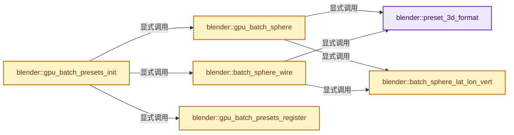

# 实现依赖专题：source/blender/gpu/intern/gpu_batch_presets.cc

[实现依赖导航](../../../README.md) · [符号索引](../../../../00-课程指南/02-源码与提交索引/符号依赖与实现索引.md)

本专题从正文实际调用进入，集中保存共享实现。函数有稳定锚点，可从调用处直接跳到对应完整函数；递归与互相调用通过回链组织。

## 本文件的实现关系




## 完整成员与函数实现

<a id="f-6feca1afc3a0b252"></a>

### `blender::preset_3d_format`

实现位置：[source/blender/gpu/intern/gpu_batch_presets.cc](../../../../../../../../source/blender/gpu/intern/gpu_batch_presets.cc) · L65—L75。

**教学注释版**

<!-- annotated:af292deb0d2cdf -->

```cpp
static GPUVertFormat &preset_3d_format()
{
  if (g_presets_3d.format.attr_len == 0) {
    GPUVertFormat *format = &g_presets_3d.format;
    g_presets_3d.attr_id.pos = GPU_vertformat_attr_add(
        format, "pos", gpu::VertAttrType::SFLOAT_32_32_32);
    g_presets_3d.attr_id.nor = GPU_vertformat_attr_add(
        format, "nor", gpu::VertAttrType::SFLOAT_32_32_32);
  }
  return g_presets_3d.format;
}
```

<details>
<summary>核对原始源码：source/blender/gpu/intern/gpu_batch_presets.cc · L65—L75</summary>

<!-- original:af292deb0d2cdf:source/blender/gpu/intern/gpu_batch_presets.cc:65:75 -->

```cpp
static GPUVertFormat &preset_3d_format()
{
  if (g_presets_3d.format.attr_len == 0) {
    GPUVertFormat *format = &g_presets_3d.format;
    g_presets_3d.attr_id.pos = GPU_vertformat_attr_add(
        format, "pos", gpu::VertAttrType::SFLOAT_32_32_32);
    g_presets_3d.attr_id.nor = GPU_vertformat_attr_add(
        format, "nor", gpu::VertAttrType::SFLOAT_32_32_32);
  }
  return g_presets_3d.format;
}
```

</details>

**沿实际写入检查状态**

- `g_presets_3d.attr_id.pos = GPU_vertformat_attr_add(`
- `g_presets_3d.attr_id.nor = GPU_vertformat_attr_add(`

**结果出口**

- `return g_presets_3d.format;`

**继续追踪实现**

- `GPU_vertformat_attr_add` → [blender::GPU_vertformat_attr_add · L389](gpu_vertex_format.cc.md#f-a36e23f37b97fff4)。

<a id="f-fe3e1996f3e5d5bd"></a>

### `blender::batch_sphere_lat_lon_vert`

实现位置：[source/blender/gpu/intern/gpu_batch_presets.cc](../../../../../../../../source/blender/gpu/intern/gpu_batch_presets.cc) · L89—L100。

接口参数：

- `GPUVertBufRaw *pos_step`
- `GPUVertBufRaw *nor_step`
- `float lat`
- `float lon`

**教学注释版**

<!-- annotated:45b8e0cdde1653 -->

```cpp
static void batch_sphere_lat_lon_vert(GPUVertBufRaw *pos_step,
                                      GPUVertBufRaw *nor_step,
                                      float lat,
                                      float lon)
{
  float pos[3];
  pos[0] = sinf(lat) * cosf(lon);
  pos[1] = cosf(lat);
  pos[2] = sinf(lat) * sinf(lon);
  copy_v3_v3(static_cast<float *>(GPU_vertbuf_raw_step(pos_step)), pos);
  copy_v3_v3(static_cast<float *>(GPU_vertbuf_raw_step(nor_step)), pos);
}
```

<details>
<summary>核对原始源码：source/blender/gpu/intern/gpu_batch_presets.cc · L89—L100</summary>

<!-- original:45b8e0cdde1653:source/blender/gpu/intern/gpu_batch_presets.cc:89:100 -->

```cpp
static void batch_sphere_lat_lon_vert(GPUVertBufRaw *pos_step,
                                      GPUVertBufRaw *nor_step,
                                      float lat,
                                      float lon)
{
  float pos[3];
  pos[0] = sinf(lat) * cosf(lon);
  pos[1] = cosf(lat);
  pos[2] = sinf(lat) * sinf(lon);
  copy_v3_v3(static_cast<float *>(GPU_vertbuf_raw_step(pos_step)), pos);
  copy_v3_v3(static_cast<float *>(GPU_vertbuf_raw_step(nor_step)), pos);
}
```

</details>

**沿实际写入检查状态**

- `pos[0] = sinf(lat) * cosf(lon);`
- `pos[1] = cosf(lat);`
- `pos[2] = sinf(lat) * sinf(lon);`

**继续追踪实现**

- `sinf` → [sinf · L27](../../../07-Intern运行时与平台/cycles/kernel/svm/radial_tiling_shared.h.md#m-40547e913688)；[sinf · L49](../../../07-Intern运行时与平台/cycles/kernel/svm/radial_tiling_shared.h.md#m-8908e5f49833)；[sinf · L80](../../../07-Intern运行时与平台/cycles/kernel/svm/radial_tiling_shared.h.md#m-71130f6adcc4)；[sinf · L31](../../../01-BLI基础库/intern/radial_tiling_shared.hh.md#m-a51a6c88deca)；[sinf · L53](../../../01-BLI基础库/intern/radial_tiling_shared.hh.md#m-9a4db95358ff)；[sinf · L84](../../../01-BLI基础库/intern/radial_tiling_shared.hh.md#m-d26cdafe5b93)；[sinf · L27](../../../07-Intern运行时与平台/cycles/kernel/osl/shaders/node_radial_tiling_shared.h.md#m-9f80b4d363af)；[sinf · L49](../../../07-Intern运行时与平台/cycles/kernel/osl/shaders/node_radial_tiling_shared.h.md#m-f52c29b37ed1)；[sinf · L80](../../../07-Intern运行时与平台/cycles/kernel/osl/shaders/node_radial_tiling_shared.h.md#m-7f1f234ef9ec)；[sinf · L187](../../../07-Intern运行时与平台/cycles/kernel/device/oneapi/compat.h.md#m-aab07e522dda)；[sinf · L287](../../../07-Intern运行时与平台/cycles/kernel/device/metal/compat.h.md#m-7009b99c07ca)；[sinf · L94](../../../07-Intern运行时与平台/cycles/kernel/device/hip/compat.h.md#m-4a1f5d760325)；[sinf · L92](../../../07-Intern运行时与平台/cycles/kernel/device/cuda/compat.h.md#m-e63872738f13)；[sinf · L44](../GPU_shader_shared_utils.hh.md#m-a916f31e38c4)；[sinf · L65](../GPU_shader_shared_utils.hh.md#m-268edbf6d41e)。宏定义由构建条件选择。
- `cosf` → [cosf · L20](../../../07-Intern运行时与平台/cycles/kernel/svm/radial_tiling_shared.h.md#m-cee9ebf67d86)；[cosf · L42](../../../07-Intern运行时与平台/cycles/kernel/svm/radial_tiling_shared.h.md#m-346533627567)；[cosf · L73](../../../07-Intern运行时与平台/cycles/kernel/svm/radial_tiling_shared.h.md#m-e01b94a43b72)；[cosf · L24](../../../01-BLI基础库/intern/radial_tiling_shared.hh.md#m-c317cb08dec6)；[cosf · L46](../../../01-BLI基础库/intern/radial_tiling_shared.hh.md#m-93325b515297)；[cosf · L77](../../../01-BLI基础库/intern/radial_tiling_shared.hh.md#m-d3058af0b490)；[cosf · L20](../../../07-Intern运行时与平台/cycles/kernel/osl/shaders/node_radial_tiling_shared.h.md#m-4c6aea22a560)；[cosf · L42](../../../07-Intern运行时与平台/cycles/kernel/osl/shaders/node_radial_tiling_shared.h.md#m-1fd6a5414477)；[cosf · L73](../../../07-Intern运行时与平台/cycles/kernel/osl/shaders/node_radial_tiling_shared.h.md#m-de2402f85270)；[cosf · L186](../../../07-Intern运行时与平台/cycles/kernel/device/oneapi/compat.h.md#m-7fdbd99009e0)；[cosf · L288](../../../07-Intern运行时与平台/cycles/kernel/device/metal/compat.h.md#m-68fe984e8b68)；[cosf · L93](../../../07-Intern运行时与平台/cycles/kernel/device/hip/compat.h.md#m-21bb557a23f1)；[cosf · L91](../../../07-Intern运行时与平台/cycles/kernel/device/cuda/compat.h.md#m-7721be419a49)；[cosf · L43](../GPU_shader_shared_utils.hh.md#m-25d02fd11b3b)；[cosf · L64](../GPU_shader_shared_utils.hh.md#m-698fc51ccda3)。宏定义由构建条件选择。
- `copy_v3_v3` → [blender::copy_v3_v3 · L47](../../../01-BLI基础库/intern/math_vector_inline.cc.md#f-037a0d5fa5060bd6)。
- `GPU_vertbuf_raw_step` → [blender::GPU_vertbuf_raw_step · L329](../GPU_vertex_buffer.hh.md#f-a206297b58614393)。

<a id="f-fec7412d7123ef7b"></a>

### `blender::gpu_batch_sphere`

实现位置：[source/blender/gpu/intern/gpu_batch_presets.cc](../../../../../../../../source/blender/gpu/intern/gpu_batch_presets.cc) · L134—L170。

接口参数：

- `int lat_res`
- `int lon_res`

**教学注释版**

<!-- annotated:7d050b5327193f -->

```cpp
static gpu::Batch *gpu_batch_sphere(int lat_res, int lon_res)
{
  const float lon_inc = 2 * M_PI / lon_res;
  const float lat_inc = M_PI / lat_res;
  float lon, lat;

  gpu::VertBuf *vbo = GPU_vertbuf_create_with_format(preset_3d_format());
  const uint vbo_len = (lat_res - 1) * lon_res * 6;
  GPU_vertbuf_data_alloc(*vbo, vbo_len);

  GPUVertBufRaw pos_step, nor_step;
  GPU_vertbuf_attr_get_raw_data(vbo, g_presets_3d.attr_id.pos, &pos_step);
  GPU_vertbuf_attr_get_raw_data(vbo, g_presets_3d.attr_id.nor, &nor_step);

  lon = 0.0f;
  for (int i = 0; i < lon_res; i++, lon += lon_inc) {
    lat = 0.0f;
    for (int j = 0; j < lat_res; j++, lat += lat_inc) {
      if (j != lat_res - 1) { /* Pole */
        batch_sphere_lat_lon_vert(&pos_step, &nor_step, lat + lat_inc, lon + lon_inc);
        batch_sphere_lat_lon_vert(&pos_step, &nor_step, lat + lat_inc, lon);
        batch_sphere_lat_lon_vert(&pos_step, &nor_step, lat, lon);
      }

      if (j != 0) { /* Pole */
        batch_sphere_lat_lon_vert(&pos_step, &nor_step, lat, lon + lon_inc);
        batch_sphere_lat_lon_vert(&pos_step, &nor_step, lat + lat_inc, lon + lon_inc);
        batch_sphere_lat_lon_vert(&pos_step, &nor_step, lat, lon);
      }
    }
  }

  BLI_assert(vbo_len == GPU_vertbuf_raw_used(&pos_step));
  BLI_assert(vbo_len == GPU_vertbuf_raw_used(&nor_step));

  return GPU_batch_create_ex(GPU_PRIM_TRIS, vbo, nullptr, GPU_BATCH_OWNS_VBO);
}
```

<details>
<summary>核对原始源码：source/blender/gpu/intern/gpu_batch_presets.cc · L134—L170</summary>

<!-- original:7d050b5327193f:source/blender/gpu/intern/gpu_batch_presets.cc:134:170 -->

```cpp
static gpu::Batch *gpu_batch_sphere(int lat_res, int lon_res)
{
  const float lon_inc = 2 * M_PI / lon_res;
  const float lat_inc = M_PI / lat_res;
  float lon, lat;

  gpu::VertBuf *vbo = GPU_vertbuf_create_with_format(preset_3d_format());
  const uint vbo_len = (lat_res - 1) * lon_res * 6;
  GPU_vertbuf_data_alloc(*vbo, vbo_len);

  GPUVertBufRaw pos_step, nor_step;
  GPU_vertbuf_attr_get_raw_data(vbo, g_presets_3d.attr_id.pos, &pos_step);
  GPU_vertbuf_attr_get_raw_data(vbo, g_presets_3d.attr_id.nor, &nor_step);

  lon = 0.0f;
  for (int i = 0; i < lon_res; i++, lon += lon_inc) {
    lat = 0.0f;
    for (int j = 0; j < lat_res; j++, lat += lat_inc) {
      if (j != lat_res - 1) { /* Pole */
        batch_sphere_lat_lon_vert(&pos_step, &nor_step, lat + lat_inc, lon + lon_inc);
        batch_sphere_lat_lon_vert(&pos_step, &nor_step, lat + lat_inc, lon);
        batch_sphere_lat_lon_vert(&pos_step, &nor_step, lat, lon);
      }

      if (j != 0) { /* Pole */
        batch_sphere_lat_lon_vert(&pos_step, &nor_step, lat, lon + lon_inc);
        batch_sphere_lat_lon_vert(&pos_step, &nor_step, lat + lat_inc, lon + lon_inc);
        batch_sphere_lat_lon_vert(&pos_step, &nor_step, lat, lon);
      }
    }
  }

  BLI_assert(vbo_len == GPU_vertbuf_raw_used(&pos_step));
  BLI_assert(vbo_len == GPU_vertbuf_raw_used(&nor_step));

  return GPU_batch_create_ex(GPU_PRIM_TRIS, vbo, nullptr, GPU_BATCH_OWNS_VBO);
}
```

</details>

**沿实际写入检查状态**

- `lon = 0.0f;`
- `lat = 0.0f;`

**结果出口**

- `return GPU_batch_create_ex(GPU_PRIM_TRIS, vbo, nullptr, GPU_BATCH_OWNS_VBO);`

**继续追踪实现**

- `GPU_vertbuf_create_with_format` → [blender::GPU_vertbuf_create_with_format · L71](../GPU_vertex_buffer.hh.md#f-bd43fe034e852138)。
- `preset_3d_format` → [blender::preset_3d_format · L65](gpu_batch_presets.cc.md#f-6feca1afc3a0b252)。
- `GPU_vertbuf_data_alloc` → [blender::GPU_vertbuf_data_alloc · L172](gpu_vertex_buffer.cc.md#f-8ee5cf106e0f2b0f)。
- `GPU_vertbuf_attr_get_raw_data` → [blender::GPU_vertbuf_attr_get_raw_data · L245](gpu_vertex_buffer.cc.md#f-00aeac0bf6fcdb36)。
- `batch_sphere_lat_lon_vert` → [blender::batch_sphere_lat_lon_vert · L89](gpu_batch_presets.cc.md#f-fe3e1996f3e5d5bd)。
- `BLI_assert` → [BLI_assert · L48](../../../01-BLI基础库/BLI_assert.hh.md#m-57a88495704d)；[BLI_assert · L63](../../../01-BLI基础库/BLI_assert.hh.md#m-d07050020cb5)。宏定义由构建条件选择。
- `GPU_vertbuf_raw_used` → [blender::GPU_vertbuf_raw_used · L339](../GPU_vertex_buffer.hh.md#f-b25b1d2990442cfb)。
- `GPU_batch_create_ex` → [blender::GPU_batch_create_ex · L53](gpu_batch.cc.md#f-d3825f4a720aba94)。

<a id="f-951bbdcaad6d5e8e"></a>

### `blender::batch_sphere_wire`

实现位置：[source/blender/gpu/intern/gpu_batch_presets.cc](../../../../../../../../source/blender/gpu/intern/gpu_batch_presets.cc) · L172—L204。

接口参数：

- `int lat_res`
- `int lon_res`

**教学注释版**

<!-- annotated:13e1216780b5d5 -->

```cpp
static gpu::Batch *batch_sphere_wire(int lat_res, int lon_res)
{
  const float lon_inc = 2 * M_PI / lon_res;
  const float lat_inc = M_PI / lat_res;
  float lon, lat;

  gpu::VertBuf *vbo = GPU_vertbuf_create_with_format(preset_3d_format());
  const uint vbo_len = (lat_res * lon_res * 2) + ((lat_res - 1) * lon_res * 2);
  GPU_vertbuf_data_alloc(*vbo, vbo_len);

  GPUVertBufRaw pos_step, nor_step;
  GPU_vertbuf_attr_get_raw_data(vbo, g_presets_3d.attr_id.pos, &pos_step);
  GPU_vertbuf_attr_get_raw_data(vbo, g_presets_3d.attr_id.nor, &nor_step);

  lon = 0.0f;
  for (int i = 0; i < lon_res; i++, lon += lon_inc) {
    lat = 0.0f;
    for (int j = 0; j < lat_res; j++, lat += lat_inc) {
      batch_sphere_lat_lon_vert(&pos_step, &nor_step, lat + lat_inc, lon);
      batch_sphere_lat_lon_vert(&pos_step, &nor_step, lat, lon);

      if (j != lat_res - 1) { /* Pole */
        batch_sphere_lat_lon_vert(&pos_step, &nor_step, lat + lat_inc, lon + lon_inc);
        batch_sphere_lat_lon_vert(&pos_step, &nor_step, lat + lat_inc, lon);
      }
    }
  }

  BLI_assert(vbo_len == GPU_vertbuf_raw_used(&pos_step));
  BLI_assert(vbo_len == GPU_vertbuf_raw_used(&nor_step));

  return GPU_batch_create_ex(GPU_PRIM_LINES, vbo, nullptr, GPU_BATCH_OWNS_VBO);
}
```

<details>
<summary>核对原始源码：source/blender/gpu/intern/gpu_batch_presets.cc · L172—L204</summary>

<!-- original:13e1216780b5d5:source/blender/gpu/intern/gpu_batch_presets.cc:172:204 -->

```cpp
static gpu::Batch *batch_sphere_wire(int lat_res, int lon_res)
{
  const float lon_inc = 2 * M_PI / lon_res;
  const float lat_inc = M_PI / lat_res;
  float lon, lat;

  gpu::VertBuf *vbo = GPU_vertbuf_create_with_format(preset_3d_format());
  const uint vbo_len = (lat_res * lon_res * 2) + ((lat_res - 1) * lon_res * 2);
  GPU_vertbuf_data_alloc(*vbo, vbo_len);

  GPUVertBufRaw pos_step, nor_step;
  GPU_vertbuf_attr_get_raw_data(vbo, g_presets_3d.attr_id.pos, &pos_step);
  GPU_vertbuf_attr_get_raw_data(vbo, g_presets_3d.attr_id.nor, &nor_step);

  lon = 0.0f;
  for (int i = 0; i < lon_res; i++, lon += lon_inc) {
    lat = 0.0f;
    for (int j = 0; j < lat_res; j++, lat += lat_inc) {
      batch_sphere_lat_lon_vert(&pos_step, &nor_step, lat + lat_inc, lon);
      batch_sphere_lat_lon_vert(&pos_step, &nor_step, lat, lon);

      if (j != lat_res - 1) { /* Pole */
        batch_sphere_lat_lon_vert(&pos_step, &nor_step, lat + lat_inc, lon + lon_inc);
        batch_sphere_lat_lon_vert(&pos_step, &nor_step, lat + lat_inc, lon);
      }
    }
  }

  BLI_assert(vbo_len == GPU_vertbuf_raw_used(&pos_step));
  BLI_assert(vbo_len == GPU_vertbuf_raw_used(&nor_step));

  return GPU_batch_create_ex(GPU_PRIM_LINES, vbo, nullptr, GPU_BATCH_OWNS_VBO);
}
```

</details>

**沿实际写入检查状态**

- `lon = 0.0f;`
- `lat = 0.0f;`

**结果出口**

- `return GPU_batch_create_ex(GPU_PRIM_LINES, vbo, nullptr, GPU_BATCH_OWNS_VBO);`

**继续追踪实现**

- `GPU_vertbuf_create_with_format` → [blender::GPU_vertbuf_create_with_format · L71](../GPU_vertex_buffer.hh.md#f-bd43fe034e852138)。
- `preset_3d_format` → [blender::preset_3d_format · L65](gpu_batch_presets.cc.md#f-6feca1afc3a0b252)。
- `GPU_vertbuf_data_alloc` → [blender::GPU_vertbuf_data_alloc · L172](gpu_vertex_buffer.cc.md#f-8ee5cf106e0f2b0f)。
- `GPU_vertbuf_attr_get_raw_data` → [blender::GPU_vertbuf_attr_get_raw_data · L245](gpu_vertex_buffer.cc.md#f-00aeac0bf6fcdb36)。
- `batch_sphere_lat_lon_vert` → [blender::batch_sphere_lat_lon_vert · L89](gpu_batch_presets.cc.md#f-fe3e1996f3e5d5bd)。
- `BLI_assert` → [BLI_assert · L48](../../../01-BLI基础库/BLI_assert.hh.md#m-57a88495704d)；[BLI_assert · L63](../../../01-BLI基础库/BLI_assert.hh.md#m-d07050020cb5)。宏定义由构建条件选择。
- `GPU_vertbuf_raw_used` → [blender::GPU_vertbuf_raw_used · L339](../GPU_vertex_buffer.hh.md#f-b25b1d2990442cfb)。
- `GPU_batch_create_ex` → [blender::GPU_batch_create_ex · L53](gpu_batch.cc.md#f-d3825f4a720aba94)。

<a id="f-a0f8109273e3d7f7"></a>

### `blender::gpu_batch_presets_init`

实现位置：[source/blender/gpu/intern/gpu_batch_presets.cc](../../../../../../../../source/blender/gpu/intern/gpu_batch_presets.cc) · L230—L249。

**教学注释版**

<!-- annotated:9776b3fadebc93 -->

```cpp
void gpu_batch_presets_init()
{
  BLI_mutex_init(&g_presets_3d.mutex);

  /* Hard coded resolution */
  g_presets_3d.batch.sphere_low = gpu_batch_sphere(8, 16);
  gpu_batch_presets_register(g_presets_3d.batch.sphere_low);

  g_presets_3d.batch.sphere_med = gpu_batch_sphere(16, 10);
  gpu_batch_presets_register(g_presets_3d.batch.sphere_med);

  g_presets_3d.batch.sphere_high = gpu_batch_sphere(32, 24);
  gpu_batch_presets_register(g_presets_3d.batch.sphere_high);

  g_presets_3d.batch.sphere_wire_low = batch_sphere_wire(6, 8);
  gpu_batch_presets_register(g_presets_3d.batch.sphere_wire_low);

  g_presets_3d.batch.sphere_wire_med = batch_sphere_wire(8, 16);
  gpu_batch_presets_register(g_presets_3d.batch.sphere_wire_med);
}
```

<details>
<summary>核对原始源码：source/blender/gpu/intern/gpu_batch_presets.cc · L230—L249</summary>

<!-- original:9776b3fadebc93:source/blender/gpu/intern/gpu_batch_presets.cc:230:249 -->

```cpp
void gpu_batch_presets_init()
{
  BLI_mutex_init(&g_presets_3d.mutex);

  /* Hard coded resolution */
  g_presets_3d.batch.sphere_low = gpu_batch_sphere(8, 16);
  gpu_batch_presets_register(g_presets_3d.batch.sphere_low);

  g_presets_3d.batch.sphere_med = gpu_batch_sphere(16, 10);
  gpu_batch_presets_register(g_presets_3d.batch.sphere_med);

  g_presets_3d.batch.sphere_high = gpu_batch_sphere(32, 24);
  gpu_batch_presets_register(g_presets_3d.batch.sphere_high);

  g_presets_3d.batch.sphere_wire_low = batch_sphere_wire(6, 8);
  gpu_batch_presets_register(g_presets_3d.batch.sphere_wire_low);

  g_presets_3d.batch.sphere_wire_med = batch_sphere_wire(8, 16);
  gpu_batch_presets_register(g_presets_3d.batch.sphere_wire_med);
}
```

</details>

**沿实际写入检查状态**

- `g_presets_3d.batch.sphere_low = gpu_batch_sphere(8, 16);`
- `g_presets_3d.batch.sphere_med = gpu_batch_sphere(16, 10);`
- `g_presets_3d.batch.sphere_high = gpu_batch_sphere(32, 24);`
- `g_presets_3d.batch.sphere_wire_low = batch_sphere_wire(6, 8);`
- `g_presets_3d.batch.sphere_wire_med = batch_sphere_wire(8, 16);`

**继续追踪实现**

- `BLI_mutex_init` → [BLI_mutex_init · L343](../../../01-BLI基础库/intern/threads.cc.md#f-7d065be18920fb3a)。
- `gpu_batch_sphere` → [blender::gpu_batch_sphere · L134](gpu_batch_presets.cc.md#f-fec7412d7123ef7b)。
- `gpu_batch_presets_register` → [blender::gpu_batch_presets_register · L251](gpu_batch_presets.cc.md#f-44daaf7123510418)。
- `batch_sphere_wire` → [blender::batch_sphere_wire · L172](gpu_batch_presets.cc.md#f-951bbdcaad6d5e8e)。

<a id="f-44daaf7123510418"></a>

### `blender::gpu_batch_presets_register`

实现位置：[source/blender/gpu/intern/gpu_batch_presets.cc](../../../../../../../../source/blender/gpu/intern/gpu_batch_presets.cc) · L251—L256。

接口参数：

- `gpu::Batch *preset_batch`

**教学注释版**

<!-- annotated:529b903a67b96b -->

```cpp
void gpu_batch_presets_register(gpu::Batch *preset_batch)
{
  BLI_mutex_lock(&g_presets_3d.mutex);
  BLI_addtail(&presets_list, BLI_genericNodeN(preset_batch));
  BLI_mutex_unlock(&g_presets_3d.mutex);
}
```

<details>
<summary>核对原始源码：source/blender/gpu/intern/gpu_batch_presets.cc · L251—L256</summary>

<!-- original:529b903a67b96b:source/blender/gpu/intern/gpu_batch_presets.cc:251:256 -->

```cpp
void gpu_batch_presets_register(gpu::Batch *preset_batch)
{
  BLI_mutex_lock(&g_presets_3d.mutex);
  BLI_addtail(&presets_list, BLI_genericNodeN(preset_batch));
  BLI_mutex_unlock(&g_presets_3d.mutex);
}
```

</details>

**继续追踪实现**

- `BLI_mutex_lock` → [BLI_mutex_lock · L348](../../../01-BLI基础库/intern/threads.cc.md#f-825ea5a7ea897c32)。
- `BLI_addtail` → [blender::BLI_addtail · L118](../../../01-BLI基础库/intern/listbase.cc.md#f-4fb027713fa3115b)。
- `BLI_genericNodeN` → [blender::BLI_genericNodeN · L936](../../../01-BLI基础库/intern/listbase.cc.md#f-a3f8fad9ff74a185)。
- `BLI_mutex_unlock` → [BLI_mutex_unlock · L353](../../../01-BLI基础库/intern/threads.cc.md#f-e8638af1addfc8a4)。
