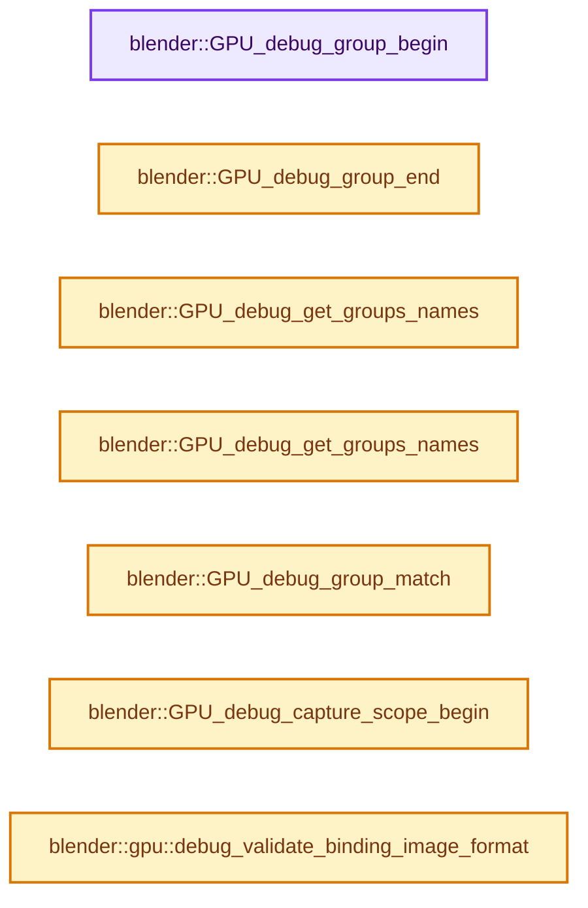
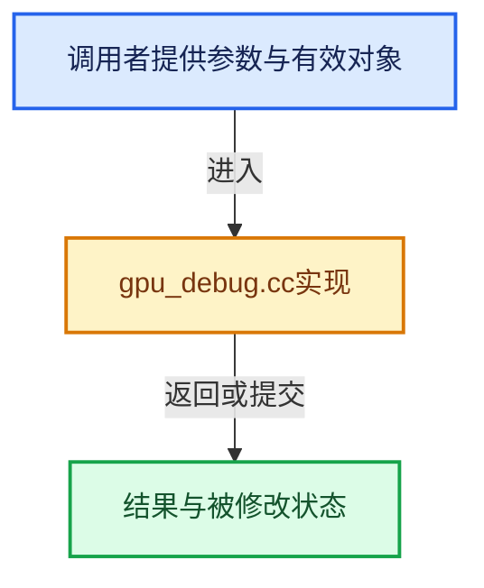

# 实现依赖专题：source/blender/gpu/intern/gpu_debug.cc

[实现依赖导航](../../../README.md) · [符号索引](../../../../00-课程指南/02-源码与提交索引/符号依赖与实现索引.md)

本专题从正文实际调用进入，集中保存共享实现。函数有稳定锚点，可从调用处直接跳到对应完整函数；递归与互相调用通过回链组织。

## 本文件的实现关系






## 完整成员与函数实现

<a id="f-c74a16ba40e0e7a7"></a>

### `blender::GPU_debug_group_begin`

实现位置：[source/blender/gpu/intern/gpu_debug.cc](../../../../../../../../source/blender/gpu/intern/gpu_debug.cc) · L23—L32。

接口参数：

- `const char *name`

**教学注释版**

<!-- annotated:ee4b93869c512a -->

```cpp
void GPU_debug_group_begin(const char *name)
{
  if (!(G.debug & G_DEBUG_GPU) && !G.profile_gpu) {
    return;
  }
  Context *ctx = Context::get();
  DebugStack &stack = ctx->debug_stack;
  stack.append(StringRef(name));
  ctx->debug_group_begin(name, stack.size());
}
```

<details>
<summary>核对原始源码：source/blender/gpu/intern/gpu_debug.cc · L23—L32</summary>

<!-- original:ee4b93869c512a:source/blender/gpu/intern/gpu_debug.cc:23:32 -->

```cpp
void GPU_debug_group_begin(const char *name)
{
  if (!(G.debug & G_DEBUG_GPU) && !G.profile_gpu) {
    return;
  }
  Context *ctx = Context::get();
  DebugStack &stack = ctx->debug_stack;
  stack.append(StringRef(name));
  ctx->debug_group_begin(name, stack.size());
}
```

</details>

**继续追踪实现**

- `Context::get` → [blender::gpu::Context::get · L127](gpu_context.cc.md#f-7ca16707244f2d11)。
- `stack.append` → [blender::UV_ClipboardBuffer::append · L151](../../editors/uvedit/uvedit_clipboard.cc.md#f-de8d3eb273c2b6e2)；[blender::GVectorArray::append · L28](../../../01-BLI基础库/intern/generic_vector_array.cc.md#f-0cb0cf008e99799f)；[blender::GLSharedOrphanLists::OrphanList::append · L213](../opengl/gl_context.cc.md#f-38a327ca2ce8ae16)。同名重载需按实参类型选择。
- `StringRef` → [blender::StringRef::StringRef · L555](../../../../01-基础容器与现代CPP/15-StringRef字符串视图.md#f-f6aca324a36faa7e)；[blender::StringRef::StringRef · L560](../../../../01-基础容器与现代CPP/15-StringRef字符串视图.md#f-ab9714781ca51bac)；[blender::StringRef::StringRef · L565](../../../../01-基础容器与现代CPP/15-StringRef字符串视图.md#f-95f0b483bbdd7739)；[blender::StringRef::StringRef · L570](../../../../01-基础容器与现代CPP/15-StringRef字符串视图.md#f-808d05699cb33334)；[blender::StringRef::StringRef · L631](../../../../01-基础容器与现代CPP/15-StringRef字符串视图.md#f-37788e5f3fa3b736)；[blender::StringRef::StringRef · L641](../../../../01-基础容器与现代CPP/15-StringRef字符串视图.md#f-11abd0510fb6b926)；[blender::StringRef::StringRef · L646](../../../../01-基础容器与现代CPP/15-StringRef字符串视图.md#f-8437dbd8a582eefd)；[blender::StringRef::StringRef · L651](../../../../01-基础容器与现代CPP/15-StringRef字符串视图.md#f-70bcb338de0db978)。同名重载需按实参类型选择。
- `ctx->debug_group_begin` → [调用协议](../../../../00-课程指南/01-路线与规范/模板宏与动态分派协议.md)：由接收对象具体类型或运行时策略提供实现。调用位置L31。
- `stack.size` → [blender::Bounds<T>::size · L543](../../../../12-空间数据结构与几何算法/07-Bounds与BVH对比.md#f-fcce88c0824fcd97)；[blender::GVArrayImpl::size · L651](../../../../04-虚拟数组与索引选择/05-GVArray运行时类型.md#f-f23d3d1f3b110f1e)；[blender::GVArrayCommon::size · L759](../../../../04-虚拟数组与索引选择/05-GVArray运行时类型.md#f-0856784f4e4fd3c9)；[blender::StringRefBase::size · L196](../../../../01-基础容器与现代CPP/15-StringRef字符串视图.md#f-60d4631c74931d2e)；[blender::KDTreeNew<T>::size · L493](../../../../12-空间数据结构与几何算法/05-K近邻与范围查询.md#f-233c05ce6d5c8d39)；[blender::MainAllIDsIterator::size · L1291](../../../02-BKE几何与数据/intern/main.cc.md#f-520d1311c646452f)；[blender::GLSourcesBaked::size · L1541](../opengl/gl_shader.cc.md#f-5b5b539d533c6792)。同名重载需按实参类型选择。

<a id="f-6d1ac356d118d5ac"></a>

### `blender::GPU_debug_group_end`

实现位置：[source/blender/gpu/intern/gpu_debug.cc](../../../../../../../../source/blender/gpu/intern/gpu_debug.cc) · L34—L42。

**教学注释版**

<!-- annotated:a61311905d87f6 -->

```cpp
void GPU_debug_group_end()
{
  if (!(G.debug & G_DEBUG_GPU) && !G.profile_gpu) {
    return;
  }
  Context *ctx = Context::get();
  ctx->debug_stack.pop_last();
  ctx->debug_group_end();
}
```

<details>
<summary>核对原始源码：source/blender/gpu/intern/gpu_debug.cc · L34—L42</summary>

<!-- original:a61311905d87f6:source/blender/gpu/intern/gpu_debug.cc:34:42 -->

```cpp
void GPU_debug_group_end()
{
  if (!(G.debug & G_DEBUG_GPU) && !G.profile_gpu) {
    return;
  }
  Context *ctx = Context::get();
  ctx->debug_stack.pop_last();
  ctx->debug_group_end();
}
```

</details>

**继续追踪实现**

- `Context::get` → [blender::gpu::Context::get · L127](gpu_context.cc.md#f-7ca16707244f2d11)。
- `ctx->debug_stack.pop_last` → [调用协议](../../../../00-课程指南/01-路线与规范/模板宏与动态分派协议.md)：接收对象类型依赖auto、返回值或模板实例；不按同名猜测目标。调用位置L40。
- `ctx->debug_group_end` → [调用协议](../../../../00-课程指南/01-路线与规范/模板宏与动态分派协议.md)：由接收对象具体类型或运行时策略提供实现。调用位置L41。

<a id="f-2340b84b1ad80b62"></a>

### `blender::GPU_debug_get_groups_names`

实现位置：[source/blender/gpu/intern/gpu_debug.cc](../../../../../../../../source/blender/gpu/intern/gpu_debug.cc) · L44—L60。

接口参数：

- `int name_buf_maxncpy`
- `char *r_name_buf`

**教学注释版**

<!-- annotated:b2407a88afa38b -->

```cpp
void GPU_debug_get_groups_names(int name_buf_maxncpy, char *r_name_buf)
{
  Context *ctx = Context::get();
  if (ctx == nullptr) {
    return;
  }
  DebugStack &stack = ctx->debug_stack;
  if (stack.is_empty()) {
    r_name_buf[0] = '\0';
    return;
  }
  size_t len = 0;
  for (StringRef &name : stack) {
    len += BLI_snprintf_rlen(r_name_buf + len, name_buf_maxncpy - len, "%s > ", name.data());
  }
  r_name_buf[len - 3] = '\0';
}
```

<details>
<summary>核对原始源码：source/blender/gpu/intern/gpu_debug.cc · L44—L60</summary>

<!-- original:b2407a88afa38b:source/blender/gpu/intern/gpu_debug.cc:44:60 -->

```cpp
void GPU_debug_get_groups_names(int name_buf_maxncpy, char *r_name_buf)
{
  Context *ctx = Context::get();
  if (ctx == nullptr) {
    return;
  }
  DebugStack &stack = ctx->debug_stack;
  if (stack.is_empty()) {
    r_name_buf[0] = '\0';
    return;
  }
  size_t len = 0;
  for (StringRef &name : stack) {
    len += BLI_snprintf_rlen(r_name_buf + len, name_buf_maxncpy - len, "%s > ", name.data());
  }
  r_name_buf[len - 3] = '\0';
}
```

</details>

**沿实际写入检查状态**

- `r_name_buf[0] = '\0';`
- `len += BLI_snprintf_rlen(r_name_buf + len, name_buf_maxncpy - len, "%s > ", name.data());`

**继续追踪实现**

- `Context::get` → [blender::gpu::Context::get · L127](gpu_context.cc.md#f-7ca16707244f2d11)。
- `stack.is_empty` → [blender::Bounds<T>::is_empty · L533](../../../../12-空间数据结构与几何算法/07-Bounds与BVH对比.md#f-55ac376b3d0a0944)；[blender::GVArrayCommon::is_empty · L767](../../../../04-虚拟数组与索引选择/05-GVArray运行时类型.md#f-c1da602ffc5555f9)；[blender::StringRefBase::is_empty · L201](../../../../01-基础容器与现代CPP/15-StringRef字符串视图.md#f-9f6c3d2da1cb1796)；[blender::KDTreeNew<T>::is_empty · L498](../../../../12-空间数据结构与几何算法/05-K近邻与范围查询.md#f-67f0ff91cf00b00b)。同名重载需按实参类型选择。
- `BLI_snprintf_rlen` → [blender::BLI_snprintf_rlen · L213](../../../01-BLI基础库/intern/string.cc.md#f-935c2eb6daad7a3a)。
- `name.data` → [调用协议](../../../../00-课程指南/01-路线与规范/模板宏与动态分派协议.md)：接收对象类型依赖auto、返回值或模板实例；不按同名猜测目标。调用位置L57。

<a id="f-ef6ce710b13aa67f"></a>

### `blender::GPU_debug_get_groups_names`

实现位置：[source/blender/gpu/intern/gpu_debug.cc](../../../../../../../../source/blender/gpu/intern/gpu_debug.cc) · L62—L82。

接口参数：

- `IndexRange levels`

**教学注释版**

<!-- annotated:2791ec28fadb18 -->

```cpp
std::string GPU_debug_get_groups_names(IndexRange levels)
{
  Context *ctx = Context::get();
  if (ctx == nullptr) {
    return "";
  }
  DebugStack &stack = ctx->debug_stack;
  if (stack.is_empty()) {
    return "";
  }
  std::string result;

  int i = 0;
  for (StringRef &name : stack) {
    if (levels.contains(i++)) {
      result += name;
      result += " > ";
    }
  }
  return result.substr(0, result.size() - 3);
}
```

<details>
<summary>核对原始源码：source/blender/gpu/intern/gpu_debug.cc · L62—L82</summary>

<!-- original:2791ec28fadb18:source/blender/gpu/intern/gpu_debug.cc:62:82 -->

```cpp
std::string GPU_debug_get_groups_names(IndexRange levels)
{
  Context *ctx = Context::get();
  if (ctx == nullptr) {
    return "";
  }
  DebugStack &stack = ctx->debug_stack;
  if (stack.is_empty()) {
    return "";
  }
  std::string result;

  int i = 0;
  for (StringRef &name : stack) {
    if (levels.contains(i++)) {
      result += name;
      result += " > ";
    }
  }
  return result.substr(0, result.size() - 3);
}
```

</details>

**沿实际写入检查状态**

- `result += name;`
- `result += " > ";`

**结果出口**

- `return "";`
- `return result.substr(0, result.size() - 3);`

**继续追踪实现**

- `Context::get` → [blender::gpu::Context::get · L127](gpu_context.cc.md#f-7ca16707244f2d11)。
- `stack.is_empty` → [blender::Bounds<T>::is_empty · L533](../../../../12-空间数据结构与几何算法/07-Bounds与BVH对比.md#f-55ac376b3d0a0944)；[blender::GVArrayCommon::is_empty · L767](../../../../04-虚拟数组与索引选择/05-GVArray运行时类型.md#f-c1da602ffc5555f9)；[blender::StringRefBase::is_empty · L201](../../../../01-基础容器与现代CPP/15-StringRef字符串视图.md#f-9f6c3d2da1cb1796)；[blender::KDTreeNew<T>::is_empty · L498](../../../../12-空间数据结构与几何算法/05-K近邻与范围查询.md#f-67f0ff91cf00b00b)。同名重载需按实参类型选择。
- `levels.contains` → [blender::IndexRange::contains · L251](../../../../01-基础容器与现代CPP/04-IndexRange连续整数区间.md#f-1a01eaa28eaecd5c)；[blender::IndexRange::contains · L259](../../../../01-基础容器与现代CPP/04-IndexRange连续整数区间.md#f-8eb195a52f17a51f)。同名重载需按实参类型选择。
- `result.substr` → [外部契约](https://eel.is/c++draft/)：这个边界按实际表达式及所属类型核对参数、返回值、寿命与失败行为。这里提供接口入口，不声称已解释该第三方版本的内部实现。
- `result.size` → [外部契约](https://eel.is/c++draft/)：这个边界按实际表达式及所属类型核对参数、返回值、寿命与失败行为。这里提供接口入口，不声称已解释该第三方版本的内部实现。

<a id="f-9de0ad763415e280"></a>

### `blender::GPU_debug_group_match`

实现位置：[source/blender/gpu/intern/gpu_debug.cc](../../../../../../../../source/blender/gpu/intern/gpu_debug.cc) · L84—L99。

接口参数：

- `const char *ref`

**教学注释版**

<!-- annotated:ee73fea548faba -->

```cpp
bool GPU_debug_group_match(const char *ref)
{
  /* Otherwise there will be no names. */
  BLI_assert(G.debug & G_DEBUG_GPU);
  Context *ctx = Context::get();
  if (ctx == nullptr) {
    return false;
  }
  const DebugStack &stack = ctx->debug_stack;
  for (const StringRef &name : stack) {
    if (name == ref) {
      return true;
    }
  }
  return false;
}
```

<details>
<summary>核对原始源码：source/blender/gpu/intern/gpu_debug.cc · L84—L99</summary>

<!-- original:ee73fea548faba:source/blender/gpu/intern/gpu_debug.cc:84:99 -->

```cpp
bool GPU_debug_group_match(const char *ref)
{
  /* Otherwise there will be no names. */
  BLI_assert(G.debug & G_DEBUG_GPU);
  Context *ctx = Context::get();
  if (ctx == nullptr) {
    return false;
  }
  const DebugStack &stack = ctx->debug_stack;
  for (const StringRef &name : stack) {
    if (name == ref) {
      return true;
    }
  }
  return false;
}
```

</details>

**结果出口**

- `return false;`
- `return true;`

**继续追踪实现**

- `BLI_assert` → [BLI_assert · L48](../../../01-BLI基础库/BLI_assert.hh.md#m-57a88495704d)；[BLI_assert · L63](../../../01-BLI基础库/BLI_assert.hh.md#m-d07050020cb5)。宏定义由构建条件选择。
- `Context::get` → [blender::gpu::Context::get · L127](gpu_context.cc.md#f-7ca16707244f2d11)。

<a id="f-5442bcfce29a7486"></a>

### `blender::GPU_debug_capture_scope_begin`

实现位置：[source/blender/gpu/intern/gpu_debug.cc](../../../../../../../../source/blender/gpu/intern/gpu_debug.cc) · L146—L166。

接口参数：

- `void *scope`

**教学注释版**

<!-- annotated:87c3a3e014ddb6 -->

```cpp
bool GPU_debug_capture_scope_begin(void *scope)
{
  /* Early exit if scope does not exist or not in debug mode. */
  if (!(G.debug & G_DEBUG_GPU) || !scope) {
    return false;
  }

  Context *ctx = Context::get();
  if (!ctx) {
    return false;
  }

  /* Declare beginning of capture scope region. */
  bool scope_capturing = ctx->debug_capture_scope_begin(scope);
  if (scope_capturing && !ctx->debug_is_capturing) {
    /* Call GPU_finish to ensure all desired GPU commands occur within the capture boundary. */
    GPU_finish();
    ctx->debug_is_capturing = true;
  }
  return ctx->debug_is_capturing;
}
```

<details>
<summary>核对原始源码：source/blender/gpu/intern/gpu_debug.cc · L146—L166</summary>

<!-- original:87c3a3e014ddb6:source/blender/gpu/intern/gpu_debug.cc:146:166 -->

```cpp
bool GPU_debug_capture_scope_begin(void *scope)
{
  /* Early exit if scope does not exist or not in debug mode. */
  if (!(G.debug & G_DEBUG_GPU) || !scope) {
    return false;
  }

  Context *ctx = Context::get();
  if (!ctx) {
    return false;
  }

  /* Declare beginning of capture scope region. */
  bool scope_capturing = ctx->debug_capture_scope_begin(scope);
  if (scope_capturing && !ctx->debug_is_capturing) {
    /* Call GPU_finish to ensure all desired GPU commands occur within the capture boundary. */
    GPU_finish();
    ctx->debug_is_capturing = true;
  }
  return ctx->debug_is_capturing;
}
```

</details>

**沿实际写入检查状态**

- `ctx->debug_is_capturing = true;`

**结果出口**

- `return false;`
- `return ctx->debug_is_capturing;`

**继续追踪实现**

- `Context::get` → [blender::gpu::Context::get · L127](gpu_context.cc.md#f-7ca16707244f2d11)。
- `ctx->debug_capture_scope_begin` → [调用协议](../../../../00-课程指南/01-路线与规范/模板宏与动态分派协议.md)：由接收对象具体类型或运行时策略提供实现。调用位置L159。
- `GPU_finish` → [blender::GPU_finish · L289](gpu_state.cc.md#f-b4372dd2c21f2253)。

<a id="f-24f4504fa9ae1ae8"></a>

### `blender::gpu::debug_validate_binding_image_format`

实现位置：[source/blender/gpu/intern/gpu_debug.cc](../../../../../../../../source/blender/gpu/intern/gpu_debug.cc) · L193—L223。

**教学注释版**

<!-- annotated:299a2330144677 -->

```cpp
void debug_validate_binding_image_format()
{
  if (!(G.debug & G_DEBUG_GPU)) {
    return;
  }

  const auto &texture_formats_state = Context::get()->state_manager->image_formats;
  const auto &texture_formats_shader = Context::get()->shader->interface->image_formats_;
  for (int image_unit = 0; image_unit < GPU_MAX_IMAGE; image_unit++) {
    TextureWriteFormat format_state = texture_formats_state[image_unit];
    TextureWriteFormat format_shader = texture_formats_shader[image_unit];
    if (format_state != TextureWriteFormat::Invalid &&
        format_shader == TextureWriteFormat::Invalid)
    {
      /* It is allowed for an image to be bound in the state manager but to be unused in the
       * shader. */
      continue;
    }
    if (texture_formats_shader[image_unit] != texture_formats_state[image_unit]) [[unlikely]] {
      fprintf(
          stderr,
          "Error in GPU_debug_validate_binding_image_format: Image format mismatch detected for "
          "shader '%s' at binding %d (shader format '%s' vs. bound texture format '%s').\n",
          Context::get()->shader->name_get().c_str(),
          image_unit,
          GPU_texture_format_name(to_texture_format(texture_formats_shader[image_unit])),
          GPU_texture_format_name(to_texture_format(texture_formats_state[image_unit])));
      BLI_assert_unreachable();
    }
  }
}
```

<details>
<summary>核对原始源码：source/blender/gpu/intern/gpu_debug.cc · L193—L223</summary>

<!-- original:299a2330144677:source/blender/gpu/intern/gpu_debug.cc:193:223 -->

```cpp
void debug_validate_binding_image_format()
{
  if (!(G.debug & G_DEBUG_GPU)) {
    return;
  }

  const auto &texture_formats_state = Context::get()->state_manager->image_formats;
  const auto &texture_formats_shader = Context::get()->shader->interface->image_formats_;
  for (int image_unit = 0; image_unit < GPU_MAX_IMAGE; image_unit++) {
    TextureWriteFormat format_state = texture_formats_state[image_unit];
    TextureWriteFormat format_shader = texture_formats_shader[image_unit];
    if (format_state != TextureWriteFormat::Invalid &&
        format_shader == TextureWriteFormat::Invalid)
    {
      /* It is allowed for an image to be bound in the state manager but to be unused in the
       * shader. */
      continue;
    }
    if (texture_formats_shader[image_unit] != texture_formats_state[image_unit]) [[unlikely]] {
      fprintf(
          stderr,
          "Error in GPU_debug_validate_binding_image_format: Image format mismatch detected for "
          "shader '%s' at binding %d (shader format '%s' vs. bound texture format '%s').\n",
          Context::get()->shader->name_get().c_str(),
          image_unit,
          GPU_texture_format_name(to_texture_format(texture_formats_shader[image_unit])),
          GPU_texture_format_name(to_texture_format(texture_formats_state[image_unit])));
      BLI_assert_unreachable();
    }
  }
}
```

</details>

**继续追踪实现**

- `Context::get` → [blender::gpu::Context::get · L127](gpu_context.cc.md#f-7ca16707244f2d11)。
- `fprintf` → [外部契约](https://eel.is/c++draft/)：这个边界按实际表达式及所属类型核对参数、返回值、寿命与失败行为。这里提供接口入口，不声称已解释该第三方版本的内部实现。
- `Context::get()->shader->name_get().c_str` → [调用协议](../../../../00-课程指南/01-路线与规范/模板宏与动态分派协议.md)：接收对象类型依赖auto、返回值或模板实例；不按同名猜测目标。调用位置L216。
- `Context::get()->shader->name_get` → [调用协议](../../../../00-课程指南/01-路线与规范/模板宏与动态分派协议.md)：接收对象类型依赖auto、返回值或模板实例；不按同名猜测目标。调用位置L216。
- `GPU_texture_format_name` → [blender::GPU_texture_format_name · L819](gpu_texture.cc.md#f-377b7ba81ad33abf)。
- `to_texture_format` → [blender::gpu::to_texture_format · L910](gpu_texture_private.hh.md#f-c39c4470878f5955)。
- `BLI_assert_unreachable` → [BLI_assert_unreachable · L77](../../../01-BLI基础库/BLI_assert.hh.md#m-7a2d91a67d8e)。宏定义由构建条件选择。
