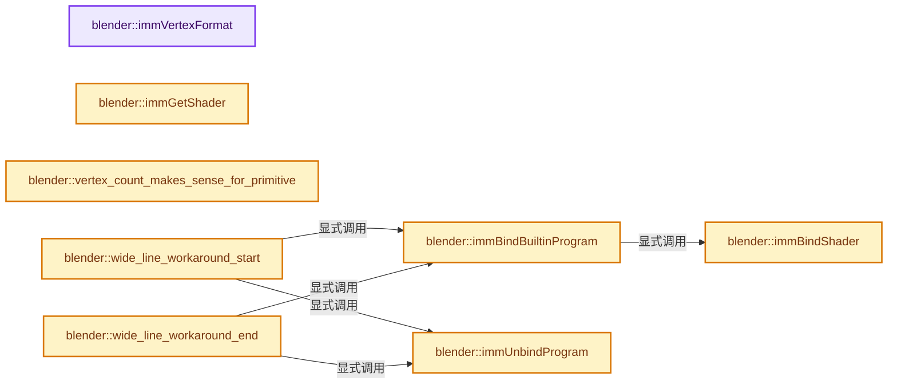

# 实现依赖专题：source/blender/gpu/intern/gpu_immediate.cc

[实现依赖导航](../../../README.md) · [符号索引](../../../../00-课程指南/02-源码与提交索引/符号依赖与实现索引.md)

本专题从正文实际调用进入，集中保存共享实现。函数有稳定锚点，可从调用处直接跳到对应完整函数；递归与互相调用通过回链组织。

## 本文件的实现关系




## 完整成员与函数实现

<a id="f-cc131113ee25fc66"></a>

### `blender::immVertexFormat`

实现位置：[source/blender/gpu/intern/gpu_immediate.cc](../../../../../../../../source/blender/gpu/intern/gpu_immediate.cc) · L41—L45。

**教学注释版**

<!-- annotated:93e332b7146261 -->

```cpp
GPUVertFormat *immVertexFormat()
{
  GPU_vertformat_clear(&imm->vertex_format);
  return &imm->vertex_format;
}
```

<details>
<summary>核对原始源码：source/blender/gpu/intern/gpu_immediate.cc · L41—L45</summary>

<!-- original:93e332b7146261:source/blender/gpu/intern/gpu_immediate.cc:41:45 -->

```cpp
GPUVertFormat *immVertexFormat()
{
  GPU_vertformat_clear(&imm->vertex_format);
  return &imm->vertex_format;
}
```

</details>

**结果出口**

- `return &imm->vertex_format;`

**继续追踪实现**

- `GPU_vertformat_clear` → [blender::GPU_vertformat_clear · L331](gpu_vertex_format.cc.md#f-8e1d1779ec8338af)。

<a id="f-bd8152246b710b55"></a>

### `blender::immBindShader`

实现位置：[source/blender/gpu/intern/gpu_immediate.cc](../../../../../../../../source/blender/gpu/intern/gpu_immediate.cc) · L47—L61。

接口参数：

- `gpu::Shader *shader`

**教学注释版**

<!-- annotated:3ed19f1757b606 -->

```cpp
void immBindShader(gpu::Shader *shader)
{
  BLI_assert(imm->shader == nullptr);

  imm->shader = shader;
  imm->builtin_shader_bound = std::nullopt;

  if (!imm->vertex_format.packed) {
    VertexFormat_pack(&imm->vertex_format);
    imm->enabled_attr_bits = 0xFFFFu & ~(0xFFFFu << imm->vertex_format.attr_len);
  }

  GPU_shader_bind(shader);
  GPU_matrix_bind(shader);
}
```

<details>
<summary>核对原始源码：source/blender/gpu/intern/gpu_immediate.cc · L47—L61</summary>

<!-- original:3ed19f1757b606:source/blender/gpu/intern/gpu_immediate.cc:47:61 -->

```cpp
void immBindShader(gpu::Shader *shader)
{
  BLI_assert(imm->shader == nullptr);

  imm->shader = shader;
  imm->builtin_shader_bound = std::nullopt;

  if (!imm->vertex_format.packed) {
    VertexFormat_pack(&imm->vertex_format);
    imm->enabled_attr_bits = 0xFFFFu & ~(0xFFFFu << imm->vertex_format.attr_len);
  }

  GPU_shader_bind(shader);
  GPU_matrix_bind(shader);
}
```

</details>

**沿实际写入检查状态**

- `imm->shader = shader;`
- `imm->builtin_shader_bound = std::nullopt;`
- `imm->enabled_attr_bits = 0xFFFFu & ~(0xFFFFu << imm->vertex_format.attr_len);`

**继续追踪实现**

- `BLI_assert` → [BLI_assert · L48](../../../01-BLI基础库/BLI_assert.hh.md#m-57a88495704d)；[BLI_assert · L63](../../../01-BLI基础库/BLI_assert.hh.md#m-d07050020cb5)。宏定义由构建条件选择。
- `VertexFormat_pack` → [blender::VertexFormat_pack · L564](gpu_vertex_format.cc.md#f-2ac935f11fa00f23)。
- `GPU_shader_bind` → [blender::GPU_shader_bind · L387](gpu_shader.cc.md#f-a879eef1816db611)。
- `GPU_matrix_bind` → [blender::GPU_matrix_bind · L612](gpu_matrix.cc.md#f-c4bd0ac3f45ded4f)。

<a id="f-958234d295e1ef45"></a>

### `blender::immBindBuiltinProgram`

实现位置：[source/blender/gpu/intern/gpu_immediate.cc](../../../../../../../../source/blender/gpu/intern/gpu_immediate.cc) · L63—L68。

接口参数：

- `GPUBuiltinShader shader_id`

**教学注释版**

<!-- annotated:4b5b2855e72ce8 -->

```cpp
void immBindBuiltinProgram(GPUBuiltinShader shader_id)
{
  gpu::Shader *shader = GPU_shader_get_builtin_shader(shader_id);
  immBindShader(shader);
  imm->builtin_shader_bound = shader_id;
}
```

<details>
<summary>核对原始源码：source/blender/gpu/intern/gpu_immediate.cc · L63—L68</summary>

<!-- original:4b5b2855e72ce8:source/blender/gpu/intern/gpu_immediate.cc:63:68 -->

```cpp
void immBindBuiltinProgram(GPUBuiltinShader shader_id)
{
  gpu::Shader *shader = GPU_shader_get_builtin_shader(shader_id);
  immBindShader(shader);
  imm->builtin_shader_bound = shader_id;
}
```

</details>

**沿实际写入检查状态**

- `imm->builtin_shader_bound = shader_id;`

**继续追踪实现**

- `GPU_shader_get_builtin_shader` → [blender::GPU_shader_get_builtin_shader · L268](gpu_shader_builtin.cc.md#f-235dd2ce9b1ac196)。
- `immBindShader` → [blender::immBindShader · L47](gpu_immediate.cc.md#f-bd8152246b710b55)。

<a id="f-1534593ba1cbfc41"></a>

### `blender::immUnbindProgram`

实现位置：[source/blender/gpu/intern/gpu_immediate.cc](../../../../../../../../source/blender/gpu/intern/gpu_immediate.cc) · L70—L76。

**教学注释版**

<!-- annotated:c46f65d9c6ca0f -->

```cpp
void immUnbindProgram()
{
  BLI_assert(imm->shader != nullptr);

  GPU_shader_unbind();
  imm->shader = nullptr;
}
```

<details>
<summary>核对原始源码：source/blender/gpu/intern/gpu_immediate.cc · L70—L76</summary>

<!-- original:c46f65d9c6ca0f:source/blender/gpu/intern/gpu_immediate.cc:70:76 -->

```cpp
void immUnbindProgram()
{
  BLI_assert(imm->shader != nullptr);

  GPU_shader_unbind();
  imm->shader = nullptr;
}
```

</details>

**沿实际写入检查状态**

- `imm->shader = nullptr;`

**继续追踪实现**

- `BLI_assert` → [BLI_assert · L48](../../../01-BLI基础库/BLI_assert.hh.md#m-57a88495704d)；[BLI_assert · L63](../../../01-BLI基础库/BLI_assert.hh.md#m-d07050020cb5)。宏定义由构建条件选择。
- `GPU_shader_unbind` → [blender::GPU_shader_unbind · L424](gpu_shader.cc.md#f-e0462e112df4c1ef)。

<a id="f-c4441327d5214267"></a>

### `blender::immGetShader`

实现位置：[source/blender/gpu/intern/gpu_immediate.cc](../../../../../../../../source/blender/gpu/intern/gpu_immediate.cc) · L83—L86。

**教学注释版**

<!-- annotated:17f75c1a1eb2ae -->

```cpp
gpu::Shader *immGetShader()
{
  return imm->shader;
}
```

<details>
<summary>核对原始源码：source/blender/gpu/intern/gpu_immediate.cc · L83—L86</summary>

<!-- original:17f75c1a1eb2ae:source/blender/gpu/intern/gpu_immediate.cc:83:86 -->

```cpp
gpu::Shader *immGetShader()
{
  return imm->shader;
}
```

</details>

**结果出口**

- `return imm->shader;`

**继续追踪实现**

本实现没有需要继续展开的显式调用；检查返回表达式、对象转换和调用者前置条件。

<a id="f-c08b10d385c97bab"></a>

### `blender::vertex_count_makes_sense_for_primitive`

实现位置：[source/blender/gpu/intern/gpu_immediate.cc](../../../../../../../../source/blender/gpu/intern/gpu_immediate.cc) · L89—L114。

接口参数：

- `uint vertex_len`
- `GPUPrimType prim_type`

**教学注释版**

<!-- annotated:d0cd3210f26957 -->

```cpp
static bool vertex_count_makes_sense_for_primitive(uint vertex_len, GPUPrimType prim_type)
{
  /* does vertex_len make sense for this primitive type? */
  if (vertex_len == 0) {
    return false;
  }

  switch (prim_type) {
    case GPU_PRIM_POINTS:
      return true;
    case GPU_PRIM_LINES:
      return vertex_len % 2 == 0;
    case GPU_PRIM_LINE_STRIP:
    case GPU_PRIM_LINE_LOOP:
      return vertex_len >= 2;
    case GPU_PRIM_LINE_STRIP_ADJ:
      return vertex_len >= 4;
    case GPU_PRIM_TRIS:
      return vertex_len % 3 == 0;
    case GPU_PRIM_TRI_STRIP:
    case GPU_PRIM_TRI_FAN:
      return vertex_len >= 3;
    default:
      return false;
  }
}
```

<details>
<summary>核对原始源码：source/blender/gpu/intern/gpu_immediate.cc · L89—L114</summary>

<!-- original:d0cd3210f26957:source/blender/gpu/intern/gpu_immediate.cc:89:114 -->

```cpp
static bool vertex_count_makes_sense_for_primitive(uint vertex_len, GPUPrimType prim_type)
{
  /* does vertex_len make sense for this primitive type? */
  if (vertex_len == 0) {
    return false;
  }

  switch (prim_type) {
    case GPU_PRIM_POINTS:
      return true;
    case GPU_PRIM_LINES:
      return vertex_len % 2 == 0;
    case GPU_PRIM_LINE_STRIP:
    case GPU_PRIM_LINE_LOOP:
      return vertex_len >= 2;
    case GPU_PRIM_LINE_STRIP_ADJ:
      return vertex_len >= 4;
    case GPU_PRIM_TRIS:
      return vertex_len % 3 == 0;
    case GPU_PRIM_TRI_STRIP:
    case GPU_PRIM_TRI_FAN:
      return vertex_len >= 3;
    default:
      return false;
  }
}
```

</details>

**结果出口**

- `return false;`
- `return true;`
- `return vertex_len % 2 == 0;`
- `return vertex_len >= 2;`
- `return vertex_len >= 4;`
- `return vertex_len % 3 == 0;`
- `return vertex_len >= 3;`

**继续追踪实现**

本实现没有需要继续展开的显式调用；检查返回表达式、对象转换和调用者前置条件。

<a id="f-ddcd7ce9321e085e"></a>

### `blender::wide_line_workaround_start`

实现位置：[source/blender/gpu/intern/gpu_immediate.cc](../../../../../../../../source/blender/gpu/intern/gpu_immediate.cc) · L124—L184。

接口参数：

- `GPUPrimType prim_type`

**教学注释版**

<!-- annotated:50aa8bcf2cf707 -->

```cpp
static void wide_line_workaround_start(GPUPrimType prim_type)
{
  if (!ELEM(prim_type, GPU_PRIM_LINES, GPU_PRIM_LINE_STRIP, GPU_PRIM_LINE_LOOP)) {
    return;
  }

  float line_width = GPU_line_width_get();

  if (line_width == 1.0f && !GPU_line_smooth_get()) {
    /* No need to change the shader. */
    return;
  }
  if (!imm->builtin_shader_bound) {
    return;
  }

  GPUBuiltinShader polyline_sh;
  switch (*imm->builtin_shader_bound) {
    case GPU_SHADER_3D_CLIPPED_UNIFORM_COLOR:
      polyline_sh = GPU_SHADER_3D_POLYLINE_CLIPPED_UNIFORM_COLOR;
      break;
    case GPU_SHADER_3D_UNIFORM_COLOR:
      polyline_sh = GPU_SHADER_3D_POLYLINE_UNIFORM_COLOR;
      break;
    case GPU_SHADER_3D_FLAT_COLOR:
      polyline_sh = GPU_SHADER_3D_POLYLINE_FLAT_COLOR;
      break;
    case GPU_SHADER_3D_SMOOTH_COLOR:
      polyline_sh = GPU_SHADER_3D_POLYLINE_SMOOTH_COLOR;
      break;
    default:
      /* Cannot replace the current shader with a polyline shader. */
      return;
  }

  imm->prev_builtin_shader = imm->builtin_shader_bound;

  immUnbindProgram();

  /* TODO(fclem): Don't use geometry shader and use quad instancing with double load. */
  // GPU_vertformat_multiload_enable(imm->vertex_format, 2);

  immBindBuiltinProgram(polyline_sh);

  float viewport[4];
  GPU_viewport_size_get_f(viewport);
  immUniform2fv("viewportSize", &viewport[2]);
  immUniform1f("lineWidth", line_width);

  if (GPU_blend_get() == GPU_BLEND_NONE) {
    /* Disable line smoothing when blending is disabled (see #81827). */
    immUniform1i("lineSmooth", 0);
  }

  if (ELEM(polyline_sh,
           GPU_SHADER_3D_POLYLINE_CLIPPED_UNIFORM_COLOR,
           GPU_SHADER_3D_POLYLINE_UNIFORM_COLOR))
  {
    immUniformColor4fv(imm->uniform_color);
  }
}
```

<details>
<summary>核对原始源码：source/blender/gpu/intern/gpu_immediate.cc · L124—L184</summary>

<!-- original:50aa8bcf2cf707:source/blender/gpu/intern/gpu_immediate.cc:124:184 -->

```cpp
static void wide_line_workaround_start(GPUPrimType prim_type)
{
  if (!ELEM(prim_type, GPU_PRIM_LINES, GPU_PRIM_LINE_STRIP, GPU_PRIM_LINE_LOOP)) {
    return;
  }

  float line_width = GPU_line_width_get();

  if (line_width == 1.0f && !GPU_line_smooth_get()) {
    /* No need to change the shader. */
    return;
  }
  if (!imm->builtin_shader_bound) {
    return;
  }

  GPUBuiltinShader polyline_sh;
  switch (*imm->builtin_shader_bound) {
    case GPU_SHADER_3D_CLIPPED_UNIFORM_COLOR:
      polyline_sh = GPU_SHADER_3D_POLYLINE_CLIPPED_UNIFORM_COLOR;
      break;
    case GPU_SHADER_3D_UNIFORM_COLOR:
      polyline_sh = GPU_SHADER_3D_POLYLINE_UNIFORM_COLOR;
      break;
    case GPU_SHADER_3D_FLAT_COLOR:
      polyline_sh = GPU_SHADER_3D_POLYLINE_FLAT_COLOR;
      break;
    case GPU_SHADER_3D_SMOOTH_COLOR:
      polyline_sh = GPU_SHADER_3D_POLYLINE_SMOOTH_COLOR;
      break;
    default:
      /* Cannot replace the current shader with a polyline shader. */
      return;
  }

  imm->prev_builtin_shader = imm->builtin_shader_bound;

  immUnbindProgram();

  /* TODO(fclem): Don't use geometry shader and use quad instancing with double load. */
  // GPU_vertformat_multiload_enable(imm->vertex_format, 2);

  immBindBuiltinProgram(polyline_sh);

  float viewport[4];
  GPU_viewport_size_get_f(viewport);
  immUniform2fv("viewportSize", &viewport[2]);
  immUniform1f("lineWidth", line_width);

  if (GPU_blend_get() == GPU_BLEND_NONE) {
    /* Disable line smoothing when blending is disabled (see #81827). */
    immUniform1i("lineSmooth", 0);
  }

  if (ELEM(polyline_sh,
           GPU_SHADER_3D_POLYLINE_CLIPPED_UNIFORM_COLOR,
           GPU_SHADER_3D_POLYLINE_UNIFORM_COLOR))
  {
    immUniformColor4fv(imm->uniform_color);
  }
}
```

</details>

**沿实际写入检查状态**

- `polyline_sh = GPU_SHADER_3D_POLYLINE_CLIPPED_UNIFORM_COLOR;`
- `polyline_sh = GPU_SHADER_3D_POLYLINE_UNIFORM_COLOR;`
- `polyline_sh = GPU_SHADER_3D_POLYLINE_FLAT_COLOR;`
- `polyline_sh = GPU_SHADER_3D_POLYLINE_SMOOTH_COLOR;`
- `imm->prev_builtin_shader = imm->builtin_shader_bound;`

**继续追踪实现**

- `ELEM` → [ELEM · L88](../../../07-Intern运行时与平台/ghost/intern/GHOST_utildefines.hh.md#m-d28724a15928)；[ELEM · L135](../../../01-BLI基础库/BLI_utildefines.hh.md#m-d6572de7cae0)。宏定义由构建条件选择。
- `GPU_line_width_get` → [blender::GPU_line_width_get · L241](gpu_state.cc.md#f-edb5043f8f4346e5)。
- `GPU_line_smooth_get` → [blender::GPU_line_smooth_get · L247](gpu_state.cc.md#f-2b9828ec3e68d1e5)。
- `immUnbindProgram` → [blender::immUnbindProgram · L70](gpu_immediate.cc.md#f-1534593ba1cbfc41)。
- `immBindBuiltinProgram` → [blender::immBindBuiltinProgram · L63](gpu_immediate.cc.md#f-958234d295e1ef45)。
- `GPU_viewport_size_get_f` → [blender::GPU_viewport_size_get_f · L258](gpu_state.cc.md#f-2cc9d4423985bf4f)。
- `immUniform2fv` → [blender::immUniform2fv · L593](gpu_immediate.cc.md#f-692364bd25764b0a)。
- `immUniform1f` → [blender::immUniform1f · L583](gpu_immediate.cc.md#f-294f146b86fc6b2f)。
- `GPU_blend_get` → [blender::GPU_blend_get · L211](gpu_state.cc.md#f-0cde4126a448c681)。
- `immUniform1i` → [blender::immUniform1i · L629](gpu_immediate.cc.md#f-9bc2b3c91c1d53fa)。
- `immUniformColor4fv` → [blender::immUniformColor4fv · L664](gpu_immediate.cc.md#f-f598e90144bdeef6)。

<a id="f-3c595b048fade057"></a>

### `blender::wide_line_workaround_end`

实现位置：[source/blender/gpu/intern/gpu_immediate.cc](../../../../../../../../source/blender/gpu/intern/gpu_immediate.cc) · L186—L198。

**教学注释版**

<!-- annotated:4ef7961d308e7e -->

```cpp
static void wide_line_workaround_end()
{
  if (imm->prev_builtin_shader) {
    if (GPU_blend_get() == GPU_BLEND_NONE) {
      /* Restore default. */
      immUniform1i("lineSmooth", 1);
    }
    immUnbindProgram();

    immBindBuiltinProgram(*imm->prev_builtin_shader);
    imm->prev_builtin_shader = std::nullopt;
  }
}
```

<details>
<summary>核对原始源码：source/blender/gpu/intern/gpu_immediate.cc · L186—L198</summary>

<!-- original:4ef7961d308e7e:source/blender/gpu/intern/gpu_immediate.cc:186:198 -->

```cpp
static void wide_line_workaround_end()
{
  if (imm->prev_builtin_shader) {
    if (GPU_blend_get() == GPU_BLEND_NONE) {
      /* Restore default. */
      immUniform1i("lineSmooth", 1);
    }
    immUnbindProgram();

    immBindBuiltinProgram(*imm->prev_builtin_shader);
    imm->prev_builtin_shader = std::nullopt;
  }
}
```

</details>

**沿实际写入检查状态**

- `imm->prev_builtin_shader = std::nullopt;`

**继续追踪实现**

- `GPU_blend_get` → [blender::GPU_blend_get · L211](gpu_state.cc.md#f-0cde4126a448c681)。
- `immUniform1i` → [blender::immUniform1i · L629](gpu_immediate.cc.md#f-9bc2b3c91c1d53fa)。
- `immUnbindProgram` → [blender::immUnbindProgram · L70](gpu_immediate.cc.md#f-1534593ba1cbfc41)。
- `immBindBuiltinProgram` → [blender::immBindBuiltinProgram · L63](gpu_immediate.cc.md#f-958234d295e1ef45)。

<a id="f-d20e080325dd293f"></a>

### `blender::immBegin`

实现位置：[source/blender/gpu/intern/gpu_immediate.cc](../../../../../../../../source/blender/gpu/intern/gpu_immediate.cc) · L202—L215。

接口参数：

- `GPUPrimType prim_type`
- `uint vertex_len`

**教学注释版**

<!-- annotated:98853edbf6ce45 -->

```cpp
void immBegin(GPUPrimType prim_type, uint vertex_len)
{
  BLI_assert(imm->prim_type == GPU_PRIM_NONE); /* Make sure we haven't already begun. */
  BLI_assert(vertex_count_makes_sense_for_primitive(vertex_len, prim_type));

  wide_line_workaround_start(prim_type);

  imm->prim_type = prim_type;
  imm->vertex_len = vertex_len;
  imm->vertex_idx = 0;
  imm->unassigned_attr_bits = imm->enabled_attr_bits;

  imm->vertex_data = imm->begin();
}
```

<details>
<summary>核对原始源码：source/blender/gpu/intern/gpu_immediate.cc · L202—L215</summary>

<!-- original:98853edbf6ce45:source/blender/gpu/intern/gpu_immediate.cc:202:215 -->

```cpp
void immBegin(GPUPrimType prim_type, uint vertex_len)
{
  BLI_assert(imm->prim_type == GPU_PRIM_NONE); /* Make sure we haven't already begun. */
  BLI_assert(vertex_count_makes_sense_for_primitive(vertex_len, prim_type));

  wide_line_workaround_start(prim_type);

  imm->prim_type = prim_type;
  imm->vertex_len = vertex_len;
  imm->vertex_idx = 0;
  imm->unassigned_attr_bits = imm->enabled_attr_bits;

  imm->vertex_data = imm->begin();
}
```

</details>

**沿实际写入检查状态**

- `imm->prim_type = prim_type;`
- `imm->vertex_len = vertex_len;`
- `imm->vertex_idx = 0;`
- `imm->unassigned_attr_bits = imm->enabled_attr_bits;`
- `imm->vertex_data = imm->begin();`

**继续追踪实现**

- `BLI_assert` → [BLI_assert · L48](../../../01-BLI基础库/BLI_assert.hh.md#m-57a88495704d)；[BLI_assert · L63](../../../01-BLI基础库/BLI_assert.hh.md#m-d07050020cb5)。宏定义由构建条件选择。
- `vertex_count_makes_sense_for_primitive` → [blender::vertex_count_makes_sense_for_primitive · L89](gpu_immediate.cc.md#f-c08b10d385c97bab)。
- `wide_line_workaround_start` → [blender::wide_line_workaround_start · L124](gpu_immediate.cc.md#f-ddcd7ce9321e085e)。
- `imm->begin` → [调用协议](../../../../00-课程指南/01-路线与规范/模板宏与动态分派协议.md)：接收对象类型依赖auto、返回值或模板实例；不按同名猜测目标。调用位置L214。

<a id="f-d618cb15aaf74c49"></a>

### `blender::immBeginAtMost`

实现位置：[source/blender/gpu/intern/gpu_immediate.cc](../../../../../../../../source/blender/gpu/intern/gpu_immediate.cc) · L217—L222。

接口参数：

- `GPUPrimType prim_type`
- `uint vertex_len`

**教学注释版**

<!-- annotated:e22699eeb46ca2 -->

```cpp
void immBeginAtMost(GPUPrimType prim_type, uint vertex_len)
{
  BLI_assert(vertex_len > 0);
  imm->strict_vertex_len = false;
  immBegin(prim_type, vertex_len);
}
```

<details>
<summary>核对原始源码：source/blender/gpu/intern/gpu_immediate.cc · L217—L222</summary>

<!-- original:e22699eeb46ca2:source/blender/gpu/intern/gpu_immediate.cc:217:222 -->

```cpp
void immBeginAtMost(GPUPrimType prim_type, uint vertex_len)
{
  BLI_assert(vertex_len > 0);
  imm->strict_vertex_len = false;
  immBegin(prim_type, vertex_len);
}
```

</details>

**沿实际写入检查状态**

- `imm->strict_vertex_len = false;`

**继续追踪实现**

- `BLI_assert` → [BLI_assert · L48](../../../01-BLI基础库/BLI_assert.hh.md#m-57a88495704d)；[BLI_assert · L63](../../../01-BLI基础库/BLI_assert.hh.md#m-d07050020cb5)。宏定义由构建条件选择。
- `immBegin` → [blender::immBegin · L202](gpu_immediate.cc.md#f-d20e080325dd293f)。

<a id="f-ef4c47367ce69810"></a>

### `blender::immEnd`

实现位置：[source/blender/gpu/intern/gpu_immediate.cc](../../../../../../../../source/blender/gpu/intern/gpu_immediate.cc) · L252—L286。

**教学注释版**

<!-- annotated:2f42b8a5691db9 -->

```cpp
void immEnd()
{
  BLI_assert(imm->prim_type != GPU_PRIM_NONE); /* Make sure we're between a Begin/End pair. */
  BLI_assert(imm->vertex_data || imm->batch);

  if (imm->strict_vertex_len) {
    BLI_assert(imm->vertex_idx == imm->vertex_len); /* With all vertices defined. */
  }
  else {
    BLI_assert(imm->vertex_idx <= imm->vertex_len);
    BLI_assert(imm->vertex_idx == 0 ||
               vertex_count_makes_sense_for_primitive(imm->vertex_idx, imm->prim_type));
  }

  if (imm->batch) {
    if (imm->vertex_idx < imm->vertex_len) {
      GPU_vertbuf_data_resize(*imm->batch->verts[0], imm->vertex_idx);
      /* TODO: resize only if vertex count is much smaller */
    }
    GPU_batch_set_shader(imm->batch, imm->shader);
    imm->batch->flag &= ~GPU_BATCH_BUILDING;
    imm->batch = nullptr; /* don't free, batch belongs to caller */
  }
  else {
    Context::get()->assert_framebuffer_shader_compatibility(imm->shader);
    imm->end();
  }

  /* Prepare for next immBegin. */
  imm->prim_type = GPU_PRIM_NONE;
  imm->strict_vertex_len = true;
  imm->vertex_data = nullptr;

  wide_line_workaround_end();
}
```

<details>
<summary>核对原始源码：source/blender/gpu/intern/gpu_immediate.cc · L252—L286</summary>

<!-- original:2f42b8a5691db9:source/blender/gpu/intern/gpu_immediate.cc:252:286 -->

```cpp
void immEnd()
{
  BLI_assert(imm->prim_type != GPU_PRIM_NONE); /* Make sure we're between a Begin/End pair. */
  BLI_assert(imm->vertex_data || imm->batch);

  if (imm->strict_vertex_len) {
    BLI_assert(imm->vertex_idx == imm->vertex_len); /* With all vertices defined. */
  }
  else {
    BLI_assert(imm->vertex_idx <= imm->vertex_len);
    BLI_assert(imm->vertex_idx == 0 ||
               vertex_count_makes_sense_for_primitive(imm->vertex_idx, imm->prim_type));
  }

  if (imm->batch) {
    if (imm->vertex_idx < imm->vertex_len) {
      GPU_vertbuf_data_resize(*imm->batch->verts[0], imm->vertex_idx);
      /* TODO: resize only if vertex count is much smaller */
    }
    GPU_batch_set_shader(imm->batch, imm->shader);
    imm->batch->flag &= ~GPU_BATCH_BUILDING;
    imm->batch = nullptr; /* don't free, batch belongs to caller */
  }
  else {
    Context::get()->assert_framebuffer_shader_compatibility(imm->shader);
    imm->end();
  }

  /* Prepare for next immBegin. */
  imm->prim_type = GPU_PRIM_NONE;
  imm->strict_vertex_len = true;
  imm->vertex_data = nullptr;

  wide_line_workaround_end();
}
```

</details>

**沿实际写入检查状态**

- `imm->batch->flag &= ~GPU_BATCH_BUILDING;`
- `imm->batch = nullptr; /* don't free, batch belongs to caller */`
- `imm->prim_type = GPU_PRIM_NONE;`
- `imm->strict_vertex_len = true;`
- `imm->vertex_data = nullptr;`

**继续追踪实现**

- `BLI_assert` → [BLI_assert · L48](../../../01-BLI基础库/BLI_assert.hh.md#m-57a88495704d)；[BLI_assert · L63](../../../01-BLI基础库/BLI_assert.hh.md#m-d07050020cb5)。宏定义由构建条件选择。
- `vertex_count_makes_sense_for_primitive` → [blender::vertex_count_makes_sense_for_primitive · L89](gpu_immediate.cc.md#f-c08b10d385c97bab)。
- `GPU_vertbuf_data_resize` → [blender::GPU_vertbuf_data_resize · L177](gpu_vertex_buffer.cc.md#f-d65057a6de0dcd9a)。
- `GPU_batch_set_shader` → [blender::GPU_batch_set_shader · L193](gpu_batch.cc.md#f-b541a0f384da352a)。
- `Context::get()->assert_framebuffer_shader_compatibility` → [调用协议](../../../../00-课程指南/01-路线与规范/模板宏与动态分派协议.md)：接收对象类型依赖auto、返回值或模板实例；不按同名猜测目标。调用位置L276。
- `Context::get` → [blender::gpu::Context::get · L127](gpu_context.cc.md#f-7ca16707244f2d11)。
- `imm->end` → [调用协议](../../../../00-课程指南/01-路线与规范/模板宏与动态分派协议.md)：接收对象类型依赖auto、返回值或模板实例；不按同名猜测目标。调用位置L277。
- `wide_line_workaround_end` → [blender::wide_line_workaround_end · L186](gpu_immediate.cc.md#f-3c595b048fade057)。

<a id="f-a7d6d8a2def3d1d7"></a>

### `blender::setAttrValueBit`

实现位置：[source/blender/gpu/intern/gpu_immediate.cc](../../../../../../../../source/blender/gpu/intern/gpu_immediate.cc) · L360—L365。

接口参数：

- `uint attr_id`

**教学注释版**

<!-- annotated:d8791c7ae7882f -->

```cpp
static void setAttrValueBit(uint attr_id)
{
  uint16_t mask = 1 << attr_id;
  BLI_assert(imm->unassigned_attr_bits & mask); /* not already set */
  imm->unassigned_attr_bits &= ~mask;
}
```

<details>
<summary>核对原始源码：source/blender/gpu/intern/gpu_immediate.cc · L360—L365</summary>

<!-- original:d8791c7ae7882f:source/blender/gpu/intern/gpu_immediate.cc:360:365 -->

```cpp
static void setAttrValueBit(uint attr_id)
{
  uint16_t mask = 1 << attr_id;
  BLI_assert(imm->unassigned_attr_bits & mask); /* not already set */
  imm->unassigned_attr_bits &= ~mask;
}
```

</details>

**沿实际写入检查状态**

- `imm->unassigned_attr_bits &= ~mask;`

**继续追踪实现**

- `BLI_assert` → [BLI_assert · L48](../../../01-BLI基础库/BLI_assert.hh.md#m-57a88495704d)；[BLI_assert · L63](../../../01-BLI基础库/BLI_assert.hh.md#m-d07050020cb5)。宏定义由构建条件选择。

<a id="f-6595ef33a220f4c8"></a>

### `blender::immAttr2f`

实现位置：[source/blender/gpu/intern/gpu_immediate.cc](../../../../../../../../source/blender/gpu/intern/gpu_immediate.cc) · L384—L398。

接口参数：

- `uint attr_id`
- `float x`
- `float y`

**教学注释版**

<!-- annotated:04407549c93d28 -->

```cpp
void immAttr2f(uint attr_id, float x, float y)
{
  GPUVertAttr *attr = &imm->vertex_format.attrs[attr_id];
  BLI_assert(attr_id < imm->vertex_format.attr_len);
  BLI_assert(ELEM(attr->type.format, VertAttrType::SFLOAT_32_32));
  BLI_assert(imm->vertex_idx < imm->vertex_len);
  BLI_assert(imm->prim_type != GPU_PRIM_NONE); /* make sure we're between a Begin/End pair */
  setAttrValueBit(attr_id);

  float *data = reinterpret_cast<float *>(imm->vertex_data + attr->offset);
  // printf("%s %td %p\n", __FUNCTION__, (GLubyte*)data - imm->buffer_data, data);

  data[0] = x;
  data[1] = y;
}
```

<details>
<summary>核对原始源码：source/blender/gpu/intern/gpu_immediate.cc · L384—L398</summary>

<!-- original:04407549c93d28:source/blender/gpu/intern/gpu_immediate.cc:384:398 -->

```cpp
void immAttr2f(uint attr_id, float x, float y)
{
  GPUVertAttr *attr = &imm->vertex_format.attrs[attr_id];
  BLI_assert(attr_id < imm->vertex_format.attr_len);
  BLI_assert(ELEM(attr->type.format, VertAttrType::SFLOAT_32_32));
  BLI_assert(imm->vertex_idx < imm->vertex_len);
  BLI_assert(imm->prim_type != GPU_PRIM_NONE); /* make sure we're between a Begin/End pair */
  setAttrValueBit(attr_id);

  float *data = reinterpret_cast<float *>(imm->vertex_data + attr->offset);
  // printf("%s %td %p\n", __FUNCTION__, (GLubyte*)data - imm->buffer_data, data);

  data[0] = x;
  data[1] = y;
}
```

</details>

**沿实际写入检查状态**

- `data[0] = x;`
- `data[1] = y;`

**继续追踪实现**

- `BLI_assert` → [BLI_assert · L48](../../../01-BLI基础库/BLI_assert.hh.md#m-57a88495704d)；[BLI_assert · L63](../../../01-BLI基础库/BLI_assert.hh.md#m-d07050020cb5)。宏定义由构建条件选择。
- `ELEM` → [ELEM · L88](../../../07-Intern运行时与平台/ghost/intern/GHOST_utildefines.hh.md#m-d28724a15928)；[ELEM · L135](../../../01-BLI基础库/BLI_utildefines.hh.md#m-d6572de7cae0)。宏定义由构建条件选择。
- `setAttrValueBit` → [blender::setAttrValueBit · L360](gpu_immediate.cc.md#f-a7d6d8a2def3d1d7)。

<a id="f-b296ad5a765b4d16"></a>

### `blender::immAttr3f`

实现位置：[source/blender/gpu/intern/gpu_immediate.cc](../../../../../../../../source/blender/gpu/intern/gpu_immediate.cc) · L400—L415。

接口参数：

- `uint attr_id`
- `float x`
- `float y`
- `float z`

**教学注释版**

<!-- annotated:c8675dea6812dc -->

```cpp
void immAttr3f(uint attr_id, float x, float y, float z)
{
  GPUVertAttr *attr = &imm->vertex_format.attrs[attr_id];
  BLI_assert(attr_id < imm->vertex_format.attr_len);
  BLI_assert(ELEM(attr->type.format, VertAttrType::SFLOAT_32_32_32));
  BLI_assert(imm->vertex_idx < imm->vertex_len);
  BLI_assert(imm->prim_type != GPU_PRIM_NONE); /* make sure we're between a Begin/End pair */
  setAttrValueBit(attr_id);

  float *data = reinterpret_cast<float *>(imm->vertex_data + attr->offset);
  // printf("%s %td %p\n", __FUNCTION__, (GLubyte*)data - imm->buffer_data, data);

  data[0] = x;
  data[1] = y;
  data[2] = z;
}
```

<details>
<summary>核对原始源码：source/blender/gpu/intern/gpu_immediate.cc · L400—L415</summary>

<!-- original:c8675dea6812dc:source/blender/gpu/intern/gpu_immediate.cc:400:415 -->

```cpp
void immAttr3f(uint attr_id, float x, float y, float z)
{
  GPUVertAttr *attr = &imm->vertex_format.attrs[attr_id];
  BLI_assert(attr_id < imm->vertex_format.attr_len);
  BLI_assert(ELEM(attr->type.format, VertAttrType::SFLOAT_32_32_32));
  BLI_assert(imm->vertex_idx < imm->vertex_len);
  BLI_assert(imm->prim_type != GPU_PRIM_NONE); /* make sure we're between a Begin/End pair */
  setAttrValueBit(attr_id);

  float *data = reinterpret_cast<float *>(imm->vertex_data + attr->offset);
  // printf("%s %td %p\n", __FUNCTION__, (GLubyte*)data - imm->buffer_data, data);

  data[0] = x;
  data[1] = y;
  data[2] = z;
}
```

</details>

**沿实际写入检查状态**

- `data[0] = x;`
- `data[1] = y;`
- `data[2] = z;`

**继续追踪实现**

- `BLI_assert` → [BLI_assert · L48](../../../01-BLI基础库/BLI_assert.hh.md#m-57a88495704d)；[BLI_assert · L63](../../../01-BLI基础库/BLI_assert.hh.md#m-d07050020cb5)。宏定义由构建条件选择。
- `ELEM` → [ELEM · L88](../../../07-Intern运行时与平台/ghost/intern/GHOST_utildefines.hh.md#m-d28724a15928)；[ELEM · L135](../../../01-BLI基础库/BLI_utildefines.hh.md#m-d6572de7cae0)。宏定义由构建条件选择。
- `setAttrValueBit` → [blender::setAttrValueBit · L360](gpu_immediate.cc.md#f-a7d6d8a2def3d1d7)。

<a id="f-f2233afb223d2678"></a>

### `blender::immAttr4f`

实现位置：[source/blender/gpu/intern/gpu_immediate.cc](../../../../../../../../source/blender/gpu/intern/gpu_immediate.cc) · L417—L433。

接口参数：

- `uint attr_id`
- `float x`
- `float y`
- `float z`
- `float w`

**教学注释版**

<!-- annotated:dc3f7126fb3490 -->

```cpp
void immAttr4f(uint attr_id, float x, float y, float z, float w)
{
  GPUVertAttr *attr = &imm->vertex_format.attrs[attr_id];
  BLI_assert(attr_id < imm->vertex_format.attr_len);
  BLI_assert(ELEM(attr->type.format, VertAttrType::SFLOAT_32_32_32_32));
  BLI_assert(imm->vertex_idx < imm->vertex_len);
  BLI_assert(imm->prim_type != GPU_PRIM_NONE); /* make sure we're between a Begin/End pair */
  setAttrValueBit(attr_id);

  float *data = reinterpret_cast<float *>(imm->vertex_data + attr->offset);
  // printf("%s %td %p\n", __FUNCTION__, (GLubyte*)data - imm->buffer_data, data);

  data[0] = x;
  data[1] = y;
  data[2] = z;
  data[3] = w;
}
```

<details>
<summary>核对原始源码：source/blender/gpu/intern/gpu_immediate.cc · L417—L433</summary>

<!-- original:dc3f7126fb3490:source/blender/gpu/intern/gpu_immediate.cc:417:433 -->

```cpp
void immAttr4f(uint attr_id, float x, float y, float z, float w)
{
  GPUVertAttr *attr = &imm->vertex_format.attrs[attr_id];
  BLI_assert(attr_id < imm->vertex_format.attr_len);
  BLI_assert(ELEM(attr->type.format, VertAttrType::SFLOAT_32_32_32_32));
  BLI_assert(imm->vertex_idx < imm->vertex_len);
  BLI_assert(imm->prim_type != GPU_PRIM_NONE); /* make sure we're between a Begin/End pair */
  setAttrValueBit(attr_id);

  float *data = reinterpret_cast<float *>(imm->vertex_data + attr->offset);
  // printf("%s %td %p\n", __FUNCTION__, (GLubyte*)data - imm->buffer_data, data);

  data[0] = x;
  data[1] = y;
  data[2] = z;
  data[3] = w;
}
```

</details>

**沿实际写入检查状态**

- `data[0] = x;`
- `data[1] = y;`
- `data[2] = z;`
- `data[3] = w;`

**继续追踪实现**

- `BLI_assert` → [BLI_assert · L48](../../../01-BLI基础库/BLI_assert.hh.md#m-57a88495704d)；[BLI_assert · L63](../../../01-BLI基础库/BLI_assert.hh.md#m-d07050020cb5)。宏定义由构建条件选择。
- `ELEM` → [ELEM · L88](../../../07-Intern运行时与平台/ghost/intern/GHOST_utildefines.hh.md#m-d28724a15928)；[ELEM · L135](../../../01-BLI基础库/BLI_utildefines.hh.md#m-d6572de7cae0)。宏定义由构建条件选择。
- `setAttrValueBit` → [blender::setAttrValueBit · L360](gpu_immediate.cc.md#f-a7d6d8a2def3d1d7)。

<a id="f-e70cf9331d4b7ada"></a>

### `blender::immAttr4fv`

实现位置：[source/blender/gpu/intern/gpu_immediate.cc](../../../../../../../../source/blender/gpu/intern/gpu_immediate.cc) · L474—L477。

接口参数：

- `uint attr_id`
- `const float data[4]`

**教学注释版**

<!-- annotated:e468e779b558f1 -->

```cpp
void immAttr4fv(uint attr_id, const float data[4])
{
  immAttr4f(attr_id, data[0], data[1], data[2], data[3]);
}
```

<details>
<summary>核对原始源码：source/blender/gpu/intern/gpu_immediate.cc · L474—L477</summary>

<!-- original:e468e779b558f1:source/blender/gpu/intern/gpu_immediate.cc:474:477 -->

```cpp
void immAttr4fv(uint attr_id, const float data[4])
{
  immAttr4f(attr_id, data[0], data[1], data[2], data[3]);
}
```

</details>

**继续追踪实现**

- `immAttr4f` → [blender::immAttr4f · L417](gpu_immediate.cc.md#f-f2233afb223d2678)。

<a id="f-a96aaad741f841a1"></a>

### `blender::immAttr4ub`

实现位置：[source/blender/gpu/intern/gpu_immediate.cc](../../../../../../../../source/blender/gpu/intern/gpu_immediate.cc) · L479—L495。

接口参数：

- `uint attr_id`
- `uchar r`
- `uchar g`
- `uchar b`
- `uchar a`

**教学注释版**

<!-- annotated:fcdf6815b931bd -->

```cpp
void immAttr4ub(uint attr_id, uchar r, uchar g, uchar b, uchar a)
{
  GPUVertAttr *attr = &imm->vertex_format.attrs[attr_id];
  BLI_assert(attr_id < imm->vertex_format.attr_len);
  BLI_assert(ELEM(attr->type.format, VertAttrType::UINT_8_8_8_8, VertAttrType::UNORM_8_8_8_8));
  BLI_assert(imm->vertex_idx < imm->vertex_len);
  BLI_assert(imm->prim_type != GPU_PRIM_NONE); /* make sure we're between a Begin/End pair */
  setAttrValueBit(attr_id);

  uchar *data = imm->vertex_data + attr->offset;
  // printf("%s %td %p\n", __FUNCTION__, data - imm->buffer_data, data);

  data[0] = r;
  data[1] = g;
  data[2] = b;
  data[3] = a;
}
```

<details>
<summary>核对原始源码：source/blender/gpu/intern/gpu_immediate.cc · L479—L495</summary>

<!-- original:fcdf6815b931bd:source/blender/gpu/intern/gpu_immediate.cc:479:495 -->

```cpp
void immAttr4ub(uint attr_id, uchar r, uchar g, uchar b, uchar a)
{
  GPUVertAttr *attr = &imm->vertex_format.attrs[attr_id];
  BLI_assert(attr_id < imm->vertex_format.attr_len);
  BLI_assert(ELEM(attr->type.format, VertAttrType::UINT_8_8_8_8, VertAttrType::UNORM_8_8_8_8));
  BLI_assert(imm->vertex_idx < imm->vertex_len);
  BLI_assert(imm->prim_type != GPU_PRIM_NONE); /* make sure we're between a Begin/End pair */
  setAttrValueBit(attr_id);

  uchar *data = imm->vertex_data + attr->offset;
  // printf("%s %td %p\n", __FUNCTION__, data - imm->buffer_data, data);

  data[0] = r;
  data[1] = g;
  data[2] = b;
  data[3] = a;
}
```

</details>

**沿实际写入检查状态**

- `data[0] = r;`
- `data[1] = g;`
- `data[2] = b;`
- `data[3] = a;`

**继续追踪实现**

- `BLI_assert` → [BLI_assert · L48](../../../01-BLI基础库/BLI_assert.hh.md#m-57a88495704d)；[BLI_assert · L63](../../../01-BLI基础库/BLI_assert.hh.md#m-d07050020cb5)。宏定义由构建条件选择。
- `ELEM` → [ELEM · L88](../../../07-Intern运行时与平台/ghost/intern/GHOST_utildefines.hh.md#m-d28724a15928)；[ELEM · L135](../../../01-BLI基础库/BLI_utildefines.hh.md#m-d6572de7cae0)。宏定义由构建条件选择。
- `setAttrValueBit` → [blender::setAttrValueBit · L360](gpu_immediate.cc.md#f-a7d6d8a2def3d1d7)。

<a id="f-81ed9c5641aa2d48"></a>

### `blender::immAttr4ubv`

实现位置：[source/blender/gpu/intern/gpu_immediate.cc](../../../../../../../../source/blender/gpu/intern/gpu_immediate.cc) · L497—L500。

接口参数：

- `uint attr_id`
- `const uchar data[4]`

**教学注释版**

<!-- annotated:e40265b57ecc14 -->

```cpp
void immAttr4ubv(uint attr_id, const uchar data[4])
{
  immAttr4ub(attr_id, data[0], data[1], data[2], data[3]);
}
```

<details>
<summary>核对原始源码：source/blender/gpu/intern/gpu_immediate.cc · L497—L500</summary>

<!-- original:e40265b57ecc14:source/blender/gpu/intern/gpu_immediate.cc:497:500 -->

```cpp
void immAttr4ubv(uint attr_id, const uchar data[4])
{
  immAttr4ub(attr_id, data[0], data[1], data[2], data[3]);
}
```

</details>

**继续追踪实现**

- `immAttr4ub` → [blender::immAttr4ub · L479](gpu_immediate.cc.md#f-a96aaad741f841a1)。

<a id="f-e6fc3208e5087690"></a>

### `blender::immEndVertex`

实现位置：[source/blender/gpu/intern/gpu_immediate.cc](../../../../../../../../source/blender/gpu/intern/gpu_immediate.cc) · L510—L537。

**教学注释版**

<!-- annotated:bac0356a8572c8 -->

```cpp
static void immEndVertex() /* and move on to the next vertex */
{
  BLI_assert(imm->prim_type != GPU_PRIM_NONE); /* make sure we're between a Begin/End pair */
  BLI_assert(imm->vertex_idx < imm->vertex_len);

  /* Have all attributes been assigned values?
   * If not, copy value from previous vertex. */
  if (imm->unassigned_attr_bits) {
    BLI_assert(imm->vertex_idx > 0); /* first vertex must have all attributes specified */
    for (uint a_idx = 0; a_idx < imm->vertex_format.attr_len; a_idx++) {
      if ((imm->unassigned_attr_bits >> a_idx) & 1) {
        const GPUVertAttr *a = &imm->vertex_format.attrs[a_idx];

#if 0
        printf("copying %s from vertex %u to %u\n", a->name, imm->vertex_idx - 1, imm->vertex_idx);
#endif

        uchar *data = imm->vertex_data + a->offset;
        // [讲解] memcpy：复制字节，源与目标不应重叠。类型生命周期、对齐和可复制表示须由调用者证明，不是任意对象的复制构造。
        memcpy(data, data - imm->vertex_format.stride, a->type.size());
        /* TODO: consolidate copy of adjacent attributes */
      }
    }
  }

  imm->vertex_idx++;
  imm->vertex_data += imm->vertex_format.stride;
  imm->unassigned_attr_bits = imm->enabled_attr_bits;
}
```

<details>
<summary>核对原始源码：source/blender/gpu/intern/gpu_immediate.cc · L510—L537</summary>

<!-- original:bac0356a8572c8:source/blender/gpu/intern/gpu_immediate.cc:510:537 -->

```cpp
static void immEndVertex() /* and move on to the next vertex */
{
  BLI_assert(imm->prim_type != GPU_PRIM_NONE); /* make sure we're between a Begin/End pair */
  BLI_assert(imm->vertex_idx < imm->vertex_len);

  /* Have all attributes been assigned values?
   * If not, copy value from previous vertex. */
  if (imm->unassigned_attr_bits) {
    BLI_assert(imm->vertex_idx > 0); /* first vertex must have all attributes specified */
    for (uint a_idx = 0; a_idx < imm->vertex_format.attr_len; a_idx++) {
      if ((imm->unassigned_attr_bits >> a_idx) & 1) {
        const GPUVertAttr *a = &imm->vertex_format.attrs[a_idx];

#if 0
        printf("copying %s from vertex %u to %u\n", a->name, imm->vertex_idx - 1, imm->vertex_idx);
#endif

        uchar *data = imm->vertex_data + a->offset;
        memcpy(data, data - imm->vertex_format.stride, a->type.size());
        /* TODO: consolidate copy of adjacent attributes */
      }
    }
  }

  imm->vertex_idx++;
  imm->vertex_data += imm->vertex_format.stride;
  imm->unassigned_attr_bits = imm->enabled_attr_bits;
}
```

</details>

**沿实际写入检查状态**

- `imm->vertex_data += imm->vertex_format.stride;`
- `imm->unassigned_attr_bits = imm->enabled_attr_bits;`

**继续追踪实现**

- `BLI_assert` → [BLI_assert · L48](../../../01-BLI基础库/BLI_assert.hh.md#m-57a88495704d)；[BLI_assert · L63](../../../01-BLI基础库/BLI_assert.hh.md#m-d07050020cb5)。宏定义由构建条件选择。
- `printf` → [外部契约](https://eel.is/c++draft/)：这个边界按实际表达式及所属类型核对参数、返回值、寿命与失败行为。这里提供接口入口，不声称已解释该第三方版本的内部实现。
- `memcpy` → [外部契约](https://eel.is/c++draft/cstring.syn)：复制字节，源与目标不应重叠。类型生命周期、对齐和可复制表示须由调用者证明，不是任意对象的复制构造。
- `a->type.size` → [调用协议](../../../../00-课程指南/01-路线与规范/模板宏与动态分派协议.md)：接收对象类型依赖auto、返回值或模板实例；不按同名猜测目标。调用位置L528。

<a id="f-c5aa0ff286be3978"></a>

### `blender::immVertex2f`

实现位置：[source/blender/gpu/intern/gpu_immediate.cc](../../../../../../../../source/blender/gpu/intern/gpu_immediate.cc) · L539—L543。

接口参数：

- `uint attr_id`
- `float x`
- `float y`

**教学注释版**

<!-- annotated:9a9a8b93a2afd7 -->

```cpp
void immVertex2f(uint attr_id, float x, float y)
{
  immAttr2f(attr_id, x, y);
  immEndVertex();
}
```

<details>
<summary>核对原始源码：source/blender/gpu/intern/gpu_immediate.cc · L539—L543</summary>

<!-- original:9a9a8b93a2afd7:source/blender/gpu/intern/gpu_immediate.cc:539:543 -->

```cpp
void immVertex2f(uint attr_id, float x, float y)
{
  immAttr2f(attr_id, x, y);
  immEndVertex();
}
```

</details>

**继续追踪实现**

- `immAttr2f` → [blender::immAttr2f · L384](gpu_immediate.cc.md#f-6595ef33a220f4c8)。
- `immEndVertex` → [blender::immEndVertex · L510](gpu_immediate.cc.md#f-e6fc3208e5087690)。

<a id="f-8b4731581b842ad3"></a>

### `blender::immVertex3f`

实现位置：[source/blender/gpu/intern/gpu_immediate.cc](../../../../../../../../source/blender/gpu/intern/gpu_immediate.cc) · L545—L549。

接口参数：

- `uint attr_id`
- `float x`
- `float y`
- `float z`

**教学注释版**

<!-- annotated:df06d641d6e56c -->

```cpp
void immVertex3f(uint attr_id, float x, float y, float z)
{
  immAttr3f(attr_id, x, y, z);
  immEndVertex();
}
```

<details>
<summary>核对原始源码：source/blender/gpu/intern/gpu_immediate.cc · L545—L549</summary>

<!-- original:df06d641d6e56c:source/blender/gpu/intern/gpu_immediate.cc:545:549 -->

```cpp
void immVertex3f(uint attr_id, float x, float y, float z)
{
  immAttr3f(attr_id, x, y, z);
  immEndVertex();
}
```

</details>

**继续追踪实现**

- `immAttr3f` → [blender::immAttr3f · L400](gpu_immediate.cc.md#f-b296ad5a765b4d16)。
- `immEndVertex` → [blender::immEndVertex · L510](gpu_immediate.cc.md#f-e6fc3208e5087690)。

<a id="f-e97a61f12b767334"></a>

### `blender::immVertex2fv`

实现位置：[source/blender/gpu/intern/gpu_immediate.cc](../../../../../../../../source/blender/gpu/intern/gpu_immediate.cc) · L563—L567。

接口参数：

- `uint attr_id`
- `const float data[2]`

**教学注释版**

<!-- annotated:4e5d05d7d37b05 -->

```cpp
void immVertex2fv(uint attr_id, const float data[2])
{
  immAttr2f(attr_id, data[0], data[1]);
  immEndVertex();
}
```

<details>
<summary>核对原始源码：source/blender/gpu/intern/gpu_immediate.cc · L563—L567</summary>

<!-- original:4e5d05d7d37b05:source/blender/gpu/intern/gpu_immediate.cc:563:567 -->

```cpp
void immVertex2fv(uint attr_id, const float data[2])
{
  immAttr2f(attr_id, data[0], data[1]);
  immEndVertex();
}
```

</details>

**继续追踪实现**

- `immAttr2f` → [blender::immAttr2f · L384](gpu_immediate.cc.md#f-6595ef33a220f4c8)。
- `immEndVertex` → [blender::immEndVertex · L510](gpu_immediate.cc.md#f-e6fc3208e5087690)。

<a id="f-6eeac22418e729da"></a>

### `blender::immVertex3fv`

实现位置：[source/blender/gpu/intern/gpu_immediate.cc](../../../../../../../../source/blender/gpu/intern/gpu_immediate.cc) · L569—L573。

接口参数：

- `uint attr_id`
- `const float data[3]`

**教学注释版**

<!-- annotated:ddb689de435844 -->

```cpp
void immVertex3fv(uint attr_id, const float data[3])
{
  immAttr3f(attr_id, data[0], data[1], data[2]);
  immEndVertex();
}
```

<details>
<summary>核对原始源码：source/blender/gpu/intern/gpu_immediate.cc · L569—L573</summary>

<!-- original:ddb689de435844:source/blender/gpu/intern/gpu_immediate.cc:569:573 -->

```cpp
void immVertex3fv(uint attr_id, const float data[3])
{
  immAttr3f(attr_id, data[0], data[1], data[2]);
  immEndVertex();
}
```

</details>

**继续追踪实现**

- `immAttr3f` → [blender::immAttr3f · L400](gpu_immediate.cc.md#f-b296ad5a765b4d16)。
- `immEndVertex` → [blender::immEndVertex · L510](gpu_immediate.cc.md#f-e6fc3208e5087690)。

<a id="f-294f146b86fc6b2f"></a>

### `blender::immUniform1f`

实现位置：[source/blender/gpu/intern/gpu_immediate.cc](../../../../../../../../source/blender/gpu/intern/gpu_immediate.cc) · L583—L586。

接口参数：

- `const char *name`
- `float x`

**教学注释版**

<!-- annotated:3ade8511327c59 -->

```cpp
void immUniform1f(const char *name, float x)
{
  GPU_shader_uniform_1f(imm->shader, name, x);
}
```

<details>
<summary>核对原始源码：source/blender/gpu/intern/gpu_immediate.cc · L583—L586</summary>

<!-- original:3ade8511327c59:source/blender/gpu/intern/gpu_immediate.cc:583:586 -->

```cpp
void immUniform1f(const char *name, float x)
{
  GPU_shader_uniform_1f(imm->shader, name, x);
}
```

</details>

**继续追踪实现**

- `GPU_shader_uniform_1f` → [blender::GPU_shader_uniform_1f · L675](gpu_shader.cc.md#f-56672be17e2419d8)。

<a id="f-07209ea0e8ae5f8f"></a>

### `blender::immUniform2f`

实现位置：[source/blender/gpu/intern/gpu_immediate.cc](../../../../../../../../source/blender/gpu/intern/gpu_immediate.cc) · L588—L591。

接口参数：

- `const char *name`
- `float x`
- `float y`

**教学注释版**

<!-- annotated:ea1507fb0a5cf9 -->

```cpp
void immUniform2f(const char *name, float x, float y)
{
  GPU_shader_uniform_2f(imm->shader, name, x, y);
}
```

<details>
<summary>核对原始源码：source/blender/gpu/intern/gpu_immediate.cc · L588—L591</summary>

<!-- original:ea1507fb0a5cf9:source/blender/gpu/intern/gpu_immediate.cc:588:591 -->

```cpp
void immUniform2f(const char *name, float x, float y)
{
  GPU_shader_uniform_2f(imm->shader, name, x, y);
}
```

</details>

**继续追踪实现**

- `GPU_shader_uniform_2f` → [blender::GPU_shader_uniform_2f · L657](gpu_shader.cc.md#f-47e633fb21cc2521)。

<a id="f-692364bd25764b0a"></a>

### `blender::immUniform2fv`

实现位置：[source/blender/gpu/intern/gpu_immediate.cc](../../../../../../../../source/blender/gpu/intern/gpu_immediate.cc) · L593—L596。

接口参数：

- `const char *name`
- `const float data[2]`

**教学注释版**

<!-- annotated:c1d247f0e22e69 -->

```cpp
void immUniform2fv(const char *name, const float data[2])
{
  GPU_shader_uniform_2fv(imm->shader, name, data);
}
```

<details>
<summary>核对原始源码：source/blender/gpu/intern/gpu_immediate.cc · L593—L596</summary>

<!-- original:c1d247f0e22e69:source/blender/gpu/intern/gpu_immediate.cc:593:596 -->

```cpp
void immUniform2fv(const char *name, const float data[2])
{
  GPU_shader_uniform_2fv(imm->shader, name, data);
}
```

</details>

**继续追踪实现**

- `GPU_shader_uniform_2fv` → [blender::GPU_shader_uniform_2fv · L681](gpu_shader.cc.md#f-283f2f23b1ad9326)。

<a id="f-c6b2669da0df18b8"></a>

### `blender::immUniform4f`

实现位置：[source/blender/gpu/intern/gpu_immediate.cc](../../../../../../../../source/blender/gpu/intern/gpu_immediate.cc) · L608—L611。

接口参数：

- `const char *name`
- `float x`
- `float y`
- `float z`
- `float w`

**教学注释版**

<!-- annotated:ba5c11ed74e920 -->

```cpp
void immUniform4f(const char *name, float x, float y, float z, float w)
{
  GPU_shader_uniform_4f(imm->shader, name, x, y, z, w);
}
```

<details>
<summary>核对原始源码：source/blender/gpu/intern/gpu_immediate.cc · L608—L611</summary>

<!-- original:ba5c11ed74e920:source/blender/gpu/intern/gpu_immediate.cc:608:611 -->

```cpp
void immUniform4f(const char *name, float x, float y, float z, float w)
{
  GPU_shader_uniform_4f(imm->shader, name, x, y, z, w);
}
```

</details>

**继续追踪实现**

- `GPU_shader_uniform_4f` → [blender::GPU_shader_uniform_4f · L669](gpu_shader.cc.md#f-abb7ddcdf70de151)。

<a id="f-f3d96bb663efda43"></a>

### `blender::immUniform4fv`

实现位置：[source/blender/gpu/intern/gpu_immediate.cc](../../../../../../../../source/blender/gpu/intern/gpu_immediate.cc) · L613—L616。

接口参数：

- `const char *name`
- `const float data[4]`

**教学注释版**

<!-- annotated:e6ab81fa9f79fd -->

```cpp
void immUniform4fv(const char *name, const float data[4])
{
  GPU_shader_uniform_4fv(imm->shader, name, data);
}
```

<details>
<summary>核对原始源码：source/blender/gpu/intern/gpu_immediate.cc · L613—L616</summary>

<!-- original:e6ab81fa9f79fd:source/blender/gpu/intern/gpu_immediate.cc:613:616 -->

```cpp
void immUniform4fv(const char *name, const float data[4])
{
  GPU_shader_uniform_4fv(imm->shader, name, data);
}
```

</details>

**继续追踪实现**

- `GPU_shader_uniform_4fv` → [blender::GPU_shader_uniform_4fv · L693](gpu_shader.cc.md#f-04893200f3b7c75b)。

<a id="f-9bc2b3c91c1d53fa"></a>

### `blender::immUniform1i`

实现位置：[source/blender/gpu/intern/gpu_immediate.cc](../../../../../../../../source/blender/gpu/intern/gpu_immediate.cc) · L629—L632。

接口参数：

- `const char *name`
- `int x`

**教学注释版**

<!-- annotated:3a37945d637661 -->

```cpp
void immUniform1i(const char *name, int x)
{
  GPU_shader_uniform_1i(imm->shader, name, x);
}
```

<details>
<summary>核对原始源码：source/blender/gpu/intern/gpu_immediate.cc · L629—L632</summary>

<!-- original:3a37945d637661:source/blender/gpu/intern/gpu_immediate.cc:629:632 -->

```cpp
void immUniform1i(const char *name, int x)
{
  GPU_shader_uniform_1i(imm->shader, name, x);
}
```

</details>

**继续追踪实现**

- `GPU_shader_uniform_1i` → [blender::GPU_shader_uniform_1i · L646](gpu_shader.cc.md#f-d02d234ed60d9de0)。

<a id="f-81a4f3a9b6b79c25"></a>

### `blender::immUniformColor4f`

实现位置：[source/blender/gpu/intern/gpu_immediate.cc](../../../../../../../../source/blender/gpu/intern/gpu_immediate.cc) · L654—L662。

接口参数：

- `float r`
- `float g`
- `float b`
- `float a`

**教学注释版**

<!-- annotated:2696d4ad315f79 -->

```cpp
void immUniformColor4f(float r, float g, float b, float a)
{
  int32_t uniform_loc = GPU_shader_get_builtin_uniform(imm->shader, GPU_UNIFORM_COLOR);
  BLI_assert(uniform_loc != -1);
  float data[4] = {r, g, b, a};
  GPU_shader_uniform_float_ex(imm->shader, uniform_loc, 4, 1, data);
  /* For wide Line workaround. */
  copy_v4_v4(imm->uniform_color, data);
}
```

<details>
<summary>核对原始源码：source/blender/gpu/intern/gpu_immediate.cc · L654—L662</summary>

<!-- original:2696d4ad315f79:source/blender/gpu/intern/gpu_immediate.cc:654:662 -->

```cpp
void immUniformColor4f(float r, float g, float b, float a)
{
  int32_t uniform_loc = GPU_shader_get_builtin_uniform(imm->shader, GPU_UNIFORM_COLOR);
  BLI_assert(uniform_loc != -1);
  float data[4] = {r, g, b, a};
  GPU_shader_uniform_float_ex(imm->shader, uniform_loc, 4, 1, data);
  /* For wide Line workaround. */
  copy_v4_v4(imm->uniform_color, data);
}
```

</details>

**继续追踪实现**

- `GPU_shader_get_builtin_uniform` → [blender::GPU_shader_get_builtin_uniform · L538](gpu_shader.cc.md#f-5c493ac2a8f00630)。
- `BLI_assert` → [BLI_assert · L48](../../../01-BLI基础库/BLI_assert.hh.md#m-57a88495704d)；[BLI_assert · L63](../../../01-BLI基础库/BLI_assert.hh.md#m-d07050020cb5)。宏定义由构建条件选择。
- `GPU_shader_uniform_float_ex` → [blender::GPU_shader_uniform_float_ex · L634](gpu_shader.cc.md#f-bae0e0521a75040e)。
- `copy_v4_v4` → [blender::copy_v4_v4 · L54](../../../01-BLI基础库/intern/math_vector_inline.cc.md#f-0cf225fc326edf4a)。

<a id="f-f598e90144bdeef6"></a>

### `blender::immUniformColor4fv`

实现位置：[source/blender/gpu/intern/gpu_immediate.cc](../../../../../../../../source/blender/gpu/intern/gpu_immediate.cc) · L664—L667。

接口参数：

- `const float rgba[4]`

**教学注释版**

<!-- annotated:be3a9f27b1528d -->

```cpp
void immUniformColor4fv(const float rgba[4])
{
  immUniformColor4f(rgba[0], rgba[1], rgba[2], rgba[3]);
}
```

<details>
<summary>核对原始源码：source/blender/gpu/intern/gpu_immediate.cc · L664—L667</summary>

<!-- original:be3a9f27b1528d:source/blender/gpu/intern/gpu_immediate.cc:664:667 -->

```cpp
void immUniformColor4fv(const float rgba[4])
{
  immUniformColor4f(rgba[0], rgba[1], rgba[2], rgba[3]);
}
```

</details>

**继续追踪实现**

- `immUniformColor4f` → [blender::immUniformColor4f · L654](gpu_immediate.cc.md#f-81a4f3a9b6b79c25)。

<a id="f-ecaf1a74aaa6d852"></a>

### `blender::immUniformColor3f`

实现位置：[source/blender/gpu/intern/gpu_immediate.cc](../../../../../../../../source/blender/gpu/intern/gpu_immediate.cc) · L669—L672。

接口参数：

- `float r`
- `float g`
- `float b`

**教学注释版**

<!-- annotated:919e8eeaf98ef0 -->

```cpp
void immUniformColor3f(float r, float g, float b)
{
  immUniformColor4f(r, g, b, 1.0f);
}
```

<details>
<summary>核对原始源码：source/blender/gpu/intern/gpu_immediate.cc · L669—L672</summary>

<!-- original:919e8eeaf98ef0:source/blender/gpu/intern/gpu_immediate.cc:669:672 -->

```cpp
void immUniformColor3f(float r, float g, float b)
{
  immUniformColor4f(r, g, b, 1.0f);
}
```

</details>

**继续追踪实现**

- `immUniformColor4f` → [blender::immUniformColor4f · L654](gpu_immediate.cc.md#f-81a4f3a9b6b79c25)。

<a id="f-e671d391629ff0af"></a>

### `blender::immUniformColor3fv`

实现位置：[source/blender/gpu/intern/gpu_immediate.cc](../../../../../../../../source/blender/gpu/intern/gpu_immediate.cc) · L674—L677。

接口参数：

- `const float rgb[3]`

**教学注释版**

<!-- annotated:046e97a0661330 -->

```cpp
void immUniformColor3fv(const float rgb[3])
{
  immUniformColor4f(rgb[0], rgb[1], rgb[2], 1.0f);
}
```

<details>
<summary>核对原始源码：source/blender/gpu/intern/gpu_immediate.cc · L674—L677</summary>

<!-- original:046e97a0661330:source/blender/gpu/intern/gpu_immediate.cc:674:677 -->

```cpp
void immUniformColor3fv(const float rgb[3])
{
  immUniformColor4f(rgb[0], rgb[1], rgb[2], 1.0f);
}
```

</details>

**继续追踪实现**

- `immUniformColor4f` → [blender::immUniformColor4f · L654](gpu_immediate.cc.md#f-81a4f3a9b6b79c25)。

<a id="f-718571f21e9ac977"></a>

### `blender::immUniformColor3fvAlpha`

实现位置：[source/blender/gpu/intern/gpu_immediate.cc](../../../../../../../../source/blender/gpu/intern/gpu_immediate.cc) · L679—L682。

接口参数：

- `const float rgb[3]`
- `float a`

**教学注释版**

<!-- annotated:d7e2cc83a486ec -->

```cpp
void immUniformColor3fvAlpha(const float rgb[3], float a)
{
  immUniformColor4f(rgb[0], rgb[1], rgb[2], a);
}
```

<details>
<summary>核对原始源码：source/blender/gpu/intern/gpu_immediate.cc · L679—L682</summary>

<!-- original:d7e2cc83a486ec:source/blender/gpu/intern/gpu_immediate.cc:679:682 -->

```cpp
void immUniformColor3fvAlpha(const float rgb[3], float a)
{
  immUniformColor4f(rgb[0], rgb[1], rgb[2], a);
}
```

</details>

**继续追踪实现**

- `immUniformColor4f` → [blender::immUniformColor4f · L654](gpu_immediate.cc.md#f-81a4f3a9b6b79c25)。

<a id="f-20ae1013e42c1177"></a>

### `blender::immUniformColor3ub`

实现位置：[source/blender/gpu/intern/gpu_immediate.cc](../../../../../../../../source/blender/gpu/intern/gpu_immediate.cc) · L684—L688。

接口参数：

- `uchar r`
- `uchar g`
- `uchar b`

**教学注释版**

<!-- annotated:1ed0942d894707 -->

```cpp
void immUniformColor3ub(uchar r, uchar g, uchar b)
{
  const float scale = 1.0f / 255.0f;
  immUniformColor4f(scale * r, scale * g, scale * b, 1.0f);
}
```

<details>
<summary>核对原始源码：source/blender/gpu/intern/gpu_immediate.cc · L684—L688</summary>

<!-- original:1ed0942d894707:source/blender/gpu/intern/gpu_immediate.cc:684:688 -->

```cpp
void immUniformColor3ub(uchar r, uchar g, uchar b)
{
  const float scale = 1.0f / 255.0f;
  immUniformColor4f(scale * r, scale * g, scale * b, 1.0f);
}
```

</details>

**继续追踪实现**

- `immUniformColor4f` → [blender::immUniformColor4f · L654](gpu_immediate.cc.md#f-81a4f3a9b6b79c25)。

<a id="f-42c9c99de9bb9a2a"></a>

### `blender::immUniformColor3ubv`

实现位置：[source/blender/gpu/intern/gpu_immediate.cc](../../../../../../../../source/blender/gpu/intern/gpu_immediate.cc) · L696—L699。

接口参数：

- `const uchar rgb[3]`

**教学注释版**

<!-- annotated:165edb316cd032 -->

```cpp
void immUniformColor3ubv(const uchar rgb[3])
{
  immUniformColor3ub(rgb[0], rgb[1], rgb[2]);
}
```

<details>
<summary>核对原始源码：source/blender/gpu/intern/gpu_immediate.cc · L696—L699</summary>

<!-- original:165edb316cd032:source/blender/gpu/intern/gpu_immediate.cc:696:699 -->

```cpp
void immUniformColor3ubv(const uchar rgb[3])
{
  immUniformColor3ub(rgb[0], rgb[1], rgb[2]);
}
```

</details>

**继续追踪实现**

- `immUniformColor3ub` → [blender::immUniformColor3ub · L684](gpu_immediate.cc.md#f-20ae1013e42c1177)。

<a id="f-25f002cbd74bb461"></a>

### `blender::immUniformThemeColor`

实现位置：[source/blender/gpu/intern/gpu_immediate.cc](../../../../../../../../source/blender/gpu/intern/gpu_immediate.cc) · L713—L718。

接口参数：

- `int color_id`

**教学注释版**

<!-- annotated:7678a8eae0e002 -->

```cpp
void immUniformThemeColor(int color_id)
{
  float color[4];
  ui::theme::get_color_4fv(color_id, color);
  immUniformColor4fv(color);
}
```

<details>
<summary>核对原始源码：source/blender/gpu/intern/gpu_immediate.cc · L713—L718</summary>

<!-- original:7678a8eae0e002:source/blender/gpu/intern/gpu_immediate.cc:713:718 -->

```cpp
void immUniformThemeColor(int color_id)
{
  float color[4];
  ui::theme::get_color_4fv(color_id, color);
  immUniformColor4fv(color);
}
```

</details>

**继续追踪实现**

- `ui::theme::get_color_4fv` → [blender::ui::theme::get_color_4fv · L1249](../../editors/interface/resources.cc.md#f-a6baad76e39427c6)。
- `immUniformColor4fv` → [blender::immUniformColor4fv · L664](gpu_immediate.cc.md#f-f598e90144bdeef6)。

<a id="f-591b1c3eb4c7fda2"></a>

### `blender::immUniformThemeColorAlpha`

实现位置：[source/blender/gpu/intern/gpu_immediate.cc](../../../../../../../../source/blender/gpu/intern/gpu_immediate.cc) · L720—L726。

接口参数：

- `int color_id`
- `float a`

**教学注释版**

<!-- annotated:a255b901f4df04 -->

```cpp
void immUniformThemeColorAlpha(int color_id, float a)
{
  float color[4];
  ui::theme::get_color_3fv(color_id, color);
  color[3] = a;
  immUniformColor4fv(color);
}
```

<details>
<summary>核对原始源码：source/blender/gpu/intern/gpu_immediate.cc · L720—L726</summary>

<!-- original:a255b901f4df04:source/blender/gpu/intern/gpu_immediate.cc:720:726 -->

```cpp
void immUniformThemeColorAlpha(int color_id, float a)
{
  float color[4];
  ui::theme::get_color_3fv(color_id, color);
  color[3] = a;
  immUniformColor4fv(color);
}
```

</details>

**沿实际写入检查状态**

- `color[3] = a;`

**继续追踪实现**

- `ui::theme::get_color_3fv` → [blender::ui::theme::get_color_3fv · L1241](../../editors/interface/resources.cc.md#f-6ac6719124c421f4)。
- `immUniformColor4fv` → [blender::immUniformColor4fv · L664](gpu_immediate.cc.md#f-f598e90144bdeef6)。

<a id="f-04fc33e5f5671da9"></a>

### `blender::immUniformThemeColor3`

实现位置：[source/blender/gpu/intern/gpu_immediate.cc](../../../../../../../../source/blender/gpu/intern/gpu_immediate.cc) · L728—L733。

接口参数：

- `int color_id`

**教学注释版**

<!-- annotated:1bcf2844a2212d -->

```cpp
void immUniformThemeColor3(int color_id)
{
  float color[3];
  ui::theme::get_color_3fv(color_id, color);
  immUniformColor3fv(color);
}
```

<details>
<summary>核对原始源码：source/blender/gpu/intern/gpu_immediate.cc · L728—L733</summary>

<!-- original:1bcf2844a2212d:source/blender/gpu/intern/gpu_immediate.cc:728:733 -->

```cpp
void immUniformThemeColor3(int color_id)
{
  float color[3];
  ui::theme::get_color_3fv(color_id, color);
  immUniformColor3fv(color);
}
```

</details>

**继续追踪实现**

- `ui::theme::get_color_3fv` → [blender::ui::theme::get_color_3fv · L1241](../../editors/interface/resources.cc.md#f-6ac6719124c421f4)。
- `immUniformColor3fv` → [blender::immUniformColor3fv · L674](gpu_immediate.cc.md#f-e671d391629ff0af)。

<a id="f-4262a6b0e07d9bb5"></a>

### `blender::immUniformThemeColorShadeAlpha`

实现位置：[source/blender/gpu/intern/gpu_immediate.cc](../../../../../../../../source/blender/gpu/intern/gpu_immediate.cc) · L742—L747。

接口参数：

- `int color_id`
- `int color_offset`
- `int alpha_offset`

**教学注释版**

<!-- annotated:64cba04b4c4bb4 -->

```cpp
void immUniformThemeColorShadeAlpha(int color_id, int color_offset, int alpha_offset)
{
  float color[4];
  ui::theme::get_color_shade_alpha_4fv(color_id, color_offset, alpha_offset, color);
  immUniformColor4fv(color);
}
```

<details>
<summary>核对原始源码：source/blender/gpu/intern/gpu_immediate.cc · L742—L747</summary>

<!-- original:64cba04b4c4bb4:source/blender/gpu/intern/gpu_immediate.cc:742:747 -->

```cpp
void immUniformThemeColorShadeAlpha(int color_id, int color_offset, int alpha_offset)
{
  float color[4];
  ui::theme::get_color_shade_alpha_4fv(color_id, color_offset, alpha_offset, color);
  immUniformColor4fv(color);
}
```

</details>

**继续追踪实现**

- `ui::theme::get_color_shade_alpha_4fv` → [blender::ui::theme::get_color_shade_alpha_4fv · L1334](../../editors/interface/resources.cc.md#f-4ce27c9393d494bc)。
- `immUniformColor4fv` → [blender::immUniformColor4fv · L664](gpu_immediate.cc.md#f-f598e90144bdeef6)。
