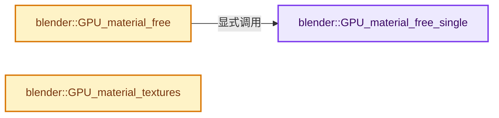
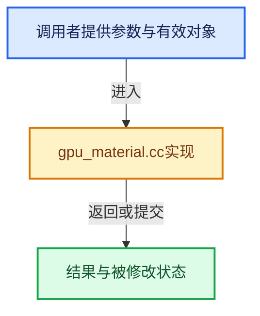

# 实现依赖专题：source/blender/gpu/intern/gpu_material.cc

[实现依赖导航](../../../README.md) · [符号索引](../../../../00-课程指南/02-源码与提交索引/符号依赖与实现索引.md)

本专题从正文实际调用进入，集中保存共享实现。函数有稳定锚点，可从调用处直接跳到对应完整函数；递归与互相调用通过回链组织。

## 本文件的实现关系






## 完整成员与函数实现

<a id="f-171e2eb39dd66b46"></a>

### `blender::GPU_material_free_single`

实现位置：[source/blender/gpu/intern/gpu_material.cc](../../../../../../../../source/blender/gpu/intern/gpu_material.cc) · L283—L286。

接口参数：

- `GPUMaterial *material`

**教学注释版**

<!-- annotated:a379a793b14bb4 -->

```cpp
void GPU_material_free_single(GPUMaterial *material)
{
  MEM_delete(material);
}
```

<details>
<summary>核对原始源码：source/blender/gpu/intern/gpu_material.cc · L283—L286</summary>

<!-- original:a379a793b14bb4:source/blender/gpu/intern/gpu_material.cc:283:286 -->

```cpp
void GPU_material_free_single(GPUMaterial *material)
{
  MEM_delete(material);
}
```

</details>

**继续追踪实现**

- `MEM_delete` → [MEM_delete · L400](../../../07-Intern运行时与平台/guardedalloc/MEM_guardedalloc.h.md#f-9049ffdd1682887c)。

<a id="f-dabf0b556ae042cd"></a>

### `blender::GPU_material_free`

实现位置：[source/blender/gpu/intern/gpu_material.cc](../../../../../../../../source/blender/gpu/intern/gpu_material.cc) · L288—L295。

接口参数：

- `ListBaseT<LinkData> *gpumaterial`

**教学注释版**

<!-- annotated:68311bf16675d5 -->

```cpp
void GPU_material_free(ListBaseT<LinkData> *gpumaterial)
{
  for (LinkData &link : *gpumaterial) {
    GPUMaterial *material = static_cast<GPUMaterial *>(link.data);
    GPU_material_free_single(material);
  }
  gpumaterial->free_no_destruct();
}
```

<details>
<summary>核对原始源码：source/blender/gpu/intern/gpu_material.cc · L288—L295</summary>

<!-- original:68311bf16675d5:source/blender/gpu/intern/gpu_material.cc:288:295 -->

```cpp
void GPU_material_free(ListBaseT<LinkData> *gpumaterial)
{
  for (LinkData &link : *gpumaterial) {
    GPUMaterial *material = static_cast<GPUMaterial *>(link.data);
    GPU_material_free_single(material);
  }
  gpumaterial->free_no_destruct();
}
```

</details>

**继续追踪实现**

- `GPU_material_free_single` → [blender::GPU_material_free_single · L283](gpu_material.cc.md#f-171e2eb39dd66b46)。
- `gpumaterial->free_no_destruct` → [blender::ListBaseT::free_no_destruct · L78](../../makesdna/DNA_listBase.h.md#f-8656670edd0f6b7e)。

<a id="f-568652b896582bfc"></a>

### `blender::GPU_material_textures`

实现位置：[source/blender/gpu/intern/gpu_material.cc](../../../../../../../../source/blender/gpu/intern/gpu_material.cc) · L422—L425。

接口参数：

- `GPUMaterial *material`

**教学注释版**

<!-- annotated:436e9bcb9a71fe -->

```cpp
ListBaseT<GPUMaterialTexture> GPU_material_textures(GPUMaterial *material)
{
  return material->graph.textures;
}
```

<details>
<summary>核对原始源码：source/blender/gpu/intern/gpu_material.cc · L422—L425</summary>

<!-- original:436e9bcb9a71fe:source/blender/gpu/intern/gpu_material.cc:422:425 -->

```cpp
ListBaseT<GPUMaterialTexture> GPU_material_textures(GPUMaterial *material)
{
  return material->graph.textures;
}
```

</details>

**结果出口**

- `return material->graph.textures;`

**继续追踪实现**

本实现没有需要继续展开的显式调用；检查返回表达式、对象转换和调用者前置条件。
