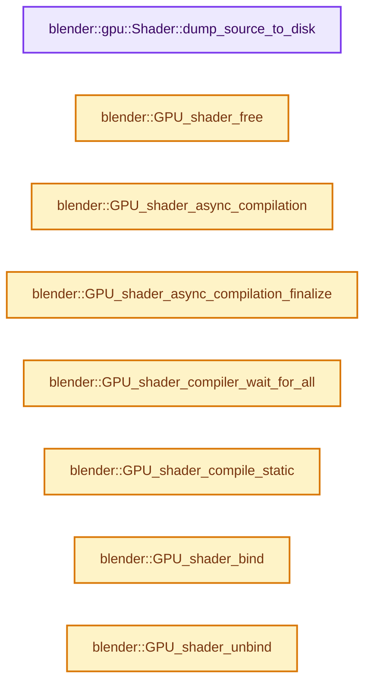
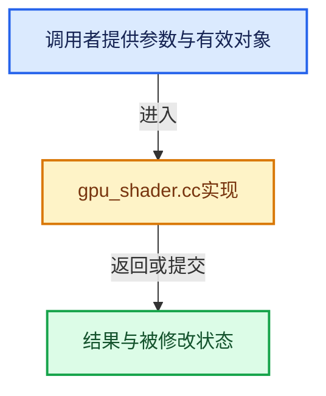

# 实现依赖专题：source/blender/gpu/intern/gpu_shader.cc

[实现依赖导航](../../../README.md) · [符号索引](../../../../00-课程指南/02-源码与提交索引/符号依赖与实现索引.md)

本专题从正文实际调用进入，集中保存共享实现。函数有稳定锚点，可从调用处直接跳到对应完整函数；递归与互相调用通过回链组织。

## 本文件的实现关系






## 完整成员与函数实现

<a id="f-1f17d534da7fac4e"></a>

### `blender::gpu::Shader::dump_source_to_disk`

实现位置：[source/blender/gpu/intern/gpu_shader.cc](../../../../../../../../source/blender/gpu/intern/gpu_shader.cc) · L43—L89。

接口参数：

- `StringRef shader_name`
- `StringRef shader_name_with_stage_name`
- `StringRef extension`
- `StringRef source`

**教学注释版**

<!-- annotated:ffd0a40309d38a -->

```cpp
void Shader::dump_source_to_disk(StringRef shader_name,
                                 StringRef shader_name_with_stage_name,
                                 StringRef extension,
                                 StringRef source)
{
  StringRefNull pattern = G.gpu_debug_shader_source_name;
  /* Support starting and/or ending with a wildcard. */
  if (pattern == "*") {
    /* If using a single wildcard, match everything. */
  }
  else if (pattern.startswith("*") && pattern.endswith("*")) {
    std::string sub_str = pattern.substr(1, pattern.size() - 2);
    if (shader_name.find(sub_str) == std::string::npos) {
      return;
    }
  }
  else if (pattern.startswith("*")) {
    std::string sub_str = pattern.substr(1);
    if (!shader_name.endswith(sub_str)) {
      return;
    }
  }
  else if (pattern.endswith("*")) {
    std::string sub_str = pattern.substr(0, pattern.size() - 1);
    if (!shader_name.startswith(sub_str)) {
      return;
    }
  }
  else if (shader_name != pattern) {
    return;
  }

  namespace fs = std::filesystem;
  fs::path shader_dir = fs::current_path() / "Shaders";
  fs::create_directories(shader_dir);
  fs::path file_path = shader_dir / (shader_name_with_stage_name + extension);

  std::ofstream output_source_file(file_path);
  if (output_source_file) {
    output_source_file << source;
    output_source_file.close();
    std::cout << "Shader Source Debug: Writing file: " << file_path << "\n";
  }
  else {
    std::cerr << "Shader Source Debug: Failed to open file: " << file_path << "\n";
  }
}
```

<details>
<summary>核对原始源码：source/blender/gpu/intern/gpu_shader.cc · L43—L89</summary>

<!-- original:ffd0a40309d38a:source/blender/gpu/intern/gpu_shader.cc:43:89 -->

```cpp
void Shader::dump_source_to_disk(StringRef shader_name,
                                 StringRef shader_name_with_stage_name,
                                 StringRef extension,
                                 StringRef source)
{
  StringRefNull pattern = G.gpu_debug_shader_source_name;
  /* Support starting and/or ending with a wildcard. */
  if (pattern == "*") {
    /* If using a single wildcard, match everything. */
  }
  else if (pattern.startswith("*") && pattern.endswith("*")) {
    std::string sub_str = pattern.substr(1, pattern.size() - 2);
    if (shader_name.find(sub_str) == std::string::npos) {
      return;
    }
  }
  else if (pattern.startswith("*")) {
    std::string sub_str = pattern.substr(1);
    if (!shader_name.endswith(sub_str)) {
      return;
    }
  }
  else if (pattern.endswith("*")) {
    std::string sub_str = pattern.substr(0, pattern.size() - 1);
    if (!shader_name.startswith(sub_str)) {
      return;
    }
  }
  else if (shader_name != pattern) {
    return;
  }

  namespace fs = std::filesystem;
  fs::path shader_dir = fs::current_path() / "Shaders";
  fs::create_directories(shader_dir);
  fs::path file_path = shader_dir / (shader_name_with_stage_name + extension);

  std::ofstream output_source_file(file_path);
  if (output_source_file) {
    output_source_file << source;
    output_source_file.close();
    std::cout << "Shader Source Debug: Writing file: " << file_path << "\n";
  }
  else {
    std::cerr << "Shader Source Debug: Failed to open file: " << file_path << "\n";
  }
}
```

</details>

**继续追踪实现**

- `pattern.startswith` → [blender::StringRefBase::startswith · L269](../../../../01-基础容器与现代CPP/15-StringRef字符串视图.md#f-78237ccfe249bfa5)。
- `pattern.endswith` → [blender::StringRefBase::endswith · L285](../../../../01-基础容器与现代CPP/15-StringRef字符串视图.md#f-9b23dbdd3afc9dbb)。
- `pattern.substr` → [调用协议](../../../../00-课程指南/01-路线与规范/模板宏与动态分派协议.md)：由接收对象具体类型或运行时策略提供实现。调用位置L54。
- `pattern.size` → [调用协议](../../../../00-课程指南/01-路线与规范/模板宏与动态分派协议.md)：由接收对象具体类型或运行时策略提供实现。调用位置L54。
- `shader_name.find` → [blender::gpu::VKPushConstants::Layout::find · L97](../vulkan/vk_push_constants.cc.md#f-fc5e007471c50aae)。
- `shader_name.endswith` → [blender::StringRefBase::endswith · L285](../../../../01-基础容器与现代CPP/15-StringRef字符串视图.md#f-9b23dbdd3afc9dbb)。
- `shader_name.startswith` → [blender::StringRefBase::startswith · L269](../../../../01-基础容器与现代CPP/15-StringRef字符串视图.md#f-78237ccfe249bfa5)。
- `fs::current_path` → [调用协议](../../../../00-课程指南/01-路线与规范/模板宏与动态分派协议.md)：函数指针、局部可调用对象或未展开的宏；必须结合调用者环境。调用位置L76。
- `fs::create_directories` → [调用协议](../../../../00-课程指南/01-路线与规范/模板宏与动态分派协议.md)：函数指针、局部可调用对象或未展开的宏；必须结合调用者环境。调用位置L77。
- `output_source_file.close` → [外部契约](https://eel.is/c++draft/)：这个边界按实际表达式及所属类型核对参数、返回值、寿命与失败行为。这里提供接口入口，不声称已解释该第三方版本的内部实现。

<a id="f-cf33ab59d64fe377"></a>

### `blender::GPU_shader_free`

实现位置：[source/blender/gpu/intern/gpu_shader.cc](../../../../../../../../source/blender/gpu/intern/gpu_shader.cc) · L185—L188。

接口参数：

- `gpu::Shader *shader`

**教学注释版**

<!-- annotated:ca2c682cc8acb5 -->

```cpp
void GPU_shader_free(gpu::Shader *shader)
{
  delete shader;
}
```

<details>
<summary>核对原始源码：source/blender/gpu/intern/gpu_shader.cc · L185—L188</summary>

<!-- original:ca2c682cc8acb5:source/blender/gpu/intern/gpu_shader.cc:185:188 -->

```cpp
void GPU_shader_free(gpu::Shader *shader)
{
  delete shader;
}
```

</details>

**继续追踪实现**

本实现没有需要继续展开的显式调用；检查返回表达式、对象转换和调用者前置条件。

<a id="f-86d291f0e30f2e39"></a>

### `blender::GPU_shader_async_compilation`

实现位置：[source/blender/gpu/intern/gpu_shader.cc](../../../../../../../../source/blender/gpu/intern/gpu_shader.cc) · L320—L326。

接口参数：

- `const GPUShaderCreateInfo *info`
- `CompilationPriority priority`

**教学注释版**

<!-- annotated:b9c339100e11df -->

```cpp
AsyncCompilationHandle GPU_shader_async_compilation(const GPUShaderCreateInfo *info,
                                                    CompilationPriority priority)
{
  using namespace blender::gpu::shader;
  const ShaderCreateInfo *info_ = reinterpret_cast<const ShaderCreateInfo *>(info);
  return GPUBackend::get()->get_compiler()->async_compilation(info_, priority);
}
```

<details>
<summary>核对原始源码：source/blender/gpu/intern/gpu_shader.cc · L320—L326</summary>

<!-- original:b9c339100e11df:source/blender/gpu/intern/gpu_shader.cc:320:326 -->

```cpp
AsyncCompilationHandle GPU_shader_async_compilation(const GPUShaderCreateInfo *info,
                                                    CompilationPriority priority)
{
  using namespace blender::gpu::shader;
  const ShaderCreateInfo *info_ = reinterpret_cast<const ShaderCreateInfo *>(info);
  return GPUBackend::get()->get_compiler()->async_compilation(info_, priority);
}
```

</details>

**结果出口**

- `return GPUBackend::get()->get_compiler()->async_compilation(info_, priority);`

**继续追踪实现**

- `GPUBackend::get()->get_compiler()->async_compilation` → [调用协议](../../../../00-课程指南/01-路线与规范/模板宏与动态分派协议.md)：接收对象类型依赖auto、返回值或模板实例；不按同名猜测目标。调用位置L325。
- `GPUBackend::get()->get_compiler` → [调用协议](../../../../00-课程指南/01-路线与规范/模板宏与动态分派协议.md)：接收对象类型依赖auto、返回值或模板实例；不按同名猜测目标。调用位置L325。
- `GPUBackend::get` → [blender::GPUBackend::get · L642](gpu_context.cc.md#f-c876dc1cb5bd7700)。

<a id="f-9551a6f2f3ddc30c"></a>

### `blender::GPU_shader_async_compilation_finalize`

实现位置：[source/blender/gpu/intern/gpu_shader.cc](../../../../../../../../source/blender/gpu/intern/gpu_shader.cc) · L333—L337。

接口参数：

- `AsyncCompilationHandle &handle`

**教学注释版**

<!-- annotated:cb14b08fa6b644 -->

```cpp
gpu::Shader *GPU_shader_async_compilation_finalize(AsyncCompilationHandle &handle)
{
  Shader *result = GPUBackend::get()->get_compiler()->async_compilation_finalize(handle);
  return reinterpret_cast<gpu::Shader *>(result);
}
```

<details>
<summary>核对原始源码：source/blender/gpu/intern/gpu_shader.cc · L333—L337</summary>

<!-- original:cb14b08fa6b644:source/blender/gpu/intern/gpu_shader.cc:333:337 -->

```cpp
gpu::Shader *GPU_shader_async_compilation_finalize(AsyncCompilationHandle &handle)
{
  Shader *result = GPUBackend::get()->get_compiler()->async_compilation_finalize(handle);
  return reinterpret_cast<gpu::Shader *>(result);
}
```

</details>

**结果出口**

- `return reinterpret_cast<gpu::Shader *>(result);`

**继续追踪实现**

- `GPUBackend::get()->get_compiler()->async_compilation_finalize` → [调用协议](../../../../00-课程指南/01-路线与规范/模板宏与动态分派协议.md)：接收对象类型依赖auto、返回值或模板实例；不按同名猜测目标。调用位置L335。
- `GPUBackend::get()->get_compiler` → [调用协议](../../../../00-课程指南/01-路线与规范/模板宏与动态分派协议.md)：接收对象类型依赖auto、返回值或模板实例；不按同名猜测目标。调用位置L335。
- `GPUBackend::get` → [blender::GPUBackend::get · L642](gpu_context.cc.md#f-c876dc1cb5bd7700)。

<a id="f-49322c6a72e3f0f9"></a>

### `blender::GPU_shader_compiler_wait_for_all`

实现位置：[source/blender/gpu/intern/gpu_shader.cc](../../../../../../../../source/blender/gpu/intern/gpu_shader.cc) · L355—L358。

**教学注释版**

<!-- annotated:e1364a54581c9f -->

```cpp
void GPU_shader_compiler_wait_for_all()
{
  GPUBackend::get()->get_compiler()->wait_for_all();
}
```

<details>
<summary>核对原始源码：source/blender/gpu/intern/gpu_shader.cc · L355—L358</summary>

<!-- original:e1364a54581c9f:source/blender/gpu/intern/gpu_shader.cc:355:358 -->

```cpp
void GPU_shader_compiler_wait_for_all()
{
  GPUBackend::get()->get_compiler()->wait_for_all();
}
```

</details>

**继续追踪实现**

- `GPUBackend::get()->get_compiler()->wait_for_all` → [调用协议](../../../../00-课程指南/01-路线与规范/模板宏与动态分派协议.md)：接收对象类型依赖auto、返回值或模板实例；不按同名猜测目标。调用位置L357。
- `GPUBackend::get()->get_compiler` → [调用协议](../../../../00-课程指南/01-路线与规范/模板宏与动态分派协议.md)：接收对象类型依赖auto、返回值或模板实例；不按同名猜测目标。调用位置L357。
- `GPUBackend::get` → [blender::GPUBackend::get · L642](gpu_context.cc.md#f-c876dc1cb5bd7700)。

<a id="f-2357045ae209ac45"></a>

### `blender::GPU_shader_compile_static`

实现位置：[source/blender/gpu/intern/gpu_shader.cc](../../../../../../../../source/blender/gpu/intern/gpu_shader.cc) · L370—L374。

**教学注释版**

<!-- annotated:f1b115e498ca8f -->

```cpp
void GPU_shader_compile_static()
{
  printf("Compiling all static GPU shaders. This process takes a while.\n");
  gpu_shader_create_info_compile_all("");
}
```

<details>
<summary>核对原始源码：source/blender/gpu/intern/gpu_shader.cc · L370—L374</summary>

<!-- original:f1b115e498ca8f:source/blender/gpu/intern/gpu_shader.cc:370:374 -->

```cpp
void GPU_shader_compile_static()
{
  printf("Compiling all static GPU shaders. This process takes a while.\n");
  gpu_shader_create_info_compile_all("");
}
```

</details>

**继续追踪实现**

- `printf` → [外部契约](https://eel.is/c++draft/)：这个边界按实际表达式及所属类型核对参数、返回值、寿命与失败行为。这里提供接口入口，不声称已解释该第三方版本的内部实现。
- `gpu_shader_create_info_compile_all` → [blender::gpu_shader_create_info_compile_all · L848](gpu_shader_create_info.cc.md#f-0d5720a078dd9b0a)。

<a id="f-a879eef1816db611"></a>

### `blender::GPU_shader_bind`

实现位置：[source/blender/gpu/intern/gpu_shader.cc](../../../../../../../../source/blender/gpu/intern/gpu_shader.cc) · L387—L422。

接口参数：

- `gpu::Shader *gpu_shader`
- `const shader::SpecializationConstants *constants_state`

**教学注释版**

<!-- annotated:3551c420bb8603 -->

```cpp
void GPU_shader_bind(gpu::Shader *gpu_shader,
                     const shader::SpecializationConstants *constants_state)
{
  Shader *shader = gpu_shader;

  BLI_assert_msg(constants_state != nullptr || shader->constants->is_empty(),
                 "Shader requires specialization constants but none was passed");

  Context *ctx = Context::get();

  if (ctx->shader != shader) {
    ctx->shader = shader;
    shader->bind(constants_state);
    GPU_matrix_bind(gpu_shader);
    Shader::set_srgb_uniform(ctx, gpu_shader);
    /* Blender working color space do not change during the drawing of the frame.
     * So we can just set the uniform once. */
    Shader::set_scene_linear_to_xyz_uniform(gpu_shader);
  }
  else {
    if (constants_state) {
      shader->bind(constants_state);
    }
    if (ctx->shader_builtin_srgb_is_dirty) {
      Shader::set_srgb_uniform(ctx, gpu_shader);
    }
    if (GPU_matrix_dirty_get()) {
      GPU_matrix_bind(gpu_shader);
    }
  }
#if GPU_SHADER_PRINTF_ENABLE
  if (!ctx->printf_buf.is_empty()) {
    GPU_storagebuf_bind(ctx->printf_buf.last(), GPU_SHADER_PRINTF_SLOT);
  }
#endif
}
```

<details>
<summary>核对原始源码：source/blender/gpu/intern/gpu_shader.cc · L387—L422</summary>

<!-- original:3551c420bb8603:source/blender/gpu/intern/gpu_shader.cc:387:422 -->

```cpp
void GPU_shader_bind(gpu::Shader *gpu_shader,
                     const shader::SpecializationConstants *constants_state)
{
  Shader *shader = gpu_shader;

  BLI_assert_msg(constants_state != nullptr || shader->constants->is_empty(),
                 "Shader requires specialization constants but none was passed");

  Context *ctx = Context::get();

  if (ctx->shader != shader) {
    ctx->shader = shader;
    shader->bind(constants_state);
    GPU_matrix_bind(gpu_shader);
    Shader::set_srgb_uniform(ctx, gpu_shader);
    /* Blender working color space do not change during the drawing of the frame.
     * So we can just set the uniform once. */
    Shader::set_scene_linear_to_xyz_uniform(gpu_shader);
  }
  else {
    if (constants_state) {
      shader->bind(constants_state);
    }
    if (ctx->shader_builtin_srgb_is_dirty) {
      Shader::set_srgb_uniform(ctx, gpu_shader);
    }
    if (GPU_matrix_dirty_get()) {
      GPU_matrix_bind(gpu_shader);
    }
  }
#if GPU_SHADER_PRINTF_ENABLE
  if (!ctx->printf_buf.is_empty()) {
    GPU_storagebuf_bind(ctx->printf_buf.last(), GPU_SHADER_PRINTF_SLOT);
  }
#endif
}
```

</details>

**沿实际写入检查状态**

- `ctx->shader = shader;`

**继续追踪实现**

- `BLI_assert_msg` → [BLI_assert_msg · L55](../../../01-BLI基础库/BLI_assert.hh.md#m-695eed20dceb)；[BLI_assert_msg · L64](../../../01-BLI基础库/BLI_assert.hh.md#m-7de5563de4db)。宏定义由构建条件选择。
- `shader->constants->is_empty` → [调用协议](../../../../00-课程指南/01-路线与规范/模板宏与动态分派协议.md)：接收对象类型依赖auto、返回值或模板实例；不按同名猜测目标。调用位置L392。
- `Context::get` → [blender::gpu::Context::get · L127](gpu_context.cc.md#f-7ca16707244f2d11)。
- `shader->bind` → [blender::gpu::tests::Shader::bind · L113](../tests/push_constants_test.cc.md#f-0ebe3206015f5028)。
- `GPU_matrix_bind` → [blender::GPU_matrix_bind · L612](gpu_matrix.cc.md#f-c4bd0ac3f45ded4f)。
- `Shader::set_srgb_uniform` → [blender::gpu::Shader::set_srgb_uniform · L769](gpu_shader.cc.md#f-b189547fa6ac724c)。
- `Shader::set_scene_linear_to_xyz_uniform` → [blender::gpu::Shader::set_scene_linear_to_xyz_uniform · L778](gpu_shader.cc.md#f-2b80e88b9331713b)。
- `GPU_matrix_dirty_get` → [blender::GPU_matrix_dirty_get · L662](gpu_matrix.cc.md#f-9b273c4286f88eeb)。
- `ctx->printf_buf.is_empty` → [调用协议](../../../../00-课程指南/01-路线与规范/模板宏与动态分派协议.md)：接收对象类型依赖auto、返回值或模板实例；不按同名猜测目标。调用位置L418。
- `GPU_storagebuf_bind` → [blender::GPU_storagebuf_bind · L94](gpu_storage_buffer.cc.md#f-e795e74fcc758ac4)。
- `ctx->printf_buf.last` → [调用协议](../../../../00-课程指南/01-路线与规范/模板宏与动态分派协议.md)：接收对象类型依赖auto、返回值或模板实例；不按同名猜测目标。调用位置L419。

<a id="f-e0462e112df4c1ef"></a>

### `blender::GPU_shader_unbind`

实现位置：[source/blender/gpu/intern/gpu_shader.cc](../../../../../../../../source/blender/gpu/intern/gpu_shader.cc) · L424—L436。

**教学注释版**

<!-- annotated:7a21b310c9359c -->

```cpp
void GPU_shader_unbind()
{
  Context *ctx = Context::get();
  if (ctx == nullptr) {
    return;
  }
#ifndef NDEBUG
  if (ctx->shader) {
    ctx->shader->unbind();
  }
#endif
  ctx->shader = nullptr;
}
```

<details>
<summary>核对原始源码：source/blender/gpu/intern/gpu_shader.cc · L424—L436</summary>

<!-- original:7a21b310c9359c:source/blender/gpu/intern/gpu_shader.cc:424:436 -->

```cpp
void GPU_shader_unbind()
{
  Context *ctx = Context::get();
  if (ctx == nullptr) {
    return;
  }
#ifndef NDEBUG
  if (ctx->shader) {
    ctx->shader->unbind();
  }
#endif
  ctx->shader = nullptr;
}
```

</details>

**沿实际写入检查状态**

- `ctx->shader = nullptr;`

**继续追踪实现**

- `Context::get` → [blender::gpu::Context::get · L127](gpu_context.cc.md#f-7ca16707244f2d11)。
- `ctx->shader->unbind` → [调用协议](../../../../00-课程指南/01-路线与规范/模板宏与动态分派协议.md)：接收对象类型依赖auto、返回值或模板实例；不按同名猜测目标。调用位置L432。

<a id="f-2275be29b0215181"></a>

### `blender::GPU_shader_get_uniform`

实现位置：[source/blender/gpu/intern/gpu_shader.cc](../../../../../../../../source/blender/gpu/intern/gpu_shader.cc) · L524—L529。

接口参数：

- `gpu::Shader *shader`
- `const char *name`

**教学注释版**

<!-- annotated:3c74853e66511c -->

```cpp
int GPU_shader_get_uniform(gpu::Shader *shader, const char *name)
{
  const ShaderInterface *interface = shader->interface;
  const ShaderInput *uniform = interface->uniform_get(name);
  return uniform ? uniform->location : -1;
}
```

<details>
<summary>核对原始源码：source/blender/gpu/intern/gpu_shader.cc · L524—L529</summary>

<!-- original:3c74853e66511c:source/blender/gpu/intern/gpu_shader.cc:524:529 -->

```cpp
int GPU_shader_get_uniform(gpu::Shader *shader, const char *name)
{
  const ShaderInterface *interface = shader->interface;
  const ShaderInput *uniform = interface->uniform_get(name);
  return uniform ? uniform->location : -1;
}
```

</details>

**结果出口**

- `return uniform ? uniform->location : -1;`

**继续追踪实现**

- `interface->uniform_get` → [blender::gpu::ShaderInterface::uniform_get · L120](gpu_shader_interface.hh.md#f-f14976d24053e4e0)。

<a id="f-5c493ac2a8f00630"></a>

### `blender::GPU_shader_get_builtin_uniform`

实现位置：[source/blender/gpu/intern/gpu_shader.cc](../../../../../../../../source/blender/gpu/intern/gpu_shader.cc) · L538—L542。

接口参数：

- `gpu::Shader *shader`
- `int builtin`

**教学注释版**

<!-- annotated:537e30aafe7693 -->

```cpp
int GPU_shader_get_builtin_uniform(gpu::Shader *shader, int builtin)
{
  const ShaderInterface *interface = shader->interface;
  return interface->uniform_builtin(GPUUniformBuiltin(builtin));
}
```

<details>
<summary>核对原始源码：source/blender/gpu/intern/gpu_shader.cc · L538—L542</summary>

<!-- original:537e30aafe7693:source/blender/gpu/intern/gpu_shader.cc:538:542 -->

```cpp
int GPU_shader_get_builtin_uniform(gpu::Shader *shader, int builtin)
{
  const ShaderInterface *interface = shader->interface;
  return interface->uniform_builtin(GPUUniformBuiltin(builtin));
}
```

</details>

**结果出口**

- `return interface->uniform_builtin(GPUUniformBuiltin(builtin));`

**继续追踪实现**

- `interface->uniform_builtin` → [blender::gpu::ShaderInterface::uniform_builtin · L163](gpu_shader_interface.hh.md#f-006a1ed238879b7b)。
- `GPUUniformBuiltin` → [blender::GPUUniformBuiltin](../GPU_shader.hh.md#t-b407b22f09f3)。

<a id="f-91a2bf7d4bbda1dc"></a>

### `blender::GPU_shader_get_ssbo_binding`

实现位置：[source/blender/gpu/intern/gpu_shader.cc](../../../../../../../../source/blender/gpu/intern/gpu_shader.cc) · L544—L549。

接口参数：

- `gpu::Shader *shader`
- `const char *name`

**教学注释版**

<!-- annotated:1e1a79123d6917 -->

```cpp
int GPU_shader_get_ssbo_binding(gpu::Shader *shader, const char *name)
{
  const ShaderInterface *interface = shader->interface;
  const ShaderInput *ssbo = interface->ssbo_get(name);
  return ssbo ? ssbo->location : -1;
}
```

<details>
<summary>核对原始源码：source/blender/gpu/intern/gpu_shader.cc · L544—L549</summary>

<!-- original:1e1a79123d6917:source/blender/gpu/intern/gpu_shader.cc:544:549 -->

```cpp
int GPU_shader_get_ssbo_binding(gpu::Shader *shader, const char *name)
{
  const ShaderInterface *interface = shader->interface;
  const ShaderInput *ssbo = interface->ssbo_get(name);
  return ssbo ? ssbo->location : -1;
}
```

</details>

**结果出口**

- `return ssbo ? ssbo->location : -1;`

**继续追踪实现**

- `interface->ssbo_get` → [blender::gpu::ShaderInterface::ssbo_get · L130](gpu_shader_interface.hh.md#f-5cb2063c862d0179)；[blender::gpu::ShaderInterface::ssbo_get · L134](gpu_shader_interface.hh.md#f-7faa3482fa8684d8)。同名重载需按实参类型选择。

<a id="f-640a2aa8e79fb49f"></a>

### `blender::GPU_shader_get_ubo_binding`

实现位置：[source/blender/gpu/intern/gpu_shader.cc](../../../../../../../../source/blender/gpu/intern/gpu_shader.cc) · L558—L563。

接口参数：

- `gpu::Shader *shader`
- `const char *name`

**教学注释版**

<!-- annotated:70819aab51e79d -->

```cpp
int GPU_shader_get_ubo_binding(gpu::Shader *shader, const char *name)
{
  const ShaderInterface *interface = shader->interface;
  const ShaderInput *ubo = interface->ubo_get(name);
  return ubo ? ubo->binding : -1;
}
```

<details>
<summary>核对原始源码：source/blender/gpu/intern/gpu_shader.cc · L558—L563</summary>

<!-- original:70819aab51e79d:source/blender/gpu/intern/gpu_shader.cc:558:563 -->

```cpp
int GPU_shader_get_ubo_binding(gpu::Shader *shader, const char *name)
{
  const ShaderInterface *interface = shader->interface;
  const ShaderInput *ubo = interface->ubo_get(name);
  return ubo ? ubo->binding : -1;
}
```

</details>

**结果出口**

- `return ubo ? ubo->binding : -1;`

**继续追踪实现**

- `interface->ubo_get` → [blender::gpu::ShaderInterface::ubo_get · L111](gpu_shader_interface.hh.md#f-3c1cfdde10aacbef)；[blender::gpu::ShaderInterface::ubo_get · L115](gpu_shader_interface.hh.md#f-68ce09474348e845)。同名重载需按实参类型选择。

<a id="f-bae0e0521a75040e"></a>

### `blender::GPU_shader_uniform_float_ex`

实现位置：[source/blender/gpu/intern/gpu_shader.cc](../../../../../../../../source/blender/gpu/intern/gpu_shader.cc) · L634—L638。

接口参数：

- `gpu::Shader *shader`
- `int loc`
- `int len`
- `int array_size`
- `const float *value`

**教学注释版**

<!-- annotated:220644d2beb012 -->

```cpp
void GPU_shader_uniform_float_ex(
    gpu::Shader *shader, int loc, int len, int array_size, const float *value)
{
  shader->uniform_float(loc, len, array_size, value);
}
```

<details>
<summary>核对原始源码：source/blender/gpu/intern/gpu_shader.cc · L634—L638</summary>

<!-- original:220644d2beb012:source/blender/gpu/intern/gpu_shader.cc:634:638 -->

```cpp
void GPU_shader_uniform_float_ex(
    gpu::Shader *shader, int loc, int len, int array_size, const float *value)
{
  shader->uniform_float(loc, len, array_size, value);
}
```

</details>

**继续追踪实现**

- `shader->uniform_float` → [blender::GLShader::uniform_float · L1429](../opengl/gl_shader.cc.md#f-5918f2e48c2fe8fd)。

<a id="f-df6f5be0c396a418"></a>

### `blender::GPU_shader_uniform_int_ex`

实现位置：[source/blender/gpu/intern/gpu_shader.cc](../../../../../../../../source/blender/gpu/intern/gpu_shader.cc) · L640—L644。

接口参数：

- `gpu::Shader *shader`
- `int loc`
- `int len`
- `int array_size`
- `const int *value`

**教学注释版**

<!-- annotated:3431072dd637cc -->

```cpp
void GPU_shader_uniform_int_ex(
    gpu::Shader *shader, int loc, int len, int array_size, const int *value)
{
  shader->uniform_int(loc, len, array_size, value);
}
```

<details>
<summary>核对原始源码：source/blender/gpu/intern/gpu_shader.cc · L640—L644</summary>

<!-- original:3431072dd637cc:source/blender/gpu/intern/gpu_shader.cc:640:644 -->

```cpp
void GPU_shader_uniform_int_ex(
    gpu::Shader *shader, int loc, int len, int array_size, const int *value)
{
  shader->uniform_int(loc, len, array_size, value);
}
```

</details>

**继续追踪实现**

- `shader->uniform_int` → [blender::GLShader::uniform_int · L1456](../opengl/gl_shader.cc.md#f-fdac796aaec5a43d)。

<a id="f-d02d234ed60d9de0"></a>

### `blender::GPU_shader_uniform_1i`

实现位置：[source/blender/gpu/intern/gpu_shader.cc](../../../../../../../../source/blender/gpu/intern/gpu_shader.cc) · L646—L650。

接口参数：

- `gpu::Shader *sh`
- `const char *name`
- `int value`

**教学注释版**

<!-- annotated:c2f1e4d49ea0bc -->

```cpp
void GPU_shader_uniform_1i(gpu::Shader *sh, const char *name, int value)
{
  const int loc = GPU_shader_get_uniform(sh, name);
  GPU_shader_uniform_int_ex(sh, loc, 1, 1, &value);
}
```

<details>
<summary>核对原始源码：source/blender/gpu/intern/gpu_shader.cc · L646—L650</summary>

<!-- original:c2f1e4d49ea0bc:source/blender/gpu/intern/gpu_shader.cc:646:650 -->

```cpp
void GPU_shader_uniform_1i(gpu::Shader *sh, const char *name, int value)
{
  const int loc = GPU_shader_get_uniform(sh, name);
  GPU_shader_uniform_int_ex(sh, loc, 1, 1, &value);
}
```

</details>

**继续追踪实现**

- `GPU_shader_get_uniform` → [blender::GPU_shader_get_uniform · L524](gpu_shader.cc.md#f-2275be29b0215181)。
- `GPU_shader_uniform_int_ex` → [blender::GPU_shader_uniform_int_ex · L640](gpu_shader.cc.md#f-df6f5be0c396a418)。

<a id="f-866f89b40db913ec"></a>

### `blender::GPU_shader_uniform_1b`

实现位置：[source/blender/gpu/intern/gpu_shader.cc](../../../../../../../../source/blender/gpu/intern/gpu_shader.cc) · L652—L655。

接口参数：

- `gpu::Shader *sh`
- `const char *name`
- `bool value`

**教学注释版**

<!-- annotated:e53b2b2c61f41f -->

```cpp
void GPU_shader_uniform_1b(gpu::Shader *sh, const char *name, bool value)
{
  GPU_shader_uniform_1i(sh, name, value ? 1 : 0);
}
```

<details>
<summary>核对原始源码：source/blender/gpu/intern/gpu_shader.cc · L652—L655</summary>

<!-- original:e53b2b2c61f41f:source/blender/gpu/intern/gpu_shader.cc:652:655 -->

```cpp
void GPU_shader_uniform_1b(gpu::Shader *sh, const char *name, bool value)
{
  GPU_shader_uniform_1i(sh, name, value ? 1 : 0);
}
```

</details>

**继续追踪实现**

- `GPU_shader_uniform_1i` → [blender::GPU_shader_uniform_1i · L646](gpu_shader.cc.md#f-d02d234ed60d9de0)。

<a id="f-47e633fb21cc2521"></a>

### `blender::GPU_shader_uniform_2f`

实现位置：[source/blender/gpu/intern/gpu_shader.cc](../../../../../../../../source/blender/gpu/intern/gpu_shader.cc) · L657—L661。

接口参数：

- `gpu::Shader *sh`
- `const char *name`
- `float x`
- `float y`

**教学注释版**

<!-- annotated:dfe817bab4df1e -->

```cpp
void GPU_shader_uniform_2f(gpu::Shader *sh, const char *name, float x, float y)
{
  const float data[2] = {x, y};
  GPU_shader_uniform_2fv(sh, name, data);
}
```

<details>
<summary>核对原始源码：source/blender/gpu/intern/gpu_shader.cc · L657—L661</summary>

<!-- original:dfe817bab4df1e:source/blender/gpu/intern/gpu_shader.cc:657:661 -->

```cpp
void GPU_shader_uniform_2f(gpu::Shader *sh, const char *name, float x, float y)
{
  const float data[2] = {x, y};
  GPU_shader_uniform_2fv(sh, name, data);
}
```

</details>

**继续追踪实现**

- `GPU_shader_uniform_2fv` → [blender::GPU_shader_uniform_2fv · L681](gpu_shader.cc.md#f-283f2f23b1ad9326)。

<a id="f-abb7ddcdf70de151"></a>

### `blender::GPU_shader_uniform_4f`

实现位置：[source/blender/gpu/intern/gpu_shader.cc](../../../../../../../../source/blender/gpu/intern/gpu_shader.cc) · L669—L673。

接口参数：

- `gpu::Shader *sh`
- `const char *name`
- `float x`
- `float y`
- `float z`
- `float w`

**教学注释版**

<!-- annotated:4820a21e9b7677 -->

```cpp
void GPU_shader_uniform_4f(gpu::Shader *sh, const char *name, float x, float y, float z, float w)
{
  const float data[4] = {x, y, z, w};
  GPU_shader_uniform_4fv(sh, name, data);
}
```

<details>
<summary>核对原始源码：source/blender/gpu/intern/gpu_shader.cc · L669—L673</summary>

<!-- original:4820a21e9b7677:source/blender/gpu/intern/gpu_shader.cc:669:673 -->

```cpp
void GPU_shader_uniform_4f(gpu::Shader *sh, const char *name, float x, float y, float z, float w)
{
  const float data[4] = {x, y, z, w};
  GPU_shader_uniform_4fv(sh, name, data);
}
```

</details>

**继续追踪实现**

- `GPU_shader_uniform_4fv` → [blender::GPU_shader_uniform_4fv · L693](gpu_shader.cc.md#f-04893200f3b7c75b)。

<a id="f-56672be17e2419d8"></a>

### `blender::GPU_shader_uniform_1f`

实现位置：[source/blender/gpu/intern/gpu_shader.cc](../../../../../../../../source/blender/gpu/intern/gpu_shader.cc) · L675—L679。

接口参数：

- `gpu::Shader *sh`
- `const char *name`
- `float value`

**教学注释版**

<!-- annotated:023b61bff1afd2 -->

```cpp
void GPU_shader_uniform_1f(gpu::Shader *sh, const char *name, float value)
{
  const int loc = GPU_shader_get_uniform(sh, name);
  GPU_shader_uniform_float_ex(sh, loc, 1, 1, &value);
}
```

<details>
<summary>核对原始源码：source/blender/gpu/intern/gpu_shader.cc · L675—L679</summary>

<!-- original:023b61bff1afd2:source/blender/gpu/intern/gpu_shader.cc:675:679 -->

```cpp
void GPU_shader_uniform_1f(gpu::Shader *sh, const char *name, float value)
{
  const int loc = GPU_shader_get_uniform(sh, name);
  GPU_shader_uniform_float_ex(sh, loc, 1, 1, &value);
}
```

</details>

**继续追踪实现**

- `GPU_shader_get_uniform` → [blender::GPU_shader_get_uniform · L524](gpu_shader.cc.md#f-2275be29b0215181)。
- `GPU_shader_uniform_float_ex` → [blender::GPU_shader_uniform_float_ex · L634](gpu_shader.cc.md#f-bae0e0521a75040e)。

<a id="f-283f2f23b1ad9326"></a>

### `blender::GPU_shader_uniform_2fv`

实现位置：[source/blender/gpu/intern/gpu_shader.cc](../../../../../../../../source/blender/gpu/intern/gpu_shader.cc) · L681—L685。

接口参数：

- `gpu::Shader *sh`
- `const char *name`
- `const float data[2]`

**教学注释版**

<!-- annotated:a0074dd62050a8 -->

```cpp
void GPU_shader_uniform_2fv(gpu::Shader *sh, const char *name, const float data[2])
{
  const int loc = GPU_shader_get_uniform(sh, name);
  GPU_shader_uniform_float_ex(sh, loc, 2, 1, data);
}
```

<details>
<summary>核对原始源码：source/blender/gpu/intern/gpu_shader.cc · L681—L685</summary>

<!-- original:a0074dd62050a8:source/blender/gpu/intern/gpu_shader.cc:681:685 -->

```cpp
void GPU_shader_uniform_2fv(gpu::Shader *sh, const char *name, const float data[2])
{
  const int loc = GPU_shader_get_uniform(sh, name);
  GPU_shader_uniform_float_ex(sh, loc, 2, 1, data);
}
```

</details>

**继续追踪实现**

- `GPU_shader_get_uniform` → [blender::GPU_shader_get_uniform · L524](gpu_shader.cc.md#f-2275be29b0215181)。
- `GPU_shader_uniform_float_ex` → [blender::GPU_shader_uniform_float_ex · L634](gpu_shader.cc.md#f-bae0e0521a75040e)。

<a id="f-04893200f3b7c75b"></a>

### `blender::GPU_shader_uniform_4fv`

实现位置：[source/blender/gpu/intern/gpu_shader.cc](../../../../../../../../source/blender/gpu/intern/gpu_shader.cc) · L693—L697。

接口参数：

- `gpu::Shader *sh`
- `const char *name`
- `const float data[4]`

**教学注释版**

<!-- annotated:8ff873c0b4cddb -->

```cpp
void GPU_shader_uniform_4fv(gpu::Shader *sh, const char *name, const float data[4])
{
  const int loc = GPU_shader_get_uniform(sh, name);
  GPU_shader_uniform_float_ex(sh, loc, 4, 1, data);
}
```

<details>
<summary>核对原始源码：source/blender/gpu/intern/gpu_shader.cc · L693—L697</summary>

<!-- original:8ff873c0b4cddb:source/blender/gpu/intern/gpu_shader.cc:693:697 -->

```cpp
void GPU_shader_uniform_4fv(gpu::Shader *sh, const char *name, const float data[4])
{
  const int loc = GPU_shader_get_uniform(sh, name);
  GPU_shader_uniform_float_ex(sh, loc, 4, 1, data);
}
```

</details>

**继续追踪实现**

- `GPU_shader_get_uniform` → [blender::GPU_shader_get_uniform · L524](gpu_shader.cc.md#f-2275be29b0215181)。
- `GPU_shader_uniform_float_ex` → [blender::GPU_shader_uniform_float_ex · L634](gpu_shader.cc.md#f-bae0e0521a75040e)。

<a id="f-26becb05a3c9a2ee"></a>

### `blender::GPU_shader_uniform_2iv`

实现位置：[source/blender/gpu/intern/gpu_shader.cc](../../../../../../../../source/blender/gpu/intern/gpu_shader.cc) · L699—L703。

接口参数：

- `gpu::Shader *sh`
- `const char *name`
- `const int data[2]`

**教学注释版**

<!-- annotated:fb7e0137c58968 -->

```cpp
void GPU_shader_uniform_2iv(gpu::Shader *sh, const char *name, const int data[2])
{
  const int loc = GPU_shader_get_uniform(sh, name);
  GPU_shader_uniform_int_ex(sh, loc, 2, 1, data);
}
```

<details>
<summary>核对原始源码：source/blender/gpu/intern/gpu_shader.cc · L699—L703</summary>

<!-- original:fb7e0137c58968:source/blender/gpu/intern/gpu_shader.cc:699:703 -->

```cpp
void GPU_shader_uniform_2iv(gpu::Shader *sh, const char *name, const int data[2])
{
  const int loc = GPU_shader_get_uniform(sh, name);
  GPU_shader_uniform_int_ex(sh, loc, 2, 1, data);
}
```

</details>

**继续追踪实现**

- `GPU_shader_get_uniform` → [blender::GPU_shader_get_uniform · L524](gpu_shader.cc.md#f-2275be29b0215181)。
- `GPU_shader_uniform_int_ex` → [blender::GPU_shader_uniform_int_ex · L640](gpu_shader.cc.md#f-df6f5be0c396a418)。

<a id="f-e40b025cd1b564d1"></a>

### `blender::GPU_shader_uniform_3iv`

实现位置：[source/blender/gpu/intern/gpu_shader.cc](../../../../../../../../source/blender/gpu/intern/gpu_shader.cc) · L705—L709。

接口参数：

- `gpu::Shader *sh`
- `const char *name`
- `const int data[3]`

**教学注释版**

<!-- annotated:1c8247738819ce -->

```cpp
void GPU_shader_uniform_3iv(gpu::Shader *sh, const char *name, const int data[3])
{
  const int loc = GPU_shader_get_uniform(sh, name);
  GPU_shader_uniform_int_ex(sh, loc, 3, 1, data);
}
```

<details>
<summary>核对原始源码：source/blender/gpu/intern/gpu_shader.cc · L705—L709</summary>

<!-- original:1c8247738819ce:source/blender/gpu/intern/gpu_shader.cc:705:709 -->

```cpp
void GPU_shader_uniform_3iv(gpu::Shader *sh, const char *name, const int data[3])
{
  const int loc = GPU_shader_get_uniform(sh, name);
  GPU_shader_uniform_int_ex(sh, loc, 3, 1, data);
}
```

</details>

**继续追踪实现**

- `GPU_shader_get_uniform` → [blender::GPU_shader_get_uniform · L524](gpu_shader.cc.md#f-2275be29b0215181)。
- `GPU_shader_uniform_int_ex` → [blender::GPU_shader_uniform_int_ex · L640](gpu_shader.cc.md#f-df6f5be0c396a418)。

<a id="f-b189547fa6ac724c"></a>

### `blender::gpu::Shader::set_srgb_uniform`

实现位置：[source/blender/gpu/intern/gpu_shader.cc](../../../../../../../../source/blender/gpu/intern/gpu_shader.cc) · L769—L776。

接口参数：

- `Context *ctx`
- `gpu::Shader *shader`

**教学注释版**

<!-- annotated:8781beac77804c -->

```cpp
void Shader::set_srgb_uniform(Context *ctx, gpu::Shader *shader)
{
  int32_t loc = GPU_shader_get_builtin_uniform(shader, GPU_UNIFORM_SRGB_TRANSFORM);
  if (loc != -1) {
    GPU_shader_uniform_int_ex(shader, loc, 1, 1, &ctx->shader_builtin_srgb_transform);
  }
  ctx->shader_builtin_srgb_is_dirty = false;
}
```

<details>
<summary>核对原始源码：source/blender/gpu/intern/gpu_shader.cc · L769—L776</summary>

<!-- original:8781beac77804c:source/blender/gpu/intern/gpu_shader.cc:769:776 -->

```cpp
void Shader::set_srgb_uniform(Context *ctx, gpu::Shader *shader)
{
  int32_t loc = GPU_shader_get_builtin_uniform(shader, GPU_UNIFORM_SRGB_TRANSFORM);
  if (loc != -1) {
    GPU_shader_uniform_int_ex(shader, loc, 1, 1, &ctx->shader_builtin_srgb_transform);
  }
  ctx->shader_builtin_srgb_is_dirty = false;
}
```

</details>

**沿实际写入检查状态**

- `ctx->shader_builtin_srgb_is_dirty = false;`

**继续追踪实现**

- `GPU_shader_get_builtin_uniform` → [blender::GPU_shader_get_builtin_uniform · L538](gpu_shader.cc.md#f-5c493ac2a8f00630)。
- `GPU_shader_uniform_int_ex` → [blender::GPU_shader_uniform_int_ex · L640](gpu_shader.cc.md#f-df6f5be0c396a418)。

<a id="f-2b80e88b9331713b"></a>

### `blender::gpu::Shader::set_scene_linear_to_xyz_uniform`

实现位置：[source/blender/gpu/intern/gpu_shader.cc](../../../../../../../../source/blender/gpu/intern/gpu_shader.cc) · L778—L784。

接口参数：

- `gpu::Shader *shader`

**教学注释版**

<!-- annotated:ecd077e5c06b08 -->

```cpp
void Shader::set_scene_linear_to_xyz_uniform(gpu::Shader *shader)
{
  int32_t loc = GPU_shader_get_builtin_uniform(shader, GPU_UNIFORM_SCENE_LINEAR_XFORM);
  if (loc != -1) {
    GPU_shader_uniform_float_ex(shader, loc, 9, 1, colorspace::scene_linear_to_rec709.ptr()[0]);
  }
}
```

<details>
<summary>核对原始源码：source/blender/gpu/intern/gpu_shader.cc · L778—L784</summary>

<!-- original:ecd077e5c06b08:source/blender/gpu/intern/gpu_shader.cc:778:784 -->

```cpp
void Shader::set_scene_linear_to_xyz_uniform(gpu::Shader *shader)
{
  int32_t loc = GPU_shader_get_builtin_uniform(shader, GPU_UNIFORM_SCENE_LINEAR_XFORM);
  if (loc != -1) {
    GPU_shader_uniform_float_ex(shader, loc, 9, 1, colorspace::scene_linear_to_rec709.ptr()[0]);
  }
}
```

</details>

**继续追踪实现**

- `GPU_shader_get_builtin_uniform` → [blender::GPU_shader_get_builtin_uniform · L538](gpu_shader.cc.md#f-5c493ac2a8f00630)。
- `GPU_shader_uniform_float_ex` → [blender::GPU_shader_uniform_float_ex · L634](gpu_shader.cc.md#f-bae0e0521a75040e)。
- `colorspace::scene_linear_to_rec709.ptr` → [调用协议](../../../../00-课程指南/01-路线与规范/模板宏与动态分派协议.md)：接收对象类型依赖auto、返回值或模板实例；不按同名猜测目标。调用位置L782。
