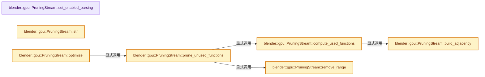
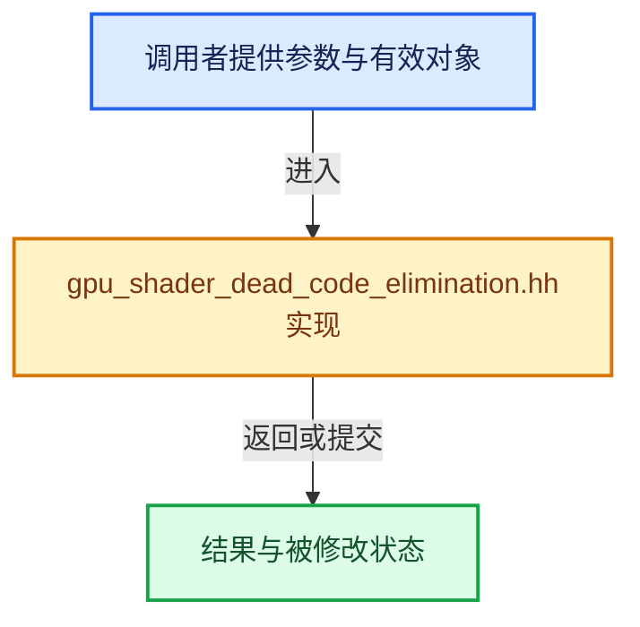

# 实现依赖专题：source/blender/gpu/intern/gpu_shader_dead_code_elimination.hh

[实现依赖导航](../../../README.md) · [符号索引](../../../../00-课程指南/02-源码与提交索引/符号依赖与实现索引.md)

本专题从正文实际调用进入，集中保存共享实现。函数有稳定锚点，可从调用处直接跳到对应完整函数；递归与互相调用通过回链组织。

## 本文件的实现关系






## 完整成员与函数实现

<a id="f-e8929e18f6e992a1"></a>

### `blender::gpu::PruningStream::set_enabled_parsing`

实现位置：[source/blender/gpu/intern/gpu_shader_dead_code_elimination.hh](../../../../../../../../source/blender/gpu/intern/gpu_shader_dead_code_elimination.hh) · L105—L108。

接口参数：

- `bool value`

**教学注释版**

<!-- annotated:083be0cb85deef -->

```cpp
  void set_enabled_parsing(bool value)
  {
    enabled_ = value;
  }
```

<details>
<summary>核对原始源码：source/blender/gpu/intern/gpu_shader_dead_code_elimination.hh · L105—L108</summary>

<!-- original:083be0cb85deef:source/blender/gpu/intern/gpu_shader_dead_code_elimination.hh:105:108 -->

```cpp
  void set_enabled_parsing(bool value)
  {
    enabled_ = value;
  }
```

</details>

**沿实际写入检查状态**

- `enabled_ = value;`

**继续追踪实现**

本实现没有需要继续展开的显式调用；检查返回表达式、对象转换和调用者前置条件。

<a id="f-1e640d321db3ffe3"></a>

### `blender::gpu::PruningStream::str`

实现位置：[source/blender/gpu/intern/gpu_shader_dead_code_elimination.hh](../../../../../../../../source/blender/gpu/intern/gpu_shader_dead_code_elimination.hh) · L199—L253。

**教学注释版**

<!-- annotated:ef74e2a9141f28 -->

```cpp
  std::string str() const
  {
    if (total_length == 0) {
      return {};
    }

    std::string result;
    result.reserve(total_length);

    size_t global_offset = 0;
    // [讲解] removals.begin：提供当前存储或有效范围的地址。
    const auto *rem_it = removals.begin();

    for (const auto &segment : stream) {
      size_t seg_idx = 0;
      /* Process the current segment until we reach its end */
      while (seg_idx < segment.size()) {
        size_t current_global_pos = global_offset + seg_idx;
        /* If no active removals remain, copy the rest of the segment. */
        // [讲解] removals.end：提供当前存储或有效范围的地址。
        if (rem_it == removals.end()) {
          result.append(segment, seg_idx, std::string::npos);
          break;
        }

        auto [r_start, r_end] = *rem_it;
        /* Safety check: ensure we haven't somehow passed the removal (if unsorted) */
        BLI_assert(current_global_pos < r_end);

        if (current_global_pos < r_start) {
          /* We are before the removal starts.
           * Copy until the segment ends OR the removal starts */
          // [讲解] std::min：按比较关系选取较小值；截断范围时还需先满足非负和可表示范围，min本身不会证明边界安全。
          size_t len = std::min(size_t(segment.size()) - seg_idx, r_start - current_global_pos);
          result.append(segment, seg_idx, len);
          seg_idx += len;
          continue;
        }

        /* We are inside the removal range.
         * Process until the segment ends OR the removal ends */
        size_t len = std::min(size_t(segment.size()) - seg_idx, r_end - current_global_pos);
        /* Replace the removed chunk by newlines. */
        std::string_view chunk(segment.data() + seg_idx, len);
        size_t newlines = std::count(chunk.begin(), chunk.end(), '\n');
        result.append(newlines, '\n');
        seg_idx += len;
        /* If we reached the end of this removal range, move to the next one */
        if (global_offset + seg_idx >= r_end) {
          ++rem_it;
        }
      }
      /* Update global offset before moving to next segment */
      global_offset += segment.size();
    }

    return result;
  }
```

<details>
<summary>核对原始源码：source/blender/gpu/intern/gpu_shader_dead_code_elimination.hh · L199—L253</summary>

<!-- original:ef74e2a9141f28:source/blender/gpu/intern/gpu_shader_dead_code_elimination.hh:199:253 -->

```cpp
  std::string str() const
  {
    if (total_length == 0) {
      return {};
    }

    std::string result;
    result.reserve(total_length);

    size_t global_offset = 0;
    const auto *rem_it = removals.begin();

    for (const auto &segment : stream) {
      size_t seg_idx = 0;
      /* Process the current segment until we reach its end */
      while (seg_idx < segment.size()) {
        size_t current_global_pos = global_offset + seg_idx;
        /* If no active removals remain, copy the rest of the segment. */
        if (rem_it == removals.end()) {
          result.append(segment, seg_idx, std::string::npos);
          break;
        }

        auto [r_start, r_end] = *rem_it;
        /* Safety check: ensure we haven't somehow passed the removal (if unsorted) */
        BLI_assert(current_global_pos < r_end);

        if (current_global_pos < r_start) {
          /* We are before the removal starts.
           * Copy until the segment ends OR the removal starts */
          size_t len = std::min(size_t(segment.size()) - seg_idx, r_start - current_global_pos);
          result.append(segment, seg_idx, len);
          seg_idx += len;
          continue;
        }

        /* We are inside the removal range.
         * Process until the segment ends OR the removal ends */
        size_t len = std::min(size_t(segment.size()) - seg_idx, r_end - current_global_pos);
        /* Replace the removed chunk by newlines. */
        std::string_view chunk(segment.data() + seg_idx, len);
        size_t newlines = std::count(chunk.begin(), chunk.end(), '\n');
        result.append(newlines, '\n');
        seg_idx += len;
        /* If we reached the end of this removal range, move to the next one */
        if (global_offset + seg_idx >= r_end) {
          ++rem_it;
        }
      }
      /* Update global offset before moving to next segment */
      global_offset += segment.size();
    }

    return result;
  }
```

</details>

**沿实际写入检查状态**

- `seg_idx += len;`
- `global_offset += segment.size();`

**结果出口**

- `return {};`
- `return result;`

**继续追踪实现**

- `result.reserve` → [外部契约](https://eel.is/c++draft/)：这个边界按实际表达式及所属类型核对参数、返回值、寿命与失败行为。这里提供接口入口，不声称已解释该第三方版本的内部实现。
- `removals.begin` → [blender::Vector::begin · L967](../../../../01-基础容器与现代CPP/12-Vector异常安全与边界.md#f-64fb75a6663b953c)；[blender::Vector::begin · L976](../../../../01-基础容器与现代CPP/12-Vector异常安全与边界.md#f-7c6486a8b8e8f13f)。同名重载需按实参类型选择。
- `segment.size` → [调用协议](../../../../00-课程指南/01-路线与规范/模板宏与动态分派协议.md)：接收对象类型依赖auto、返回值或模板实例；不按同名猜测目标。调用位置L214。
- `removals.end` → [blender::Vector::end · L971](../../../../01-基础容器与现代CPP/12-Vector异常安全与边界.md#f-8a6033745be8f712)；[blender::Vector::end · L980](../../../../01-基础容器与现代CPP/12-Vector异常安全与边界.md#f-ebb3ada259887677)。同名重载需按实参类型选择。
- `result.append` → [外部契约](https://eel.is/c++draft/)：这个边界按实际表达式及所属类型核对参数、返回值、寿命与失败行为。这里提供接口入口，不声称已解释该第三方版本的内部实现。
- `BLI_assert` → [BLI_assert · L48](../../../01-BLI基础库/BLI_assert.hh.md#m-57a88495704d)；[BLI_assert · L63](../../../01-BLI基础库/BLI_assert.hh.md#m-d07050020cb5)。宏定义由构建条件选择。
- `std::min` → [外部契约](https://eel.is/c++draft/alg.min.max)：按比较关系选取较小值；截断范围时还需先满足非负和可表示范围，min本身不会证明边界安全。
- `segment.data` → [调用协议](../../../../00-课程指南/01-路线与规范/模板宏与动态分派协议.md)：接收对象类型依赖auto、返回值或模板实例；不按同名猜测目标。调用位置L239。
- `std::count` → [外部契约](https://eel.is/c++draft/)：这个边界按实际表达式及所属类型核对参数、返回值、寿命与失败行为。这里提供接口入口，不声称已解释该第三方版本的内部实现。
- `chunk.begin` → [外部契约](https://eel.is/c++draft/)：这个边界按实际表达式及所属类型核对参数、返回值、寿命与失败行为。这里提供接口入口，不声称已解释该第三方版本的内部实现。
- `chunk.end` → [外部契约](https://eel.is/c++draft/)：这个边界按实际表达式及所属类型核对参数、返回值、寿命与失败行为。这里提供接口入口，不声称已解释该第三方版本的内部实现。

<a id="f-763a4353045e80d1"></a>

### `blender::gpu::PruningStream::optimize`

实现位置：[source/blender/gpu/intern/gpu_shader_dead_code_elimination.hh](../../../../../../../../source/blender/gpu/intern/gpu_shader_dead_code_elimination.hh) · L255—L258。

接口参数：

- `const Span<TokenAtom> entry_points`

**教学注释版**

<!-- annotated:11ba27253ba8bb -->

```cpp
  void optimize(const Span<TokenAtom> entry_points)
  {
    prune_unused_functions(entry_points);
  }
```

<details>
<summary>核对原始源码：source/blender/gpu/intern/gpu_shader_dead_code_elimination.hh · L255—L258</summary>

<!-- original:11ba27253ba8bb:source/blender/gpu/intern/gpu_shader_dead_code_elimination.hh:255:258 -->

```cpp
  void optimize(const Span<TokenAtom> entry_points)
  {
    prune_unused_functions(entry_points);
  }
```

</details>

**继续追踪实现**

- `prune_unused_functions` → [blender::gpu::PruningStream::prune_unused_functions · L389](gpu_shader_dead_code_elimination.hh.md#f-6b9add250d3275b6)。

<a id="f-43175cc9fc1ab552"></a>

### `blender::gpu::PruningStream::build_adjacency`

实现位置：[source/blender/gpu/intern/gpu_shader_dead_code_elimination.hh](../../../../../../../../source/blender/gpu/intern/gpu_shader_dead_code_elimination.hh) · L344—L352。

**教学注释版**

<!-- annotated:bdd0c8eb36dd33 -->

```cpp
  Map<TokenAtom, Vector<TokenAtom>> build_adjacency()
  {
    Map<TokenAtom, Vector<TokenAtom>> adj;
    // [讲解] adj.reserve：重新组织槽位或准备容量。
    adj.reserve(graph.declarations.size());
    for (const auto &[from, to] : graph.edges) {
      adj.lookup_or_add_default(from).append(to);
    }
    return adj;
  }
```

<details>
<summary>核对原始源码：source/blender/gpu/intern/gpu_shader_dead_code_elimination.hh · L344—L352</summary>

<!-- original:bdd0c8eb36dd33:source/blender/gpu/intern/gpu_shader_dead_code_elimination.hh:344:352 -->

```cpp
  Map<TokenAtom, Vector<TokenAtom>> build_adjacency()
  {
    Map<TokenAtom, Vector<TokenAtom>> adj;
    adj.reserve(graph.declarations.size());
    for (const auto &[from, to] : graph.edges) {
      adj.lookup_or_add_default(from).append(to);
    }
    return adj;
  }
```

</details>

**结果出口**

- `return adj;`

**继续追踪实现**

- `adj.reserve` → [blender::Map::reserve · L1028](../../../../02-哈希表与关联数据结构/06-删除墓碑与值销毁.md#f-03761191d90c03e9)。
- `graph.declarations.size` → [调用协议](../../../../00-课程指南/01-路线与规范/模板宏与动态分派协议.md)：接收对象类型依赖auto、返回值或模板实例；不按同名猜测目标。调用位置L347。
- `adj.lookup_or_add_default(from).append` → [调用协议](../../../../00-课程指南/01-路线与规范/模板宏与动态分派协议.md)：接收对象类型依赖auto、返回值或模板实例；不按同名猜测目标。调用位置L349。
- `adj.lookup_or_add_default` → [blender::Map::lookup_or_add_default · L639](../../../../02-哈希表与关联数据结构/05-Map插入与回调.md#f-e8d33f0bfe1f3153)；[blender::Map::lookup_or_add_default · L643](../../../../02-哈希表与关联数据结构/05-Map插入与回调.md#f-d67ab6e12fd0a267)。同名重载需按实参类型选择。

<a id="f-605ff0949dd545a3"></a>

### `blender::gpu::PruningStream::compute_used_functions`

实现位置：[source/blender/gpu/intern/gpu_shader_dead_code_elimination.hh](../../../../../../../../source/blender/gpu/intern/gpu_shader_dead_code_elimination.hh) · L354—L387。

接口参数：

- `Span<TokenAtom> &roots`

**教学注释版**

<!-- annotated:80b23511397e07 -->

```cpp
  Set<TokenAtom> compute_used_functions(Span<TokenAtom> &roots)
  {
    Set<TokenAtom> used;
    // [讲解] used.reserve：重新组织槽位或准备容量。
    used.reserve(graph.declarations.size());

    auto adj = build_adjacency();

    std::vector<TokenAtom> stack;
    stack.reserve(64);

    for (TokenAtom root : roots) {
      // [讲解] used.add：按哈希与相等关系加入键或键值。
      if (used.add(root)) {
        stack.push_back(root);
      }

      while (!stack.empty()) {
        TokenAtom f = stack.back();
        stack.pop_back();

        const auto *calls = adj.lookup_ptr(f);
        if (calls == nullptr) {
          continue;
        }

        for (TokenAtom callee : *calls) {
          if (used.add(callee)) {
            stack.push_back(callee);
          }
        }
      }
    }

    return used;
  }
```

<details>
<summary>核对原始源码：source/blender/gpu/intern/gpu_shader_dead_code_elimination.hh · L354—L387</summary>

<!-- original:80b23511397e07:source/blender/gpu/intern/gpu_shader_dead_code_elimination.hh:354:387 -->

```cpp
  Set<TokenAtom> compute_used_functions(Span<TokenAtom> &roots)
  {
    Set<TokenAtom> used;
    used.reserve(graph.declarations.size());

    auto adj = build_adjacency();

    std::vector<TokenAtom> stack;
    stack.reserve(64);

    for (TokenAtom root : roots) {
      if (used.add(root)) {
        stack.push_back(root);
      }

      while (!stack.empty()) {
        TokenAtom f = stack.back();
        stack.pop_back();

        const auto *calls = adj.lookup_ptr(f);
        if (calls == nullptr) {
          continue;
        }

        for (TokenAtom callee : *calls) {
          if (used.add(callee)) {
            stack.push_back(callee);
          }
        }
      }
    }

    return used;
  }
```

</details>

**结果出口**

- `return used;`

**继续追踪实现**

- `used.reserve` → [blender::Set::reserve · L656](../../../../02-哈希表与关联数据结构/08-Set与集合语义.md#f-95bdc8ebdf9331d4)。
- `graph.declarations.size` → [调用协议](../../../../00-课程指南/01-路线与规范/模板宏与动态分派协议.md)：接收对象类型依赖auto、返回值或模板实例；不按同名猜测目标。调用位置L357。
- `build_adjacency` → [blender::gpu::PruningStream::build_adjacency · L344](gpu_shader_dead_code_elimination.hh.md#f-43175cc9fc1ab552)。
- `stack.reserve` → [外部契约](https://eel.is/c++draft/)：这个边界按实际表达式及所属类型核对参数、返回值、寿命与失败行为。这里提供接口入口，不声称已解释该第三方版本的内部实现。
- `used.add` → [blender::Set::add · L248](../../../../02-哈希表与关联数据结构/08-Set与集合语义.md#f-c7498809c2327fba)；[blender::Set::add · L252](../../../../02-哈希表与关联数据结构/08-Set与集合语义.md#f-e3ac8d1c52c03c2b)。同名重载需按实参类型选择。
- `stack.push_back` → [外部契约](https://eel.is/c++draft/)：这个边界按实际表达式及所属类型核对参数、返回值、寿命与失败行为。这里提供接口入口，不声称已解释该第三方版本的内部实现。
- `stack.empty` → [外部契约](https://eel.is/c++draft/)：这个边界按实际表达式及所属类型核对参数、返回值、寿命与失败行为。这里提供接口入口，不声称已解释该第三方版本的内部实现。
- `stack.back` → [外部契约](https://eel.is/c++draft/)：这个边界按实际表达式及所属类型核对参数、返回值、寿命与失败行为。这里提供接口入口，不声称已解释该第三方版本的内部实现。
- `stack.pop_back` → [外部契约](https://eel.is/c++draft/)：这个边界按实际表达式及所属类型核对参数、返回值、寿命与失败行为。这里提供接口入口，不声称已解释该第三方版本的内部实现。
- `adj.lookup_ptr` → [调用协议](../../../../00-课程指南/01-路线与规范/模板宏与动态分派协议.md)：接收对象类型依赖auto、返回值或模板实例；不按同名猜测目标。调用位置L373。

<a id="f-6b9add250d3275b6"></a>

### `blender::gpu::PruningStream::prune_unused_functions`

实现位置：[source/blender/gpu/intern/gpu_shader_dead_code_elimination.hh](../../../../../../../../source/blender/gpu/intern/gpu_shader_dead_code_elimination.hh) · L389—L406。

接口参数：

- `Span<TokenAtom> entry_points`

**教学注释版**

<!-- annotated:714131e62e2ca2 -->

```cpp
  void prune_unused_functions(Span<TokenAtom> entry_points)
  {
    Set<TokenAtom> used = compute_used_functions(entry_points);

    for (auto [type_tok, name_tok, end_tok] : graph.declarations) {
      // [讲解] used.contains：查询活项数量或键是否存在。
      if (used.contains(name_tok.atom())) {
        continue;
      }

      if (name_tok.flag == end_tok.flag) {
        // [讲解] removals.clear：销毁所有有效元素，把size变为0，但保留原分配或内嵌容量。
        removals.clear();
        BLI_assert("Bug in parser, function name not detected");
        break;
      }

      remove_range(type_tok.flag, end_tok.flag + 1);
    }
  }
```

<details>
<summary>核对原始源码：source/blender/gpu/intern/gpu_shader_dead_code_elimination.hh · L389—L406</summary>

<!-- original:714131e62e2ca2:source/blender/gpu/intern/gpu_shader_dead_code_elimination.hh:389:406 -->

```cpp
  void prune_unused_functions(Span<TokenAtom> entry_points)
  {
    Set<TokenAtom> used = compute_used_functions(entry_points);

    for (auto [type_tok, name_tok, end_tok] : graph.declarations) {
      if (used.contains(name_tok.atom())) {
        continue;
      }

      if (name_tok.flag == end_tok.flag) {
        removals.clear();
        BLI_assert("Bug in parser, function name not detected");
        break;
      }

      remove_range(type_tok.flag, end_tok.flag + 1);
    }
  }
```

</details>

**继续追踪实现**

- `compute_used_functions` → [blender::gpu::PruningStream::compute_used_functions · L354](gpu_shader_dead_code_elimination.hh.md#f-605ff0949dd545a3)。
- `used.contains` → [blender::Set::contains · L310](../../../../02-哈希表与关联数据结构/08-Set与集合语义.md#f-af7099799494350e)。
- `name_tok.atom` → [调用协议](../../../../00-课程指南/01-路线与规范/模板宏与动态分派协议.md)：接收对象类型依赖auto、返回值或模板实例；不按同名猜测目标。调用位置L394。
- `removals.clear` → [blender::Vector::clear · L468](../../../../01-基础容器与现代CPP/10-Vector扩容与增长.md#f-d051bebff5275a43)。
- `BLI_assert` → [BLI_assert · L48](../../../01-BLI基础库/BLI_assert.hh.md#m-57a88495704d)；[BLI_assert · L63](../../../01-BLI基础库/BLI_assert.hh.md#m-d07050020cb5)。宏定义由构建条件选择。
- `remove_range` → [blender::gpu::PruningStream::remove_range · L409](gpu_shader_dead_code_elimination.hh.md#f-e3cf8b24e9302add)。

<a id="f-e3cf8b24e9302add"></a>

### `blender::gpu::PruningStream::remove_range`

实现位置：[source/blender/gpu/intern/gpu_shader_dead_code_elimination.hh](../../../../../../../../source/blender/gpu/intern/gpu_shader_dead_code_elimination.hh) · L409—L412。

接口参数：

- `int start_char`
- `int end_char`

**教学注释版**

<!-- annotated:166ce965204489 -->

```cpp
  void remove_range(int start_char, int end_char)
  {
    // [讲解] removals.append_as：在尾部建立新元素，必要时先扩大存储。
    removals.append_as(start_char, end_char);
  }
```

<details>
<summary>核对原始源码：source/blender/gpu/intern/gpu_shader_dead_code_elimination.hh · L409—L412</summary>

<!-- original:166ce965204489:source/blender/gpu/intern/gpu_shader_dead_code_elimination.hh:409:412 -->

```cpp
  void remove_range(int start_char, int end_char)
  {
    removals.append_as(start_char, end_char);
  }
```

</details>

**继续追踪实现**

- `removals.append_as` → [blender::Vector::append_as · L507](../../../../01-基础容器与现代CPP/11-Vector插入删除与重排.md#f-44d7aa103502cef2)。
