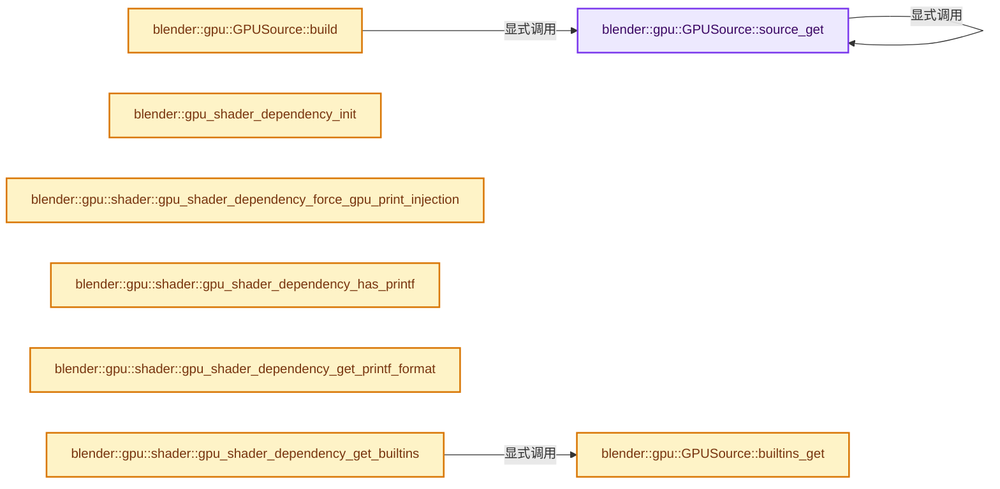
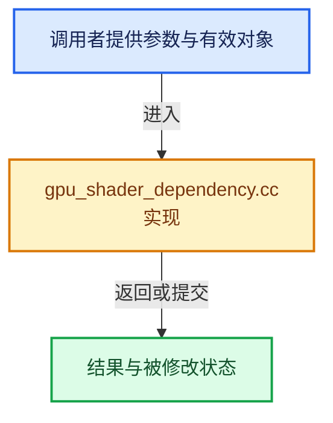

# 实现依赖专题：source/blender/gpu/intern/gpu_shader_dependency.cc

[实现依赖导航](../../../README.md) · [符号索引](../../../../00-课程指南/02-源码与提交索引/符号依赖与实现索引.md)

本专题从正文实际调用进入，集中保存共享实现。函数有稳定锚点，可从调用处直接跳到对应完整函数；递归与互相调用通过回链组织。

## 本文件的实现关系






## 完整成员与函数实现

<a id="f-d4c350773d6f8551"></a>

### `blender::gpu::GPUSource::source_get`

实现位置：[source/blender/gpu/intern/gpu_shader_dependency.cc](../../../../../../../../source/blender/gpu/intern/gpu_shader_dependency.cc) · L398—L488。

接口参数：

- `Vector<StringRefNull> &result`
- `Vector<StringRefNull> &included`
- `const shader::GeneratedSourceList &generated_sources`
- `const GPUSourceDictionary &dict`
- `const GPUSource &from`

**教学注释版**

<!-- annotated:b55bb377605f8c -->

```cpp
  void source_get(Vector<StringRefNull> &result,
                  Vector<StringRefNull> &included,
                  const shader::GeneratedSourceList &generated_sources,
                  const GPUSourceDictionary &dict,
                  const GPUSource &from) const
  {
#define CLOG_FILE_INCLUDE(_from, _include) \
  if (CLOG_CHECK(&LOG, CLG_LEVEL_TRACE) && \
      (from).filename.c_str() != (_include).filename.c_str()) \
  { \
    const char *from_filename = (_from).filename.c_str(); \
    const char *include_filename = (_include).filename.c_str(); \
    const int from_size = int((_from).source.size()); \
    const int include_size = int((_include).source.size()); \
    std::string link = fmt::format( \
        "{}_{} --> {}_{}\n", from_filename, from_size, include_filename, include_size); \
    std::string style = fmt::format("style {}_{} fill:#{:x}{:x}0\n", \
                                    include_filename, \
                                    include_size, \
                                    min_uu(15, include_size / 1000), \
                                    15 - min_uu(15, include_size / 1000)); \
    CLG_log_raw(LOG.type, link.c_str()); \
    CLG_log_raw(LOG.type, style.c_str()); \
  }

    const shader::GeneratedSource *gen_src = nullptr;
    if (flag_is_set(this->builtins, shader::BuiltinBits::RUNTIME_GENERATED)) {
      /* Linear lookup since we won't have more than a few per shaders.
       * Also avoid the complexity of a Map in info creation. */
      for (const shader::GeneratedSource &generated_src : generated_sources) {
        if (generated_src.filename == this->filename) {
          gen_src = &generated_src;
          break;
        }
      }
    }

    /* Check if this file was already included. */
    for (const StringRefNull &source_content : included) {
      /* Yes, compare pointer instead of string for speed.
       * Each source is guaranteed to be unique and non-moving during the building process. */
      if (source_content.c_str() == (gen_src ? gen_src->content.c_str() : this->source.c_str())) {
        /* Already included. */
        CLOG_FILE_INCLUDE(from, *this);
        return;
      }
    }

    if (!flag_is_set(this->builtins, shader::BuiltinBits::RUNTIME_GENERATED)) {
      // [讲解] included.append：在尾部建立新元素，必要时先扩大存储。
      included.append(this->source);
      for (const auto &dependency : this->dependencies) {
        /* WATCH: Recursive. */
        dependency->source_get(result, included, generated_sources, dict, *this);
      }
      CLOG_FILE_INCLUDE(from, *this);
      result.append(this->source);
      return;
    }

    if (gen_src) {
      included.append(gen_src->content);
      /* Include dependencies before the generated file. */
      for (const auto &dependency_name : gen_src->dependencies) {
        BLI_assert_msg(dependency_name != this->filename, "Recursive include");

        // [讲解] dict.lookup_default：按键查找对应项。
        GPUSource *dependency_source = dict.lookup_default(dependency_name, nullptr);
        if (dependency_source == nullptr) {
          /* Will certainly fail compilation. But avoid crashing the application. */
          std::cerr << "Generated dependency not found : " + dependency_name << std::endl;
          return;
        }
        /* WATCH: Recursive. */
        dependency_source->source_get(result, included, generated_sources, dict, *this);
      }
      CLOG_FILE_INCLUDE(from, *this);
      result.append(gen_src->content);
      return;
    }

    std::cerr << "warn: Generated source not provided. Using fallback for : " << this->filename
              << std::endl;
    included.append(this->source);
    /* Dependencies for generated sources are not folded on startup.
     * This allows for different set of dependencies at runtime. */
    for (const auto &dependency : this->dependencies) {
      /* WATCH: Recursive. */
      dependency->source_get(result, included, generated_sources, dict, *this);
    }
    CLOG_FILE_INCLUDE(from, *this);
    result.append(this->source);
  }
```

<details>
<summary>核对原始源码：source/blender/gpu/intern/gpu_shader_dependency.cc · L398—L488</summary>

<!-- original:b55bb377605f8c:source/blender/gpu/intern/gpu_shader_dependency.cc:398:488 -->

```cpp
  void source_get(Vector<StringRefNull> &result,
                  Vector<StringRefNull> &included,
                  const shader::GeneratedSourceList &generated_sources,
                  const GPUSourceDictionary &dict,
                  const GPUSource &from) const
  {
#define CLOG_FILE_INCLUDE(_from, _include) \
  if (CLOG_CHECK(&LOG, CLG_LEVEL_TRACE) && \
      (from).filename.c_str() != (_include).filename.c_str()) \
  { \
    const char *from_filename = (_from).filename.c_str(); \
    const char *include_filename = (_include).filename.c_str(); \
    const int from_size = int((_from).source.size()); \
    const int include_size = int((_include).source.size()); \
    std::string link = fmt::format( \
        "{}_{} --> {}_{}\n", from_filename, from_size, include_filename, include_size); \
    std::string style = fmt::format("style {}_{} fill:#{:x}{:x}0\n", \
                                    include_filename, \
                                    include_size, \
                                    min_uu(15, include_size / 1000), \
                                    15 - min_uu(15, include_size / 1000)); \
    CLG_log_raw(LOG.type, link.c_str()); \
    CLG_log_raw(LOG.type, style.c_str()); \
  }

    const shader::GeneratedSource *gen_src = nullptr;
    if (flag_is_set(this->builtins, shader::BuiltinBits::RUNTIME_GENERATED)) {
      /* Linear lookup since we won't have more than a few per shaders.
       * Also avoid the complexity of a Map in info creation. */
      for (const shader::GeneratedSource &generated_src : generated_sources) {
        if (generated_src.filename == this->filename) {
          gen_src = &generated_src;
          break;
        }
      }
    }

    /* Check if this file was already included. */
    for (const StringRefNull &source_content : included) {
      /* Yes, compare pointer instead of string for speed.
       * Each source is guaranteed to be unique and non-moving during the building process. */
      if (source_content.c_str() == (gen_src ? gen_src->content.c_str() : this->source.c_str())) {
        /* Already included. */
        CLOG_FILE_INCLUDE(from, *this);
        return;
      }
    }

    if (!flag_is_set(this->builtins, shader::BuiltinBits::RUNTIME_GENERATED)) {
      included.append(this->source);
      for (const auto &dependency : this->dependencies) {
        /* WATCH: Recursive. */
        dependency->source_get(result, included, generated_sources, dict, *this);
      }
      CLOG_FILE_INCLUDE(from, *this);
      result.append(this->source);
      return;
    }

    if (gen_src) {
      included.append(gen_src->content);
      /* Include dependencies before the generated file. */
      for (const auto &dependency_name : gen_src->dependencies) {
        BLI_assert_msg(dependency_name != this->filename, "Recursive include");

        GPUSource *dependency_source = dict.lookup_default(dependency_name, nullptr);
        if (dependency_source == nullptr) {
          /* Will certainly fail compilation. But avoid crashing the application. */
          std::cerr << "Generated dependency not found : " + dependency_name << std::endl;
          return;
        }
        /* WATCH: Recursive. */
        dependency_source->source_get(result, included, generated_sources, dict, *this);
      }
      CLOG_FILE_INCLUDE(from, *this);
      result.append(gen_src->content);
      return;
    }

    std::cerr << "warn: Generated source not provided. Using fallback for : " << this->filename
              << std::endl;
    included.append(this->source);
    /* Dependencies for generated sources are not folded on startup.
     * This allows for different set of dependencies at runtime. */
    for (const auto &dependency : this->dependencies) {
      /* WATCH: Recursive. */
      dependency->source_get(result, included, generated_sources, dict, *this);
    }
    CLOG_FILE_INCLUDE(from, *this);
    result.append(this->source);
  }
```

</details>

**沿实际写入检查状态**

- `gen_src = &generated_src;`

**继续追踪实现**

- `flag_is_set` → [调用协议](../../../../00-课程指南/01-路线与规范/模板宏与动态分派协议.md)：函数指针、局部可调用对象或未展开的宏；必须结合调用者环境。调用位置L424。
- `source_content.c_str` → [调用协议](../../../../00-课程指南/01-路线与规范/模板宏与动态分派协议.md)：接收对象类型依赖auto、返回值或模板实例；不按同名猜测目标。调用位置L439。
- `gen_src->content.c_str` → [调用协议](../../../../00-课程指南/01-路线与规范/模板宏与动态分派协议.md)：接收对象类型依赖auto、返回值或模板实例；不按同名猜测目标。调用位置L439。
- `this->source.c_str` → [调用协议](../../../../00-课程指南/01-路线与规范/模板宏与动态分派协议.md)：接收对象类型依赖auto、返回值或模板实例；不按同名猜测目标。调用位置L439。
- `CLOG_FILE_INCLUDE` → [调用协议](../../../../00-课程指南/01-路线与规范/模板宏与动态分派协议.md)：函数指针、局部可调用对象或未展开的宏；必须结合调用者环境。调用位置L441。
- `included.append` → [blender::Vector::append · L498](../../../../01-基础容器与现代CPP/11-Vector插入删除与重排.md#f-5bde268a69e443ec)；[blender::Vector::append · L502](../../../../01-基础容器与现代CPP/11-Vector插入删除与重排.md#f-591e0b15e6308532)。同名重载需按实参类型选择。
- `dependency->source_get` → [调用协议](../../../../00-课程指南/01-路线与规范/模板宏与动态分派协议.md)：接收对象类型依赖auto、返回值或模板实例；不按同名猜测目标。调用位置L450。
- `result.append` → [blender::Vector::append · L498](../../../../01-基础容器与现代CPP/11-Vector插入删除与重排.md#f-5bde268a69e443ec)；[blender::Vector::append · L502](../../../../01-基础容器与现代CPP/11-Vector插入删除与重排.md#f-591e0b15e6308532)。同名重载需按实参类型选择。
- `BLI_assert_msg` → [BLI_assert_msg · L55](../../../01-BLI基础库/BLI_assert.hh.md#m-695eed20dceb)；[BLI_assert_msg · L64](../../../01-BLI基础库/BLI_assert.hh.md#m-7de5563de4db)。宏定义由构建条件选择。
- `dict.lookup_default` → [blender::Map::lookup_default · L570](../../../../02-哈希表与关联数据结构/05-Map插入与回调.md#f-40294aaf345f6a8b)。
- `dependency_source->source_get` → [blender::gpu::GPUSource::source_get · L398](gpu_shader_dependency.cc.md#f-d4c350773d6f8551)。

<a id="f-431294138d24eb6b"></a>

### `blender::gpu::GPUSource::build`

实现位置：[source/blender/gpu/intern/gpu_shader_dependency.cc](../../../../../../../../source/blender/gpu/intern/gpu_shader_dependency.cc) · L491—L498。

接口参数：

- `Vector<StringRefNull> &result`
- `const shader::GeneratedSourceList &generated_sources`
- `const GPUSourceDictionary &dict`

**教学注释版**

<!-- annotated:fc4e7d82fab649 -->

```cpp
  void build(Vector<StringRefNull> &result,
             const shader::GeneratedSourceList &generated_sources,
             const GPUSourceDictionary &dict) const
  {
    /* List of visited files. Avoid infinite or double includes. */
    Vector<StringRefNull> included;
    source_get(result, included, generated_sources, dict, *this);
  }
```

<details>
<summary>核对原始源码：source/blender/gpu/intern/gpu_shader_dependency.cc · L491—L498</summary>

<!-- original:fc4e7d82fab649:source/blender/gpu/intern/gpu_shader_dependency.cc:491:498 -->

```cpp
  void build(Vector<StringRefNull> &result,
             const shader::GeneratedSourceList &generated_sources,
             const GPUSourceDictionary &dict) const
  {
    /* List of visited files. Avoid infinite or double includes. */
    Vector<StringRefNull> included;
    source_get(result, included, generated_sources, dict, *this);
  }
```

</details>

**继续追踪实现**

- `source_get` → [blender::gpu::GPUSource::source_get · L398](gpu_shader_dependency.cc.md#f-d4c350773d6f8551)。

<a id="f-a0a4126a4eaffe05"></a>

### `blender::gpu::GPUSource::builtins_get`

实现位置：[source/blender/gpu/intern/gpu_shader_dependency.cc](../../../../../../../../source/blender/gpu/intern/gpu_shader_dependency.cc) · L500—L507。

**教学注释版**

<!-- annotated:2081c899937a2e -->

```cpp
  shader::BuiltinBits builtins_get() const
  {
    shader::BuiltinBits out_builtins = builtins;
    for (auto *dep : dependencies) {
      out_builtins |= dep->builtins_get();
    }
    return out_builtins;
  }
```

<details>
<summary>核对原始源码：source/blender/gpu/intern/gpu_shader_dependency.cc · L500—L507</summary>

<!-- original:2081c899937a2e:source/blender/gpu/intern/gpu_shader_dependency.cc:500:507 -->

```cpp
  shader::BuiltinBits builtins_get() const
  {
    shader::BuiltinBits out_builtins = builtins;
    for (auto *dep : dependencies) {
      out_builtins |= dep->builtins_get();
    }
    return out_builtins;
  }
```

</details>

**沿实际写入检查状态**

- `out_builtins |= dep->builtins_get();`

**结果出口**

- `return out_builtins;`

**继续追踪实现**

- `dep->builtins_get` → [调用协议](../../../../00-课程指南/01-路线与规范/模板宏与动态分派协议.md)：接收对象类型依赖auto、返回值或模板实例；不按同名猜测目标。调用位置L504。

<a id="f-8ece865771fc3bbc"></a>

### `blender::gpu_shader_dependency_init`

实现位置：[source/blender/gpu/intern/gpu_shader_dependency.cc](../../../../../../../../source/blender/gpu/intern/gpu_shader_dependency.cc) · L550—L620。

**教学注释版**

<!-- annotated:2b46420d630c49 -->

```cpp
void gpu_shader_dependency_init()
{
  g_formats = new GPUPrintFormatMap();
  g_sources = new GPUSourceDictionary();
  g_functions = new GPUFunctionDictionary();

#define SHADER_SOURCE(filename_underscore, filename, filepath) \
  g_sources->add_new(filename, \
                     new GPUSource(filepath, \
                                   filename, \
                                   datatoc_##filename_underscore, \
                                   g_functions, \
                                   g_formats, \
                                   gpu::shader::metadata_##filename_underscore));

#include "glsl_gpu_source_list.h"

#include "glsl_compositor_source_list.h"
#include "glsl_draw_source_list.h"
#include "glsl_eevee_source_list.h"
#include "glsl_gpencil_source_list.h"
#include "glsl_image_source_list.h"
#include "glsl_ocio_source_list.h"
#include "glsl_overlay_source_list.h"
#include "glsl_select_id_source_list.h"
#include "glsl_workbench_source_list.h"
#ifdef WITH_OPENSUBDIV
#  include "glsl_osd_source_list.h"
#endif
#undef SHADER_SOURCE
#ifdef WITH_OPENSUBDIV
  osd_patch_basis = openSubdiv_getGLSLPatchBasisSource();
  osd_patch_basis = shader::SourceProcessor(
                        osd_patch_basis, "osd_patch_basis.glsl", gpu::shader::Language::GLSL, {})
                        .remove_comments();
  auto source_ptr_opt = g_sources->pop_try("osd_patch_basis.glsl");
  if (source_ptr_opt) {
    delete source_ptr_opt.value();
  }
  g_sources->add_new(
      "osd_patch_basis.glsl",
      new GPUSource("osd_patch_basis.glsl",
                    "osd_patch_basis.glsl",
                    (osd_patch_basis).c_str(),
                    g_functions,
                    g_formats,
                    [](GPUSource &, GPUFunctionDictionary *, GPUPrintFormatMap *) {}));
#endif

  int errors = 0;
  for (auto *value : g_sources->values()) {
    errors += value->init_dependencies(*g_sources);
  }
  BLI_assert_msg(errors == 0, "Dependency errors detected: Aborting");
  UNUSED_VARS_NDEBUG(errors);

#if GPU_SHADER_PRINTF_ENABLE
  if (!g_formats->is_empty()) {
    /* Detect if there is any printf in node lib files.
     * See gpu_shader_dependency_force_gpu_print_injection(). */
    for (auto *value : g_sources->values()) {
      if (flag_is_set(value->builtins, shader::BuiltinBits::USE_PRINTF)) {
        if (value->filename.startswith("gpu_shader_material_")) {
          force_printf_injection = true;
          break;
        }
      }
    }
  }
#endif
}
```

<details>
<summary>核对原始源码：source/blender/gpu/intern/gpu_shader_dependency.cc · L550—L620</summary>

<!-- original:2b46420d630c49:source/blender/gpu/intern/gpu_shader_dependency.cc:550:620 -->

```cpp
void gpu_shader_dependency_init()
{
  g_formats = new GPUPrintFormatMap();
  g_sources = new GPUSourceDictionary();
  g_functions = new GPUFunctionDictionary();

#define SHADER_SOURCE(filename_underscore, filename, filepath) \
  g_sources->add_new(filename, \
                     new GPUSource(filepath, \
                                   filename, \
                                   datatoc_##filename_underscore, \
                                   g_functions, \
                                   g_formats, \
                                   gpu::shader::metadata_##filename_underscore));

#include "glsl_gpu_source_list.h"

#include "glsl_compositor_source_list.h"
#include "glsl_draw_source_list.h"
#include "glsl_eevee_source_list.h"
#include "glsl_gpencil_source_list.h"
#include "glsl_image_source_list.h"
#include "glsl_ocio_source_list.h"
#include "glsl_overlay_source_list.h"
#include "glsl_select_id_source_list.h"
#include "glsl_workbench_source_list.h"
#ifdef WITH_OPENSUBDIV
#  include "glsl_osd_source_list.h"
#endif
#undef SHADER_SOURCE
#ifdef WITH_OPENSUBDIV
  osd_patch_basis = openSubdiv_getGLSLPatchBasisSource();
  osd_patch_basis = shader::SourceProcessor(
                        osd_patch_basis, "osd_patch_basis.glsl", gpu::shader::Language::GLSL, {})
                        .remove_comments();
  auto source_ptr_opt = g_sources->pop_try("osd_patch_basis.glsl");
  if (source_ptr_opt) {
    delete source_ptr_opt.value();
  }
  g_sources->add_new(
      "osd_patch_basis.glsl",
      new GPUSource("osd_patch_basis.glsl",
                    "osd_patch_basis.glsl",
                    (osd_patch_basis).c_str(),
                    g_functions,
                    g_formats,
                    [](GPUSource &, GPUFunctionDictionary *, GPUPrintFormatMap *) {}));
#endif

  int errors = 0;
  for (auto *value : g_sources->values()) {
    errors += value->init_dependencies(*g_sources);
  }
  BLI_assert_msg(errors == 0, "Dependency errors detected: Aborting");
  UNUSED_VARS_NDEBUG(errors);

#if GPU_SHADER_PRINTF_ENABLE
  if (!g_formats->is_empty()) {
    /* Detect if there is any printf in node lib files.
     * See gpu_shader_dependency_force_gpu_print_injection(). */
    for (auto *value : g_sources->values()) {
      if (flag_is_set(value->builtins, shader::BuiltinBits::USE_PRINTF)) {
        if (value->filename.startswith("gpu_shader_material_")) {
          force_printf_injection = true;
          break;
        }
      }
    }
  }
#endif
}
```

</details>

**沿实际写入检查状态**

- `g_formats = new GPUPrintFormatMap();`
- `g_sources = new GPUSourceDictionary();`
- `g_functions = new GPUFunctionDictionary();`
- `osd_patch_basis = openSubdiv_getGLSLPatchBasisSource();`
- `osd_patch_basis = shader::SourceProcessor(`
- `errors += value->init_dependencies(*g_sources);`
- `force_printf_injection = true;`

**继续追踪实现**

- `openSubdiv_getGLSLPatchBasisSource` → [openSubdiv_getGLSLPatchBasisSource · L18](../../../07-Intern运行时与平台/opensubdiv/stub/opensubdiv_evaluator_stub.cc.md#f-1167200ac30972e7)；[openSubdiv_getGLSLPatchBasisSource · L39](../../../07-Intern运行时与平台/opensubdiv/internal/evaluator/evaluator_capi.cc.md#f-a34f195ef3ae305c)。同名重载需按实参类型选择。
- `shader::SourceProcessor( osd_patch_basis, "osd_patch_basis.glsl", gpu::shader::Language::GLSL, {}) .remove_comments` → [调用协议](../../../../00-课程指南/01-路线与规范/模板宏与动态分派协议.md)：接收对象类型依赖auto、返回值或模板实例；不按同名猜测目标。调用位置L582。
- `shader::SourceProcessor` → [blender::gpu::shader::SourceProcessor::SourceProcessor · L105](../shader_tool/processor.hh.md#f-2d808c2a331326e7)。
- `g_sources->pop_try` → [调用协议](../../../../00-课程指南/01-路线与规范/模板宏与动态分派协议.md)：接收对象类型依赖auto、返回值或模板实例；不按同名猜测目标。调用位置L585。
- `source_ptr_opt.value` → [调用协议](../../../../00-课程指南/01-路线与规范/模板宏与动态分派协议.md)：接收对象类型依赖auto、返回值或模板实例；不按同名猜测目标。调用位置L587。
- `g_sources->add_new` → [调用协议](../../../../00-课程指南/01-路线与规范/模板宏与动态分派协议.md)：接收对象类型依赖auto、返回值或模板实例；不按同名猜测目标。调用位置L589。
- `(osd_patch_basis).c_str` → [调用协议](../../../../00-课程指南/01-路线与规范/模板宏与动态分派协议.md)：接收对象类型依赖auto、返回值或模板实例；不按同名猜测目标。调用位置L593。
- `g_sources->values` → [调用协议](../../../../00-课程指南/01-路线与规范/模板宏与动态分派协议.md)：接收对象类型依赖auto、返回值或模板实例；不按同名猜测目标。调用位置L600。
- `value->init_dependencies` → [调用协议](../../../../00-课程指南/01-路线与规范/模板宏与动态分派协议.md)：接收对象类型依赖auto、返回值或模板实例；不按同名猜测目标。调用位置L601。
- `BLI_assert_msg` → [BLI_assert_msg · L55](../../../01-BLI基础库/BLI_assert.hh.md#m-695eed20dceb)；[BLI_assert_msg · L64](../../../01-BLI基础库/BLI_assert.hh.md#m-7de5563de4db)。宏定义由构建条件选择。
- `UNUSED_VARS_NDEBUG` → [UNUSED_VARS_NDEBUG · L526](../../../01-BLI基础库/BLI_utildefines.hh.md#m-fea439f7d366)；[UNUSED_VARS_NDEBUG · L528](../../../01-BLI基础库/BLI_utildefines.hh.md#m-a8f8cfac06c0)。宏定义由构建条件选择。
- `g_formats->is_empty` → [调用协议](../../../../00-课程指南/01-路线与规范/模板宏与动态分派协议.md)：接收对象类型依赖auto、返回值或模板实例；不按同名猜测目标。调用位置L607。
- `flag_is_set` → [调用协议](../../../../00-课程指南/01-路线与规范/模板宏与动态分派协议.md)：函数指针、局部可调用对象或未展开的宏；必须结合调用者环境。调用位置L611。
- `value->filename.startswith` → [调用协议](../../../../00-课程指南/01-路线与规范/模板宏与动态分派协议.md)：接收对象类型依赖auto、返回值或模板实例；不按同名猜测目标。调用位置L612。

<a id="f-afce539653376960"></a>

### `blender::gpu::shader::gpu_shader_dependency_force_gpu_print_injection`

实现位置：[source/blender/gpu/intern/gpu_shader_dependency.cc](../../../../../../../../source/blender/gpu/intern/gpu_shader_dependency.cc) · L655—L660。

**教学注释版**

<!-- annotated:75641045143a36 -->

```cpp
bool gpu_shader_dependency_force_gpu_print_injection()
{
  /* WORKAROUND: We cannot know what shader will require printing if the printf is inside shader
   * node code. In this case, we just force injection inside all shaders. */
  return force_printf_injection;
}
```

<details>
<summary>核对原始源码：source/blender/gpu/intern/gpu_shader_dependency.cc · L655—L660</summary>

<!-- original:75641045143a36:source/blender/gpu/intern/gpu_shader_dependency.cc:655:660 -->

```cpp
bool gpu_shader_dependency_force_gpu_print_injection()
{
  /* WORKAROUND: We cannot know what shader will require printing if the printf is inside shader
   * node code. In this case, we just force injection inside all shaders. */
  return force_printf_injection;
}
```

</details>

**结果出口**

- `return force_printf_injection;`

**继续追踪实现**

本实现没有需要继续展开的显式调用；检查返回表达式、对象转换和调用者前置条件。

<a id="f-751bc104b982d4a0"></a>

### `blender::gpu::shader::gpu_shader_dependency_has_printf`

实现位置：[source/blender/gpu/intern/gpu_shader_dependency.cc](../../../../../../../../source/blender/gpu/intern/gpu_shader_dependency.cc) · L662—L665。

**教学注释版**

<!-- annotated:fb3ae0270f07c5 -->

```cpp
bool gpu_shader_dependency_has_printf()
{
  return (g_formats != nullptr) && g_shader_use_printf;
}
```

<details>
<summary>核对原始源码：source/blender/gpu/intern/gpu_shader_dependency.cc · L662—L665</summary>

<!-- original:fb3ae0270f07c5:source/blender/gpu/intern/gpu_shader_dependency.cc:662:665 -->

```cpp
bool gpu_shader_dependency_has_printf()
{
  return (g_formats != nullptr) && g_shader_use_printf;
}
```

</details>

**结果出口**

- `return (g_formats != nullptr) && g_shader_use_printf;`

**继续追踪实现**

本实现没有需要继续展开的显式调用；检查返回表达式、对象转换和调用者前置条件。

<a id="f-39cf1c253adf2ded"></a>

### `blender::gpu::shader::gpu_shader_dependency_get_printf_format`

实现位置：[source/blender/gpu/intern/gpu_shader_dependency.cc](../../../../../../../../source/blender/gpu/intern/gpu_shader_dependency.cc) · L667—L670。

接口参数：

- `uint32_t format_hash`

**教学注释版**

<!-- annotated:e3d8a8b85692ac -->

```cpp
const PrintfFormat &gpu_shader_dependency_get_printf_format(uint32_t format_hash)
{
  return g_formats->lookup(format_hash);
}
```

<details>
<summary>核对原始源码：source/blender/gpu/intern/gpu_shader_dependency.cc · L667—L670</summary>

<!-- original:e3d8a8b85692ac:source/blender/gpu/intern/gpu_shader_dependency.cc:667:670 -->

```cpp
const PrintfFormat &gpu_shader_dependency_get_printf_format(uint32_t format_hash)
{
  return g_formats->lookup(format_hash);
}
```

</details>

**结果出口**

- `return g_formats->lookup(format_hash);`

**继续追踪实现**

- `g_formats->lookup` → [调用协议](../../../../00-课程指南/01-路线与规范/模板宏与动态分派协议.md)：接收对象类型依赖auto、返回值或模板实例；不按同名猜测目标。调用位置L669。

<a id="f-f2ab50983dc382e6"></a>

### `blender::gpu::shader::gpu_shader_dependency_get_builtins`

实现位置：[source/blender/gpu/intern/gpu_shader_dependency.cc](../../../../../../../../source/blender/gpu/intern/gpu_shader_dependency.cc) · L672—L685。

接口参数：

- `const StringRefNull shader_source_name`

**教学注释版**

<!-- annotated:559377a468a226 -->

```cpp
BuiltinBits gpu_shader_dependency_get_builtins(const StringRefNull shader_source_name)
{
  if (shader_source_name.is_empty()) {
    return shader::BuiltinBits::NONE;
  }
  if (g_sources->contains(shader_source_name) == false) {
    std::cerr << "Error: Could not find \"" << shader_source_name
              << "\" in the list of registered source.\n";
    BLI_assert(0);
    return shader::BuiltinBits::NONE;
  }
  GPUSource *source = g_sources->lookup(shader_source_name);
  return source->builtins_get();
}
```

<details>
<summary>核对原始源码：source/blender/gpu/intern/gpu_shader_dependency.cc · L672—L685</summary>

<!-- original:559377a468a226:source/blender/gpu/intern/gpu_shader_dependency.cc:672:685 -->

```cpp
BuiltinBits gpu_shader_dependency_get_builtins(const StringRefNull shader_source_name)
{
  if (shader_source_name.is_empty()) {
    return shader::BuiltinBits::NONE;
  }
  if (g_sources->contains(shader_source_name) == false) {
    std::cerr << "Error: Could not find \"" << shader_source_name
              << "\" in the list of registered source.\n";
    BLI_assert(0);
    return shader::BuiltinBits::NONE;
  }
  GPUSource *source = g_sources->lookup(shader_source_name);
  return source->builtins_get();
}
```

</details>

**结果出口**

- `return shader::BuiltinBits::NONE;`
- `return source->builtins_get();`

**继续追踪实现**

- `shader_source_name.is_empty` → [调用协议](../../../../00-课程指南/01-路线与规范/模板宏与动态分派协议.md)：由接收对象具体类型或运行时策略提供实现。调用位置L674。
- `g_sources->contains` → [调用协议](../../../../00-课程指南/01-路线与规范/模板宏与动态分派协议.md)：接收对象类型依赖auto、返回值或模板实例；不按同名猜测目标。调用位置L677。
- `BLI_assert` → [BLI_assert · L48](../../../01-BLI基础库/BLI_assert.hh.md#m-57a88495704d)；[BLI_assert · L63](../../../01-BLI基础库/BLI_assert.hh.md#m-d07050020cb5)。宏定义由构建条件选择。
- `g_sources->lookup` → [调用协议](../../../../00-课程指南/01-路线与规范/模板宏与动态分派协议.md)：接收对象类型依赖auto、返回值或模板实例；不按同名猜测目标。调用位置L683。
- `source->builtins_get` → [blender::gpu::GPUSource::builtins_get · L500](gpu_shader_dependency.cc.md#f-a0a4126a4eaffe05)。

<a id="f-756c4c52058a1430"></a>

### `blender::gpu::shader::gpu_shader_dependency_get_shared_variables`

实现位置：[source/blender/gpu/intern/gpu_shader_dependency.cc](../../../../../../../../source/blender/gpu/intern/gpu_shader_dependency.cc) · L687—L701。

接口参数：

- `const StringRefNull shader_source_name`

**教学注释版**

<!-- annotated:ba21e54f222e2f -->

```cpp
Span<ShaderCreateInfo::SharedVariable> gpu_shader_dependency_get_shared_variables(
    const StringRefNull shader_source_name)
{
  if (shader_source_name.is_empty()) {
    return {};
  }
  if (g_sources->contains(shader_source_name) == false) {
    std::cerr << "Error: Could not find \"" << shader_source_name
              << "\" in the list of registered source.\n";
    BLI_assert(0);
    return {};
  }
  GPUSource *source = g_sources->lookup(shader_source_name);
  return source->shared_variables;
}
```

<details>
<summary>核对原始源码：source/blender/gpu/intern/gpu_shader_dependency.cc · L687—L701</summary>

<!-- original:ba21e54f222e2f:source/blender/gpu/intern/gpu_shader_dependency.cc:687:701 -->

```cpp
Span<ShaderCreateInfo::SharedVariable> gpu_shader_dependency_get_shared_variables(
    const StringRefNull shader_source_name)
{
  if (shader_source_name.is_empty()) {
    return {};
  }
  if (g_sources->contains(shader_source_name) == false) {
    std::cerr << "Error: Could not find \"" << shader_source_name
              << "\" in the list of registered source.\n";
    BLI_assert(0);
    return {};
  }
  GPUSource *source = g_sources->lookup(shader_source_name);
  return source->shared_variables;
}
```

</details>

**结果出口**

- `return {};`
- `return source->shared_variables;`

**继续追踪实现**

- `shader_source_name.is_empty` → [调用协议](../../../../00-课程指南/01-路线与规范/模板宏与动态分派协议.md)：由接收对象具体类型或运行时策略提供实现。调用位置L690。
- `g_sources->contains` → [调用协议](../../../../00-课程指南/01-路线与规范/模板宏与动态分派协议.md)：接收对象类型依赖auto、返回值或模板实例；不按同名猜测目标。调用位置L693。
- `BLI_assert` → [BLI_assert · L48](../../../01-BLI基础库/BLI_assert.hh.md#m-57a88495704d)；[BLI_assert · L63](../../../01-BLI基础库/BLI_assert.hh.md#m-d07050020cb5)。宏定义由构建条件选择。
- `g_sources->lookup` → [调用协议](../../../../00-课程指南/01-路线与规范/模板宏与动态分派协议.md)：接收对象类型依赖auto、返回值或模板实例；不按同名猜测目标。调用位置L699。

<a id="f-eed1e38bd527e5aa"></a>

### `blender::gpu::shader::gpu_shader_dependency_get_resolved_source`

实现位置：[source/blender/gpu/intern/gpu_shader_dependency.cc](../../../../../../../../source/blender/gpu/intern/gpu_shader_dependency.cc) · L703—L722。

接口参数：

- `const StringRefNull shader_source_name`
- `const shader::GeneratedSourceList &generated_sources`
- `const StringRefNull shader_name`

**教学注释版**

<!-- annotated:29a71a14a90dc6 -->

```cpp
Vector<StringRefNull> gpu_shader_dependency_get_resolved_source(
    const StringRefNull shader_source_name,
    const shader::GeneratedSourceList &generated_sources,
    const StringRefNull shader_name)
{
  Vector<StringRefNull> result;
  GPUSource *src = g_sources->lookup_default(shader_source_name, nullptr);
  if (src == nullptr) {
    std::cerr << "Error source not found : " << shader_source_name << std::endl;
  }
  CLOG_TRACE(&LOG, "Resolved Source Tree (Mermaid flowchart) %s", shader_name.c_str());
  if (CLOG_CHECK(&LOG, CLG_LEVEL_TRACE)) {
    CLG_log_raw(LOG.type, "flowchart LR\n");
  }
  src->build(result, generated_sources, *g_sources);
  if (CLOG_CHECK(&LOG, CLG_LEVEL_TRACE)) {
    CLG_log_raw(LOG.type, "\n");
  }
  return result;
}
```

<details>
<summary>核对原始源码：source/blender/gpu/intern/gpu_shader_dependency.cc · L703—L722</summary>

<!-- original:29a71a14a90dc6:source/blender/gpu/intern/gpu_shader_dependency.cc:703:722 -->

```cpp
Vector<StringRefNull> gpu_shader_dependency_get_resolved_source(
    const StringRefNull shader_source_name,
    const shader::GeneratedSourceList &generated_sources,
    const StringRefNull shader_name)
{
  Vector<StringRefNull> result;
  GPUSource *src = g_sources->lookup_default(shader_source_name, nullptr);
  if (src == nullptr) {
    std::cerr << "Error source not found : " << shader_source_name << std::endl;
  }
  CLOG_TRACE(&LOG, "Resolved Source Tree (Mermaid flowchart) %s", shader_name.c_str());
  if (CLOG_CHECK(&LOG, CLG_LEVEL_TRACE)) {
    CLG_log_raw(LOG.type, "flowchart LR\n");
  }
  src->build(result, generated_sources, *g_sources);
  if (CLOG_CHECK(&LOG, CLG_LEVEL_TRACE)) {
    CLG_log_raw(LOG.type, "\n");
  }
  return result;
}
```

</details>

**结果出口**

- `return result;`

**继续追踪实现**

- `g_sources->lookup_default` → [调用协议](../../../../00-课程指南/01-路线与规范/模板宏与动态分派协议.md)：接收对象类型依赖auto、返回值或模板实例；不按同名猜测目标。调用位置L709。
- `CLOG_TRACE` → [CLOG_TRACE · L192](../../../07-Intern运行时与平台/clog/CLG_log.h.md#m-46273bee5728)。宏定义由构建条件选择。
- `shader_name.c_str` → [blender::StringRefNull::c_str · L544](../../../../01-基础容器与现代CPP/15-StringRef字符串视图.md#f-4a8bbfe1e6d00757)。
- `CLOG_CHECK` → [CLOG_CHECK · L147](../../../07-Intern运行时与平台/clog/CLG_log.h.md#m-27348fec3943)。宏定义由构建条件选择。
- `CLG_log_raw` → [CLG_log_raw · L697](../../../07-Intern运行时与平台/clog/clog.cc.md#f-1cca101bc2509d7a)。
- `src->build` → [blender::gpu::GPUSource::build · L491](gpu_shader_dependency.cc.md#f-431294138d24eb6b)。

<a id="f-b4aa189653fc855e"></a>

### `blender::gpu::shader::gpu_shader_dependency_get_filename_from_source_string`

实现位置：[source/blender/gpu/intern/gpu_shader_dependency.cc](../../../../../../../../source/blender/gpu/intern/gpu_shader_dependency.cc) · L733—L741。

接口参数：

- `const StringRef source_string`

**教学注释版**

<!-- annotated:c7ac30a6ebb9ab -->

```cpp
StringRefNull gpu_shader_dependency_get_filename_from_source_string(const StringRef source_string)
{
  for (auto &source : g_sources->values()) {
    if (source->source == source_string) {
      return source->filename;
    }
  }
  return "";
}
```

<details>
<summary>核对原始源码：source/blender/gpu/intern/gpu_shader_dependency.cc · L733—L741</summary>

<!-- original:c7ac30a6ebb9ab:source/blender/gpu/intern/gpu_shader_dependency.cc:733:741 -->

```cpp
StringRefNull gpu_shader_dependency_get_filename_from_source_string(const StringRef source_string)
{
  for (auto &source : g_sources->values()) {
    if (source->source == source_string) {
      return source->filename;
    }
  }
  return "";
}
```

</details>

**结果出口**

- `return source->filename;`
- `return "";`

**继续追踪实现**

- `g_sources->values` → [调用协议](../../../../00-课程指南/01-路线与规范/模板宏与动态分派协议.md)：接收对象类型依赖auto、返回值或模板实例；不按同名猜测目标。调用位置L735。
