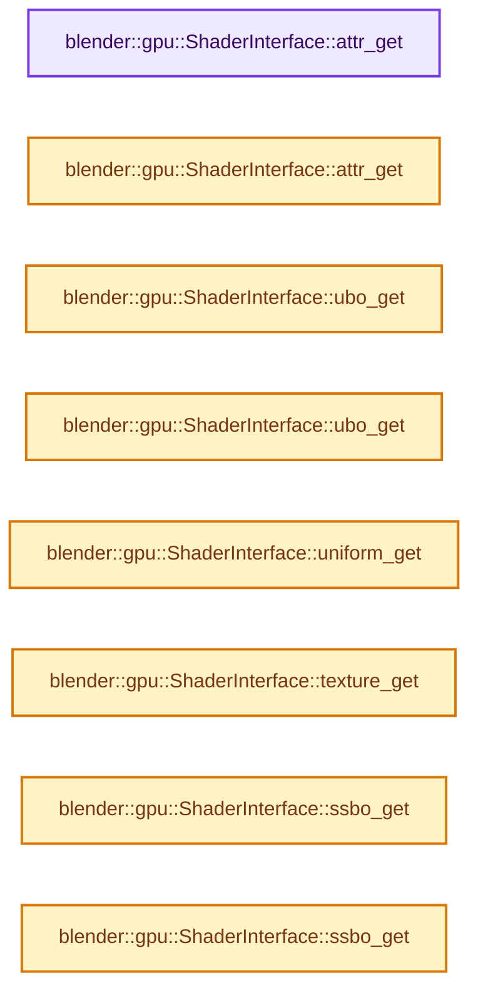
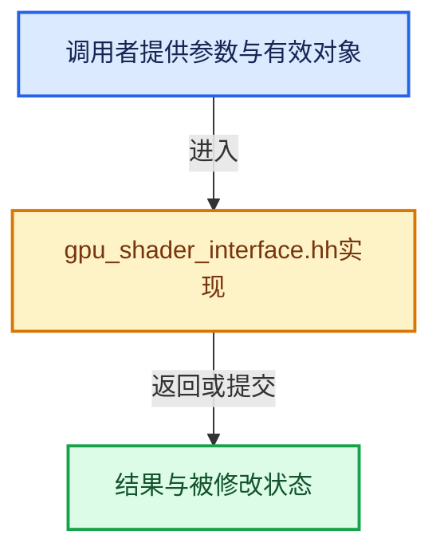

# 实现依赖专题：source/blender/gpu/intern/gpu_shader_interface.hh

[实现依赖导航](../../../README.md) · [符号索引](../../../../00-课程指南/02-源码与提交索引/符号依赖与实现索引.md)

本专题从正文实际调用进入，集中保存共享实现。函数有稳定锚点，可从调用处直接跳到对应完整函数；递归与互相调用通过回链组织。

## 本文件的实现关系






## 完整成员与函数实现

<a id="f-d7bd732863225c65"></a>

### `blender::gpu::ShaderInterface::attr_get`

实现位置：[source/blender/gpu/intern/gpu_shader_interface.hh](../../../../../../../../source/blender/gpu/intern/gpu_shader_interface.hh) · L102—L105。

接口参数：

- `const StringRefNull name`

**教学注释版**

<!-- annotated:693394f0eac7d3 -->

```cpp
  const ShaderInput *attr_get(const StringRefNull name) const
  {
    return input_lookup(inputs_, attr_len_, name);
  }
```

<details>
<summary>核对原始源码：source/blender/gpu/intern/gpu_shader_interface.hh · L102—L105</summary>

<!-- original:693394f0eac7d3:source/blender/gpu/intern/gpu_shader_interface.hh:102:105 -->

```cpp
  const ShaderInput *attr_get(const StringRefNull name) const
  {
    return input_lookup(inputs_, attr_len_, name);
  }
```

</details>

**结果出口**

- `return input_lookup(inputs_, attr_len_, name);`

**继续追踪实现**

- `input_lookup` → [blender::gpu::ShaderInterface::input_lookup · L330](gpu_shader_interface.hh.md#f-a95c751f44230134)；[blender::gpu::ShaderInterface::input_lookup · L358](gpu_shader_interface.hh.md#f-0fd66f84d7eee4cf)。同名重载需按实参类型选择。

<a id="f-5bb767b46d34948d"></a>

### `blender::gpu::ShaderInterface::attr_get`

实现位置：[source/blender/gpu/intern/gpu_shader_interface.hh](../../../../../../../../source/blender/gpu/intern/gpu_shader_interface.hh) · L106—L109。

接口参数：

- `const int binding`

**教学注释版**

<!-- annotated:d5bc652ec21be0 -->

```cpp
  const ShaderInput *attr_get(const int binding) const
  {
    return input_lookup(inputs_, attr_len_, binding);
  }
```

<details>
<summary>核对原始源码：source/blender/gpu/intern/gpu_shader_interface.hh · L106—L109</summary>

<!-- original:d5bc652ec21be0:source/blender/gpu/intern/gpu_shader_interface.hh:106:109 -->

```cpp
  const ShaderInput *attr_get(const int binding) const
  {
    return input_lookup(inputs_, attr_len_, binding);
  }
```

</details>

**结果出口**

- `return input_lookup(inputs_, attr_len_, binding);`

**继续追踪实现**

- `input_lookup` → [blender::gpu::ShaderInterface::input_lookup · L330](gpu_shader_interface.hh.md#f-a95c751f44230134)；[blender::gpu::ShaderInterface::input_lookup · L358](gpu_shader_interface.hh.md#f-0fd66f84d7eee4cf)。同名重载需按实参类型选择。

<a id="f-3c1cfdde10aacbef"></a>

### `blender::gpu::ShaderInterface::ubo_get`

实现位置：[source/blender/gpu/intern/gpu_shader_interface.hh](../../../../../../../../source/blender/gpu/intern/gpu_shader_interface.hh) · L111—L114。

接口参数：

- `const StringRefNull name`

**教学注释版**

<!-- annotated:080c052ad0b4c3 -->

```cpp
  const ShaderInput *ubo_get(const StringRefNull name) const
  {
    return input_lookup(inputs_ + attr_len_, ubo_len_, name);
  }
```

<details>
<summary>核对原始源码：source/blender/gpu/intern/gpu_shader_interface.hh · L111—L114</summary>

<!-- original:080c052ad0b4c3:source/blender/gpu/intern/gpu_shader_interface.hh:111:114 -->

```cpp
  const ShaderInput *ubo_get(const StringRefNull name) const
  {
    return input_lookup(inputs_ + attr_len_, ubo_len_, name);
  }
```

</details>

**结果出口**

- `return input_lookup(inputs_ + attr_len_, ubo_len_, name);`

**继续追踪实现**

- `input_lookup` → [blender::gpu::ShaderInterface::input_lookup · L330](gpu_shader_interface.hh.md#f-a95c751f44230134)；[blender::gpu::ShaderInterface::input_lookup · L358](gpu_shader_interface.hh.md#f-0fd66f84d7eee4cf)。同名重载需按实参类型选择。

<a id="f-68ce09474348e845"></a>

### `blender::gpu::ShaderInterface::ubo_get`

实现位置：[source/blender/gpu/intern/gpu_shader_interface.hh](../../../../../../../../source/blender/gpu/intern/gpu_shader_interface.hh) · L115—L118。

接口参数：

- `const int binding`

**教学注释版**

<!-- annotated:86207e82811825 -->

```cpp
  const ShaderInput *ubo_get(const int binding) const
  {
    return input_lookup(inputs_ + attr_len_, ubo_len_, binding);
  }
```

<details>
<summary>核对原始源码：source/blender/gpu/intern/gpu_shader_interface.hh · L115—L118</summary>

<!-- original:86207e82811825:source/blender/gpu/intern/gpu_shader_interface.hh:115:118 -->

```cpp
  const ShaderInput *ubo_get(const int binding) const
  {
    return input_lookup(inputs_ + attr_len_, ubo_len_, binding);
  }
```

</details>

**结果出口**

- `return input_lookup(inputs_ + attr_len_, ubo_len_, binding);`

**继续追踪实现**

- `input_lookup` → [blender::gpu::ShaderInterface::input_lookup · L330](gpu_shader_interface.hh.md#f-a95c751f44230134)；[blender::gpu::ShaderInterface::input_lookup · L358](gpu_shader_interface.hh.md#f-0fd66f84d7eee4cf)。同名重载需按实参类型选择。

<a id="f-f14976d24053e4e0"></a>

### `blender::gpu::ShaderInterface::uniform_get`

实现位置：[source/blender/gpu/intern/gpu_shader_interface.hh](../../../../../../../../source/blender/gpu/intern/gpu_shader_interface.hh) · L120—L123。

接口参数：

- `const StringRefNull name`

**教学注释版**

<!-- annotated:3e3096c6e01542 -->

```cpp
  const ShaderInput *uniform_get(const StringRefNull name) const
  {
    return input_lookup(inputs_ + attr_len_ + ubo_len_, uniform_len_, name);
  }
```

<details>
<summary>核对原始源码：source/blender/gpu/intern/gpu_shader_interface.hh · L120—L123</summary>

<!-- original:3e3096c6e01542:source/blender/gpu/intern/gpu_shader_interface.hh:120:123 -->

```cpp
  const ShaderInput *uniform_get(const StringRefNull name) const
  {
    return input_lookup(inputs_ + attr_len_ + ubo_len_, uniform_len_, name);
  }
```

</details>

**结果出口**

- `return input_lookup(inputs_ + attr_len_ + ubo_len_, uniform_len_, name);`

**继续追踪实现**

- `input_lookup` → [blender::gpu::ShaderInterface::input_lookup · L330](gpu_shader_interface.hh.md#f-a95c751f44230134)；[blender::gpu::ShaderInterface::input_lookup · L358](gpu_shader_interface.hh.md#f-0fd66f84d7eee4cf)。同名重载需按实参类型选择。

<a id="f-3f380c6fa87cea55"></a>

### `blender::gpu::ShaderInterface::texture_get`

实现位置：[source/blender/gpu/intern/gpu_shader_interface.hh](../../../../../../../../source/blender/gpu/intern/gpu_shader_interface.hh) · L125—L128。

接口参数：

- `const int binding`

**教学注释版**

<!-- annotated:824ca9b18c3761 -->

```cpp
  const ShaderInput *texture_get(const int binding) const
  {
    return input_lookup(inputs_ + attr_len_ + ubo_len_, uniform_len_, binding);
  }
```

<details>
<summary>核对原始源码：source/blender/gpu/intern/gpu_shader_interface.hh · L125—L128</summary>

<!-- original:824ca9b18c3761:source/blender/gpu/intern/gpu_shader_interface.hh:125:128 -->

```cpp
  const ShaderInput *texture_get(const int binding) const
  {
    return input_lookup(inputs_ + attr_len_ + ubo_len_, uniform_len_, binding);
  }
```

</details>

**结果出口**

- `return input_lookup(inputs_ + attr_len_ + ubo_len_, uniform_len_, binding);`

**继续追踪实现**

- `input_lookup` → [blender::gpu::ShaderInterface::input_lookup · L330](gpu_shader_interface.hh.md#f-a95c751f44230134)；[blender::gpu::ShaderInterface::input_lookup · L358](gpu_shader_interface.hh.md#f-0fd66f84d7eee4cf)。同名重载需按实参类型选择。

<a id="f-5cb2063c862d0179"></a>

### `blender::gpu::ShaderInterface::ssbo_get`

实现位置：[source/blender/gpu/intern/gpu_shader_interface.hh](../../../../../../../../source/blender/gpu/intern/gpu_shader_interface.hh) · L130—L133。

接口参数：

- `const StringRefNull name`

**教学注释版**

<!-- annotated:0bf4bd7f6d066f -->

```cpp
  const ShaderInput *ssbo_get(const StringRefNull name) const
  {
    return input_lookup(inputs_ + attr_len_ + ubo_len_ + uniform_len_, ssbo_len_, name);
  }
```

<details>
<summary>核对原始源码：source/blender/gpu/intern/gpu_shader_interface.hh · L130—L133</summary>

<!-- original:0bf4bd7f6d066f:source/blender/gpu/intern/gpu_shader_interface.hh:130:133 -->

```cpp
  const ShaderInput *ssbo_get(const StringRefNull name) const
  {
    return input_lookup(inputs_ + attr_len_ + ubo_len_ + uniform_len_, ssbo_len_, name);
  }
```

</details>

**结果出口**

- `return input_lookup(inputs_ + attr_len_ + ubo_len_ + uniform_len_, ssbo_len_, name);`

**继续追踪实现**

- `input_lookup` → [blender::gpu::ShaderInterface::input_lookup · L330](gpu_shader_interface.hh.md#f-a95c751f44230134)；[blender::gpu::ShaderInterface::input_lookup · L358](gpu_shader_interface.hh.md#f-0fd66f84d7eee4cf)。同名重载需按实参类型选择。

<a id="f-7faa3482fa8684d8"></a>

### `blender::gpu::ShaderInterface::ssbo_get`

实现位置：[source/blender/gpu/intern/gpu_shader_interface.hh](../../../../../../../../source/blender/gpu/intern/gpu_shader_interface.hh) · L134—L137。

接口参数：

- `const int binding`

**教学注释版**

<!-- annotated:586c053e7ba9ac -->

```cpp
  const ShaderInput *ssbo_get(const int binding) const
  {
    return input_lookup(inputs_ + attr_len_ + ubo_len_ + uniform_len_, ssbo_len_, binding);
  }
```

<details>
<summary>核对原始源码：source/blender/gpu/intern/gpu_shader_interface.hh · L134—L137</summary>

<!-- original:586c053e7ba9ac:source/blender/gpu/intern/gpu_shader_interface.hh:134:137 -->

```cpp
  const ShaderInput *ssbo_get(const int binding) const
  {
    return input_lookup(inputs_ + attr_len_ + ubo_len_ + uniform_len_, ssbo_len_, binding);
  }
```

</details>

**结果出口**

- `return input_lookup(inputs_ + attr_len_ + ubo_len_ + uniform_len_, ssbo_len_, binding);`

**继续追踪实现**

- `input_lookup` → [blender::gpu::ShaderInterface::input_lookup · L330](gpu_shader_interface.hh.md#f-a95c751f44230134)；[blender::gpu::ShaderInterface::input_lookup · L358](gpu_shader_interface.hh.md#f-0fd66f84d7eee4cf)。同名重载需按实参类型选择。

<a id="f-82c196d031144f7f"></a>

### `blender::gpu::ShaderInterface::input_name_get`

实现位置：[source/blender/gpu/intern/gpu_shader_interface.hh](../../../../../../../../source/blender/gpu/intern/gpu_shader_interface.hh) · L157—L160。

接口参数：

- `const ShaderInput *input`

**教学注释版**

<!-- annotated:edab1a07bcdf55 -->

```cpp
  const char *input_name_get(const ShaderInput *input) const
  {
    return name_buffer_ + input->name_offset;
  }
```

<details>
<summary>核对原始源码：source/blender/gpu/intern/gpu_shader_interface.hh · L157—L160</summary>

<!-- original:edab1a07bcdf55:source/blender/gpu/intern/gpu_shader_interface.hh:157:160 -->

```cpp
  const char *input_name_get(const ShaderInput *input) const
  {
    return name_buffer_ + input->name_offset;
  }
```

</details>

**结果出口**

- `return name_buffer_ + input->name_offset;`

**继续追踪实现**

本实现没有需要继续展开的显式调用；检查返回表达式、对象转换和调用者前置条件。

<a id="f-006a1ed238879b7b"></a>

### `blender::gpu::ShaderInterface::uniform_builtin`

实现位置：[source/blender/gpu/intern/gpu_shader_interface.hh](../../../../../../../../source/blender/gpu/intern/gpu_shader_interface.hh) · L163—L167。

接口参数：

- `const GPUUniformBuiltin builtin`

**教学注释版**

<!-- annotated:ae683ff50a7fb3 -->

```cpp
  int32_t uniform_builtin(const GPUUniformBuiltin builtin) const
  {
    BLI_assert(builtin >= 0 && builtin < GPU_NUM_UNIFORMS);
    return builtins_[builtin];
  }
```

<details>
<summary>核对原始源码：source/blender/gpu/intern/gpu_shader_interface.hh · L163—L167</summary>

<!-- original:ae683ff50a7fb3:source/blender/gpu/intern/gpu_shader_interface.hh:163:167 -->

```cpp
  int32_t uniform_builtin(const GPUUniformBuiltin builtin) const
  {
    BLI_assert(builtin >= 0 && builtin < GPU_NUM_UNIFORMS);
    return builtins_[builtin];
  }
```

</details>

**结果出口**

- `return builtins_[builtin];`

**继续追踪实现**

- `BLI_assert` → [BLI_assert · L48](../../../01-BLI基础库/BLI_assert.hh.md#m-57a88495704d)；[BLI_assert · L63](../../../01-BLI基础库/BLI_assert.hh.md#m-d07050020cb5)。宏定义由构建条件选择。

<a id="f-a95c751f44230134"></a>

### `blender::gpu::ShaderInterface::input_lookup`

实现位置：[source/blender/gpu/intern/gpu_shader_interface.hh](../../../../../../../../source/blender/gpu/intern/gpu_shader_interface.hh) · L330—L356。

接口参数：

- `const ShaderInput *const inputs`
- `const uint inputs_len`
- `const StringRefNull name`

**教学注释版**

<!-- annotated:f91736c78c7c60 -->

```cpp
inline const ShaderInput *ShaderInterface::input_lookup(const ShaderInput *const inputs,
                                                        const uint inputs_len,
                                                        const StringRefNull name) const
{
  const uint name_hash = BLI_hash_string(name.c_str());
  /* Simple linear search for now. */
  for (int i = inputs_len - 1; i >= 0; i--) {
    if (inputs[i].name_hash == name_hash) {
      if ((i > 0) && UNLIKELY(inputs[i - 1].name_hash == name_hash)) {
        /* Hash collision resolve. */
        for (; i >= 0 && inputs[i].name_hash == name_hash; i--) {
          if (name == (name_buffer_ + inputs[i].name_offset)) {
            return inputs + i; /* not found */
          }
        }
        return nullptr; /* not found */
      }

      /* This is a bit dangerous since we could have a hash collision.
       * where the asked uniform that does not exist has the same hash
       * as a real uniform. */
      BLI_assert(name == (name_buffer_ + inputs[i].name_offset));
      return inputs + i;
    }
  }
  return nullptr; /* not found */
}
```

<details>
<summary>核对原始源码：source/blender/gpu/intern/gpu_shader_interface.hh · L330—L356</summary>

<!-- original:f91736c78c7c60:source/blender/gpu/intern/gpu_shader_interface.hh:330:356 -->

```cpp
inline const ShaderInput *ShaderInterface::input_lookup(const ShaderInput *const inputs,
                                                        const uint inputs_len,
                                                        const StringRefNull name) const
{
  const uint name_hash = BLI_hash_string(name.c_str());
  /* Simple linear search for now. */
  for (int i = inputs_len - 1; i >= 0; i--) {
    if (inputs[i].name_hash == name_hash) {
      if ((i > 0) && UNLIKELY(inputs[i - 1].name_hash == name_hash)) {
        /* Hash collision resolve. */
        for (; i >= 0 && inputs[i].name_hash == name_hash; i--) {
          if (name == (name_buffer_ + inputs[i].name_offset)) {
            return inputs + i; /* not found */
          }
        }
        return nullptr; /* not found */
      }

      /* This is a bit dangerous since we could have a hash collision.
       * where the asked uniform that does not exist has the same hash
       * as a real uniform. */
      BLI_assert(name == (name_buffer_ + inputs[i].name_offset));
      return inputs + i;
    }
  }
  return nullptr; /* not found */
}
```

</details>

**结果出口**

- `return inputs + i; /* not found */`
- `return nullptr; /* not found */`
- `return inputs + i;`

**继续追踪实现**

- `BLI_hash_string` → [blender::BLI_hash_string · L69](../../../01-BLI基础库/BLI_hash_c.hh.md#f-0f3487d576368d89)。
- `name.c_str` → [blender::StringRefNull::c_str · L544](../../../../01-基础容器与现代CPP/15-StringRef字符串视图.md#f-4a8bbfe1e6d00757)。
- `UNLIKELY` → [UNLIKELY · L52](../../../07-Intern运行时与平台/guardedalloc/intern/mallocn_intern.hh.md#m-b66d81651173)；[UNLIKELY · L55](../../../07-Intern运行时与平台/guardedalloc/intern/mallocn_intern.hh.md#m-43069123e9fe)；[UNLIKELY · L108](../../../07-Intern运行时与平台/cycles/util/defines.h.md#m-c50729f638e8)；[UNLIKELY · L111](../../../07-Intern运行时与平台/cycles/util/defines.h.md#m-08e633831622)；[UNLIKELY · L25](../../../01-BLI基础库/intern/math_base_inline.cc.md#m-beab6e34c61e)；[UNLIKELY · L27](../../../01-BLI基础库/intern/math_base_inline.cc.md#m-9b279ffdd95b)；[UNLIKELY · L544](../../../01-BLI基础库/BLI_utildefines.hh.md#m-74644b8209a0)；[UNLIKELY · L547](../../../01-BLI基础库/BLI_utildefines.hh.md#m-3a47ebab6298)。宏定义由构建条件选择。
- `BLI_assert` → [BLI_assert · L48](../../../01-BLI基础库/BLI_assert.hh.md#m-57a88495704d)；[BLI_assert · L63](../../../01-BLI基础库/BLI_assert.hh.md#m-d07050020cb5)。宏定义由构建条件选择。

<a id="f-0fd66f84d7eee4cf"></a>

### `blender::gpu::ShaderInterface::input_lookup`

实现位置：[source/blender/gpu/intern/gpu_shader_interface.hh](../../../../../../../../source/blender/gpu/intern/gpu_shader_interface.hh) · L358—L369。

接口参数：

- `const ShaderInput *const inputs`
- `const uint inputs_len`
- `const int binding`

**教学注释版**

<!-- annotated:967d0b85674efc -->

```cpp
inline const ShaderInput *ShaderInterface::input_lookup(const ShaderInput *const inputs,
                                                        const uint inputs_len,
                                                        const int binding) const
{
  /* Simple linear search for now. */
  for (int i = inputs_len - 1; i >= 0; i--) {
    if (inputs[i].binding == binding) {
      return inputs + i;
    }
  }
  return nullptr; /* not found */
}
```

<details>
<summary>核对原始源码：source/blender/gpu/intern/gpu_shader_interface.hh · L358—L369</summary>

<!-- original:967d0b85674efc:source/blender/gpu/intern/gpu_shader_interface.hh:358:369 -->

```cpp
inline const ShaderInput *ShaderInterface::input_lookup(const ShaderInput *const inputs,
                                                        const uint inputs_len,
                                                        const int binding) const
{
  /* Simple linear search for now. */
  for (int i = inputs_len - 1; i >= 0; i--) {
    if (inputs[i].binding == binding) {
      return inputs + i;
    }
  }
  return nullptr; /* not found */
}
```

</details>

**结果出口**

- `return inputs + i;`
- `return nullptr; /* not found */`

**继续追踪实现**

本实现没有需要继续展开的显式调用；检查返回表达式、对象转换和调用者前置条件。
