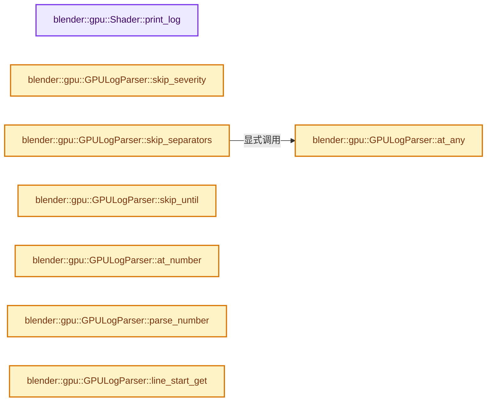

# 实现依赖专题：source/blender/gpu/intern/gpu_shader_log.cc

[实现依赖导航](../../../README.md) · [符号索引](../../../../00-课程指南/02-源码与提交索引/符号依赖与实现索引.md)

本专题从正文实际调用进入，集中保存共享实现。函数有稳定锚点，可从调用处直接跳到对应完整函数；递归与互相调用通过回链组织。

## 本文件的实现关系




## 完整成员与函数实现

<a id="f-fff423e194be653a"></a>

### `blender::gpu::Shader::print_log`

实现位置：[source/blender/gpu/intern/gpu_shader_log.cc](../../../../../../../../source/blender/gpu/intern/gpu_shader_log.cc) · L43—L274。

接口参数：

- `Span<StringRefNull> sources`
- `const char *log`
- `const char *stage`
- `const bool error`
- `GPULogParser *parser`

**教学注释版**

<!-- annotated:f0903a3cecb59d -->

```cpp
void Shader::print_log(Span<StringRefNull> sources,
                       const char *log,
                       const char *stage,
                       const bool error,
                       GPULogParser *parser)
{
  const char line_prefix[] = "      | ";
  char err_col[] = "\033[31;1m";
  char warn_col[] = "\033[33;1m";
  char info_col[] = "\033[0;2m";
  char reset_col[] = "\033[0;0m";
  std::string sources_combined = fmt::to_string(fmt::join(sources, ""));
  DynStr *dynstr = BLI_dynstr_new();

  if (!CLG_color_support_get(&LOG)) {
    err_col[0] = warn_col[0] = info_col[0] = reset_col[0] = '\0';
  }

  BLI_dynstr_appendf(dynstr, "\n");

#if DEBUG_DEPENDENCIES
  BLI_dynstr_appendf(
      dynstr, "%s%sIncluded files (in order):%s\n", info_col, line_prefix, reset_col);
#endif

  Vector<int64_t> sources_end_line;
  for (StringRef src : sources) {
    int64_t cursor = 0, line_count = 0;
    while ((cursor = src.find('\n', cursor) + 1)) {
      line_count++;
    }
    if (sources_end_line.is_empty() == false) {
      // [讲解] sources_end_line.last：访问有效范围首端或末端元素。
      line_count += sources_end_line.last();
    }
    // [讲解] sources_end_line.append：在尾部建立新元素，必要时先扩大存储。
    sources_end_line.append(line_count);
#if DEBUG_DEPENDENCIES
    StringRefNull filename = shader::gpu_shader_dependency_get_filename_from_source_string(src);
    if (!filename.is_empty()) {
      BLI_dynstr_appendf(
          dynstr, "%s%s  %s%s\n", info_col, line_prefix, filename.c_str(), reset_col);
    }
#endif
  }
  if (sources_end_line.is_empty()) {
    sources_end_line.append(0);
  }

  const char *log_line = log, *line_end;

  LogCursor previous_location;

  bool found_line_id = false;
  while ((line_end = strchr(log_line, '\n'))) {
    /* Skip empty lines. */
    if (line_end == log_line) {
      log_line++;
      continue;
    }

    /* Silence not useful lines. */
    StringRef logref = StringRefNull(log_line).substr(0, size_t(line_end) - size_t(log_line));
    if (logref.endswith(" shader failed to compile with the following errors:") ||
        logref.endswith(" No code generated"))
    {
      log_line += size_t(line_end) - size_t(log_line);
      continue;
    }

    GPULogItem log_item;
    log_line = parser->parse_line(sources_combined.c_str(), log_line, log_item);

    /* Empty line, skip. */
    if ((log_item.cursor.row == -1) && ELEM(log_line[0], '\n', '\0')) {
      continue;
    }

    /* Sanitize output. Really bad values can happen when the error line is buggy. */
    // [讲解] sources.size：查询视图长度或生成对应有效索引区间。
    if (log_item.cursor.source >= sources.size()) {
      log_item.cursor.source = -1;
    }
    if (log_item.cursor.row >= sources_end_line.last()) {
      log_item.cursor.source = -1;
      log_item.cursor.row = -1;
    }

    if (log_item.cursor.row == -1) {
      found_line_id = false;
    }

    const char *src_line = sources_combined.c_str();

    std::string log_line_str(log_line, (line_end + 1) - log_line);
    if (log_line_str.ends_with(" used uninitialized\n")) {
      /* Mesa GLSL compiler warns about uninitialized variables are mostly false positive.
       * Avoid noise. */
      log_line = line_end + 1;
      continue;
    }

    /* Separate from previous block. */
    if (previous_location.source != log_item.cursor.source ||
        previous_location.row != log_item.cursor.row)
    {
      BLI_dynstr_appendf(dynstr, "%s%s%s\n", info_col, line_prefix, reset_col);
    }
    else if (log_item.cursor.column != previous_location.column) {
      BLI_dynstr_appendf(dynstr, "%s\n", line_prefix);
    }
    /* Print line from the source file that is producing the error. */
    if ((log_item.cursor.row != -1) && (log_item.cursor.row != previous_location.row ||
                                        log_item.cursor.column != previous_location.column))
    {
      const char *src_line_end;
      found_line_id = false;
      /* Lines are 1 based. */
      int src_line_index = 1;
      while ((src_line_end = strchr(src_line, '\n'))) {
        if (src_line_index >= log_item.cursor.row) {
          found_line_id = true;
          break;
        }
        if (src_line_index >= log_item.cursor.row - DEBUG_CONTEXT_LINES) {
          BLI_dynstr_appendf(dynstr, "%5d | ", src_line_index);
          BLI_dynstr_nappend(dynstr, src_line, (src_line_end + 1) - src_line);
        }
        /* Continue to next line. */
        src_line = src_line_end + 1;
        src_line_index++;
      }
      /* Print error source. */
      if (found_line_id) {
        if (log_item.cursor.row != previous_location.row) {
          BLI_dynstr_appendf(dynstr, "%5d | ", src_line_index);
        }
        else {
          BLI_dynstr_appendf(dynstr, line_prefix);
        }
        BLI_dynstr_nappend(dynstr, src_line, (src_line_end + 1) - src_line);
        /* Print char offset. */
        BLI_dynstr_appendf(dynstr, line_prefix);
        if (log_item.cursor.column != -1) {
          for (int i = 0; i < log_item.cursor.column; i++) {
            BLI_dynstr_appendf(dynstr, " ");
          }
          BLI_dynstr_appendf(dynstr, "^");
        }
        BLI_dynstr_appendf(dynstr, "\n");

        /* Skip the error line. */
        src_line = src_line_end + 1;
        src_line_index++;
        while ((src_line_end = strchr(src_line, '\n'))) {
          if (src_line_index > log_item.cursor.row + DEBUG_CONTEXT_LINES) {
            break;
          }
          BLI_dynstr_appendf(dynstr, "%5d | ", src_line_index);
          BLI_dynstr_nappend(dynstr, src_line, (src_line_end + 1) - src_line);
          /* Continue to next line. */
          src_line = src_line_end + 1;
          src_line_index++;
        }
      }
    }
    BLI_dynstr_appendf(dynstr, line_prefix);

    /* Search the correct source index. */
    int row_in_file = log_item.cursor.row;
    int source_index = log_item.cursor.source;
    if (source_index <= 0) {
      for (auto i : sources_end_line.index_range()) {
        if (log_item.cursor.row <= sources_end_line[i]) {
          source_index = i;
          break;
        }
      }
    }
    if (source_index > 0) {
      row_in_file -= sources_end_line[source_index - 1];
    }
    /* Print the filename the error line is coming from. */
    if (!log_item.cursor.file_name_and_error_line.empty()) {
      char name_buf[256];
      std::string string = log_item.cursor.file_name_and_error_line.substr(0,
                                                                           sizeof(name_buf) - 1);
      StringRefNull(string).copy_utf8_truncated(name_buf);
      BLI_dynstr_appendf(dynstr, "%s%s: %s", info_col, name_buf, reset_col);
    }
    else if (source_index > 0) {
      StringRefNull filename = shader::gpu_shader_dependency_get_filename_from_source_string(
          sources[source_index]);
      if (!filename.is_empty()) {
        BLI_dynstr_appendf(dynstr,
                           "%s%s:%d:%d: %s",
                           info_col,
                           filename.c_str(),
                           row_in_file,
                           log_item.cursor.column + 1,
                           reset_col);
      }
    }

    if (log_item.severity == Severity::Error) {
      BLI_dynstr_appendf(dynstr, "%s%s%s: ", err_col, "Error", info_col);
    }
    else if (log_item.severity == Severity::Warning) {
      BLI_dynstr_appendf(dynstr, "%s%s%s: ", warn_col, "Warning", info_col);
    }
    else if (log_item.severity == Severity::Note) {
      BLI_dynstr_appendf(dynstr, "%s%s%s: ", warn_col, "Note", info_col);
    }
    /* Print the error itself. */
    BLI_dynstr_append(dynstr, info_col);
    BLI_dynstr_nappend(dynstr, log_line, (line_end + 1) - log_line);
    BLI_dynstr_append(dynstr, reset_col);
    /* Continue to next line. */
    log_line = line_end + 1;
    previous_location = log_item.cursor;
  }

  CLG_Level level = error ? CLG_LEVEL_ERROR : CLG_LEVEL_WARN;

  if (CLOG_CHECK(&LOG, level)) {
    if (DEBUG_LOG_SHADER_SRC_ON_ERROR && error) {
      CLG_log_raw(LOG.type, sources_combined.c_str());
    }
    const char *_str = BLI_dynstr_get_cstring(dynstr);
    CLOG_AT_LEVEL(&LOG, level, "%s %s: %s", this->name, stage, _str);
    MEM_delete(_str);
  }

  BLI_dynstr_free(dynstr);
}
```

<details>
<summary>核对原始源码：source/blender/gpu/intern/gpu_shader_log.cc · L43—L274</summary>

<!-- original:f0903a3cecb59d:source/blender/gpu/intern/gpu_shader_log.cc:43:274 -->

```cpp
void Shader::print_log(Span<StringRefNull> sources,
                       const char *log,
                       const char *stage,
                       const bool error,
                       GPULogParser *parser)
{
  const char line_prefix[] = "      | ";
  char err_col[] = "\033[31;1m";
  char warn_col[] = "\033[33;1m";
  char info_col[] = "\033[0;2m";
  char reset_col[] = "\033[0;0m";
  std::string sources_combined = fmt::to_string(fmt::join(sources, ""));
  DynStr *dynstr = BLI_dynstr_new();

  if (!CLG_color_support_get(&LOG)) {
    err_col[0] = warn_col[0] = info_col[0] = reset_col[0] = '\0';
  }

  BLI_dynstr_appendf(dynstr, "\n");

#if DEBUG_DEPENDENCIES
  BLI_dynstr_appendf(
      dynstr, "%s%sIncluded files (in order):%s\n", info_col, line_prefix, reset_col);
#endif

  Vector<int64_t> sources_end_line;
  for (StringRef src : sources) {
    int64_t cursor = 0, line_count = 0;
    while ((cursor = src.find('\n', cursor) + 1)) {
      line_count++;
    }
    if (sources_end_line.is_empty() == false) {
      line_count += sources_end_line.last();
    }
    sources_end_line.append(line_count);
#if DEBUG_DEPENDENCIES
    StringRefNull filename = shader::gpu_shader_dependency_get_filename_from_source_string(src);
    if (!filename.is_empty()) {
      BLI_dynstr_appendf(
          dynstr, "%s%s  %s%s\n", info_col, line_prefix, filename.c_str(), reset_col);
    }
#endif
  }
  if (sources_end_line.is_empty()) {
    sources_end_line.append(0);
  }

  const char *log_line = log, *line_end;

  LogCursor previous_location;

  bool found_line_id = false;
  while ((line_end = strchr(log_line, '\n'))) {
    /* Skip empty lines. */
    if (line_end == log_line) {
      log_line++;
      continue;
    }

    /* Silence not useful lines. */
    StringRef logref = StringRefNull(log_line).substr(0, size_t(line_end) - size_t(log_line));
    if (logref.endswith(" shader failed to compile with the following errors:") ||
        logref.endswith(" No code generated"))
    {
      log_line += size_t(line_end) - size_t(log_line);
      continue;
    }

    GPULogItem log_item;
    log_line = parser->parse_line(sources_combined.c_str(), log_line, log_item);

    /* Empty line, skip. */
    if ((log_item.cursor.row == -1) && ELEM(log_line[0], '\n', '\0')) {
      continue;
    }

    /* Sanitize output. Really bad values can happen when the error line is buggy. */
    if (log_item.cursor.source >= sources.size()) {
      log_item.cursor.source = -1;
    }
    if (log_item.cursor.row >= sources_end_line.last()) {
      log_item.cursor.source = -1;
      log_item.cursor.row = -1;
    }

    if (log_item.cursor.row == -1) {
      found_line_id = false;
    }

    const char *src_line = sources_combined.c_str();

    std::string log_line_str(log_line, (line_end + 1) - log_line);
    if (log_line_str.ends_with(" used uninitialized\n")) {
      /* Mesa GLSL compiler warns about uninitialized variables are mostly false positive.
       * Avoid noise. */
      log_line = line_end + 1;
      continue;
    }

    /* Separate from previous block. */
    if (previous_location.source != log_item.cursor.source ||
        previous_location.row != log_item.cursor.row)
    {
      BLI_dynstr_appendf(dynstr, "%s%s%s\n", info_col, line_prefix, reset_col);
    }
    else if (log_item.cursor.column != previous_location.column) {
      BLI_dynstr_appendf(dynstr, "%s\n", line_prefix);
    }
    /* Print line from the source file that is producing the error. */
    if ((log_item.cursor.row != -1) && (log_item.cursor.row != previous_location.row ||
                                        log_item.cursor.column != previous_location.column))
    {
      const char *src_line_end;
      found_line_id = false;
      /* Lines are 1 based. */
      int src_line_index = 1;
      while ((src_line_end = strchr(src_line, '\n'))) {
        if (src_line_index >= log_item.cursor.row) {
          found_line_id = true;
          break;
        }
        if (src_line_index >= log_item.cursor.row - DEBUG_CONTEXT_LINES) {
          BLI_dynstr_appendf(dynstr, "%5d | ", src_line_index);
          BLI_dynstr_nappend(dynstr, src_line, (src_line_end + 1) - src_line);
        }
        /* Continue to next line. */
        src_line = src_line_end + 1;
        src_line_index++;
      }
      /* Print error source. */
      if (found_line_id) {
        if (log_item.cursor.row != previous_location.row) {
          BLI_dynstr_appendf(dynstr, "%5d | ", src_line_index);
        }
        else {
          BLI_dynstr_appendf(dynstr, line_prefix);
        }
        BLI_dynstr_nappend(dynstr, src_line, (src_line_end + 1) - src_line);
        /* Print char offset. */
        BLI_dynstr_appendf(dynstr, line_prefix);
        if (log_item.cursor.column != -1) {
          for (int i = 0; i < log_item.cursor.column; i++) {
            BLI_dynstr_appendf(dynstr, " ");
          }
          BLI_dynstr_appendf(dynstr, "^");
        }
        BLI_dynstr_appendf(dynstr, "\n");

        /* Skip the error line. */
        src_line = src_line_end + 1;
        src_line_index++;
        while ((src_line_end = strchr(src_line, '\n'))) {
          if (src_line_index > log_item.cursor.row + DEBUG_CONTEXT_LINES) {
            break;
          }
          BLI_dynstr_appendf(dynstr, "%5d | ", src_line_index);
          BLI_dynstr_nappend(dynstr, src_line, (src_line_end + 1) - src_line);
          /* Continue to next line. */
          src_line = src_line_end + 1;
          src_line_index++;
        }
      }
    }
    BLI_dynstr_appendf(dynstr, line_prefix);

    /* Search the correct source index. */
    int row_in_file = log_item.cursor.row;
    int source_index = log_item.cursor.source;
    if (source_index <= 0) {
      for (auto i : sources_end_line.index_range()) {
        if (log_item.cursor.row <= sources_end_line[i]) {
          source_index = i;
          break;
        }
      }
    }
    if (source_index > 0) {
      row_in_file -= sources_end_line[source_index - 1];
    }
    /* Print the filename the error line is coming from. */
    if (!log_item.cursor.file_name_and_error_line.empty()) {
      char name_buf[256];
      std::string string = log_item.cursor.file_name_and_error_line.substr(0,
                                                                           sizeof(name_buf) - 1);
      StringRefNull(string).copy_utf8_truncated(name_buf);
      BLI_dynstr_appendf(dynstr, "%s%s: %s", info_col, name_buf, reset_col);
    }
    else if (source_index > 0) {
      StringRefNull filename = shader::gpu_shader_dependency_get_filename_from_source_string(
          sources[source_index]);
      if (!filename.is_empty()) {
        BLI_dynstr_appendf(dynstr,
                           "%s%s:%d:%d: %s",
                           info_col,
                           filename.c_str(),
                           row_in_file,
                           log_item.cursor.column + 1,
                           reset_col);
      }
    }

    if (log_item.severity == Severity::Error) {
      BLI_dynstr_appendf(dynstr, "%s%s%s: ", err_col, "Error", info_col);
    }
    else if (log_item.severity == Severity::Warning) {
      BLI_dynstr_appendf(dynstr, "%s%s%s: ", warn_col, "Warning", info_col);
    }
    else if (log_item.severity == Severity::Note) {
      BLI_dynstr_appendf(dynstr, "%s%s%s: ", warn_col, "Note", info_col);
    }
    /* Print the error itself. */
    BLI_dynstr_append(dynstr, info_col);
    BLI_dynstr_nappend(dynstr, log_line, (line_end + 1) - log_line);
    BLI_dynstr_append(dynstr, reset_col);
    /* Continue to next line. */
    log_line = line_end + 1;
    previous_location = log_item.cursor;
  }

  CLG_Level level = error ? CLG_LEVEL_ERROR : CLG_LEVEL_WARN;

  if (CLOG_CHECK(&LOG, level)) {
    if (DEBUG_LOG_SHADER_SRC_ON_ERROR && error) {
      CLG_log_raw(LOG.type, sources_combined.c_str());
    }
    const char *_str = BLI_dynstr_get_cstring(dynstr);
    CLOG_AT_LEVEL(&LOG, level, "%s %s: %s", this->name, stage, _str);
    MEM_delete(_str);
  }

  BLI_dynstr_free(dynstr);
}
```

</details>

**沿实际写入检查状态**

- `err_col[0] = warn_col[0] = info_col[0] = reset_col[0] = '\0';`
- `line_count += sources_end_line.last();`
- `log_line += size_t(line_end) - size_t(log_line);`
- `log_line = parser->parse_line(sources_combined.c_str(), log_line, log_item);`
- `log_item.cursor.source = -1;`
- `log_item.cursor.row = -1;`
- `found_line_id = false;`
- `log_line = line_end + 1;`
- `found_line_id = true;`
- `src_line = src_line_end + 1;`
- `source_index = i;`
- `row_in_file -= sources_end_line[source_index - 1];`
- `previous_location = log_item.cursor;`

**继续追踪实现**

- `fmt::to_string` → [外部契约](https://fmt.dev/latest/api/)：按fmt接口的格式字符串与参数类型契约使用，格式化不改变被格式化对象的拥有关系。
- `fmt::join` → [外部契约](https://fmt.dev/latest/api/)：按fmt接口的格式字符串与参数类型契约使用，格式化不改变被格式化对象的拥有关系。
- `BLI_dynstr_new` → [blender::BLI_dynstr_new · L39](../../../01-BLI基础库/intern/BLI_dynstr.cc.md#f-175f7e29ab0bb527)。
- `CLG_color_support_get` → [CLG_color_support_get · L1008](../../../07-Intern运行时与平台/clog/clog.cc.md#f-16f8ad68274ec35b)。
- `BLI_dynstr_appendf` → [blender::BLI_dynstr_appendf · L108](../../../01-BLI基础库/intern/BLI_dynstr.cc.md#f-4c5a9394eb5ed39c)。
- `src.find` → [调用协议](../../../../00-课程指南/01-路线与规范/模板宏与动态分派协议.md)：接收对象类型依赖auto、返回值或模板实例；不按同名猜测目标。调用位置L71。
- `sources_end_line.is_empty` → [blender::Vector::is_empty · L792](../../../../01-基础容器与现代CPP/11-Vector插入删除与重排.md#f-937bbd9cb80bdcc8)。
- `sources_end_line.last` → [blender::Vector::last · L749](../../../../01-基础容器与现代CPP/11-Vector插入删除与重排.md#f-d32e1fd895e766b4)；[blender::Vector::last · L755](../../../../01-基础容器与现代CPP/11-Vector插入删除与重排.md#f-66b262993c080d9d)。同名重载需按实参类型选择。
- `sources_end_line.append` → [blender::Vector::append · L498](../../../../01-基础容器与现代CPP/11-Vector插入删除与重排.md#f-5bde268a69e443ec)；[blender::Vector::append · L502](../../../../01-基础容器与现代CPP/11-Vector插入删除与重排.md#f-591e0b15e6308532)。同名重载需按实参类型选择。
- `shader::gpu_shader_dependency_get_filename_from_source_string` → [blender::gpu::shader::gpu_shader_dependency_get_filename_from_source_string · L733](gpu_shader_dependency.cc.md#f-b4aa189653fc855e)。
- `filename.is_empty` → [blender::gpu::GPUWorker::is_empty · L51](gpu_worker.cc.md#f-5a2a896d06e91fb9)。
- `filename.c_str` → [blender::StringRefNull::c_str · L544](../../../../01-基础容器与现代CPP/15-StringRef字符串视图.md#f-4a8bbfe1e6d00757)。
- `strchr` → [调用协议](../../../../00-课程指南/01-路线与规范/模板宏与动态分派协议.md)：函数指针、局部可调用对象或未展开的宏；必须结合调用者环境。调用位置L95。
- `StringRefNull(log_line).substr` → [调用协议](../../../../00-课程指南/01-路线与规范/模板宏与动态分派协议.md)：接收对象类型依赖auto、返回值或模板实例；不按同名猜测目标。调用位置L103。
- `StringRefNull` → [blender::StringRefNull::StringRefNull · L149](../../../../01-基础容器与现代CPP/15-StringRef字符串视图.md#f-ebc6ee5f8fc16390)；[blender::StringRefNull::StringRefNull · L496](../../../../01-基础容器与现代CPP/15-StringRef字符串视图.md#f-936c98fc0d9ae39e)；[blender::StringRefNull::StringRefNull · L502](../../../../01-基础容器与现代CPP/15-StringRef字符串视图.md#f-cf03ac0c28007ee0)；[blender::StringRefNull::StringRefNull · L512](../../../../01-基础容器与现代CPP/15-StringRef字符串视图.md#f-8a14273318bc57e1)；[blender::StringRefNull::StringRefNull · L523](../../../../01-基础容器与现代CPP/15-StringRef字符串视图.md#f-e1cc63a4ff92775b)。同名重载需按实参类型选择。
- `logref.endswith` → [blender::StringRefBase::endswith · L285](../../../../01-基础容器与现代CPP/15-StringRef字符串视图.md#f-9b23dbdd3afc9dbb)。
- `parser->parse_line` → [blender::gpu::VKLogParser::parse_line · L15](../vulkan/vk_shader_log.cc.md#f-4c59fb7e99e2a338)；[blender::gpu::GLLogParser::parse_line · L15](../opengl/gl_shader_log.cc.md#f-57be06e81261b99e)。同名重载需按实参类型选择。
- `sources_combined.c_str` → [外部契约](https://eel.is/c++draft/)：这个边界按实际表达式及所属类型核对参数、返回值、寿命与失败行为。这里提供接口入口，不声称已解释该第三方版本的内部实现。
- `ELEM` → [ELEM · L88](../../../07-Intern运行时与平台/ghost/intern/GHOST_utildefines.hh.md#m-d28724a15928)；[ELEM · L135](../../../01-BLI基础库/BLI_utildefines.hh.md#m-d6572de7cae0)。宏定义由构建条件选择。
- `sources.size` → [blender::Span::size · L256](../../../../01-基础容器与现代CPP/05-Span只读连续视图.md#f-5f80fa006089c998)。
- `log_line_str.ends_with` → [外部契约](https://eel.is/c++draft/)：这个边界按实际表达式及所属类型核对参数、返回值、寿命与失败行为。这里提供接口入口，不声称已解释该第三方版本的内部实现。
- `BLI_dynstr_nappend` → [blender::BLI_dynstr_nappend · L77](../../../01-BLI基础库/intern/BLI_dynstr.cc.md#f-c848f55debb777f1)。
- `sources_end_line.index_range` → [blender::Vector::index_range · L1026](../../../../01-基础容器与现代CPP/12-Vector异常安全与边界.md#f-ac29cf36ef185ab9)。
- `log_item.cursor.file_name_and_error_line.empty` → [调用协议](../../../../00-课程指南/01-路线与规范/模板宏与动态分派协议.md)：接收对象类型依赖auto、返回值或模板实例；不按同名猜测目标。调用位置L223。
- `log_item.cursor.file_name_and_error_line.substr` → [调用协议](../../../../00-课程指南/01-路线与规范/模板宏与动态分派协议.md)：接收对象类型依赖auto、返回值或模板实例；不按同名猜测目标。调用位置L225。
- `StringRefNull(string).copy_utf8_truncated` → [调用协议](../../../../00-课程指南/01-路线与规范/模板宏与动态分派协议.md)：接收对象类型依赖auto、返回值或模板实例；不按同名猜测目标。调用位置L227。
- `BLI_dynstr_append` → [blender::BLI_dynstr_append · L58](../../../01-BLI基础库/intern/BLI_dynstr.cc.md#f-5cdd0abfaf808d5e)。
- `CLOG_CHECK` → [CLOG_CHECK · L147](../../../07-Intern运行时与平台/clog/CLG_log.h.md#m-27348fec3943)。宏定义由构建条件选择。
- `CLG_log_raw` → [CLG_log_raw · L697](../../../07-Intern运行时与平台/clog/clog.cc.md#f-1cca101bc2509d7a)。
- `BLI_dynstr_get_cstring` → [blender::BLI_dynstr_get_cstring · L145](../../../01-BLI基础库/intern/BLI_dynstr.cc.md#f-96bf160f2e4e8179)。
- `CLOG_AT_LEVEL` → [CLOG_AT_LEVEL · L150](../../../07-Intern运行时与平台/clog/CLG_log.h.md#m-27d8408e382a)。宏定义由构建条件选择。
- `MEM_delete` → [MEM_delete · L400](../../../07-Intern运行时与平台/guardedalloc/MEM_guardedalloc.h.md#f-9049ffdd1682887c)。
- `BLI_dynstr_free` → [blender::BLI_dynstr_free · L170](../../../01-BLI基础库/intern/BLI_dynstr.cc.md#f-9c73673642d1e91f)。

<a id="f-30864ad1cb97f7fa"></a>

### `blender::gpu::GPULogParser::skip_severity`

实现位置：[source/blender/gpu/intern/gpu_shader_log.cc](../../../../../../../../source/blender/gpu/intern/gpu_shader_log.cc) · L276—L295。

接口参数：

- `const char *log_line`
- `GPULogItem &log_item`
- `const char *error_msg`
- `const char *warning_msg`
- `const char *note_msg`

**教学注释版**

<!-- annotated:063f4aea83916c -->

```cpp
const char *GPULogParser::skip_severity(const char *log_line,
                                        GPULogItem &log_item,
                                        const char *error_msg,
                                        const char *warning_msg,
                                        const char *note_msg) const
{
  if (STREQLEN(log_line, error_msg, strlen(error_msg))) {
    log_line += strlen(error_msg);
    log_item.severity = Severity::Error;
  }
  else if (STREQLEN(log_line, warning_msg, strlen(warning_msg))) {
    log_line += strlen(warning_msg);
    log_item.severity = Severity::Warning;
  }
  else if (STREQLEN(log_line, note_msg, strlen(note_msg))) {
    log_line += strlen(note_msg);
    log_item.severity = Severity::Note;
  }
  return log_line;
}
```

<details>
<summary>核对原始源码：source/blender/gpu/intern/gpu_shader_log.cc · L276—L295</summary>

<!-- original:063f4aea83916c:source/blender/gpu/intern/gpu_shader_log.cc:276:295 -->

```cpp
const char *GPULogParser::skip_severity(const char *log_line,
                                        GPULogItem &log_item,
                                        const char *error_msg,
                                        const char *warning_msg,
                                        const char *note_msg) const
{
  if (STREQLEN(log_line, error_msg, strlen(error_msg))) {
    log_line += strlen(error_msg);
    log_item.severity = Severity::Error;
  }
  else if (STREQLEN(log_line, warning_msg, strlen(warning_msg))) {
    log_line += strlen(warning_msg);
    log_item.severity = Severity::Warning;
  }
  else if (STREQLEN(log_line, note_msg, strlen(note_msg))) {
    log_line += strlen(note_msg);
    log_item.severity = Severity::Note;
  }
  return log_line;
}
```

</details>

**沿实际写入检查状态**

- `log_line += strlen(error_msg);`
- `log_item.severity = Severity::Error;`
- `log_line += strlen(warning_msg);`
- `log_item.severity = Severity::Warning;`
- `log_line += strlen(note_msg);`
- `log_item.severity = Severity::Note;`

**结果出口**

- `return log_line;`

**继续追踪实现**

- `STREQLEN` → [STREQLEN · L114](../../../07-Intern运行时与平台/ghost/intern/GHOST_utildefines.hh.md#m-4c9fb75cc1d1)；[STREQLEN · L453](../../../01-BLI基础库/BLI_utildefines.hh.md#m-c74c1422ab62)；[STREQLEN · L56](../../../07-Intern运行时与平台/clog/clog.cc.md#m-c4a18b1393b9)。宏定义由构建条件选择。
- `strlen` → [外部契约](https://eel.is/c++draft/)：这个边界按实际表达式及所属类型核对参数、返回值、寿命与失败行为。这里提供接口入口，不声称已解释该第三方版本的内部实现。

<a id="f-cd8fc24d4e26a018"></a>

### `blender::gpu::GPULogParser::skip_separators`

实现位置：[source/blender/gpu/intern/gpu_shader_log.cc](../../../../../../../../source/blender/gpu/intern/gpu_shader_log.cc) · L297—L303。

接口参数：

- `const char *log_line`
- `const StringRef separators`

**教学注释版**

<!-- annotated:be685c7203c6a0 -->

```cpp
const char *GPULogParser::skip_separators(const char *log_line, const StringRef separators) const
{
  while (at_any(log_line, separators)) {
    log_line++;
  }
  return log_line;
}
```

<details>
<summary>核对原始源码：source/blender/gpu/intern/gpu_shader_log.cc · L297—L303</summary>

<!-- original:be685c7203c6a0:source/blender/gpu/intern/gpu_shader_log.cc:297:303 -->

```cpp
const char *GPULogParser::skip_separators(const char *log_line, const StringRef separators) const
{
  while (at_any(log_line, separators)) {
    log_line++;
  }
  return log_line;
}
```

</details>

**结果出口**

- `return log_line;`

**继续追踪实现**

- `at_any` → [blender::gpu::GPULogParser::at_any · L322](gpu_shader_log.cc.md#f-61d70da09aed45ec)。

<a id="f-b64198603624b9cb"></a>

### `blender::gpu::GPULogParser::skip_until`

实现位置：[source/blender/gpu/intern/gpu_shader_log.cc](../../../../../../../../source/blender/gpu/intern/gpu_shader_log.cc) · L305—L315。

接口参数：

- `const char *log_line`
- `char stop_char`

**教学注释版**

<!-- annotated:4970285c1787bf -->

```cpp
const char *GPULogParser::skip_until(const char *log_line, char stop_char) const
{
  const char *cursor = log_line;
  while (!ELEM(cursor[0], '\n', '\0')) {
    if (cursor[0] == stop_char) {
      return cursor;
    }
    cursor++;
  }
  return log_line;
}
```

<details>
<summary>核对原始源码：source/blender/gpu/intern/gpu_shader_log.cc · L305—L315</summary>

<!-- original:4970285c1787bf:source/blender/gpu/intern/gpu_shader_log.cc:305:315 -->

```cpp
const char *GPULogParser::skip_until(const char *log_line, char stop_char) const
{
  const char *cursor = log_line;
  while (!ELEM(cursor[0], '\n', '\0')) {
    if (cursor[0] == stop_char) {
      return cursor;
    }
    cursor++;
  }
  return log_line;
}
```

</details>

**结果出口**

- `return cursor;`
- `return log_line;`

**继续追踪实现**

- `ELEM` → [ELEM · L88](../../../07-Intern运行时与平台/ghost/intern/GHOST_utildefines.hh.md#m-d28724a15928)；[ELEM · L135](../../../01-BLI基础库/BLI_utildefines.hh.md#m-d6572de7cae0)。宏定义由构建条件选择。

<a id="f-e14d9a3b16837238"></a>

### `blender::gpu::GPULogParser::at_number`

实现位置：[source/blender/gpu/intern/gpu_shader_log.cc](../../../../../../../../source/blender/gpu/intern/gpu_shader_log.cc) · L317—L320。

接口参数：

- `const char *log_line`

**教学注释版**

<!-- annotated:e66a67065cf512 -->

```cpp
bool GPULogParser::at_number(const char *log_line) const
{
  return log_line[0] >= '0' && log_line[0] <= '9';
}
```

<details>
<summary>核对原始源码：source/blender/gpu/intern/gpu_shader_log.cc · L317—L320</summary>

<!-- original:e66a67065cf512:source/blender/gpu/intern/gpu_shader_log.cc:317:320 -->

```cpp
bool GPULogParser::at_number(const char *log_line) const
{
  return log_line[0] >= '0' && log_line[0] <= '9';
}
```

</details>

**结果出口**

- `return log_line[0] >= '0' && log_line[0] <= '9';`

**继续追踪实现**

本实现没有需要继续展开的显式调用；检查返回表达式、对象转换和调用者前置条件。

<a id="f-61d70da09aed45ec"></a>

### `blender::gpu::GPULogParser::at_any`

实现位置：[source/blender/gpu/intern/gpu_shader_log.cc](../../../../../../../../source/blender/gpu/intern/gpu_shader_log.cc) · L322—L325。

接口参数：

- `const char *log_line`
- `const StringRef chars`

**教学注释版**

<!-- annotated:eec1a0f5ef5f2e -->

```cpp
bool GPULogParser::at_any(const char *log_line, const StringRef chars) const
{
  return chars.find(log_line[0]) != StringRef::not_found;
}
```

<details>
<summary>核对原始源码：source/blender/gpu/intern/gpu_shader_log.cc · L322—L325</summary>

<!-- original:eec1a0f5ef5f2e:source/blender/gpu/intern/gpu_shader_log.cc:322:325 -->

```cpp
bool GPULogParser::at_any(const char *log_line, const StringRef chars) const
{
  return chars.find(log_line[0]) != StringRef::not_found;
}
```

</details>

**结果出口**

- `return chars.find(log_line[0]) != StringRef::not_found;`

**继续追踪实现**

- `chars.find` → [blender::gpu::VKPushConstants::Layout::find · L97](../vulkan/vk_push_constants.cc.md#f-fc5e007471c50aae)。

<a id="f-b6bc341be2b6e2cf"></a>

### `blender::gpu::GPULogParser::parse_number`

实现位置：[source/blender/gpu/intern/gpu_shader_log.cc](../../../../../../../../source/blender/gpu/intern/gpu_shader_log.cc) · L327—L330。

接口参数：

- `const char *log_line`
- `const char **r_new_position`

**教学注释版**

<!-- annotated:0284aecff773ba -->

```cpp
int GPULogParser::parse_number(const char *log_line, const char **r_new_position) const
{
  return int(strtol(log_line, const_cast<char **>(r_new_position), 10));
}
```

<details>
<summary>核对原始源码：source/blender/gpu/intern/gpu_shader_log.cc · L327—L330</summary>

<!-- original:0284aecff773ba:source/blender/gpu/intern/gpu_shader_log.cc:327:330 -->

```cpp
int GPULogParser::parse_number(const char *log_line, const char **r_new_position) const
{
  return int(strtol(log_line, const_cast<char **>(r_new_position), 10));
}
```

</details>

**结果出口**

- `return int(strtol(log_line, const_cast<char **>(r_new_position), 10));`

**继续追踪实现**

- `strtol` → [调用协议](../../../../00-课程指南/01-路线与规范/模板宏与动态分派协议.md)：函数指针、局部可调用对象或未展开的宏；必须结合调用者环境。调用位置L329。

<a id="f-b8c61af03e75cdbd"></a>

### `blender::gpu::GPULogParser::line_start_get`

实现位置：[source/blender/gpu/intern/gpu_shader_log.cc](../../../../../../../../source/blender/gpu/intern/gpu_shader_log.cc) · L332—L346。

接口参数：

- `StringRefNull source_combined`
- `size_t target_line`

**教学注释版**

<!-- annotated:4739ec51d9d57c -->

```cpp
size_t GPULogParser::line_start_get(StringRefNull source_combined, size_t target_line)
{
  size_t cursor = 0;
  size_t current_line = 1;
  for (char c : source_combined) {
    if (current_line >= target_line) {
      return cursor + 1;
    }
    if (c == '\n') {
      current_line++;
    }
    cursor++;
  }
  return -1;
}
```

<details>
<summary>核对原始源码：source/blender/gpu/intern/gpu_shader_log.cc · L332—L346</summary>

<!-- original:4739ec51d9d57c:source/blender/gpu/intern/gpu_shader_log.cc:332:346 -->

```cpp
size_t GPULogParser::line_start_get(StringRefNull source_combined, size_t target_line)
{
  size_t cursor = 0;
  size_t current_line = 1;
  for (char c : source_combined) {
    if (current_line >= target_line) {
      return cursor + 1;
    }
    if (c == '\n') {
      current_line++;
    }
    cursor++;
  }
  return -1;
}
```

</details>

**结果出口**

- `return cursor + 1;`
- `return -1;`

**继续追踪实现**

本实现没有需要继续展开的显式调用；检查返回表达式、对象转换和调用者前置条件。

<a id="f-ea9f94085e30c06b"></a>

### `blender::gpu::GPULogParser::filename_get`

实现位置：[source/blender/gpu/intern/gpu_shader_log.cc](../../../../../../../../source/blender/gpu/intern/gpu_shader_log.cc) · L348—L361。

接口参数：

- `StringRefNull source_combined`
- `size_t pos`

**教学注释版**

<!-- annotated:aa2ac47f80b65b -->

```cpp
StringRef GPULogParser::filename_get(StringRefNull source_combined, size_t pos)
{
  StringRef sub_str = source_combined.substr(0, pos);
  StringRefNull directive = "#line 1 \"";
  size_t nearest_line_directive = sub_str.rfind(directive);
  if (nearest_line_directive != std::string::npos) {
    size_t start_of_file_name = nearest_line_directive + directive.size();
    size_t end_of_file_name = sub_str.find('\"', start_of_file_name);
    if (end_of_file_name != std::string::npos) {
      return sub_str.substr(start_of_file_name, end_of_file_name - start_of_file_name);
    }
  }
  return {};
}
```

<details>
<summary>核对原始源码：source/blender/gpu/intern/gpu_shader_log.cc · L348—L361</summary>

<!-- original:aa2ac47f80b65b:source/blender/gpu/intern/gpu_shader_log.cc:348:361 -->

```cpp
StringRef GPULogParser::filename_get(StringRefNull source_combined, size_t pos)
{
  StringRef sub_str = source_combined.substr(0, pos);
  StringRefNull directive = "#line 1 \"";
  size_t nearest_line_directive = sub_str.rfind(directive);
  if (nearest_line_directive != std::string::npos) {
    size_t start_of_file_name = nearest_line_directive + directive.size();
    size_t end_of_file_name = sub_str.find('\"', start_of_file_name);
    if (end_of_file_name != std::string::npos) {
      return sub_str.substr(start_of_file_name, end_of_file_name - start_of_file_name);
    }
  }
  return {};
}
```

</details>

**结果出口**

- `return sub_str.substr(start_of_file_name, end_of_file_name - start_of_file_name);`
- `return {};`

**继续追踪实现**

- `source_combined.substr` → [调用协议](../../../../00-课程指南/01-路线与规范/模板宏与动态分派协议.md)：由接收对象具体类型或运行时策略提供实现。调用位置L350。
- `sub_str.rfind` → [blender::StringRefBase::rfind · L351](../../../../01-基础容器与现代CPP/15-StringRef字符串视图.md#f-27776ce224b75211)；[blender::StringRefBase::rfind · L357](../../../../01-基础容器与现代CPP/15-StringRef字符串视图.md#f-6c36f5dbd6a83083)。同名重载需按实参类型选择。
- `directive.size` → [调用协议](../../../../00-课程指南/01-路线与规范/模板宏与动态分派协议.md)：由接收对象具体类型或运行时策略提供实现。调用位置L354。
- `sub_str.find` → [blender::gpu::VKPushConstants::Layout::find · L97](../vulkan/vk_push_constants.cc.md#f-fc5e007471c50aae)。
- `sub_str.substr` → [调用协议](../../../../00-课程指南/01-路线与规范/模板宏与动态分派协议.md)：由接收对象具体类型或运行时策略提供实现。调用位置L357。

<a id="f-0aad1899e03c2525"></a>

### `blender::gpu::GPULogParser::source_line_get`

实现位置：[source/blender/gpu/intern/gpu_shader_log.cc](../../../../../../../../source/blender/gpu/intern/gpu_shader_log.cc) · L364—L375。

接口参数：

- `StringRefNull source_combined`
- `size_t pos`

**教学注释版**

<!-- annotated:6887b407e079fa -->

```cpp
size_t GPULogParser::source_line_get(StringRefNull source_combined, size_t pos)
{
  StringRef sub_str = source_combined.substr(0, pos);
  StringRefNull directive = "#line ";
  size_t nearest_line_directive = sub_str.rfind(directive);
  size_t line_count = 1;
  if (nearest_line_directive != std::string::npos) {
    sub_str = sub_str.substr(nearest_line_directive + directive.size());
    line_count = std::stoll(sub_str) - 1;
  }
  return line_count + std::count(sub_str.begin(), sub_str.end(), '\n');
}
```

<details>
<summary>核对原始源码：source/blender/gpu/intern/gpu_shader_log.cc · L364—L375</summary>

<!-- original:6887b407e079fa:source/blender/gpu/intern/gpu_shader_log.cc:364:375 -->

```cpp
size_t GPULogParser::source_line_get(StringRefNull source_combined, size_t pos)
{
  StringRef sub_str = source_combined.substr(0, pos);
  StringRefNull directive = "#line ";
  size_t nearest_line_directive = sub_str.rfind(directive);
  size_t line_count = 1;
  if (nearest_line_directive != std::string::npos) {
    sub_str = sub_str.substr(nearest_line_directive + directive.size());
    line_count = std::stoll(sub_str) - 1;
  }
  return line_count + std::count(sub_str.begin(), sub_str.end(), '\n');
}
```

</details>

**沿实际写入检查状态**

- `sub_str = sub_str.substr(nearest_line_directive + directive.size());`
- `line_count = std::stoll(sub_str) - 1;`

**结果出口**

- `return line_count + std::count(sub_str.begin(), sub_str.end(), '\n');`

**继续追踪实现**

- `source_combined.substr` → [调用协议](../../../../00-课程指南/01-路线与规范/模板宏与动态分派协议.md)：由接收对象具体类型或运行时策略提供实现。调用位置L366。
- `sub_str.rfind` → [blender::StringRefBase::rfind · L351](../../../../01-基础容器与现代CPP/15-StringRef字符串视图.md#f-27776ce224b75211)；[blender::StringRefBase::rfind · L357](../../../../01-基础容器与现代CPP/15-StringRef字符串视图.md#f-6c36f5dbd6a83083)。同名重载需按实参类型选择。
- `sub_str.substr` → [调用协议](../../../../00-课程指南/01-路线与规范/模板宏与动态分派协议.md)：由接收对象具体类型或运行时策略提供实现。调用位置L371。
- `directive.size` → [调用协议](../../../../00-课程指南/01-路线与规范/模板宏与动态分派协议.md)：由接收对象具体类型或运行时策略提供实现。调用位置L371。
- `std::stoll` → [外部契约](https://eel.is/c++draft/)：这个边界按实际表达式及所属类型核对参数、返回值、寿命与失败行为。这里提供接口入口，不声称已解释该第三方版本的内部实现。
- `std::count` → [外部契约](https://eel.is/c++draft/)：这个边界按实际表达式及所属类型核对参数、返回值、寿命与失败行为。这里提供接口入口，不声称已解释该第三方版本的内部实现。
- `sub_str.begin` → [blender::gpu::VKImmediate::begin · L27](../vulkan/vk_immediate.cc.md#f-1d628bedbeb91605)；[blender::gpu::GLImmediate::begin · L67](../opengl/gl_immediate.cc.md#f-4d654ef607d0fd7d)。同名重载需按实参类型选择。
- `sub_str.end` → [blender::gpu::VKImmediate::end · L40](../vulkan/vk_immediate.cc.md#f-7bb7a8d61fdf60f5)；[blender::gpu::GLImmediate::end · L138](../opengl/gl_immediate.cc.md#f-4399e008138c6e0e)。同名重载需按实参类型选择。

<a id="f-51c4fb018eb3c48f"></a>

### `blender::gpu::printf_begin`

实现位置：[source/blender/gpu/intern/gpu_shader_log.cc](../../../../../../../../source/blender/gpu/intern/gpu_shader_log.cc) · L382—L397。

接口参数：

- `Context *ctx`

**教学注释版**

<!-- annotated:2cbee0cfde8536 -->

```cpp
void printf_begin(Context *ctx)
{
#if GPU_SHADER_PRINTF_ENABLE == 0
  return;
#endif
  if (ctx == nullptr) {
    return;
  }
  if (!shader::gpu_shader_dependency_has_printf()) {
    return;
  }
  StorageBuf *printf_buf = GPU_storagebuf_create(GPU_SHADER_PRINTF_MAX_CAPACITY *
                                                 sizeof(uint32_t));
  GPU_storagebuf_clear_to_zero(printf_buf);
  ctx->printf_buf.append(printf_buf);
}
```

<details>
<summary>核对原始源码：source/blender/gpu/intern/gpu_shader_log.cc · L382—L397</summary>

<!-- original:2cbee0cfde8536:source/blender/gpu/intern/gpu_shader_log.cc:382:397 -->

```cpp
void printf_begin(Context *ctx)
{
#if GPU_SHADER_PRINTF_ENABLE == 0
  return;
#endif
  if (ctx == nullptr) {
    return;
  }
  if (!shader::gpu_shader_dependency_has_printf()) {
    return;
  }
  StorageBuf *printf_buf = GPU_storagebuf_create(GPU_SHADER_PRINTF_MAX_CAPACITY *
                                                 sizeof(uint32_t));
  GPU_storagebuf_clear_to_zero(printf_buf);
  ctx->printf_buf.append(printf_buf);
}
```

</details>

**继续追踪实现**

- `shader::gpu_shader_dependency_has_printf` → [blender::gpu::shader::gpu_shader_dependency_has_printf · L662](gpu_shader_dependency.cc.md#f-751bc104b982d4a0)。
- `GPU_storagebuf_create` → [GPU_storagebuf_create · L31](../GPU_storage_buffer.hh.md#m-f971c641b75c)。宏定义由构建条件选择。
- `GPU_storagebuf_clear_to_zero` → [blender::GPU_storagebuf_clear_to_zero · L109](gpu_storage_buffer.cc.md#f-3df087cf8d73387d)。
- `ctx->printf_buf.append` → [调用协议](../../../../00-课程指南/01-路线与规范/模板宏与动态分派协议.md)：接收对象类型依赖auto、返回值或模板实例；不按同名猜测目标。调用位置L396。

<a id="f-0fdec07e8a9f6ce5"></a>

### `blender::gpu::printf_end`

实现位置：[source/blender/gpu/intern/gpu_shader_log.cc](../../../../../../../../source/blender/gpu/intern/gpu_shader_log.cc) · L399—L461。

接口参数：

- `Context *ctx`

**教学注释版**

<!-- annotated:5bcc8b5d95c79d -->

```cpp
void printf_end(Context *ctx)
{
#if GPU_SHADER_PRINTF_ENABLE == 0
  return;
#endif
  if (ctx == nullptr) {
    return;
  }
  if (ctx->printf_buf.is_empty()) {
    return;
  }
  StorageBuf *printf_buf = ctx->printf_buf.pop_last();

  Vector<uint32_t> data(GPU_SHADER_PRINTF_MAX_CAPACITY);
  // [讲解] data.data：提供当前存储或有效范围的地址。
  GPU_storagebuf_read(printf_buf, data.data());
  GPU_storagebuf_free(printf_buf);

  uint32_t data_len = data[0];
  if (data_len == 0) {
    return;
  }

  /* data[0] contains the length of the data. */
  int cursor = 1;
  while (cursor < data_len + 1) {
    uint32_t format_hash = data[cursor++];

    const shader::PrintfFormat &format = shader::gpu_shader_dependency_get_printf_format(
        format_hash);

    if (cursor + format.format_blocks.size() >= GPU_SHADER_PRINTF_MAX_CAPACITY) {
      printf("Printf buffer overflow.\n");
      break;
    }

    for (const shader::PrintfFormat::Block &block : format.format_blocks) {
      switch (block.type) {
        case shader::PrintfFormat::Block::NONE:
          printf("%s", block.fmt.c_str());
          break;
        case shader::PrintfFormat::Block::STRING: {
          /* This is actually just the string that is referenced, not a format. */
          const shader::PrintfFormat &str = shader::gpu_shader_dependency_get_printf_format(
              *reinterpret_cast<uint32_t *>(&data[cursor++]));
          printf(block.fmt.c_str(), str.format_str.c_str());
          break;
        }
        case shader::PrintfFormat::Block::UINT:
          printf(block.fmt.c_str(), *reinterpret_cast<uint32_t *>(&data[cursor++]));
          break;
        case shader::PrintfFormat::Block::INT:
          printf(block.fmt.c_str(), *reinterpret_cast<int32_t *>(&data[cursor++]));
          break;
        case shader::PrintfFormat::Block::FLOAT:
          printf(block.fmt.c_str(), *reinterpret_cast<float *>(&data[cursor++]));
          break;
        default:
          BLI_assert_unreachable();
          break;
      }
    }
  }
}
```

<details>
<summary>核对原始源码：source/blender/gpu/intern/gpu_shader_log.cc · L399—L461</summary>

<!-- original:5bcc8b5d95c79d:source/blender/gpu/intern/gpu_shader_log.cc:399:461 -->

```cpp
void printf_end(Context *ctx)
{
#if GPU_SHADER_PRINTF_ENABLE == 0
  return;
#endif
  if (ctx == nullptr) {
    return;
  }
  if (ctx->printf_buf.is_empty()) {
    return;
  }
  StorageBuf *printf_buf = ctx->printf_buf.pop_last();

  Vector<uint32_t> data(GPU_SHADER_PRINTF_MAX_CAPACITY);
  GPU_storagebuf_read(printf_buf, data.data());
  GPU_storagebuf_free(printf_buf);

  uint32_t data_len = data[0];
  if (data_len == 0) {
    return;
  }

  /* data[0] contains the length of the data. */
  int cursor = 1;
  while (cursor < data_len + 1) {
    uint32_t format_hash = data[cursor++];

    const shader::PrintfFormat &format = shader::gpu_shader_dependency_get_printf_format(
        format_hash);

    if (cursor + format.format_blocks.size() >= GPU_SHADER_PRINTF_MAX_CAPACITY) {
      printf("Printf buffer overflow.\n");
      break;
    }

    for (const shader::PrintfFormat::Block &block : format.format_blocks) {
      switch (block.type) {
        case shader::PrintfFormat::Block::NONE:
          printf("%s", block.fmt.c_str());
          break;
        case shader::PrintfFormat::Block::STRING: {
          /* This is actually just the string that is referenced, not a format. */
          const shader::PrintfFormat &str = shader::gpu_shader_dependency_get_printf_format(
              *reinterpret_cast<uint32_t *>(&data[cursor++]));
          printf(block.fmt.c_str(), str.format_str.c_str());
          break;
        }
        case shader::PrintfFormat::Block::UINT:
          printf(block.fmt.c_str(), *reinterpret_cast<uint32_t *>(&data[cursor++]));
          break;
        case shader::PrintfFormat::Block::INT:
          printf(block.fmt.c_str(), *reinterpret_cast<int32_t *>(&data[cursor++]));
          break;
        case shader::PrintfFormat::Block::FLOAT:
          printf(block.fmt.c_str(), *reinterpret_cast<float *>(&data[cursor++]));
          break;
        default:
          BLI_assert_unreachable();
          break;
      }
    }
  }
}
```

</details>

**继续追踪实现**

- `ctx->printf_buf.is_empty` → [调用协议](../../../../00-课程指南/01-路线与规范/模板宏与动态分派协议.md)：接收对象类型依赖auto、返回值或模板实例；不按同名猜测目标。调用位置L407。
- `ctx->printf_buf.pop_last` → [调用协议](../../../../00-课程指南/01-路线与规范/模板宏与动态分派协议.md)：接收对象类型依赖auto、返回值或模板实例；不按同名猜测目标。调用位置L410。
- `GPU_storagebuf_read` → [blender::GPU_storagebuf_read · L130](gpu_storage_buffer.cc.md#f-23a1a6f735982fa6)。
- `data.data` → [blender::Vector::data · L954](../../../../01-基础容器与现代CPP/12-Vector异常安全与边界.md#f-6e441591404715bc)；[blender::Vector::data · L962](../../../../01-基础容器与现代CPP/12-Vector异常安全与边界.md#f-4bc78d4954c1021a)。同名重载需按实参类型选择。
- `GPU_storagebuf_free` → [blender::GPU_storagebuf_free · L79](gpu_storage_buffer.cc.md#f-2c69e3c2aa7fa861)。
- `shader::gpu_shader_dependency_get_printf_format` → [blender::gpu::shader::gpu_shader_dependency_get_printf_format · L667](gpu_shader_dependency.cc.md#f-39cf1c253adf2ded)。
- `format.format_blocks.size` → [调用协议](../../../../00-课程指南/01-路线与规范/模板宏与动态分派协议.md)：接收对象类型依赖auto、返回值或模板实例；不按同名猜测目标。调用位置L429。
- `printf` → [外部契约](https://eel.is/c++draft/)：这个边界按实际表达式及所属类型核对参数、返回值、寿命与失败行为。这里提供接口入口，不声称已解释该第三方版本的内部实现。
- `block.fmt.c_str` → [调用协议](../../../../00-课程指南/01-路线与规范/模板宏与动态分派协议.md)：接收对象类型依赖auto、返回值或模板实例；不按同名猜测目标。调用位置L437。
- `str.format_str.c_str` → [调用协议](../../../../00-课程指南/01-路线与规范/模板宏与动态分派协议.md)：接收对象类型依赖auto、返回值或模板实例；不按同名猜测目标。调用位置L443。
- `BLI_assert_unreachable` → [BLI_assert_unreachable · L77](../../../01-BLI基础库/BLI_assert.hh.md#m-7a2d91a67d8e)。宏定义由构建条件选择。
