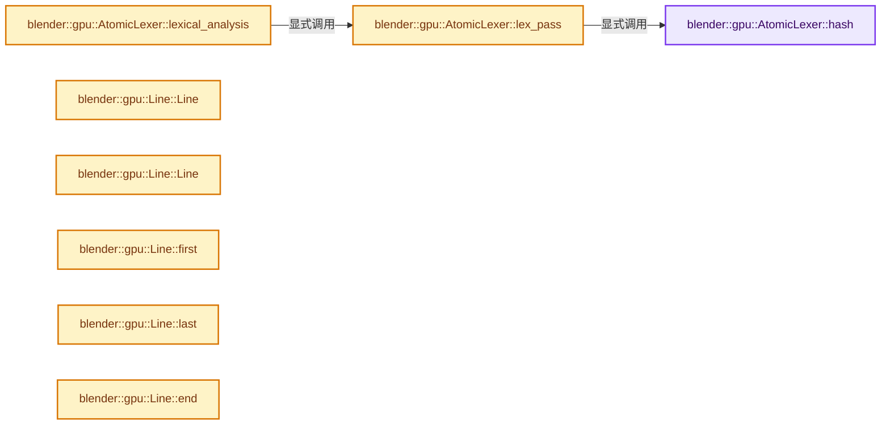
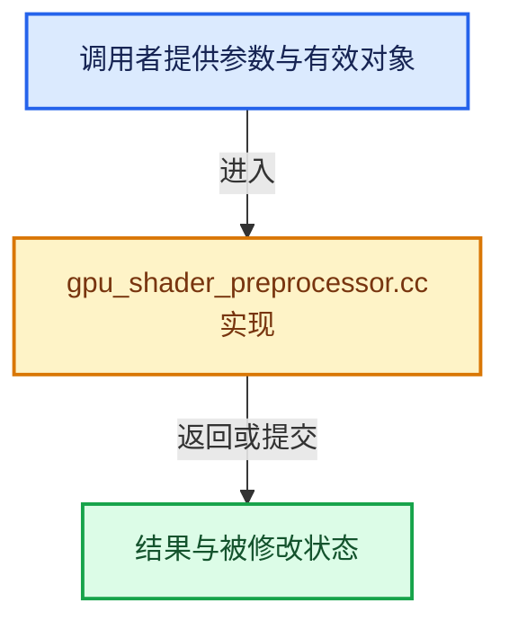

# 实现依赖专题：source/blender/gpu/intern/gpu_shader_preprocessor.cc

[实现依赖导航](../../../README.md) · [符号索引](../../../../00-课程指南/02-源码与提交索引/符号依赖与实现索引.md)

本专题从正文实际调用进入，集中保存共享实现。函数有稳定锚点，可从调用处直接跳到对应完整函数；递归与互相调用通过回链组织。

## 本文件的实现关系






## 相关类型布局与成员入口

<a id="t-19394dc40e1a"></a>

### `blender::gpu::DirectiveType`

原始声明：[source/blender/gpu/intern/gpu_shader_preprocessor.cc](../../../../../../../../source/blender/gpu/intern/gpu_shader_preprocessor.cc) · L313—L326。

以下保留类的数据声明与编译条件，成员函数实现通过后面的精确链接阅读。

<!-- annotated:78966d49460078 -->

```cpp
enum class DirectiveType : char {
  Define = TokenType::Define,
  Undef = TokenType::Undef,
  Line = TokenType::Line,
  If = TokenType::If,
  Ifdef = TokenType::Ifdef,
  Ifndef = TokenType::Ifndef,
  Elif = TokenType::Elif,
  Else = TokenType::Else,
  Endif = TokenType::Endif,
  Pragma = TokenType::Pragma,
  /* Any other unhandled directives (warnings / errors / pragma etc...). */
  Other = TokenType::Word,
};
```

<details>
<summary>核对原始源码：source/blender/gpu/intern/gpu_shader_preprocessor.cc · L313—L326</summary>

<!-- original:78966d49460078:source/blender/gpu/intern/gpu_shader_preprocessor.cc:313:326 -->

```cpp
enum class DirectiveType : char {
  Define = TokenType::Define,
  Undef = TokenType::Undef,
  Line = TokenType::Line,
  If = TokenType::If,
  Ifdef = TokenType::Ifdef,
  Ifndef = TokenType::Ifndef,
  Elif = TokenType::Elif,
  Else = TokenType::Else,
  Endif = TokenType::Endif,
  Pragma = TokenType::Pragma,
  /* Any other unhandled directives (warnings / errors / pragma etc...). */
  Other = TokenType::Word,
};
```

</details>


## 完整成员与函数实现

<a id="f-d1d7de7c7c9a2ee9"></a>

### `blender::gpu::AtomicLexer::hash`

实现位置：[source/blender/gpu/intern/gpu_shader_preprocessor.cc](../../../../../../../../source/blender/gpu/intern/gpu_shader_preprocessor.cc) · L113—L116。

接口参数：

- `StringRef tok_str`

**教学注释版**

<!-- annotated:4c6145e453c685 -->

```cpp
  BLI_INLINE_METHOD TokenAtom hash(StringRef tok_str)
  {
    return identifier_map.lookup_or_add(tok_str);
  }
```

<details>
<summary>核对原始源码：source/blender/gpu/intern/gpu_shader_preprocessor.cc · L113—L116</summary>

<!-- original:4c6145e453c685:source/blender/gpu/intern/gpu_shader_preprocessor.cc:113:116 -->

```cpp
  BLI_INLINE_METHOD TokenAtom hash(StringRef tok_str)
  {
    return identifier_map.lookup_or_add(tok_str);
  }
```

</details>

**结果出口**

- `return identifier_map.lookup_or_add(tok_str);`

**继续追踪实现**

- `identifier_map.lookup_or_add` → [lexit::IdentifierMap::lookup_or_add · L140](../shader_tool/lexit/identifier.hh.md#f-b87c4328f4f33bf0)。

<a id="f-f43546f9b8600c41"></a>

### `blender::gpu::AtomicLexer::lexical_analysis`

实现位置：[source/blender/gpu/intern/gpu_shader_preprocessor.cc](../../../../../../../../source/blender/gpu/intern/gpu_shader_preprocessor.cc) · L137—L141。

接口参数：

- `std::string_view input`

**教学注释版**

<!-- annotated:5c695ac30f650c -->

```cpp
  void lexical_analysis(std::string_view input)
  {
    process(input, lexit::char_class_table);
    lex_pass();
  }
```

<details>
<summary>核对原始源码：source/blender/gpu/intern/gpu_shader_preprocessor.cc · L137—L141</summary>

<!-- original:5c695ac30f650c:source/blender/gpu/intern/gpu_shader_preprocessor.cc:137:141 -->

```cpp
  void lexical_analysis(std::string_view input)
  {
    process(input, lexit::char_class_table);
    lex_pass();
  }
```

</details>

**继续追踪实现**

- `process` → [调用协议](../../../../00-课程指南/01-路线与规范/模板宏与动态分派协议.md)：函数指针、局部可调用对象或未展开的宏；必须结合调用者环境。调用位置L139。
- `lex_pass` → [blender::gpu::AtomicLexer::lex_pass · L154](gpu_shader_preprocessor.cc.md#f-b33881648b16154f)。

<a id="f-b33881648b16154f"></a>

### `blender::gpu::AtomicLexer::lex_pass`

实现位置：[source/blender/gpu/intern/gpu_shader_preprocessor.cc](../../../../../../../../source/blender/gpu/intern/gpu_shader_preprocessor.cc) · L154—L215。

**教学注释版**

<!-- annotated:1ca0ba1352599e -->

```cpp
  BLI_NOINLINE void lex_pass()
  {
    identifier_map.reserve(size());

    // [讲解] std::memset：填充字节，不调用T构造函数，也不保证任意类型的全零表示是合法或期望值。
    std::memset(atoms_.get(), 0, size() * sizeof(TokenAtom));

    /* Reserved 0 atom (invalid). */
    hash(" ");

    KeywordTable keywords({
        identifier_map.make_keyword("line", TokenType::Line),
        identifier_map.make_keyword("define", Define),
        identifier_map.make_keyword("if", If),
        identifier_map.make_keyword("ifdef", Ifdef),
        identifier_map.make_keyword("ifndef", Ifndef),
        identifier_map.make_keyword("else", Else),
        identifier_map.make_keyword("elif", Elif),
        identifier_map.make_keyword("endif", Endif),
        identifier_map.make_keyword("pragma", Pragma),
        identifier_map.make_keyword("undef", Undef),
    });

    /* Not keywords, but warm the identifier map with common identifiers. */
    identifier_map.lookup_or_add("r");
    identifier_map.lookup_or_add("a");
    identifier_map.lookup_or_add("void");
    identifier_map.lookup_or_add("return");
    identifier_map.lookup_or_add("x");
    identifier_map.lookup_or_add("y");
    identifier_map.lookup_or_add("texture");
    identifier_map.lookup_or_add("coord");
    identifier_map.lookup_or_add("struct");
    identifier_map.lookup_or_add("int");
    identifier_map.lookup_or_add("uint");
    identifier_map.lookup_or_add("float");

    atomize_words(identifier_map, keywords);

    /* Create line structure. */
    // [讲解] line_offsets_buf_.resize：把有效元素数调整为new_size。增长路径构造新元素，缩小路径销毁尾部对象，最后才提交新的end_。
    line_offsets_buf_.resize(size_);
    line_offsets_buf_[0] = 0;
    int line_id = 1;
    for (int i = 0; i < size_; ++i) {
      line_offsets_buf_[line_id] = i + 1;
      line_id += types_[i] == NewLine;
    }
    line_offsets_buf_.resize(line_id);
    /* Finish last line. But only do so if it contains at least one character. */
    // [讲解] line_offsets_buf_.last：访问有效范围首端或末端元素。
    if (line_offsets_buf_.last() != size_) {
      // [讲解] line_offsets_buf_.append：在尾部建立新元素，必要时先扩大存储。
      line_offsets_buf_.append(size_);
    }

    /* Create directive structure. */
    // [讲解] directive_lines.reserve：确保可容纳至少min_capacity个元素；当前size和已有元素值不因容量请求本身而增加。
    directive_lines.reserve(line_offsets_buf_.size());
    // [讲解] line_offsets_buf_.size：用end_减begin_得到活元素数量。
    for (int i = 0; i < line_offsets_buf_.size(); ++i) {
      if (types_[line_offsets_buf_[i]] == '#') {
        directive_lines.append(i);
      }
    }

    // [讲解] line_offsets_buf_.as_span：构造对当前有效元素区间的借用视图。
    line_offsets = line_offsets_buf_.as_span();
  }
```

<details>
<summary>核对原始源码：source/blender/gpu/intern/gpu_shader_preprocessor.cc · L154—L215</summary>

<!-- original:1ca0ba1352599e:source/blender/gpu/intern/gpu_shader_preprocessor.cc:154:215 -->

```cpp
  BLI_NOINLINE void lex_pass()
  {
    identifier_map.reserve(size());

    std::memset(atoms_.get(), 0, size() * sizeof(TokenAtom));

    /* Reserved 0 atom (invalid). */
    hash(" ");

    KeywordTable keywords({
        identifier_map.make_keyword("line", TokenType::Line),
        identifier_map.make_keyword("define", Define),
        identifier_map.make_keyword("if", If),
        identifier_map.make_keyword("ifdef", Ifdef),
        identifier_map.make_keyword("ifndef", Ifndef),
        identifier_map.make_keyword("else", Else),
        identifier_map.make_keyword("elif", Elif),
        identifier_map.make_keyword("endif", Endif),
        identifier_map.make_keyword("pragma", Pragma),
        identifier_map.make_keyword("undef", Undef),
    });

    /* Not keywords, but warm the identifier map with common identifiers. */
    identifier_map.lookup_or_add("r");
    identifier_map.lookup_or_add("a");
    identifier_map.lookup_or_add("void");
    identifier_map.lookup_or_add("return");
    identifier_map.lookup_or_add("x");
    identifier_map.lookup_or_add("y");
    identifier_map.lookup_or_add("texture");
    identifier_map.lookup_or_add("coord");
    identifier_map.lookup_or_add("struct");
    identifier_map.lookup_or_add("int");
    identifier_map.lookup_or_add("uint");
    identifier_map.lookup_or_add("float");

    atomize_words(identifier_map, keywords);

    /* Create line structure. */
    line_offsets_buf_.resize(size_);
    line_offsets_buf_[0] = 0;
    int line_id = 1;
    for (int i = 0; i < size_; ++i) {
      line_offsets_buf_[line_id] = i + 1;
      line_id += types_[i] == NewLine;
    }
    line_offsets_buf_.resize(line_id);
    /* Finish last line. But only do so if it contains at least one character. */
    if (line_offsets_buf_.last() != size_) {
      line_offsets_buf_.append(size_);
    }

    /* Create directive structure. */
    directive_lines.reserve(line_offsets_buf_.size());
    for (int i = 0; i < line_offsets_buf_.size(); ++i) {
      if (types_[line_offsets_buf_[i]] == '#') {
        directive_lines.append(i);
      }
    }

    line_offsets = line_offsets_buf_.as_span();
  }
```

</details>

**沿实际写入检查状态**

- `line_offsets_buf_[0] = 0;`
- `line_offsets_buf_[line_id] = i + 1;`
- `line_id += types_[i] == NewLine;`
- `line_offsets = line_offsets_buf_.as_span();`

**继续追踪实现**

- `identifier_map.reserve` → [lexit::IdentifierMap::reserve · L119](../shader_tool/lexit/identifier.hh.md#f-d4936a77bcd55ccc)。
- `size` → [调用协议](../../../../00-课程指南/01-路线与规范/模板宏与动态分派协议.md)：函数指针、局部可调用对象或未展开的宏；必须结合调用者环境。调用位置L156。
- `std::memset` → [外部契约](https://eel.is/c++draft/cstring.syn)：填充字节，不调用T构造函数，也不保证任意类型的全零表示是合法或期望值。
- `atoms_.get` → [调用协议](../../../../00-课程指南/01-路线与规范/模板宏与动态分派协议.md)：接收对象类型依赖auto、返回值或模板实例；不按同名猜测目标。调用位置L158。
- `hash` → [blender::gpu::AtomicLexer::hash · L113](gpu_shader_preprocessor.cc.md#f-d1d7de7c7c9a2ee9)。
- `identifier_map.make_keyword` → [lexit::IdentifierMap::make_keyword · L185](../shader_tool/lexit/identifier.hh.md#f-a52a81c19c9133aa)。
- `identifier_map.lookup_or_add` → [lexit::IdentifierMap::lookup_or_add · L140](../shader_tool/lexit/identifier.hh.md#f-b87c4328f4f33bf0)。
- `atomize_words` → [lexit::TokenBuffer::atomize_words · L671](../shader_tool/lexit/lexit.cc.md#f-95dac04fdffdf946)。
- `line_offsets_buf_.resize` → [blender::Vector::resize · L418](../../../../01-基础容器与现代CPP/10-Vector扩容与增长.md#f-059312cabb8abe3a)；[blender::Vector::resize · L439](../../../../01-基础容器与现代CPP/10-Vector扩容与增长.md#f-ab8f94924ebe2d12)。同名重载需按实参类型选择。
- `line_offsets_buf_.last` → [blender::Vector::last · L749](../../../../01-基础容器与现代CPP/11-Vector插入删除与重排.md#f-d32e1fd895e766b4)；[blender::Vector::last · L755](../../../../01-基础容器与现代CPP/11-Vector插入删除与重排.md#f-66b262993c080d9d)。同名重载需按实参类型选择。
- `line_offsets_buf_.append` → [blender::Vector::append · L498](../../../../01-基础容器与现代CPP/11-Vector插入删除与重排.md#f-5bde268a69e443ec)；[blender::Vector::append · L502](../../../../01-基础容器与现代CPP/11-Vector插入删除与重排.md#f-591e0b15e6308532)。同名重载需按实参类型选择。
- `directive_lines.reserve` → [blender::Vector::reserve · L405](../../../../01-基础容器与现代CPP/10-Vector扩容与增长.md#f-4cf9c0f00e01102e)。
- `line_offsets_buf_.size` → [blender::Vector::size · L780](../../../../01-基础容器与现代CPP/11-Vector插入删除与重排.md#f-714773731767349c)。
- `directive_lines.append` → [blender::Vector::append · L498](../../../../01-基础容器与现代CPP/11-Vector插入删除与重排.md#f-5bde268a69e443ec)；[blender::Vector::append · L502](../../../../01-基础容器与现代CPP/11-Vector插入删除与重排.md#f-591e0b15e6308532)。同名重载需按实参类型选择。
- `line_offsets_buf_.as_span` → [blender::Vector::as_span · L390](../../../../01-基础容器与现代CPP/10-Vector扩容与增长.md#f-e2eed03cefcdd2ff)。

<a id="f-fa4f8a2868488aea"></a>

### `blender::gpu::Line::Line`

实现位置：[source/blender/gpu/intern/gpu_shader_preprocessor.cc](../../../../../../../../source/blender/gpu/intern/gpu_shader_preprocessor.cc) · L238—L238。

**教学注释版**

<!-- annotated:13f0b83b60bbaf -->

```cpp
  Line() : lex_(nullptr), index_(-1) {};
```

<details>
<summary>核对原始源码：source/blender/gpu/intern/gpu_shader_preprocessor.cc · L238—L238</summary>

<!-- original:13f0b83b60bbaf:source/blender/gpu/intern/gpu_shader_preprocessor.cc:238:238 -->

```cpp
  Line() : lex_(nullptr), index_(-1) {};
```

</details>

**继续追踪实现**

本实现没有需要继续展开的显式调用；检查返回表达式、对象转换和调用者前置条件。

<a id="f-480213d3364ad335"></a>

### `blender::gpu::Line::Line`

实现位置：[source/blender/gpu/intern/gpu_shader_preprocessor.cc](../../../../../../../../source/blender/gpu/intern/gpu_shader_preprocessor.cc) · L240—L246。

接口参数：

- `const AtomicLexer *lex`
- `int index`

**教学注释版**

<!-- annotated:b86af39af90990 -->

```cpp
  Line(const AtomicLexer *lex, int index) : lex_(lex), index_(index)
  {
    BLI_assert(is_valid());
#ifdef DEBUG_ID_STRING
    debug_str_ = str();
#endif
  };
```

<details>
<summary>核对原始源码：source/blender/gpu/intern/gpu_shader_preprocessor.cc · L240—L246</summary>

<!-- original:b86af39af90990:source/blender/gpu/intern/gpu_shader_preprocessor.cc:240:246 -->

```cpp
  Line(const AtomicLexer *lex, int index) : lex_(lex), index_(index)
  {
    BLI_assert(is_valid());
#ifdef DEBUG_ID_STRING
    debug_str_ = str();
#endif
  };
```

</details>

**沿实际写入检查状态**

- `debug_str_ = str();`

**继续追踪实现**

- `BLI_assert` → [BLI_assert · L48](../../../01-BLI基础库/BLI_assert.hh.md#m-57a88495704d)；[BLI_assert · L63](../../../01-BLI基础库/BLI_assert.hh.md#m-d07050020cb5)。宏定义由构建条件选择。
- `is_valid` → [blender::gpu::Line::is_valid · L286](gpu_shader_preprocessor.cc.md#f-046708c49d595d57)。
- `str` → [blender::gpu::Line::str · L275](gpu_shader_preprocessor.cc.md#f-cb9029061152a7f9)。

<a id="f-89f3ab568080e5e7"></a>

### `blender::gpu::Line::first`

实现位置：[source/blender/gpu/intern/gpu_shader_preprocessor.cc](../../../../../../../../source/blender/gpu/intern/gpu_shader_preprocessor.cc) · L259—L262。

**教学注释版**

<!-- annotated:af91422791a3d5 -->

```cpp
  Token first() const
  {
    return (*lex_)[lex_->line_offsets[index_].first()];
  }
```

<details>
<summary>核对原始源码：source/blender/gpu/intern/gpu_shader_preprocessor.cc · L259—L262</summary>

<!-- original:af91422791a3d5:source/blender/gpu/intern/gpu_shader_preprocessor.cc:259:262 -->

```cpp
  Token first() const
  {
    return (*lex_)[lex_->line_offsets[index_].first()];
  }
```

</details>

**结果出口**

- `return (*lex_)[lex_->line_offsets[index_].first()];`

**继续追踪实现**

- `lex_->line_offsets[index_].first` → [调用协议](../../../../00-课程指南/01-路线与规范/模板宏与动态分派协议.md)：接收对象类型依赖auto、返回值或模板实例；不按同名猜测目标。调用位置L261。

<a id="f-1487966bb4e46cb5"></a>

### `blender::gpu::Line::last`

实现位置：[source/blender/gpu/intern/gpu_shader_preprocessor.cc](../../../../../../../../source/blender/gpu/intern/gpu_shader_preprocessor.cc) · L264—L268。

**教学注释版**

<!-- annotated:743e99008a0416 -->

```cpp
  Token last() const
  {
    blender::IndexRange range = lex_->line_offsets[index_];
    // [讲解] range.size：读取连续区间或分组的边界信息。
    return (*lex_)[range.size() > 1 ? range.last(1) : range.last()];
  }
```

<details>
<summary>核对原始源码：source/blender/gpu/intern/gpu_shader_preprocessor.cc · L264—L268</summary>

<!-- original:743e99008a0416:source/blender/gpu/intern/gpu_shader_preprocessor.cc:264:268 -->

```cpp
  Token last() const
  {
    blender::IndexRange range = lex_->line_offsets[index_];
    return (*lex_)[range.size() > 1 ? range.last(1) : range.last()];
  }
```

</details>

**结果出口**

- `return (*lex_)[range.size() > 1 ? range.last(1) : range.last()];`

**继续追踪实现**

- `range.size` → [blender::IndexRange::size · L156](../../../../01-基础容器与现代CPP/04-IndexRange连续整数区间.md#f-05f66c3ebb2fdfec)。
- `range.last` → [blender::gpu::shader::parser::IndexRange::last · L62](../shader_tool/utils.hh.md#f-373501206569c3b3)。

<a id="f-859dc86ec220f554"></a>

### `blender::gpu::Line::end`

实现位置：[source/blender/gpu/intern/gpu_shader_preprocessor.cc](../../../../../../../../source/blender/gpu/intern/gpu_shader_preprocessor.cc) · L270—L273。

**教学注释版**

<!-- annotated:df0cc788b913a2 -->

```cpp
  Token end() const
  {
    return (*lex_)[lex_->line_offsets[index_].last()];
  }
```

<details>
<summary>核对原始源码：source/blender/gpu/intern/gpu_shader_preprocessor.cc · L270—L273</summary>

<!-- original:df0cc788b913a2:source/blender/gpu/intern/gpu_shader_preprocessor.cc:270:273 -->

```cpp
  Token end() const
  {
    return (*lex_)[lex_->line_offsets[index_].last()];
  }
```

</details>

**结果出口**

- `return (*lex_)[lex_->line_offsets[index_].last()];`

**继续追踪实现**

- `lex_->line_offsets[index_].last` → [调用协议](../../../../00-课程指南/01-路线与规范/模板宏与动态分派协议.md)：接收对象类型依赖auto、返回值或模板实例；不按同名猜测目标。调用位置L272。

<a id="f-cb9029061152a7f9"></a>

### `blender::gpu::Line::str`

实现位置：[source/blender/gpu/intern/gpu_shader_preprocessor.cc](../../../../../../../../source/blender/gpu/intern/gpu_shader_preprocessor.cc) · L275—L279。

**教学注释版**

<!-- annotated:90194de842aab0 -->

```cpp
  StringRef str() const
  {
    IndexRange range = lex_->line_offsets[index_];
    // [讲解] range.first：读取范围两端的有效索引或值。
    return lex_->substr((*lex_)[range.first()], (*lex_)[range.last()]);
  }
```

<details>
<summary>核对原始源码：source/blender/gpu/intern/gpu_shader_preprocessor.cc · L275—L279</summary>

<!-- original:90194de842aab0:source/blender/gpu/intern/gpu_shader_preprocessor.cc:275:279 -->

```cpp
  StringRef str() const
  {
    IndexRange range = lex_->line_offsets[index_];
    return lex_->substr((*lex_)[range.first()], (*lex_)[range.last()]);
  }
```

</details>

**结果出口**

- `return lex_->substr((*lex_)[range.first()], (*lex_)[range.last()]);`

**继续追踪实现**

- `lex_->substr` → [调用协议](../../../../00-课程指南/01-路线与规范/模板宏与动态分派协议.md)：由接收对象具体类型或运行时策略提供实现。调用位置L278。
- `range.first` → [blender::IndexRange::first · L204](../../../../01-基础容器与现代CPP/04-IndexRange连续整数区间.md#f-ab443c94e531befa)。
- `range.last` → [blender::gpu::shader::parser::IndexRange::last · L62](../shader_tool/utils.hh.md#f-373501206569c3b3)。

<a id="f-c29512bf9b216be2"></a>

### `blender::gpu::Line::is_last`

实现位置：[source/blender/gpu/intern/gpu_shader_preprocessor.cc](../../../../../../../../source/blender/gpu/intern/gpu_shader_preprocessor.cc) · L281—L284。

**教学注释版**

<!-- annotated:04092c03732c32 -->

```cpp
  bool is_last() const
  {
    return (lex_->line_offsets.size() - 1) == index_;
  }
```

<details>
<summary>核对原始源码：source/blender/gpu/intern/gpu_shader_preprocessor.cc · L281—L284</summary>

<!-- original:04092c03732c32:source/blender/gpu/intern/gpu_shader_preprocessor.cc:281:284 -->

```cpp
  bool is_last() const
  {
    return (lex_->line_offsets.size() - 1) == index_;
  }
```

</details>

**结果出口**

- `return (lex_->line_offsets.size() - 1) == index_;`

**继续追踪实现**

- `lex_->line_offsets.size` → [调用协议](../../../../00-课程指南/01-路线与规范/模板宏与动态分派协议.md)：接收对象类型依赖auto、返回值或模板实例；不按同名猜测目标。调用位置L283。

<a id="f-046708c49d595d57"></a>

### `blender::gpu::Line::is_valid`

实现位置：[source/blender/gpu/intern/gpu_shader_preprocessor.cc](../../../../../../../../source/blender/gpu/intern/gpu_shader_preprocessor.cc) · L286—L289。

**教学注释版**

<!-- annotated:4af1e238817fd6 -->

```cpp
  bool is_valid() const
  {
    return index_ >= 0 && index_ < lex_->line_offsets.size();
  }
```

<details>
<summary>核对原始源码：source/blender/gpu/intern/gpu_shader_preprocessor.cc · L286—L289</summary>

<!-- original:4af1e238817fd6:source/blender/gpu/intern/gpu_shader_preprocessor.cc:286:289 -->

```cpp
  bool is_valid() const
  {
    return index_ >= 0 && index_ < lex_->line_offsets.size();
  }
```

</details>

**结果出口**

- `return index_ >= 0 && index_ < lex_->line_offsets.size();`

**继续追踪实现**

- `lex_->line_offsets.size` → [调用协议](../../../../00-课程指南/01-路线与规范/模板宏与动态分派协议.md)：接收对象类型依赖auto、返回值或模板实例；不按同名猜测目标。调用位置L288。

<a id="f-af657e689e7ce940"></a>

### `blender::gpu::Line::next`

实现位置：[source/blender/gpu/intern/gpu_shader_preprocessor.cc](../../../../../../../../source/blender/gpu/intern/gpu_shader_preprocessor.cc) · L292—L295。

**教学注释版**

<!-- annotated:86e531f041be89 -->

```cpp
  Line next() const
  {
    return Line(lex_, index_ + 1);
  }
```

<details>
<summary>核对原始源码：source/blender/gpu/intern/gpu_shader_preprocessor.cc · L292—L295</summary>

<!-- original:86e531f041be89:source/blender/gpu/intern/gpu_shader_preprocessor.cc:292:295 -->

```cpp
  Line next() const
  {
    return Line(lex_, index_ + 1);
  }
```

</details>

**结果出口**

- `return Line(lex_, index_ + 1);`

**继续追踪实现**

- `Line` → [blender::gpu::Line::Line · L238](gpu_shader_preprocessor.cc.md#f-fa4f8a2868488aea)；[blender::gpu::Line::Line · L240](gpu_shader_preprocessor.cc.md#f-480213d3364ad335)。同名重载需按实参类型选择。

<a id="f-e67b8f6df1955d7a"></a>

### `blender::gpu::Directive::Directive`

实现位置：[source/blender/gpu/intern/gpu_shader_preprocessor.cc](../../../../../../../../source/blender/gpu/intern/gpu_shader_preprocessor.cc) · L340—L340。

**教学注释版**

<!-- annotated:44017b6142a8a1 -->

```cpp
  Directive() : lex_(nullptr), index_(-1) {};
```

<details>
<summary>核对原始源码：source/blender/gpu/intern/gpu_shader_preprocessor.cc · L340—L340</summary>

<!-- original:44017b6142a8a1:source/blender/gpu/intern/gpu_shader_preprocessor.cc:340:340 -->

```cpp
  Directive() : lex_(nullptr), index_(-1) {};
```

</details>

**继续追踪实现**

本实现没有需要继续展开的显式调用；检查返回表达式、对象转换和调用者前置条件。

<a id="f-4ceb390ed6cd1e34"></a>

### `blender::gpu::Directive::Directive`

实现位置：[source/blender/gpu/intern/gpu_shader_preprocessor.cc](../../../../../../../../source/blender/gpu/intern/gpu_shader_preprocessor.cc) · L341—L347。

接口参数：

- `const AtomicLexer *lex`
- `int index`

**教学注释版**

<!-- annotated:baef984d45c89c -->

```cpp
  Directive(const AtomicLexer *lex, int index) : lex_(lex), index_(index)
  {
    BLI_assert(is_valid());
#ifdef DEBUG_ID_STRING
    debug_str_ = str();
#endif
  };
```

<details>
<summary>核对原始源码：source/blender/gpu/intern/gpu_shader_preprocessor.cc · L341—L347</summary>

<!-- original:baef984d45c89c:source/blender/gpu/intern/gpu_shader_preprocessor.cc:341:347 -->

```cpp
  Directive(const AtomicLexer *lex, int index) : lex_(lex), index_(index)
  {
    BLI_assert(is_valid());
#ifdef DEBUG_ID_STRING
    debug_str_ = str();
#endif
  };
```

</details>

**沿实际写入检查状态**

- `debug_str_ = str();`

**继续追踪实现**

- `BLI_assert` → [BLI_assert · L48](../../../01-BLI基础库/BLI_assert.hh.md#m-57a88495704d)；[BLI_assert · L63](../../../01-BLI基础库/BLI_assert.hh.md#m-d07050020cb5)。宏定义由构建条件选择。
- `is_valid` → [blender::gpu::Directive::is_valid · L390](gpu_shader_preprocessor.cc.md#f-5acb204e33e41dcb)。
- `str` → [blender::gpu::Directive::str · L409](gpu_shader_preprocessor.cc.md#f-3a18ec34b103a99b)。

<a id="f-2b0fed4eea56216b"></a>

### `blender::gpu::Directive::invalid`

实现位置：[source/blender/gpu/intern/gpu_shader_preprocessor.cc](../../../../../../../../source/blender/gpu/intern/gpu_shader_preprocessor.cc) · L350—L353。

**教学注释版**

<!-- annotated:68766a6a4a0170 -->

```cpp
  static Directive invalid()
  {
    return Directive();
  }
```

<details>
<summary>核对原始源码：source/blender/gpu/intern/gpu_shader_preprocessor.cc · L350—L353</summary>

<!-- original:68766a6a4a0170:source/blender/gpu/intern/gpu_shader_preprocessor.cc:350:353 -->

```cpp
  static Directive invalid()
  {
    return Directive();
  }
```

</details>

**结果出口**

- `return Directive();`

**继续追踪实现**

- `Directive` → [blender::gpu::Directive::Directive · L340](gpu_shader_preprocessor.cc.md#f-e67b8f6df1955d7a)；[blender::gpu::Directive::Directive · L341](gpu_shader_preprocessor.cc.md#f-4ceb390ed6cd1e34)。同名重载需按实参类型选择。

<a id="f-b463d18acf6a1449"></a>

### `blender::gpu::Directive::first`

实现位置：[source/blender/gpu/intern/gpu_shader_preprocessor.cc](../../../../../../../../source/blender/gpu/intern/gpu_shader_preprocessor.cc) · L360—L363。

**教学注释版**

<!-- annotated:b45a6e2ffece69 -->

```cpp
  Line first() const
  {
    return lex_->line(lex_->directive_lines[index_]);
  }
```

<details>
<summary>核对原始源码：source/blender/gpu/intern/gpu_shader_preprocessor.cc · L360—L363</summary>

<!-- original:b45a6e2ffece69:source/blender/gpu/intern/gpu_shader_preprocessor.cc:360:363 -->

```cpp
  Line first() const
  {
    return lex_->line(lex_->directive_lines[index_]);
  }
```

</details>

**结果出口**

- `return lex_->line(lex_->directive_lines[index_]);`

**继续追踪实现**

- `lex_->line` → [blender::gpu::AtomicLexer::line · L485](gpu_shader_preprocessor.cc.md#f-e1df097b5a760a05)。

<a id="f-b19a4a76a51136ea"></a>

### `blender::gpu::Directive::last`

实现位置：[source/blender/gpu/intern/gpu_shader_preprocessor.cc](../../../../../../../../source/blender/gpu/intern/gpu_shader_preprocessor.cc) · L365—L373。

**教学注释版**

<!-- annotated:e175616bbd6a90 -->

```cpp
  Line last() const
  {
    /* Could be precomputed if becoming a bottleneck. */
    Line line = first();
    while (line.last() == Backslash) {
      line = line.next();
    }
    return line;
  }
```

<details>
<summary>核对原始源码：source/blender/gpu/intern/gpu_shader_preprocessor.cc · L365—L373</summary>

<!-- original:e175616bbd6a90:source/blender/gpu/intern/gpu_shader_preprocessor.cc:365:373 -->

```cpp
  Line last() const
  {
    /* Could be precomputed if becoming a bottleneck. */
    Line line = first();
    while (line.last() == Backslash) {
      line = line.next();
    }
    return line;
  }
```

</details>

**沿实际写入检查状态**

- `line = line.next();`

**结果出口**

- `return line;`

**继续追踪实现**

- `first` → [blender::gpu::Directive::first · L360](gpu_shader_preprocessor.cc.md#f-b463d18acf6a1449)。
- `line.last` → [blender::gpu::Line::last · L264](gpu_shader_preprocessor.cc.md#f-1487966bb4e46cb5)。
- `line.next` → [blender::gpu::Line::next · L292](gpu_shader_preprocessor.cc.md#f-af657e689e7ce940)。

<a id="f-40070f851664c27b"></a>

### `blender::gpu::Directive::type`

实现位置：[source/blender/gpu/intern/gpu_shader_preprocessor.cc](../../../../../../../../source/blender/gpu/intern/gpu_shader_preprocessor.cc) · L375—L378。

**教学注释版**

<!-- annotated:aeff028a061953 -->

```cpp
  DirectiveType type() const
  {
    return DirectiveType(identifier().type());
  }
```

<details>
<summary>核对原始源码：source/blender/gpu/intern/gpu_shader_preprocessor.cc · L375—L378</summary>

<!-- original:aeff028a061953:source/blender/gpu/intern/gpu_shader_preprocessor.cc:375:378 -->

```cpp
  DirectiveType type() const
  {
    return DirectiveType(identifier().type());
  }
```

</details>

**结果出口**

- `return DirectiveType(identifier().type());`

**继续追踪实现**

- `DirectiveType` → [blender::gpu::DirectiveType](gpu_shader_preprocessor.cc.md#t-19394dc40e1a)。
- `identifier().type` → [调用协议](../../../../00-课程指南/01-路线与规范/模板宏与动态分派协议.md)：接收对象类型依赖auto、返回值或模板实例；不按同名猜测目标。调用位置L377。
- `identifier` → [blender::gpu::Directive::identifier · L381](gpu_shader_preprocessor.cc.md#f-2d4be9fcf06f53d8)。

<a id="f-2d4be9fcf06f53d8"></a>

### `blender::gpu::Directive::identifier`

实现位置：[source/blender/gpu/intern/gpu_shader_preprocessor.cc](../../../../../../../../source/blender/gpu/intern/gpu_shader_preprocessor.cc) · L381—L388。

**教学注释版**

<!-- annotated:cc63e861a0fb12 -->

```cpp
  Token identifier() const
  {
    Line line = first();
    Token hash_tok = line.first();
    BLI_assert(hash_tok == Hash);
    Token dir_tok = hash_tok.next();
    return dir_tok;
  }
```

<details>
<summary>核对原始源码：source/blender/gpu/intern/gpu_shader_preprocessor.cc · L381—L388</summary>

<!-- original:cc63e861a0fb12:source/blender/gpu/intern/gpu_shader_preprocessor.cc:381:388 -->

```cpp
  Token identifier() const
  {
    Line line = first();
    Token hash_tok = line.first();
    BLI_assert(hash_tok == Hash);
    Token dir_tok = hash_tok.next();
    return dir_tok;
  }
```

</details>

**结果出口**

- `return dir_tok;`

**继续追踪实现**

- `first` → [blender::gpu::Directive::first · L360](gpu_shader_preprocessor.cc.md#f-b463d18acf6a1449)。
- `line.first` → [blender::gpu::Line::first · L259](gpu_shader_preprocessor.cc.md#f-89f3ab568080e5e7)。
- `BLI_assert` → [BLI_assert · L48](../../../01-BLI基础库/BLI_assert.hh.md#m-57a88495704d)；[BLI_assert · L63](../../../01-BLI基础库/BLI_assert.hh.md#m-d07050020cb5)。宏定义由构建条件选择。
- `hash_tok.next` → [blender::gpu::shader::parser::Token::next · L33](../shader_tool/token.hh.md#f-6c97bb2a10e7f32a)。

<a id="f-5acb204e33e41dcb"></a>

### `blender::gpu::Directive::is_valid`

实现位置：[source/blender/gpu/intern/gpu_shader_preprocessor.cc](../../../../../../../../source/blender/gpu/intern/gpu_shader_preprocessor.cc) · L390—L393。

**教学注释版**

<!-- annotated:3368ca9884c4a0 -->

```cpp
  bool is_valid() const
  {
    return index_ >= 0 && index_ < lex_->directive_lines.size();
  }
```

<details>
<summary>核对原始源码：source/blender/gpu/intern/gpu_shader_preprocessor.cc · L390—L393</summary>

<!-- original:3368ca9884c4a0:source/blender/gpu/intern/gpu_shader_preprocessor.cc:390:393 -->

```cpp
  bool is_valid() const
  {
    return index_ >= 0 && index_ < lex_->directive_lines.size();
  }
```

</details>

**结果出口**

- `return index_ >= 0 && index_ < lex_->directive_lines.size();`

**继续追踪实现**

- `lex_->directive_lines.size` → [调用协议](../../../../00-课程指南/01-路线与规范/模板宏与动态分派协议.md)：接收对象类型依赖auto、返回值或模板实例；不按同名猜测目标。调用位置L392。

<a id="f-4f3b83c06214817c"></a>

### `blender::gpu::Directive::is_last`

实现位置：[source/blender/gpu/intern/gpu_shader_preprocessor.cc](../../../../../../../../source/blender/gpu/intern/gpu_shader_preprocessor.cc) · L395—L398。

**教学注释版**

<!-- annotated:053cd1d301b333 -->

```cpp
  bool is_last() const
  {
    return (lex_->directive_lines.size() - 1) == index_;
  }
```

<details>
<summary>核对原始源码：source/blender/gpu/intern/gpu_shader_preprocessor.cc · L395—L398</summary>

<!-- original:053cd1d301b333:source/blender/gpu/intern/gpu_shader_preprocessor.cc:395:398 -->

```cpp
  bool is_last() const
  {
    return (lex_->directive_lines.size() - 1) == index_;
  }
```

</details>

**结果出口**

- `return (lex_->directive_lines.size() - 1) == index_;`

**继续追踪实现**

- `lex_->directive_lines.size` → [调用协议](../../../../00-课程指南/01-路线与规范/模板宏与动态分派协议.md)：接收对象类型依赖auto、返回值或模板实例；不按同名猜测目标。调用位置L397。

<a id="f-f46df1f694e18539"></a>

### `blender::gpu::Directive::next`

实现位置：[source/blender/gpu/intern/gpu_shader_preprocessor.cc](../../../../../../../../source/blender/gpu/intern/gpu_shader_preprocessor.cc) · L400—L403。

**教学注释版**

<!-- annotated:3f76241f7a1182 -->

```cpp
  Directive next() const
  {
    return Directive(lex_, index_ + 1);
  }
```

<details>
<summary>核对原始源码：source/blender/gpu/intern/gpu_shader_preprocessor.cc · L400—L403</summary>

<!-- original:3f76241f7a1182:source/blender/gpu/intern/gpu_shader_preprocessor.cc:400:403 -->

```cpp
  Directive next() const
  {
    return Directive(lex_, index_ + 1);
  }
```

</details>

**结果出口**

- `return Directive(lex_, index_ + 1);`

**继续追踪实现**

- `Directive` → [blender::gpu::Directive::Directive · L340](gpu_shader_preprocessor.cc.md#f-e67b8f6df1955d7a)；[blender::gpu::Directive::Directive · L341](gpu_shader_preprocessor.cc.md#f-4ceb390ed6cd1e34)。同名重载需按实参类型选择。

<a id="f-3a18ec34b103a99b"></a>

### `blender::gpu::Directive::str`

实现位置：[source/blender/gpu/intern/gpu_shader_preprocessor.cc](../../../../../../../../source/blender/gpu/intern/gpu_shader_preprocessor.cc) · L409—L416。

**教学注释版**

<!-- annotated:9dd414418de11b -->

```cpp
  StringRef str() const
  {
    Line start = first();
    Line end = last();
    Token tok_start = start.first();
    Token tok_end = end.last();
    return lex_->substr(tok_start, tok_end);
  }
```

<details>
<summary>核对原始源码：source/blender/gpu/intern/gpu_shader_preprocessor.cc · L409—L416</summary>

<!-- original:9dd414418de11b:source/blender/gpu/intern/gpu_shader_preprocessor.cc:409:416 -->

```cpp
  StringRef str() const
  {
    Line start = first();
    Line end = last();
    Token tok_start = start.first();
    Token tok_end = end.last();
    return lex_->substr(tok_start, tok_end);
  }
```

</details>

**结果出口**

- `return lex_->substr(tok_start, tok_end);`

**继续追踪实现**

- `first` → [blender::gpu::Directive::first · L360](gpu_shader_preprocessor.cc.md#f-b463d18acf6a1449)。
- `last` → [blender::gpu::Directive::last · L365](gpu_shader_preprocessor.cc.md#f-b19a4a76a51136ea)。
- `start.first` → [blender::gpu::Line::first · L259](gpu_shader_preprocessor.cc.md#f-89f3ab568080e5e7)。
- `end.last` → [blender::gpu::Line::last · L264](gpu_shader_preprocessor.cc.md#f-1487966bb4e46cb5)。
- `lex_->substr` → [调用协议](../../../../00-课程指南/01-路线与规范/模板宏与动态分派协议.md)：由接收对象具体类型或运行时策略提供实现。调用位置L415。

<a id="f-ece3b15afb843801"></a>

### `blender::gpu::Directive::str_with_whitespace`

实现位置：[source/blender/gpu/intern/gpu_shader_preprocessor.cc](../../../../../../../../source/blender/gpu/intern/gpu_shader_preprocessor.cc) · L418—L425。

**教学注释版**

<!-- annotated:c65d1bdbfdd0c1 -->

```cpp
  StringRef str_with_whitespace() const
  {
    Line start = first();
    Line end = last();
    Token tok_start = start.first();
    Token tok_end = end.end();
    return lex_->substr(tok_start, tok_end);
  }
```

<details>
<summary>核对原始源码：source/blender/gpu/intern/gpu_shader_preprocessor.cc · L418—L425</summary>

<!-- original:c65d1bdbfdd0c1:source/blender/gpu/intern/gpu_shader_preprocessor.cc:418:425 -->

```cpp
  StringRef str_with_whitespace() const
  {
    Line start = first();
    Line end = last();
    Token tok_start = start.first();
    Token tok_end = end.end();
    return lex_->substr(tok_start, tok_end);
  }
```

</details>

**结果出口**

- `return lex_->substr(tok_start, tok_end);`

**继续追踪实现**

- `first` → [blender::gpu::Directive::first · L360](gpu_shader_preprocessor.cc.md#f-b463d18acf6a1449)。
- `last` → [blender::gpu::Directive::last · L365](gpu_shader_preprocessor.cc.md#f-b19a4a76a51136ea)。
- `start.first` → [blender::gpu::Line::first · L259](gpu_shader_preprocessor.cc.md#f-89f3ab568080e5e7)。
- `end.end` → [blender::gpu::Line::end · L270](gpu_shader_preprocessor.cc.md#f-859dc86ec220f554)。
- `lex_->substr` → [调用协议](../../../../00-课程指南/01-路线与规范/模板宏与动态分派协议.md)：由接收对象具体类型或运行时策略提供实现。调用位置L424。

<a id="f-0e8d444eb98d9ebd"></a>

### `blender::gpu::increment_to_next_conditional`

实现位置：[source/blender/gpu/intern/gpu_shader_preprocessor.cc](../../../../../../../../source/blender/gpu/intern/gpu_shader_preprocessor.cc) · L439—L460。

接口参数：

- `Directive &dir`

**教学注释版**

<!-- annotated:263397d04d066a -->

```cpp
static DirectiveType increment_to_next_conditional(Directive &dir)
{
  dir = dir.next();
  while (dir.is_valid()) {
    DirectiveType type = dir.type();
    if (ELEM(type,
             DirectiveType::If,
             DirectiveType::Ifdef,
             DirectiveType::Ifndef,
             DirectiveType::Else,
             DirectiveType::Elif,
             DirectiveType::Endif))
    {
      return type;
    }
    dir = dir.next();
  }
  /* Missing matching #endif. */
  // TODO exception?
  BLI_assert_unreachable();
  return DirectiveType::Other;
}
```

<details>
<summary>核对原始源码：source/blender/gpu/intern/gpu_shader_preprocessor.cc · L439—L460</summary>

<!-- original:263397d04d066a:source/blender/gpu/intern/gpu_shader_preprocessor.cc:439:460 -->

```cpp
static DirectiveType increment_to_next_conditional(Directive &dir)
{
  dir = dir.next();
  while (dir.is_valid()) {
    DirectiveType type = dir.type();
    if (ELEM(type,
             DirectiveType::If,
             DirectiveType::Ifdef,
             DirectiveType::Ifndef,
             DirectiveType::Else,
             DirectiveType::Elif,
             DirectiveType::Endif))
    {
      return type;
    }
    dir = dir.next();
  }
  /* Missing matching #endif. */
  // TODO exception?
  BLI_assert_unreachable();
  return DirectiveType::Other;
}
```

</details>

**沿实际写入检查状态**

- `dir = dir.next();`

**结果出口**

- `return type;`
- `return DirectiveType::Other;`

**继续追踪实现**

- `dir.next` → [blender::gpu::Directive::next · L400](gpu_shader_preprocessor.cc.md#f-f46df1f694e18539)。
- `dir.is_valid` → [blender::gpu::Directive::is_valid · L390](gpu_shader_preprocessor.cc.md#f-5acb204e33e41dcb)。
- `dir.type` → [blender::gpu::Directive::type · L375](gpu_shader_preprocessor.cc.md#f-40070f851664c27b)。
- `ELEM` → [ELEM · L88](../../../07-Intern运行时与平台/ghost/intern/GHOST_utildefines.hh.md#m-d28724a15928)；[ELEM · L135](../../../01-BLI基础库/BLI_utildefines.hh.md#m-d6572de7cae0)。宏定义由构建条件选择。
- `BLI_assert_unreachable` → [BLI_assert_unreachable · L77](../../../01-BLI基础库/BLI_assert.hh.md#m-7a2d91a67d8e)。宏定义由构建条件选择。

<a id="f-750eb627b73285d3"></a>

### `blender::gpu::find_next_matching_conditional`

实现位置：[source/blender/gpu/intern/gpu_shader_preprocessor.cc](../../../../../../../../source/blender/gpu/intern/gpu_shader_preprocessor.cc) · L462—L483。

接口参数：

- `Directive dir`

**教学注释版**

<!-- annotated:6e5b000f04955c -->

```cpp
static Directive find_next_matching_conditional(Directive dir)
{
  int stack = 1;
  while (dir.is_valid()) {
    DirectiveType type = increment_to_next_conditional(dir);
    if (ELEM(type, DirectiveType::If, DirectiveType::Ifdef, DirectiveType::Ifndef)) {
      stack++;
    }
    else if (ELEM(type, DirectiveType::Endif)) {
      stack--;
    }

    if (stack == 0) {
      return dir; /* Endif. */
    }
    if (stack == 1 && ELEM(type, DirectiveType::Else, DirectiveType::Elif)) {
      return dir;
    }
  }
  BLI_assert_unreachable();
  return Directive::invalid();
}
```

<details>
<summary>核对原始源码：source/blender/gpu/intern/gpu_shader_preprocessor.cc · L462—L483</summary>

<!-- original:6e5b000f04955c:source/blender/gpu/intern/gpu_shader_preprocessor.cc:462:483 -->

```cpp
static Directive find_next_matching_conditional(Directive dir)
{
  int stack = 1;
  while (dir.is_valid()) {
    DirectiveType type = increment_to_next_conditional(dir);
    if (ELEM(type, DirectiveType::If, DirectiveType::Ifdef, DirectiveType::Ifndef)) {
      stack++;
    }
    else if (ELEM(type, DirectiveType::Endif)) {
      stack--;
    }

    if (stack == 0) {
      return dir; /* Endif. */
    }
    if (stack == 1 && ELEM(type, DirectiveType::Else, DirectiveType::Elif)) {
      return dir;
    }
  }
  BLI_assert_unreachable();
  return Directive::invalid();
}
```

</details>

**结果出口**

- `return dir; /* Endif. */`
- `return dir;`
- `return Directive::invalid();`

**继续追踪实现**

- `dir.is_valid` → [blender::gpu::Directive::is_valid · L390](gpu_shader_preprocessor.cc.md#f-5acb204e33e41dcb)。
- `increment_to_next_conditional` → [blender::gpu::increment_to_next_conditional · L439](gpu_shader_preprocessor.cc.md#f-0e8d444eb98d9ebd)。
- `ELEM` → [ELEM · L88](../../../07-Intern运行时与平台/ghost/intern/GHOST_utildefines.hh.md#m-d28724a15928)；[ELEM · L135](../../../01-BLI基础库/BLI_utildefines.hh.md#m-d6572de7cae0)。宏定义由构建条件选择。
- `BLI_assert_unreachable` → [BLI_assert_unreachable · L77](../../../01-BLI基础库/BLI_assert.hh.md#m-7a2d91a67d8e)。宏定义由构建条件选择。
- `Directive::invalid` → [blender::gpu::Directive::invalid · L350](gpu_shader_preprocessor.cc.md#f-2b0fed4eea56216b)。

<a id="f-e1df097b5a760a05"></a>

### `blender::gpu::AtomicLexer::line`

实现位置：[source/blender/gpu/intern/gpu_shader_preprocessor.cc](../../../../../../../../source/blender/gpu/intern/gpu_shader_preprocessor.cc) · L485—L488。

接口参数：

- `int index`

**教学注释版**

<!-- annotated:bf7e2bcd784616 -->

```cpp
Line AtomicLexer::line(int index) const
{
  return Line(this, index);
}
```

<details>
<summary>核对原始源码：source/blender/gpu/intern/gpu_shader_preprocessor.cc · L485—L488</summary>

<!-- original:bf7e2bcd784616:source/blender/gpu/intern/gpu_shader_preprocessor.cc:485:488 -->

```cpp
Line AtomicLexer::line(int index) const
{
  return Line(this, index);
}
```

</details>

**结果出口**

- `return Line(this, index);`

**继续追踪实现**

- `Line` → [blender::gpu::Line::Line · L238](gpu_shader_preprocessor.cc.md#f-fa4f8a2868488aea)；[blender::gpu::Line::Line · L240](gpu_shader_preprocessor.cc.md#f-480213d3364ad335)。同名重载需按实参类型选择。

<a id="f-07ff1c93c5d71bd2"></a>

### `blender::gpu::AtomicLexer::directive`

实现位置：[source/blender/gpu/intern/gpu_shader_preprocessor.cc](../../../../../../../../source/blender/gpu/intern/gpu_shader_preprocessor.cc) · L490—L493。

接口参数：

- `int index`

**教学注释版**

<!-- annotated:1f62dc13b8247d -->

```cpp
Directive AtomicLexer::directive(int index) const
{
  return Directive(this, index);
}
```

<details>
<summary>核对原始源码：source/blender/gpu/intern/gpu_shader_preprocessor.cc · L490—L493</summary>

<!-- original:1f62dc13b8247d:source/blender/gpu/intern/gpu_shader_preprocessor.cc:490:493 -->

```cpp
Directive AtomicLexer::directive(int index) const
{
  return Directive(this, index);
}
```

</details>

**结果出口**

- `return Directive(this, index);`

**继续追踪实现**

- `Directive` → [blender::gpu::Directive::Directive · L340](gpu_shader_preprocessor.cc.md#f-e67b8f6df1955d7a)；[blender::gpu::Directive::Directive · L341](gpu_shader_preprocessor.cc.md#f-4ceb390ed6cd1e34)。同名重载需按实参类型选择。

<a id="f-6355e548a766c0d4"></a>

### `blender::gpu::TokenStream::clear`

实现位置：[source/blender/gpu/intern/gpu_shader_preprocessor.cc](../../../../../../../../source/blender/gpu/intern/gpu_shader_preprocessor.cc) · L521—L524。

**教学注释版**

<!-- annotated:6e48186f8529fd -->

```cpp
  void clear()
  {
    // [讲解] tokens.clear：销毁所有有效元素，把size变为0，但保留原分配或内嵌容量。
    tokens.clear();
  }
```

<details>
<summary>核对原始源码：source/blender/gpu/intern/gpu_shader_preprocessor.cc · L521—L524</summary>

<!-- original:6e48186f8529fd:source/blender/gpu/intern/gpu_shader_preprocessor.cc:521:524 -->

```cpp
  void clear()
  {
    tokens.clear();
  }
```

</details>

**继续追踪实现**

- `tokens.clear` → [blender::Vector::clear · L468](../../../../01-基础容器与现代CPP/10-Vector扩容与增长.md#f-d051bebff5275a43)。

<a id="f-c44d787507d0dd0c"></a>

### `blender::gpu::TokenStream::str`

实现位置：[source/blender/gpu/intern/gpu_shader_preprocessor.cc](../../../../../../../../source/blender/gpu/intern/gpu_shader_preprocessor.cc) · L586—L597。

**教学注释版**

<!-- annotated:b9a0fff8d0f3c9 -->

```cpp
  std::string str()
  {
    result_buf_.clear();
    // [讲解] tokens.size：用end_减begin_得到活元素数量。
    result_buf_.reserve(tokens.size() * 7);
    for (const auto stream_tok : tokens) {
      result_buf_ += stream_tok.str();
      if (stream_tok.flag) {
        result_buf_ += ' ';
      }
    }
    return result_buf_;
  }
```

<details>
<summary>核对原始源码：source/blender/gpu/intern/gpu_shader_preprocessor.cc · L586—L597</summary>

<!-- original:b9a0fff8d0f3c9:source/blender/gpu/intern/gpu_shader_preprocessor.cc:586:597 -->

```cpp
  std::string str()
  {
    result_buf_.clear();
    result_buf_.reserve(tokens.size() * 7);
    for (const auto stream_tok : tokens) {
      result_buf_ += stream_tok.str();
      if (stream_tok.flag) {
        result_buf_ += ' ';
      }
    }
    return result_buf_;
  }
```

</details>

**沿实际写入检查状态**

- `result_buf_ += stream_tok.str();`
- `result_buf_ += ' ';`

**结果出口**

- `return result_buf_;`

**继续追踪实现**

- `result_buf_.clear` → [外部契约](https://eel.is/c++draft/)：这个边界按实际表达式及所属类型核对参数、返回值、寿命与失败行为。这里提供接口入口，不声称已解释该第三方版本的内部实现。
- `result_buf_.reserve` → [外部契约](https://eel.is/c++draft/)：这个边界按实际表达式及所属类型核对参数、返回值、寿命与失败行为。这里提供接口入口，不声称已解释该第三方版本的内部实现。
- `tokens.size` → [blender::Vector::size · L780](../../../../01-基础容器与现代CPP/11-Vector插入删除与重排.md#f-714773731767349c)。
- `stream_tok.str` → [调用协议](../../../../00-课程指南/01-路线与规范/模板宏与动态分派协议.md)：接收对象类型依赖auto、返回值或模板实例；不按同名猜测目标。调用位置L591。

<a id="f-fc2eaebb551af345"></a>

### `blender::gpu::TokenStream::Iterator::Iterator`

实现位置：[source/blender/gpu/intern/gpu_shader_preprocessor.cc](../../../../../../../../source/blender/gpu/intern/gpu_shader_preprocessor.cc) · L604—L604。

接口参数：

- `const TokenStream &stream`
- `const Token *tok`

**教学注释版**

<!-- annotated:3d20c076099f0f -->

```cpp
    Iterator(const TokenStream &stream, const Token *tok) : stream(&stream), tok(tok) {}
```

<details>
<summary>核对原始源码：source/blender/gpu/intern/gpu_shader_preprocessor.cc · L604—L604</summary>

<!-- original:3d20c076099f0f:source/blender/gpu/intern/gpu_shader_preprocessor.cc:604:604 -->

```cpp
    Iterator(const TokenStream &stream, const Token *tok) : stream(&stream), tok(tok) {}
```

</details>

**继续追踪实现**

本实现没有需要继续展开的显式调用；检查返回表达式、对象转换和调用者前置条件。

<a id="f-fb8f178f08fded7f"></a>

### `blender::gpu::TokenStream::Iterator::Iterator`

实现位置：[source/blender/gpu/intern/gpu_shader_preprocessor.cc](../../../../../../../../source/blender/gpu/intern/gpu_shader_preprocessor.cc) · L605—L605。

接口参数：

- `const Iterator &other`

**教学注释版**

<!-- annotated:a52367cd014258 -->

```cpp
    Iterator(const Iterator &other) = default;
```

<details>
<summary>核对原始源码：source/blender/gpu/intern/gpu_shader_preprocessor.cc · L605—L605</summary>

<!-- original:a52367cd014258:source/blender/gpu/intern/gpu_shader_preprocessor.cc:605:605 -->

```cpp
    Iterator(const Iterator &other) = default;
```

</details>

**继续追踪实现**

本实现没有需要继续展开的显式调用；检查返回表达式、对象转换和调用者前置条件。

<a id="f-c18c9056cd24913a"></a>

### `blender::gpu::TokenStream::Iterator::is_valid`

实现位置：[source/blender/gpu/intern/gpu_shader_preprocessor.cc](../../../../../../../../source/blender/gpu/intern/gpu_shader_preprocessor.cc) · L607—L610。

**教学注释版**

<!-- annotated:5deaad0ac5f56d -->

```cpp
    bool is_valid() const
    {
      return tok != nullptr;
    }
```

<details>
<summary>核对原始源码：source/blender/gpu/intern/gpu_shader_preprocessor.cc · L607—L610</summary>

<!-- original:5deaad0ac5f56d:source/blender/gpu/intern/gpu_shader_preprocessor.cc:607:610 -->

```cpp
    bool is_valid() const
    {
      return tok != nullptr;
    }
```

</details>

**结果出口**

- `return tok != nullptr;`

**继续追踪实现**

本实现没有需要继续展开的显式调用；检查返回表达式、对象转换和调用者前置条件。

<a id="f-993e48473eff649a"></a>

### `blender::gpu::TokenStream::Iterator::str`

实现位置：[source/blender/gpu/intern/gpu_shader_preprocessor.cc](../../../../../../../../source/blender/gpu/intern/gpu_shader_preprocessor.cc) · L621—L624。

**教学注释版**

<!-- annotated:4e7e0ee681020c -->

```cpp
    std::string_view str() const
    {
      return tok ? tok->str() : "";
    }
```

<details>
<summary>核对原始源码：source/blender/gpu/intern/gpu_shader_preprocessor.cc · L621—L624</summary>

<!-- original:4e7e0ee681020c:source/blender/gpu/intern/gpu_shader_preprocessor.cc:621:624 -->

```cpp
    std::string_view str() const
    {
      return tok ? tok->str() : "";
    }
```

</details>

**结果出口**

- `return tok ? tok->str() : "";`

**继续追踪实现**

- `tok->str` → [blender::gpu::shader::parser::Token::str · L114](../shader_tool/token.hh.md#f-c6a6f51e9c75c68a)；[lexit::Token::str · L381](../shader_tool/lexit/lexit.hh.md#f-a2c6425f49731351)。同名重载需按实参类型选择。

<a id="f-d2dd062b1beeaf1c"></a>

### `blender::gpu::TokenStream::Iterator::followed_by_whitespace`

实现位置：[source/blender/gpu/intern/gpu_shader_preprocessor.cc](../../../../../../../../source/blender/gpu/intern/gpu_shader_preprocessor.cc) · L626—L629。

**教学注释版**

<!-- annotated:17b78a49359f9a -->

```cpp
    bool followed_by_whitespace() const
    {
      return tok ? tok->flag : false;
    }
```

<details>
<summary>核对原始源码：source/blender/gpu/intern/gpu_shader_preprocessor.cc · L626—L629</summary>

<!-- original:17b78a49359f9a:source/blender/gpu/intern/gpu_shader_preprocessor.cc:626:629 -->

```cpp
    bool followed_by_whitespace() const
    {
      return tok ? tok->flag : false;
    }
```

</details>

**结果出口**

- `return tok ? tok->flag : false;`

**继续追踪实现**

本实现没有需要继续展开的显式调用；检查返回表达式、对象转换和调用者前置条件。

<a id="f-56aef130bc33b1e1"></a>

### `blender::gpu::TokenStream::Iterator::next`

实现位置：[source/blender/gpu/intern/gpu_shader_preprocessor.cc](../../../../../../../../source/blender/gpu/intern/gpu_shader_preprocessor.cc) · L631—L637。

**教学注释版**

<!-- annotated:bc586e47a0c8eb -->

```cpp
    Iterator next() const
    {
      if (tok == nullptr || tok + 1 >= stream->tokens.end()) {
        return Iterator(*stream, nullptr);
      }
      return Iterator(*stream, tok + 1);
    }
```

<details>
<summary>核对原始源码：source/blender/gpu/intern/gpu_shader_preprocessor.cc · L631—L637</summary>

<!-- original:bc586e47a0c8eb:source/blender/gpu/intern/gpu_shader_preprocessor.cc:631:637 -->

```cpp
    Iterator next() const
    {
      if (tok == nullptr || tok + 1 >= stream->tokens.end()) {
        return Iterator(*stream, nullptr);
      }
      return Iterator(*stream, tok + 1);
    }
```

</details>

**结果出口**

- `return Iterator(*stream, nullptr);`
- `return Iterator(*stream, tok + 1);`

**继续追踪实现**

- `stream->tokens.end` → [调用协议](../../../../00-课程指南/01-路线与规范/模板宏与动态分派协议.md)：接收对象类型依赖auto、返回值或模板实例；不按同名猜测目标。调用位置L633。
- `Iterator` → [blender::gpu::TokenStream::Iterator::Iterator · L604](gpu_shader_preprocessor.cc.md#f-fc2eaebb551af345)；[blender::gpu::TokenStream::Iterator::Iterator · L605](gpu_shader_preprocessor.cc.md#f-fb8f178f08fded7f)。同名重载需按实参类型选择。

<a id="f-9f193d038531d9c4"></a>

### `blender::gpu::TokenStream::begin`

实现位置：[source/blender/gpu/intern/gpu_shader_preprocessor.cc](../../../../../../../../source/blender/gpu/intern/gpu_shader_preprocessor.cc) · L688—L694。

**教学注释版**

<!-- annotated:670843064573b7 -->

```cpp
  Iterator begin() const
  {
    if (tokens.is_empty()) {
      return end();
    }
    // [讲解] tokens.begin：提供当前存储或有效范围的地址。
    return Iterator(*this, tokens.begin());
  }
```

<details>
<summary>核对原始源码：source/blender/gpu/intern/gpu_shader_preprocessor.cc · L688—L694</summary>

<!-- original:670843064573b7:source/blender/gpu/intern/gpu_shader_preprocessor.cc:688:694 -->

```cpp
  Iterator begin() const
  {
    if (tokens.is_empty()) {
      return end();
    }
    return Iterator(*this, tokens.begin());
  }
```

</details>

**结果出口**

- `return end();`
- `return Iterator(*this, tokens.begin());`

**继续追踪实现**

- `tokens.is_empty` → [blender::Vector::is_empty · L792](../../../../01-基础容器与现代CPP/11-Vector插入删除与重排.md#f-937bbd9cb80bdcc8)。
- `end` → [blender::gpu::TokenStream::end · L696](gpu_shader_preprocessor.cc.md#f-824298626125fa07)。
- `Iterator` → [blender::gpu::TokenStream::Iterator::Iterator · L604](gpu_shader_preprocessor.cc.md#f-fc2eaebb551af345)；[blender::gpu::TokenStream::Iterator::Iterator · L605](gpu_shader_preprocessor.cc.md#f-fb8f178f08fded7f)。同名重载需按实参类型选择。
- `tokens.begin` → [blender::Vector::begin · L967](../../../../01-基础容器与现代CPP/12-Vector异常安全与边界.md#f-64fb75a6663b953c)；[blender::Vector::begin · L976](../../../../01-基础容器与现代CPP/12-Vector异常安全与边界.md#f-7c6486a8b8e8f13f)。同名重载需按实参类型选择。

<a id="f-824298626125fa07"></a>

### `blender::gpu::TokenStream::end`

实现位置：[source/blender/gpu/intern/gpu_shader_preprocessor.cc](../../../../../../../../source/blender/gpu/intern/gpu_shader_preprocessor.cc) · L696—L699。

**教学注释版**

<!-- annotated:2b6f9255f4b14b -->

```cpp
  Iterator end() const
  {
    return Iterator(*this, nullptr);
  }
```

<details>
<summary>核对原始源码：source/blender/gpu/intern/gpu_shader_preprocessor.cc · L696—L699</summary>

<!-- original:2b6f9255f4b14b:source/blender/gpu/intern/gpu_shader_preprocessor.cc:696:699 -->

```cpp
  Iterator end() const
  {
    return Iterator(*this, nullptr);
  }
```

</details>

**结果出口**

- `return Iterator(*this, nullptr);`

**继续追踪实现**

- `Iterator` → [blender::gpu::TokenStream::Iterator::Iterator · L604](gpu_shader_preprocessor.cc.md#f-fc2eaebb551af345)；[blender::gpu::TokenStream::Iterator::Iterator · L605](gpu_shader_preprocessor.cc.md#f-fb8f178f08fded7f)。同名重载需按实参类型选择。

<a id="f-51625382857636b4"></a>

### `blender::gpu::Preprocessor::TokenStreamPool::alloc`

实现位置：[source/blender/gpu/intern/gpu_shader_preprocessor.cc](../../../../../../../../source/blender/gpu/intern/gpu_shader_preprocessor.cc) · L788—L803。

**教学注释版**

<!-- annotated:f51910e3284e01 -->

```cpp
    Ptr alloc()
    {
      int target_idx;
      if (free_indices.empty()) {
        target_idx = pool.size();
        pool.emplace_back(lex_);
      }
      else {
        target_idx = free_indices.back();
        free_indices.pop_back();
      }

      TokenStream &s = pool[target_idx];
      s.clear();
      return Ptr(&s, Deleter{this, target_idx});
    }
```

<details>
<summary>核对原始源码：source/blender/gpu/intern/gpu_shader_preprocessor.cc · L788—L803</summary>

<!-- original:f51910e3284e01:source/blender/gpu/intern/gpu_shader_preprocessor.cc:788:803 -->

```cpp
    Ptr alloc()
    {
      int target_idx;
      if (free_indices.empty()) {
        target_idx = pool.size();
        pool.emplace_back(lex_);
      }
      else {
        target_idx = free_indices.back();
        free_indices.pop_back();
      }

      TokenStream &s = pool[target_idx];
      s.clear();
      return Ptr(&s, Deleter{this, target_idx});
    }
```

</details>

**沿实际写入检查状态**

- `target_idx = pool.size();`
- `target_idx = free_indices.back();`

**结果出口**

- `return Ptr(&s, Deleter{this, target_idx});`

**继续追踪实现**

- `free_indices.empty` → [外部契约](https://eel.is/c++draft/)：这个边界按实际表达式及所属类型核对参数、返回值、寿命与失败行为。这里提供接口入口，不声称已解释该第三方版本的内部实现。
- `pool.size` → [外部契约](https://eel.is/c++draft/)：这个边界按实际表达式及所属类型核对参数、返回值、寿命与失败行为。这里提供接口入口，不声称已解释该第三方版本的内部实现。
- `pool.emplace_back` → [外部契约](https://eel.is/c++draft/)：这个边界按实际表达式及所属类型核对参数、返回值、寿命与失败行为。这里提供接口入口，不声称已解释该第三方版本的内部实现。
- `free_indices.back` → [外部契约](https://eel.is/c++draft/)：这个边界按实际表达式及所属类型核对参数、返回值、寿命与失败行为。这里提供接口入口，不声称已解释该第三方版本的内部实现。
- `free_indices.pop_back` → [外部契约](https://eel.is/c++draft/)：这个边界按实际表达式及所属类型核对参数、返回值、寿命与失败行为。这里提供接口入口，不声称已解释该第三方版本的内部实现。
- `s.clear` → [blender::gpu::TokenStream::clear · L521](gpu_shader_preprocessor.cc.md#f-6355e548a766c0d4)。
- `Ptr` → [调用协议](../../../../00-课程指南/01-路线与规范/模板宏与动态分派协议.md)：函数指针、局部可调用对象或未展开的宏；必须结合调用者环境。调用位置L802。

<a id="f-622f9c56fe52a9f4"></a>

### `blender::gpu::Preprocessor::Macro::is_empty`

实现位置：[source/blender/gpu/intern/gpu_shader_preprocessor.cc](../../../../../../../../source/blender/gpu/intern/gpu_shader_preprocessor.cc) · L817—L820。

**教学注释版**

<!-- annotated:a991af362a73d3 -->

```cpp
    bool is_empty() const
    {
      return definition->tokens.is_empty();
    }
```

<details>
<summary>核对原始源码：source/blender/gpu/intern/gpu_shader_preprocessor.cc · L817—L820</summary>

<!-- original:a991af362a73d3:source/blender/gpu/intern/gpu_shader_preprocessor.cc:817:820 -->

```cpp
    bool is_empty() const
    {
      return definition->tokens.is_empty();
    }
```

</details>

**结果出口**

- `return definition->tokens.is_empty();`

**继续追踪实现**

- `definition->tokens.is_empty` → [调用协议](../../../../00-课程指南/01-路线与规范/模板宏与动态分派协议.md)：接收对象类型依赖auto、返回值或模板实例；不按同名猜测目标。调用位置L819。

<a id="f-c241968f83537b79"></a>

### `blender::gpu::Preprocessor::preprocess`

实现位置：[source/blender/gpu/intern/gpu_shader_preprocessor.cc](../../../../../../../../source/blender/gpu/intern/gpu_shader_preprocessor.cc) · L945—L974。

**教学注释版**

<!-- annotated:df55e3e0c85282 -->

```cpp
  void preprocess()
  {
    if (lex_.directive_lines.is_empty()) {
      out_stream_ << TokenRange<Token>{.begin = lex_.front(), .end = lex_.back()};
      return;
    }

    last_directive_end = lex_.line(0);
    next_directive = lex_.directive(0);
    /* Expand until the first directive. */
    if (lex_.line(0) != next_directive.first()) {
      expand_macros_in_range(lex_.line(0), next_directive.first().prev());
    }

    while (!next_directive.is_last()) {
      Directive id = next_directive;
      /* The next directive might be overwritten by evaluate_directive. Increment before call. */
      next_directive = id.next();
      evaluate_directive(id);

      expand_macros_in_range(last_directive_end.next(), next_directive.first().prev());
    }
    /* Evaluate last directive without calling next and creating an invalid ID. */
    evaluate_directive(next_directive);

    if (!last_directive_end.is_last()) {
      Line last_line = lex_.line(lex_.line_offsets.size() - 1);
      expand_macros_in_range(last_directive_end.next(), last_line);
    }
  }
```

<details>
<summary>核对原始源码：source/blender/gpu/intern/gpu_shader_preprocessor.cc · L945—L974</summary>

<!-- original:df55e3e0c85282:source/blender/gpu/intern/gpu_shader_preprocessor.cc:945:974 -->

```cpp
  void preprocess()
  {
    if (lex_.directive_lines.is_empty()) {
      out_stream_ << TokenRange<Token>{.begin = lex_.front(), .end = lex_.back()};
      return;
    }

    last_directive_end = lex_.line(0);
    next_directive = lex_.directive(0);
    /* Expand until the first directive. */
    if (lex_.line(0) != next_directive.first()) {
      expand_macros_in_range(lex_.line(0), next_directive.first().prev());
    }

    while (!next_directive.is_last()) {
      Directive id = next_directive;
      /* The next directive might be overwritten by evaluate_directive. Increment before call. */
      next_directive = id.next();
      evaluate_directive(id);

      expand_macros_in_range(last_directive_end.next(), next_directive.first().prev());
    }
    /* Evaluate last directive without calling next and creating an invalid ID. */
    evaluate_directive(next_directive);

    if (!last_directive_end.is_last()) {
      Line last_line = lex_.line(lex_.line_offsets.size() - 1);
      expand_macros_in_range(last_directive_end.next(), last_line);
    }
  }
```

</details>

**沿实际写入检查状态**

- `last_directive_end = lex_.line(0);`
- `next_directive = lex_.directive(0);`
- `next_directive = id.next();`

**继续追踪实现**

- `lex_.directive_lines.is_empty` → [调用协议](../../../../00-课程指南/01-路线与规范/模板宏与动态分派协议.md)：接收对象类型依赖auto、返回值或模板实例；不按同名猜测目标。调用位置L947。
- `lex_.front` → [调用协议](../../../../00-课程指南/01-路线与规范/模板宏与动态分派协议.md)：由接收对象具体类型或运行时策略提供实现。调用位置L948。
- `lex_.back` → [调用协议](../../../../00-课程指南/01-路线与规范/模板宏与动态分派协议.md)：由接收对象具体类型或运行时策略提供实现。调用位置L948。
- `lex_.line` → [blender::gpu::AtomicLexer::line · L485](gpu_shader_preprocessor.cc.md#f-e1df097b5a760a05)。
- `lex_.directive` → [blender::gpu::AtomicLexer::directive · L490](gpu_shader_preprocessor.cc.md#f-07ff1c93c5d71bd2)。
- `next_directive.first` → [blender::gpu::Directive::first · L360](gpu_shader_preprocessor.cc.md#f-b463d18acf6a1449)。
- `expand_macros_in_range` → [blender::gpu::Preprocessor::expand_macros_in_range · L1288](gpu_shader_preprocessor.cc.md#f-13593e28b41373d6)。
- `next_directive.first().prev` → [调用协议](../../../../00-课程指南/01-路线与规范/模板宏与动态分派协议.md)：接收对象类型依赖auto、返回值或模板实例；不按同名猜测目标。调用位置L956。
- `next_directive.is_last` → [blender::gpu::Directive::is_last · L395](gpu_shader_preprocessor.cc.md#f-4f3b83c06214817c)。
- `id.next` → [blender::gpu::Directive::next · L400](gpu_shader_preprocessor.cc.md#f-f46df1f694e18539)。
- `evaluate_directive` → [blender::gpu::Preprocessor::evaluate_directive · L996](gpu_shader_preprocessor.cc.md#f-a58c810aeedd8c57)。
- `last_directive_end.next` → [blender::gpu::Line::next · L292](gpu_shader_preprocessor.cc.md#f-af657e689e7ce940)。
- `last_directive_end.is_last` → [blender::gpu::Line::is_last · L281](gpu_shader_preprocessor.cc.md#f-c29512bf9b216be2)。
- `lex_.line_offsets.size` → [调用协议](../../../../00-课程指南/01-路线与规范/模板宏与动态分派协议.md)：接收对象类型依赖auto、返回值或模板实例；不按同名猜测目标。调用位置L971。

<a id="f-c12811ff9f750610"></a>

### `blender::gpu::Preprocessor::optimize`

实现位置：[source/blender/gpu/intern/gpu_shader_preprocessor.cc](../../../../../../../../source/blender/gpu/intern/gpu_shader_preprocessor.cc) · L976—L982。

**教学注释版**

<!-- annotated:d516d72903d7fd -->

```cpp
  void optimize()
  {
    Vector<TokenAtom> entry_points;
    // [讲解] entry_points.append：在尾部建立新元素，必要时先扩大存储。
    entry_points.append(lex_.hash("main"));

    // [讲解] entry_points.as_span：构造对当前有效元素区间的借用视图。
    out_stream_.optimize(entry_points.as_span());
  }
```

<details>
<summary>核对原始源码：source/blender/gpu/intern/gpu_shader_preprocessor.cc · L976—L982</summary>

<!-- original:d516d72903d7fd:source/blender/gpu/intern/gpu_shader_preprocessor.cc:976:982 -->

```cpp
  void optimize()
  {
    Vector<TokenAtom> entry_points;
    entry_points.append(lex_.hash("main"));

    out_stream_.optimize(entry_points.as_span());
  }
```

</details>

**继续追踪实现**

- `entry_points.append` → [blender::Vector::append · L498](../../../../01-基础容器与现代CPP/11-Vector插入删除与重排.md#f-5bde268a69e443ec)；[blender::Vector::append · L502](../../../../01-基础容器与现代CPP/11-Vector插入删除与重排.md#f-591e0b15e6308532)。同名重载需按实参类型选择。
- `lex_.hash` → [blender::gpu::AtomicLexer::hash · L113](gpu_shader_preprocessor.cc.md#f-d1d7de7c7c9a2ee9)。
- `out_stream_.optimize` → [blender::gpu::PruningStream::optimize · L255](gpu_shader_dead_code_elimination.hh.md#f-763a4353045e80d1)。
- `entry_points.as_span` → [blender::Vector::as_span · L390](../../../../01-基础容器与现代CPP/10-Vector扩容与增长.md#f-e2eed03cefcdd2ff)。

<a id="f-71c66a114ef1b871"></a>

### `blender::gpu::Preprocessor::result_get`

实现位置：[source/blender/gpu/intern/gpu_shader_preprocessor.cc](../../../../../../../../source/blender/gpu/intern/gpu_shader_preprocessor.cc) · L984—L987。

**教学注释版**

<!-- annotated:0d67dfba2adf59 -->

```cpp
  std::string result_get()
  {
    return out_stream_.str();
  }
```

<details>
<summary>核对原始源码：source/blender/gpu/intern/gpu_shader_preprocessor.cc · L984—L987</summary>

<!-- original:0d67dfba2adf59:source/blender/gpu/intern/gpu_shader_preprocessor.cc:984:987 -->

```cpp
  std::string result_get()
  {
    return out_stream_.str();
  }
```

</details>

**结果出口**

- `return out_stream_.str();`

**继续追踪实现**

- `out_stream_.str` → [blender::gpu::PruningStream::str · L199](gpu_shader_dead_code_elimination.hh.md#f-1e640d321db3ffe3)。

<a id="f-a58c810aeedd8c57"></a>

### `blender::gpu::Preprocessor::evaluate_directive`

实现位置：[source/blender/gpu/intern/gpu_shader_preprocessor.cc](../../../../../../../../source/blender/gpu/intern/gpu_shader_preprocessor.cc) · L996—L1030。

接口参数：

- `Directive dir`

**教学注释版**

<!-- annotated:d4d2e8fc2ec370 -->

```cpp
  void evaluate_directive(Directive dir)
  {
    DirectiveType dir_type = dir.type();

    /* Note: gets overwritten by conditional processing. */
    last_directive_end = dir.last();

    switch (dir_type) {
      case DirectiveType::Define:
        define_macro(dir);
        break;
      case DirectiveType::Undef:
        undefine_macro(dir);
        break;
      case DirectiveType::If:
      case DirectiveType::Ifdef:
      case DirectiveType::Ifndef:
      case DirectiveType::Elif:
      case DirectiveType::Else:
        process_conditional(dir, dir_type);
        break;
      case DirectiveType::Line:
        erase_lines(dir.first(), dir.last());
        break;
      case DirectiveType::Endif:
        erase_lines(dir.first(), dir.last());
        break;
      case DirectiveType::Pragma:
        process_pragma(dir);
        ATTR_FALLTHROUGH;
      case DirectiveType::Other:
        out_stream_ << dir.str_with_whitespace();
        break;
    }
  }
```

<details>
<summary>核对原始源码：source/blender/gpu/intern/gpu_shader_preprocessor.cc · L996—L1030</summary>

<!-- original:d4d2e8fc2ec370:source/blender/gpu/intern/gpu_shader_preprocessor.cc:996:1030 -->

```cpp
  void evaluate_directive(Directive dir)
  {
    DirectiveType dir_type = dir.type();

    /* Note: gets overwritten by conditional processing. */
    last_directive_end = dir.last();

    switch (dir_type) {
      case DirectiveType::Define:
        define_macro(dir);
        break;
      case DirectiveType::Undef:
        undefine_macro(dir);
        break;
      case DirectiveType::If:
      case DirectiveType::Ifdef:
      case DirectiveType::Ifndef:
      case DirectiveType::Elif:
      case DirectiveType::Else:
        process_conditional(dir, dir_type);
        break;
      case DirectiveType::Line:
        erase_lines(dir.first(), dir.last());
        break;
      case DirectiveType::Endif:
        erase_lines(dir.first(), dir.last());
        break;
      case DirectiveType::Pragma:
        process_pragma(dir);
        ATTR_FALLTHROUGH;
      case DirectiveType::Other:
        out_stream_ << dir.str_with_whitespace();
        break;
    }
  }
```

</details>

**沿实际写入检查状态**

- `last_directive_end = dir.last();`

**继续追踪实现**

- `dir.type` → [blender::gpu::Directive::type · L375](gpu_shader_preprocessor.cc.md#f-40070f851664c27b)。
- `dir.last` → [blender::gpu::Directive::last · L365](gpu_shader_preprocessor.cc.md#f-b19a4a76a51136ea)。
- `define_macro` → [blender::gpu::Preprocessor::define_macro · L1132](gpu_shader_preprocessor.cc.md#f-b68942f183887b7c)。
- `undefine_macro` → [blender::gpu::Preprocessor::undefine_macro · L1160](gpu_shader_preprocessor.cc.md#f-9b51e0bc0c099870)。
- `process_conditional` → [blender::gpu::Preprocessor::process_conditional · L1173](gpu_shader_preprocessor.cc.md#f-dc99534308f312c0)。
- `erase_lines` → [blender::gpu::Preprocessor::erase_lines · L1592](gpu_shader_preprocessor.cc.md#f-d19d3b6ba6082bf3)。
- `dir.first` → [blender::gpu::Directive::first · L360](gpu_shader_preprocessor.cc.md#f-b463d18acf6a1449)。
- `process_pragma` → [blender::gpu::Preprocessor::process_pragma · L1041](gpu_shader_preprocessor.cc.md#f-e2b08d3cdc75ab49)。
- `dir.str_with_whitespace` → [blender::gpu::Directive::str_with_whitespace · L418](gpu_shader_preprocessor.cc.md#f-ece3b15afb843801)。

<a id="f-e2b08d3cdc75ab49"></a>

### `blender::gpu::Preprocessor::process_pragma`

实现位置：[source/blender/gpu/intern/gpu_shader_preprocessor.cc](../../../../../../../../source/blender/gpu/intern/gpu_shader_preprocessor.cc) · L1041—L1059。

接口参数：

- `Directive dir`

**教学注释版**

<!-- annotated:e63b395c9042fd -->

```cpp
  BLI_NOINLINE void process_pragma(Directive dir)
  {
    Token tok = dir.identifier().next();
    if (tok.atom() == blender_atom) {
      tok = tok.next();
      if (tok.atom() == dce_atom) {
        tok = tok.next();
        if (tok.atom() == off_atom) {
          out_stream_.set_enabled_parsing(false);
        }
        else if (tok.atom() == on_atom) {
          out_stream_.set_enabled_parsing(true);
        }
        else {
          BLI_assert_msg(false, "Invalid dead_code_elimination pragma. Expecting on or off.");
        }
      }
    }
  }
```

<details>
<summary>核对原始源码：source/blender/gpu/intern/gpu_shader_preprocessor.cc · L1041—L1059</summary>

<!-- original:e63b395c9042fd:source/blender/gpu/intern/gpu_shader_preprocessor.cc:1041:1059 -->

```cpp
  BLI_NOINLINE void process_pragma(Directive dir)
  {
    Token tok = dir.identifier().next();
    if (tok.atom() == blender_atom) {
      tok = tok.next();
      if (tok.atom() == dce_atom) {
        tok = tok.next();
        if (tok.atom() == off_atom) {
          out_stream_.set_enabled_parsing(false);
        }
        else if (tok.atom() == on_atom) {
          out_stream_.set_enabled_parsing(true);
        }
        else {
          BLI_assert_msg(false, "Invalid dead_code_elimination pragma. Expecting on or off.");
        }
      }
    }
  }
```

</details>

**沿实际写入检查状态**

- `tok = tok.next();`

**继续追踪实现**

- `dir.identifier().next` → [调用协议](../../../../00-课程指南/01-路线与规范/模板宏与动态分派协议.md)：接收对象类型依赖auto、返回值或模板实例；不按同名猜测目标。调用位置L1043。
- `dir.identifier` → [blender::gpu::Directive::identifier · L381](gpu_shader_preprocessor.cc.md#f-2d4be9fcf06f53d8)。
- `tok.atom` → [lexit::Token::atom · L363](../shader_tool/lexit/lexit.hh.md#f-1ff90ce8ed5a7425)。
- `tok.next` → [blender::gpu::shader::parser::Token::next · L33](../shader_tool/token.hh.md#f-6c97bb2a10e7f32a)。
- `out_stream_.set_enabled_parsing` → [blender::gpu::PruningStream::set_enabled_parsing · L105](gpu_shader_dead_code_elimination.hh.md#f-e8929e18f6e992a1)。
- `BLI_assert_msg` → [BLI_assert_msg · L55](../../../01-BLI基础库/BLI_assert.hh.md#m-695eed20dceb)；[BLI_assert_msg · L64](../../../01-BLI基础库/BLI_assert.hh.md#m-7de5563de4db)。宏定义由构建条件选择。

<a id="f-560be7dea1d97204"></a>

### `blender::gpu::Preprocessor::parse_macro_params`

实现位置：[source/blender/gpu/intern/gpu_shader_preprocessor.cc](../../../../../../../../source/blender/gpu/intern/gpu_shader_preprocessor.cc) · L1068—L1098。

接口参数：

- `Token &tok`

**教学注释版**

<!-- annotated:6ce64f3c1abbe0 -->

```cpp
  BLI_NOINLINE Vector<TokenAtom> parse_macro_params(Token &tok)
  {
    Vector<TokenAtom> macro_parameters;
    while (true) {
      /* Continue to the next name. */
      tok = tok.next();
      if (tok == Backslash && tok.next() == NewLine) {
        /* Preprocessor new line. Skip and continue. */
        tok = tok.next(2);
        continue;
      }
      if (tok == ParClose) {
        break;
      }
      // [讲解] macro_parameters.append：在尾部建立新元素，必要时先扩大存储。
      macro_parameters.append(tok.str() == "..." ? va_args_atom : tok.atom());
      /* Continue to the next separator. */
      tok = tok.next();
      if (tok == Backslash && tok.next() == NewLine) {
        /* Preprocessor new line. Skip and continue. */
        tok = tok.next(2);
        continue;
      }
      if (tok == ParClose) {
        break;
      }
    }
    /* Skip closing parenthesis. */
    tok = tok.next();

    return macro_parameters;
  }
```

<details>
<summary>核对原始源码：source/blender/gpu/intern/gpu_shader_preprocessor.cc · L1068—L1098</summary>

<!-- original:6ce64f3c1abbe0:source/blender/gpu/intern/gpu_shader_preprocessor.cc:1068:1098 -->

```cpp
  BLI_NOINLINE Vector<TokenAtom> parse_macro_params(Token &tok)
  {
    Vector<TokenAtom> macro_parameters;
    while (true) {
      /* Continue to the next name. */
      tok = tok.next();
      if (tok == Backslash && tok.next() == NewLine) {
        /* Preprocessor new line. Skip and continue. */
        tok = tok.next(2);
        continue;
      }
      if (tok == ParClose) {
        break;
      }
      macro_parameters.append(tok.str() == "..." ? va_args_atom : tok.atom());
      /* Continue to the next separator. */
      tok = tok.next();
      if (tok == Backslash && tok.next() == NewLine) {
        /* Preprocessor new line. Skip and continue. */
        tok = tok.next(2);
        continue;
      }
      if (tok == ParClose) {
        break;
      }
    }
    /* Skip closing parenthesis. */
    tok = tok.next();

    return macro_parameters;
  }
```

</details>

**沿实际写入检查状态**

- `tok = tok.next();`
- `tok = tok.next(2);`

**结果出口**

- `return macro_parameters;`

**继续追踪实现**

- `tok.next` → [blender::gpu::shader::parser::Token::next · L33](../shader_tool/token.hh.md#f-6c97bb2a10e7f32a)。
- `macro_parameters.append` → [blender::Vector::append · L498](../../../../01-基础容器与现代CPP/11-Vector插入删除与重排.md#f-5bde268a69e443ec)；[blender::Vector::append · L502](../../../../01-基础容器与现代CPP/11-Vector插入删除与重排.md#f-591e0b15e6308532)。同名重载需按实参类型选择。
- `tok.str` → [blender::gpu::shader::parser::Token::str · L114](../shader_tool/token.hh.md#f-c6a6f51e9c75c68a)。
- `tok.atom` → [lexit::Token::atom · L363](../shader_tool/lexit/lexit.hh.md#f-1ff90ce8ed5a7425)。

<a id="f-a6d6744aa1976ed3"></a>

### `blender::gpu::Preprocessor::parse_macro_definition`

实现位置：[source/blender/gpu/intern/gpu_shader_preprocessor.cc](../../../../../../../../source/blender/gpu/intern/gpu_shader_preprocessor.cc) · L1100—L1130。

接口参数：

- `Token definition_start_tok`
- `bool &contains_concat`

**教学注释版**

<!-- annotated:80398499d6c1cc -->

```cpp
  BLI_NOINLINE TokenStreamPtr parse_macro_definition(Token definition_start_tok,
                                                     bool &contains_concat)
  {
    TokenStreamPtr definition = stream_pool.alloc();

    Token tok = definition_start_tok;
    while (true) {
      Token tok_next = tok.next();
      if (ELEM(tok, NewLine, lexit::EndOfFile)) {
        break;
      }
      if (tok == Backslash && tok_next == NewLine) {
        /* Preprocessor new line. Skip and continue. */
        tok = tok.next(2);
        /* Still insert a space to avoid merging tokens. */
        *definition << TokenStream::Space{};
        continue;
      }
      if (tok == Hash && tok_next == Hash) {
        /* Token Pasting operator. Emit a single Hash token. */
        *definition << tok;
        contains_concat = true;
        tok = tok.next(2);
        continue;
      }
      BLI_assert_msg(tok != Hash, "Stringify operator is not supported");
      *definition << tok;
      tok = tok_next;
    }
    return definition;
  }
```

<details>
<summary>核对原始源码：source/blender/gpu/intern/gpu_shader_preprocessor.cc · L1100—L1130</summary>

<!-- original:80398499d6c1cc:source/blender/gpu/intern/gpu_shader_preprocessor.cc:1100:1130 -->

```cpp
  BLI_NOINLINE TokenStreamPtr parse_macro_definition(Token definition_start_tok,
                                                     bool &contains_concat)
  {
    TokenStreamPtr definition = stream_pool.alloc();

    Token tok = definition_start_tok;
    while (true) {
      Token tok_next = tok.next();
      if (ELEM(tok, NewLine, lexit::EndOfFile)) {
        break;
      }
      if (tok == Backslash && tok_next == NewLine) {
        /* Preprocessor new line. Skip and continue. */
        tok = tok.next(2);
        /* Still insert a space to avoid merging tokens. */
        *definition << TokenStream::Space{};
        continue;
      }
      if (tok == Hash && tok_next == Hash) {
        /* Token Pasting operator. Emit a single Hash token. */
        *definition << tok;
        contains_concat = true;
        tok = tok.next(2);
        continue;
      }
      BLI_assert_msg(tok != Hash, "Stringify operator is not supported");
      *definition << tok;
      tok = tok_next;
    }
    return definition;
  }
```

</details>

**沿实际写入检查状态**

- `tok = tok.next(2);`
- `contains_concat = true;`
- `tok = tok_next;`

**结果出口**

- `return definition;`

**继续追踪实现**

- `stream_pool.alloc` → [blender::gpu::Preprocessor::TokenStreamPool::alloc · L788](gpu_shader_preprocessor.cc.md#f-51625382857636b4)。
- `tok.next` → [blender::gpu::shader::parser::Token::next · L33](../shader_tool/token.hh.md#f-6c97bb2a10e7f32a)。
- `ELEM` → [ELEM · L88](../../../07-Intern运行时与平台/ghost/intern/GHOST_utildefines.hh.md#m-d28724a15928)；[ELEM · L135](../../../01-BLI基础库/BLI_utildefines.hh.md#m-d6572de7cae0)。宏定义由构建条件选择。
- `BLI_assert_msg` → [BLI_assert_msg · L55](../../../01-BLI基础库/BLI_assert.hh.md#m-695eed20dceb)；[BLI_assert_msg · L64](../../../01-BLI基础库/BLI_assert.hh.md#m-7de5563de4db)。宏定义由构建条件选择。

<a id="f-b68942f183887b7c"></a>

### `blender::gpu::Preprocessor::define_macro`

实现位置：[source/blender/gpu/intern/gpu_shader_preprocessor.cc](../../../../../../../../source/blender/gpu/intern/gpu_shader_preprocessor.cc) · L1132—L1139。

接口参数：

- `Directive dir`

**教学注释版**

<!-- annotated:3d1ccf321a601a -->

```cpp
  BLI_NOINLINE void define_macro(Directive dir)
  {
    const Token name = dir.identifier().next();
    BLI_assert(name == Word);
    defines.add_overwrite(name.atom(), dir);
    enabled_macros[name.atom()].set(true);
    erase_lines(dir.first(), dir.last());
  }
```

<details>
<summary>核对原始源码：source/blender/gpu/intern/gpu_shader_preprocessor.cc · L1132—L1139</summary>

<!-- original:3d1ccf321a601a:source/blender/gpu/intern/gpu_shader_preprocessor.cc:1132:1139 -->

```cpp
  BLI_NOINLINE void define_macro(Directive dir)
  {
    const Token name = dir.identifier().next();
    BLI_assert(name == Word);
    defines.add_overwrite(name.atom(), dir);
    enabled_macros[name.atom()].set(true);
    erase_lines(dir.first(), dir.last());
  }
```

</details>

**继续追踪实现**

- `dir.identifier().next` → [调用协议](../../../../00-课程指南/01-路线与规范/模板宏与动态分派协议.md)：接收对象类型依赖auto、返回值或模板实例；不按同名猜测目标。调用位置L1134。
- `dir.identifier` → [blender::gpu::Directive::identifier · L381](gpu_shader_preprocessor.cc.md#f-2d4be9fcf06f53d8)。
- `BLI_assert` → [BLI_assert · L48](../../../01-BLI基础库/BLI_assert.hh.md#m-57a88495704d)；[BLI_assert · L63](../../../01-BLI基础库/BLI_assert.hh.md#m-d07050020cb5)。宏定义由构建条件选择。
- `defines.add_overwrite` → [blender::Map::add_overwrite · L325](../../../../02-哈希表与关联数据结构/04-Map查找与键访问.md#f-e340706c503570c8)；[blender::Map::add_overwrite · L329](../../../../02-哈希表与关联数据结构/04-Map查找与键访问.md#f-33b468b72fd66944)；[blender::Map::add_overwrite · L333](../../../../02-哈希表与关联数据结构/04-Map查找与键访问.md#f-d91cbf0ab4beeb7f)；[blender::Map::add_overwrite · L337](../../../../02-哈希表与关联数据结构/04-Map查找与键访问.md#f-7e2b93551ab3f253)。同名重载需按实参类型选择。
- `name.atom` → [lexit::Token::atom · L363](../shader_tool/lexit/lexit.hh.md#f-1ff90ce8ed5a7425)。
- `enabled_macros[name.atom()].set` → [调用协议](../../../../00-课程指南/01-路线与规范/模板宏与动态分派协议.md)：接收对象类型依赖auto、返回值或模板实例；不按同名猜测目标。调用位置L1137。
- `erase_lines` → [blender::gpu::Preprocessor::erase_lines · L1592](gpu_shader_preprocessor.cc.md#f-d19d3b6ba6082bf3)。
- `dir.first` → [blender::gpu::Directive::first · L360](gpu_shader_preprocessor.cc.md#f-b463d18acf6a1449)。
- `dir.last` → [blender::gpu::Directive::last · L365](gpu_shader_preprocessor.cc.md#f-b19a4a76a51136ea)。

<a id="f-a35fc06fbbbb1f7e"></a>

### `blender::gpu::Preprocessor::get_macro`

实现位置：[source/blender/gpu/intern/gpu_shader_preprocessor.cc](../../../../../../../../source/blender/gpu/intern/gpu_shader_preprocessor.cc) · L1141—L1158。

接口参数：

- `Directive dir`

**教学注释版**

<!-- annotated:bec1693782576e -->

```cpp
  BLI_NOINLINE Macro &get_macro(Directive dir)
  {
    if (parsed_macro[int(dir)] == nullptr) {
      const Token name = dir.identifier().next();
      const Token after_name = name.next();
      Token cursor = after_name;

      // [讲解] std::make_unique<Macro>：创建独占拥有的对象，拥有关系可移动，get返回的借用指针不自动延长寿命。
      auto macro = std::make_unique<Macro>(dir);
      macro->is_function = (after_name == ParOpen) && !name.followed_by_whitespace();
      if (macro->is_function) {
        macro->params = parse_macro_params(cursor);
      }
      macro->definition = parse_macro_definition(cursor, macro->contains_concat);

      // [讲解] std::move：把表达式转换成可供移动重载选择的值类别；不保证真的移动，不结束源对象寿命，对const值可能选择复制。
      parsed_macro[int(dir)] = std::move(macro);
    }
    return *parsed_macro[int(dir)];
  }
```

<details>
<summary>核对原始源码：source/blender/gpu/intern/gpu_shader_preprocessor.cc · L1141—L1158</summary>

<!-- original:bec1693782576e:source/blender/gpu/intern/gpu_shader_preprocessor.cc:1141:1158 -->

```cpp
  BLI_NOINLINE Macro &get_macro(Directive dir)
  {
    if (parsed_macro[int(dir)] == nullptr) {
      const Token name = dir.identifier().next();
      const Token after_name = name.next();
      Token cursor = after_name;

      auto macro = std::make_unique<Macro>(dir);
      macro->is_function = (after_name == ParOpen) && !name.followed_by_whitespace();
      if (macro->is_function) {
        macro->params = parse_macro_params(cursor);
      }
      macro->definition = parse_macro_definition(cursor, macro->contains_concat);

      parsed_macro[int(dir)] = std::move(macro);
    }
    return *parsed_macro[int(dir)];
  }
```

</details>

**沿实际写入检查状态**

- `macro->is_function = (after_name == ParOpen) && !name.followed_by_whitespace();`
- `macro->params = parse_macro_params(cursor);`
- `macro->definition = parse_macro_definition(cursor, macro->contains_concat);`

**结果出口**

- `return *parsed_macro[int(dir)];`

**继续追踪实现**

- `dir.identifier().next` → [调用协议](../../../../00-课程指南/01-路线与规范/模板宏与动态分派协议.md)：接收对象类型依赖auto、返回值或模板实例；不按同名猜测目标。调用位置L1144。
- `dir.identifier` → [blender::gpu::Directive::identifier · L381](gpu_shader_preprocessor.cc.md#f-2d4be9fcf06f53d8)。
- `name.next` → [blender::gpu::shader::parser::Token::next · L33](../shader_tool/token.hh.md#f-6c97bb2a10e7f32a)。
- `std::make_unique<Macro>` → [外部契约](https://eel.is/c++draft/unique.ptr.create)：创建独占拥有的对象，拥有关系可移动，get返回的借用指针不自动延长寿命。
- `name.followed_by_whitespace` → [lexit::Token::followed_by_whitespace · L395](../shader_tool/lexit/lexit.hh.md#f-3d4b54b40f1243b6)。
- `parse_macro_params` → [blender::gpu::Preprocessor::parse_macro_params · L1068](gpu_shader_preprocessor.cc.md#f-560be7dea1d97204)。
- `parse_macro_definition` → [blender::gpu::Preprocessor::parse_macro_definition · L1100](gpu_shader_preprocessor.cc.md#f-a6d6744aa1976ed3)。
- `std::move` → [外部契约](https://eel.is/c++draft/utility.forward)：把表达式转换成可供移动重载选择的值类别；不保证真的移动，不结束源对象寿命，对const值可能选择复制。

<a id="f-9b51e0bc0c099870"></a>

### `blender::gpu::Preprocessor::undefine_macro`

实现位置：[source/blender/gpu/intern/gpu_shader_preprocessor.cc](../../../../../../../../source/blender/gpu/intern/gpu_shader_preprocessor.cc) · L1160—L1167。

接口参数：

- `Directive dir`

**教学注释版**

<!-- annotated:c23e8c34f4cb28 -->

```cpp
  void undefine_macro(Directive dir)
  {
    const Token name = dir.identifier().next();
    BLI_assert(name == Word);
    enabled_macros[name.atom()].set(false);
    // [讲解] defines.remove：移除占用项并维护探测状态。
    defines.remove(name.atom());
    erase_lines(dir.first(), dir.last());
  }
```

<details>
<summary>核对原始源码：source/blender/gpu/intern/gpu_shader_preprocessor.cc · L1160—L1167</summary>

<!-- original:c23e8c34f4cb28:source/blender/gpu/intern/gpu_shader_preprocessor.cc:1160:1167 -->

```cpp
  void undefine_macro(Directive dir)
  {
    const Token name = dir.identifier().next();
    BLI_assert(name == Word);
    enabled_macros[name.atom()].set(false);
    defines.remove(name.atom());
    erase_lines(dir.first(), dir.last());
  }
```

</details>

**继续追踪实现**

- `dir.identifier().next` → [调用协议](../../../../00-课程指南/01-路线与规范/模板宏与动态分派协议.md)：接收对象类型依赖auto、返回值或模板实例；不按同名猜测目标。调用位置L1162。
- `dir.identifier` → [blender::gpu::Directive::identifier · L381](gpu_shader_preprocessor.cc.md#f-2d4be9fcf06f53d8)。
- `BLI_assert` → [BLI_assert · L48](../../../01-BLI基础库/BLI_assert.hh.md#m-57a88495704d)；[BLI_assert · L63](../../../01-BLI基础库/BLI_assert.hh.md#m-d07050020cb5)。宏定义由构建条件选择。
- `enabled_macros[name.atom()].set` → [调用协议](../../../../00-课程指南/01-路线与规范/模板宏与动态分派协议.md)：接收对象类型依赖auto、返回值或模板实例；不按同名猜测目标。调用位置L1164。
- `name.atom` → [lexit::Token::atom · L363](../shader_tool/lexit/lexit.hh.md#f-1ff90ce8ed5a7425)。
- `defines.remove` → [blender::Map::remove · L368](../../../../02-哈希表与关联数据结构/04-Map查找与键访问.md#f-2f431f9fec96d780)；[blender::Map::remove · L934](../../../../02-哈希表与关联数据结构/06-删除墓碑与值销毁.md#f-91af8d68066c586e)。同名重载需按实参类型选择。
- `erase_lines` → [blender::gpu::Preprocessor::erase_lines · L1592](gpu_shader_preprocessor.cc.md#f-d19d3b6ba6082bf3)。
- `dir.first` → [blender::gpu::Directive::first · L360](gpu_shader_preprocessor.cc.md#f-b463d18acf6a1449)。
- `dir.last` → [blender::gpu::Directive::last · L365](gpu_shader_preprocessor.cc.md#f-b19a4a76a51136ea)。

<a id="f-dc99534308f312c0"></a>

### `blender::gpu::Preprocessor::process_conditional`

实现位置：[source/blender/gpu/intern/gpu_shader_preprocessor.cc](../../../../../../../../source/blender/gpu/intern/gpu_shader_preprocessor.cc) · L1173—L1234。

接口参数：

- `const Directive dir`
- `const DirectiveType dir_type`

**教学注释版**

<!-- annotated:3279d343fc2a35 -->

```cpp
  BLI_NOINLINE void process_conditional(const Directive dir, const DirectiveType dir_type)
  {
    /* If this is part of an already evaluated statement. */
    // [讲解] jump_stack.last：访问有效范围首端或末端元素。
    if (!jump_stack.is_empty() && jump_stack.last() == dir) {
      // [讲解] jump_stack.pop_last：取走最后一个值并移除末元素。
      jump_stack.pop_last();
      /* Find matching endif. */
      Directive endif = find_next_matching_conditional(dir);
      while (endif.type() != DirectiveType::Endif) {
        endif = find_next_matching_conditional(endif);
      }
      if (endif.is_last()) {
        /* Erase everything this and the last directive. */
        Line last_before_endif = endif.first().prev();
        erase_lines(dir.first(), last_before_endif);
        next_directive = endif;
        /* Don't expand inside this section. */
        last_directive_end = last_before_endif;
      }
      else {
        /* Erase everything between this directive and the #endif (inclusive). */
        Line endif_end = endif.last();
        erase_lines(dir.first(), endif_end);
        /* Evaluate after the endif. */
        next_directive = endif.next();
        /* Don't expand inside this section. */
        last_directive_end = endif_end;
      }
      return;
    }

    const Line dir_line_start = dir.first();
    const Line dir_line_end = dir.last();
    const Token dir_tok = dir.identifier();
    /* Evaluate condition. */
    const Token cond_start = dir_tok.next();
    const Token cond_end = dir_line_end.last();
    const bool condition_result = evaluate_condition(dir_type, cond_start, cond_end);

    /* Find matching endif or else. */
    const Directive next_condition = find_next_matching_conditional(dir);

    if (condition_result) {
      /* If is followed by else statement. */
      DirectiveType next_dir_type = next_condition.type();
      if (ELEM(next_dir_type, DirectiveType::Elif, DirectiveType::Else)) {
        /* Record a jump statement at the next #else statement to jump & erase to the #endif. */
        // [讲解] jump_stack.append：在尾部建立新元素，必要时先扩大存储。
        jump_stack.append(next_condition);
      }
      /* Erase condition and continue parsing content.
       * The #endif will just be erased later. */
      erase_lines(dir_line_start, dir_line_end);
    }
    else {
      Line last_before_next_cond = next_condition.first().prev();
      /* Erase everything until next condition (this directive included). */
      erase_lines(dir_line_start, last_before_next_cond);
      /* Jump to next condition. */
      next_directive = next_condition;
      /* Don't expand inside this section. */
      last_directive_end = last_before_next_cond;
    }
  }
```

<details>
<summary>核对原始源码：source/blender/gpu/intern/gpu_shader_preprocessor.cc · L1173—L1234</summary>

<!-- original:3279d343fc2a35:source/blender/gpu/intern/gpu_shader_preprocessor.cc:1173:1234 -->

```cpp
  BLI_NOINLINE void process_conditional(const Directive dir, const DirectiveType dir_type)
  {
    /* If this is part of an already evaluated statement. */
    if (!jump_stack.is_empty() && jump_stack.last() == dir) {
      jump_stack.pop_last();
      /* Find matching endif. */
      Directive endif = find_next_matching_conditional(dir);
      while (endif.type() != DirectiveType::Endif) {
        endif = find_next_matching_conditional(endif);
      }
      if (endif.is_last()) {
        /* Erase everything this and the last directive. */
        Line last_before_endif = endif.first().prev();
        erase_lines(dir.first(), last_before_endif);
        next_directive = endif;
        /* Don't expand inside this section. */
        last_directive_end = last_before_endif;
      }
      else {
        /* Erase everything between this directive and the #endif (inclusive). */
        Line endif_end = endif.last();
        erase_lines(dir.first(), endif_end);
        /* Evaluate after the endif. */
        next_directive = endif.next();
        /* Don't expand inside this section. */
        last_directive_end = endif_end;
      }
      return;
    }

    const Line dir_line_start = dir.first();
    const Line dir_line_end = dir.last();
    const Token dir_tok = dir.identifier();
    /* Evaluate condition. */
    const Token cond_start = dir_tok.next();
    const Token cond_end = dir_line_end.last();
    const bool condition_result = evaluate_condition(dir_type, cond_start, cond_end);

    /* Find matching endif or else. */
    const Directive next_condition = find_next_matching_conditional(dir);

    if (condition_result) {
      /* If is followed by else statement. */
      DirectiveType next_dir_type = next_condition.type();
      if (ELEM(next_dir_type, DirectiveType::Elif, DirectiveType::Else)) {
        /* Record a jump statement at the next #else statement to jump & erase to the #endif. */
        jump_stack.append(next_condition);
      }
      /* Erase condition and continue parsing content.
       * The #endif will just be erased later. */
      erase_lines(dir_line_start, dir_line_end);
    }
    else {
      Line last_before_next_cond = next_condition.first().prev();
      /* Erase everything until next condition (this directive included). */
      erase_lines(dir_line_start, last_before_next_cond);
      /* Jump to next condition. */
      next_directive = next_condition;
      /* Don't expand inside this section. */
      last_directive_end = last_before_next_cond;
    }
  }
```

</details>

**沿实际写入检查状态**

- `endif = find_next_matching_conditional(endif);`
- `next_directive = endif;`
- `last_directive_end = last_before_endif;`
- `next_directive = endif.next();`
- `last_directive_end = endif_end;`
- `next_directive = next_condition;`
- `last_directive_end = last_before_next_cond;`

**继续追踪实现**

- `jump_stack.is_empty` → [blender::Vector::is_empty · L792](../../../../01-基础容器与现代CPP/11-Vector插入删除与重排.md#f-937bbd9cb80bdcc8)。
- `jump_stack.last` → [blender::Vector::last · L749](../../../../01-基础容器与现代CPP/11-Vector插入删除与重排.md#f-d32e1fd895e766b4)；[blender::Vector::last · L755](../../../../01-基础容器与现代CPP/11-Vector插入删除与重排.md#f-66b262993c080d9d)。同名重载需按实参类型选择。
- `jump_stack.pop_last` → [blender::Vector::pop_last · L815](../../../../01-基础容器与现代CPP/11-Vector插入删除与重排.md#f-e001e773e04130ce)。
- `find_next_matching_conditional` → [blender::gpu::find_next_matching_conditional · L462](gpu_shader_preprocessor.cc.md#f-750eb627b73285d3)。
- `endif.type` → [blender::gpu::Directive::type · L375](gpu_shader_preprocessor.cc.md#f-40070f851664c27b)。
- `endif.is_last` → [blender::gpu::Directive::is_last · L395](gpu_shader_preprocessor.cc.md#f-4f3b83c06214817c)。
- `endif.first().prev` → [调用协议](../../../../00-课程指南/01-路线与规范/模板宏与动态分派协议.md)：接收对象类型依赖auto、返回值或模板实例；不按同名猜测目标。调用位置L1185。
- `endif.first` → [blender::gpu::Directive::first · L360](gpu_shader_preprocessor.cc.md#f-b463d18acf6a1449)。
- `erase_lines` → [blender::gpu::Preprocessor::erase_lines · L1592](gpu_shader_preprocessor.cc.md#f-d19d3b6ba6082bf3)。
- `dir.first` → [blender::gpu::Directive::first · L360](gpu_shader_preprocessor.cc.md#f-b463d18acf6a1449)。
- `endif.last` → [blender::gpu::Directive::last · L365](gpu_shader_preprocessor.cc.md#f-b19a4a76a51136ea)。
- `endif.next` → [blender::gpu::Directive::next · L400](gpu_shader_preprocessor.cc.md#f-f46df1f694e18539)。
- `dir.last` → [blender::gpu::Directive::last · L365](gpu_shader_preprocessor.cc.md#f-b19a4a76a51136ea)。
- `dir.identifier` → [blender::gpu::Directive::identifier · L381](gpu_shader_preprocessor.cc.md#f-2d4be9fcf06f53d8)。
- `dir_tok.next` → [blender::gpu::shader::parser::Token::next · L33](../shader_tool/token.hh.md#f-6c97bb2a10e7f32a)。
- `dir_line_end.last` → [blender::gpu::Line::last · L264](gpu_shader_preprocessor.cc.md#f-1487966bb4e46cb5)。
- `evaluate_condition` → [blender::gpu::Preprocessor::evaluate_condition · L1236](gpu_shader_preprocessor.cc.md#f-774f8e67dcaf7c0d)。
- `next_condition.type` → [blender::gpu::Directive::type · L375](gpu_shader_preprocessor.cc.md#f-40070f851664c27b)。
- `ELEM` → [ELEM · L88](../../../07-Intern运行时与平台/ghost/intern/GHOST_utildefines.hh.md#m-d28724a15928)；[ELEM · L135](../../../01-BLI基础库/BLI_utildefines.hh.md#m-d6572de7cae0)。宏定义由构建条件选择。
- `jump_stack.append` → [blender::Vector::append · L498](../../../../01-基础容器与现代CPP/11-Vector插入删除与重排.md#f-5bde268a69e443ec)；[blender::Vector::append · L502](../../../../01-基础容器与现代CPP/11-Vector插入删除与重排.md#f-591e0b15e6308532)。同名重载需按实参类型选择。
- `next_condition.first().prev` → [调用协议](../../../../00-课程指南/01-路线与规范/模板宏与动态分派协议.md)：接收对象类型依赖auto、返回值或模板实例；不按同名猜测目标。调用位置L1226。
- `next_condition.first` → [blender::gpu::Directive::first · L360](gpu_shader_preprocessor.cc.md#f-b463d18acf6a1449)。

<a id="f-774f8e67dcaf7c0d"></a>

### `blender::gpu::Preprocessor::evaluate_condition`

实现位置：[source/blender/gpu/intern/gpu_shader_preprocessor.cc](../../../../../../../../source/blender/gpu/intern/gpu_shader_preprocessor.cc) · L1236—L1252。

接口参数：

- `const DirectiveType dir_type`
- `Token start`
- `Token end`

**教学注释版**

<!-- annotated:b7bad825d0abe8 -->

```cpp
  bool evaluate_condition(const DirectiveType dir_type, Token start, Token end)
  {
    switch (dir_type) {
      case DirectiveType::Else:
        return true;
      case DirectiveType::Ifdef:
        // [讲解] defines.contains：查询活项数量或键是否存在。
        return defines.contains(start.atom());
      case DirectiveType::Ifndef:
        return !defines.contains(start.atom());
      case DirectiveType::If:
      case DirectiveType::Elif:
        return evaluate_expression(start, end);
      default:
        BLI_assert_unreachable();
        return true;
    }
  }
```

<details>
<summary>核对原始源码：source/blender/gpu/intern/gpu_shader_preprocessor.cc · L1236—L1252</summary>

<!-- original:b7bad825d0abe8:source/blender/gpu/intern/gpu_shader_preprocessor.cc:1236:1252 -->

```cpp
  bool evaluate_condition(const DirectiveType dir_type, Token start, Token end)
  {
    switch (dir_type) {
      case DirectiveType::Else:
        return true;
      case DirectiveType::Ifdef:
        return defines.contains(start.atom());
      case DirectiveType::Ifndef:
        return !defines.contains(start.atom());
      case DirectiveType::If:
      case DirectiveType::Elif:
        return evaluate_expression(start, end);
      default:
        BLI_assert_unreachable();
        return true;
    }
  }
```

</details>

**结果出口**

- `return true;`
- `return defines.contains(start.atom());`
- `return !defines.contains(start.atom());`
- `return evaluate_expression(start, end);`

**继续追踪实现**

- `defines.contains` → [blender::Map::contains · L353](../../../../02-哈希表与关联数据结构/04-Map查找与键访问.md#f-70237c86261ee04d)。
- `start.atom` → [lexit::Token::atom · L363](../shader_tool/lexit/lexit.hh.md#f-1ff90ce8ed5a7425)。
- `evaluate_expression` → [blender::gpu::Preprocessor::evaluate_expression · L1254](gpu_shader_preprocessor.cc.md#f-22b33b1d5fe72c89)。
- `BLI_assert_unreachable` → [BLI_assert_unreachable · L77](../../../01-BLI基础库/BLI_assert.hh.md#m-7a2d91a67d8e)。宏定义由构建条件选择。

<a id="f-22b33b1d5fe72c89"></a>

### `blender::gpu::Preprocessor::evaluate_expression`

实现位置：[source/blender/gpu/intern/gpu_shader_preprocessor.cc](../../../../../../../../source/blender/gpu/intern/gpu_shader_preprocessor.cc) · L1254—L1282。

接口参数：

- `const Token start`
- `const Token end`

**教学注释版**

<!-- annotated:0c6664067b7768 -->

```cpp
  bool evaluate_expression(const Token start, const Token end)
  {
    /* Expand expression into integer ops string. */
    TokenStreamPtr expand = expand_expression(start, end);

    /* Early out simple cases. */
    if (expand->tokens.size() == 1) {
      const auto &token = expand->tokens.first();
      StringRef str = token.str();
      if (str == "0") {
        return false;
      }
      if (str == "1") {
        return true;
      }
    }

    try {
      /* TODO(fclem): Do not parse again. Simply use the token stream. */
      std::string str = expand->str();
      expression_parser.lexical_analysis(str);
      return expression_parser.eval() != 0;
    }
    catch (const std::exception &e) {
      std::cout << "\"" << lex_.substr(start, end) << "\" > \"" << expand->str() << "\" ";
      std::cerr << "Error: " << e.what() << "\n";
      return false;
    }
  }
```

<details>
<summary>核对原始源码：source/blender/gpu/intern/gpu_shader_preprocessor.cc · L1254—L1282</summary>

<!-- original:0c6664067b7768:source/blender/gpu/intern/gpu_shader_preprocessor.cc:1254:1282 -->

```cpp
  bool evaluate_expression(const Token start, const Token end)
  {
    /* Expand expression into integer ops string. */
    TokenStreamPtr expand = expand_expression(start, end);

    /* Early out simple cases. */
    if (expand->tokens.size() == 1) {
      const auto &token = expand->tokens.first();
      StringRef str = token.str();
      if (str == "0") {
        return false;
      }
      if (str == "1") {
        return true;
      }
    }

    try {
      /* TODO(fclem): Do not parse again. Simply use the token stream. */
      std::string str = expand->str();
      expression_parser.lexical_analysis(str);
      return expression_parser.eval() != 0;
    }
    catch (const std::exception &e) {
      std::cout << "\"" << lex_.substr(start, end) << "\" > \"" << expand->str() << "\" ";
      std::cerr << "Error: " << e.what() << "\n";
      return false;
    }
  }
```

</details>

**结果出口**

- `return false;`
- `return true;`
- `return expression_parser.eval() != 0;`

**继续追踪实现**

- `expand_expression` → [blender::gpu::Preprocessor::expand_expression · L1532](gpu_shader_preprocessor.cc.md#f-0b98685f8fc71405)。
- `expand->tokens.size` → [调用协议](../../../../00-课程指南/01-路线与规范/模板宏与动态分派协议.md)：接收对象类型依赖auto、返回值或模板实例；不按同名猜测目标。调用位置L1260。
- `expand->tokens.first` → [调用协议](../../../../00-课程指南/01-路线与规范/模板宏与动态分派协议.md)：接收对象类型依赖auto、返回值或模板实例；不按同名猜测目标。调用位置L1261。
- `token.str` → [调用协议](../../../../00-课程指南/01-路线与规范/模板宏与动态分派协议.md)：接收对象类型依赖auto、返回值或模板实例；不按同名猜测目标。调用位置L1262。
- `expand->str` → [blender::gpu::Line::str · L275](gpu_shader_preprocessor.cc.md#f-cb9029061152a7f9)；[blender::gpu::Directive::str · L409](gpu_shader_preprocessor.cc.md#f-3a18ec34b103a99b)；[blender::gpu::TokenStream::str · L586](gpu_shader_preprocessor.cc.md#f-c44d787507d0dd0c)；[blender::gpu::TokenStream::Iterator::str · L621](gpu_shader_preprocessor.cc.md#f-993e48473eff649a)。同名重载需按实参类型选择。
- `expression_parser.lexical_analysis` → [blender::gpu::AtomicLexer::lexical_analysis · L137](gpu_shader_preprocessor.cc.md#f-f43546f9b8600c41)。
- `expression_parser.eval` → [blender::gpu::shader::parser::ExpressionParser::eval · L42](../shader_tool/expression.hh.md#f-f9b1c3be93dffa2c)。
- `lex_.substr` → [调用协议](../../../../00-课程指南/01-路线与规范/模板宏与动态分派协议.md)：由接收对象具体类型或运行时策略提供实现。调用位置L1278。
- `e.what` → [外部契约](https://eel.is/c++draft/)：这个边界按实际表达式及所属类型核对参数、返回值、寿命与失败行为。这里提供接口入口，不声称已解释该第三方版本的内部实现。

<a id="f-13593e28b41373d6"></a>

### `blender::gpu::Preprocessor::expand_macros_in_range`

实现位置：[source/blender/gpu/intern/gpu_shader_preprocessor.cc](../../../../../../../../source/blender/gpu/intern/gpu_shader_preprocessor.cc) · L1288—L1329。

接口参数：

- `const Line start_line`
- `const Line end_line`

**教学注释版**

<!-- annotated:cf01e2955372fd -->

```cpp
  BLI_NOINLINE void expand_macros_in_range(const Line start_line, const Line end_line)
  {
    int start = int(start_line.first());
    int end = int(end_line.end());
    if (start > end) {
      return;
    }
    if (start == end) {
      out_stream_ << lex_[start];
      return;
    }

    const Vector<int> &candidates = gather_candidate_in_range(start, end);

    Token after_last_emitted = lex_[start];

    // [讲解] candidates.begin：提供当前存储或有效范围的地址。
    for (const auto *it = candidates.begin(); it != candidates.end();) {
      const Token tok = lex_[*it];
      // [讲解] defines.lookup：按键查找对应项。
      const Directive macro_id = defines.lookup(tok.atom());
      /* Emit tokens between the last emitted token and this one. */
      if (int(after_last_emitted) < *it) {
        out_stream_ << TokenRange<Token>{after_last_emitted, tok.prev()};
      }

      if (macro_id == Directive::invalid()) {
        out_stream_ << tok;
        after_last_emitted = tok.next();
        ++it;
        continue;
      }

      const Token end_tok = expand_and_replace(tok, macro_id);
      after_last_emitted = end_tok.next();
      /* Skip candidates already expanded. */
      // [讲解] candidates.end：提供当前存储或有效范围的地址。
      while (it != candidates.end() && *it <= int(end_tok)) {
        ++it;
      }
    }

    const Token last_tok = lex_[end];
    out_stream_ << TokenRange<Token>{after_last_emitted, last_tok};
  }
```

<details>
<summary>核对原始源码：source/blender/gpu/intern/gpu_shader_preprocessor.cc · L1288—L1329</summary>

<!-- original:cf01e2955372fd:source/blender/gpu/intern/gpu_shader_preprocessor.cc:1288:1329 -->

```cpp
  BLI_NOINLINE void expand_macros_in_range(const Line start_line, const Line end_line)
  {
    int start = int(start_line.first());
    int end = int(end_line.end());
    if (start > end) {
      return;
    }
    if (start == end) {
      out_stream_ << lex_[start];
      return;
    }

    const Vector<int> &candidates = gather_candidate_in_range(start, end);

    Token after_last_emitted = lex_[start];

    for (const auto *it = candidates.begin(); it != candidates.end();) {
      const Token tok = lex_[*it];
      const Directive macro_id = defines.lookup(tok.atom());
      /* Emit tokens between the last emitted token and this one. */
      if (int(after_last_emitted) < *it) {
        out_stream_ << TokenRange<Token>{after_last_emitted, tok.prev()};
      }

      if (macro_id == Directive::invalid()) {
        out_stream_ << tok;
        after_last_emitted = tok.next();
        ++it;
        continue;
      }

      const Token end_tok = expand_and_replace(tok, macro_id);
      after_last_emitted = end_tok.next();
      /* Skip candidates already expanded. */
      while (it != candidates.end() && *it <= int(end_tok)) {
        ++it;
      }
    }

    const Token last_tok = lex_[end];
    out_stream_ << TokenRange<Token>{after_last_emitted, last_tok};
  }
```

</details>

**沿实际写入检查状态**

- `after_last_emitted = tok.next();`
- `after_last_emitted = end_tok.next();`

**继续追踪实现**

- `start_line.first` → [blender::gpu::Line::first · L259](gpu_shader_preprocessor.cc.md#f-89f3ab568080e5e7)。
- `end_line.end` → [blender::gpu::Line::end · L270](gpu_shader_preprocessor.cc.md#f-859dc86ec220f554)。
- `gather_candidate_in_range` → [blender::gpu::Preprocessor::gather_candidate_in_range · L1337](gpu_shader_preprocessor.cc.md#f-3cf9998bd691c592)。
- `candidates.begin` → [blender::Vector::begin · L967](../../../../01-基础容器与现代CPP/12-Vector异常安全与边界.md#f-64fb75a6663b953c)；[blender::Vector::begin · L976](../../../../01-基础容器与现代CPP/12-Vector异常安全与边界.md#f-7c6486a8b8e8f13f)。同名重载需按实参类型选择。
- `candidates.end` → [blender::Vector::end · L971](../../../../01-基础容器与现代CPP/12-Vector异常安全与边界.md#f-8a6033745be8f712)；[blender::Vector::end · L980](../../../../01-基础容器与现代CPP/12-Vector异常安全与边界.md#f-ebb3ada259887677)。同名重载需按实参类型选择。
- `defines.lookup` → [blender::Map::lookup · L545](../../../../02-哈希表与关联数据结构/04-Map查找与键访问.md#f-f25ef95f1454656d)；[blender::Map::lookup · L549](../../../../02-哈希表与关联数据结构/04-Map查找与键访问.md#f-742f9454fa7ea4b9)。同名重载需按实参类型选择。
- `tok.atom` → [lexit::Token::atom · L363](../shader_tool/lexit/lexit.hh.md#f-1ff90ce8ed5a7425)。
- `tok.prev` → [blender::gpu::shader::parser::Token::prev · L29](../shader_tool/token.hh.md#f-f36216e3c1b1d6ec)。
- `Directive::invalid` → [blender::gpu::Directive::invalid · L350](gpu_shader_preprocessor.cc.md#f-2b0fed4eea56216b)。
- `tok.next` → [blender::gpu::shader::parser::Token::next · L33](../shader_tool/token.hh.md#f-6c97bb2a10e7f32a)。
- `expand_and_replace` → [blender::gpu::Preprocessor::expand_and_replace · L1353](gpu_shader_preprocessor.cc.md#f-a3bb7fd5f4dd1cf6)。
- `end_tok.next` → [blender::gpu::shader::parser::Token::next · L33](../shader_tool/token.hh.md#f-6c97bb2a10e7f32a)。

<a id="f-3cf9998bd691c592"></a>

### `blender::gpu::Preprocessor::gather_candidate_in_range`

实现位置：[source/blender/gpu/intern/gpu_shader_preprocessor.cc](../../../../../../../../source/blender/gpu/intern/gpu_shader_preprocessor.cc) · L1337—L1351。

接口参数：

- `int start`
- `int end`

**教学注释版**

<!-- annotated:9a566dba13fddd -->

```cpp
  BLI_NOINLINE const Vector<int> &gather_candidate_in_range(int start, int end)
  {
    // [讲解] expand_candidates_.clear：销毁所有有效元素，把size变为0，但保留原分配或内嵌容量。
    expand_candidates_.clear();
    // [讲解] expand_candidates_.resize：把有效元素数调整为new_size。增长路径构造新元素，缩小路径销毁尾部对象，最后才提交新的end_。
    expand_candidates_.resize(end - start + 1);
    int candidates_count = 0;
    /* TODO(fclem): This is the major bottleneck after the actual expansion.
     * Can be sped up using SIMD. */
    for (int i : blender::IndexRange::from_begin_end(start, end)) {
      /* Branchless insertion. Faster than. */
      expand_candidates_[candidates_count] = i;
      candidates_count += enabled_macros[lex_.atoms_[i]];
    }
    expand_candidates_.resize(candidates_count);
    return expand_candidates_;
  }
```

<details>
<summary>核对原始源码：source/blender/gpu/intern/gpu_shader_preprocessor.cc · L1337—L1351</summary>

<!-- original:9a566dba13fddd:source/blender/gpu/intern/gpu_shader_preprocessor.cc:1337:1351 -->

```cpp
  BLI_NOINLINE const Vector<int> &gather_candidate_in_range(int start, int end)
  {
    expand_candidates_.clear();
    expand_candidates_.resize(end - start + 1);
    int candidates_count = 0;
    /* TODO(fclem): This is the major bottleneck after the actual expansion.
     * Can be sped up using SIMD. */
    for (int i : blender::IndexRange::from_begin_end(start, end)) {
      /* Branchless insertion. Faster than. */
      expand_candidates_[candidates_count] = i;
      candidates_count += enabled_macros[lex_.atoms_[i]];
    }
    expand_candidates_.resize(candidates_count);
    return expand_candidates_;
  }
```

</details>

**沿实际写入检查状态**

- `expand_candidates_[candidates_count] = i;`
- `candidates_count += enabled_macros[lex_.atoms_[i]];`

**结果出口**

- `return expand_candidates_;`

**继续追踪实现**

- `expand_candidates_.clear` → [blender::Vector::clear · L468](../../../../01-基础容器与现代CPP/10-Vector扩容与增长.md#f-d051bebff5275a43)。
- `expand_candidates_.resize` → [blender::Vector::resize · L418](../../../../01-基础容器与现代CPP/10-Vector扩容与增长.md#f-059312cabb8abe3a)；[blender::Vector::resize · L439](../../../../01-基础容器与现代CPP/10-Vector扩容与增长.md#f-ab8f94924ebe2d12)。同名重载需按实参类型选择。
- `blender::IndexRange::from_begin_end` → [blender::IndexRange::from_begin_end · L78](../../../../01-基础容器与现代CPP/04-IndexRange连续整数区间.md#f-a523839fb9650253)。

<a id="f-a3bb7fd5f4dd1cf6"></a>

### `blender::gpu::Preprocessor::expand_and_replace`

实现位置：[source/blender/gpu/intern/gpu_shader_preprocessor.cc](../../../../../../../../source/blender/gpu/intern/gpu_shader_preprocessor.cc) · L1353—L1358。

接口参数：

- `const Token tok`
- `const Directive macro_id`

**教学注释版**

<!-- annotated:fbba577605fd7f -->

```cpp
  BLI_NOINLINE Token expand_and_replace(const Token tok, const Directive macro_id)
  {
    auto [replacement, end] = expand_macro(tok, get_macro(macro_id));
    out_stream_ << *replacement;
    return end;
  }
```

<details>
<summary>核对原始源码：source/blender/gpu/intern/gpu_shader_preprocessor.cc · L1353—L1358</summary>

<!-- original:fbba577605fd7f:source/blender/gpu/intern/gpu_shader_preprocessor.cc:1353:1358 -->

```cpp
  BLI_NOINLINE Token expand_and_replace(const Token tok, const Directive macro_id)
  {
    auto [replacement, end] = expand_macro(tok, get_macro(macro_id));
    out_stream_ << *replacement;
    return end;
  }
```

</details>

**结果出口**

- `return end;`

**继续追踪实现**

- `expand_macro` → [blender::gpu::Preprocessor::expand_macro · L1470](gpu_shader_preprocessor.cc.md#f-e8332e34477ee0be)。
- `get_macro` → [blender::gpu::Preprocessor::get_macro · L1141](gpu_shader_preprocessor.cc.md#f-a35fc06fbbbb1f7e)。

<a id="f-b95c22eb7f01b939"></a>

### `blender::gpu::Preprocessor::parse_and_expand`

实现位置：[source/blender/gpu/intern/gpu_shader_preprocessor.cc](../../../../../../../../source/blender/gpu/intern/gpu_shader_preprocessor.cc) · L1361—L1380。

接口参数：

- `const TokenStream &tok_stream`

**教学注释版**

<!-- annotated:0eccce4c0f2994 -->

```cpp
  BLI_NOINLINE TokenStreamPtr parse_and_expand(const TokenStream &tok_stream)
  {
    auto result = stream_pool.alloc();

    for (auto tok = tok_stream.begin(), end = tok_stream.end(); tok != end; ++tok) {
      if (tok == Word) {
        /* Try to match the token pointed at by cursor with a defined macro. If that happen advance
         * the cursor to the end of the macro (in case of functional macro). */
        // [讲解] defines.lookup_default：按键查找对应项。
        Directive macro_id = defines.lookup_default(tok.atom(), Directive::invalid());
        if (macro_id != Directive::invalid()) {
          auto [replacement, end] = expand_macro(tok, get_macro(macro_id));
          *result << *replacement;
          tok = end;
          continue;
        }
      }
      *result << tok;
    }
    return result;
  }
```

<details>
<summary>核对原始源码：source/blender/gpu/intern/gpu_shader_preprocessor.cc · L1361—L1380</summary>

<!-- original:0eccce4c0f2994:source/blender/gpu/intern/gpu_shader_preprocessor.cc:1361:1380 -->

```cpp
  BLI_NOINLINE TokenStreamPtr parse_and_expand(const TokenStream &tok_stream)
  {
    auto result = stream_pool.alloc();

    for (auto tok = tok_stream.begin(), end = tok_stream.end(); tok != end; ++tok) {
      if (tok == Word) {
        /* Try to match the token pointed at by cursor with a defined macro. If that happen advance
         * the cursor to the end of the macro (in case of functional macro). */
        Directive macro_id = defines.lookup_default(tok.atom(), Directive::invalid());
        if (macro_id != Directive::invalid()) {
          auto [replacement, end] = expand_macro(tok, get_macro(macro_id));
          *result << *replacement;
          tok = end;
          continue;
        }
      }
      *result << tok;
    }
    return result;
  }
```

</details>

**沿实际写入检查状态**

- `tok = end;`

**结果出口**

- `return result;`

**继续追踪实现**

- `stream_pool.alloc` → [blender::gpu::Preprocessor::TokenStreamPool::alloc · L788](gpu_shader_preprocessor.cc.md#f-51625382857636b4)。
- `tok_stream.begin` → [blender::gpu::TokenStream::begin · L688](gpu_shader_preprocessor.cc.md#f-9f193d038531d9c4)。
- `tok_stream.end` → [blender::gpu::TokenStream::end · L696](gpu_shader_preprocessor.cc.md#f-824298626125fa07)。
- `defines.lookup_default` → [blender::Map::lookup_default · L570](../../../../02-哈希表与关联数据结构/05-Map插入与回调.md#f-40294aaf345f6a8b)。
- `tok.atom` → [调用协议](../../../../00-课程指南/01-路线与规范/模板宏与动态分派协议.md)：接收对象类型依赖auto、返回值或模板实例；不按同名猜测目标。调用位置L1369。
- `Directive::invalid` → [blender::gpu::Directive::invalid · L350](gpu_shader_preprocessor.cc.md#f-2b0fed4eea56216b)。
- `expand_macro` → [blender::gpu::Preprocessor::expand_macro · L1470](gpu_shader_preprocessor.cc.md#f-e8332e34477ee0be)。
- `get_macro` → [blender::gpu::Preprocessor::get_macro · L1141](gpu_shader_preprocessor.cc.md#f-a35fc06fbbbb1f7e)。

<a id="f-e4dc3f42f437ca57"></a>

### `blender::gpu::Preprocessor::parse_macro_args`

实现位置：[source/blender/gpu/intern/gpu_shader_preprocessor.cc](../../../../../../../../source/blender/gpu/intern/gpu_shader_preprocessor.cc) · L1392—L1429。

接口参数：

- `const Vector<TokenAtom> &params`
- `IToken &tok`

**教学注释版**

<!-- annotated:a37942aff4c243 -->

```cpp
  template<typename IToken>
  BLI_NOINLINE Vector<TokenRange<IToken>> parse_macro_args(const Vector<TokenAtom> &params,
                                                           IToken &tok)
  {
    Vector<TokenRange<IToken>> args;
    for (const TokenAtom param_atom : params) {
      IToken param_start = tok;
      IToken param_end = get_end_of_parameter(param_start);

      if (param_atom == va_args_atom) {
        /* Seek end of argument list for variadic arguments. */
        param_end = get_end_of_parameter(param_start, true);
      }

      // [讲解] args.append：在尾部建立新元素，必要时先扩大存储。
      args.append({param_start.next(), param_end});
      /* Continue to the next separator. */
      tok = param_end;
      if (tok == Invalid) {
        break;
      }
    }
    /* No parameter case. */
    if (params.is_empty()) {
      /* Continue to end parenthesis. */
      tok = tok.next();
    }
    if (tok == Invalid) {
      /* Error: missing closing parenthesis. */
      /* Cancel expansion. */
      return {};
    }
    if (tok != ParClose) {
      /* Error: too many arguments provided to function-like macro invocation. */
      /* Cancel expansion. */
      return {};
    }
    return args;
  }
```

<details>
<summary>核对原始源码：source/blender/gpu/intern/gpu_shader_preprocessor.cc · L1392—L1429</summary>

<!-- original:a37942aff4c243:source/blender/gpu/intern/gpu_shader_preprocessor.cc:1392:1429 -->

```cpp
  template<typename IToken>
  BLI_NOINLINE Vector<TokenRange<IToken>> parse_macro_args(const Vector<TokenAtom> &params,
                                                           IToken &tok)
  {
    Vector<TokenRange<IToken>> args;
    for (const TokenAtom param_atom : params) {
      IToken param_start = tok;
      IToken param_end = get_end_of_parameter(param_start);

      if (param_atom == va_args_atom) {
        /* Seek end of argument list for variadic arguments. */
        param_end = get_end_of_parameter(param_start, true);
      }

      args.append({param_start.next(), param_end});
      /* Continue to the next separator. */
      tok = param_end;
      if (tok == Invalid) {
        break;
      }
    }
    /* No parameter case. */
    if (params.is_empty()) {
      /* Continue to end parenthesis. */
      tok = tok.next();
    }
    if (tok == Invalid) {
      /* Error: missing closing parenthesis. */
      /* Cancel expansion. */
      return {};
    }
    if (tok != ParClose) {
      /* Error: too many arguments provided to function-like macro invocation. */
      /* Cancel expansion. */
      return {};
    }
    return args;
  }
```

</details>

**沿实际写入检查状态**

- `param_end = get_end_of_parameter(param_start, true);`
- `tok = param_end;`
- `tok = tok.next();`

**结果出口**

- `return {};`
- `return args;`

**继续追踪实现**

- `get_end_of_parameter` → [blender::gpu::Preprocessor::get_end_of_parameter · L1623](gpu_shader_preprocessor.cc.md#f-5dda9041b2591855)。
- `args.append` → [blender::Vector::append · L498](../../../../01-基础容器与现代CPP/11-Vector插入删除与重排.md#f-5bde268a69e443ec)；[blender::Vector::append · L502](../../../../01-基础容器与现代CPP/11-Vector插入删除与重排.md#f-591e0b15e6308532)。同名重载需按实参类型选择。
- `param_start.next` → [blender::gpu::Line::next · L292](gpu_shader_preprocessor.cc.md#f-af657e689e7ce940)；[blender::gpu::Directive::next · L400](gpu_shader_preprocessor.cc.md#f-f46df1f694e18539)；[blender::gpu::TokenStream::Iterator::next · L631](gpu_shader_preprocessor.cc.md#f-56aef130bc33b1e1)。同名重载需按实参类型选择。
- `params.is_empty` → [blender::Vector::is_empty · L792](../../../../01-基础容器与现代CPP/11-Vector插入删除与重排.md#f-937bbd9cb80bdcc8)。
- `tok.next` → [blender::gpu::Line::next · L292](gpu_shader_preprocessor.cc.md#f-af657e689e7ce940)；[blender::gpu::Directive::next · L400](gpu_shader_preprocessor.cc.md#f-f46df1f694e18539)；[blender::gpu::TokenStream::Iterator::next · L631](gpu_shader_preprocessor.cc.md#f-56aef130bc33b1e1)。同名重载需按实参类型选择。

<a id="f-55545b8c2c69f3a2"></a>

### `blender::gpu::Preprocessor::expand_macro_args`

实现位置：[source/blender/gpu/intern/gpu_shader_preprocessor.cc](../../../../../../../../source/blender/gpu/intern/gpu_shader_preprocessor.cc) · L1431—L1468。

接口参数：

- `const Macro &macro`
- `const Vector<TokenRange<IToken>> &macro_args`

**教学注释版**

<!-- annotated:568fc70460ca49 -->

```cpp
  template<typename IToken>
  BLI_NOINLINE TokenStreamPtr expand_macro_args(const Macro &macro,
                                                const Vector<TokenRange<IToken>> &macro_args)
  {
    TokenStreamPtr ts = stream_pool.alloc();
    for (const auto &def_tok : *macro.definition) {
      if (def_tok.type() == Hash) {
        *ts << TokenStream::Concatenate{};
        continue;
      }
      if (def_tok.type() == Word && !macro_args.is_empty()) {
        /* Lookup macro arguments. */
        int arg_id = macro.params.first_index_of_try(def_tok.atom());
        if (arg_id != -1) {
          const TokenRange<IToken> &macro_value = macro_args[arg_id];

          if (def_tok.prev() == Hash || def_tok.next() == Hash) {
            /* Token pasting. Do not expand now. */
            *ts << macro_value;
          }
          else {
            /* Expand argument. Can expand to the same macro (finite recursion). */
            TokenStreamPtr stream = stream_pool.alloc();
            *stream << macro_value;
            *ts << *parse_and_expand(*stream);
          }

          if (def_tok.followed_by_whitespace()) {
            /* Don't lose whitespace after macro token. */
            *ts << TokenStream::Space{};
          }
          continue;
        }
      }
      *ts << def_tok;
    }
    return ts;
  }
```

<details>
<summary>核对原始源码：source/blender/gpu/intern/gpu_shader_preprocessor.cc · L1431—L1468</summary>

<!-- original:568fc70460ca49:source/blender/gpu/intern/gpu_shader_preprocessor.cc:1431:1468 -->

```cpp
  template<typename IToken>
  BLI_NOINLINE TokenStreamPtr expand_macro_args(const Macro &macro,
                                                const Vector<TokenRange<IToken>> &macro_args)
  {
    TokenStreamPtr ts = stream_pool.alloc();
    for (const auto &def_tok : *macro.definition) {
      if (def_tok.type() == Hash) {
        *ts << TokenStream::Concatenate{};
        continue;
      }
      if (def_tok.type() == Word && !macro_args.is_empty()) {
        /* Lookup macro arguments. */
        int arg_id = macro.params.first_index_of_try(def_tok.atom());
        if (arg_id != -1) {
          const TokenRange<IToken> &macro_value = macro_args[arg_id];

          if (def_tok.prev() == Hash || def_tok.next() == Hash) {
            /* Token pasting. Do not expand now. */
            *ts << macro_value;
          }
          else {
            /* Expand argument. Can expand to the same macro (finite recursion). */
            TokenStreamPtr stream = stream_pool.alloc();
            *stream << macro_value;
            *ts << *parse_and_expand(*stream);
          }

          if (def_tok.followed_by_whitespace()) {
            /* Don't lose whitespace after macro token. */
            *ts << TokenStream::Space{};
          }
          continue;
        }
      }
      *ts << def_tok;
    }
    return ts;
  }
```

</details>

**结果出口**

- `return ts;`

**继续追踪实现**

- `stream_pool.alloc` → [blender::gpu::Preprocessor::TokenStreamPool::alloc · L788](gpu_shader_preprocessor.cc.md#f-51625382857636b4)。
- `def_tok.type` → [调用协议](../../../../00-课程指南/01-路线与规范/模板宏与动态分派协议.md)：接收对象类型依赖auto、返回值或模板实例；不按同名猜测目标。调用位置L1437。
- `macro_args.is_empty` → [blender::Vector::is_empty · L792](../../../../01-基础容器与现代CPP/11-Vector插入删除与重排.md#f-937bbd9cb80bdcc8)。
- `macro.params.first_index_of_try` → [调用协议](../../../../00-课程指南/01-路线与规范/模板宏与动态分派协议.md)：接收对象类型依赖auto、返回值或模板实例；不按同名猜测目标。调用位置L1443。
- `def_tok.atom` → [调用协议](../../../../00-课程指南/01-路线与规范/模板宏与动态分派协议.md)：接收对象类型依赖auto、返回值或模板实例；不按同名猜测目标。调用位置L1443。
- `def_tok.prev` → [调用协议](../../../../00-课程指南/01-路线与规范/模板宏与动态分派协议.md)：接收对象类型依赖auto、返回值或模板实例；不按同名猜测目标。调用位置L1447。
- `def_tok.next` → [调用协议](../../../../00-课程指南/01-路线与规范/模板宏与动态分派协议.md)：接收对象类型依赖auto、返回值或模板实例；不按同名猜测目标。调用位置L1447。
- `parse_and_expand` → [blender::gpu::Preprocessor::parse_and_expand · L1361](gpu_shader_preprocessor.cc.md#f-b95c22eb7f01b939)。
- `def_tok.followed_by_whitespace` → [调用协议](../../../../00-课程指南/01-路线与规范/模板宏与动态分派协议.md)：接收对象类型依赖auto、返回值或模板实例；不按同名猜测目标。调用位置L1458。

<a id="f-e8332e34477ee0be"></a>

### `blender::gpu::Preprocessor::expand_macro`

实现位置：[source/blender/gpu/intern/gpu_shader_preprocessor.cc](../../../../../../../../source/blender/gpu/intern/gpu_shader_preprocessor.cc) · L1470—L1529。

接口参数：

- `const IToken expanded_tok`
- `const Macro &macro`

**教学注释版**

<!-- annotated:6bfcfd7f8012d2 -->

```cpp
  template<typename IToken>
  BLI_NOINLINE ExpandedResult<IToken> expand_macro(const IToken expanded_tok, const Macro &macro)
  {
    // [讲解] visited_macros.contains：在有效元素中按相等关系查找。
    if (visited_macros.contains(macro.id)) {
      /* Recursion. Do not expand. */
      /* Currently still replace by the original token (noop).
       * Would be better to not bypass replacement altogether. */
      TokenStreamPtr expanded = stream_pool.alloc();
      *expanded << expanded_tok;
      // [讲解] std::move：把表达式转换成可供移动重载选择的值类别；不保证真的移动，不结束源对象寿命，对const值可能选择复制。
      return {std::move(expanded), expanded_tok};
    }

    IToken end_of_expansion = expanded_tok;

    Vector<TokenRange<IToken>> fn_arguments;
    if (macro.is_function) {
      IToken tok = expanded_tok;
      tok = tok.next();
      if (tok != ParOpen) {
        /* Macro doesn't have parameters. It should not expand. */
        /* Currently still replace by the original token (noop).
         * Would be better to bypass replacement altogether. */
        TokenStreamPtr expanded = stream_pool.alloc();
        *expanded << expanded_tok;
        return {std::move(expanded), expanded_tok};
      }

      fn_arguments = parse_macro_args(macro.params, tok);
      /* Make sure to replace the whole call. */
      end_of_expansion = tok;
    }

    if (macro.is_empty()) {
      /* Empty definition. */
      TokenStreamPtr expanded = stream_pool.alloc();
      return {std::move(expanded), end_of_expansion};
    }

    TokenStreamPtr result;

    if (!macro.is_function && !macro.contains_concat) {
      /* Fast Path. */
      // [讲解] visited_macros.append：在尾部建立新元素，必要时先扩大存储。
      visited_macros.append(macro.id);
      result = parse_and_expand(*macro.definition);
      // [讲解] visited_macros.pop_last：取走最后一个值并移除末元素。
      visited_macros.pop_last();
    }
    else {
      TokenStreamPtr expanded = expand_macro_args(macro, fn_arguments);
      /* Add to the set to avoid infinite recursion. */
      visited_macros.append(macro.id);
      result = parse_and_expand(*expanded);
      visited_macros.pop_last();
    }

    if (end_of_expansion.followed_by_whitespace()) {
      *result << TokenStream::Space{};
    }

    return {std::move(result), end_of_expansion};
  }
```

<details>
<summary>核对原始源码：source/blender/gpu/intern/gpu_shader_preprocessor.cc · L1470—L1529</summary>

<!-- original:6bfcfd7f8012d2:source/blender/gpu/intern/gpu_shader_preprocessor.cc:1470:1529 -->

```cpp
  template<typename IToken>
  BLI_NOINLINE ExpandedResult<IToken> expand_macro(const IToken expanded_tok, const Macro &macro)
  {
    if (visited_macros.contains(macro.id)) {
      /* Recursion. Do not expand. */
      /* Currently still replace by the original token (noop).
       * Would be better to not bypass replacement altogether. */
      TokenStreamPtr expanded = stream_pool.alloc();
      *expanded << expanded_tok;
      return {std::move(expanded), expanded_tok};
    }

    IToken end_of_expansion = expanded_tok;

    Vector<TokenRange<IToken>> fn_arguments;
    if (macro.is_function) {
      IToken tok = expanded_tok;
      tok = tok.next();
      if (tok != ParOpen) {
        /* Macro doesn't have parameters. It should not expand. */
        /* Currently still replace by the original token (noop).
         * Would be better to bypass replacement altogether. */
        TokenStreamPtr expanded = stream_pool.alloc();
        *expanded << expanded_tok;
        return {std::move(expanded), expanded_tok};
      }

      fn_arguments = parse_macro_args(macro.params, tok);
      /* Make sure to replace the whole call. */
      end_of_expansion = tok;
    }

    if (macro.is_empty()) {
      /* Empty definition. */
      TokenStreamPtr expanded = stream_pool.alloc();
      return {std::move(expanded), end_of_expansion};
    }

    TokenStreamPtr result;

    if (!macro.is_function && !macro.contains_concat) {
      /* Fast Path. */
      visited_macros.append(macro.id);
      result = parse_and_expand(*macro.definition);
      visited_macros.pop_last();
    }
    else {
      TokenStreamPtr expanded = expand_macro_args(macro, fn_arguments);
      /* Add to the set to avoid infinite recursion. */
      visited_macros.append(macro.id);
      result = parse_and_expand(*expanded);
      visited_macros.pop_last();
    }

    if (end_of_expansion.followed_by_whitespace()) {
      *result << TokenStream::Space{};
    }

    return {std::move(result), end_of_expansion};
  }
```

</details>

**沿实际写入检查状态**

- `tok = tok.next();`
- `fn_arguments = parse_macro_args(macro.params, tok);`
- `end_of_expansion = tok;`
- `result = parse_and_expand(*macro.definition);`
- `result = parse_and_expand(*expanded);`

**结果出口**

- `return {std::move(expanded), expanded_tok};`
- `return {std::move(expanded), end_of_expansion};`
- `return {std::move(result), end_of_expansion};`

**继续追踪实现**

- `visited_macros.contains` → [blender::Vector::contains · L938](../../../../01-基础容器与现代CPP/12-Vector异常安全与边界.md#f-11ad8adb697ee04a)。
- `stream_pool.alloc` → [blender::gpu::Preprocessor::TokenStreamPool::alloc · L788](gpu_shader_preprocessor.cc.md#f-51625382857636b4)。
- `std::move` → [外部契约](https://eel.is/c++draft/utility.forward)：把表达式转换成可供移动重载选择的值类别；不保证真的移动，不结束源对象寿命，对const值可能选择复制。
- `tok.next` → [blender::gpu::Line::next · L292](gpu_shader_preprocessor.cc.md#f-af657e689e7ce940)；[blender::gpu::Directive::next · L400](gpu_shader_preprocessor.cc.md#f-f46df1f694e18539)；[blender::gpu::TokenStream::Iterator::next · L631](gpu_shader_preprocessor.cc.md#f-56aef130bc33b1e1)。同名重载需按实参类型选择。
- `parse_macro_args` → [blender::gpu::Preprocessor::parse_macro_args · L1392](gpu_shader_preprocessor.cc.md#f-e4dc3f42f437ca57)。
- `macro.is_empty` → [blender::gpu::Preprocessor::Macro::is_empty · L817](gpu_shader_preprocessor.cc.md#f-622f9c56fe52a9f4)。
- `visited_macros.append` → [blender::Vector::append · L498](../../../../01-基础容器与现代CPP/11-Vector插入删除与重排.md#f-5bde268a69e443ec)；[blender::Vector::append · L502](../../../../01-基础容器与现代CPP/11-Vector插入删除与重排.md#f-591e0b15e6308532)。同名重载需按实参类型选择。
- `parse_and_expand` → [blender::gpu::Preprocessor::parse_and_expand · L1361](gpu_shader_preprocessor.cc.md#f-b95c22eb7f01b939)。
- `visited_macros.pop_last` → [blender::Vector::pop_last · L815](../../../../01-基础容器与现代CPP/11-Vector插入删除与重排.md#f-e001e773e04130ce)。
- `expand_macro_args` → [blender::gpu::Preprocessor::expand_macro_args · L1431](gpu_shader_preprocessor.cc.md#f-55545b8c2c69f3a2)。
- `end_of_expansion.followed_by_whitespace` → [blender::gpu::TokenStream::Iterator::followed_by_whitespace · L626](gpu_shader_preprocessor.cc.md#f-d2dd062b1beeaf1c)。

<a id="f-0b98685f8fc71405"></a>

### `blender::gpu::Preprocessor::expand_expression`

实现位置：[source/blender/gpu/intern/gpu_shader_preprocessor.cc](../../../../../../../../source/blender/gpu/intern/gpu_shader_preprocessor.cc) · L1532—L1586。

接口参数：

- `const Token start`
- `const Token end`

**教学注释版**

<!-- annotated:7cb80a0c5ef693 -->

```cpp
  TokenStreamPtr expand_expression(const Token start, const Token end)
  {
    TokenStreamPtr result = stream_pool.alloc();

    Token tok = start;
    while (true) {
      BLI_assert(tok.is_valid());
      TokenAtom tok_atom = tok == Word ? tok.atom() : TokenAtom(0);

      // [讲解] defines.lookup_default：按键查找对应项。
      Directive macro_id = defines.lookup_default(tok.atom(), Directive::invalid());

      if (tok_atom == TokenAtom(0)) {
        /* Non word. */
        *result << lex_[int(tok)];
      }
      else if (macro_id != Directive::invalid()) {
        Macro &macro = get_macro(macro_id);
        auto [replacement, macro_end] = expand_macro(Token(lex_[int(tok)]), macro);
        *result << *replacement;
        tok = lex_[int(macro_end)];
      }
      else if (tok_atom == defined_atom) {
        /* Parenthesis or space */
        tok = tok.next();
        const bool is_function = (tok == ParOpen);
        /* Token to search. */
        if (is_function) {
          tok = tok.next();
        }
        else {
          BLI_assert(tok == Word);
        }
        // [讲解] defines.contains：查询活项数量或键是否存在。
        if (defines.contains(tok.atom())) {
          *result << TokenStream::True{};
        }
        else {
          *result << TokenStream::False{};
        }
        if (is_function) {
          /* End parenthesis. */
          tok = tok.next();
        }
      }
      else {
        /* Substitution failure. */
        *result << lex_[int(tok)];
      }
      if (tok == end) {
        break;
      }
      tok = skip_directive_newlines(tok.next());
    }

    return result;
  }
```

<details>
<summary>核对原始源码：source/blender/gpu/intern/gpu_shader_preprocessor.cc · L1532—L1586</summary>

<!-- original:7cb80a0c5ef693:source/blender/gpu/intern/gpu_shader_preprocessor.cc:1532:1586 -->

```cpp
  TokenStreamPtr expand_expression(const Token start, const Token end)
  {
    TokenStreamPtr result = stream_pool.alloc();

    Token tok = start;
    while (true) {
      BLI_assert(tok.is_valid());
      TokenAtom tok_atom = tok == Word ? tok.atom() : TokenAtom(0);

      Directive macro_id = defines.lookup_default(tok.atom(), Directive::invalid());

      if (tok_atom == TokenAtom(0)) {
        /* Non word. */
        *result << lex_[int(tok)];
      }
      else if (macro_id != Directive::invalid()) {
        Macro &macro = get_macro(macro_id);
        auto [replacement, macro_end] = expand_macro(Token(lex_[int(tok)]), macro);
        *result << *replacement;
        tok = lex_[int(macro_end)];
      }
      else if (tok_atom == defined_atom) {
        /* Parenthesis or space */
        tok = tok.next();
        const bool is_function = (tok == ParOpen);
        /* Token to search. */
        if (is_function) {
          tok = tok.next();
        }
        else {
          BLI_assert(tok == Word);
        }
        if (defines.contains(tok.atom())) {
          *result << TokenStream::True{};
        }
        else {
          *result << TokenStream::False{};
        }
        if (is_function) {
          /* End parenthesis. */
          tok = tok.next();
        }
      }
      else {
        /* Substitution failure. */
        *result << lex_[int(tok)];
      }
      if (tok == end) {
        break;
      }
      tok = skip_directive_newlines(tok.next());
    }

    return result;
  }
```

</details>

**沿实际写入检查状态**

- `tok = lex_[int(macro_end)];`
- `tok = tok.next();`
- `tok = skip_directive_newlines(tok.next());`

**结果出口**

- `return result;`

**继续追踪实现**

- `stream_pool.alloc` → [blender::gpu::Preprocessor::TokenStreamPool::alloc · L788](gpu_shader_preprocessor.cc.md#f-51625382857636b4)。
- `BLI_assert` → [BLI_assert · L48](../../../01-BLI基础库/BLI_assert.hh.md#m-57a88495704d)；[BLI_assert · L63](../../../01-BLI基础库/BLI_assert.hh.md#m-d07050020cb5)。宏定义由构建条件选择。
- `tok.is_valid` → [lexit::Token::is_valid · L65](../shader_tool/lexit/lexit.hh.md#f-a0a77cb72a96e29c)。
- `tok.atom` → [lexit::Token::atom · L363](../shader_tool/lexit/lexit.hh.md#f-1ff90ce8ed5a7425)。
- `TokenAtom` → [调用协议](../../../../00-课程指南/01-路线与规范/模板宏与动态分派协议.md)：函数指针、局部可调用对象或未展开的宏；必须结合调用者环境。调用位置L1539。
- `defines.lookup_default` → [blender::Map::lookup_default · L570](../../../../02-哈希表与关联数据结构/05-Map插入与回调.md#f-40294aaf345f6a8b)。
- `Directive::invalid` → [blender::gpu::Directive::invalid · L350](gpu_shader_preprocessor.cc.md#f-2b0fed4eea56216b)。
- `get_macro` → [blender::gpu::Preprocessor::get_macro · L1141](gpu_shader_preprocessor.cc.md#f-a35fc06fbbbb1f7e)。
- `expand_macro` → [blender::gpu::Preprocessor::expand_macro · L1470](gpu_shader_preprocessor.cc.md#f-e8332e34477ee0be)。
- `Token` → [blender::Token](../../../02-BKE几何与数据/intern/path_templates.cc.md#t-d63008e5c7da)；[blender::gpu::shader::parser::Token](../shader_tool/utils.hh.md#t-61fe8aa0d9c5)；[blender::gpu::shader::parser::Token](../shader_tool/token_stream.hh.md#t-b992c7a23e63)；[blender::gpu::shader::parser::Token](../shader_tool/token.hh.md#t-d3ab878b577f)；[blender::dna::Token](../../makesdna/intern/dna_parse.cc.md#t-090556cdb8c0)；[lexit::Token](../shader_tool/lexit/lexit.hh.md#t-54099d12a149)；[blender::gpu::shader::parser::Token](../shader_tool/ast.hh.md#t-f13f71bcf7e9)。
- `tok.next` → [blender::gpu::shader::parser::Token::next · L33](../shader_tool/token.hh.md#f-6c97bb2a10e7f32a)。
- `defines.contains` → [blender::Map::contains · L353](../../../../02-哈希表与关联数据结构/04-Map查找与键访问.md#f-70237c86261ee04d)。
- `skip_directive_newlines` → [blender::gpu::Preprocessor::skip_directive_newlines · L1611](gpu_shader_preprocessor.cc.md#f-f1a1807dffa37758)。

<a id="f-d19d3b6ba6082bf3"></a>

### `blender::gpu::Preprocessor::erase_lines`

实现位置：[source/blender/gpu/intern/gpu_shader_preprocessor.cc](../../../../../../../../source/blender/gpu/intern/gpu_shader_preprocessor.cc) · L1592—L1598。

接口参数：

- `Line start`
- `Line end`

**教学注释版**

<!-- annotated:f756c0a9150677 -->

```cpp
  void erase_lines(Line start, Line end)
  {
    if (int(end) > int(start)) {
      out_stream_ << new_lines(start, end);
    }
    out_stream_ << end.end().str_with_whitespace();
  }
```

<details>
<summary>核对原始源码：source/blender/gpu/intern/gpu_shader_preprocessor.cc · L1592—L1598</summary>

<!-- original:f756c0a9150677:source/blender/gpu/intern/gpu_shader_preprocessor.cc:1592:1598 -->

```cpp
  void erase_lines(Line start, Line end)
  {
    if (int(end) > int(start)) {
      out_stream_ << new_lines(start, end);
    }
    out_stream_ << end.end().str_with_whitespace();
  }
```

</details>

**继续追踪实现**

- `new_lines` → [blender::gpu::Preprocessor::new_lines · L1606](gpu_shader_preprocessor.cc.md#f-bc6a5e875ea7d673)。
- `end.end().str_with_whitespace` → [调用协议](../../../../00-课程指南/01-路线与规范/模板宏与动态分派协议.md)：接收对象类型依赖auto、返回值或模板实例；不按同名猜测目标。调用位置L1597。
- `end.end` → [blender::gpu::Line::end · L270](gpu_shader_preprocessor.cc.md#f-859dc86ec220f554)。

<a id="f-bc6a5e875ea7d673"></a>

### `blender::gpu::Preprocessor::new_lines`

实现位置：[source/blender/gpu/intern/gpu_shader_preprocessor.cc](../../../../../../../../source/blender/gpu/intern/gpu_shader_preprocessor.cc) · L1606—L1609。

接口参数：

- `Line line_start`
- `Line line_end`

**教学注释版**

<!-- annotated:9a7d7fe3722aab -->

```cpp
  StringRef new_lines(Line line_start, Line line_end)
  {
    return StringRef(new_lines_buf).substr(0, int(line_end) - int(line_start));
  }
```

<details>
<summary>核对原始源码：source/blender/gpu/intern/gpu_shader_preprocessor.cc · L1606—L1609</summary>

<!-- original:9a7d7fe3722aab:source/blender/gpu/intern/gpu_shader_preprocessor.cc:1606:1609 -->

```cpp
  StringRef new_lines(Line line_start, Line line_end)
  {
    return StringRef(new_lines_buf).substr(0, int(line_end) - int(line_start));
  }
```

</details>

**结果出口**

- `return StringRef(new_lines_buf).substr(0, int(line_end) - int(line_start));`

**继续追踪实现**

- `StringRef(new_lines_buf).substr` → [调用协议](../../../../00-课程指南/01-路线与规范/模板宏与动态分派协议.md)：接收对象类型依赖auto、返回值或模板实例；不按同名猜测目标。调用位置L1608。
- `StringRef` → [blender::StringRef::StringRef · L555](../../../../01-基础容器与现代CPP/15-StringRef字符串视图.md#f-f6aca324a36faa7e)；[blender::StringRef::StringRef · L560](../../../../01-基础容器与现代CPP/15-StringRef字符串视图.md#f-ab9714781ca51bac)；[blender::StringRef::StringRef · L565](../../../../01-基础容器与现代CPP/15-StringRef字符串视图.md#f-95f0b483bbdd7739)；[blender::StringRef::StringRef · L570](../../../../01-基础容器与现代CPP/15-StringRef字符串视图.md#f-808d05699cb33334)；[blender::StringRef::StringRef · L631](../../../../01-基础容器与现代CPP/15-StringRef字符串视图.md#f-37788e5f3fa3b736)；[blender::StringRef::StringRef · L641](../../../../01-基础容器与现代CPP/15-StringRef字符串视图.md#f-11abd0510fb6b926)；[blender::StringRef::StringRef · L646](../../../../01-基础容器与现代CPP/15-StringRef字符串视图.md#f-8437dbd8a582eefd)；[blender::StringRef::StringRef · L651](../../../../01-基础容器与现代CPP/15-StringRef字符串视图.md#f-70bcb338de0db978)。同名重载需按实参类型选择。

<a id="f-f1a1807dffa37758"></a>

### `blender::gpu::Preprocessor::skip_directive_newlines`

实现位置：[source/blender/gpu/intern/gpu_shader_preprocessor.cc](../../../../../../../../source/blender/gpu/intern/gpu_shader_preprocessor.cc) · L1611—L1617。

接口参数：

- `Token tok`

**教学注释版**

<!-- annotated:c09cff5a6d63c8 -->

```cpp
  Token skip_directive_newlines(Token tok)
  {
    while (tok == Backslash && tok.next() == NewLine) {
      tok = tok.next().next();
    }
    return tok;
  }
```

<details>
<summary>核对原始源码：source/blender/gpu/intern/gpu_shader_preprocessor.cc · L1611—L1617</summary>

<!-- original:c09cff5a6d63c8:source/blender/gpu/intern/gpu_shader_preprocessor.cc:1611:1617 -->

```cpp
  Token skip_directive_newlines(Token tok)
  {
    while (tok == Backslash && tok.next() == NewLine) {
      tok = tok.next().next();
    }
    return tok;
  }
```

</details>

**沿实际写入检查状态**

- `tok = tok.next().next();`

**结果出口**

- `return tok;`

**继续追踪实现**

- `tok.next` → [blender::gpu::shader::parser::Token::next · L33](../shader_tool/token.hh.md#f-6c97bb2a10e7f32a)。
- `tok.next().next` → [调用协议](../../../../00-课程指南/01-路线与规范/模板宏与动态分派协议.md)：接收对象类型依赖auto、返回值或模板实例；不按同名猜测目标。调用位置L1614。

<a id="f-5dda9041b2591855"></a>

### `blender::gpu::Preprocessor::get_end_of_parameter`

实现位置：[source/blender/gpu/intern/gpu_shader_preprocessor.cc](../../../../../../../../source/blender/gpu/intern/gpu_shader_preprocessor.cc) · L1623—L1645。

接口参数：

- `IToken tok`
- `bool skip_to_end = false`

**教学注释版**

<!-- annotated:7a6466760b65ff -->

```cpp
  template<typename IToken>
  static IToken get_end_of_parameter(IToken tok, bool skip_to_end = false)
  {
    /* Avoid matching comma inside parameter function calls. */
    int stack = 1;
    tok = tok.next();
    while (tok.is_valid()) {
      if (tok == ParOpen) {
        stack++;
      }
      else if (tok == ParClose) {
        stack--;
      }
      if (stack == 0) {
        return tok;
      }
      if (stack == 1 && tok == Comma && !skip_to_end) {
        return tok;
      }
      tok = tok.next();
    }
    return tok;
  }
```

<details>
<summary>核对原始源码：source/blender/gpu/intern/gpu_shader_preprocessor.cc · L1623—L1645</summary>

<!-- original:7a6466760b65ff:source/blender/gpu/intern/gpu_shader_preprocessor.cc:1623:1645 -->

```cpp
  template<typename IToken>
  static IToken get_end_of_parameter(IToken tok, bool skip_to_end = false)
  {
    /* Avoid matching comma inside parameter function calls. */
    int stack = 1;
    tok = tok.next();
    while (tok.is_valid()) {
      if (tok == ParOpen) {
        stack++;
      }
      else if (tok == ParClose) {
        stack--;
      }
      if (stack == 0) {
        return tok;
      }
      if (stack == 1 && tok == Comma && !skip_to_end) {
        return tok;
      }
      tok = tok.next();
    }
    return tok;
  }
```

</details>

**沿实际写入检查状态**

- `tok = tok.next();`

**结果出口**

- `return tok;`

**继续追踪实现**

- `tok.next` → [blender::gpu::Line::next · L292](gpu_shader_preprocessor.cc.md#f-af657e689e7ce940)；[blender::gpu::Directive::next · L400](gpu_shader_preprocessor.cc.md#f-f46df1f694e18539)；[blender::gpu::TokenStream::Iterator::next · L631](gpu_shader_preprocessor.cc.md#f-56aef130bc33b1e1)。同名重载需按实参类型选择。
- `tok.is_valid` → [blender::gpu::Line::is_valid · L286](gpu_shader_preprocessor.cc.md#f-046708c49d595d57)；[blender::gpu::Directive::is_valid · L390](gpu_shader_preprocessor.cc.md#f-5acb204e33e41dcb)；[blender::gpu::TokenStream::Iterator::is_valid · L607](gpu_shader_preprocessor.cc.md#f-c18c9056cd24913a)。同名重载需按实参类型选择。

<a id="f-aa2ca0d8385ce53a"></a>

### `blender::gpu::Shader::run_preprocessor`

实现位置：[source/blender/gpu/intern/gpu_shader_preprocessor.cc](../../../../../../../../source/blender/gpu/intern/gpu_shader_preprocessor.cc) · L1654—L1669。

接口参数：

- `StringRef source`
- `bool no_dead_code_elimination`

**教学注释版**

<!-- annotated:7930efa5b6bb85 -->

```cpp
std::string Shader::run_preprocessor(StringRef source, bool no_dead_code_elimination)
{
  BLI_assert_msg(source.find("//") == std::string::npos && source.find("/*") == std::string::npos,
                 "Input source to the preprocessor should have no comments.");

  if (G.debug & G_DEBUG_GPU_SHADER_NO_PREPROCESSOR) {
    return source;
  }

  Preprocessor processor(source);
  processor.preprocess();
  if (!no_dead_code_elimination) {
    processor.optimize();
  }
  return processor.result_get();
}
```

<details>
<summary>核对原始源码：source/blender/gpu/intern/gpu_shader_preprocessor.cc · L1654—L1669</summary>

<!-- original:7930efa5b6bb85:source/blender/gpu/intern/gpu_shader_preprocessor.cc:1654:1669 -->

```cpp
std::string Shader::run_preprocessor(StringRef source, bool no_dead_code_elimination)
{
  BLI_assert_msg(source.find("//") == std::string::npos && source.find("/*") == std::string::npos,
                 "Input source to the preprocessor should have no comments.");

  if (G.debug & G_DEBUG_GPU_SHADER_NO_PREPROCESSOR) {
    return source;
  }

  Preprocessor processor(source);
  processor.preprocess();
  if (!no_dead_code_elimination) {
    processor.optimize();
  }
  return processor.result_get();
}
```

</details>

**结果出口**

- `return source;`
- `return processor.result_get();`

**继续追踪实现**

- `BLI_assert_msg` → [BLI_assert_msg · L55](../../../01-BLI基础库/BLI_assert.hh.md#m-695eed20dceb)；[BLI_assert_msg · L64](../../../01-BLI基础库/BLI_assert.hh.md#m-7de5563de4db)。宏定义由构建条件选择。
- `source.find` → [blender::gpu::VKPushConstants::Layout::find · L97](../vulkan/vk_push_constants.cc.md#f-fc5e007471c50aae)。
- `processor.preprocess` → [blender::gpu::Preprocessor::preprocess · L945](gpu_shader_preprocessor.cc.md#f-c241968f83537b79)。
- `processor.optimize` → [blender::gpu::Preprocessor::optimize · L976](gpu_shader_preprocessor.cc.md#f-c12811ff9f750610)。
- `processor.result_get` → [blender::gpu::Preprocessor::result_get · L984](gpu_shader_preprocessor.cc.md#f-71c66a114ef1b871)。
