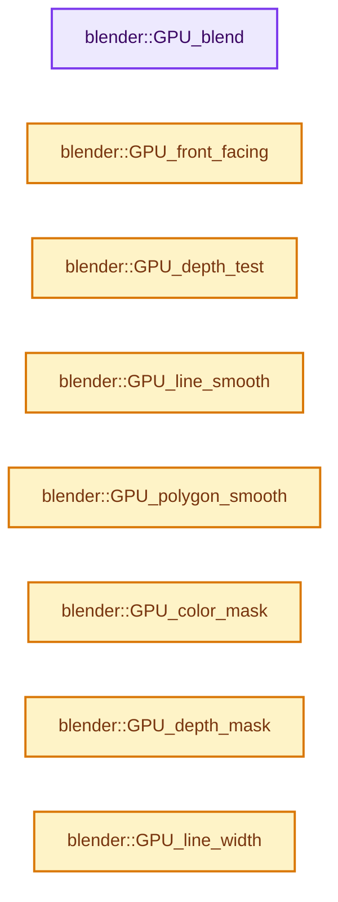
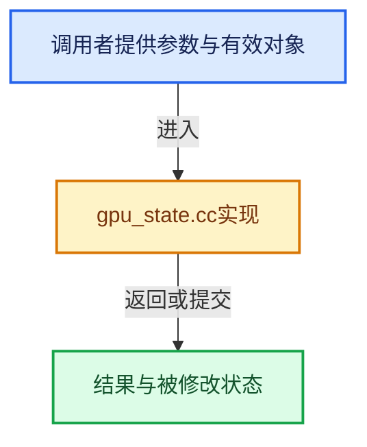

# 实现依赖专题：source/blender/gpu/intern/gpu_state.cc

[实现依赖导航](../../../README.md) · [符号索引](../../../../00-课程指南/02-源码与提交索引/符号依赖与实现索引.md)

本专题从正文实际调用进入，集中保存共享实现。函数有稳定锚点，可从调用处直接跳到对应完整函数；递归与互相调用通过回链组织。

## 本文件的实现关系






<a id="m-1983035b4156"></a>

## 宏 `SET_IMMUTABLE_STATE`

<!-- annotated:e7901b04872aab -->

```cpp
#define SET_IMMUTABLE_STATE(_state, _value) SET_STATE(, _state, _value)
#define SET_MUTABLE_STATE(_state, _value) SET_STATE(mutable_, _state, _value)
```

<details>
<summary>核对原始源码：source/blender/gpu/intern/gpu_state.cc · L37—L38</summary>

<!-- original:e7901b04872aab:source/blender/gpu/intern/gpu_state.cc:37:38 -->

```cpp
#define SET_IMMUTABLE_STATE(_state, _value) SET_STATE(, _state, _value)
#define SET_MUTABLE_STATE(_state, _value) SET_STATE(mutable_, _state, _value)
```

</details>

宏在预处理阶段展开，参数替换、重复求值和条件编译应直接从该定义检查。与普通函数不同，宏不会自动提供参数类型检查；构建配置选择哪个定义需结合外围条件。

<a id="m-5ff61ee0e9bd"></a>

## 宏 `SET_MUTABLE_STATE`

<!-- annotated:98ff389aefe567 -->

```cpp
#define SET_MUTABLE_STATE(_state, _value) SET_STATE(mutable_, _state, _value)

```

<details>
<summary>核对原始源码：source/blender/gpu/intern/gpu_state.cc · L38—L39</summary>

<!-- original:98ff389aefe567:source/blender/gpu/intern/gpu_state.cc:38:39 -->

```cpp
#define SET_MUTABLE_STATE(_state, _value) SET_STATE(mutable_, _state, _value)

```

</details>

宏在预处理阶段展开，参数替换、重复求值和条件编译应直接从该定义检查。与普通函数不同，宏不会自动提供参数类型检查；构建配置选择哪个定义需结合外围条件。

## 完整成员与函数实现

<a id="f-aa74e4560c194f83"></a>

### `blender::GPU_blend`

实现位置：[source/blender/gpu/intern/gpu_state.cc](../../../../../../../../source/blender/gpu/intern/gpu_state.cc) · L44—L47。

接口参数：

- `GPUBlend blend`

**教学注释版**

<!-- annotated:96eb21f7b87f16 -->

```cpp
void GPU_blend(GPUBlend blend)
{
  SET_IMMUTABLE_STATE(blend, blend);
}
```

<details>
<summary>核对原始源码：source/blender/gpu/intern/gpu_state.cc · L44—L47</summary>

<!-- original:96eb21f7b87f16:source/blender/gpu/intern/gpu_state.cc:44:47 -->

```cpp
void GPU_blend(GPUBlend blend)
{
  SET_IMMUTABLE_STATE(blend, blend);
}
```

</details>

**继续追踪实现**

- `SET_IMMUTABLE_STATE` → [SET_IMMUTABLE_STATE · L37](gpu_state.cc.md#m-1983035b4156)。宏定义由构建条件选择。

<a id="f-470d5afb0c7f9430"></a>

### `blender::GPU_front_facing`

实现位置：[source/blender/gpu/intern/gpu_state.cc](../../../../../../../../source/blender/gpu/intern/gpu_state.cc) · L60—L63。

接口参数：

- `bool invert`

**教学注释版**

<!-- annotated:e49a0329249cf3 -->

```cpp
void GPU_front_facing(bool invert)
{
  SET_IMMUTABLE_STATE(invert_facing, invert);
}
```

<details>
<summary>核对原始源码：source/blender/gpu/intern/gpu_state.cc · L60—L63</summary>

<!-- original:e49a0329249cf3:source/blender/gpu/intern/gpu_state.cc:60:63 -->

```cpp
void GPU_front_facing(bool invert)
{
  SET_IMMUTABLE_STATE(invert_facing, invert);
}
```

</details>

**继续追踪实现**

- `SET_IMMUTABLE_STATE` → [SET_IMMUTABLE_STATE · L37](gpu_state.cc.md#m-1983035b4156)。宏定义由构建条件选择。

<a id="f-b3b9ee4be7572808"></a>

### `blender::GPU_depth_test`

实现位置：[source/blender/gpu/intern/gpu_state.cc](../../../../../../../../source/blender/gpu/intern/gpu_state.cc) · L70—L73。

接口参数：

- `GPUDepthTest test`

**教学注释版**

<!-- annotated:cfe2077a66cee3 -->

```cpp
void GPU_depth_test(GPUDepthTest test)
{
  SET_IMMUTABLE_STATE(depth_test, test);
}
```

<details>
<summary>核对原始源码：source/blender/gpu/intern/gpu_state.cc · L70—L73</summary>

<!-- original:cfe2077a66cee3:source/blender/gpu/intern/gpu_state.cc:70:73 -->

```cpp
void GPU_depth_test(GPUDepthTest test)
{
  SET_IMMUTABLE_STATE(depth_test, test);
}
```

</details>

**继续追踪实现**

- `SET_IMMUTABLE_STATE` → [SET_IMMUTABLE_STATE · L37](gpu_state.cc.md#m-1983035b4156)。宏定义由构建条件选择。

<a id="f-8b145981bbc8915e"></a>

### `blender::GPU_line_smooth`

实现位置：[source/blender/gpu/intern/gpu_state.cc](../../../../../../../../source/blender/gpu/intern/gpu_state.cc) · L80—L83。

接口参数：

- `bool enable`

**教学注释版**

<!-- annotated:483fe45b7cc869 -->

```cpp
void GPU_line_smooth(bool enable)
{
  SET_IMMUTABLE_STATE(line_smooth, enable);
}
```

<details>
<summary>核对原始源码：source/blender/gpu/intern/gpu_state.cc · L80—L83</summary>

<!-- original:483fe45b7cc869:source/blender/gpu/intern/gpu_state.cc:80:83 -->

```cpp
void GPU_line_smooth(bool enable)
{
  SET_IMMUTABLE_STATE(line_smooth, enable);
}
```

</details>

**继续追踪实现**

- `SET_IMMUTABLE_STATE` → [SET_IMMUTABLE_STATE · L37](gpu_state.cc.md#m-1983035b4156)。宏定义由构建条件选择。

<a id="f-0012556792e814bc"></a>

### `blender::GPU_polygon_smooth`

实现位置：[source/blender/gpu/intern/gpu_state.cc](../../../../../../../../source/blender/gpu/intern/gpu_state.cc) · L85—L88。

接口参数：

- `bool enable`

**教学注释版**

<!-- annotated:fcc4c8023fc46c -->

```cpp
void GPU_polygon_smooth(bool enable)
{
  SET_IMMUTABLE_STATE(polygon_smooth, enable);
}
```

<details>
<summary>核对原始源码：source/blender/gpu/intern/gpu_state.cc · L85—L88</summary>

<!-- original:fcc4c8023fc46c:source/blender/gpu/intern/gpu_state.cc:85:88 -->

```cpp
void GPU_polygon_smooth(bool enable)
{
  SET_IMMUTABLE_STATE(polygon_smooth, enable);
}
```

</details>

**继续追踪实现**

- `SET_IMMUTABLE_STATE` → [SET_IMMUTABLE_STATE · L37](gpu_state.cc.md#m-1983035b4156)。宏定义由构建条件选择。

<a id="f-28518a9db84e1366"></a>

### `blender::GPU_color_mask`

实现位置：[source/blender/gpu/intern/gpu_state.cc](../../../../../../../../source/blender/gpu/intern/gpu_state.cc) · L95—L105。

接口参数：

- `bool r`
- `bool g`
- `bool b`
- `bool a`

**教学注释版**

<!-- annotated:93b9b734738f30 -->

```cpp
void GPU_color_mask(bool r, bool g, bool b, bool a)
{
  StateManager *stack = Context::get()->state_manager;
  auto &state = stack->state;
  uint32_t write_mask = state.write_mask;
  SET_FLAG_FROM_TEST(write_mask, r, uint32_t(GPU_WRITE_RED));
  SET_FLAG_FROM_TEST(write_mask, g, uint32_t(GPU_WRITE_GREEN));
  SET_FLAG_FROM_TEST(write_mask, b, uint32_t(GPU_WRITE_BLUE));
  SET_FLAG_FROM_TEST(write_mask, a, uint32_t(GPU_WRITE_ALPHA));
  state.write_mask = write_mask;
}
```

<details>
<summary>核对原始源码：source/blender/gpu/intern/gpu_state.cc · L95—L105</summary>

<!-- original:93b9b734738f30:source/blender/gpu/intern/gpu_state.cc:95:105 -->

```cpp
void GPU_color_mask(bool r, bool g, bool b, bool a)
{
  StateManager *stack = Context::get()->state_manager;
  auto &state = stack->state;
  uint32_t write_mask = state.write_mask;
  SET_FLAG_FROM_TEST(write_mask, r, uint32_t(GPU_WRITE_RED));
  SET_FLAG_FROM_TEST(write_mask, g, uint32_t(GPU_WRITE_GREEN));
  SET_FLAG_FROM_TEST(write_mask, b, uint32_t(GPU_WRITE_BLUE));
  SET_FLAG_FROM_TEST(write_mask, a, uint32_t(GPU_WRITE_ALPHA));
  state.write_mask = write_mask;
}
```

</details>

**沿实际写入检查状态**

- `state.write_mask = write_mask;`

**继续追踪实现**

- `Context::get` → [blender::gpu::Context::get · L127](gpu_context.cc.md#f-7ca16707244f2d11)。
- `SET_FLAG_FROM_TEST` → [SET_FLAG_FROM_TEST · L557](../../../01-BLI基础库/BLI_utildefines.hh.md#m-8e0dc83e01a8)。宏定义由构建条件选择。

<a id="f-960a0181687885c0"></a>

### `blender::GPU_depth_mask`

实现位置：[source/blender/gpu/intern/gpu_state.cc](../../../../../../../../source/blender/gpu/intern/gpu_state.cc) · L107—L114。

接口参数：

- `bool depth`

**教学注释版**

<!-- annotated:97f1447c44dd13 -->

```cpp
void GPU_depth_mask(bool depth)
{
  StateManager *stack = Context::get()->state_manager;
  auto &state = stack->state;
  uint32_t write_mask = state.write_mask;
  SET_FLAG_FROM_TEST(write_mask, depth, uint32_t(GPU_WRITE_DEPTH));
  state.write_mask = write_mask;
}
```

<details>
<summary>核对原始源码：source/blender/gpu/intern/gpu_state.cc · L107—L114</summary>

<!-- original:97f1447c44dd13:source/blender/gpu/intern/gpu_state.cc:107:114 -->

```cpp
void GPU_depth_mask(bool depth)
{
  StateManager *stack = Context::get()->state_manager;
  auto &state = stack->state;
  uint32_t write_mask = state.write_mask;
  SET_FLAG_FROM_TEST(write_mask, depth, uint32_t(GPU_WRITE_DEPTH));
  state.write_mask = write_mask;
}
```

</details>

**沿实际写入检查状态**

- `state.write_mask = write_mask;`

**继续追踪实现**

- `Context::get` → [blender::gpu::Context::get · L127](gpu_context.cc.md#f-7ca16707244f2d11)。
- `SET_FLAG_FROM_TEST` → [SET_FLAG_FROM_TEST · L557](../../../01-BLI基础库/BLI_utildefines.hh.md#m-8e0dc83e01a8)。宏定义由构建条件选择。

<a id="f-9aa9b164f4d6ec7e"></a>

### `blender::GPU_line_width`

实现位置：[source/blender/gpu/intern/gpu_state.cc](../../../../../../../../source/blender/gpu/intern/gpu_state.cc) · L151—L155。

接口参数：

- `float width`

**教学注释版**

<!-- annotated:c1727f64ea1101 -->

```cpp
void GPU_line_width(float width)
{
  width = max_ff(1.0f, width * PIXELSIZE);
  SET_MUTABLE_STATE(line_width, width);
}
```

<details>
<summary>核对原始源码：source/blender/gpu/intern/gpu_state.cc · L151—L155</summary>

<!-- original:c1727f64ea1101:source/blender/gpu/intern/gpu_state.cc:151:155 -->

```cpp
void GPU_line_width(float width)
{
  width = max_ff(1.0f, width * PIXELSIZE);
  SET_MUTABLE_STATE(line_width, width);
}
```

</details>

**沿实际写入检查状态**

- `width = max_ff(1.0f, width * PIXELSIZE);`

**继续追踪实现**

- `max_ff` → [blender::max_ff · L325](../../../01-BLI基础库/intern/math_base_inline.cc.md#f-05a351a3afd7dc2a)。
- `SET_MUTABLE_STATE` → [SET_MUTABLE_STATE · L38](gpu_state.cc.md#m-5ff61ee0e9bd)。宏定义由构建条件选择。

<a id="f-3af311dd9716b12d"></a>

### `blender::GPU_point_size`

实现位置：[source/blender/gpu/intern/gpu_state.cc](../../../../../../../../source/blender/gpu/intern/gpu_state.cc) · L157—L163。

接口参数：

- `float size`

**教学注释版**

<!-- annotated:8fd658fe27e391 -->

```cpp
void GPU_point_size(float size)
{
  StateManager *stack = Context::get()->state_manager;
  auto &state = stack->mutable_state;
  /* Keep the sign of point_size since it represents the enable state. */
  state.point_size = size * ((state.point_size > 0.0) ? 1.0f : -1.0f);
}
```

<details>
<summary>核对原始源码：source/blender/gpu/intern/gpu_state.cc · L157—L163</summary>

<!-- original:8fd658fe27e391:source/blender/gpu/intern/gpu_state.cc:157:163 -->

```cpp
void GPU_point_size(float size)
{
  StateManager *stack = Context::get()->state_manager;
  auto &state = stack->mutable_state;
  /* Keep the sign of point_size since it represents the enable state. */
  state.point_size = size * ((state.point_size > 0.0) ? 1.0f : -1.0f);
}
```

</details>

**沿实际写入检查状态**

- `state.point_size = size * ((state.point_size > 0.0) ? 1.0f : -1.0f);`

**继续追踪实现**

- `Context::get` → [blender::gpu::Context::get · L127](gpu_context.cc.md#f-7ca16707244f2d11)。

<a id="f-f3f7bc1c5e622437"></a>

### `blender::GPU_program_point_size`

实现位置：[source/blender/gpu/intern/gpu_state.cc](../../../../../../../../source/blender/gpu/intern/gpu_state.cc) · L165—L171。

接口参数：

- `bool enable`

**教学注释版**

<!-- annotated:063722fc7042c3 -->

```cpp
void GPU_program_point_size(bool enable)
{
  StateManager *stack = Context::get()->state_manager;
  auto &state = stack->mutable_state;
  /* Set point size sign negative to disable. */
  state.point_size = fabsf(state.point_size) * (enable ? 1 : -1);
}
```

<details>
<summary>核对原始源码：source/blender/gpu/intern/gpu_state.cc · L165—L171</summary>

<!-- original:063722fc7042c3:source/blender/gpu/intern/gpu_state.cc:165:171 -->

```cpp
void GPU_program_point_size(bool enable)
{
  StateManager *stack = Context::get()->state_manager;
  auto &state = stack->mutable_state;
  /* Set point size sign negative to disable. */
  state.point_size = fabsf(state.point_size) * (enable ? 1 : -1);
}
```

</details>

**沿实际写入检查状态**

- `state.point_size = fabsf(state.point_size) * (enable ? 1 : -1);`

**继续追踪实现**

- `Context::get` → [blender::gpu::Context::get · L127](gpu_context.cc.md#f-7ca16707244f2d11)。
- `fabsf` → [fabsf · L21](../../../07-Intern运行时与平台/cycles/kernel/svm/radial_tiling_shared.h.md#m-02cc4c69cfb3)；[fabsf · L43](../../../07-Intern运行时与平台/cycles/kernel/svm/radial_tiling_shared.h.md#m-04effe61803b)；[fabsf · L74](../../../07-Intern运行时与平台/cycles/kernel/svm/radial_tiling_shared.h.md#m-927dd4eba7dc)；[fabsf · L25](../../../01-BLI基础库/intern/radial_tiling_shared.hh.md#m-8348d6b3d08f)；[fabsf · L47](../../../01-BLI基础库/intern/radial_tiling_shared.hh.md#m-13b7e0b6d84f)；[fabsf · L78](../../../01-BLI基础库/intern/radial_tiling_shared.hh.md#m-326c83464a0d)；[fabsf · L21](../../../07-Intern运行时与平台/cycles/kernel/osl/shaders/node_radial_tiling_shared.h.md#m-7c3ee12fc119)；[fabsf · L43](../../../07-Intern运行时与平台/cycles/kernel/osl/shaders/node_radial_tiling_shared.h.md#m-9112db0e2dd1)；[fabsf · L74](../../../07-Intern运行时与平台/cycles/kernel/osl/shaders/node_radial_tiling_shared.h.md#m-ee4e61908a6f)；[fabsf · L167](../../../07-Intern运行时与平台/cycles/kernel/device/oneapi/compat.h.md#m-b039ee6c1601)；[fabsf · L265](../../../07-Intern运行时与平台/cycles/kernel/device/metal/compat.h.md#m-6b21869e9f3f)。宏定义由构建条件选择。

<a id="f-01ba9519e95d1f18"></a>

### `blender::GPU_scissor_test`

实现位置：[source/blender/gpu/intern/gpu_state.cc](../../../../../../../../source/blender/gpu/intern/gpu_state.cc) · L173—L176。

接口参数：

- `bool enable`

**教学注释版**

<!-- annotated:e6c69793a2f05f -->

```cpp
void GPU_scissor_test(bool enable)
{
  Context::get()->active_fb->scissor_test_set(enable);
}
```

<details>
<summary>核对原始源码：source/blender/gpu/intern/gpu_state.cc · L173—L176</summary>

<!-- original:e6c69793a2f05f:source/blender/gpu/intern/gpu_state.cc:173:176 -->

```cpp
void GPU_scissor_test(bool enable)
{
  Context::get()->active_fb->scissor_test_set(enable);
}
```

</details>

**继续追踪实现**

- `Context::get()->active_fb->scissor_test_set` → [调用协议](../../../../00-课程指南/01-路线与规范/模板宏与动态分派协议.md)：接收对象类型依赖auto、返回值或模板实例；不按同名猜测目标。调用位置L175。
- `Context::get` → [blender::gpu::Context::get · L127](gpu_context.cc.md#f-7ca16707244f2d11)。

<a id="f-cfbc3974a70690db"></a>

### `blender::GPU_scissor`

实现位置：[source/blender/gpu/intern/gpu_state.cc](../../../../../../../../source/blender/gpu/intern/gpu_state.cc) · L178—L182。

接口参数：

- `int x`
- `int y`
- `int width`
- `int height`

**教学注释版**

<!-- annotated:9f023328dff299 -->

```cpp
void GPU_scissor(int x, int y, int width, int height)
{
  int scissor_rect[4] = {x, y, width, height};
  Context::get()->active_fb->scissor_set(scissor_rect);
}
```

<details>
<summary>核对原始源码：source/blender/gpu/intern/gpu_state.cc · L178—L182</summary>

<!-- original:9f023328dff299:source/blender/gpu/intern/gpu_state.cc:178:182 -->

```cpp
void GPU_scissor(int x, int y, int width, int height)
{
  int scissor_rect[4] = {x, y, width, height};
  Context::get()->active_fb->scissor_set(scissor_rect);
}
```

</details>

**继续追踪实现**

- `Context::get()->active_fb->scissor_set` → [调用协议](../../../../00-课程指南/01-路线与规范/模板宏与动态分派协议.md)：接收对象类型依赖auto、返回值或模板实例；不按同名猜测目标。调用位置L181。
- `Context::get` → [blender::gpu::Context::get · L127](gpu_context.cc.md#f-7ca16707244f2d11)。

<a id="f-0cde4126a448c681"></a>

### `blender::GPU_blend_get`

实现位置：[source/blender/gpu/intern/gpu_state.cc](../../../../../../../../source/blender/gpu/intern/gpu_state.cc) · L211—L215。

**教学注释版**

<!-- annotated:79938d9c110064 -->

```cpp
GPUBlend GPU_blend_get()
{
  GPUState &state = Context::get()->state_manager->state;
  return GPUBlend(state.blend);
}
```

<details>
<summary>核对原始源码：source/blender/gpu/intern/gpu_state.cc · L211—L215</summary>

<!-- original:79938d9c110064:source/blender/gpu/intern/gpu_state.cc:211:215 -->

```cpp
GPUBlend GPU_blend_get()
{
  GPUState &state = Context::get()->state_manager->state;
  return GPUBlend(state.blend);
}
```

</details>

**结果出口**

- `return GPUBlend(state.blend);`

**继续追踪实现**

- `Context::get` → [blender::gpu::Context::get · L127](gpu_context.cc.md#f-7ca16707244f2d11)。
- `GPUBlend` → [blender::GPUBlend](../GPU_state.hh.md#t-a6f5317d93f3)。

<a id="f-edb5043f8f4346e5"></a>

### `blender::GPU_line_width_get`

实现位置：[source/blender/gpu/intern/gpu_state.cc](../../../../../../../../source/blender/gpu/intern/gpu_state.cc) · L241—L245。

**教学注释版**

<!-- annotated:4ce4d7644f4d1f -->

```cpp
float GPU_line_width_get()
{
  const GPUStateMutable &state = Context::get()->state_manager->mutable_state;
  return state.line_width;
}
```

<details>
<summary>核对原始源码：source/blender/gpu/intern/gpu_state.cc · L241—L245</summary>

<!-- original:4ce4d7644f4d1f:source/blender/gpu/intern/gpu_state.cc:241:245 -->

```cpp
float GPU_line_width_get()
{
  const GPUStateMutable &state = Context::get()->state_manager->mutable_state;
  return state.line_width;
}
```

</details>

**结果出口**

- `return state.line_width;`

**继续追踪实现**

- `Context::get` → [blender::gpu::Context::get · L127](gpu_context.cc.md#f-7ca16707244f2d11)。

<a id="f-2b9828ec3e68d1e5"></a>

### `blender::GPU_line_smooth_get`

实现位置：[source/blender/gpu/intern/gpu_state.cc](../../../../../../../../source/blender/gpu/intern/gpu_state.cc) · L247—L251。

**教学注释版**

<!-- annotated:d80815f48ce61e -->

```cpp
bool GPU_line_smooth_get()
{
  const GPUState &state = Context::get()->state_manager->state;
  return bool(state.line_smooth);
}
```

<details>
<summary>核对原始源码：source/blender/gpu/intern/gpu_state.cc · L247—L251</summary>

<!-- original:d80815f48ce61e:source/blender/gpu/intern/gpu_state.cc:247:251 -->

```cpp
bool GPU_line_smooth_get()
{
  const GPUState &state = Context::get()->state_manager->state;
  return bool(state.line_smooth);
}
```

</details>

**结果出口**

- `return bool(state.line_smooth);`

**继续追踪实现**

- `Context::get` → [blender::gpu::Context::get · L127](gpu_context.cc.md#f-7ca16707244f2d11)。

<a id="f-2cc9d4423985bf4f"></a>

### `blender::GPU_viewport_size_get_f`

实现位置：[source/blender/gpu/intern/gpu_state.cc](../../../../../../../../source/blender/gpu/intern/gpu_state.cc) · L258—L265。

接口参数：

- `float coords[4]`

**教学注释版**

<!-- annotated:def84e1c4b1e8a -->

```cpp
void GPU_viewport_size_get_f(float coords[4])
{
  int viewport[4];
  Context::get()->active_fb->viewport_get(viewport);
  for (int i = 0; i < 4; i++) {
    coords[i] = viewport[i];
  }
}
```

<details>
<summary>核对原始源码：source/blender/gpu/intern/gpu_state.cc · L258—L265</summary>

<!-- original:def84e1c4b1e8a:source/blender/gpu/intern/gpu_state.cc:258:265 -->

```cpp
void GPU_viewport_size_get_f(float coords[4])
{
  int viewport[4];
  Context::get()->active_fb->viewport_get(viewport);
  for (int i = 0; i < 4; i++) {
    coords[i] = viewport[i];
  }
}
```

</details>

**沿实际写入检查状态**

- `coords[i] = viewport[i];`

**继续追踪实现**

- `Context::get()->active_fb->viewport_get` → [调用协议](../../../../00-课程指南/01-路线与规范/模板宏与动态分派协议.md)：接收对象类型依赖auto、返回值或模板实例；不按同名猜测目标。调用位置L261。
- `Context::get` → [blender::gpu::Context::get · L127](gpu_context.cc.md#f-7ca16707244f2d11)。

<a id="f-f98cd533380f7e14"></a>

### `blender::GPU_depth_mask_get`

实现位置：[source/blender/gpu/intern/gpu_state.cc](../../../../../../../../source/blender/gpu/intern/gpu_state.cc) · L272—L276。

**教学注释版**

<!-- annotated:bd29d436eb0c86 -->

```cpp
bool GPU_depth_mask_get()
{
  const GPUState &state = Context::get()->state_manager->state;
  return (state.write_mask & GPU_WRITE_DEPTH) != 0;
}
```

<details>
<summary>核对原始源码：source/blender/gpu/intern/gpu_state.cc · L272—L276</summary>

<!-- original:bd29d436eb0c86:source/blender/gpu/intern/gpu_state.cc:272:276 -->

```cpp
bool GPU_depth_mask_get()
{
  const GPUState &state = Context::get()->state_manager->state;
  return (state.write_mask & GPU_WRITE_DEPTH) != 0;
}
```

</details>

**结果出口**

- `return (state.write_mask & GPU_WRITE_DEPTH) != 0;`

**继续追踪实现**

- `Context::get` → [blender::gpu::Context::get · L127](gpu_context.cc.md#f-7ca16707244f2d11)。

<a id="f-c521fe47c3318227"></a>

### `blender::GPU_flush`

实现位置：[source/blender/gpu/intern/gpu_state.cc](../../../../../../../../source/blender/gpu/intern/gpu_state.cc) · L284—L287。

**教学注释版**

<!-- annotated:f66dc3695d21f6 -->

```cpp
void GPU_flush()
{
  Context::get()->flush();
}
```

<details>
<summary>核对原始源码：source/blender/gpu/intern/gpu_state.cc · L284—L287</summary>

<!-- original:f66dc3695d21f6:source/blender/gpu/intern/gpu_state.cc:284:287 -->

```cpp
void GPU_flush()
{
  Context::get()->flush();
}
```

</details>

**继续追踪实现**

- `Context::get()->flush` → [调用协议](../../../../00-课程指南/01-路线与规范/模板宏与动态分派协议.md)：接收对象类型依赖auto、返回值或模板实例；不按同名猜测目标。调用位置L286。
- `Context::get` → [blender::gpu::Context::get · L127](gpu_context.cc.md#f-7ca16707244f2d11)。

<a id="f-b4372dd2c21f2253"></a>

### `blender::GPU_finish`

实现位置：[source/blender/gpu/intern/gpu_state.cc](../../../../../../../../source/blender/gpu/intern/gpu_state.cc) · L289—L292。

**教学注释版**

<!-- annotated:da47c902ec5a24 -->

```cpp
void GPU_finish()
{
  Context::get()->finish();
}
```

<details>
<summary>核对原始源码：source/blender/gpu/intern/gpu_state.cc · L289—L292</summary>

<!-- original:da47c902ec5a24:source/blender/gpu/intern/gpu_state.cc:289:292 -->

```cpp
void GPU_finish()
{
  Context::get()->finish();
}
```

</details>

**继续追踪实现**

- `Context::get()->finish` → [调用协议](../../../../00-课程指南/01-路线与规范/模板宏与动态分派协议.md)：接收对象类型依赖auto、返回值或模板实例；不按同名猜测目标。调用位置L291。
- `Context::get` → [blender::gpu::Context::get · L127](gpu_context.cc.md#f-7ca16707244f2d11)。

<a id="f-12b0420ed5767bcc"></a>

### `blender::GPU_apply_state`

实现位置：[source/blender/gpu/intern/gpu_state.cc](../../../../../../../../source/blender/gpu/intern/gpu_state.cc) · L294—L297。

**教学注释版**

<!-- annotated:bb560333960999 -->

```cpp
void GPU_apply_state()
{
  Context::get()->state_manager->apply_state();
}
```

<details>
<summary>核对原始源码：source/blender/gpu/intern/gpu_state.cc · L294—L297</summary>

<!-- original:bb560333960999:source/blender/gpu/intern/gpu_state.cc:294:297 -->

```cpp
void GPU_apply_state()
{
  Context::get()->state_manager->apply_state();
}
```

</details>

**继续追踪实现**

- `Context::get()->state_manager->apply_state` → [调用协议](../../../../00-课程指南/01-路线与规范/模板宏与动态分派协议.md)：接收对象类型依赖auto、返回值或模板实例；不按同名猜测目标。调用位置L296。
- `Context::get` → [blender::gpu::Context::get · L127](gpu_context.cc.md#f-7ca16707244f2d11)。

<a id="f-5a91f15b51991eb7"></a>

### `blender::GPU_memory_barrier`

实现位置：[source/blender/gpu/intern/gpu_state.cc](../../../../../../../../source/blender/gpu/intern/gpu_state.cc) · L305—L308。

接口参数：

- `GPUBarrier barrier`

**教学注释版**

<!-- annotated:39aa8aab56a5ac -->

```cpp
void GPU_memory_barrier(GPUBarrier barrier)
{
  Context::get()->state_manager->issue_barrier(barrier);
}
```

<details>
<summary>核对原始源码：source/blender/gpu/intern/gpu_state.cc · L305—L308</summary>

<!-- original:39aa8aab56a5ac:source/blender/gpu/intern/gpu_state.cc:305:308 -->

```cpp
void GPU_memory_barrier(GPUBarrier barrier)
{
  Context::get()->state_manager->issue_barrier(barrier);
}
```

</details>

**继续追踪实现**

- `Context::get()->state_manager->issue_barrier` → [调用协议](../../../../00-课程指南/01-路线与规范/模板宏与动态分派协议.md)：接收对象类型依赖auto、返回值或模板实例；不按同名猜测目标。调用位置L307。
- `Context::get` → [blender::gpu::Context::get · L127](gpu_context.cc.md#f-7ca16707244f2d11)。
