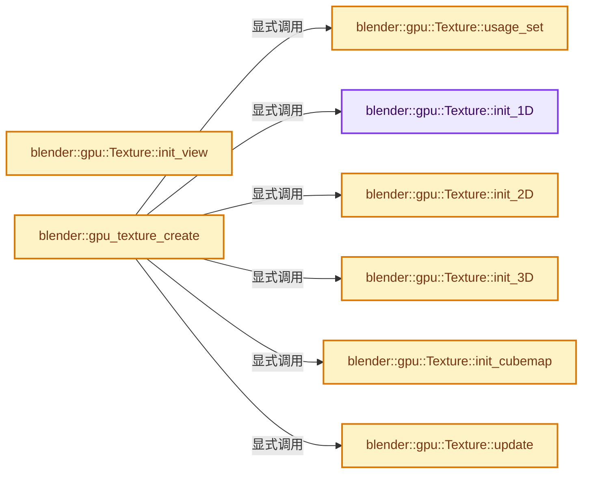
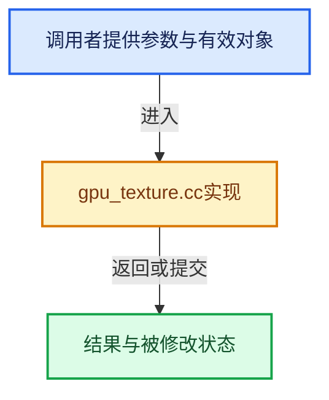

# 实现依赖专题：source/blender/gpu/intern/gpu_texture.cc

[实现依赖导航](../../../README.md) · [符号索引](../../../../00-课程指南/02-源码与提交索引/符号依赖与实现索引.md)

本专题从正文实际调用进入，集中保存共享实现。函数有稳定锚点，可从调用处直接跳到对应完整函数；递归与互相调用通过回链组织。

## 本文件的实现关系






## 完整成员与函数实现

<a id="f-8a1bb25094f9db40"></a>

### `blender::gpu::Texture::init_1D`

实现位置：[source/blender/gpu/intern/gpu_texture.cc](../../../../../../../../source/blender/gpu/intern/gpu_texture.cc) · L53—L68。

接口参数：

- `int w`
- `int layers`
- `int mip_len`
- `TextureFormat format`

**教学注释版**

<!-- annotated:c2538b5208e550 -->

```cpp
bool Texture::init_1D(int w, int layers, int mip_len, TextureFormat format)
{
  w_ = w;
  h_ = layers;
  d_ = 0;
  int mip_len_max = 1 + floorf(log2f(w));
  mipmaps_ = min_ii(mip_len, mip_len_max);
  mip_max_ = mip_min_ + mipmaps_ - 1;
  format_ = format;
  format_flag_ = to_format_flag(format);
  type_ = (layers > 0) ? GPU_TEXTURE_1D_ARRAY : GPU_TEXTURE_1D;
  if ((format_flag_ & (GPU_FORMAT_DEPTH_STENCIL | GPU_FORMAT_INTEGER)) == 0) {
    sampler_state.filtering = GPU_SAMPLER_FILTERING_LINEAR;
  }
  return this->init_internal();
}
```

<details>
<summary>核对原始源码：source/blender/gpu/intern/gpu_texture.cc · L53—L68</summary>

<!-- original:c2538b5208e550:source/blender/gpu/intern/gpu_texture.cc:53:68 -->

```cpp
bool Texture::init_1D(int w, int layers, int mip_len, TextureFormat format)
{
  w_ = w;
  h_ = layers;
  d_ = 0;
  int mip_len_max = 1 + floorf(log2f(w));
  mipmaps_ = min_ii(mip_len, mip_len_max);
  mip_max_ = mip_min_ + mipmaps_ - 1;
  format_ = format;
  format_flag_ = to_format_flag(format);
  type_ = (layers > 0) ? GPU_TEXTURE_1D_ARRAY : GPU_TEXTURE_1D;
  if ((format_flag_ & (GPU_FORMAT_DEPTH_STENCIL | GPU_FORMAT_INTEGER)) == 0) {
    sampler_state.filtering = GPU_SAMPLER_FILTERING_LINEAR;
  }
  return this->init_internal();
}
```

</details>

**沿实际写入检查状态**

- `w_ = w;`
- `h_ = layers;`
- `d_ = 0;`
- `mipmaps_ = min_ii(mip_len, mip_len_max);`
- `mip_max_ = mip_min_ + mipmaps_ - 1;`
- `format_ = format;`
- `format_flag_ = to_format_flag(format);`
- `type_ = (layers > 0) ? GPU_TEXTURE_1D_ARRAY : GPU_TEXTURE_1D;`
- `sampler_state.filtering = GPU_SAMPLER_FILTERING_LINEAR;`

**结果出口**

- `return this->init_internal();`

**继续追踪实现**

- `floorf` → [floorf · L22](../../../07-Intern运行时与平台/cycles/kernel/svm/radial_tiling_shared.h.md#m-fb64dda1b0f0)；[floorf · L44](../../../07-Intern运行时与平台/cycles/kernel/svm/radial_tiling_shared.h.md#m-25e4a157b53d)；[floorf · L75](../../../07-Intern运行时与平台/cycles/kernel/svm/radial_tiling_shared.h.md#m-e128f662cbe8)；[floorf · L26](../../../01-BLI基础库/intern/radial_tiling_shared.hh.md#m-ebadf845d492)；[floorf · L48](../../../01-BLI基础库/intern/radial_tiling_shared.hh.md#m-efe0b148573a)；[floorf · L79](../../../01-BLI基础库/intern/radial_tiling_shared.hh.md#m-9df2f26758e8)；[floorf · L22](../../../07-Intern运行时与平台/cycles/kernel/osl/shaders/node_radial_tiling_shared.h.md#m-6b2e29ad4b19)；[floorf · L44](../../../07-Intern运行时与平台/cycles/kernel/osl/shaders/node_radial_tiling_shared.h.md#m-f90222d9b445)；[floorf · L75](../../../07-Intern运行时与平台/cycles/kernel/osl/shaders/node_radial_tiling_shared.h.md#m-938380992bb5)；[floorf · L172](../../../07-Intern运行时与平台/cycles/kernel/device/oneapi/compat.h.md#m-176475a253a6)；[floorf · L270](../../../07-Intern运行时与平台/cycles/kernel/device/metal/compat.h.md#m-fb37dbc77698)；[floorf · L49](../GPU_shader_shared_utils.hh.md#m-e7115fdd7560)；[floorf · L70](../GPU_shader_shared_utils.hh.md#m-aee5f6a438e4)。宏定义由构建条件选择。
- `log2f` → [调用协议](../../../../00-课程指南/01-路线与规范/模板宏与动态分派协议.md)：函数指针、局部可调用对象或未展开的宏；必须结合调用者环境。调用位置L58。
- `min_ii` → [blender::min_ii · L364](../../../01-BLI基础库/intern/math_base_inline.cc.md#f-30336db35b2810b8)。
- `to_format_flag` → [blender::gpu::to_format_flag · L417](gpu_texture_private.hh.md#f-250b6edf51726647)。
- `this->init_internal` → [blender::gpu::VKTexture::init_internal · L590](../vulkan/vk_texture.cc.md#f-aecef3f9f84e6934)；[blender::gpu::VKTexture::init_internal · L643](../vulkan/vk_texture.cc.md#f-5bb52087dfa263f8)；[blender::gpu::VKTexture::init_internal · L653](../vulkan/vk_texture.cc.md#f-2e66d07100277290)；[blender::gpu::GLTexture::init_internal · L58](../opengl/gl_texture.cc.md#f-b7777c443e3cc7b0)；[blender::gpu::GLTexture::init_internal · L99](../opengl/gl_texture.cc.md#f-712e831adba48747)；[blender::gpu::GLTexture::init_internal · L121](../opengl/gl_texture.cc.md#f-b5d454ede7a94c20)。同名重载需按实参类型选择。

<a id="f-800bbfb3601797ce"></a>

### `blender::gpu::Texture::init_2D`

实现位置：[source/blender/gpu/intern/gpu_texture.cc](../../../../../../../../source/blender/gpu/intern/gpu_texture.cc) · L70—L85。

接口参数：

- `int w`
- `int h`
- `int layers`
- `int mip_len`
- `TextureFormat format`

**教学注释版**

<!-- annotated:13e56d4dcc902a -->

```cpp
bool Texture::init_2D(int w, int h, int layers, int mip_len, TextureFormat format)
{
  w_ = w;
  h_ = h;
  d_ = layers;
  int mip_len_max = 1 + floorf(log2f(max_ii(w, h)));
  mipmaps_ = min_ii(mip_len, mip_len_max);
  mip_max_ = mip_min_ + mipmaps_ - 1;
  format_ = format;
  format_flag_ = to_format_flag(format);
  type_ = (layers > 0) ? GPU_TEXTURE_2D_ARRAY : GPU_TEXTURE_2D;
  if ((format_flag_ & (GPU_FORMAT_DEPTH_STENCIL | GPU_FORMAT_INTEGER)) == 0) {
    sampler_state.filtering = GPU_SAMPLER_FILTERING_LINEAR;
  }
  return this->init_internal();
}
```

<details>
<summary>核对原始源码：source/blender/gpu/intern/gpu_texture.cc · L70—L85</summary>

<!-- original:13e56d4dcc902a:source/blender/gpu/intern/gpu_texture.cc:70:85 -->

```cpp
bool Texture::init_2D(int w, int h, int layers, int mip_len, TextureFormat format)
{
  w_ = w;
  h_ = h;
  d_ = layers;
  int mip_len_max = 1 + floorf(log2f(max_ii(w, h)));
  mipmaps_ = min_ii(mip_len, mip_len_max);
  mip_max_ = mip_min_ + mipmaps_ - 1;
  format_ = format;
  format_flag_ = to_format_flag(format);
  type_ = (layers > 0) ? GPU_TEXTURE_2D_ARRAY : GPU_TEXTURE_2D;
  if ((format_flag_ & (GPU_FORMAT_DEPTH_STENCIL | GPU_FORMAT_INTEGER)) == 0) {
    sampler_state.filtering = GPU_SAMPLER_FILTERING_LINEAR;
  }
  return this->init_internal();
}
```

</details>

**沿实际写入检查状态**

- `w_ = w;`
- `h_ = h;`
- `d_ = layers;`
- `mipmaps_ = min_ii(mip_len, mip_len_max);`
- `mip_max_ = mip_min_ + mipmaps_ - 1;`
- `format_ = format;`
- `format_flag_ = to_format_flag(format);`
- `type_ = (layers > 0) ? GPU_TEXTURE_2D_ARRAY : GPU_TEXTURE_2D;`
- `sampler_state.filtering = GPU_SAMPLER_FILTERING_LINEAR;`

**结果出口**

- `return this->init_internal();`

**继续追踪实现**

- `floorf` → [floorf · L22](../../../07-Intern运行时与平台/cycles/kernel/svm/radial_tiling_shared.h.md#m-fb64dda1b0f0)；[floorf · L44](../../../07-Intern运行时与平台/cycles/kernel/svm/radial_tiling_shared.h.md#m-25e4a157b53d)；[floorf · L75](../../../07-Intern运行时与平台/cycles/kernel/svm/radial_tiling_shared.h.md#m-e128f662cbe8)；[floorf · L26](../../../01-BLI基础库/intern/radial_tiling_shared.hh.md#m-ebadf845d492)；[floorf · L48](../../../01-BLI基础库/intern/radial_tiling_shared.hh.md#m-efe0b148573a)；[floorf · L79](../../../01-BLI基础库/intern/radial_tiling_shared.hh.md#m-9df2f26758e8)；[floorf · L22](../../../07-Intern运行时与平台/cycles/kernel/osl/shaders/node_radial_tiling_shared.h.md#m-6b2e29ad4b19)；[floorf · L44](../../../07-Intern运行时与平台/cycles/kernel/osl/shaders/node_radial_tiling_shared.h.md#m-f90222d9b445)；[floorf · L75](../../../07-Intern运行时与平台/cycles/kernel/osl/shaders/node_radial_tiling_shared.h.md#m-938380992bb5)；[floorf · L172](../../../07-Intern运行时与平台/cycles/kernel/device/oneapi/compat.h.md#m-176475a253a6)；[floorf · L270](../../../07-Intern运行时与平台/cycles/kernel/device/metal/compat.h.md#m-fb37dbc77698)；[floorf · L49](../GPU_shader_shared_utils.hh.md#m-e7115fdd7560)；[floorf · L70](../GPU_shader_shared_utils.hh.md#m-aee5f6a438e4)。宏定义由构建条件选择。
- `log2f` → [调用协议](../../../../00-课程指南/01-路线与规范/模板宏与动态分派协议.md)：函数指针、局部可调用对象或未展开的宏；必须结合调用者环境。调用位置L75。
- `max_ii` → [blender::max_ii · L368](../../../01-BLI基础库/intern/math_base_inline.cc.md#f-c45aa7b373adb94c)。
- `min_ii` → [blender::min_ii · L364](../../../01-BLI基础库/intern/math_base_inline.cc.md#f-30336db35b2810b8)。
- `to_format_flag` → [blender::gpu::to_format_flag · L417](gpu_texture_private.hh.md#f-250b6edf51726647)。
- `this->init_internal` → [blender::gpu::VKTexture::init_internal · L590](../vulkan/vk_texture.cc.md#f-aecef3f9f84e6934)；[blender::gpu::VKTexture::init_internal · L643](../vulkan/vk_texture.cc.md#f-5bb52087dfa263f8)；[blender::gpu::VKTexture::init_internal · L653](../vulkan/vk_texture.cc.md#f-2e66d07100277290)；[blender::gpu::GLTexture::init_internal · L58](../opengl/gl_texture.cc.md#f-b7777c443e3cc7b0)；[blender::gpu::GLTexture::init_internal · L99](../opengl/gl_texture.cc.md#f-712e831adba48747)；[blender::gpu::GLTexture::init_internal · L121](../opengl/gl_texture.cc.md#f-b5d454ede7a94c20)。同名重载需按实参类型选择。

<a id="f-386d12126277b9ed"></a>

### `blender::gpu::Texture::init_3D`

实现位置：[source/blender/gpu/intern/gpu_texture.cc](../../../../../../../../source/blender/gpu/intern/gpu_texture.cc) · L87—L102。

接口参数：

- `int w`
- `int h`
- `int d`
- `int mip_len`
- `TextureFormat format`

**教学注释版**

<!-- annotated:fed7dad79095c2 -->

```cpp
bool Texture::init_3D(int w, int h, int d, int mip_len, TextureFormat format)
{
  w_ = w;
  h_ = h;
  d_ = d;
  // [讲解] std::max：按比较关系选取较大值。本讲解中的增长公式同时满足最低请求和几何增长；若保存返回引用，还需注意实参寿命。
  int mip_len_max = 1 + floorf(log2f(std::max({w, h, d})));
  mipmaps_ = min_ii(mip_len, mip_len_max);
  mip_max_ = mip_min_ + mipmaps_ - 1;
  format_ = format;
  format_flag_ = to_format_flag(format);
  type_ = GPU_TEXTURE_3D;
  if ((format_flag_ & (GPU_FORMAT_DEPTH_STENCIL | GPU_FORMAT_INTEGER)) == 0) {
    sampler_state.filtering = GPU_SAMPLER_FILTERING_LINEAR;
  }
  return this->init_internal();
}
```

<details>
<summary>核对原始源码：source/blender/gpu/intern/gpu_texture.cc · L87—L102</summary>

<!-- original:fed7dad79095c2:source/blender/gpu/intern/gpu_texture.cc:87:102 -->

```cpp
bool Texture::init_3D(int w, int h, int d, int mip_len, TextureFormat format)
{
  w_ = w;
  h_ = h;
  d_ = d;
  int mip_len_max = 1 + floorf(log2f(std::max({w, h, d})));
  mipmaps_ = min_ii(mip_len, mip_len_max);
  mip_max_ = mip_min_ + mipmaps_ - 1;
  format_ = format;
  format_flag_ = to_format_flag(format);
  type_ = GPU_TEXTURE_3D;
  if ((format_flag_ & (GPU_FORMAT_DEPTH_STENCIL | GPU_FORMAT_INTEGER)) == 0) {
    sampler_state.filtering = GPU_SAMPLER_FILTERING_LINEAR;
  }
  return this->init_internal();
}
```

</details>

**沿实际写入检查状态**

- `w_ = w;`
- `h_ = h;`
- `d_ = d;`
- `mipmaps_ = min_ii(mip_len, mip_len_max);`
- `mip_max_ = mip_min_ + mipmaps_ - 1;`
- `format_ = format;`
- `format_flag_ = to_format_flag(format);`
- `type_ = GPU_TEXTURE_3D;`
- `sampler_state.filtering = GPU_SAMPLER_FILTERING_LINEAR;`

**结果出口**

- `return this->init_internal();`

**继续追踪实现**

- `floorf` → [floorf · L22](../../../07-Intern运行时与平台/cycles/kernel/svm/radial_tiling_shared.h.md#m-fb64dda1b0f0)；[floorf · L44](../../../07-Intern运行时与平台/cycles/kernel/svm/radial_tiling_shared.h.md#m-25e4a157b53d)；[floorf · L75](../../../07-Intern运行时与平台/cycles/kernel/svm/radial_tiling_shared.h.md#m-e128f662cbe8)；[floorf · L26](../../../01-BLI基础库/intern/radial_tiling_shared.hh.md#m-ebadf845d492)；[floorf · L48](../../../01-BLI基础库/intern/radial_tiling_shared.hh.md#m-efe0b148573a)；[floorf · L79](../../../01-BLI基础库/intern/radial_tiling_shared.hh.md#m-9df2f26758e8)；[floorf · L22](../../../07-Intern运行时与平台/cycles/kernel/osl/shaders/node_radial_tiling_shared.h.md#m-6b2e29ad4b19)；[floorf · L44](../../../07-Intern运行时与平台/cycles/kernel/osl/shaders/node_radial_tiling_shared.h.md#m-f90222d9b445)；[floorf · L75](../../../07-Intern运行时与平台/cycles/kernel/osl/shaders/node_radial_tiling_shared.h.md#m-938380992bb5)；[floorf · L172](../../../07-Intern运行时与平台/cycles/kernel/device/oneapi/compat.h.md#m-176475a253a6)；[floorf · L270](../../../07-Intern运行时与平台/cycles/kernel/device/metal/compat.h.md#m-fb37dbc77698)；[floorf · L49](../GPU_shader_shared_utils.hh.md#m-e7115fdd7560)；[floorf · L70](../GPU_shader_shared_utils.hh.md#m-aee5f6a438e4)。宏定义由构建条件选择。
- `log2f` → [调用协议](../../../../00-课程指南/01-路线与规范/模板宏与动态分派协议.md)：函数指针、局部可调用对象或未展开的宏；必须结合调用者环境。调用位置L92。
- `std::max` → [外部契约](https://eel.is/c++draft/alg.min.max)：按比较关系选取较大值。本讲解中的增长公式同时满足最低请求和几何增长；若保存返回引用，还需注意实参寿命。
- `min_ii` → [blender::min_ii · L364](../../../01-BLI基础库/intern/math_base_inline.cc.md#f-30336db35b2810b8)。
- `to_format_flag` → [blender::gpu::to_format_flag · L417](gpu_texture_private.hh.md#f-250b6edf51726647)。
- `this->init_internal` → [blender::gpu::VKTexture::init_internal · L590](../vulkan/vk_texture.cc.md#f-aecef3f9f84e6934)；[blender::gpu::VKTexture::init_internal · L643](../vulkan/vk_texture.cc.md#f-5bb52087dfa263f8)；[blender::gpu::VKTexture::init_internal · L653](../vulkan/vk_texture.cc.md#f-2e66d07100277290)；[blender::gpu::GLTexture::init_internal · L58](../opengl/gl_texture.cc.md#f-b7777c443e3cc7b0)；[blender::gpu::GLTexture::init_internal · L99](../opengl/gl_texture.cc.md#f-712e831adba48747)；[blender::gpu::GLTexture::init_internal · L121](../opengl/gl_texture.cc.md#f-b5d454ede7a94c20)。同名重载需按实参类型选择。

<a id="f-de734b117d3b9a8d"></a>

### `blender::gpu::Texture::init_cubemap`

实现位置：[source/blender/gpu/intern/gpu_texture.cc](../../../../../../../../source/blender/gpu/intern/gpu_texture.cc) · L104—L119。

接口参数：

- `int w`
- `int layers`
- `int mip_len`
- `TextureFormat format`

**教学注释版**

<!-- annotated:239f5152025bfb -->

```cpp
bool Texture::init_cubemap(int w, int layers, int mip_len, TextureFormat format)
{
  w_ = w;
  h_ = w;
  d_ = max_ii(1, layers) * 6;
  int mip_len_max = 1 + floorf(log2f(w));
  mipmaps_ = min_ii(mip_len, mip_len_max);
  mip_max_ = mip_min_ + mipmaps_ - 1;
  format_ = format;
  format_flag_ = to_format_flag(format);
  type_ = (layers > 0) ? GPU_TEXTURE_CUBE_ARRAY : GPU_TEXTURE_CUBE;
  if ((format_flag_ & (GPU_FORMAT_DEPTH_STENCIL | GPU_FORMAT_INTEGER)) == 0) {
    sampler_state.filtering = GPU_SAMPLER_FILTERING_LINEAR;
  }
  return this->init_internal();
}
```

<details>
<summary>核对原始源码：source/blender/gpu/intern/gpu_texture.cc · L104—L119</summary>

<!-- original:239f5152025bfb:source/blender/gpu/intern/gpu_texture.cc:104:119 -->

```cpp
bool Texture::init_cubemap(int w, int layers, int mip_len, TextureFormat format)
{
  w_ = w;
  h_ = w;
  d_ = max_ii(1, layers) * 6;
  int mip_len_max = 1 + floorf(log2f(w));
  mipmaps_ = min_ii(mip_len, mip_len_max);
  mip_max_ = mip_min_ + mipmaps_ - 1;
  format_ = format;
  format_flag_ = to_format_flag(format);
  type_ = (layers > 0) ? GPU_TEXTURE_CUBE_ARRAY : GPU_TEXTURE_CUBE;
  if ((format_flag_ & (GPU_FORMAT_DEPTH_STENCIL | GPU_FORMAT_INTEGER)) == 0) {
    sampler_state.filtering = GPU_SAMPLER_FILTERING_LINEAR;
  }
  return this->init_internal();
}
```

</details>

**沿实际写入检查状态**

- `w_ = w;`
- `h_ = w;`
- `d_ = max_ii(1, layers) * 6;`
- `mipmaps_ = min_ii(mip_len, mip_len_max);`
- `mip_max_ = mip_min_ + mipmaps_ - 1;`
- `format_ = format;`
- `format_flag_ = to_format_flag(format);`
- `type_ = (layers > 0) ? GPU_TEXTURE_CUBE_ARRAY : GPU_TEXTURE_CUBE;`
- `sampler_state.filtering = GPU_SAMPLER_FILTERING_LINEAR;`

**结果出口**

- `return this->init_internal();`

**继续追踪实现**

- `max_ii` → [blender::max_ii · L368](../../../01-BLI基础库/intern/math_base_inline.cc.md#f-c45aa7b373adb94c)。
- `floorf` → [floorf · L22](../../../07-Intern运行时与平台/cycles/kernel/svm/radial_tiling_shared.h.md#m-fb64dda1b0f0)；[floorf · L44](../../../07-Intern运行时与平台/cycles/kernel/svm/radial_tiling_shared.h.md#m-25e4a157b53d)；[floorf · L75](../../../07-Intern运行时与平台/cycles/kernel/svm/radial_tiling_shared.h.md#m-e128f662cbe8)；[floorf · L26](../../../01-BLI基础库/intern/radial_tiling_shared.hh.md#m-ebadf845d492)；[floorf · L48](../../../01-BLI基础库/intern/radial_tiling_shared.hh.md#m-efe0b148573a)；[floorf · L79](../../../01-BLI基础库/intern/radial_tiling_shared.hh.md#m-9df2f26758e8)；[floorf · L22](../../../07-Intern运行时与平台/cycles/kernel/osl/shaders/node_radial_tiling_shared.h.md#m-6b2e29ad4b19)；[floorf · L44](../../../07-Intern运行时与平台/cycles/kernel/osl/shaders/node_radial_tiling_shared.h.md#m-f90222d9b445)；[floorf · L75](../../../07-Intern运行时与平台/cycles/kernel/osl/shaders/node_radial_tiling_shared.h.md#m-938380992bb5)；[floorf · L172](../../../07-Intern运行时与平台/cycles/kernel/device/oneapi/compat.h.md#m-176475a253a6)；[floorf · L270](../../../07-Intern运行时与平台/cycles/kernel/device/metal/compat.h.md#m-fb37dbc77698)；[floorf · L49](../GPU_shader_shared_utils.hh.md#m-e7115fdd7560)；[floorf · L70](../GPU_shader_shared_utils.hh.md#m-aee5f6a438e4)。宏定义由构建条件选择。
- `log2f` → [调用协议](../../../../00-课程指南/01-路线与规范/模板宏与动态分派协议.md)：函数指针、局部可调用对象或未展开的宏；必须结合调用者环境。调用位置L109。
- `min_ii` → [blender::min_ii · L364](../../../01-BLI基础库/intern/math_base_inline.cc.md#f-30336db35b2810b8)。
- `to_format_flag` → [blender::gpu::to_format_flag · L417](gpu_texture_private.hh.md#f-250b6edf51726647)。
- `this->init_internal` → [blender::gpu::VKTexture::init_internal · L590](../vulkan/vk_texture.cc.md#f-aecef3f9f84e6934)；[blender::gpu::VKTexture::init_internal · L643](../vulkan/vk_texture.cc.md#f-5bb52087dfa263f8)；[blender::gpu::VKTexture::init_internal · L653](../vulkan/vk_texture.cc.md#f-2e66d07100277290)；[blender::gpu::GLTexture::init_internal · L58](../opengl/gl_texture.cc.md#f-b7777c443e3cc7b0)；[blender::gpu::GLTexture::init_internal · L99](../opengl/gl_texture.cc.md#f-712e831adba48747)；[blender::gpu::GLTexture::init_internal · L121](../opengl/gl_texture.cc.md#f-b5d454ede7a94c20)。同名重载需按实参类型选择。

<a id="f-6f7f736819ccaf76"></a>

### `blender::gpu::Texture::init_view`

实现位置：[source/blender/gpu/intern/gpu_texture.cc](../../../../../../../../source/blender/gpu/intern/gpu_texture.cc) · L133—L178。

接口参数：

- `Texture *src`
- `TextureFormat format`
- `GPUTextureType type`
- `int mip_start`
- `int mip_len`
- `int layer_start`
- `int layer_len`
- `bool cube_as_array`
- `bool use_stencil`

**教学注释版**

<!-- annotated:06a217bc5636af -->

```cpp
bool Texture::init_view(Texture *src,
                        TextureFormat format,
                        GPUTextureType type,
                        int mip_start,
                        int mip_len,
                        int layer_start,
                        int layer_len,
                        bool cube_as_array,
                        bool use_stencil)
{
  BLI_assert(source_texture_ == nullptr);
  source_texture_ = src;
  gpu_image_usage_flags_ = src->gpu_image_usage_flags_;
  sampler_state = src->sampler_state;

  int view_extent[3]{0, 0, 0};
  src->mip_size_get(mip_start, view_extent);

  view_layer_start_ = min_ii(layer_start, src->layer_count() - 1);

  type_ = type;
  if (cube_as_array) {
    BLI_assert(type_ & GPU_TEXTURE_CUBE);
    type_ = (type_ & ~GPU_TEXTURE_CUBE) | GPU_TEXTURE_2D_ARRAY;
  }

  if (type & GPU_TEXTURE_ARRAY) {
    // [讲解] std::min：按比较关系选取较小值；截断范围时还需先满足非负和可表示范围，min本身不会证明边界安全。
    view_extent[src->dimensions_count() - 1] = std::min(layer_len,
                                                        (src->layer_count() - view_layer_start_));
  }
  else if (src->type_get() & GPU_TEXTURE_ARRAY) {
    view_extent[src->dimensions_count()] = 0;
  }

  w_ = view_extent[0];
  h_ = view_extent[1];
  d_ = view_extent[2];

  mip_min_ = min_ii(mip_start, src->mipmaps_ - 1);
  mipmaps_ = min_ii(mip_len, (src->mipmaps_ - mip_min_));
  mip_max_ = mip_min_ + mipmaps_ - 1;
  format_ = format;
  format_flag_ = to_format_flag(format);

  return this->init_internal(src, use_stencil);
}
```

<details>
<summary>核对原始源码：source/blender/gpu/intern/gpu_texture.cc · L133—L178</summary>

<!-- original:06a217bc5636af:source/blender/gpu/intern/gpu_texture.cc:133:178 -->

```cpp
bool Texture::init_view(Texture *src,
                        TextureFormat format,
                        GPUTextureType type,
                        int mip_start,
                        int mip_len,
                        int layer_start,
                        int layer_len,
                        bool cube_as_array,
                        bool use_stencil)
{
  BLI_assert(source_texture_ == nullptr);
  source_texture_ = src;
  gpu_image_usage_flags_ = src->gpu_image_usage_flags_;
  sampler_state = src->sampler_state;

  int view_extent[3]{0, 0, 0};
  src->mip_size_get(mip_start, view_extent);

  view_layer_start_ = min_ii(layer_start, src->layer_count() - 1);

  type_ = type;
  if (cube_as_array) {
    BLI_assert(type_ & GPU_TEXTURE_CUBE);
    type_ = (type_ & ~GPU_TEXTURE_CUBE) | GPU_TEXTURE_2D_ARRAY;
  }

  if (type & GPU_TEXTURE_ARRAY) {
    view_extent[src->dimensions_count() - 1] = std::min(layer_len,
                                                        (src->layer_count() - view_layer_start_));
  }
  else if (src->type_get() & GPU_TEXTURE_ARRAY) {
    view_extent[src->dimensions_count()] = 0;
  }

  w_ = view_extent[0];
  h_ = view_extent[1];
  d_ = view_extent[2];

  mip_min_ = min_ii(mip_start, src->mipmaps_ - 1);
  mipmaps_ = min_ii(mip_len, (src->mipmaps_ - mip_min_));
  mip_max_ = mip_min_ + mipmaps_ - 1;
  format_ = format;
  format_flag_ = to_format_flag(format);

  return this->init_internal(src, use_stencil);
}
```

</details>

**沿实际写入检查状态**

- `source_texture_ = src;`
- `gpu_image_usage_flags_ = src->gpu_image_usage_flags_;`
- `sampler_state = src->sampler_state;`
- `view_layer_start_ = min_ii(layer_start, src->layer_count() - 1);`
- `type_ = type;`
- `type_ = (type_ & ~GPU_TEXTURE_CUBE) | GPU_TEXTURE_2D_ARRAY;`
- `w_ = view_extent[0];`
- `h_ = view_extent[1];`
- `d_ = view_extent[2];`
- `mip_min_ = min_ii(mip_start, src->mipmaps_ - 1);`
- `mipmaps_ = min_ii(mip_len, (src->mipmaps_ - mip_min_));`
- `mip_max_ = mip_min_ + mipmaps_ - 1;`
- `format_ = format;`
- `format_flag_ = to_format_flag(format);`

**结果出口**

- `return this->init_internal(src, use_stencil);`

**继续追踪实现**

- `BLI_assert` → [BLI_assert · L48](../../../01-BLI基础库/BLI_assert.hh.md#m-57a88495704d)；[BLI_assert · L63](../../../01-BLI基础库/BLI_assert.hh.md#m-d07050020cb5)。宏定义由构建条件选择。
- `src->mip_size_get` → [blender::gpu::Texture::mip_size_get · L217](gpu_texture_private.hh.md#f-47b3751ad4374e58)；[blender::gpu::Texture::mip_size_get · L237](gpu_texture_private.hh.md#f-a6329b73c65c6b0e)。同名重载需按实参类型选择。
- `min_ii` → [blender::min_ii · L364](../../../01-BLI基础库/intern/math_base_inline.cc.md#f-30336db35b2810b8)。
- `src->layer_count` → [blender::gpu::Texture::layer_count · L274](gpu_texture_private.hh.md#f-ae5bba132ad53865)。
- `src->dimensions_count` → [blender::gpu::Texture::dimensions_count · L257](gpu_texture_private.hh.md#f-c961bd9805205442)。
- `std::min` → [外部契约](https://eel.is/c++draft/alg.min.max)：按比较关系选取较小值；截断范围时还需先满足非负和可表示范围，min本身不会证明边界安全。
- `src->type_get` → [blender::gpu::Texture::type_get · L311](gpu_texture_private.hh.md#f-973d5500434c5b18)。
- `to_format_flag` → [blender::gpu::to_format_flag · L417](gpu_texture_private.hh.md#f-250b6edf51726647)。
- `this->init_internal` → [blender::gpu::VKTexture::init_internal · L590](../vulkan/vk_texture.cc.md#f-aecef3f9f84e6934)；[blender::gpu::VKTexture::init_internal · L643](../vulkan/vk_texture.cc.md#f-5bb52087dfa263f8)；[blender::gpu::VKTexture::init_internal · L653](../vulkan/vk_texture.cc.md#f-2e66d07100277290)；[blender::gpu::GLTexture::init_internal · L58](../opengl/gl_texture.cc.md#f-b7777c443e3cc7b0)；[blender::gpu::GLTexture::init_internal · L99](../opengl/gl_texture.cc.md#f-712e831adba48747)；[blender::gpu::GLTexture::init_internal · L121](../opengl/gl_texture.cc.md#f-b5d454ede7a94c20)。同名重载需按实参类型选择。

<a id="f-519dad4c5ada8199"></a>

### `blender::gpu::Texture::usage_set`

实现位置：[source/blender/gpu/intern/gpu_texture.cc](../../../../../../../../source/blender/gpu/intern/gpu_texture.cc) · L180—L183。

接口参数：

- `eGPUTextureUsage usage_flags`

**教学注释版**

<!-- annotated:bbe49e38ef6bf2 -->

```cpp
void Texture::usage_set(eGPUTextureUsage usage_flags)
{
  gpu_image_usage_flags_ = usage_flags;
}
```

<details>
<summary>核对原始源码：source/blender/gpu/intern/gpu_texture.cc · L180—L183</summary>

<!-- original:bbe49e38ef6bf2:source/blender/gpu/intern/gpu_texture.cc:180:183 -->

```cpp
void Texture::usage_set(eGPUTextureUsage usage_flags)
{
  gpu_image_usage_flags_ = usage_flags;
}
```

</details>

**沿实际写入检查状态**

- `gpu_image_usage_flags_ = usage_flags;`

**继续追踪实现**

本实现没有需要继续展开的显式调用；检查返回表达式、对象转换和调用者前置条件。

<a id="f-ba3dafa55fd4b071"></a>

### `blender::gpu::Texture::update`

实现位置：[source/blender/gpu/intern/gpu_texture.cc](../../../../../../../../source/blender/gpu/intern/gpu_texture.cc) · L211—L218。

接口参数：

- `eGPUDataFormat format`
- `const void *data`

**教学注释版**

<!-- annotated:865c0f6f4b5ccb -->

```cpp
void Texture::update(eGPUDataFormat format, const void *data)
{
  int mip = 0;
  int extent[3] = {1, 1, 1};
  int offset[3] = {0, 0, 0};
  this->mip_size_get(mip, extent);
  this->update_sub(mip, offset, extent, format, data);
}
```

<details>
<summary>核对原始源码：source/blender/gpu/intern/gpu_texture.cc · L211—L218</summary>

<!-- original:865c0f6f4b5ccb:source/blender/gpu/intern/gpu_texture.cc:211:218 -->

```cpp
void Texture::update(eGPUDataFormat format, const void *data)
{
  int mip = 0;
  int extent[3] = {1, 1, 1};
  int offset[3] = {0, 0, 0};
  this->mip_size_get(mip, extent);
  this->update_sub(mip, offset, extent, format, data);
}
```

</details>

**继续追踪实现**

- `this->mip_size_get` → [blender::gpu::Texture::mip_size_get · L217](gpu_texture_private.hh.md#f-47b3751ad4374e58)；[blender::gpu::Texture::mip_size_get · L237](gpu_texture_private.hh.md#f-a6329b73c65c6b0e)。同名重载需按实参类型选择。
- `this->update_sub` → [blender::gpu::VKVertexBuffer::update_sub · L76](../vulkan/vk_vertex_buffer.cc.md#f-093a4f852029668d)；[blender::gpu::VKTexture::update_sub · L363](../vulkan/vk_texture.cc.md#f-a3937255a1cc1210)；[blender::gpu::VKTexture::update_sub · L534](../vulkan/vk_texture.cc.md#f-050f779cae17fb46)；[blender::gpu::VKTexture::update_sub · L544](../vulkan/vk_texture.cc.md#f-cb14dbccaebbb3db)；[blender::gpu::VKIndexBuffer::update_sub · L103](../vulkan/vk_index_buffer.cc.md#f-b46f9dcfad212bfb)；[blender::gpu::GLVertBuf::update_sub · L140](../opengl/gl_vertex_buffer.cc.md#f-b458dbaca6d259e1)；[blender::gpu::GLTexture::update_sub · L190](../opengl/gl_texture.cc.md#f-6ab5a387083426bc)；[blender::gpu::GLTexture::update_sub · L358](../opengl/gl_texture.cc.md#f-6aab12c617050ffb)；[blender::gpu::GLIndexBuf::update_sub · L100](../opengl/gl_index_buffer.cc.md#f-5753e4749840c965)。同名重载需按实参类型选择。

<a id="f-dcbf6229f9eb3370"></a>

### `blender::gpu_texture_create`

实现位置：[source/blender/gpu/intern/gpu_texture.cc](../../../../../../../../source/blender/gpu/intern/gpu_texture.cc) · L240—L284。

接口参数：

- `const char *name`
- `const int w`
- `const int h`
- `const int d`
- `const GPUTextureType type`
- `int mip_len`
- `TextureFormat tex_format`
- `eGPUTextureUsage usage`
- `const void *pixels`
- `eGPUDataFormat data_format = GPU_DATA_FLOAT`

**教学注释版**

<!-- annotated:f1dddef808c208 -->

```cpp
static inline gpu::Texture *gpu_texture_create(const char *name,
                                               const int w,
                                               const int h,
                                               const int d,
                                               const GPUTextureType type,
                                               int mip_len,
                                               TextureFormat tex_format,
                                               eGPUTextureUsage usage,
                                               const void *pixels,
                                               eGPUDataFormat data_format = GPU_DATA_FLOAT)
{
  BLI_assert(mip_len > 0);
  Texture *tex = GPUBackend::get()->texture_alloc(name);
  tex->usage_set(usage);

  bool success = false;
  switch (type) {
    case GPU_TEXTURE_1D:
    case GPU_TEXTURE_1D_ARRAY:
      success = tex->init_1D(w, h, mip_len, tex_format);
      break;
    case GPU_TEXTURE_2D:
    case GPU_TEXTURE_2D_ARRAY:
      success = tex->init_2D(w, h, d, mip_len, tex_format);
      break;
    case GPU_TEXTURE_3D:
      success = tex->init_3D(w, h, d, mip_len, tex_format);
      break;
    case GPU_TEXTURE_CUBE:
    case GPU_TEXTURE_CUBE_ARRAY:
      success = tex->init_cubemap(w, d, mip_len, tex_format);
      break;
    default:
      break;
  }

  if (!success) {
    delete tex;
    return nullptr;
  }
  if (pixels) {
    tex->update(data_format, pixels);
  }
  return reinterpret_cast<gpu::Texture *>(tex);
}
```

<details>
<summary>核对原始源码：source/blender/gpu/intern/gpu_texture.cc · L240—L284</summary>

<!-- original:f1dddef808c208:source/blender/gpu/intern/gpu_texture.cc:240:284 -->

```cpp
static inline gpu::Texture *gpu_texture_create(const char *name,
                                               const int w,
                                               const int h,
                                               const int d,
                                               const GPUTextureType type,
                                               int mip_len,
                                               TextureFormat tex_format,
                                               eGPUTextureUsage usage,
                                               const void *pixels,
                                               eGPUDataFormat data_format = GPU_DATA_FLOAT)
{
  BLI_assert(mip_len > 0);
  Texture *tex = GPUBackend::get()->texture_alloc(name);
  tex->usage_set(usage);

  bool success = false;
  switch (type) {
    case GPU_TEXTURE_1D:
    case GPU_TEXTURE_1D_ARRAY:
      success = tex->init_1D(w, h, mip_len, tex_format);
      break;
    case GPU_TEXTURE_2D:
    case GPU_TEXTURE_2D_ARRAY:
      success = tex->init_2D(w, h, d, mip_len, tex_format);
      break;
    case GPU_TEXTURE_3D:
      success = tex->init_3D(w, h, d, mip_len, tex_format);
      break;
    case GPU_TEXTURE_CUBE:
    case GPU_TEXTURE_CUBE_ARRAY:
      success = tex->init_cubemap(w, d, mip_len, tex_format);
      break;
    default:
      break;
  }

  if (!success) {
    delete tex;
    return nullptr;
  }
  if (pixels) {
    tex->update(data_format, pixels);
  }
  return reinterpret_cast<gpu::Texture *>(tex);
}
```

</details>

**沿实际写入检查状态**

- `success = tex->init_1D(w, h, mip_len, tex_format);`
- `success = tex->init_2D(w, h, d, mip_len, tex_format);`
- `success = tex->init_3D(w, h, d, mip_len, tex_format);`
- `success = tex->init_cubemap(w, d, mip_len, tex_format);`

**结果出口**

- `return nullptr;`
- `return reinterpret_cast<gpu::Texture *>(tex);`

**继续追踪实现**

- `BLI_assert` → [BLI_assert · L48](../../../01-BLI基础库/BLI_assert.hh.md#m-57a88495704d)；[BLI_assert · L63](../../../01-BLI基础库/BLI_assert.hh.md#m-d07050020cb5)。宏定义由构建条件选择。
- `GPUBackend::get()->texture_alloc` → [调用协议](../../../../00-课程指南/01-路线与规范/模板宏与动态分派协议.md)：接收对象类型依赖auto、返回值或模板实例；不按同名猜测目标。调用位置L252。
- `GPUBackend::get` → [blender::GPUBackend::get · L642](gpu_context.cc.md#f-c876dc1cb5bd7700)。
- `tex->usage_set` → [blender::gpu::Texture::usage_set · L180](gpu_texture.cc.md#f-519dad4c5ada8199)。
- `tex->init_1D` → [blender::gpu::Texture::init_1D · L53](gpu_texture.cc.md#f-8a1bb25094f9db40)。
- `tex->init_2D` → [blender::gpu::Texture::init_2D · L70](gpu_texture.cc.md#f-800bbfb3601797ce)。
- `tex->init_3D` → [blender::gpu::Texture::init_3D · L87](gpu_texture.cc.md#f-386d12126277b9ed)。
- `tex->init_cubemap` → [blender::gpu::Texture::init_cubemap · L104](gpu_texture.cc.md#f-de734b117d3b9a8d)。
- `tex->update` → [blender::gpu::Texture::update · L211](gpu_texture.cc.md#f-ba3dafa55fd4b071)。

<a id="f-94f4328588fba6ec"></a>

### `blender::GPU_texture_create_1d_array`

实现位置：[source/blender/gpu/intern/gpu_texture.cc](../../../../../../../../source/blender/gpu/intern/gpu_texture.cc) · L296—L306。

接口参数：

- `const char *name`
- `int width`
- `int layer_len`
- `int mip_len`
- `TextureFormat format`
- `eGPUTextureUsage usage`
- `const float *data`

**教学注释版**

<!-- annotated:77bfa952aebf27 -->

```cpp
gpu::Texture *GPU_texture_create_1d_array(const char *name,
                                          int width,
                                          int layer_len,
                                          int mip_len,
                                          TextureFormat format,
                                          eGPUTextureUsage usage,
                                          const float *data)
{
  return gpu_texture_create(
      name, width, layer_len, 0, GPU_TEXTURE_1D_ARRAY, mip_len, format, usage, data);
}
```

<details>
<summary>核对原始源码：source/blender/gpu/intern/gpu_texture.cc · L296—L306</summary>

<!-- original:77bfa952aebf27:source/blender/gpu/intern/gpu_texture.cc:296:306 -->

```cpp
gpu::Texture *GPU_texture_create_1d_array(const char *name,
                                          int width,
                                          int layer_len,
                                          int mip_len,
                                          TextureFormat format,
                                          eGPUTextureUsage usage,
                                          const float *data)
{
  return gpu_texture_create(
      name, width, layer_len, 0, GPU_TEXTURE_1D_ARRAY, mip_len, format, usage, data);
}
```

</details>

**结果出口**

- `return gpu_texture_create(`

**继续追踪实现**

- `gpu_texture_create` → [blender::gpu_texture_create · L240](gpu_texture.cc.md#f-dcbf6229f9eb3370)。

<a id="f-5aa2a42234aebbda"></a>

### `blender::GPU_texture_create_2d`

实现位置：[source/blender/gpu/intern/gpu_texture.cc](../../../../../../../../source/blender/gpu/intern/gpu_texture.cc) · L308—L317。

接口参数：

- `const char *name`
- `int width`
- `int height`
- `int mip_len`
- `TextureFormat format`
- `eGPUTextureUsage usage`
- `const float *data`

**教学注释版**

<!-- annotated:b35c20317826df -->

```cpp
gpu::Texture *GPU_texture_create_2d(const char *name,
                                    int width,
                                    int height,
                                    int mip_len,
                                    TextureFormat format,
                                    eGPUTextureUsage usage,
                                    const float *data)
{
  return gpu_texture_create(name, width, height, 0, GPU_TEXTURE_2D, mip_len, format, usage, data);
}
```

<details>
<summary>核对原始源码：source/blender/gpu/intern/gpu_texture.cc · L308—L317</summary>

<!-- original:b35c20317826df:source/blender/gpu/intern/gpu_texture.cc:308:317 -->

```cpp
gpu::Texture *GPU_texture_create_2d(const char *name,
                                    int width,
                                    int height,
                                    int mip_len,
                                    TextureFormat format,
                                    eGPUTextureUsage usage,
                                    const float *data)
{
  return gpu_texture_create(name, width, height, 0, GPU_TEXTURE_2D, mip_len, format, usage, data);
}
```

</details>

**结果出口**

- `return gpu_texture_create(name, width, height, 0, GPU_TEXTURE_2D, mip_len, format, usage, data);`

**继续追踪实现**

- `gpu_texture_create` → [blender::gpu_texture_create · L240](gpu_texture.cc.md#f-dcbf6229f9eb3370)。

<a id="f-c56ab2472a370c27"></a>

### `blender::GPU_texture_create_2d_array`

实现位置：[source/blender/gpu/intern/gpu_texture.cc](../../../../../../../../source/blender/gpu/intern/gpu_texture.cc) · L319—L330。

接口参数：

- `const char *name`
- `int width`
- `int height`
- `int layer_len`
- `int mip_len`
- `TextureFormat format`
- `eGPUTextureUsage usage`
- `const float *data`

**教学注释版**

<!-- annotated:b1f3cc012d8900 -->

```cpp
gpu::Texture *GPU_texture_create_2d_array(const char *name,
                                          int width,
                                          int height,
                                          int layer_len,
                                          int mip_len,
                                          TextureFormat format,
                                          eGPUTextureUsage usage,
                                          const float *data)
{
  return gpu_texture_create(
      name, width, height, layer_len, GPU_TEXTURE_2D_ARRAY, mip_len, format, usage, data);
}
```

<details>
<summary>核对原始源码：source/blender/gpu/intern/gpu_texture.cc · L319—L330</summary>

<!-- original:b1f3cc012d8900:source/blender/gpu/intern/gpu_texture.cc:319:330 -->

```cpp
gpu::Texture *GPU_texture_create_2d_array(const char *name,
                                          int width,
                                          int height,
                                          int layer_len,
                                          int mip_len,
                                          TextureFormat format,
                                          eGPUTextureUsage usage,
                                          const float *data)
{
  return gpu_texture_create(
      name, width, height, layer_len, GPU_TEXTURE_2D_ARRAY, mip_len, format, usage, data);
}
```

</details>

**结果出口**

- `return gpu_texture_create(`

**继续追踪实现**

- `gpu_texture_create` → [blender::gpu_texture_create · L240](gpu_texture.cc.md#f-dcbf6229f9eb3370)。

<a id="f-3bb579d016d6f5be"></a>

### `blender::GPU_texture_create_compressed_2d`

实现位置：[source/blender/gpu/intern/gpu_texture.cc](../../../../../../../../source/blender/gpu/intern/gpu_texture.cc) · L367—L401。

接口参数：

- `const char *name`
- `int width`
- `int height`
- `int mip_len`
- `TextureFormat tex_format`
- `eGPUTextureUsage usage`
- `const void *data`

**教学注释版**

<!-- annotated:6999001726a87c -->

```cpp
gpu::Texture *GPU_texture_create_compressed_2d(const char *name,
                                               int width,
                                               int height,
                                               int mip_len,
                                               TextureFormat tex_format,
                                               eGPUTextureUsage usage,
                                               const void *data)
{
  Texture *tex = GPUBackend::get()->texture_alloc(name);
  tex->usage_set(usage);
  bool success = tex->init_2D(width, height, 0, mip_len, tex_format);

  if (!success) {
    delete tex;
    return nullptr;
  }
  if (data) {
    size_t ofs = 0;
    for (int mip = 0; mip < mip_len; mip++) {
      int extent[3] = {1, 1, 1};
      int offset[3] = {0, 0, 0};
      tex->mip_size_get(mip, extent);

      size_t size = ((extent[0] + 3) / 4) * ((extent[1] + 3) / 4) * to_block_size(tex_format);
      tex->update_sub(mip,
                      offset,
                      extent,
                      to_texture_data_format(tex_format),
                      static_cast<uchar *>(const_cast<void *>(data)) + ofs);

      ofs += size;
    }
  }
  return reinterpret_cast<gpu::Texture *>(tex);
}
```

<details>
<summary>核对原始源码：source/blender/gpu/intern/gpu_texture.cc · L367—L401</summary>

<!-- original:6999001726a87c:source/blender/gpu/intern/gpu_texture.cc:367:401 -->

```cpp
gpu::Texture *GPU_texture_create_compressed_2d(const char *name,
                                               int width,
                                               int height,
                                               int mip_len,
                                               TextureFormat tex_format,
                                               eGPUTextureUsage usage,
                                               const void *data)
{
  Texture *tex = GPUBackend::get()->texture_alloc(name);
  tex->usage_set(usage);
  bool success = tex->init_2D(width, height, 0, mip_len, tex_format);

  if (!success) {
    delete tex;
    return nullptr;
  }
  if (data) {
    size_t ofs = 0;
    for (int mip = 0; mip < mip_len; mip++) {
      int extent[3] = {1, 1, 1};
      int offset[3] = {0, 0, 0};
      tex->mip_size_get(mip, extent);

      size_t size = ((extent[0] + 3) / 4) * ((extent[1] + 3) / 4) * to_block_size(tex_format);
      tex->update_sub(mip,
                      offset,
                      extent,
                      to_texture_data_format(tex_format),
                      static_cast<uchar *>(const_cast<void *>(data)) + ofs);

      ofs += size;
    }
  }
  return reinterpret_cast<gpu::Texture *>(tex);
}
```

</details>

**沿实际写入检查状态**

- `ofs += size;`

**结果出口**

- `return nullptr;`
- `return reinterpret_cast<gpu::Texture *>(tex);`

**继续追踪实现**

- `GPUBackend::get()->texture_alloc` → [调用协议](../../../../00-课程指南/01-路线与规范/模板宏与动态分派协议.md)：接收对象类型依赖auto、返回值或模板实例；不按同名猜测目标。调用位置L375。
- `GPUBackend::get` → [blender::GPUBackend::get · L642](gpu_context.cc.md#f-c876dc1cb5bd7700)。
- `tex->usage_set` → [blender::gpu::Texture::usage_set · L180](gpu_texture.cc.md#f-519dad4c5ada8199)。
- `tex->init_2D` → [blender::gpu::Texture::init_2D · L70](gpu_texture.cc.md#f-800bbfb3601797ce)。
- `tex->mip_size_get` → [blender::gpu::Texture::mip_size_get · L217](gpu_texture_private.hh.md#f-47b3751ad4374e58)；[blender::gpu::Texture::mip_size_get · L237](gpu_texture_private.hh.md#f-a6329b73c65c6b0e)。同名重载需按实参类型选择。
- `to_block_size` → [blender::gpu::to_block_size · L400](gpu_texture_private.hh.md#f-807ba29337528ecf)。
- `tex->update_sub` → [调用协议](../../../../00-课程指南/01-路线与规范/模板宏与动态分派协议.md)：由接收对象具体类型或运行时策略提供实现。调用位置L391。
- `to_texture_data_format` → [blender::gpu::to_texture_data_format · L715](gpu_texture_private.hh.md#f-34cec07ea5aff5d0)。

<a id="f-49ae29eb96a317ed"></a>

### `blender::GPU_texture_create_error`

实现位置：[source/blender/gpu/intern/gpu_texture.cc](../../../../../../../../source/blender/gpu/intern/gpu_texture.cc) · L423—L443。

接口参数：

- `int dimension`
- `bool is_array`

**教学注释版**

<!-- annotated:592de579ef8a9e -->

```cpp
gpu::Texture *GPU_texture_create_error(int dimension, bool is_array)
{
  const float pixel[4] = {1.0f, 0.0f, 1.0f, 1.0f};
  int w = 1;
  int h = (dimension < 2 && !is_array) ? 0 : 1;
  int d = (dimension < 3 && !is_array) ? 0 : 1;

  GPUTextureType type = GPU_TEXTURE_3D;
  type = (dimension == 2) ? (is_array ? GPU_TEXTURE_2D_ARRAY : GPU_TEXTURE_2D) : type;
  type = (dimension == 1) ? (is_array ? GPU_TEXTURE_1D_ARRAY : GPU_TEXTURE_1D) : type;

  return gpu_texture_create("invalid_tex",
                            w,
                            h,
                            d,
                            type,
                            1,
                            TextureFormat::UNORM_8_8_8_8,
                            GPU_TEXTURE_USAGE_GENERAL,
                            pixel);
}
```

<details>
<summary>核对原始源码：source/blender/gpu/intern/gpu_texture.cc · L423—L443</summary>

<!-- original:592de579ef8a9e:source/blender/gpu/intern/gpu_texture.cc:423:443 -->

```cpp
gpu::Texture *GPU_texture_create_error(int dimension, bool is_array)
{
  const float pixel[4] = {1.0f, 0.0f, 1.0f, 1.0f};
  int w = 1;
  int h = (dimension < 2 && !is_array) ? 0 : 1;
  int d = (dimension < 3 && !is_array) ? 0 : 1;

  GPUTextureType type = GPU_TEXTURE_3D;
  type = (dimension == 2) ? (is_array ? GPU_TEXTURE_2D_ARRAY : GPU_TEXTURE_2D) : type;
  type = (dimension == 1) ? (is_array ? GPU_TEXTURE_1D_ARRAY : GPU_TEXTURE_1D) : type;

  return gpu_texture_create("invalid_tex",
                            w,
                            h,
                            d,
                            type,
                            1,
                            TextureFormat::UNORM_8_8_8_8,
                            GPU_TEXTURE_USAGE_GENERAL,
                            pixel);
}
```

</details>

**沿实际写入检查状态**

- `type = (dimension == 2) ? (is_array ? GPU_TEXTURE_2D_ARRAY : GPU_TEXTURE_2D) : type;`
- `type = (dimension == 1) ? (is_array ? GPU_TEXTURE_1D_ARRAY : GPU_TEXTURE_1D) : type;`

**结果出口**

- `return gpu_texture_create("invalid_tex",`

**继续追踪实现**

- `gpu_texture_create` → [blender::gpu_texture_create · L240](gpu_texture.cc.md#f-dcbf6229f9eb3370)。

<a id="f-fe0e8110c39be01f"></a>

### `blender::GPU_texture_create_view`

实现位置：[source/blender/gpu/intern/gpu_texture.cc](../../../../../../../../source/blender/gpu/intern/gpu_texture.cc) · L445—L486。

接口参数：

- `const char *name`
- `gpu::Texture *source_texture`
- `TextureFormat view_format`
- `int mip_start`
- `int mip_len`
- `int layer_start`
- `int layer_len`
- `bool cube_as_array`
- `bool use_stencil`

**教学注释版**

<!-- annotated:d4b2021d95c7d3 -->

```cpp
gpu::Texture *GPU_texture_create_view(const char *name,
                                      gpu::Texture *source_texture,
                                      TextureFormat view_format,
                                      int mip_start,
                                      int mip_len,
                                      int layer_start,
                                      int layer_len,
                                      bool cube_as_array,
                                      bool use_stencil)
{
  BLI_assert(mip_len > 0);
  BLI_assert(layer_len > 0);
  BLI_assert_msg(use_stencil == false ||
                     (GPU_texture_usage(source_texture) & GPU_TEXTURE_USAGE_FORMAT_VIEW),
                 "Source texture of TextureView must have GPU_TEXTURE_USAGE_FORMAT_VIEW usage "
                 "flag if view texture uses stencil texturing.");
  BLI_assert_msg((view_format == GPU_texture_format(source_texture)) ||
                     (GPU_texture_usage(source_texture) & GPU_TEXTURE_USAGE_FORMAT_VIEW),
                 "Source texture of TextureView must have GPU_TEXTURE_USAGE_FORMAT_VIEW usage "
                 "flag if view texture format is different.");
  Texture *view = GPUBackend::get()->texture_alloc(name);
  view->init_view(source_texture,
                  view_format,
                  source_texture->type_get(),
                  mip_start,
                  mip_len,
                  layer_start,
                  layer_len,
                  cube_as_array,
                  use_stencil);

  /* On integer textures, disable filtering by default, as this is not guaranteed to be
   * consistently supported across backends. */
  if (GPU_texture_has_integer_format(view)) {
    view->sampler_state.set_filtering_flag_from_test(GPU_SAMPLER_FILTERING_LINEAR, false);
    view->sampler_state.set_filtering_flag_from_test(GPU_SAMPLER_FILTERING_MIPMAP, false);
    view->sampler_state.set_filtering_flag_from_test(GPU_SAMPLER_FILTERING_ANISOTROPIC_MASK,
                                                     false);
  }

  return view;
}
```

<details>
<summary>核对原始源码：source/blender/gpu/intern/gpu_texture.cc · L445—L486</summary>

<!-- original:d4b2021d95c7d3:source/blender/gpu/intern/gpu_texture.cc:445:486 -->

```cpp
gpu::Texture *GPU_texture_create_view(const char *name,
                                      gpu::Texture *source_texture,
                                      TextureFormat view_format,
                                      int mip_start,
                                      int mip_len,
                                      int layer_start,
                                      int layer_len,
                                      bool cube_as_array,
                                      bool use_stencil)
{
  BLI_assert(mip_len > 0);
  BLI_assert(layer_len > 0);
  BLI_assert_msg(use_stencil == false ||
                     (GPU_texture_usage(source_texture) & GPU_TEXTURE_USAGE_FORMAT_VIEW),
                 "Source texture of TextureView must have GPU_TEXTURE_USAGE_FORMAT_VIEW usage "
                 "flag if view texture uses stencil texturing.");
  BLI_assert_msg((view_format == GPU_texture_format(source_texture)) ||
                     (GPU_texture_usage(source_texture) & GPU_TEXTURE_USAGE_FORMAT_VIEW),
                 "Source texture of TextureView must have GPU_TEXTURE_USAGE_FORMAT_VIEW usage "
                 "flag if view texture format is different.");
  Texture *view = GPUBackend::get()->texture_alloc(name);
  view->init_view(source_texture,
                  view_format,
                  source_texture->type_get(),
                  mip_start,
                  mip_len,
                  layer_start,
                  layer_len,
                  cube_as_array,
                  use_stencil);

  /* On integer textures, disable filtering by default, as this is not guaranteed to be
   * consistently supported across backends. */
  if (GPU_texture_has_integer_format(view)) {
    view->sampler_state.set_filtering_flag_from_test(GPU_SAMPLER_FILTERING_LINEAR, false);
    view->sampler_state.set_filtering_flag_from_test(GPU_SAMPLER_FILTERING_MIPMAP, false);
    view->sampler_state.set_filtering_flag_from_test(GPU_SAMPLER_FILTERING_ANISOTROPIC_MASK,
                                                     false);
  }

  return view;
}
```

</details>

**结果出口**

- `return view;`

**继续追踪实现**

- `BLI_assert` → [BLI_assert · L48](../../../01-BLI基础库/BLI_assert.hh.md#m-57a88495704d)；[BLI_assert · L63](../../../01-BLI基础库/BLI_assert.hh.md#m-d07050020cb5)。宏定义由构建条件选择。
- `BLI_assert_msg` → [BLI_assert_msg · L55](../../../01-BLI基础库/BLI_assert.hh.md#m-695eed20dceb)；[BLI_assert_msg · L64](../../../01-BLI基础库/BLI_assert.hh.md#m-7de5563de4db)。宏定义由构建条件选择。
- `GPU_texture_usage` → [blender::GPU_texture_usage · L489](gpu_texture.cc.md#f-994e62665df34877)。
- `GPU_texture_format` → [blender::GPU_texture_format · L814](gpu_texture.cc.md#f-842c3f6555a1c248)。
- `GPUBackend::get()->texture_alloc` → [调用协议](../../../../00-课程指南/01-路线与规范/模板宏与动态分派协议.md)：接收对象类型依赖auto、返回值或模板实例；不按同名猜测目标。调用位置L465。
- `GPUBackend::get` → [blender::GPUBackend::get · L642](gpu_context.cc.md#f-c876dc1cb5bd7700)。
- `view->init_view` → [blender::gpu::Texture::init_view · L133](gpu_texture.cc.md#f-6f7f736819ccaf76)。
- `source_texture->type_get` → [blender::gpu::Texture::type_get · L311](gpu_texture_private.hh.md#f-973d5500434c5b18)。
- `GPU_texture_has_integer_format` → [blender::GPU_texture_has_integer_format · L972](gpu_texture.cc.md#f-51affa66efb02f6c)。
- `view->sampler_state.set_filtering_flag_from_test` → [调用协议](../../../../00-课程指南/01-路线与规范/模板宏与动态分派协议.md)：接收对象类型依赖auto、返回值或模板实例；不按同名猜测目标。调用位置L479。

<a id="f-994e62665df34877"></a>

### `blender::GPU_texture_usage`

实现位置：[source/blender/gpu/intern/gpu_texture.cc](../../../../../../../../source/blender/gpu/intern/gpu_texture.cc) · L489—L492。

接口参数：

- `const gpu::Texture *texture`

**教学注释版**

<!-- annotated:aee4458d2ef6b3 -->

```cpp
eGPUTextureUsage GPU_texture_usage(const gpu::Texture *texture)
{
  return texture->usage_get();
}
```

<details>
<summary>核对原始源码：source/blender/gpu/intern/gpu_texture.cc · L489—L492</summary>

<!-- original:aee4458d2ef6b3:source/blender/gpu/intern/gpu_texture.cc:489:492 -->

```cpp
eGPUTextureUsage GPU_texture_usage(const gpu::Texture *texture)
{
  return texture->usage_get();
}
```

</details>

**结果出口**

- `return texture->usage_get();`

**继续追踪实现**

- `texture->usage_get` → [blender::gpu::Texture::usage_get · L206](gpu_texture_private.hh.md#f-33e0781d80810456)。

<a id="f-2c901e7b4602b08e"></a>

### `blender::GPU_texture_update_sub`

实现位置：[source/blender/gpu/intern/gpu_texture.cc](../../../../../../../../source/blender/gpu/intern/gpu_texture.cc) · L507—L521。

接口参数：

- `gpu::Texture *tex`
- `eGPUDataFormat data_format`
- `const void *pixels`
- `int offset_x`
- `int offset_y`
- `int offset_z`
- `int width`
- `int height`
- `int depth`
- `uint unpack_row_length`

**教学注释版**

<!-- annotated:9fcb58b99401c0 -->

```cpp
void GPU_texture_update_sub(gpu::Texture *tex,
                            eGPUDataFormat data_format,
                            const void *pixels,
                            int offset_x,
                            int offset_y,
                            int offset_z,
                            int width,
                            int height,
                            int depth,
                            uint unpack_row_length)
{
  int offset[3] = {offset_x, offset_y, offset_z};
  int extent[3] = {width, height, depth};
  tex->update_sub(0, offset, extent, data_format, pixels, unpack_row_length);
}
```

<details>
<summary>核对原始源码：source/blender/gpu/intern/gpu_texture.cc · L507—L521</summary>

<!-- original:9fcb58b99401c0:source/blender/gpu/intern/gpu_texture.cc:507:521 -->

```cpp
void GPU_texture_update_sub(gpu::Texture *tex,
                            eGPUDataFormat data_format,
                            const void *pixels,
                            int offset_x,
                            int offset_y,
                            int offset_z,
                            int width,
                            int height,
                            int depth,
                            uint unpack_row_length)
{
  int offset[3] = {offset_x, offset_y, offset_z};
  int extent[3] = {width, height, depth};
  tex->update_sub(0, offset, extent, data_format, pixels, unpack_row_length);
}
```

</details>

**继续追踪实现**

- `tex->update_sub` → [调用协议](../../../../00-课程指南/01-路线与规范/模板宏与动态分派协议.md)：由接收对象具体类型或运行时策略提供实现。调用位置L520。

<a id="f-0177a1016e0e9c44"></a>

### `blender::GPU_texture_read`

实现位置：[source/blender/gpu/intern/gpu_texture.cc](../../../../../../../../source/blender/gpu/intern/gpu_texture.cc) · L538—L552。

接口参数：

- `Texture *texture`
- `eGPUDataFormat data_format`
- `int mip_level`

**教学注释版**

<!-- annotated:9d1460a8781e01 -->

```cpp
void *GPU_texture_read(Texture *texture, eGPUDataFormat data_format, int mip_level)
{
  BLI_assert(texture);
  size_t size = texture->read_size_get(mip_level, data_format);

  /* AMD Pro OpenGL drivers have a bug that write 8 bytes past buffer size
   * if the texture is big. Note, this seemingly only affects cube map arrays. (see #66573) */
  if (texture->type_get() == GPU_TEXTURE_CUBE_ARRAY) {
    size += 8;
  }

  void *data = MEM_new_uninitialized(size, __func__);
  GPU_texture_read(texture, data_format, mip_level, data);
  return data;
}
```

<details>
<summary>核对原始源码：source/blender/gpu/intern/gpu_texture.cc · L538—L552</summary>

<!-- original:9d1460a8781e01:source/blender/gpu/intern/gpu_texture.cc:538:552 -->

```cpp
void *GPU_texture_read(Texture *texture, eGPUDataFormat data_format, int mip_level)
{
  BLI_assert(texture);
  size_t size = texture->read_size_get(mip_level, data_format);

  /* AMD Pro OpenGL drivers have a bug that write 8 bytes past buffer size
   * if the texture is big. Note, this seemingly only affects cube map arrays. (see #66573) */
  if (texture->type_get() == GPU_TEXTURE_CUBE_ARRAY) {
    size += 8;
  }

  void *data = MEM_new_uninitialized(size, __func__);
  GPU_texture_read(texture, data_format, mip_level, data);
  return data;
}
```

</details>

**沿实际写入检查状态**

- `size += 8;`

**结果出口**

- `return data;`

**继续追踪实现**

- `BLI_assert` → [BLI_assert · L48](../../../01-BLI基础库/BLI_assert.hh.md#m-57a88495704d)；[BLI_assert · L63](../../../01-BLI基础库/BLI_assert.hh.md#m-d07050020cb5)。宏定义由构建条件选择。
- `texture->read_size_get` → [blender::Texture::read_size_get · L564](gpu_texture.cc.md#f-95808c471e47025a)。
- `texture->type_get` → [blender::gpu::Texture::type_get · L311](gpu_texture_private.hh.md#f-973d5500434c5b18)。
- `MEM_new_uninitialized` → [MEM_new_uninitialized · L590](../../../07-Intern运行时与平台/guardedalloc/MEM_guardedalloc.h.md#f-c773b2e5b8fe70e4)；[MEM_new_uninitialized · L124](../../../07-Intern运行时与平台/guardedalloc/intern/mallocn.cc.md#f-28a7e00a1e67f699)。同名重载需按实参类型选择。
- `GPU_texture_read` → [blender::GPU_texture_read · L538](gpu_texture.cc.md#f-0177a1016e0e9c44)；[blender::GPU_texture_read · L554](gpu_texture.cc.md#f-ed121c82244456ef)。同名重载需按实参类型选择。

<a id="f-ed121c82244456ef"></a>

### `blender::GPU_texture_read`

实现位置：[source/blender/gpu/intern/gpu_texture.cc](../../../../../../../../source/blender/gpu/intern/gpu_texture.cc) · L554—L562。

接口参数：

- `Texture *texture`
- `eGPUDataFormat data_format`
- `int mip_level`
- `void *dst`

**教学注释版**

<!-- annotated:54f2f668c4b8ed -->

```cpp
void GPU_texture_read(Texture *texture, eGPUDataFormat data_format, int mip_level, void *dst)
{
  BLI_assert(texture);
  BLI_assert_msg(
      GPU_texture_usage(texture) & GPU_TEXTURE_USAGE_HOST_READ,
      "The host-read usage flag must be specified up-front. Only textures which require data "
      "reads should be flagged, allowing the backend to make certain optimizations.");
  texture->read(mip_level, data_format, dst);
}
```

<details>
<summary>核对原始源码：source/blender/gpu/intern/gpu_texture.cc · L554—L562</summary>

<!-- original:54f2f668c4b8ed:source/blender/gpu/intern/gpu_texture.cc:554:562 -->

```cpp
void GPU_texture_read(Texture *texture, eGPUDataFormat data_format, int mip_level, void *dst)
{
  BLI_assert(texture);
  BLI_assert_msg(
      GPU_texture_usage(texture) & GPU_TEXTURE_USAGE_HOST_READ,
      "The host-read usage flag must be specified up-front. Only textures which require data "
      "reads should be flagged, allowing the backend to make certain optimizations.");
  texture->read(mip_level, data_format, dst);
}
```

</details>

**继续追踪实现**

- `BLI_assert` → [BLI_assert · L48](../../../01-BLI基础库/BLI_assert.hh.md#m-57a88495704d)；[BLI_assert · L63](../../../01-BLI基础库/BLI_assert.hh.md#m-d07050020cb5)。宏定义由构建条件选择。
- `BLI_assert_msg` → [BLI_assert_msg · L55](../../../01-BLI基础库/BLI_assert.hh.md#m-695eed20dceb)；[BLI_assert_msg · L64](../../../01-BLI基础库/BLI_assert.hh.md#m-7de5563de4db)。宏定义由构建条件选择。
- `GPU_texture_usage` → [blender::GPU_texture_usage · L489](gpu_texture.cc.md#f-994e62665df34877)。
- `texture->read` → [Texture::read · L957](../../draw/intern/DRW_gpu_wrapper.hh.md#f-dd35ddf873a3c53b)。

<a id="f-95808c471e47025a"></a>

### `blender::Texture::read_size_get`

实现位置：[source/blender/gpu/intern/gpu_texture.cc](../../../../../../../../source/blender/gpu/intern/gpu_texture.cc) · L564—L575。

接口参数：

- `int mip`
- `eGPUDataFormat format`

**教学注释版**

<!-- annotated:7b0537f5d7e731 -->

```cpp
size_t Texture::read_size_get(int mip, eGPUDataFormat format) const
{
  BLI_assert(!(format_flag_ & GPU_FORMAT_COMPRESSED));
  BLI_assert(mip <= mipmaps_ || mip == 0);
  BLI_assert(validate_data_format(format_, format));
  int extent[3] = {1, 1, 1};
  this->mip_size_get(mip, extent);

  // [讲解] std::max：按比较关系选取较大值。本讲解中的增长公式同时满足最低请求和几何增长；若保存返回引用，还需注意实参寿命。
  size_t sample_len = extent[0] * std::max(1, extent[1]) * std::max(1, extent[2]);
  size_t sample_size = to_bytesize(format_, format);
  return sample_len * sample_size;
}
```

<details>
<summary>核对原始源码：source/blender/gpu/intern/gpu_texture.cc · L564—L575</summary>

<!-- original:7b0537f5d7e731:source/blender/gpu/intern/gpu_texture.cc:564:575 -->

```cpp
size_t Texture::read_size_get(int mip, eGPUDataFormat format) const
{
  BLI_assert(!(format_flag_ & GPU_FORMAT_COMPRESSED));
  BLI_assert(mip <= mipmaps_ || mip == 0);
  BLI_assert(validate_data_format(format_, format));
  int extent[3] = {1, 1, 1};
  this->mip_size_get(mip, extent);

  size_t sample_len = extent[0] * std::max(1, extent[1]) * std::max(1, extent[2]);
  size_t sample_size = to_bytesize(format_, format);
  return sample_len * sample_size;
}
```

</details>

**结果出口**

- `return sample_len * sample_size;`

**继续追踪实现**

- `BLI_assert` → [BLI_assert · L48](../../../01-BLI基础库/BLI_assert.hh.md#m-57a88495704d)；[BLI_assert · L63](../../../01-BLI基础库/BLI_assert.hh.md#m-d07050020cb5)。宏定义由构建条件选择。
- `validate_data_format` → [blender::gpu::validate_data_format · L596](gpu_texture_private.hh.md#f-3a81f93170ecd217)。
- `this->mip_size_get` → [blender::gpu::Texture::mip_size_get · L217](gpu_texture_private.hh.md#f-47b3751ad4374e58)；[blender::gpu::Texture::mip_size_get · L237](gpu_texture_private.hh.md#f-a6329b73c65c6b0e)。同名重载需按实参类型选择。
- `std::max` → [外部契约](https://eel.is/c++draft/alg.min.max)：按比较关系选取较大值。本讲解中的增长公式同时满足最低请求和几何增长；若保存返回引用，还需注意实参寿命。
- `to_bytesize` → [blender::gpu::to_bytesize · L395](gpu_texture_private.hh.md#f-a10860ed9785f89d)；[blender::gpu::to_bytesize · L559](gpu_texture_private.hh.md#f-7e05648123684a02)；[blender::gpu::to_bytesize · L579](gpu_texture_private.hh.md#f-8ad1c9330f26cf28)。同名重载需按实参类型选择。

<a id="f-5c978eb203430df2"></a>

### `blender::GPU_texture_clear`

实现位置：[source/blender/gpu/intern/gpu_texture.cc](../../../../../../../../source/blender/gpu/intern/gpu_texture.cc) · L583—L617。

接口参数：

- `gpu::Texture *tex`
- `eGPUDataFormat data_format`
- `const void *data`

**教学注释版**

<!-- annotated:b2c5652d6afeaa -->

```cpp
void GPU_texture_clear(gpu::Texture *tex, eGPUDataFormat data_format, const void *data)
{
  BLI_assert(data != nullptr); /* Do not accept nullptr as parameter. */
  BLI_assert(validate_data_format(tex->format_get(), data_format));

  /* TODO(fclem): Ideally modify the GPU_texture_clear API. */
  double4 clear_data(0xFFFFFFFFu);
  int comp_len = to_component_len(tex->format_get());
  switch (data_format) {
    case GPU_DATA_FLOAT:
      for (int i : IndexRange(comp_len)) {
        clear_data[i] = static_cast<const float *>(data)[i];
      }
      break;
    case GPU_DATA_INT:
      for (int i : IndexRange(comp_len)) {
        clear_data[i] = static_cast<const int *>(data)[i];
      }
      break;
    case GPU_DATA_UINT:
      for (int i : IndexRange(comp_len)) {
        clear_data[i] = static_cast<const uint *>(data)[i];
      }
      break;
    case GPU_DATA_UBYTE:
      for (int i : IndexRange(comp_len)) {
        clear_data[i] = static_cast<const uint *>(data)[i];
      }
      break;
    default:
      BLI_assert_msg(0, "Unhandled data format");
      return;
  }
  tex->clear(clear_data);
}
```

<details>
<summary>核对原始源码：source/blender/gpu/intern/gpu_texture.cc · L583—L617</summary>

<!-- original:b2c5652d6afeaa:source/blender/gpu/intern/gpu_texture.cc:583:617 -->

```cpp
void GPU_texture_clear(gpu::Texture *tex, eGPUDataFormat data_format, const void *data)
{
  BLI_assert(data != nullptr); /* Do not accept nullptr as parameter. */
  BLI_assert(validate_data_format(tex->format_get(), data_format));

  /* TODO(fclem): Ideally modify the GPU_texture_clear API. */
  double4 clear_data(0xFFFFFFFFu);
  int comp_len = to_component_len(tex->format_get());
  switch (data_format) {
    case GPU_DATA_FLOAT:
      for (int i : IndexRange(comp_len)) {
        clear_data[i] = static_cast<const float *>(data)[i];
      }
      break;
    case GPU_DATA_INT:
      for (int i : IndexRange(comp_len)) {
        clear_data[i] = static_cast<const int *>(data)[i];
      }
      break;
    case GPU_DATA_UINT:
      for (int i : IndexRange(comp_len)) {
        clear_data[i] = static_cast<const uint *>(data)[i];
      }
      break;
    case GPU_DATA_UBYTE:
      for (int i : IndexRange(comp_len)) {
        clear_data[i] = static_cast<const uint *>(data)[i];
      }
      break;
    default:
      BLI_assert_msg(0, "Unhandled data format");
      return;
  }
  tex->clear(clear_data);
}
```

</details>

**沿实际写入检查状态**

- `clear_data[i] = static_cast<const float *>(data)[i];`
- `clear_data[i] = static_cast<const int *>(data)[i];`
- `clear_data[i] = static_cast<const uint *>(data)[i];`

**继续追踪实现**

- `BLI_assert` → [BLI_assert · L48](../../../01-BLI基础库/BLI_assert.hh.md#m-57a88495704d)；[BLI_assert · L63](../../../01-BLI基础库/BLI_assert.hh.md#m-d07050020cb5)。宏定义由构建条件选择。
- `validate_data_format` → [blender::gpu::validate_data_format · L596](gpu_texture_private.hh.md#f-3a81f93170ecd217)。
- `tex->format_get` → [blender::gpu::Texture::format_get · L303](gpu_texture_private.hh.md#f-84c066db43b6cfaa)。
- `to_component_len` → [blender::gpu::to_component_len · L554](gpu_texture_private.hh.md#f-24ff7034456d5942)。
- `IndexRange` → [blender::IndexRange](../../../01-BLI基础库/BLI_index_range.hh.md#t-caa3466d6776)；[blender::gpu::shader::parser::IndexRange](../shader_tool/utils.hh.md#t-82d2bd4ea71c)；[blender::IndexRange](../../makesdna/DNA_node_types.h.md#t-0448cc889d39)。
- `BLI_assert_msg` → [BLI_assert_msg · L55](../../../01-BLI基础库/BLI_assert.hh.md#m-695eed20dceb)；[BLI_assert_msg · L64](../../../01-BLI基础库/BLI_assert.hh.md#m-7de5563de4db)。宏定义由构建条件选择。
- `tex->clear` → [Texture::clear · L908](../../draw/intern/DRW_gpu_wrapper.hh.md#f-6365fed7e26dff63)；[Texture::clear · L916](../../draw/intern/DRW_gpu_wrapper.hh.md#f-352c37ec2c5abc62)；[Texture::clear · L924](../../draw/intern/DRW_gpu_wrapper.hh.md#f-305decc7a91321a8)。同名重载需按实参类型选择。

<a id="f-4a6c14a1d8e5e73e"></a>

### `blender::GPU_texture_update`

实现位置：[source/blender/gpu/intern/gpu_texture.cc](../../../../../../../../source/blender/gpu/intern/gpu_texture.cc) · L619—L622。

接口参数：

- `gpu::Texture *tex`
- `eGPUDataFormat data_format`
- `const void *data`

**教学注释版**

<!-- annotated:4e929511b07da2 -->

```cpp
void GPU_texture_update(gpu::Texture *tex, eGPUDataFormat data_format, const void *data)
{
  tex->update(data_format, data);
}
```

<details>
<summary>核对原始源码：source/blender/gpu/intern/gpu_texture.cc · L619—L622</summary>

<!-- original:4e929511b07da2:source/blender/gpu/intern/gpu_texture.cc:619:622 -->

```cpp
void GPU_texture_update(gpu::Texture *tex, eGPUDataFormat data_format, const void *data)
{
  tex->update(data_format, data);
}
```

</details>

**继续追踪实现**

- `tex->update` → [blender::gpu::Texture::update · L211](gpu_texture.cc.md#f-ba3dafa55fd4b071)。

<a id="f-5c590570f3fbea5c"></a>

### `blender::GPU_texture_bind`

实现位置：[source/blender/gpu/intern/gpu_texture.cc](../../../../../../../../source/blender/gpu/intern/gpu_texture.cc) · L633—L637。

接口参数：

- `gpu::Texture *texture`
- `int unit`

**教学注释版**

<!-- annotated:87e1ccb8403e8c -->

```cpp
void GPU_texture_bind(gpu::Texture *texture, int unit)
{
  Texture *tex = texture;
  Context::get()->state_manager->texture_bind(tex, tex->sampler_state, unit);
}
```

<details>
<summary>核对原始源码：source/blender/gpu/intern/gpu_texture.cc · L633—L637</summary>

<!-- original:87e1ccb8403e8c:source/blender/gpu/intern/gpu_texture.cc:633:637 -->

```cpp
void GPU_texture_bind(gpu::Texture *texture, int unit)
{
  Texture *tex = texture;
  Context::get()->state_manager->texture_bind(tex, tex->sampler_state, unit);
}
```

</details>

**继续追踪实现**

- `Context::get()->state_manager->texture_bind` → [调用协议](../../../../00-课程指南/01-路线与规范/模板宏与动态分派协议.md)：接收对象类型依赖auto、返回值或模板实例；不按同名猜测目标。调用位置L636。
- `Context::get` → [blender::gpu::Context::get · L127](gpu_context.cc.md#f-7ca16707244f2d11)。

<a id="f-4bd2dd4244c18f3f"></a>

### `blender::GPU_texture_unbind`

实现位置：[source/blender/gpu/intern/gpu_texture.cc](../../../../../../../../source/blender/gpu/intern/gpu_texture.cc) · L639—L643。

接口参数：

- `gpu::Texture *texture`

**教学注释版**

<!-- annotated:1d92f913c94bf6 -->

```cpp
void GPU_texture_unbind(gpu::Texture *texture)
{
  Texture *tex = texture;
  Context::get()->state_manager->texture_unbind(tex);
}
```

<details>
<summary>核对原始源码：source/blender/gpu/intern/gpu_texture.cc · L639—L643</summary>

<!-- original:1d92f913c94bf6:source/blender/gpu/intern/gpu_texture.cc:639:643 -->

```cpp
void GPU_texture_unbind(gpu::Texture *texture)
{
  Texture *tex = texture;
  Context::get()->state_manager->texture_unbind(tex);
}
```

</details>

**继续追踪实现**

- `Context::get()->state_manager->texture_unbind` → [调用协议](../../../../00-课程指南/01-路线与规范/模板宏与动态分派协议.md)：接收对象类型依赖auto、返回值或模板实例；不按同名猜测目标。调用位置L642。
- `Context::get` → [blender::gpu::Context::get · L127](gpu_context.cc.md#f-7ca16707244f2d11)。

<a id="f-a0b95d1cf219374e"></a>

### `blender::GPU_texture_unbind_all`

实现位置：[source/blender/gpu/intern/gpu_texture.cc](../../../../../../../../source/blender/gpu/intern/gpu_texture.cc) · L645—L648。

**教学注释版**

<!-- annotated:f685053285bdeb -->

```cpp
void GPU_texture_unbind_all()
{
  Context::get()->state_manager->texture_unbind_all();
}
```

<details>
<summary>核对原始源码：source/blender/gpu/intern/gpu_texture.cc · L645—L648</summary>

<!-- original:f685053285bdeb:source/blender/gpu/intern/gpu_texture.cc:645:648 -->

```cpp
void GPU_texture_unbind_all()
{
  Context::get()->state_manager->texture_unbind_all();
}
```

</details>

**继续追踪实现**

- `Context::get()->state_manager->texture_unbind_all` → [调用协议](../../../../00-课程指南/01-路线与规范/模板宏与动态分派协议.md)：接收对象类型依赖auto、返回值或模板实例；不按同名猜测目标。调用位置L647。
- `Context::get` → [blender::gpu::Context::get · L127](gpu_context.cc.md#f-7ca16707244f2d11)。

<a id="f-3962938b7d89b577"></a>

### `blender::GPU_texture_image_bind`

实现位置：[source/blender/gpu/intern/gpu_texture.cc](../../../../../../../../source/blender/gpu/intern/gpu_texture.cc) · L650—L653。

接口参数：

- `gpu::Texture *tex`
- `int unit`

**教学注释版**

<!-- annotated:46336a3a2799cc -->

```cpp
void GPU_texture_image_bind(gpu::Texture *tex, int unit)
{
  Context::get()->state_manager->image_bind(tex, unit);
}
```

<details>
<summary>核对原始源码：source/blender/gpu/intern/gpu_texture.cc · L650—L653</summary>

<!-- original:46336a3a2799cc:source/blender/gpu/intern/gpu_texture.cc:650:653 -->

```cpp
void GPU_texture_image_bind(gpu::Texture *tex, int unit)
{
  Context::get()->state_manager->image_bind(tex, unit);
}
```

</details>

**继续追踪实现**

- `Context::get()->state_manager->image_bind` → [调用协议](../../../../00-课程指南/01-路线与规范/模板宏与动态分派协议.md)：接收对象类型依赖auto、返回值或模板实例；不按同名猜测目标。调用位置L652。
- `Context::get` → [blender::gpu::Context::get · L127](gpu_context.cc.md#f-7ca16707244f2d11)。

<a id="f-46511d00aeb97cd2"></a>

### `blender::GPU_texture_image_unbind_all`

实现位置：[source/blender/gpu/intern/gpu_texture.cc](../../../../../../../../source/blender/gpu/intern/gpu_texture.cc) · L660—L663。

**教学注释版**

<!-- annotated:e32b2d2cc34809 -->

```cpp
void GPU_texture_image_unbind_all()
{
  Context::get()->state_manager->image_unbind_all();
}
```

<details>
<summary>核对原始源码：source/blender/gpu/intern/gpu_texture.cc · L660—L663</summary>

<!-- original:e32b2d2cc34809:source/blender/gpu/intern/gpu_texture.cc:660:663 -->

```cpp
void GPU_texture_image_unbind_all()
{
  Context::get()->state_manager->image_unbind_all();
}
```

</details>

**继续追踪实现**

- `Context::get()->state_manager->image_unbind_all` → [调用协议](../../../../00-课程指南/01-路线与规范/模板宏与动态分派协议.md)：接收对象类型依赖auto、返回值或模板实例；不按同名猜测目标。调用位置L662。
- `Context::get` → [blender::gpu::Context::get · L127](gpu_context.cc.md#f-7ca16707244f2d11)。

<a id="f-be44a488c6b20ecf"></a>

### `blender::GPU_texture_copy`

实现位置：[source/blender/gpu/intern/gpu_texture.cc](../../../../../../../../source/blender/gpu/intern/gpu_texture.cc) · L665—L670。

接口参数：

- `gpu::Texture *dst_`
- `gpu::Texture *src_`

**教学注释版**

<!-- annotated:542c64f93cd588 -->

```cpp
void GPU_texture_copy(gpu::Texture *dst_, gpu::Texture *src_)
{
  Texture *src = src_;
  Texture *dst = dst_;
  src->copy_to(dst, IndexRange(1));
}
```

<details>
<summary>核对原始源码：source/blender/gpu/intern/gpu_texture.cc · L665—L670</summary>

<!-- original:542c64f93cd588:source/blender/gpu/intern/gpu_texture.cc:665:670 -->

```cpp
void GPU_texture_copy(gpu::Texture *dst_, gpu::Texture *src_)
{
  Texture *src = src_;
  Texture *dst = dst_;
  src->copy_to(dst, IndexRange(1));
}
```

</details>

**继续追踪实现**

- `src->copy_to` → [调用协议](../../../../00-课程指南/01-路线与规范/模板宏与动态分派协议.md)：由接收对象具体类型或运行时策略提供实现。调用位置L669。
- `IndexRange` → [blender::IndexRange](../../../01-BLI基础库/BLI_index_range.hh.md#t-caa3466d6776)；[blender::gpu::shader::parser::IndexRange](../shader_tool/utils.hh.md#t-82d2bd4ea71c)；[blender::IndexRange](../../makesdna/DNA_node_types.h.md#t-0448cc889d39)。

<a id="f-ba1abb2050b81b6b"></a>

### `blender::GPU_texture_filter_mode`

实现位置：[source/blender/gpu/intern/gpu_texture.cc](../../../../../../../../source/blender/gpu/intern/gpu_texture.cc) · L683—L690。

接口参数：

- `gpu::Texture *texture`
- `bool use_filter`

**教学注释版**

<!-- annotated:6a740122c1bff4 -->

```cpp
void GPU_texture_filter_mode(gpu::Texture *texture, bool use_filter)
{
  Texture *tex = texture;
  /* Stencil and integer format does not support filtering. */
  BLI_assert(!(use_filter) ||
             !(tex->format_flag_get() & (GPU_FORMAT_STENCIL | GPU_FORMAT_INTEGER)));
  tex->sampler_state.set_filtering_flag_from_test(GPU_SAMPLER_FILTERING_LINEAR, use_filter);
}
```

<details>
<summary>核对原始源码：source/blender/gpu/intern/gpu_texture.cc · L683—L690</summary>

<!-- original:6a740122c1bff4:source/blender/gpu/intern/gpu_texture.cc:683:690 -->

```cpp
void GPU_texture_filter_mode(gpu::Texture *texture, bool use_filter)
{
  Texture *tex = texture;
  /* Stencil and integer format does not support filtering. */
  BLI_assert(!(use_filter) ||
             !(tex->format_flag_get() & (GPU_FORMAT_STENCIL | GPU_FORMAT_INTEGER)));
  tex->sampler_state.set_filtering_flag_from_test(GPU_SAMPLER_FILTERING_LINEAR, use_filter);
}
```

</details>

**继续追踪实现**

- `BLI_assert` → [BLI_assert · L48](../../../01-BLI基础库/BLI_assert.hh.md#m-57a88495704d)；[BLI_assert · L63](../../../01-BLI基础库/BLI_assert.hh.md#m-d07050020cb5)。宏定义由构建条件选择。
- `tex->format_flag_get` → [blender::gpu::Texture::format_flag_get · L307](gpu_texture_private.hh.md#f-4868a0a502f019d6)。
- `tex->sampler_state.set_filtering_flag_from_test` → [调用协议](../../../../00-课程指南/01-路线与规范/模板宏与动态分派协议.md)：接收对象类型依赖auto、返回值或模板实例；不按同名猜测目标。调用位置L689。

<a id="f-8170dabb7d89f6dd"></a>

### `blender::GPU_texture_mipmap_mode`

实现位置：[source/blender/gpu/intern/gpu_texture.cc](../../../../../../../../source/blender/gpu/intern/gpu_texture.cc) · L692—L700。

接口参数：

- `gpu::Texture *texture`
- `bool use_mipmap`
- `bool use_filter`

**教学注释版**

<!-- annotated:4e8ef43c25023d -->

```cpp
void GPU_texture_mipmap_mode(gpu::Texture *texture, bool use_mipmap, bool use_filter)
{
  Texture *tex = texture;
  /* Stencil and integer format does not support filtering. */
  BLI_assert(!(use_filter || use_mipmap) ||
             !(tex->format_flag_get() & (GPU_FORMAT_STENCIL | GPU_FORMAT_INTEGER)));
  tex->sampler_state.set_filtering_flag_from_test(GPU_SAMPLER_FILTERING_MIPMAP, use_mipmap);
  tex->sampler_state.set_filtering_flag_from_test(GPU_SAMPLER_FILTERING_LINEAR, use_filter);
}
```

<details>
<summary>核对原始源码：source/blender/gpu/intern/gpu_texture.cc · L692—L700</summary>

<!-- original:4e8ef43c25023d:source/blender/gpu/intern/gpu_texture.cc:692:700 -->

```cpp
void GPU_texture_mipmap_mode(gpu::Texture *texture, bool use_mipmap, bool use_filter)
{
  Texture *tex = texture;
  /* Stencil and integer format does not support filtering. */
  BLI_assert(!(use_filter || use_mipmap) ||
             !(tex->format_flag_get() & (GPU_FORMAT_STENCIL | GPU_FORMAT_INTEGER)));
  tex->sampler_state.set_filtering_flag_from_test(GPU_SAMPLER_FILTERING_MIPMAP, use_mipmap);
  tex->sampler_state.set_filtering_flag_from_test(GPU_SAMPLER_FILTERING_LINEAR, use_filter);
}
```

</details>

**继续追踪实现**

- `BLI_assert` → [BLI_assert · L48](../../../01-BLI基础库/BLI_assert.hh.md#m-57a88495704d)；[BLI_assert · L63](../../../01-BLI基础库/BLI_assert.hh.md#m-d07050020cb5)。宏定义由构建条件选择。
- `tex->format_flag_get` → [blender::gpu::Texture::format_flag_get · L307](gpu_texture_private.hh.md#f-4868a0a502f019d6)。
- `tex->sampler_state.set_filtering_flag_from_test` → [调用协议](../../../../00-课程指南/01-路线与规范/模板宏与动态分派协议.md)：接收对象类型依赖auto、返回值或模板实例；不按同名猜测目标。调用位置L698。

<a id="f-3d594236493db899"></a>

### `blender::GPU_texture_anisotropic_filter`

实现位置：[source/blender/gpu/intern/gpu_texture.cc](../../../../../../../../source/blender/gpu/intern/gpu_texture.cc) · L702—L712。

接口参数：

- `gpu::Texture *texture`
- `bool use_aniso`

**教学注释版**

<!-- annotated:1795f7be57ea68 -->

```cpp
void GPU_texture_anisotropic_filter(gpu::Texture *texture, bool use_aniso)
{
  Texture *tex = texture;
  int samples = use_aniso ? U.anisotropic_filter : 1;
  /* Stencil and integer format does not support filtering. */
  BLI_assert(!(samples > 1) ||
             !(tex->format_flag_get() & (GPU_FORMAT_STENCIL | GPU_FORMAT_INTEGER)));
  GPUSamplerFiltering filtering = GPU_anisotropic_filtering_flags(samples);
  tex->sampler_state.disable_filtering_flag(GPU_SAMPLER_FILTERING_ANISOTROPIC_MASK);
  tex->sampler_state.enable_filtering_flag(filtering);
}
```

<details>
<summary>核对原始源码：source/blender/gpu/intern/gpu_texture.cc · L702—L712</summary>

<!-- original:1795f7be57ea68:source/blender/gpu/intern/gpu_texture.cc:702:712 -->

```cpp
void GPU_texture_anisotropic_filter(gpu::Texture *texture, bool use_aniso)
{
  Texture *tex = texture;
  int samples = use_aniso ? U.anisotropic_filter : 1;
  /* Stencil and integer format does not support filtering. */
  BLI_assert(!(samples > 1) ||
             !(tex->format_flag_get() & (GPU_FORMAT_STENCIL | GPU_FORMAT_INTEGER)));
  GPUSamplerFiltering filtering = GPU_anisotropic_filtering_flags(samples);
  tex->sampler_state.disable_filtering_flag(GPU_SAMPLER_FILTERING_ANISOTROPIC_MASK);
  tex->sampler_state.enable_filtering_flag(filtering);
}
```

</details>

**继续追踪实现**

- `BLI_assert` → [BLI_assert · L48](../../../01-BLI基础库/BLI_assert.hh.md#m-57a88495704d)；[BLI_assert · L63](../../../01-BLI基础库/BLI_assert.hh.md#m-d07050020cb5)。宏定义由构建条件选择。
- `tex->format_flag_get` → [blender::gpu::Texture::format_flag_get · L307](gpu_texture_private.hh.md#f-4868a0a502f019d6)。
- `GPU_anisotropic_filtering_flags` → [blender::GPU_anisotropic_filtering_flags · L340](../GPU_texture.hh.md#f-9944b6e810410f4a)。
- `tex->sampler_state.disable_filtering_flag` → [调用协议](../../../../00-课程指南/01-路线与规范/模板宏与动态分派协议.md)：接收对象类型依赖auto、返回值或模板实例；不按同名猜测目标。调用位置L710。
- `tex->sampler_state.enable_filtering_flag` → [调用协议](../../../../00-课程指南/01-路线与规范/模板宏与动态分派协议.md)：接收对象类型依赖auto、返回值或模板实例；不按同名猜测目标。调用位置L711。

<a id="f-1ef72047fd6052e5"></a>

### `blender::GPU_texture_extend_mode`

实现位置：[source/blender/gpu/intern/gpu_texture.cc](../../../../../../../../source/blender/gpu/intern/gpu_texture.cc) · L724—L728。

接口参数：

- `gpu::Texture *texture`
- `GPUSamplerExtendMode extend_mode`

**教学注释版**

<!-- annotated:15250caf6b7bad -->

```cpp
void GPU_texture_extend_mode(gpu::Texture *texture, GPUSamplerExtendMode extend_mode)
{
  texture->sampler_state.extend_x = extend_mode;
  texture->sampler_state.extend_yz = extend_mode;
}
```

<details>
<summary>核对原始源码：source/blender/gpu/intern/gpu_texture.cc · L724—L728</summary>

<!-- original:15250caf6b7bad:source/blender/gpu/intern/gpu_texture.cc:724:728 -->

```cpp
void GPU_texture_extend_mode(gpu::Texture *texture, GPUSamplerExtendMode extend_mode)
{
  texture->sampler_state.extend_x = extend_mode;
  texture->sampler_state.extend_yz = extend_mode;
}
```

</details>

**沿实际写入检查状态**

- `texture->sampler_state.extend_x = extend_mode;`
- `texture->sampler_state.extend_yz = extend_mode;`

**继续追踪实现**

本实现没有需要继续展开的显式调用；检查返回表达式、对象转换和调用者前置条件。

<a id="f-26ec36521469d5ba"></a>

### `blender::GPU_texture_swizzle_set`

实现位置：[source/blender/gpu/intern/gpu_texture.cc](../../../../../../../../source/blender/gpu/intern/gpu_texture.cc) · L730—L733。

接口参数：

- `gpu::Texture *texture`
- `const char swizzle[4]`

**教学注释版**

<!-- annotated:51fcfed4893dbe -->

```cpp
void GPU_texture_swizzle_set(gpu::Texture *texture, const char swizzle[4])
{
  texture->swizzle_set(swizzle);
}
```

<details>
<summary>核对原始源码：source/blender/gpu/intern/gpu_texture.cc · L730—L733</summary>

<!-- original:51fcfed4893dbe:source/blender/gpu/intern/gpu_texture.cc:730:733 -->

```cpp
void GPU_texture_swizzle_set(gpu::Texture *texture, const char swizzle[4])
{
  texture->swizzle_set(swizzle);
}
```

</details>

**继续追踪实现**

- `texture->swizzle_set` → [调用协议](../../../../00-课程指南/01-路线与规范/模板宏与动态分派协议.md)：由接收对象具体类型或运行时策略提供实现。调用位置L732。

<a id="f-3f23c7904f8ea87f"></a>

### `blender::GPU_texture_free`

实现位置：[source/blender/gpu/intern/gpu_texture.cc](../../../../../../../../source/blender/gpu/intern/gpu_texture.cc) · L735—L747。

接口参数：

- `gpu::Texture *texture`

**教学注释版**

<!-- annotated:5346adeff42c8e -->

```cpp
void GPU_texture_free(gpu::Texture *texture)
{
  Texture *tex = texture;
  tex->refcount--;

  if (tex->refcount < 0) {
    fprintf(stderr, "gpu::Texture: negative refcount\n");
  }

  if (tex->refcount == 0) {
    delete tex;
  }
}
```

<details>
<summary>核对原始源码：source/blender/gpu/intern/gpu_texture.cc · L735—L747</summary>

<!-- original:5346adeff42c8e:source/blender/gpu/intern/gpu_texture.cc:735:747 -->

```cpp
void GPU_texture_free(gpu::Texture *texture)
{
  Texture *tex = texture;
  tex->refcount--;

  if (tex->refcount < 0) {
    fprintf(stderr, "gpu::Texture: negative refcount\n");
  }

  if (tex->refcount == 0) {
    delete tex;
  }
}
```

</details>

**继续追踪实现**

- `fprintf` → [外部契约](https://eel.is/c++draft/)：这个边界按实际表达式及所属类型核对参数、返回值、寿命与失败行为。这里提供接口入口，不声称已解释该第三方版本的内部实现。

<a id="f-aa21c72162afc43f"></a>

### `blender::GPU_texture_ref`

实现位置：[source/blender/gpu/intern/gpu_texture.cc](../../../../../../../../source/blender/gpu/intern/gpu_texture.cc) · L749—L752。

接口参数：

- `gpu::Texture *texture`

**教学注释版**

<!-- annotated:dc5cd533a3d0df -->

```cpp
void GPU_texture_ref(gpu::Texture *texture)
{
  texture->refcount++;
}
```

<details>
<summary>核对原始源码：source/blender/gpu/intern/gpu_texture.cc · L749—L752</summary>

<!-- original:dc5cd533a3d0df:source/blender/gpu/intern/gpu_texture.cc:749:752 -->

```cpp
void GPU_texture_ref(gpu::Texture *texture)
{
  texture->refcount++;
}
```

</details>

**继续追踪实现**

本实现没有需要继续展开的显式调用；检查返回表达式、对象转换和调用者前置条件。

<a id="f-e0da61b9656e9212"></a>

### `blender::GPU_texture_dimensions`

实现位置：[source/blender/gpu/intern/gpu_texture.cc](../../../../../../../../source/blender/gpu/intern/gpu_texture.cc) · L754—L771。

接口参数：

- `const gpu::Texture *texture`

**教学注释版**

<!-- annotated:f8e2d0ff3ba584 -->

```cpp
int GPU_texture_dimensions(const gpu::Texture *texture)
{
  GPUTextureType type = texture->type_get();
  if (type & GPU_TEXTURE_1D) {
    return 1;
  }
  if (type & GPU_TEXTURE_2D) {
    return 2;
  }
  if (type & GPU_TEXTURE_3D) {
    return 3;
  }
  if (type & GPU_TEXTURE_CUBE) {
    return 2;
  }
  /* GPU_TEXTURE_BUFFER */
  return 1;
}
```

<details>
<summary>核对原始源码：source/blender/gpu/intern/gpu_texture.cc · L754—L771</summary>

<!-- original:f8e2d0ff3ba584:source/blender/gpu/intern/gpu_texture.cc:754:771 -->

```cpp
int GPU_texture_dimensions(const gpu::Texture *texture)
{
  GPUTextureType type = texture->type_get();
  if (type & GPU_TEXTURE_1D) {
    return 1;
  }
  if (type & GPU_TEXTURE_2D) {
    return 2;
  }
  if (type & GPU_TEXTURE_3D) {
    return 3;
  }
  if (type & GPU_TEXTURE_CUBE) {
    return 2;
  }
  /* GPU_TEXTURE_BUFFER */
  return 1;
}
```

</details>

**结果出口**

- `return 1;`
- `return 2;`
- `return 3;`

**继续追踪实现**

- `texture->type_get` → [blender::gpu::Texture::type_get · L311](gpu_texture_private.hh.md#f-973d5500434c5b18)。

<a id="f-0f5cbfbefa217516"></a>

### `blender::GPU_texture_width`

实现位置：[source/blender/gpu/intern/gpu_texture.cc](../../../../../../../../source/blender/gpu/intern/gpu_texture.cc) · L773—L776。

接口参数：

- `const gpu::Texture *texture`

**教学注释版**

<!-- annotated:47d3c96f63b6cc -->

```cpp
int GPU_texture_width(const gpu::Texture *texture)
{
  return texture->width_get();
}
```

<details>
<summary>核对原始源码：source/blender/gpu/intern/gpu_texture.cc · L773—L776</summary>

<!-- original:47d3c96f63b6cc:source/blender/gpu/intern/gpu_texture.cc:773:776 -->

```cpp
int GPU_texture_width(const gpu::Texture *texture)
{
  return texture->width_get();
}
```

</details>

**结果出口**

- `return texture->width_get();`

**继续追踪实现**

- `texture->width_get` → [blender::gpu::Texture::width_get · L194](gpu_texture_private.hh.md#f-138c9c9a887b36d2)。

<a id="f-aabd7afc7f83d281"></a>

### `blender::GPU_texture_height`

实现位置：[source/blender/gpu/intern/gpu_texture.cc](../../../../../../../../source/blender/gpu/intern/gpu_texture.cc) · L778—L781。

接口参数：

- `const gpu::Texture *texture`

**教学注释版**

<!-- annotated:1dbfd423f6ac9d -->

```cpp
int GPU_texture_height(const gpu::Texture *texture)
{
  return texture->height_get();
}
```

<details>
<summary>核对原始源码：source/blender/gpu/intern/gpu_texture.cc · L778—L781</summary>

<!-- original:1dbfd423f6ac9d:source/blender/gpu/intern/gpu_texture.cc:778:781 -->

```cpp
int GPU_texture_height(const gpu::Texture *texture)
{
  return texture->height_get();
}
```

</details>

**结果出口**

- `return texture->height_get();`

**继续追踪实现**

- `texture->height_get` → [blender::gpu::Texture::height_get · L198](gpu_texture_private.hh.md#f-c5700348f3e3d710)。

<a id="f-9f2a3b2ac885ad75"></a>

### `blender::GPU_texture_depth`

实现位置：[source/blender/gpu/intern/gpu_texture.cc](../../../../../../../../source/blender/gpu/intern/gpu_texture.cc) · L783—L786。

接口参数：

- `const gpu::Texture *texture`

**教学注释版**

<!-- annotated:6cac2379120e28 -->

```cpp
int GPU_texture_depth(const gpu::Texture *texture)
{
  return texture->depth_get();
}
```

<details>
<summary>核对原始源码：source/blender/gpu/intern/gpu_texture.cc · L783—L786</summary>

<!-- original:6cac2379120e28:source/blender/gpu/intern/gpu_texture.cc:783:786 -->

```cpp
int GPU_texture_depth(const gpu::Texture *texture)
{
  return texture->depth_get();
}
```

</details>

**结果出口**

- `return texture->depth_get();`

**继续追踪实现**

- `texture->depth_get` → [blender::gpu::Texture::depth_get · L202](gpu_texture_private.hh.md#f-a42dbab00d73db40)。

<a id="f-205dd9d57e5f0fe2"></a>

### `blender::GPU_texture_original_size_set`

实现位置：[source/blender/gpu/intern/gpu_texture.cc](../../../../../../../../source/blender/gpu/intern/gpu_texture.cc) · L808—L812。

接口参数：

- `gpu::Texture *texture`
- `int w`
- `int h`

**教学注释版**

<!-- annotated:a2da66411ac8ec -->

```cpp
void GPU_texture_original_size_set(gpu::Texture *texture, int w, int h)
{
  texture->src_w = w;
  texture->src_h = h;
}
```

<details>
<summary>核对原始源码：source/blender/gpu/intern/gpu_texture.cc · L808—L812</summary>

<!-- original:a2da66411ac8ec:source/blender/gpu/intern/gpu_texture.cc:808:812 -->

```cpp
void GPU_texture_original_size_set(gpu::Texture *texture, int w, int h)
{
  texture->src_w = w;
  texture->src_h = h;
}
```

</details>

**沿实际写入检查状态**

- `texture->src_w = w;`
- `texture->src_h = h;`

**继续追踪实现**

本实现没有需要继续展开的显式调用；检查返回表达式、对象转换和调用者前置条件。

<a id="f-842c3f6555a1c248"></a>

### `blender::GPU_texture_format`

实现位置：[source/blender/gpu/intern/gpu_texture.cc](../../../../../../../../source/blender/gpu/intern/gpu_texture.cc) · L814—L817。

接口参数：

- `const gpu::Texture *texture`

**教学注释版**

<!-- annotated:f2c26571a44168 -->

```cpp
TextureFormat GPU_texture_format(const gpu::Texture *texture)
{
  return texture->format_get();
}
```

<details>
<summary>核对原始源码：source/blender/gpu/intern/gpu_texture.cc · L814—L817</summary>

<!-- original:f2c26571a44168:source/blender/gpu/intern/gpu_texture.cc:814:817 -->

```cpp
TextureFormat GPU_texture_format(const gpu::Texture *texture)
{
  return texture->format_get();
}
```

</details>

**结果出口**

- `return texture->format_get();`

**继续追踪实现**

- `texture->format_get` → [blender::gpu::Texture::format_get · L303](gpu_texture_private.hh.md#f-84c066db43b6cfaa)。

<a id="f-377b7ba81ad33abf"></a>

### `blender::GPU_texture_format_name`

实现位置：[source/blender/gpu/intern/gpu_texture.cc](../../../../../../../../source/blender/gpu/intern/gpu_texture.cc) · L819—L960。

接口参数：

- `TextureFormat texture_format`

**教学注释版**

<!-- annotated:bf1e34c9e61f78 -->

```cpp
const char *GPU_texture_format_name(TextureFormat texture_format)
{
  switch (texture_format) {
    /* Formats texture & render-buffer */
    case TextureFormat::UINT_8_8_8_8:
      return "RGBA8UI";
    case TextureFormat::SINT_8_8_8_8:
      return "RGBA8I";
    case TextureFormat::UNORM_8_8_8_8:
      return "RGBA8";
    case TextureFormat::UINT_32_32_32_32:
      return "RGBA32UI";
    case TextureFormat::SINT_32_32_32_32:
      return "RGBA32I";
    case TextureFormat::SFLOAT_32_32_32_32:
      return "RGBA32F";
    case TextureFormat::UINT_16_16_16_16:
      return "RGBA16UI";
    case TextureFormat::SINT_16_16_16_16:
      return "RGBA16I";
    case TextureFormat::SFLOAT_16_16_16_16:
      return "RGBA16F";
    case TextureFormat::UNORM_16_16_16_16:
      return "RGBA16";
    case TextureFormat::UINT_8_8:
      return "RG8UI";
    case TextureFormat::SINT_8_8:
      return "RG8I";
    case TextureFormat::UNORM_8_8:
      return "RG8";
    case TextureFormat::UINT_32_32:
      return "RG32UI";
    case TextureFormat::SINT_32_32:
      return "RG32I";
    case TextureFormat::SFLOAT_32_32:
      return "RG32F";
    case TextureFormat::UINT_16_16:
      return "RG16UI";
    case TextureFormat::SINT_16_16:
      return "RG16I";
    case TextureFormat::SFLOAT_16_16:
      return "RG16F";
    case TextureFormat::UNORM_16_16:
      return "RG16";
    case TextureFormat::UINT_8:
      return "R8UI";
    case TextureFormat::SINT_8:
      return "R8I";
    case TextureFormat::UNORM_8:
      return "R8";
    case TextureFormat::UINT_32:
      return "R32UI";
    case TextureFormat::SINT_32:
      return "R32I";
    case TextureFormat::SFLOAT_32:
      return "R32F";
    case TextureFormat::UINT_16:
      return "R16UI";
    case TextureFormat::SINT_16:
      return "R16I";
    case TextureFormat::SFLOAT_16:
      return "R16F";
    case TextureFormat::UNORM_16:
      return "R16";
    /* Special formats texture & render-buffer */
    case TextureFormat::UNORM_10_10_10_2:
      return "RGB10_A2";
    case TextureFormat::UINT_10_10_10_2:
      return "RGB10_A2UI";
    case TextureFormat::UFLOAT_11_11_10:
      return "R11F_G11F_B10F";
    case TextureFormat::SFLOAT_32_DEPTH_UINT_8:
      return "DEPTH32F_STENCIL8";
    case TextureFormat::SRGBA_8_8_8_8:
      return "SRGB8_A8";
    /* Texture only formats. */
    case TextureFormat::SFLOAT_16_16_16:
      return "RGB16F";
    case TextureFormat::SNORM_16_16_16:
      return "RGB16_SNORM";
    case TextureFormat::SINT_16_16_16:
      return "RGB16I";
    case TextureFormat::UINT_16_16_16:
      return "RGB16UI";
    case TextureFormat::UNORM_16_16_16:
      return "RGB16";
    case TextureFormat::SNORM_16_16_16_16:
      return "RGBA16_SNORM";
    case TextureFormat::SNORM_8_8_8_8:
      return "RGBA8_SNORM";
    case TextureFormat::SFLOAT_32_32_32:
      return "RGB32F";
    case TextureFormat::SINT_32_32_32:
      return "RGB32I";
    case TextureFormat::UINT_32_32_32:
      return "RGB32UI";
    case TextureFormat::SNORM_8_8_8:
      return "RGB8_SNORM";
    case TextureFormat::UNORM_8_8_8:
      return "RGB8";
    case TextureFormat::SINT_8_8_8:
      return "RGB8I";
    case TextureFormat::UINT_8_8_8:
      return "RGB8UI";
    case TextureFormat::SNORM_16_16:
      return "RG16_SNORM";
    case TextureFormat::SNORM_8_8:
      return "RG8_SNORM";
    case TextureFormat::SNORM_16:
      return "R16_SNORM";
    case TextureFormat::SNORM_8:
      return "R8_SNORM";
    /* Special formats, texture only. */
    case TextureFormat::SRGB_DXT1:
      return "SRGB8_A8_DXT1";
    case TextureFormat::SRGB_DXT3:
      return "SRGB8_A8_DXT3";
    case TextureFormat::SRGB_DXT5:
      return "SRGB8_A8_DXT5";
    case TextureFormat::SNORM_DXT1:
      return "RGBA8_DXT1";
    case TextureFormat::SNORM_DXT3:
      return "RGBA8_DXT3";
    case TextureFormat::SNORM_DXT5:
      return "RGBA8_DXT5";
    case TextureFormat::SRGBA_8_8_8:
      return "SRGB8";
    case TextureFormat::UFLOAT_9_9_9_EXP_5:
      return "RGB9_E5";
    /* Depth Formats. */
    case TextureFormat::SFLOAT_32_DEPTH:
      return "DEPTH_COMPONENT32F";
    case TextureFormat::UNORM_16_DEPTH:
      return "DEPTH_COMPONENT16";

    case TextureFormat::Invalid:
      BLI_assert_unreachable();
      return "Invalid";
  }
  BLI_assert_unreachable();
  return "";
}
```

<details>
<summary>核对原始源码：source/blender/gpu/intern/gpu_texture.cc · L819—L960</summary>

<!-- original:bf1e34c9e61f78:source/blender/gpu/intern/gpu_texture.cc:819:960 -->

```cpp
const char *GPU_texture_format_name(TextureFormat texture_format)
{
  switch (texture_format) {
    /* Formats texture & render-buffer */
    case TextureFormat::UINT_8_8_8_8:
      return "RGBA8UI";
    case TextureFormat::SINT_8_8_8_8:
      return "RGBA8I";
    case TextureFormat::UNORM_8_8_8_8:
      return "RGBA8";
    case TextureFormat::UINT_32_32_32_32:
      return "RGBA32UI";
    case TextureFormat::SINT_32_32_32_32:
      return "RGBA32I";
    case TextureFormat::SFLOAT_32_32_32_32:
      return "RGBA32F";
    case TextureFormat::UINT_16_16_16_16:
      return "RGBA16UI";
    case TextureFormat::SINT_16_16_16_16:
      return "RGBA16I";
    case TextureFormat::SFLOAT_16_16_16_16:
      return "RGBA16F";
    case TextureFormat::UNORM_16_16_16_16:
      return "RGBA16";
    case TextureFormat::UINT_8_8:
      return "RG8UI";
    case TextureFormat::SINT_8_8:
      return "RG8I";
    case TextureFormat::UNORM_8_8:
      return "RG8";
    case TextureFormat::UINT_32_32:
      return "RG32UI";
    case TextureFormat::SINT_32_32:
      return "RG32I";
    case TextureFormat::SFLOAT_32_32:
      return "RG32F";
    case TextureFormat::UINT_16_16:
      return "RG16UI";
    case TextureFormat::SINT_16_16:
      return "RG16I";
    case TextureFormat::SFLOAT_16_16:
      return "RG16F";
    case TextureFormat::UNORM_16_16:
      return "RG16";
    case TextureFormat::UINT_8:
      return "R8UI";
    case TextureFormat::SINT_8:
      return "R8I";
    case TextureFormat::UNORM_8:
      return "R8";
    case TextureFormat::UINT_32:
      return "R32UI";
    case TextureFormat::SINT_32:
      return "R32I";
    case TextureFormat::SFLOAT_32:
      return "R32F";
    case TextureFormat::UINT_16:
      return "R16UI";
    case TextureFormat::SINT_16:
      return "R16I";
    case TextureFormat::SFLOAT_16:
      return "R16F";
    case TextureFormat::UNORM_16:
      return "R16";
    /* Special formats texture & render-buffer */
    case TextureFormat::UNORM_10_10_10_2:
      return "RGB10_A2";
    case TextureFormat::UINT_10_10_10_2:
      return "RGB10_A2UI";
    case TextureFormat::UFLOAT_11_11_10:
      return "R11F_G11F_B10F";
    case TextureFormat::SFLOAT_32_DEPTH_UINT_8:
      return "DEPTH32F_STENCIL8";
    case TextureFormat::SRGBA_8_8_8_8:
      return "SRGB8_A8";
    /* Texture only formats. */
    case TextureFormat::SFLOAT_16_16_16:
      return "RGB16F";
    case TextureFormat::SNORM_16_16_16:
      return "RGB16_SNORM";
    case TextureFormat::SINT_16_16_16:
      return "RGB16I";
    case TextureFormat::UINT_16_16_16:
      return "RGB16UI";
    case TextureFormat::UNORM_16_16_16:
      return "RGB16";
    case TextureFormat::SNORM_16_16_16_16:
      return "RGBA16_SNORM";
    case TextureFormat::SNORM_8_8_8_8:
      return "RGBA8_SNORM";
    case TextureFormat::SFLOAT_32_32_32:
      return "RGB32F";
    case TextureFormat::SINT_32_32_32:
      return "RGB32I";
    case TextureFormat::UINT_32_32_32:
      return "RGB32UI";
    case TextureFormat::SNORM_8_8_8:
      return "RGB8_SNORM";
    case TextureFormat::UNORM_8_8_8:
      return "RGB8";
    case TextureFormat::SINT_8_8_8:
      return "RGB8I";
    case TextureFormat::UINT_8_8_8:
      return "RGB8UI";
    case TextureFormat::SNORM_16_16:
      return "RG16_SNORM";
    case TextureFormat::SNORM_8_8:
      return "RG8_SNORM";
    case TextureFormat::SNORM_16:
      return "R16_SNORM";
    case TextureFormat::SNORM_8:
      return "R8_SNORM";
    /* Special formats, texture only. */
    case TextureFormat::SRGB_DXT1:
      return "SRGB8_A8_DXT1";
    case TextureFormat::SRGB_DXT3:
      return "SRGB8_A8_DXT3";
    case TextureFormat::SRGB_DXT5:
      return "SRGB8_A8_DXT5";
    case TextureFormat::SNORM_DXT1:
      return "RGBA8_DXT1";
    case TextureFormat::SNORM_DXT3:
      return "RGBA8_DXT3";
    case TextureFormat::SNORM_DXT5:
      return "RGBA8_DXT5";
    case TextureFormat::SRGBA_8_8_8:
      return "SRGB8";
    case TextureFormat::UFLOAT_9_9_9_EXP_5:
      return "RGB9_E5";
    /* Depth Formats. */
    case TextureFormat::SFLOAT_32_DEPTH:
      return "DEPTH_COMPONENT32F";
    case TextureFormat::UNORM_16_DEPTH:
      return "DEPTH_COMPONENT16";

    case TextureFormat::Invalid:
      BLI_assert_unreachable();
      return "Invalid";
  }
  BLI_assert_unreachable();
  return "";
}
```

</details>

**结果出口**

- `return "RGBA8UI";`
- `return "RGBA8I";`
- `return "RGBA8";`
- `return "RGBA32UI";`
- `return "RGBA32I";`
- `return "RGBA32F";`
- `return "RGBA16UI";`
- `return "RGBA16I";`
- `return "RGBA16F";`
- `return "RGBA16";`
- `return "RG8UI";`
- `return "RG8I";`
- `return "RG8";`
- `return "RG32UI";`
- `return "RG32I";`
- `return "RG32F";`
- `return "RG16UI";`
- `return "RG16I";`
- `return "RG16F";`
- `return "RG16";`
- `return "R8UI";`
- `return "R8I";`
- `return "R8";`
- `return "R32UI";`
- `return "R32I";`
- `return "R32F";`
- `return "R16UI";`
- `return "R16I";`
- `return "R16F";`
- `return "R16";`
- `return "RGB10_A2";`
- `return "RGB10_A2UI";`
- `return "R11F_G11F_B10F";`
- `return "DEPTH32F_STENCIL8";`
- `return "SRGB8_A8";`
- `return "RGB16F";`
- `return "RGB16_SNORM";`
- `return "RGB16I";`
- `return "RGB16UI";`
- `return "RGB16";`
- `return "RGBA16_SNORM";`
- `return "RGBA8_SNORM";`
- `return "RGB32F";`
- `return "RGB32I";`
- `return "RGB32UI";`
- `return "RGB8_SNORM";`
- `return "RGB8";`
- `return "RGB8I";`
- `return "RGB8UI";`
- `return "RG16_SNORM";`
- `return "RG8_SNORM";`
- `return "R16_SNORM";`
- `return "R8_SNORM";`
- `return "SRGB8_A8_DXT1";`
- `return "SRGB8_A8_DXT3";`
- `return "SRGB8_A8_DXT5";`
- `return "RGBA8_DXT1";`
- `return "RGBA8_DXT3";`
- `return "RGBA8_DXT5";`
- `return "SRGB8";`
- `return "RGB9_E5";`
- `return "DEPTH_COMPONENT32F";`
- `return "DEPTH_COMPONENT16";`
- `return "Invalid";`
- `return "";`

**继续追踪实现**

- `BLI_assert_unreachable` → [BLI_assert_unreachable · L77](../../../01-BLI基础库/BLI_assert.hh.md#m-7a2d91a67d8e)。宏定义由构建条件选择。

<a id="f-aa2a91aea7f22c9f"></a>

### `blender::GPU_texture_has_depth_format`

实现位置：[source/blender/gpu/intern/gpu_texture.cc](../../../../../../../../source/blender/gpu/intern/gpu_texture.cc) · L962—L965。

接口参数：

- `const gpu::Texture *texture`

**教学注释版**

<!-- annotated:cb8c78b7bdfb0c -->

```cpp
bool GPU_texture_has_depth_format(const gpu::Texture *texture)
{
  return (texture->format_flag_get() & GPU_FORMAT_DEPTH) != 0;
}
```

<details>
<summary>核对原始源码：source/blender/gpu/intern/gpu_texture.cc · L962—L965</summary>

<!-- original:cb8c78b7bdfb0c:source/blender/gpu/intern/gpu_texture.cc:962:965 -->

```cpp
bool GPU_texture_has_depth_format(const gpu::Texture *texture)
{
  return (texture->format_flag_get() & GPU_FORMAT_DEPTH) != 0;
}
```

</details>

**结果出口**

- `return (texture->format_flag_get() & GPU_FORMAT_DEPTH) != 0;`

**继续追踪实现**

- `texture->format_flag_get` → [blender::gpu::Texture::format_flag_get · L307](gpu_texture_private.hh.md#f-4868a0a502f019d6)。

<a id="f-990956722e1a23a9"></a>

### `blender::GPU_texture_has_stencil_format`

实现位置：[source/blender/gpu/intern/gpu_texture.cc](../../../../../../../../source/blender/gpu/intern/gpu_texture.cc) · L967—L970。

接口参数：

- `const gpu::Texture *texture`

**教学注释版**

<!-- annotated:73829b7b96715f -->

```cpp
bool GPU_texture_has_stencil_format(const gpu::Texture *texture)
{
  return (texture->format_flag_get() & GPU_FORMAT_STENCIL) != 0;
}
```

<details>
<summary>核对原始源码：source/blender/gpu/intern/gpu_texture.cc · L967—L970</summary>

<!-- original:73829b7b96715f:source/blender/gpu/intern/gpu_texture.cc:967:970 -->

```cpp
bool GPU_texture_has_stencil_format(const gpu::Texture *texture)
{
  return (texture->format_flag_get() & GPU_FORMAT_STENCIL) != 0;
}
```

</details>

**结果出口**

- `return (texture->format_flag_get() & GPU_FORMAT_STENCIL) != 0;`

**继续追踪实现**

- `texture->format_flag_get` → [blender::gpu::Texture::format_flag_get · L307](gpu_texture_private.hh.md#f-4868a0a502f019d6)。

<a id="f-51affa66efb02f6c"></a>

### `blender::GPU_texture_has_integer_format`

实现位置：[source/blender/gpu/intern/gpu_texture.cc](../../../../../../../../source/blender/gpu/intern/gpu_texture.cc) · L972—L975。

接口参数：

- `const gpu::Texture *texture`

**教学注释版**

<!-- annotated:d3f4153a161316 -->

```cpp
bool GPU_texture_has_integer_format(const gpu::Texture *texture)
{
  return (texture->format_flag_get() & GPU_FORMAT_INTEGER) != 0;
}
```

<details>
<summary>核对原始源码：source/blender/gpu/intern/gpu_texture.cc · L972—L975</summary>

<!-- original:d3f4153a161316:source/blender/gpu/intern/gpu_texture.cc:972:975 -->

```cpp
bool GPU_texture_has_integer_format(const gpu::Texture *texture)
{
  return (texture->format_flag_get() & GPU_FORMAT_INTEGER) != 0;
}
```

</details>

**结果出口**

- `return (texture->format_flag_get() & GPU_FORMAT_INTEGER) != 0;`

**继续追踪实现**

- `texture->format_flag_get` → [blender::gpu::Texture::format_flag_get · L307](gpu_texture_private.hh.md#f-4868a0a502f019d6)。

<a id="f-e263173537b96cbb"></a>

### `blender::GPU_texture_has_float_format`

实现位置：[source/blender/gpu/intern/gpu_texture.cc](../../../../../../../../source/blender/gpu/intern/gpu_texture.cc) · L977—L980。

接口参数：

- `const gpu::Texture *texture`

**教学注释版**

<!-- annotated:45d8c53c0d26f5 -->

```cpp
bool GPU_texture_has_float_format(const gpu::Texture *texture)
{
  return (texture->format_flag_get() & GPU_FORMAT_FLOAT) != 0;
}
```

<details>
<summary>核对原始源码：source/blender/gpu/intern/gpu_texture.cc · L977—L980</summary>

<!-- original:45d8c53c0d26f5:source/blender/gpu/intern/gpu_texture.cc:977:980 -->

```cpp
bool GPU_texture_has_float_format(const gpu::Texture *texture)
{
  return (texture->format_flag_get() & GPU_FORMAT_FLOAT) != 0;
}
```

</details>

**结果出口**

- `return (texture->format_flag_get() & GPU_FORMAT_FLOAT) != 0;`

**继续追踪实现**

- `texture->format_flag_get` → [blender::gpu::Texture::format_flag_get · L307](gpu_texture_private.hh.md#f-4868a0a502f019d6)。

<a id="f-6e33f0f5788efbda"></a>

### `blender::GPU_texture_has_normalized_format`

实现位置：[source/blender/gpu/intern/gpu_texture.cc](../../../../../../../../source/blender/gpu/intern/gpu_texture.cc) · L982—L985。

接口参数：

- `const gpu::Texture *texture`

**教学注释版**

<!-- annotated:64137cd522c6b7 -->

```cpp
bool GPU_texture_has_normalized_format(const gpu::Texture *texture)
{
  return (texture->format_flag_get() & GPU_FORMAT_NORMALIZED_INTEGER) != 0;
}
```

<details>
<summary>核对原始源码：source/blender/gpu/intern/gpu_texture.cc · L982—L985</summary>

<!-- original:64137cd522c6b7:source/blender/gpu/intern/gpu_texture.cc:982:985 -->

```cpp
bool GPU_texture_has_normalized_format(const gpu::Texture *texture)
{
  return (texture->format_flag_get() & GPU_FORMAT_NORMALIZED_INTEGER) != 0;
}
```

</details>

**结果出口**

- `return (texture->format_flag_get() & GPU_FORMAT_NORMALIZED_INTEGER) != 0;`

**继续追踪实现**

- `texture->format_flag_get` → [blender::gpu::Texture::format_flag_get · L307](gpu_texture_private.hh.md#f-4868a0a502f019d6)。

<a id="f-953508f8d1370637"></a>

### `blender::GPU_texture_has_signed_format`

实现位置：[source/blender/gpu/intern/gpu_texture.cc](../../../../../../../../source/blender/gpu/intern/gpu_texture.cc) · L987—L990。

接口参数：

- `const gpu::Texture *texture`

**教学注释版**

<!-- annotated:9301f6db132f2e -->

```cpp
bool GPU_texture_has_signed_format(const gpu::Texture *texture)
{
  return (texture->format_flag_get() & GPU_FORMAT_SIGNED) != 0;
}
```

<details>
<summary>核对原始源码：source/blender/gpu/intern/gpu_texture.cc · L987—L990</summary>

<!-- original:9301f6db132f2e:source/blender/gpu/intern/gpu_texture.cc:987:990 -->

```cpp
bool GPU_texture_has_signed_format(const gpu::Texture *texture)
{
  return (texture->format_flag_get() & GPU_FORMAT_SIGNED) != 0;
}
```

</details>

**结果出口**

- `return (texture->format_flag_get() & GPU_FORMAT_SIGNED) != 0;`

**继续追踪实现**

- `texture->format_flag_get` → [blender::gpu::Texture::format_flag_get · L307](gpu_texture_private.hh.md#f-4868a0a502f019d6)。

<a id="f-e06dc73f9b30be4e"></a>

### `blender::GPU_texture_has_compressed_format`

实现位置：[source/blender/gpu/intern/gpu_texture.cc](../../../../../../../../source/blender/gpu/intern/gpu_texture.cc) · L992—L995。

接口参数：

- `const gpu::Texture *texture`

**教学注释版**

<!-- annotated:1394f5de7afb36 -->

```cpp
bool GPU_texture_has_compressed_format(const gpu::Texture *texture)
{
  return (texture->format_flag_get() & GPU_FORMAT_COMPRESSED) != 0;
}
```

<details>
<summary>核对原始源码：source/blender/gpu/intern/gpu_texture.cc · L992—L995</summary>

<!-- original:1394f5de7afb36:source/blender/gpu/intern/gpu_texture.cc:992:995 -->

```cpp
bool GPU_texture_has_compressed_format(const gpu::Texture *texture)
{
  return (texture->format_flag_get() & GPU_FORMAT_COMPRESSED) != 0;
}
```

</details>

**结果出口**

- `return (texture->format_flag_get() & GPU_FORMAT_COMPRESSED) != 0;`

**继续追踪实现**

- `texture->format_flag_get` → [blender::gpu::Texture::format_flag_get · L307](gpu_texture_private.hh.md#f-4868a0a502f019d6)。

<a id="f-375e4e4aecbcc279"></a>

### `blender::GPU_texture_is_cube`

实现位置：[source/blender/gpu/intern/gpu_texture.cc](../../../../../../../../source/blender/gpu/intern/gpu_texture.cc) · L997—L1000。

接口参数：

- `const gpu::Texture *texture`

**教学注释版**

<!-- annotated:40f04b354ffccd -->

```cpp
bool GPU_texture_is_cube(const gpu::Texture *texture)
{
  return (texture->type_get() & GPU_TEXTURE_CUBE) != 0;
}
```

<details>
<summary>核对原始源码：source/blender/gpu/intern/gpu_texture.cc · L997—L1000</summary>

<!-- original:40f04b354ffccd:source/blender/gpu/intern/gpu_texture.cc:997:1000 -->

```cpp
bool GPU_texture_is_cube(const gpu::Texture *texture)
{
  return (texture->type_get() & GPU_TEXTURE_CUBE) != 0;
}
```

</details>

**结果出口**

- `return (texture->type_get() & GPU_TEXTURE_CUBE) != 0;`

**继续追踪实现**

- `texture->type_get` → [blender::gpu::Texture::type_get · L311](gpu_texture_private.hh.md#f-973d5500434c5b18)。

<a id="f-e8d9a3fdb913720c"></a>

### `blender::GPU_texture_is_array`

实现位置：[source/blender/gpu/intern/gpu_texture.cc](../../../../../../../../source/blender/gpu/intern/gpu_texture.cc) · L1007—L1010。

接口参数：

- `const gpu::Texture *texture`

**教学注释版**

<!-- annotated:40e52ee21bfa0b -->

```cpp
bool GPU_texture_is_array(const gpu::Texture *texture)
{
  return (texture->type_get() & GPU_TEXTURE_ARRAY) != 0;
}
```

<details>
<summary>核对原始源码：source/blender/gpu/intern/gpu_texture.cc · L1007—L1010</summary>

<!-- original:40e52ee21bfa0b:source/blender/gpu/intern/gpu_texture.cc:1007:1010 -->

```cpp
bool GPU_texture_is_array(const gpu::Texture *texture)
{
  return (texture->type_get() & GPU_TEXTURE_ARRAY) != 0;
}
```

</details>

**结果出口**

- `return (texture->type_get() & GPU_TEXTURE_ARRAY) != 0;`

**继续追踪实现**

- `texture->type_get` → [blender::gpu::Texture::type_get · L311](gpu_texture_private.hh.md#f-973d5500434c5b18)。

<a id="f-33e3c065ceb71204"></a>

### `blender::GPU_pixel_buffer_get_native_handle`

实现位置：[source/blender/gpu/intern/gpu_texture.cc](../../../../../../../../source/blender/gpu/intern/gpu_texture.cc) · L1072—L1075。

接口参数：

- `GPUPixelBuffer *pixel_buf`

**教学注释版**

<!-- annotated:4df7e4a814e454 -->

```cpp
GPUPixelBufferNativeHandle GPU_pixel_buffer_get_native_handle(GPUPixelBuffer *pixel_buf)
{
  return unwrap(pixel_buf)->get_native_handle();
}
```

<details>
<summary>核对原始源码：source/blender/gpu/intern/gpu_texture.cc · L1072—L1075</summary>

<!-- original:4df7e4a814e454:source/blender/gpu/intern/gpu_texture.cc:1072:1075 -->

```cpp
GPUPixelBufferNativeHandle GPU_pixel_buffer_get_native_handle(GPUPixelBuffer *pixel_buf)
{
  return unwrap(pixel_buf)->get_native_handle();
}
```

</details>

**结果出口**

- `return unwrap(pixel_buf)->get_native_handle();`

**继续追踪实现**

- `unwrap(pixel_buf)->get_native_handle` → [调用协议](../../../../00-课程指南/01-路线与规范/模板宏与动态分派协议.md)：接收对象类型依赖auto、返回值或模板实例；不按同名猜测目标。调用位置L1074。
- `unwrap` → [调用协议](../../../../00-课程指南/01-路线与规范/模板宏与动态分派协议.md)：函数指针、局部可调用对象或未展开的宏；必须结合调用者环境。调用位置L1074。

<a id="f-493e34213ba69f98"></a>

### `blender::GPU_texture_component_len`

实现位置：[source/blender/gpu/intern/gpu_texture.cc](../../../../../../../../source/blender/gpu/intern/gpu_texture.cc) · L1083—L1086。

接口参数：

- `TextureFormat tex_format`

**教学注释版**

<!-- annotated:85b9204a41cd74 -->

```cpp
size_t GPU_texture_component_len(TextureFormat tex_format)
{
  return to_component_len(tex_format);
}
```

<details>
<summary>核对原始源码：source/blender/gpu/intern/gpu_texture.cc · L1083—L1086</summary>

<!-- original:85b9204a41cd74:source/blender/gpu/intern/gpu_texture.cc:1083:1086 -->

```cpp
size_t GPU_texture_component_len(TextureFormat tex_format)
{
  return to_component_len(tex_format);
}
```

</details>

**结果出口**

- `return to_component_len(tex_format);`

**继续追踪实现**

- `to_component_len` → [blender::gpu::to_component_len · L554](gpu_texture_private.hh.md#f-24ff7034456d5942)。
