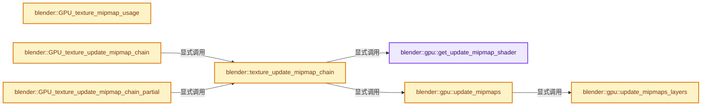
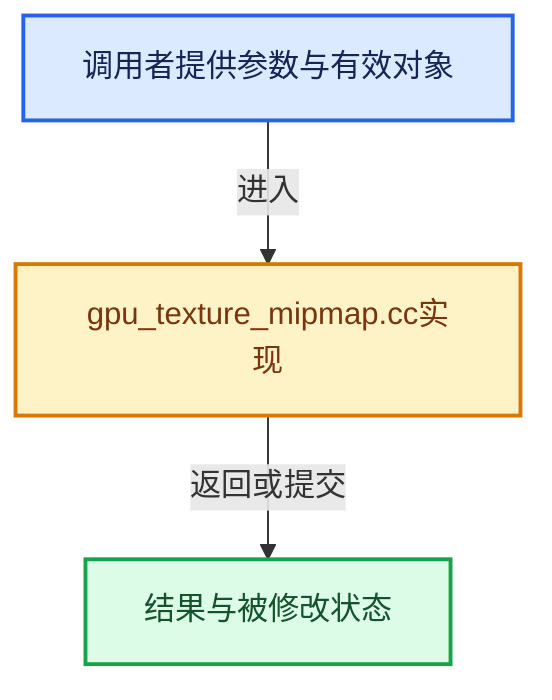

# 实现依赖专题：source/blender/gpu/intern/gpu_texture_mipmap.cc

[实现依赖导航](../../../README.md) · [符号索引](../../../../00-课程指南/02-源码与提交索引/符号依赖与实现索引.md)

本专题从正文实际调用进入，集中保存共享实现。函数有稳定锚点，可从调用处直接跳到对应完整函数；递归与互相调用通过回链组织。

## 本文件的实现关系






## 完整成员与函数实现

<a id="f-a024e3dffb43d515"></a>

### `blender::gpu::get_update_mipmap_shader`

实现位置：[source/blender/gpu/intern/gpu_texture_mipmap.cc](../../../../../../../../source/blender/gpu/intern/gpu_texture_mipmap.cc) · L39—L84。

接口参数：

- `TextureFormat texture_format`
- `bool is_layered`

**教学注释版**

<!-- annotated:6667aa9d07becb -->

```cpp
static Shader *get_update_mipmap_shader(TextureFormat texture_format, bool is_layered)
{
  if (is_layered) {
    switch (texture_format) {
      case TextureFormat::UNORM_8:
        return GPU_shader_get_builtin_shader(GPU_SHADER_2D_UPDATE_MIPMAPS_UNORM_8_LAYERED);
      case TextureFormat::UNORM_8_8_8_8:
        return GPU_shader_get_builtin_shader(GPU_SHADER_2D_UPDATE_MIPMAPS_UNORM_8_8_8_8_LAYERED);
      case TextureFormat::SFLOAT_16:
        return GPU_shader_get_builtin_shader(GPU_SHADER_2D_UPDATE_MIPMAPS_SFLOAT_16_LAYERED);
      case TextureFormat::SFLOAT_16_16_16_16:
        return GPU_shader_get_builtin_shader(
            GPU_SHADER_2D_UPDATE_MIPMAPS_SFLOAT_16_16_16_16_LAYERED);
      case TextureFormat::SFLOAT_32:
        return GPU_shader_get_builtin_shader(GPU_SHADER_2D_UPDATE_MIPMAPS_SFLOAT_32_LAYERED);
      case TextureFormat::SFLOAT_32_32_32_32:
        return GPU_shader_get_builtin_shader(
            GPU_SHADER_2D_UPDATE_MIPMAPS_SFLOAT_32_32_32_32_LAYERED);
      case TextureFormat::SRGBA_8_8_8_8:
        return GPU_shader_get_builtin_shader(GPU_SHADER_2D_UPDATE_MIPMAPS_SRGBA_8_8_8_8_LAYERED);
      default:
        break;
    }
    return nullptr;
  }

  switch (texture_format) {
    case TextureFormat::UNORM_8:
      return GPU_shader_get_builtin_shader(GPU_SHADER_2D_UPDATE_MIPMAPS_UNORM_8);
    case TextureFormat::UNORM_8_8_8_8:
      return GPU_shader_get_builtin_shader(GPU_SHADER_2D_UPDATE_MIPMAPS_UNORM_8_8_8_8);
    case TextureFormat::SFLOAT_16:
      return GPU_shader_get_builtin_shader(GPU_SHADER_2D_UPDATE_MIPMAPS_SFLOAT_16);
    case TextureFormat::SFLOAT_16_16_16_16:
      return GPU_shader_get_builtin_shader(GPU_SHADER_2D_UPDATE_MIPMAPS_SFLOAT_16_16_16_16);
    case TextureFormat::SFLOAT_32:
      return GPU_shader_get_builtin_shader(GPU_SHADER_2D_UPDATE_MIPMAPS_SFLOAT_32);
    case TextureFormat::SFLOAT_32_32_32_32:
      return GPU_shader_get_builtin_shader(GPU_SHADER_2D_UPDATE_MIPMAPS_SFLOAT_32_32_32_32);
    case TextureFormat::SRGBA_8_8_8_8:
      return GPU_shader_get_builtin_shader(GPU_SHADER_2D_UPDATE_MIPMAPS_SRGBA_8_8_8_8);
    default:
      break;
  }
  return nullptr;
}
```

<details>
<summary>核对原始源码：source/blender/gpu/intern/gpu_texture_mipmap.cc · L39—L84</summary>

<!-- original:6667aa9d07becb:source/blender/gpu/intern/gpu_texture_mipmap.cc:39:84 -->

```cpp
static Shader *get_update_mipmap_shader(TextureFormat texture_format, bool is_layered)
{
  if (is_layered) {
    switch (texture_format) {
      case TextureFormat::UNORM_8:
        return GPU_shader_get_builtin_shader(GPU_SHADER_2D_UPDATE_MIPMAPS_UNORM_8_LAYERED);
      case TextureFormat::UNORM_8_8_8_8:
        return GPU_shader_get_builtin_shader(GPU_SHADER_2D_UPDATE_MIPMAPS_UNORM_8_8_8_8_LAYERED);
      case TextureFormat::SFLOAT_16:
        return GPU_shader_get_builtin_shader(GPU_SHADER_2D_UPDATE_MIPMAPS_SFLOAT_16_LAYERED);
      case TextureFormat::SFLOAT_16_16_16_16:
        return GPU_shader_get_builtin_shader(
            GPU_SHADER_2D_UPDATE_MIPMAPS_SFLOAT_16_16_16_16_LAYERED);
      case TextureFormat::SFLOAT_32:
        return GPU_shader_get_builtin_shader(GPU_SHADER_2D_UPDATE_MIPMAPS_SFLOAT_32_LAYERED);
      case TextureFormat::SFLOAT_32_32_32_32:
        return GPU_shader_get_builtin_shader(
            GPU_SHADER_2D_UPDATE_MIPMAPS_SFLOAT_32_32_32_32_LAYERED);
      case TextureFormat::SRGBA_8_8_8_8:
        return GPU_shader_get_builtin_shader(GPU_SHADER_2D_UPDATE_MIPMAPS_SRGBA_8_8_8_8_LAYERED);
      default:
        break;
    }
    return nullptr;
  }

  switch (texture_format) {
    case TextureFormat::UNORM_8:
      return GPU_shader_get_builtin_shader(GPU_SHADER_2D_UPDATE_MIPMAPS_UNORM_8);
    case TextureFormat::UNORM_8_8_8_8:
      return GPU_shader_get_builtin_shader(GPU_SHADER_2D_UPDATE_MIPMAPS_UNORM_8_8_8_8);
    case TextureFormat::SFLOAT_16:
      return GPU_shader_get_builtin_shader(GPU_SHADER_2D_UPDATE_MIPMAPS_SFLOAT_16);
    case TextureFormat::SFLOAT_16_16_16_16:
      return GPU_shader_get_builtin_shader(GPU_SHADER_2D_UPDATE_MIPMAPS_SFLOAT_16_16_16_16);
    case TextureFormat::SFLOAT_32:
      return GPU_shader_get_builtin_shader(GPU_SHADER_2D_UPDATE_MIPMAPS_SFLOAT_32);
    case TextureFormat::SFLOAT_32_32_32_32:
      return GPU_shader_get_builtin_shader(GPU_SHADER_2D_UPDATE_MIPMAPS_SFLOAT_32_32_32_32);
    case TextureFormat::SRGBA_8_8_8_8:
      return GPU_shader_get_builtin_shader(GPU_SHADER_2D_UPDATE_MIPMAPS_SRGBA_8_8_8_8);
    default:
      break;
  }
  return nullptr;
}
```

</details>

**结果出口**

- `return GPU_shader_get_builtin_shader(GPU_SHADER_2D_UPDATE_MIPMAPS_UNORM_8_LAYERED);`
- `return GPU_shader_get_builtin_shader(GPU_SHADER_2D_UPDATE_MIPMAPS_UNORM_8_8_8_8_LAYERED);`
- `return GPU_shader_get_builtin_shader(GPU_SHADER_2D_UPDATE_MIPMAPS_SFLOAT_16_LAYERED);`
- `return GPU_shader_get_builtin_shader(`
- `return GPU_shader_get_builtin_shader(GPU_SHADER_2D_UPDATE_MIPMAPS_SFLOAT_32_LAYERED);`
- `return GPU_shader_get_builtin_shader(GPU_SHADER_2D_UPDATE_MIPMAPS_SRGBA_8_8_8_8_LAYERED);`
- `return nullptr;`
- `return GPU_shader_get_builtin_shader(GPU_SHADER_2D_UPDATE_MIPMAPS_UNORM_8);`
- `return GPU_shader_get_builtin_shader(GPU_SHADER_2D_UPDATE_MIPMAPS_UNORM_8_8_8_8);`
- `return GPU_shader_get_builtin_shader(GPU_SHADER_2D_UPDATE_MIPMAPS_SFLOAT_16);`
- `return GPU_shader_get_builtin_shader(GPU_SHADER_2D_UPDATE_MIPMAPS_SFLOAT_16_16_16_16);`
- `return GPU_shader_get_builtin_shader(GPU_SHADER_2D_UPDATE_MIPMAPS_SFLOAT_32);`
- `return GPU_shader_get_builtin_shader(GPU_SHADER_2D_UPDATE_MIPMAPS_SFLOAT_32_32_32_32);`
- `return GPU_shader_get_builtin_shader(GPU_SHADER_2D_UPDATE_MIPMAPS_SRGBA_8_8_8_8);`

**继续追踪实现**

- `GPU_shader_get_builtin_shader` → [blender::GPU_shader_get_builtin_shader · L268](gpu_shader_builtin.cc.md#f-235dd2ce9b1ac196)。

<a id="f-df922a021d906225"></a>

### `blender::gpu::update_mipmaps_layers`

实现位置：[source/blender/gpu/intern/gpu_texture_mipmap.cc](../../../../../../../../source/blender/gpu/intern/gpu_texture_mipmap.cc) · L93—L223。

接口参数：

- `Texture &texture`
- `Shader &shader`
- `const IndexRange layers`
- `const TextureFormat view_format`
- `const BitSpan modified_chunks`

**教学注释版**

<!-- annotated:5bd1e431a470f0 -->

```cpp
static void update_mipmaps_layers(Texture &texture,
                                  Shader &shader,
                                  const IndexRange layers,
                                  const TextureFormat view_format,
                                  const BitSpan modified_chunks)
{
  const int num_mipmaps = texture.mip_count();
  const int layer_count = texture.layer_count();

  /* Create view for each mipmap level. Profiling shows this is the most expensive
   * host side work of GPU mipmap generation, so it may be worth trying to cache this.
   * But it may not be that significant compared to e.g. other texture painting
   * overhead, needs to be measured. */
  Vector<Texture *, 16> views;
  for (int mipmap : IndexRange(num_mipmaps)) {
    // [讲解] views.append：在尾部建立新元素，必要时先扩大存储。
    views.append(GPU_texture_create_view(
        __func__, &texture, view_format, mipmap, 1, 0, layer_count, false, false));
  }

  /* Check the bitmask has the correct size, or empty for full update. */
  const int2 chunks_size(
      divide_ceil_u(texture.width_get(), GPU_TEXTURE_MIPMAP_UPDATE_CHUNK_SIZE),
      divide_ceil_u(texture.height_get(), GPU_TEXTURE_MIPMAP_UPDATE_CHUNK_SIZE));
  BLI_assert(modified_chunks.is_empty() ||
             modified_chunks.size() == chunks_size.x * chunks_size.y);

  /* Turn bitmask into chunk coordinates. */
  Vector<int2> chunks;
  bits::foreach_1_index(modified_chunks, [&](const int64_t i) {
    chunks.append(int2(i % chunks_size.x, i / chunks_size.x));
  });
  // [讲解] chunks.size：用end_减begin_得到活元素数量。
  StorageBuf *chunk_buf = GPU_storagebuf_create_ex(sizeof(int2) * max_ii(chunks.size(), 1),
                                                   // [讲解] chunks.data：提供当前存储或有效范围的地址。
                                                   chunks.is_empty() ? nullptr : chunks.data(),
                                                   GPU_USAGE_DYNAMIC,
                                                   __func__);
  GPU_storagebuf_bind(chunk_buf, GPU_shader_get_ssbo_binding(&shader, "chunk_list"));

  /* The views cover all layers, so only the destination layer of the dispatch varies. */
  const auto compute_dispatch_layers =
      [&](const int groups_x, const int groups_y, const int groups_z) {
        for (const int64_t layer : layers) {
          GPU_shader_uniform_1i(&shader, "dst_layer", int(layer));
          GPU_compute_dispatch(&shader, groups_x, groups_y, groups_z);
        }
      };

  constexpr int max_levels_per_dispatch = 2;

  for (int mip_start = 0; mip_start < num_mipmaps - 1; mip_start += max_levels_per_dispatch) {
    GPU_memory_barrier(GPU_BARRIER_SHADER_IMAGE_ACCESS);
    GPU_texture_image_bind(views[mip_start], 0);
    for (int mip_offset = 1; mip_offset <= max_levels_per_dispatch; mip_offset++) {
      GPU_texture_image_bind(views[min_ii(mip_start + mip_offset, views.size() - 1)], mip_offset);
    }
    int num_levels = min_ii(views.size() - mip_start - 1, max_levels_per_dispatch);
    GPU_shader_uniform_1i(&shader, "num_levels", num_levels);

    int3 mip_size(1, 1, 1);
    texture.mip_size_get(mip_start + num_levels, mip_size);

    if (num_levels == 1u) {
      /* Each thread writes one sample. */
      constexpr uint32_t warps = 4;
      const uint32_t samples = mip_size.x * mip_size.y;
      const uint32_t threads = warps * 32U;
      const uint group_len = divide_ceil_u(samples, threads);

      /* The number of work groups in a single dispatch is bounded by `GPU_max_work_group_count()`.
       * Split the work over multiple dispatches when it doesn't fit. */
      const int max_group_count = max_ii(GPU_max_work_group_count(0), 1);
      for (uint group_offset = 0; group_offset < group_len; group_offset += max_group_count) {
        GPU_shader_uniform_1i(&shader, "group_offset", int(group_offset));
        compute_dispatch_layers(int(min_uu(group_len - group_offset, max_group_count)), 1, 1);
      }
      continue;
    }

    /* Each workgroup handles a tile. */
    const int2 tile_count(divide_ceil_u(mip_size.x, MIPMAP_UPDATE_TILE_SIZE),
                          divide_ceil_u(mip_size.y, MIPMAP_UPDATE_TILE_SIZE));

    if (!chunks.is_empty()) {
      /* Partial update. */
      const int dst_level = mip_start + num_levels;

      /* Add a margin for levels with odd dimensions, as neighboring chunks are affected then.
       * For the common case of power-of-two textures there is no margin needed because of the
       * simple box filter. */
      int2 margin(0, 0);
      for (const int src_level : IndexRange(dst_level)) {
        int3 src_size(1, 1, 1);
        texture.mip_size_get(src_level, src_size);
        margin.x |= (src_size.x > 1 && (src_size.x & 1));
        margin.y |= (src_size.y > 1 && (src_size.y & 1));
      }

      /* A tile grid is dispatched per chunk. It covers the chunk's footprint at dst_level,
       * plus the margin. */
      const int chunk_pixels_num = max_ii(GPU_TEXTURE_MIPMAP_UPDATE_CHUNK_SIZE >> dst_level, 1);
      const auto chunk_tiles_num = [&](const int margin) {
        return margin ? int(divide_ceil_u(chunk_pixels_num + 2, MIPMAP_UPDATE_TILE_SIZE)) + 1 :
                        max_ii(chunk_pixels_num / MIPMAP_UPDATE_TILE_SIZE, 1);
      };
      const int2 sub_tiles(chunk_tiles_num(margin.x), chunk_tiles_num(margin.y));

      /* Check if we already cover the whole level anyway, if so fall through to full update. */
      const int64_t total_tiles = int64_t(tile_count.x) * tile_count.y;
      if (chunks.size() * sub_tiles.x * sub_tiles.y < total_tiles) {
        /* Partial update, one workgroup per tile in a chunk. */
        GPU_shader_uniform_1i(&shader, "partial_dst_level", dst_level);
        GPU_shader_uniform_1i(&shader, "margin_x", margin.x);
        GPU_shader_uniform_1i(&shader, "margin_y", margin.y);
        compute_dispatch_layers(sub_tiles.x, sub_tiles.y, chunks.size());
        continue;
      }
    }

    /* Full update, one workgroup per tile. */
    GPU_shader_uniform_1i(&shader, "partial_dst_level", -1);
    GPU_shader_uniform_1i(&shader, "margin_x", 0);
    GPU_shader_uniform_1i(&shader, "margin_y", 0);
    compute_dispatch_layers(tile_count.x, tile_count.y, 1);
  }

  for (Texture *view : views) {
    GPU_texture_free(view);
  }
  GPU_storagebuf_unbind(chunk_buf);
  GPU_storagebuf_free(chunk_buf);
  GPU_memory_barrier(GPU_BARRIER_TEXTURE_FETCH | GPU_BARRIER_SHADER_IMAGE_ACCESS);
}
```

<details>
<summary>核对原始源码：source/blender/gpu/intern/gpu_texture_mipmap.cc · L93—L223</summary>

<!-- original:5bd1e431a470f0:source/blender/gpu/intern/gpu_texture_mipmap.cc:93:223 -->

```cpp
static void update_mipmaps_layers(Texture &texture,
                                  Shader &shader,
                                  const IndexRange layers,
                                  const TextureFormat view_format,
                                  const BitSpan modified_chunks)
{
  const int num_mipmaps = texture.mip_count();
  const int layer_count = texture.layer_count();

  /* Create view for each mipmap level. Profiling shows this is the most expensive
   * host side work of GPU mipmap generation, so it may be worth trying to cache this.
   * But it may not be that significant compared to e.g. other texture painting
   * overhead, needs to be measured. */
  Vector<Texture *, 16> views;
  for (int mipmap : IndexRange(num_mipmaps)) {
    views.append(GPU_texture_create_view(
        __func__, &texture, view_format, mipmap, 1, 0, layer_count, false, false));
  }

  /* Check the bitmask has the correct size, or empty for full update. */
  const int2 chunks_size(
      divide_ceil_u(texture.width_get(), GPU_TEXTURE_MIPMAP_UPDATE_CHUNK_SIZE),
      divide_ceil_u(texture.height_get(), GPU_TEXTURE_MIPMAP_UPDATE_CHUNK_SIZE));
  BLI_assert(modified_chunks.is_empty() ||
             modified_chunks.size() == chunks_size.x * chunks_size.y);

  /* Turn bitmask into chunk coordinates. */
  Vector<int2> chunks;
  bits::foreach_1_index(modified_chunks, [&](const int64_t i) {
    chunks.append(int2(i % chunks_size.x, i / chunks_size.x));
  });
  StorageBuf *chunk_buf = GPU_storagebuf_create_ex(sizeof(int2) * max_ii(chunks.size(), 1),
                                                   chunks.is_empty() ? nullptr : chunks.data(),
                                                   GPU_USAGE_DYNAMIC,
                                                   __func__);
  GPU_storagebuf_bind(chunk_buf, GPU_shader_get_ssbo_binding(&shader, "chunk_list"));

  /* The views cover all layers, so only the destination layer of the dispatch varies. */
  const auto compute_dispatch_layers =
      [&](const int groups_x, const int groups_y, const int groups_z) {
        for (const int64_t layer : layers) {
          GPU_shader_uniform_1i(&shader, "dst_layer", int(layer));
          GPU_compute_dispatch(&shader, groups_x, groups_y, groups_z);
        }
      };

  constexpr int max_levels_per_dispatch = 2;

  for (int mip_start = 0; mip_start < num_mipmaps - 1; mip_start += max_levels_per_dispatch) {
    GPU_memory_barrier(GPU_BARRIER_SHADER_IMAGE_ACCESS);
    GPU_texture_image_bind(views[mip_start], 0);
    for (int mip_offset = 1; mip_offset <= max_levels_per_dispatch; mip_offset++) {
      GPU_texture_image_bind(views[min_ii(mip_start + mip_offset, views.size() - 1)], mip_offset);
    }
    int num_levels = min_ii(views.size() - mip_start - 1, max_levels_per_dispatch);
    GPU_shader_uniform_1i(&shader, "num_levels", num_levels);

    int3 mip_size(1, 1, 1);
    texture.mip_size_get(mip_start + num_levels, mip_size);

    if (num_levels == 1u) {
      /* Each thread writes one sample. */
      constexpr uint32_t warps = 4;
      const uint32_t samples = mip_size.x * mip_size.y;
      const uint32_t threads = warps * 32U;
      const uint group_len = divide_ceil_u(samples, threads);

      /* The number of work groups in a single dispatch is bounded by `GPU_max_work_group_count()`.
       * Split the work over multiple dispatches when it doesn't fit. */
      const int max_group_count = max_ii(GPU_max_work_group_count(0), 1);
      for (uint group_offset = 0; group_offset < group_len; group_offset += max_group_count) {
        GPU_shader_uniform_1i(&shader, "group_offset", int(group_offset));
        compute_dispatch_layers(int(min_uu(group_len - group_offset, max_group_count)), 1, 1);
      }
      continue;
    }

    /* Each workgroup handles a tile. */
    const int2 tile_count(divide_ceil_u(mip_size.x, MIPMAP_UPDATE_TILE_SIZE),
                          divide_ceil_u(mip_size.y, MIPMAP_UPDATE_TILE_SIZE));

    if (!chunks.is_empty()) {
      /* Partial update. */
      const int dst_level = mip_start + num_levels;

      /* Add a margin for levels with odd dimensions, as neighboring chunks are affected then.
       * For the common case of power-of-two textures there is no margin needed because of the
       * simple box filter. */
      int2 margin(0, 0);
      for (const int src_level : IndexRange(dst_level)) {
        int3 src_size(1, 1, 1);
        texture.mip_size_get(src_level, src_size);
        margin.x |= (src_size.x > 1 && (src_size.x & 1));
        margin.y |= (src_size.y > 1 && (src_size.y & 1));
      }

      /* A tile grid is dispatched per chunk. It covers the chunk's footprint at dst_level,
       * plus the margin. */
      const int chunk_pixels_num = max_ii(GPU_TEXTURE_MIPMAP_UPDATE_CHUNK_SIZE >> dst_level, 1);
      const auto chunk_tiles_num = [&](const int margin) {
        return margin ? int(divide_ceil_u(chunk_pixels_num + 2, MIPMAP_UPDATE_TILE_SIZE)) + 1 :
                        max_ii(chunk_pixels_num / MIPMAP_UPDATE_TILE_SIZE, 1);
      };
      const int2 sub_tiles(chunk_tiles_num(margin.x), chunk_tiles_num(margin.y));

      /* Check if we already cover the whole level anyway, if so fall through to full update. */
      const int64_t total_tiles = int64_t(tile_count.x) * tile_count.y;
      if (chunks.size() * sub_tiles.x * sub_tiles.y < total_tiles) {
        /* Partial update, one workgroup per tile in a chunk. */
        GPU_shader_uniform_1i(&shader, "partial_dst_level", dst_level);
        GPU_shader_uniform_1i(&shader, "margin_x", margin.x);
        GPU_shader_uniform_1i(&shader, "margin_y", margin.y);
        compute_dispatch_layers(sub_tiles.x, sub_tiles.y, chunks.size());
        continue;
      }
    }

    /* Full update, one workgroup per tile. */
    GPU_shader_uniform_1i(&shader, "partial_dst_level", -1);
    GPU_shader_uniform_1i(&shader, "margin_x", 0);
    GPU_shader_uniform_1i(&shader, "margin_y", 0);
    compute_dispatch_layers(tile_count.x, tile_count.y, 1);
  }

  for (Texture *view : views) {
    GPU_texture_free(view);
  }
  GPU_storagebuf_unbind(chunk_buf);
  GPU_storagebuf_free(chunk_buf);
  GPU_memory_barrier(GPU_BARRIER_TEXTURE_FETCH | GPU_BARRIER_SHADER_IMAGE_ACCESS);
}
```

</details>

**沿实际写入检查状态**

- `margin.x |= (src_size.x > 1 && (src_size.x & 1));`
- `margin.y |= (src_size.y > 1 && (src_size.y & 1));`

**结果出口**

- `return margin ? int(divide_ceil_u(chunk_pixels_num + 2, MIPMAP_UPDATE_TILE_SIZE)) + 1 :`

**继续追踪实现**

- `texture.mip_count` → [blender::gpu::Texture::mip_count · L288](gpu_texture_private.hh.md#f-01d9625cfd05654e)。
- `texture.layer_count` → [blender::gpu::Texture::layer_count · L274](gpu_texture_private.hh.md#f-ae5bba132ad53865)。
- `IndexRange` → [blender::IndexRange](../../../01-BLI基础库/BLI_index_range.hh.md#t-caa3466d6776)；[blender::gpu::shader::parser::IndexRange](../shader_tool/utils.hh.md#t-82d2bd4ea71c)；[blender::IndexRange](../../makesdna/DNA_node_types.h.md#t-0448cc889d39)。
- `views.append` → [blender::Vector::append · L498](../../../../01-基础容器与现代CPP/11-Vector插入删除与重排.md#f-5bde268a69e443ec)；[blender::Vector::append · L502](../../../../01-基础容器与现代CPP/11-Vector插入删除与重排.md#f-591e0b15e6308532)。同名重载需按实参类型选择。
- `GPU_texture_create_view` → [blender::GPU_texture_create_view · L445](gpu_texture.cc.md#f-fe0e8110c39be01f)。
- `divide_ceil_u` → [blender::divide_ceil_u · L235](../../../01-BLI基础库/intern/math_base_inline.cc.md#f-9bfe95d830410fdd)。
- `texture.width_get` → [blender::gpu::Texture::width_get · L194](gpu_texture_private.hh.md#f-138c9c9a887b36d2)。
- `texture.height_get` → [blender::gpu::Texture::height_get · L198](gpu_texture_private.hh.md#f-c5700348f3e3d710)。
- `BLI_assert` → [BLI_assert · L48](../../../01-BLI基础库/BLI_assert.hh.md#m-57a88495704d)；[BLI_assert · L63](../../../01-BLI基础库/BLI_assert.hh.md#m-d07050020cb5)。宏定义由构建条件选择。
- `modified_chunks.is_empty` → [blender::bits::BitSpan::is_empty · L156](../../../../01-基础容器与现代CPP/19-BitSpan与BitVector.md#f-9e464d71eeb9d5c6)。
- `modified_chunks.size` → [blender::bits::BitSpan::size · L151](../../../../01-基础容器与现代CPP/19-BitSpan与BitVector.md#f-619593bac6a150f5)。
- `bits::foreach_1_index` → [blender::bits::foreach_1_index · L319](../../../01-BLI基础库/BLI_bit_span_ops.hh.md#f-27c095604fcf6348)。
- `chunks.append` → [blender::Vector::append · L498](../../../../01-基础容器与现代CPP/11-Vector插入删除与重排.md#f-5bde268a69e443ec)；[blender::Vector::append · L502](../../../../01-基础容器与现代CPP/11-Vector插入删除与重排.md#f-591e0b15e6308532)。同名重载需按实参类型选择。
- `int2` → [int2 · L643](../../compositor/algorithms/intern/smaa.cc.md#m-8960c8e6139d)。宏定义由构建条件选择。
- `GPU_storagebuf_create_ex` → [blender::GPU_storagebuf_create_ex · L59](gpu_storage_buffer.cc.md#f-4042921669abadf8)。
- `max_ii` → [blender::max_ii · L368](../../../01-BLI基础库/intern/math_base_inline.cc.md#f-c45aa7b373adb94c)。
- `chunks.size` → [blender::Vector::size · L780](../../../../01-基础容器与现代CPP/11-Vector插入删除与重排.md#f-714773731767349c)。
- `chunks.is_empty` → [blender::Vector::is_empty · L792](../../../../01-基础容器与现代CPP/11-Vector插入删除与重排.md#f-937bbd9cb80bdcc8)。
- `chunks.data` → [blender::Vector::data · L954](../../../../01-基础容器与现代CPP/12-Vector异常安全与边界.md#f-6e441591404715bc)；[blender::Vector::data · L962](../../../../01-基础容器与现代CPP/12-Vector异常安全与边界.md#f-4bc78d4954c1021a)。同名重载需按实参类型选择。
- `GPU_storagebuf_bind` → [blender::GPU_storagebuf_bind · L94](gpu_storage_buffer.cc.md#f-e795e74fcc758ac4)。
- `GPU_shader_get_ssbo_binding` → [blender::GPU_shader_get_ssbo_binding · L544](gpu_shader.cc.md#f-91a2bf7d4bbda1dc)。
- `GPU_shader_uniform_1i` → [blender::GPU_shader_uniform_1i · L646](gpu_shader.cc.md#f-d02d234ed60d9de0)。
- `GPU_compute_dispatch` → [blender::GPU_compute_dispatch · L16](gpu_compute.cc.md#f-333af4920056a41a)。
- `GPU_memory_barrier` → [blender::GPU_memory_barrier · L305](gpu_state.cc.md#f-5a91f15b51991eb7)。
- `GPU_texture_image_bind` → [blender::GPU_texture_image_bind · L650](gpu_texture.cc.md#f-3962938b7d89b577)。
- `min_ii` → [blender::min_ii · L364](../../../01-BLI基础库/intern/math_base_inline.cc.md#f-30336db35b2810b8)。
- `views.size` → [blender::Vector::size · L780](../../../../01-基础容器与现代CPP/11-Vector插入删除与重排.md#f-714773731767349c)。
- `texture.mip_size_get` → [blender::gpu::Texture::mip_size_get · L217](gpu_texture_private.hh.md#f-47b3751ad4374e58)；[blender::gpu::Texture::mip_size_get · L237](gpu_texture_private.hh.md#f-a6329b73c65c6b0e)。同名重载需按实参类型选择。
- `GPU_max_work_group_count` → [blender::GPU_max_work_group_count · L77](gpu_capabilities.cc.md#f-e09045a87e514cab)。
- `compute_dispatch_layers` → [调用协议](../../../../00-课程指南/01-路线与规范/模板宏与动态分派协议.md)：局部可调用对象，须结合其初始化与捕获环境。调用位置L165。
- `min_uu` → [blender::min_uu · L373](../../../01-BLI基础库/intern/math_base_inline.cc.md#f-d359b366b411d4fe)。
- `chunk_tiles_num` → [调用协议](../../../../00-课程指南/01-路线与规范/模板宏与动态分派协议.md)：局部可调用对象，须结合其初始化与捕获环境。调用位置L196。
- `GPU_texture_free` → [blender::GPU_texture_free · L735](gpu_texture.cc.md#f-3f23c7904f8ea87f)。
- `GPU_storagebuf_unbind` → [blender::GPU_storagebuf_unbind · L99](gpu_storage_buffer.cc.md#f-c9503033675146ed)。
- `GPU_storagebuf_free` → [blender::GPU_storagebuf_free · L79](gpu_storage_buffer.cc.md#f-2c69e3c2aa7fa861)。

<a id="f-b90b375f02e11f44"></a>

### `blender::gpu::update_mipmaps`

实现位置：[source/blender/gpu/intern/gpu_texture_mipmap.cc](../../../../../../../../source/blender/gpu/intern/gpu_texture_mipmap.cc) · L225—L306。

接口参数：

- `Texture &texture`
- `Shader &shader`
- `const TextureFormat write_format`
- `const int partial_layer`
- `const BitSpan modified_chunks`

**教学注释版**

<!-- annotated:bce01ef696e128 -->

```cpp
static void update_mipmaps(Texture &texture,
                           Shader &shader,
                           const TextureFormat write_format,
                           const int partial_layer,
                           const BitSpan modified_chunks)
{
  Context &context = *Context::get();
  Shader *prev_shader = context.shader;

  Texture *texture_ptr = &texture;
  const int layer_count = texture.layer_count();
  const int mip_count = texture.mip_count();
  const bool is_layered = texture.type_get() & GPU_TEXTURE_ARRAY;

  /* When the texture format can not be written to directly and we can't use a view
   * to write it as another format, use a temporary texture. */
  const bool use_temp_texture = write_format != texture.format_get() &&
                                (texture.usage_get() & GPU_TEXTURE_USAGE_FORMAT_VIEW) == 0;
  if (use_temp_texture) {
    if (is_layered) {
      texture_ptr = GPU_texture_create_2d_array(__func__,
                                                texture.width_get(),
                                                texture.height_get(),
                                                layer_count,
                                                texture.mip_count(),
                                                TextureFormat::UNORM_8_8_8_8,
                                                GPU_TEXTURE_USAGE_SHADER_READ |
                                                    GPU_TEXTURE_USAGE_SHADER_WRITE,
                                                nullptr);
    }
    else {
      texture_ptr = GPU_texture_create_2d(__func__,
                                          texture.width_get(),
                                          texture.height_get(),
                                          texture.mip_count(),
                                          TextureFormat::UNORM_8_8_8_8,
                                          GPU_TEXTURE_USAGE_SHADER_READ |
                                              GPU_TEXTURE_USAGE_SHADER_WRITE,
                                          nullptr);
    }
    texture.copy_to(texture_ptr, IndexRange(1));
  }

  GPU_shader_bind(&shader);

  if (modified_chunks.is_empty() || use_temp_texture) {
    /* Full update of every layer. The temporary texture path does not currently
     * support partial updates, but image textures request #GPU_TEXTURE_USAGE_FORMAT_VIEW for
     * the formats that would need it, so painting does not reach this. */
    update_mipmaps_layers(*texture_ptr, shader, IndexRange(layer_count), write_format, {});
  }
  else {
    /* Partial update of a single layer's changed chunks. */
    update_mipmaps_layers(*texture_ptr,
                          shader,
                          IndexRange::from_single(partial_layer),
                          write_format,
                          modified_chunks);
  }

  if (use_temp_texture) {
    /* Copy result (mip1 and higher) to original texture and free temporary resources. */
    texture_ptr->copy_to(&texture, IndexRange::from_begin_end(1, mip_count));
    GPU_texture_free(texture_ptr);
    texture_ptr = nullptr;
  }

  /* Clear all bound images.
   *
   * Current OpenGL API doesn't have a way to rebind the previous state as it only keeps track of
   * handles. Using a temporary state manager doesn't fit with Metal as the state is stored in
   * multiple places.
   *
   * To not over complicate the implementation for something that is not likely to happen it was
   * decided to unbind all images. When artifacts happen the calling code must be fixed. */
  context.state_manager->image_unbind_all();

  /* Reset original state. */
  if (prev_shader) {
    GPU_shader_bind(prev_shader);
  }
}
```

<details>
<summary>核对原始源码：source/blender/gpu/intern/gpu_texture_mipmap.cc · L225—L306</summary>

<!-- original:bce01ef696e128:source/blender/gpu/intern/gpu_texture_mipmap.cc:225:306 -->

```cpp
static void update_mipmaps(Texture &texture,
                           Shader &shader,
                           const TextureFormat write_format,
                           const int partial_layer,
                           const BitSpan modified_chunks)
{
  Context &context = *Context::get();
  Shader *prev_shader = context.shader;

  Texture *texture_ptr = &texture;
  const int layer_count = texture.layer_count();
  const int mip_count = texture.mip_count();
  const bool is_layered = texture.type_get() & GPU_TEXTURE_ARRAY;

  /* When the texture format can not be written to directly and we can't use a view
   * to write it as another format, use a temporary texture. */
  const bool use_temp_texture = write_format != texture.format_get() &&
                                (texture.usage_get() & GPU_TEXTURE_USAGE_FORMAT_VIEW) == 0;
  if (use_temp_texture) {
    if (is_layered) {
      texture_ptr = GPU_texture_create_2d_array(__func__,
                                                texture.width_get(),
                                                texture.height_get(),
                                                layer_count,
                                                texture.mip_count(),
                                                TextureFormat::UNORM_8_8_8_8,
                                                GPU_TEXTURE_USAGE_SHADER_READ |
                                                    GPU_TEXTURE_USAGE_SHADER_WRITE,
                                                nullptr);
    }
    else {
      texture_ptr = GPU_texture_create_2d(__func__,
                                          texture.width_get(),
                                          texture.height_get(),
                                          texture.mip_count(),
                                          TextureFormat::UNORM_8_8_8_8,
                                          GPU_TEXTURE_USAGE_SHADER_READ |
                                              GPU_TEXTURE_USAGE_SHADER_WRITE,
                                          nullptr);
    }
    texture.copy_to(texture_ptr, IndexRange(1));
  }

  GPU_shader_bind(&shader);

  if (modified_chunks.is_empty() || use_temp_texture) {
    /* Full update of every layer. The temporary texture path does not currently
     * support partial updates, but image textures request #GPU_TEXTURE_USAGE_FORMAT_VIEW for
     * the formats that would need it, so painting does not reach this. */
    update_mipmaps_layers(*texture_ptr, shader, IndexRange(layer_count), write_format, {});
  }
  else {
    /* Partial update of a single layer's changed chunks. */
    update_mipmaps_layers(*texture_ptr,
                          shader,
                          IndexRange::from_single(partial_layer),
                          write_format,
                          modified_chunks);
  }

  if (use_temp_texture) {
    /* Copy result (mip1 and higher) to original texture and free temporary resources. */
    texture_ptr->copy_to(&texture, IndexRange::from_begin_end(1, mip_count));
    GPU_texture_free(texture_ptr);
    texture_ptr = nullptr;
  }

  /* Clear all bound images.
   *
   * Current OpenGL API doesn't have a way to rebind the previous state as it only keeps track of
   * handles. Using a temporary state manager doesn't fit with Metal as the state is stored in
   * multiple places.
   *
   * To not over complicate the implementation for something that is not likely to happen it was
   * decided to unbind all images. When artifacts happen the calling code must be fixed. */
  context.state_manager->image_unbind_all();

  /* Reset original state. */
  if (prev_shader) {
    GPU_shader_bind(prev_shader);
  }
}
```

</details>

**沿实际写入检查状态**

- `texture_ptr = GPU_texture_create_2d_array(__func__,`
- `texture_ptr = GPU_texture_create_2d(__func__,`
- `texture_ptr = nullptr;`

**继续追踪实现**

- `Context::get` → [blender::gpu::Context::get · L127](gpu_context.cc.md#f-7ca16707244f2d11)。
- `texture.layer_count` → [blender::gpu::Texture::layer_count · L274](gpu_texture_private.hh.md#f-ae5bba132ad53865)。
- `texture.mip_count` → [blender::gpu::Texture::mip_count · L288](gpu_texture_private.hh.md#f-01d9625cfd05654e)。
- `texture.type_get` → [blender::gpu::Texture::type_get · L311](gpu_texture_private.hh.md#f-973d5500434c5b18)。
- `texture.format_get` → [blender::gpu::Texture::format_get · L303](gpu_texture_private.hh.md#f-84c066db43b6cfaa)。
- `texture.usage_get` → [blender::gpu::Texture::usage_get · L206](gpu_texture_private.hh.md#f-33e0781d80810456)。
- `GPU_texture_create_2d_array` → [blender::GPU_texture_create_2d_array · L319](gpu_texture.cc.md#f-c56ab2472a370c27)。
- `texture.width_get` → [blender::gpu::Texture::width_get · L194](gpu_texture_private.hh.md#f-138c9c9a887b36d2)。
- `texture.height_get` → [blender::gpu::Texture::height_get · L198](gpu_texture_private.hh.md#f-c5700348f3e3d710)。
- `GPU_texture_create_2d` → [blender::GPU_texture_create_2d · L308](gpu_texture.cc.md#f-5aa2a42234aebbda)。
- `texture.copy_to` → [blender::gpu::VKTexture::copy_to · L83](../vulkan/vk_texture.cc.md#f-7a1fd5b36fda5c04)；[blender::gpu::VKTexture::copy_to · L112](../vulkan/vk_texture.cc.md#f-e8eb42128f5de1a4)；[blender::gpu::GLTexture::copy_to · L441](../opengl/gl_texture.cc.md#f-cd7e6784ea29655e)。同名重载需按实参类型选择。
- `IndexRange` → [blender::IndexRange](../../../01-BLI基础库/BLI_index_range.hh.md#t-caa3466d6776)；[blender::gpu::shader::parser::IndexRange](../shader_tool/utils.hh.md#t-82d2bd4ea71c)；[blender::IndexRange](../../makesdna/DNA_node_types.h.md#t-0448cc889d39)。
- `GPU_shader_bind` → [blender::GPU_shader_bind · L387](gpu_shader.cc.md#f-a879eef1816db611)。
- `modified_chunks.is_empty` → [blender::bits::BitSpan::is_empty · L156](../../../../01-基础容器与现代CPP/19-BitSpan与BitVector.md#f-9e464d71eeb9d5c6)。
- `update_mipmaps_layers` → [blender::gpu::update_mipmaps_layers · L93](gpu_texture_mipmap.cc.md#f-df922a021d906225)。
- `IndexRange::from_single` → [blender::IndexRange::from_single · L93](../../../../01-基础容器与现代CPP/04-IndexRange连续整数区间.md#f-c53911354f78d5b0)。
- `texture_ptr->copy_to` → [blender::gpu::VKTexture::copy_to · L83](../vulkan/vk_texture.cc.md#f-7a1fd5b36fda5c04)；[blender::gpu::VKTexture::copy_to · L112](../vulkan/vk_texture.cc.md#f-e8eb42128f5de1a4)；[blender::gpu::GLTexture::copy_to · L441](../opengl/gl_texture.cc.md#f-cd7e6784ea29655e)。同名重载需按实参类型选择。
- `IndexRange::from_begin_end` → [blender::IndexRange::from_begin_end · L78](../../../../01-基础容器与现代CPP/04-IndexRange连续整数区间.md#f-a523839fb9650253)。
- `GPU_texture_free` → [blender::GPU_texture_free · L735](gpu_texture.cc.md#f-3f23c7904f8ea87f)。
- `context.state_manager->image_unbind_all` → [调用协议](../../../../00-课程指南/01-路线与规范/模板宏与动态分派协议.md)：接收对象类型依赖auto、返回值或模板实例；不按同名猜测目标。调用位置L300。

<a id="f-cb07a5fe02450835"></a>

### `blender::GPU_texture_mipmap_usage`

实现位置：[source/blender/gpu/intern/gpu_texture_mipmap.cc](../../../../../../../../source/blender/gpu/intern/gpu_texture_mipmap.cc) · L312—L325。

接口参数：

- `TextureFormat format`

**教学注释版**

<!-- annotated:2dfca01a89005f -->

```cpp
eGPUTextureUsage GPU_texture_mipmap_usage(TextureFormat format)
{
  /* Mipmaps generated with the compute shader need write support. */
  eGPUTextureUsage usage = GPU_TEXTURE_USAGE_SHADER_WRITE;

  /* If it's sRGB and we can't write directly to it, use a texture view to write through. */
  if (format == TextureFormat::SRGBA_8_8_8_8) {
    if (!GCaps.srgb_write_direct_support && GCaps.srgb_write_view_support) {
      usage |= GPU_TEXTURE_USAGE_FORMAT_VIEW;
    }
  }

  return usage;
}
```

<details>
<summary>核对原始源码：source/blender/gpu/intern/gpu_texture_mipmap.cc · L312—L325</summary>

<!-- original:2dfca01a89005f:source/blender/gpu/intern/gpu_texture_mipmap.cc:312:325 -->

```cpp
eGPUTextureUsage GPU_texture_mipmap_usage(TextureFormat format)
{
  /* Mipmaps generated with the compute shader need write support. */
  eGPUTextureUsage usage = GPU_TEXTURE_USAGE_SHADER_WRITE;

  /* If it's sRGB and we can't write directly to it, use a texture view to write through. */
  if (format == TextureFormat::SRGBA_8_8_8_8) {
    if (!GCaps.srgb_write_direct_support && GCaps.srgb_write_view_support) {
      usage |= GPU_TEXTURE_USAGE_FORMAT_VIEW;
    }
  }

  return usage;
}
```

</details>

**沿实际写入检查状态**

- `usage |= GPU_TEXTURE_USAGE_FORMAT_VIEW;`

**结果出口**

- `return usage;`

**继续追踪实现**

本实现没有需要继续展开的显式调用；检查返回表达式、对象转换和调用者前置条件。

<a id="f-bcbf6a8a155e6af5"></a>

### `blender::texture_update_mipmap_chain`

实现位置：[source/blender/gpu/intern/gpu_texture_mipmap.cc](../../../../../../../../source/blender/gpu/intern/gpu_texture_mipmap.cc) · L327—L377。

接口参数：

- `Texture *tex`
- `const int partial_layer`
- `const BitSpan modified_chunks`

**教学注释版**

<!-- annotated:29aff8049efbd1 -->

```cpp
static void texture_update_mipmap_chain(Texture *tex,
                                        const int partial_layer,
                                        const BitSpan modified_chunks)
{
  BLI_assert(tex);

  const int num_mipmaps = tex->mip_count();
  /* Early exit - nothing to generate as texture only contains 1 mipmap level. */
  if (num_mipmaps == 1) {
    return;
  }

  bool use_compute_shaders = true;

  if ((tex->usage_get() & GPU_TEXTURE_USAGE_SHADER_WRITE) == 0) {
    CLOG_TRACE(&LOG,
               "Texture doesn't have `GPU_TEXTURE_USAGE_SHADER_WRITE` set. Fallback to backend "
               "implementation");
    use_compute_shaders = false;
  }

  if (use_compute_shaders) {
    const TextureFormat texture_format = tex->format_get();
    const bool is_layered = tex->type_get() & GPU_TEXTURE_ARRAY;
    const bool is_srgb = texture_format == TextureFormat::SRGBA_8_8_8_8;
    /* For sRGB without direct write support, write with a UNORM_8_8_8_8 format,
     * either in a temporary texture or through a texture view. */
    const TextureFormat write_format = (is_srgb && !GCaps.srgb_write_direct_support) ?
                                           TextureFormat::UNORM_8_8_8_8 :
                                           texture_format;
    /* For sRGB with direct write support, the shader is that same as UNORM_8_8_8_8 and
     * any conversion to/from sRGB happens automatically. */
    const TextureFormat shader_format = (is_srgb && GCaps.srgb_write_direct_support) ?
                                            TextureFormat::UNORM_8_8_8_8 :
                                            texture_format;
    Shader *shader = get_update_mipmap_shader(shader_format, is_layered);
    if (shader) {
      GPU_debug_group_begin("Update Mipmaps");
      update_mipmaps(*tex, *shader, write_format, partial_layer, modified_chunks);
      GPU_debug_group_end();
      return;
    }
    CLOG_INFO(&LOG,
              "No shader exists for updating mipmaps (format=%s). Fallback to backend "
              "implementation, this could lead to different results between platforms.",
              GPU_texture_format_name(texture_format));
  }

  /* No mipmap shader exists for this texture format. Fallback to backend implementation. */
  tex->generate_mipmap();
}
```

<details>
<summary>核对原始源码：source/blender/gpu/intern/gpu_texture_mipmap.cc · L327—L377</summary>

<!-- original:29aff8049efbd1:source/blender/gpu/intern/gpu_texture_mipmap.cc:327:377 -->

```cpp
static void texture_update_mipmap_chain(Texture *tex,
                                        const int partial_layer,
                                        const BitSpan modified_chunks)
{
  BLI_assert(tex);

  const int num_mipmaps = tex->mip_count();
  /* Early exit - nothing to generate as texture only contains 1 mipmap level. */
  if (num_mipmaps == 1) {
    return;
  }

  bool use_compute_shaders = true;

  if ((tex->usage_get() & GPU_TEXTURE_USAGE_SHADER_WRITE) == 0) {
    CLOG_TRACE(&LOG,
               "Texture doesn't have `GPU_TEXTURE_USAGE_SHADER_WRITE` set. Fallback to backend "
               "implementation");
    use_compute_shaders = false;
  }

  if (use_compute_shaders) {
    const TextureFormat texture_format = tex->format_get();
    const bool is_layered = tex->type_get() & GPU_TEXTURE_ARRAY;
    const bool is_srgb = texture_format == TextureFormat::SRGBA_8_8_8_8;
    /* For sRGB without direct write support, write with a UNORM_8_8_8_8 format,
     * either in a temporary texture or through a texture view. */
    const TextureFormat write_format = (is_srgb && !GCaps.srgb_write_direct_support) ?
                                           TextureFormat::UNORM_8_8_8_8 :
                                           texture_format;
    /* For sRGB with direct write support, the shader is that same as UNORM_8_8_8_8 and
     * any conversion to/from sRGB happens automatically. */
    const TextureFormat shader_format = (is_srgb && GCaps.srgb_write_direct_support) ?
                                            TextureFormat::UNORM_8_8_8_8 :
                                            texture_format;
    Shader *shader = get_update_mipmap_shader(shader_format, is_layered);
    if (shader) {
      GPU_debug_group_begin("Update Mipmaps");
      update_mipmaps(*tex, *shader, write_format, partial_layer, modified_chunks);
      GPU_debug_group_end();
      return;
    }
    CLOG_INFO(&LOG,
              "No shader exists for updating mipmaps (format=%s). Fallback to backend "
              "implementation, this could lead to different results between platforms.",
              GPU_texture_format_name(texture_format));
  }

  /* No mipmap shader exists for this texture format. Fallback to backend implementation. */
  tex->generate_mipmap();
}
```

</details>

**沿实际写入检查状态**

- `use_compute_shaders = false;`

**继续追踪实现**

- `BLI_assert` → [BLI_assert · L48](../../../01-BLI基础库/BLI_assert.hh.md#m-57a88495704d)；[BLI_assert · L63](../../../01-BLI基础库/BLI_assert.hh.md#m-d07050020cb5)。宏定义由构建条件选择。
- `tex->mip_count` → [blender::gpu::Texture::mip_count · L288](gpu_texture_private.hh.md#f-01d9625cfd05654e)。
- `tex->usage_get` → [blender::gpu::Texture::usage_get · L206](gpu_texture_private.hh.md#f-33e0781d80810456)。
- `CLOG_TRACE` → [CLOG_TRACE · L192](../../../07-Intern运行时与平台/clog/CLG_log.h.md#m-46273bee5728)。宏定义由构建条件选择。
- `tex->format_get` → [blender::gpu::Texture::format_get · L303](gpu_texture_private.hh.md#f-84c066db43b6cfaa)。
- `tex->type_get` → [blender::gpu::Texture::type_get · L311](gpu_texture_private.hh.md#f-973d5500434c5b18)。
- `get_update_mipmap_shader` → [blender::gpu::get_update_mipmap_shader · L39](gpu_texture_mipmap.cc.md#f-a024e3dffb43d515)。
- `GPU_debug_group_begin` → [blender::GPU_debug_group_begin · L23](gpu_debug.cc.md#f-c74a16ba40e0e7a7)。
- `update_mipmaps` → [blender::gpu::update_mipmaps · L225](gpu_texture_mipmap.cc.md#f-b90b375f02e11f44)。
- `GPU_debug_group_end` → [blender::GPU_debug_group_end · L34](gpu_debug.cc.md#f-6d1ac356d118d5ac)。
- `CLOG_INFO` → [CLOG_INFO · L190](../../../07-Intern运行时与平台/clog/CLG_log.h.md#m-f8b5efdfcc0f)。宏定义由构建条件选择。
- `GPU_texture_format_name` → [blender::GPU_texture_format_name · L819](gpu_texture.cc.md#f-377b7ba81ad33abf)。
- `tex->generate_mipmap` → [调用协议](../../../../00-课程指南/01-路线与规范/模板宏与动态分派协议.md)：由接收对象具体类型或运行时策略提供实现。调用位置L376。

<a id="f-ae3d338615e86225"></a>

### `blender::GPU_texture_update_mipmap_chain`

实现位置：[source/blender/gpu/intern/gpu_texture_mipmap.cc](../../../../../../../../source/blender/gpu/intern/gpu_texture_mipmap.cc) · L379—L382。

接口参数：

- `Texture *tex`

**教学注释版**

<!-- annotated:bc4e5c2ea632d5 -->

```cpp
void GPU_texture_update_mipmap_chain(Texture *tex)
{
  texture_update_mipmap_chain(tex, 0, {});
}
```

<details>
<summary>核对原始源码：source/blender/gpu/intern/gpu_texture_mipmap.cc · L379—L382</summary>

<!-- original:bc4e5c2ea632d5:source/blender/gpu/intern/gpu_texture_mipmap.cc:379:382 -->

```cpp
void GPU_texture_update_mipmap_chain(Texture *tex)
{
  texture_update_mipmap_chain(tex, 0, {});
}
```

</details>

**继续追踪实现**

- `texture_update_mipmap_chain` → [blender::texture_update_mipmap_chain · L327](gpu_texture_mipmap.cc.md#f-bcbf6a8a155e6af5)。

<a id="f-8c0e68a02199620b"></a>

### `blender::GPU_texture_update_mipmap_chain_partial`

实现位置：[source/blender/gpu/intern/gpu_texture_mipmap.cc](../../../../../../../../source/blender/gpu/intern/gpu_texture_mipmap.cc) · L384—L391。

接口参数：

- `Texture *tex`
- `const int layer`
- `const BitSpan modified_chunks`

**教学注释版**

<!-- annotated:d1bafb653ef0cc -->

```cpp
void GPU_texture_update_mipmap_chain_partial(Texture *tex,
                                             const int layer,
                                             const BitSpan modified_chunks)
{
  if (bits::any_bit_set(modified_chunks)) {
    texture_update_mipmap_chain(tex, layer, modified_chunks);
  }
}
```

<details>
<summary>核对原始源码：source/blender/gpu/intern/gpu_texture_mipmap.cc · L384—L391</summary>

<!-- original:d1bafb653ef0cc:source/blender/gpu/intern/gpu_texture_mipmap.cc:384:391 -->

```cpp
void GPU_texture_update_mipmap_chain_partial(Texture *tex,
                                             const int layer,
                                             const BitSpan modified_chunks)
{
  if (bits::any_bit_set(modified_chunks)) {
    texture_update_mipmap_chain(tex, layer, modified_chunks);
  }
}
```

</details>

**继续追踪实现**

- `bits::any_bit_set` → [blender::bits::any_bit_set · L304](../../../01-BLI基础库/BLI_bit_span_ops.hh.md#f-bfb61bb0b943d731)。
- `texture_update_mipmap_chain` → [blender::texture_update_mipmap_chain · L327](gpu_texture_mipmap.cc.md#f-bcbf6a8a155e6af5)。
