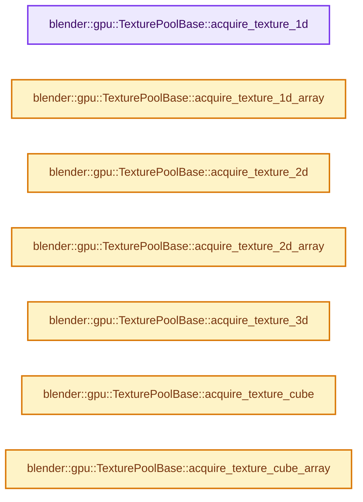
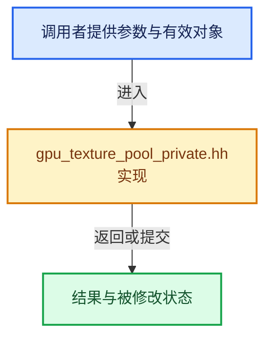

# 实现依赖专题：source/blender/gpu/intern/gpu_texture_pool_private.hh

[实现依赖导航](../../../README.md) · [符号索引](../../../../00-课程指南/02-源码与提交索引/符号依赖与实现索引.md)

本专题从正文实际调用进入，集中保存共享实现。函数有稳定锚点，可从调用处直接跳到对应完整函数；递归与互相调用通过回链组织。

## 本文件的实现关系






## 完整成员与函数实现

<a id="f-3bcaf715febcfd9b"></a>

### `blender::gpu::TexturePoolBase::acquire_texture_1d`

实现位置：[source/blender/gpu/intern/gpu_texture_pool_private.hh](../../../../../../../../source/blender/gpu/intern/gpu_texture_pool_private.hh) · L30—L37。

接口参数：

- `int extent`
- `int mip_len`
- `TextureFormat format`
- `eGPUTextureUsage usage`
- `const char *name = nullptr`

**教学注释版**

<!-- annotated:a1e4fb0f647f48 -->

```cpp
  Texture *acquire_texture_1d(int extent,
                              int mip_len,
                              TextureFormat format,
                              eGPUTextureUsage usage,
                              const char *name = nullptr) override
  {
    return acquire_texture_impl({extent, 0, 0}, mip_len, GPU_TEXTURE_1D, format, usage, name);
  }
```

<details>
<summary>核对原始源码：source/blender/gpu/intern/gpu_texture_pool_private.hh · L30—L37</summary>

<!-- original:a1e4fb0f647f48:source/blender/gpu/intern/gpu_texture_pool_private.hh:30:37 -->

```cpp
  Texture *acquire_texture_1d(int extent,
                              int mip_len,
                              TextureFormat format,
                              eGPUTextureUsage usage,
                              const char *name = nullptr) override
  {
    return acquire_texture_impl({extent, 0, 0}, mip_len, GPU_TEXTURE_1D, format, usage, name);
  }
```

</details>

**结果出口**

- `return acquire_texture_impl({extent, 0, 0}, mip_len, GPU_TEXTURE_1D, format, usage, name);`

**继续追踪实现**

- `acquire_texture_impl` → [调用协议](../../../../00-课程指南/01-路线与规范/模板宏与动态分派协议.md)：函数指针、局部可调用对象或未展开的宏；必须结合调用者环境。调用位置L36。

<a id="f-67a0a52618de7979"></a>

### `blender::gpu::TexturePoolBase::acquire_texture_1d_array`

实现位置：[source/blender/gpu/intern/gpu_texture_pool_private.hh](../../../../../../../../source/blender/gpu/intern/gpu_texture_pool_private.hh) · L38—L47。

接口参数：

- `int extent`
- `int layer_len`
- `int mip_len`
- `TextureFormat format`
- `eGPUTextureUsage usage`
- `const char *name = nullptr`

**教学注释版**

<!-- annotated:f17aef89ca0a77 -->

```cpp
  Texture *acquire_texture_1d_array(int extent,
                                    int layer_len,
                                    int mip_len,
                                    TextureFormat format,
                                    eGPUTextureUsage usage,
                                    const char *name = nullptr) override
  {
    return acquire_texture_impl(
        {extent, layer_len, 0}, mip_len, GPU_TEXTURE_1D_ARRAY, format, usage, name);
  }
```

<details>
<summary>核对原始源码：source/blender/gpu/intern/gpu_texture_pool_private.hh · L38—L47</summary>

<!-- original:f17aef89ca0a77:source/blender/gpu/intern/gpu_texture_pool_private.hh:38:47 -->

```cpp
  Texture *acquire_texture_1d_array(int extent,
                                    int layer_len,
                                    int mip_len,
                                    TextureFormat format,
                                    eGPUTextureUsage usage,
                                    const char *name = nullptr) override
  {
    return acquire_texture_impl(
        {extent, layer_len, 0}, mip_len, GPU_TEXTURE_1D_ARRAY, format, usage, name);
  }
```

</details>

**结果出口**

- `return acquire_texture_impl(`

**继续追踪实现**

- `acquire_texture_impl` → [调用协议](../../../../00-课程指南/01-路线与规范/模板宏与动态分派协议.md)：函数指针、局部可调用对象或未展开的宏；必须结合调用者环境。调用位置L45。

<a id="f-0e2da5735f914dc1"></a>

### `blender::gpu::TexturePoolBase::acquire_texture_2d`

实现位置：[source/blender/gpu/intern/gpu_texture_pool_private.hh](../../../../../../../../source/blender/gpu/intern/gpu_texture_pool_private.hh) · L48—L56。

接口参数：

- `int2 extent`
- `int mip_len`
- `TextureFormat format`
- `eGPUTextureUsage usage`
- `const char *name = nullptr`

**教学注释版**

<!-- annotated:781431cca48f02 -->

```cpp
  Texture *acquire_texture_2d(int2 extent,
                              int mip_len,
                              TextureFormat format,
                              eGPUTextureUsage usage,
                              const char *name = nullptr) override
  {
    return acquire_texture_impl(
        {extent.x, extent.y, 0}, mip_len, GPU_TEXTURE_2D, format, usage, name);
  }
```

<details>
<summary>核对原始源码：source/blender/gpu/intern/gpu_texture_pool_private.hh · L48—L56</summary>

<!-- original:781431cca48f02:source/blender/gpu/intern/gpu_texture_pool_private.hh:48:56 -->

```cpp
  Texture *acquire_texture_2d(int2 extent,
                              int mip_len,
                              TextureFormat format,
                              eGPUTextureUsage usage,
                              const char *name = nullptr) override
  {
    return acquire_texture_impl(
        {extent.x, extent.y, 0}, mip_len, GPU_TEXTURE_2D, format, usage, name);
  }
```

</details>

**结果出口**

- `return acquire_texture_impl(`

**继续追踪实现**

- `acquire_texture_impl` → [调用协议](../../../../00-课程指南/01-路线与规范/模板宏与动态分派协议.md)：函数指针、局部可调用对象或未展开的宏；必须结合调用者环境。调用位置L54。

<a id="f-21ba60a70c6eeb8b"></a>

### `blender::gpu::TexturePoolBase::acquire_texture_2d_array`

实现位置：[source/blender/gpu/intern/gpu_texture_pool_private.hh](../../../../../../../../source/blender/gpu/intern/gpu_texture_pool_private.hh) · L57—L66。

接口参数：

- `int2 extent`
- `int layer_len`
- `int mip_len`
- `TextureFormat format`
- `eGPUTextureUsage usage`
- `const char *name = nullptr`

**教学注释版**

<!-- annotated:f831c37ad8bcd0 -->

```cpp
  Texture *acquire_texture_2d_array(int2 extent,
                                    int layer_len,
                                    int mip_len,
                                    TextureFormat format,
                                    eGPUTextureUsage usage,
                                    const char *name = nullptr) override
  {
    return acquire_texture_impl(
        {extent.x, extent.y, layer_len}, mip_len, GPU_TEXTURE_2D_ARRAY, format, usage, name);
  }
```

<details>
<summary>核对原始源码：source/blender/gpu/intern/gpu_texture_pool_private.hh · L57—L66</summary>

<!-- original:f831c37ad8bcd0:source/blender/gpu/intern/gpu_texture_pool_private.hh:57:66 -->

```cpp
  Texture *acquire_texture_2d_array(int2 extent,
                                    int layer_len,
                                    int mip_len,
                                    TextureFormat format,
                                    eGPUTextureUsage usage,
                                    const char *name = nullptr) override
  {
    return acquire_texture_impl(
        {extent.x, extent.y, layer_len}, mip_len, GPU_TEXTURE_2D_ARRAY, format, usage, name);
  }
```

</details>

**结果出口**

- `return acquire_texture_impl(`

**继续追踪实现**

- `acquire_texture_impl` → [调用协议](../../../../00-课程指南/01-路线与规范/模板宏与动态分派协议.md)：函数指针、局部可调用对象或未展开的宏；必须结合调用者环境。调用位置L64。

<a id="f-d5f6486a0e189ee6"></a>

### `blender::gpu::TexturePoolBase::acquire_texture_3d`

实现位置：[source/blender/gpu/intern/gpu_texture_pool_private.hh](../../../../../../../../source/blender/gpu/intern/gpu_texture_pool_private.hh) · L67—L74。

接口参数：

- `int3 extent`
- `int mip_len`
- `TextureFormat format`
- `eGPUTextureUsage usage`
- `const char *name = nullptr`

**教学注释版**

<!-- annotated:c9e09bdc1d4575 -->

```cpp
  Texture *acquire_texture_3d(int3 extent,
                              int mip_len,
                              TextureFormat format,
                              eGPUTextureUsage usage,
                              const char *name = nullptr) override
  {
    return acquire_texture_impl(extent, mip_len, GPU_TEXTURE_3D, format, usage, name);
  }
```

<details>
<summary>核对原始源码：source/blender/gpu/intern/gpu_texture_pool_private.hh · L67—L74</summary>

<!-- original:c9e09bdc1d4575:source/blender/gpu/intern/gpu_texture_pool_private.hh:67:74 -->

```cpp
  Texture *acquire_texture_3d(int3 extent,
                              int mip_len,
                              TextureFormat format,
                              eGPUTextureUsage usage,
                              const char *name = nullptr) override
  {
    return acquire_texture_impl(extent, mip_len, GPU_TEXTURE_3D, format, usage, name);
  }
```

</details>

**结果出口**

- `return acquire_texture_impl(extent, mip_len, GPU_TEXTURE_3D, format, usage, name);`

**继续追踪实现**

- `acquire_texture_impl` → [调用协议](../../../../00-课程指南/01-路线与规范/模板宏与动态分派协议.md)：函数指针、局部可调用对象或未展开的宏；必须结合调用者环境。调用位置L73。

<a id="f-fd3004ec745150b2"></a>

### `blender::gpu::TexturePoolBase::acquire_texture_cube`

实现位置：[source/blender/gpu/intern/gpu_texture_pool_private.hh](../../../../../../../../source/blender/gpu/intern/gpu_texture_pool_private.hh) · L75—L83。

接口参数：

- `int extent`
- `int mip_len`
- `TextureFormat format`
- `eGPUTextureUsage usage`
- `const char *name = nullptr`

**教学注释版**

<!-- annotated:c070275316c2ef -->

```cpp
  Texture *acquire_texture_cube(int extent,
                                int mip_len,
                                TextureFormat format,
                                eGPUTextureUsage usage,
                                const char *name = nullptr) override
  {
    return acquire_texture_impl(
        {extent, extent, 0}, mip_len, GPU_TEXTURE_CUBE, format, usage, name);
  }
```

<details>
<summary>核对原始源码：source/blender/gpu/intern/gpu_texture_pool_private.hh · L75—L83</summary>

<!-- original:c070275316c2ef:source/blender/gpu/intern/gpu_texture_pool_private.hh:75:83 -->

```cpp
  Texture *acquire_texture_cube(int extent,
                                int mip_len,
                                TextureFormat format,
                                eGPUTextureUsage usage,
                                const char *name = nullptr) override
  {
    return acquire_texture_impl(
        {extent, extent, 0}, mip_len, GPU_TEXTURE_CUBE, format, usage, name);
  }
```

</details>

**结果出口**

- `return acquire_texture_impl(`

**继续追踪实现**

- `acquire_texture_impl` → [调用协议](../../../../00-课程指南/01-路线与规范/模板宏与动态分派协议.md)：函数指针、局部可调用对象或未展开的宏；必须结合调用者环境。调用位置L81。

<a id="f-81d2661dcf46f481"></a>

### `blender::gpu::TexturePoolBase::acquire_texture_cube_array`

实现位置：[source/blender/gpu/intern/gpu_texture_pool_private.hh](../../../../../../../../source/blender/gpu/intern/gpu_texture_pool_private.hh) · L84—L93。

接口参数：

- `int extent`
- `int layer_len`
- `int mip_len`
- `TextureFormat format`
- `eGPUTextureUsage usage`
- `const char *name = nullptr`

**教学注释版**

<!-- annotated:9b98fc79662950 -->

```cpp
  Texture *acquire_texture_cube_array(int extent,
                                      int layer_len,
                                      int mip_len,
                                      TextureFormat format,
                                      eGPUTextureUsage usage,
                                      const char *name = nullptr) override
  {
    return acquire_texture_impl(
        {extent, extent, layer_len}, mip_len, GPU_TEXTURE_CUBE_ARRAY, format, usage, name);
  }
```

<details>
<summary>核对原始源码：source/blender/gpu/intern/gpu_texture_pool_private.hh · L84—L93</summary>

<!-- original:9b98fc79662950:source/blender/gpu/intern/gpu_texture_pool_private.hh:84:93 -->

```cpp
  Texture *acquire_texture_cube_array(int extent,
                                      int layer_len,
                                      int mip_len,
                                      TextureFormat format,
                                      eGPUTextureUsage usage,
                                      const char *name = nullptr) override
  {
    return acquire_texture_impl(
        {extent, extent, layer_len}, mip_len, GPU_TEXTURE_CUBE_ARRAY, format, usage, name);
  }
```

</details>

**结果出口**

- `return acquire_texture_impl(`

**继续追踪实现**

- `acquire_texture_impl` → [调用协议](../../../../00-课程指南/01-路线与规范/模板宏与动态分派协议.md)：函数指针、局部可调用对象或未展开的宏；必须结合调用者环境。调用位置L91。
