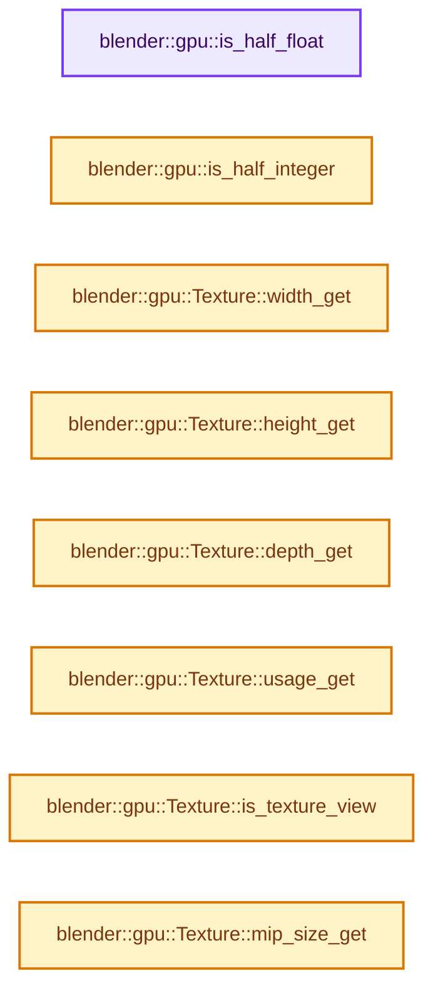
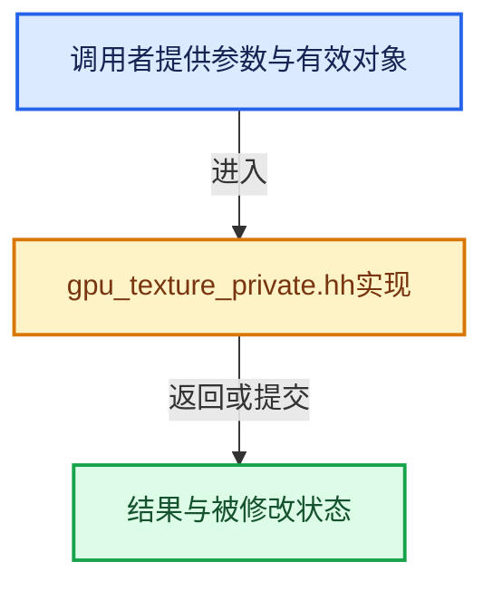

# 实现依赖专题：source/blender/gpu/intern/gpu_texture_private.hh

[实现依赖导航](../../../README.md) · [符号索引](../../../../00-课程指南/02-源码与提交索引/符号依赖与实现索引.md)

本专题从正文实际调用进入，集中保存共享实现。函数有稳定锚点，可从调用处直接跳到对应完整函数；递归与互相调用通过回链组织。

## 本文件的实现关系






## 完整成员与函数实现

<a id="f-140829c6e9b3837a"></a>

### `blender::gpu::is_half_float`

实现位置：[source/blender/gpu/intern/gpu_texture_private.hh](../../../../../../../../source/blender/gpu/intern/gpu_texture_private.hh) · L21—L32。

接口参数：

- `TextureFormat format`

**教学注释版**

<!-- annotated:3ec3593a3be8d4 -->

```cpp
inline bool is_half_float(TextureFormat format)
{
  switch (format) {
    case TextureFormat::SFLOAT_16_16_16_16:
    case TextureFormat::SFLOAT_16_16_16:
    case TextureFormat::SFLOAT_16_16:
    case TextureFormat::SFLOAT_16:
      return true;
    default:
      return false;
  }
}
```

<details>
<summary>核对原始源码：source/blender/gpu/intern/gpu_texture_private.hh · L21—L32</summary>

<!-- original:3ec3593a3be8d4:source/blender/gpu/intern/gpu_texture_private.hh:21:32 -->

```cpp
inline bool is_half_float(TextureFormat format)
{
  switch (format) {
    case TextureFormat::SFLOAT_16_16_16_16:
    case TextureFormat::SFLOAT_16_16_16:
    case TextureFormat::SFLOAT_16_16:
    case TextureFormat::SFLOAT_16:
      return true;
    default:
      return false;
  }
}
```

</details>

**结果出口**

- `return true;`
- `return false;`

**继续追踪实现**

本实现没有需要继续展开的显式调用；检查返回表达式、对象转换和调用者前置条件。

<a id="f-9f53e5f5a2f44594"></a>

### `blender::gpu::is_half_integer`

实现位置：[source/blender/gpu/intern/gpu_texture_private.hh](../../../../../../../../source/blender/gpu/intern/gpu_texture_private.hh) · L34—L45。

接口参数：

- `TextureFormat format`

**教学注释版**

<!-- annotated:513a7fd43b7b08 -->

```cpp
inline bool is_half_integer(TextureFormat format)
{
  switch (format) {
    case TextureFormat::SINT_16_16_16_16:
    case TextureFormat::SINT_16_16_16:
    case TextureFormat::SINT_16_16:
    case TextureFormat::SINT_16:
      return true;
    default:
      return false;
  }
}
```

<details>
<summary>核对原始源码：source/blender/gpu/intern/gpu_texture_private.hh · L34—L45</summary>

<!-- original:513a7fd43b7b08:source/blender/gpu/intern/gpu_texture_private.hh:34:45 -->

```cpp
inline bool is_half_integer(TextureFormat format)
{
  switch (format) {
    case TextureFormat::SINT_16_16_16_16:
    case TextureFormat::SINT_16_16_16:
    case TextureFormat::SINT_16_16:
    case TextureFormat::SINT_16:
      return true;
    default:
      return false;
  }
}
```

</details>

**结果出口**

- `return true;`
- `return false;`

**继续追踪实现**

本实现没有需要继续展开的显式调用；检查返回表达式、对象转换和调用者前置条件。

<a id="f-138c9c9a887b36d2"></a>

### `blender::gpu::Texture::width_get`

实现位置：[source/blender/gpu/intern/gpu_texture_private.hh](../../../../../../../../source/blender/gpu/intern/gpu_texture_private.hh) · L194—L197。

**教学注释版**

<!-- annotated:77d13f338c0899 -->

```cpp
  int width_get() const
  {
    return w_;
  }
```

<details>
<summary>核对原始源码：source/blender/gpu/intern/gpu_texture_private.hh · L194—L197</summary>

<!-- original:77d13f338c0899:source/blender/gpu/intern/gpu_texture_private.hh:194:197 -->

```cpp
  int width_get() const
  {
    return w_;
  }
```

</details>

**结果出口**

- `return w_;`

**继续追踪实现**

本实现没有需要继续展开的显式调用；检查返回表达式、对象转换和调用者前置条件。

<a id="f-c5700348f3e3d710"></a>

### `blender::gpu::Texture::height_get`

实现位置：[source/blender/gpu/intern/gpu_texture_private.hh](../../../../../../../../source/blender/gpu/intern/gpu_texture_private.hh) · L198—L201。

**教学注释版**

<!-- annotated:ee78a2a26428a6 -->

```cpp
  int height_get() const
  {
    return h_;
  }
```

<details>
<summary>核对原始源码：source/blender/gpu/intern/gpu_texture_private.hh · L198—L201</summary>

<!-- original:ee78a2a26428a6:source/blender/gpu/intern/gpu_texture_private.hh:198:201 -->

```cpp
  int height_get() const
  {
    return h_;
  }
```

</details>

**结果出口**

- `return h_;`

**继续追踪实现**

本实现没有需要继续展开的显式调用；检查返回表达式、对象转换和调用者前置条件。

<a id="f-a42dbab00d73db40"></a>

### `blender::gpu::Texture::depth_get`

实现位置：[source/blender/gpu/intern/gpu_texture_private.hh](../../../../../../../../source/blender/gpu/intern/gpu_texture_private.hh) · L202—L205。

**教学注释版**

<!-- annotated:b908a9750e438a -->

```cpp
  int depth_get() const
  {
    return d_;
  }
```

<details>
<summary>核对原始源码：source/blender/gpu/intern/gpu_texture_private.hh · L202—L205</summary>

<!-- original:b908a9750e438a:source/blender/gpu/intern/gpu_texture_private.hh:202:205 -->

```cpp
  int depth_get() const
  {
    return d_;
  }
```

</details>

**结果出口**

- `return d_;`

**继续追踪实现**

本实现没有需要继续展开的显式调用；检查返回表达式、对象转换和调用者前置条件。

<a id="f-33e0781d80810456"></a>

### `blender::gpu::Texture::usage_get`

实现位置：[source/blender/gpu/intern/gpu_texture_private.hh](../../../../../../../../source/blender/gpu/intern/gpu_texture_private.hh) · L206—L209。

**教学注释版**

<!-- annotated:fac17a90f3c6dc -->

```cpp
  eGPUTextureUsage usage_get() const
  {
    return gpu_image_usage_flags_;
  }
```

<details>
<summary>核对原始源码：source/blender/gpu/intern/gpu_texture_private.hh · L206—L209</summary>

<!-- original:fac17a90f3c6dc:source/blender/gpu/intern/gpu_texture_private.hh:206:209 -->

```cpp
  eGPUTextureUsage usage_get() const
  {
    return gpu_image_usage_flags_;
  }
```

</details>

**结果出口**

- `return gpu_image_usage_flags_;`

**继续追踪实现**

本实现没有需要继续展开的显式调用；检查返回表达式、对象转换和调用者前置条件。

<a id="f-788d968482534be1"></a>

### `blender::gpu::Texture::is_texture_view`

实现位置：[source/blender/gpu/intern/gpu_texture_private.hh](../../../../../../../../source/blender/gpu/intern/gpu_texture_private.hh) · L210—L213。

**教学注释版**

<!-- annotated:a8e49b3c80ef52 -->

```cpp
  bool is_texture_view() const
  {
    return source_texture_ != nullptr;
  }
```

<details>
<summary>核对原始源码：source/blender/gpu/intern/gpu_texture_private.hh · L210—L213</summary>

<!-- original:a8e49b3c80ef52:source/blender/gpu/intern/gpu_texture_private.hh:210:213 -->

```cpp
  bool is_texture_view() const
  {
    return source_texture_ != nullptr;
  }
```

</details>

**结果出口**

- `return source_texture_ != nullptr;`

**继续追踪实现**

本实现没有需要继续展开的显式调用；检查返回表达式、对象转换和调用者前置条件。

<a id="f-47b3751ad4374e58"></a>

### `blender::gpu::Texture::mip_size_get`

实现位置：[source/blender/gpu/intern/gpu_texture_private.hh](../../../../../../../../source/blender/gpu/intern/gpu_texture_private.hh) · L217—L236。

接口参数：

- `int mip`
- `int r_size[3]`

**教学注释版**

<!-- annotated:dffd6683a84594 -->

```cpp
  void mip_size_get(int mip, int r_size[3]) const
  {
    /* TODO: assert if lvl is below the limit of 1px in each dimension. */
    int div = 1 << mip;
    r_size[0] = max_ii(1, w_ / div);

    if (type_ == GPU_TEXTURE_1D_ARRAY) {
      r_size[1] = h_;
    }
    else if (h_ > 0) {
      r_size[1] = max_ii(1, h_ / div);
    }

    if (type_ & (GPU_TEXTURE_ARRAY | GPU_TEXTURE_CUBE)) {
      r_size[2] = d_;
    }
    else if (d_ > 0) {
      r_size[2] = max_ii(1, d_ / div);
    }
  }
```

<details>
<summary>核对原始源码：source/blender/gpu/intern/gpu_texture_private.hh · L217—L236</summary>

<!-- original:dffd6683a84594:source/blender/gpu/intern/gpu_texture_private.hh:217:236 -->

```cpp
  void mip_size_get(int mip, int r_size[3]) const
  {
    /* TODO: assert if lvl is below the limit of 1px in each dimension. */
    int div = 1 << mip;
    r_size[0] = max_ii(1, w_ / div);

    if (type_ == GPU_TEXTURE_1D_ARRAY) {
      r_size[1] = h_;
    }
    else if (h_ > 0) {
      r_size[1] = max_ii(1, h_ / div);
    }

    if (type_ & (GPU_TEXTURE_ARRAY | GPU_TEXTURE_CUBE)) {
      r_size[2] = d_;
    }
    else if (d_ > 0) {
      r_size[2] = max_ii(1, d_ / div);
    }
  }
```

</details>

**沿实际写入检查状态**

- `r_size[0] = max_ii(1, w_ / div);`
- `r_size[1] = h_;`
- `r_size[1] = max_ii(1, h_ / div);`
- `r_size[2] = d_;`
- `r_size[2] = max_ii(1, d_ / div);`

**继续追踪实现**

- `max_ii` → [blender::max_ii · L368](../../../01-BLI基础库/intern/math_base_inline.cc.md#f-c45aa7b373adb94c)。

<a id="f-a6329b73c65c6b0e"></a>

### `blender::gpu::Texture::mip_size_get`

实现位置：[source/blender/gpu/intern/gpu_texture_private.hh](../../../../../../../../source/blender/gpu/intern/gpu_texture_private.hh) · L237—L242。

接口参数：

- `int mip`

**教学注释版**

<!-- annotated:ed4a9a7cebfbb4 -->

```cpp
  int3 mip_size_get(int mip) const
  {
    int3 size = int3(1);
    mip_size_get(mip, size);
    return size;
  }
```

<details>
<summary>核对原始源码：source/blender/gpu/intern/gpu_texture_private.hh · L237—L242</summary>

<!-- original:ed4a9a7cebfbb4:source/blender/gpu/intern/gpu_texture_private.hh:237:242 -->

```cpp
  int3 mip_size_get(int mip) const
  {
    int3 size = int3(1);
    mip_size_get(mip, size);
    return size;
  }
```

</details>

**结果出口**

- `return size;`

**继续追踪实现**

- `int3` → [int3 · L644](../../compositor/algorithms/intern/smaa.cc.md#m-1865e8d83631)。宏定义由构建条件选择。
- `mip_size_get` → [blender::gpu::Texture::mip_size_get · L217](gpu_texture_private.hh.md#f-47b3751ad4374e58)；[blender::gpu::Texture::mip_size_get · L237](gpu_texture_private.hh.md#f-a6329b73c65c6b0e)。同名重载需按实参类型选择。

<a id="f-c961bd9805205442"></a>

### `blender::gpu::Texture::dimensions_count`

实现位置：[source/blender/gpu/intern/gpu_texture_private.hh](../../../../../../../../source/blender/gpu/intern/gpu_texture_private.hh) · L257—L272。

**教学注释版**

<!-- annotated:d932765450b3b1 -->

```cpp
  int dimensions_count() const
  {
    const int array = (type_ & GPU_TEXTURE_ARRAY) ? 1 : 0;
    switch (type_ & ~GPU_TEXTURE_ARRAY) {
      case GPU_TEXTURE_BUFFER:
        return 1;
      case GPU_TEXTURE_1D:
        return 1 + array;
      case GPU_TEXTURE_2D:
        return 2 + array;
      case GPU_TEXTURE_CUBE:
      case GPU_TEXTURE_3D:
      default:
        return 3;
    }
  }
```

<details>
<summary>核对原始源码：source/blender/gpu/intern/gpu_texture_private.hh · L257—L272</summary>

<!-- original:d932765450b3b1:source/blender/gpu/intern/gpu_texture_private.hh:257:272 -->

```cpp
  int dimensions_count() const
  {
    const int array = (type_ & GPU_TEXTURE_ARRAY) ? 1 : 0;
    switch (type_ & ~GPU_TEXTURE_ARRAY) {
      case GPU_TEXTURE_BUFFER:
        return 1;
      case GPU_TEXTURE_1D:
        return 1 + array;
      case GPU_TEXTURE_2D:
        return 2 + array;
      case GPU_TEXTURE_CUBE:
      case GPU_TEXTURE_3D:
      default:
        return 3;
    }
  }
```

</details>

**结果出口**

- `return 1;`
- `return 1 + array;`
- `return 2 + array;`
- `return 3;`

**继续追踪实现**

本实现没有需要继续展开的显式调用；检查返回表达式、对象转换和调用者前置条件。

<a id="f-ae5bba132ad53865"></a>

### `blender::gpu::Texture::layer_count`

实现位置：[source/blender/gpu/intern/gpu_texture_private.hh](../../../../../../../../source/blender/gpu/intern/gpu_texture_private.hh) · L274—L286。

**教学注释版**

<!-- annotated:76a05d3c644431 -->

```cpp
  int layer_count() const
  {
    switch (type_) {
      case GPU_TEXTURE_1D_ARRAY:
        return h_;
      case GPU_TEXTURE_2D_ARRAY:
      case GPU_TEXTURE_CUBE:
      case GPU_TEXTURE_CUBE_ARRAY:
        return d_;
      default:
        return 1;
    }
  }
```

<details>
<summary>核对原始源码：source/blender/gpu/intern/gpu_texture_private.hh · L274—L286</summary>

<!-- original:76a05d3c644431:source/blender/gpu/intern/gpu_texture_private.hh:274:286 -->

```cpp
  int layer_count() const
  {
    switch (type_) {
      case GPU_TEXTURE_1D_ARRAY:
        return h_;
      case GPU_TEXTURE_2D_ARRAY:
      case GPU_TEXTURE_CUBE:
      case GPU_TEXTURE_CUBE_ARRAY:
        return d_;
      default:
        return 1;
    }
  }
```

</details>

**结果出口**

- `return h_;`
- `return d_;`
- `return 1;`

**继续追踪实现**

本实现没有需要继续展开的显式调用；检查返回表达式、对象转换和调用者前置条件。

<a id="f-01d9625cfd05654e"></a>

### `blender::gpu::Texture::mip_count`

实现位置：[source/blender/gpu/intern/gpu_texture_private.hh](../../../../../../../../source/blender/gpu/intern/gpu_texture_private.hh) · L288—L291。

**教学注释版**

<!-- annotated:77fc61b68e343b -->

```cpp
  int mip_count() const
  {
    return mipmaps_;
  }
```

<details>
<summary>核对原始源码：source/blender/gpu/intern/gpu_texture_private.hh · L288—L291</summary>

<!-- original:77fc61b68e343b:source/blender/gpu/intern/gpu_texture_private.hh:288:291 -->

```cpp
  int mip_count() const
  {
    return mipmaps_;
  }
```

</details>

**结果出口**

- `return mipmaps_;`

**继续追踪实现**

本实现没有需要继续展开的显式调用；检查返回表达式、对象转换和调用者前置条件。

<a id="f-1f3e3bd8552609cd"></a>

### `blender::gpu::Texture::mip_map_range`

实现位置：[source/blender/gpu/intern/gpu_texture_private.hh](../../../../../../../../source/blender/gpu/intern/gpu_texture_private.hh) · L293—L296。

**教学注释版**

<!-- annotated:ecfd25e71d3699 -->

```cpp
  IndexRange mip_map_range() const
  {
    return IndexRange(mip_min_, mip_max_ - mip_min_ + 1);
  }
```

<details>
<summary>核对原始源码：source/blender/gpu/intern/gpu_texture_private.hh · L293—L296</summary>

<!-- original:ecfd25e71d3699:source/blender/gpu/intern/gpu_texture_private.hh:293:296 -->

```cpp
  IndexRange mip_map_range() const
  {
    return IndexRange(mip_min_, mip_max_ - mip_min_ + 1);
  }
```

</details>

**结果出口**

- `return IndexRange(mip_min_, mip_max_ - mip_min_ + 1);`

**继续追踪实现**

- `IndexRange` → [blender::IndexRange](../../../01-BLI基础库/BLI_index_range.hh.md#t-caa3466d6776)；[blender::gpu::shader::parser::IndexRange](../shader_tool/utils.hh.md#t-82d2bd4ea71c)；[blender::IndexRange](../../makesdna/DNA_node_types.h.md#t-0448cc889d39)。

<a id="f-e5bb6e7b882d8a9f"></a>

### `blender::gpu::Texture::layer_range`

实现位置：[source/blender/gpu/intern/gpu_texture_private.hh](../../../../../../../../source/blender/gpu/intern/gpu_texture_private.hh) · L298—L301。

**教学注释版**

<!-- annotated:34fa4fdc575c85 -->

```cpp
  IndexRange layer_range() const
  {
    return IndexRange(view_layer_start_, layer_count());
  }
```

<details>
<summary>核对原始源码：source/blender/gpu/intern/gpu_texture_private.hh · L298—L301</summary>

<!-- original:34fa4fdc575c85:source/blender/gpu/intern/gpu_texture_private.hh:298:301 -->

```cpp
  IndexRange layer_range() const
  {
    return IndexRange(view_layer_start_, layer_count());
  }
```

</details>

**结果出口**

- `return IndexRange(view_layer_start_, layer_count());`

**继续追踪实现**

- `IndexRange` → [blender::IndexRange](../../../01-BLI基础库/BLI_index_range.hh.md#t-caa3466d6776)；[blender::gpu::shader::parser::IndexRange](../shader_tool/utils.hh.md#t-82d2bd4ea71c)；[blender::IndexRange](../../makesdna/DNA_node_types.h.md#t-0448cc889d39)。
- `layer_count` → [blender::gpu::Texture::layer_count · L274](gpu_texture_private.hh.md#f-ae5bba132ad53865)。

<a id="f-84c066db43b6cfaa"></a>

### `blender::gpu::Texture::format_get`

实现位置：[source/blender/gpu/intern/gpu_texture_private.hh](../../../../../../../../source/blender/gpu/intern/gpu_texture_private.hh) · L303—L306。

**教学注释版**

<!-- annotated:591565f3310349 -->

```cpp
  TextureFormat format_get() const
  {
    return format_;
  }
```

<details>
<summary>核对原始源码：source/blender/gpu/intern/gpu_texture_private.hh · L303—L306</summary>

<!-- original:591565f3310349:source/blender/gpu/intern/gpu_texture_private.hh:303:306 -->

```cpp
  TextureFormat format_get() const
  {
    return format_;
  }
```

</details>

**结果出口**

- `return format_;`

**继续追踪实现**

本实现没有需要继续展开的显式调用；检查返回表达式、对象转换和调用者前置条件。

<a id="f-4868a0a502f019d6"></a>

### `blender::gpu::Texture::format_flag_get`

实现位置：[source/blender/gpu/intern/gpu_texture_private.hh](../../../../../../../../source/blender/gpu/intern/gpu_texture_private.hh) · L307—L310。

**教学注释版**

<!-- annotated:5857f1cc73f61d -->

```cpp
  GPUTextureFormatFlag format_flag_get() const
  {
    return format_flag_;
  }
```

<details>
<summary>核对原始源码：source/blender/gpu/intern/gpu_texture_private.hh · L307—L310</summary>

<!-- original:5857f1cc73f61d:source/blender/gpu/intern/gpu_texture_private.hh:307:310 -->

```cpp
  GPUTextureFormatFlag format_flag_get() const
  {
    return format_flag_;
  }
```

</details>

**结果出口**

- `return format_flag_;`

**继续追踪实现**

本实现没有需要继续展开的显式调用；检查返回表达式、对象转换和调用者前置条件。

<a id="f-973d5500434c5b18"></a>

### `blender::gpu::Texture::type_get`

实现位置：[source/blender/gpu/intern/gpu_texture_private.hh](../../../../../../../../source/blender/gpu/intern/gpu_texture_private.hh) · L311—L314。

**教学注释版**

<!-- annotated:3fa4444b57956b -->

```cpp
  GPUTextureType type_get() const
  {
    return type_;
  }
```

<details>
<summary>核对原始源码：source/blender/gpu/intern/gpu_texture_private.hh · L311—L314</summary>

<!-- original:3fa4444b57956b:source/blender/gpu/intern/gpu_texture_private.hh:311:314 -->

```cpp
  GPUTextureType type_get() const
  {
    return type_;
  }
```

</details>

**结果出口**

- `return type_;`

**继续追踪实现**

本实现没有需要继续展开的显式调用；检查返回表达式、对象转换和调用者前置条件。

<a id="f-5c4cfb89abf97d98"></a>

### `blender::gpu::unwrap`

实现位置：[source/blender/gpu/intern/gpu_texture_private.hh](../../../../../../../../source/blender/gpu/intern/gpu_texture_private.hh) · L386—L389。

接口参数：

- `GPUPixelBuffer *pixbuf`

**教学注释版**

<!-- annotated:ac5b6ea6f9ac6c -->

```cpp
static inline PixelBuffer *unwrap(GPUPixelBuffer *pixbuf)
{
  return reinterpret_cast<PixelBuffer *>(pixbuf);
}
```

<details>
<summary>核对原始源码：source/blender/gpu/intern/gpu_texture_private.hh · L386—L389</summary>

<!-- original:ac5b6ea6f9ac6c:source/blender/gpu/intern/gpu_texture_private.hh:386:389 -->

```cpp
static inline PixelBuffer *unwrap(GPUPixelBuffer *pixbuf)
{
  return reinterpret_cast<PixelBuffer *>(pixbuf);
}
```

</details>

**结果出口**

- `return reinterpret_cast<PixelBuffer *>(pixbuf);`

**继续追踪实现**

本实现没有需要继续展开的显式调用；检查返回表达式、对象转换和调用者前置条件。

<a id="f-3ee6604df7f9f44b"></a>

### `blender::gpu::unwrap`

实现位置：[source/blender/gpu/intern/gpu_texture_private.hh](../../../../../../../../source/blender/gpu/intern/gpu_texture_private.hh) · L390—L393。

接口参数：

- `const GPUPixelBuffer *pixbuf`

**教学注释版**

<!-- annotated:6ff935be3ca10a -->

```cpp
static inline const PixelBuffer *unwrap(const GPUPixelBuffer *pixbuf)
{
  return reinterpret_cast<const PixelBuffer *>(pixbuf);
}
```

<details>
<summary>核对原始源码：source/blender/gpu/intern/gpu_texture_private.hh · L390—L393</summary>

<!-- original:6ff935be3ca10a:source/blender/gpu/intern/gpu_texture_private.hh:390:393 -->

```cpp
static inline const PixelBuffer *unwrap(const GPUPixelBuffer *pixbuf)
{
  return reinterpret_cast<const PixelBuffer *>(pixbuf);
}
```

</details>

**结果出口**

- `return reinterpret_cast<const PixelBuffer *>(pixbuf);`

**继续追踪实现**

本实现没有需要继续展开的显式调用；检查返回表达式、对象转换和调用者前置条件。

<a id="f-a10860ed9785f89d"></a>

### `blender::gpu::to_bytesize`

实现位置：[source/blender/gpu/intern/gpu_texture_private.hh](../../../../../../../../source/blender/gpu/intern/gpu_texture_private.hh) · L395—L398。

接口参数：

- `TextureFormat format`

**教学注释版**

<!-- annotated:2eb640e735c958 -->

```cpp
inline size_t to_bytesize(TextureFormat format)
{
  return to_bytesize(DataFormat(format));
}
```

<details>
<summary>核对原始源码：source/blender/gpu/intern/gpu_texture_private.hh · L395—L398</summary>

<!-- original:2eb640e735c958:source/blender/gpu/intern/gpu_texture_private.hh:395:398 -->

```cpp
inline size_t to_bytesize(TextureFormat format)
{
  return to_bytesize(DataFormat(format));
}
```

</details>

**结果出口**

- `return to_bytesize(DataFormat(format));`

**继续追踪实现**

- `to_bytesize` → [blender::gpu::to_bytesize · L395](gpu_texture_private.hh.md#f-a10860ed9785f89d)；[blender::gpu::to_bytesize · L559](gpu_texture_private.hh.md#f-7e05648123684a02)；[blender::gpu::to_bytesize · L579](gpu_texture_private.hh.md#f-8ad1c9330f26cf28)。同名重载需按实参类型选择。
- `DataFormat` → [调用协议](../../../../00-课程指南/01-路线与规范/模板宏与动态分派协议.md)：函数指针、局部可调用对象或未展开的宏；必须结合调用者环境。调用位置L397。

<a id="f-807ba29337528ecf"></a>

### `blender::gpu::to_block_size`

实现位置：[source/blender/gpu/intern/gpu_texture_private.hh](../../../../../../../../source/blender/gpu/intern/gpu_texture_private.hh) · L400—L415。

接口参数：

- `TextureFormat data_type`

**教学注释版**

<!-- annotated:bfb06980b27f5d -->

```cpp
inline size_t to_block_size(TextureFormat data_type)
{
  switch (data_type) {
    case TextureFormat::SRGB_DXT1:
    case TextureFormat::SNORM_DXT1:
      return 8;
    case TextureFormat::SRGB_DXT3:
    case TextureFormat::SRGB_DXT5:
    case TextureFormat::SNORM_DXT3:
    case TextureFormat::SNORM_DXT5:
      return 16;
    default:
      BLI_assert_msg(0, "Texture format is not a compressed format");
      return 0;
  }
}
```

<details>
<summary>核对原始源码：source/blender/gpu/intern/gpu_texture_private.hh · L400—L415</summary>

<!-- original:bfb06980b27f5d:source/blender/gpu/intern/gpu_texture_private.hh:400:415 -->

```cpp
inline size_t to_block_size(TextureFormat data_type)
{
  switch (data_type) {
    case TextureFormat::SRGB_DXT1:
    case TextureFormat::SNORM_DXT1:
      return 8;
    case TextureFormat::SRGB_DXT3:
    case TextureFormat::SRGB_DXT5:
    case TextureFormat::SNORM_DXT3:
    case TextureFormat::SNORM_DXT5:
      return 16;
    default:
      BLI_assert_msg(0, "Texture format is not a compressed format");
      return 0;
  }
}
```

</details>

**结果出口**

- `return 8;`
- `return 16;`
- `return 0;`

**继续追踪实现**

- `BLI_assert_msg` → [BLI_assert_msg · L55](../../../01-BLI基础库/BLI_assert.hh.md#m-695eed20dceb)；[BLI_assert_msg · L64](../../../01-BLI基础库/BLI_assert.hh.md#m-7de5563de4db)。宏定义由构建条件选择。

<a id="f-250b6edf51726647"></a>

### `blender::gpu::to_format_flag`

实现位置：[source/blender/gpu/intern/gpu_texture_private.hh](../../../../../../../../source/blender/gpu/intern/gpu_texture_private.hh) · L417—L552。

接口参数：

- `TextureFormat format`

**教学注释版**

<!-- annotated:654e09f59a19ce -->

```cpp
inline GPUTextureFormatFlag to_format_flag(TextureFormat format)
{
  switch (format) {
    /* Formats texture & render-buffer */
    case TextureFormat::UINT_8_8_8_8:
      return GPU_FORMAT_INTEGER;
    case TextureFormat::SINT_8_8_8_8:
      return GPU_FORMAT_INTEGER | GPU_FORMAT_SIGNED;
    case TextureFormat::UNORM_8_8_8_8:
      return GPU_FORMAT_NORMALIZED_INTEGER;
    case TextureFormat::UINT_32_32_32_32:
      return GPU_FORMAT_INTEGER;
    case TextureFormat::SINT_32_32_32_32:
      return GPU_FORMAT_INTEGER | GPU_FORMAT_SIGNED;
    case TextureFormat::SFLOAT_32_32_32_32:
      return GPU_FORMAT_FLOAT | GPU_FORMAT_SIGNED;
    case TextureFormat::UINT_16_16_16_16:
      return GPU_FORMAT_INTEGER;
    case TextureFormat::SINT_16_16_16_16:
      return GPU_FORMAT_INTEGER | GPU_FORMAT_SIGNED;
    case TextureFormat::SFLOAT_16_16_16_16:
      return GPU_FORMAT_FLOAT | GPU_FORMAT_SIGNED;
    case TextureFormat::UNORM_16_16_16_16:
      return GPU_FORMAT_NORMALIZED_INTEGER;
    case TextureFormat::UINT_8_8:
      return GPU_FORMAT_INTEGER;
    case TextureFormat::SINT_8_8:
      return GPU_FORMAT_INTEGER | GPU_FORMAT_SIGNED;
    case TextureFormat::UNORM_8_8:
      return GPU_FORMAT_NORMALIZED_INTEGER;
    case TextureFormat::UINT_32_32:
      return GPU_FORMAT_INTEGER;
    case TextureFormat::SINT_32_32:
      return GPU_FORMAT_INTEGER | GPU_FORMAT_SIGNED;
    case TextureFormat::SFLOAT_32_32:
      return GPU_FORMAT_FLOAT | GPU_FORMAT_SIGNED;
    case TextureFormat::UINT_16_16:
      return GPU_FORMAT_INTEGER;
    case TextureFormat::SINT_16_16:
      return GPU_FORMAT_INTEGER | GPU_FORMAT_SIGNED;
    case TextureFormat::SFLOAT_16_16:
      return GPU_FORMAT_FLOAT | GPU_FORMAT_SIGNED;
    case TextureFormat::UNORM_16_16:
      return GPU_FORMAT_NORMALIZED_INTEGER;
    case TextureFormat::UINT_8:
      return GPU_FORMAT_INTEGER;
    case TextureFormat::SINT_8:
      return GPU_FORMAT_INTEGER | GPU_FORMAT_SIGNED;
    case TextureFormat::UNORM_8:
      return GPU_FORMAT_NORMALIZED_INTEGER;
    case TextureFormat::UINT_32:
      return GPU_FORMAT_INTEGER;
    case TextureFormat::SINT_32:
      return GPU_FORMAT_INTEGER | GPU_FORMAT_SIGNED;
    case TextureFormat::SFLOAT_32:
      return GPU_FORMAT_FLOAT | GPU_FORMAT_SIGNED;
    case TextureFormat::UINT_16:
      return GPU_FORMAT_INTEGER;
    case TextureFormat::SINT_16:
      return GPU_FORMAT_INTEGER | GPU_FORMAT_SIGNED;
    case TextureFormat::SFLOAT_16:
      return GPU_FORMAT_FLOAT | GPU_FORMAT_SIGNED;
    case TextureFormat::UNORM_16:
      return GPU_FORMAT_NORMALIZED_INTEGER;

    /* Special formats texture & render-buffer */
    case TextureFormat::UNORM_10_10_10_2:
      return GPU_FORMAT_NORMALIZED_INTEGER;
    case TextureFormat::UINT_10_10_10_2:
      return GPU_FORMAT_INTEGER;
    case TextureFormat::UFLOAT_11_11_10:
      return GPU_FORMAT_FLOAT;
    case TextureFormat::SFLOAT_32_DEPTH_UINT_8:
      return GPU_FORMAT_DEPTH_STENCIL;
    case TextureFormat::SRGBA_8_8_8_8:
      return GPU_FORMAT_NORMALIZED_INTEGER | GPU_FORMAT_SRGB;

    /* Texture only formats. */
    case TextureFormat::SFLOAT_16_16_16:
      return GPU_FORMAT_FLOAT | GPU_FORMAT_SIGNED;
    case TextureFormat::SNORM_16_16_16:
      return GPU_FORMAT_NORMALIZED_INTEGER | GPU_FORMAT_SIGNED;
    case TextureFormat::SINT_16_16_16:
      return GPU_FORMAT_INTEGER | GPU_FORMAT_SIGNED;
    case TextureFormat::UINT_16_16_16:
      return GPU_FORMAT_INTEGER;
    case TextureFormat::UNORM_16_16_16:
      return GPU_FORMAT_NORMALIZED_INTEGER;
    case TextureFormat::SNORM_16_16_16_16:
    case TextureFormat::SNORM_8_8_8_8:
      return GPU_FORMAT_NORMALIZED_INTEGER | GPU_FORMAT_SIGNED;
    case TextureFormat::SFLOAT_32_32_32:
      return GPU_FORMAT_FLOAT | GPU_FORMAT_SIGNED;
    case TextureFormat::SINT_32_32_32:
      return GPU_FORMAT_INTEGER | GPU_FORMAT_SIGNED;
    case TextureFormat::UINT_32_32_32:
      return GPU_FORMAT_INTEGER;
    case TextureFormat::SNORM_8_8_8:
      return GPU_FORMAT_NORMALIZED_INTEGER | GPU_FORMAT_SIGNED;
    case TextureFormat::UNORM_8_8_8:
      return GPU_FORMAT_NORMALIZED_INTEGER;
    case TextureFormat::SINT_8_8_8:
      return GPU_FORMAT_INTEGER | GPU_FORMAT_SIGNED;
    case TextureFormat::UINT_8_8_8:
      return GPU_FORMAT_INTEGER;
    case TextureFormat::SNORM_16_16:
    case TextureFormat::SNORM_8_8:
    case TextureFormat::SNORM_16:
    case TextureFormat::SNORM_8:
      return GPU_FORMAT_NORMALIZED_INTEGER | GPU_FORMAT_SIGNED;

    /* Special formats, texture only. */
    case TextureFormat::SRGB_DXT1:
    case TextureFormat::SRGB_DXT3:
    case TextureFormat::SRGB_DXT5:
      return GPU_FORMAT_NORMALIZED_INTEGER | GPU_FORMAT_COMPRESSED | GPU_FORMAT_SRGB;
    case TextureFormat::SNORM_DXT1:
    case TextureFormat::SNORM_DXT3:
    case TextureFormat::SNORM_DXT5:
      return GPU_FORMAT_NORMALIZED_INTEGER | GPU_FORMAT_COMPRESSED;
    case TextureFormat::SRGBA_8_8_8:
      return GPU_FORMAT_NORMALIZED_INTEGER | GPU_FORMAT_SRGB;
    case TextureFormat::UFLOAT_9_9_9_EXP_5:
      return GPU_FORMAT_FLOAT;

    /* Depth Formats. */
    case TextureFormat::SFLOAT_32_DEPTH:
    case TextureFormat::UNORM_16_DEPTH:
      return GPU_FORMAT_DEPTH;

    case TextureFormat::Invalid:
      BLI_assert_unreachable();
  }
  BLI_assert_unreachable();
  return GPU_FORMAT_FLOAT;
}
```

<details>
<summary>核对原始源码：source/blender/gpu/intern/gpu_texture_private.hh · L417—L552</summary>

<!-- original:654e09f59a19ce:source/blender/gpu/intern/gpu_texture_private.hh:417:552 -->

```cpp
inline GPUTextureFormatFlag to_format_flag(TextureFormat format)
{
  switch (format) {
    /* Formats texture & render-buffer */
    case TextureFormat::UINT_8_8_8_8:
      return GPU_FORMAT_INTEGER;
    case TextureFormat::SINT_8_8_8_8:
      return GPU_FORMAT_INTEGER | GPU_FORMAT_SIGNED;
    case TextureFormat::UNORM_8_8_8_8:
      return GPU_FORMAT_NORMALIZED_INTEGER;
    case TextureFormat::UINT_32_32_32_32:
      return GPU_FORMAT_INTEGER;
    case TextureFormat::SINT_32_32_32_32:
      return GPU_FORMAT_INTEGER | GPU_FORMAT_SIGNED;
    case TextureFormat::SFLOAT_32_32_32_32:
      return GPU_FORMAT_FLOAT | GPU_FORMAT_SIGNED;
    case TextureFormat::UINT_16_16_16_16:
      return GPU_FORMAT_INTEGER;
    case TextureFormat::SINT_16_16_16_16:
      return GPU_FORMAT_INTEGER | GPU_FORMAT_SIGNED;
    case TextureFormat::SFLOAT_16_16_16_16:
      return GPU_FORMAT_FLOAT | GPU_FORMAT_SIGNED;
    case TextureFormat::UNORM_16_16_16_16:
      return GPU_FORMAT_NORMALIZED_INTEGER;
    case TextureFormat::UINT_8_8:
      return GPU_FORMAT_INTEGER;
    case TextureFormat::SINT_8_8:
      return GPU_FORMAT_INTEGER | GPU_FORMAT_SIGNED;
    case TextureFormat::UNORM_8_8:
      return GPU_FORMAT_NORMALIZED_INTEGER;
    case TextureFormat::UINT_32_32:
      return GPU_FORMAT_INTEGER;
    case TextureFormat::SINT_32_32:
      return GPU_FORMAT_INTEGER | GPU_FORMAT_SIGNED;
    case TextureFormat::SFLOAT_32_32:
      return GPU_FORMAT_FLOAT | GPU_FORMAT_SIGNED;
    case TextureFormat::UINT_16_16:
      return GPU_FORMAT_INTEGER;
    case TextureFormat::SINT_16_16:
      return GPU_FORMAT_INTEGER | GPU_FORMAT_SIGNED;
    case TextureFormat::SFLOAT_16_16:
      return GPU_FORMAT_FLOAT | GPU_FORMAT_SIGNED;
    case TextureFormat::UNORM_16_16:
      return GPU_FORMAT_NORMALIZED_INTEGER;
    case TextureFormat::UINT_8:
      return GPU_FORMAT_INTEGER;
    case TextureFormat::SINT_8:
      return GPU_FORMAT_INTEGER | GPU_FORMAT_SIGNED;
    case TextureFormat::UNORM_8:
      return GPU_FORMAT_NORMALIZED_INTEGER;
    case TextureFormat::UINT_32:
      return GPU_FORMAT_INTEGER;
    case TextureFormat::SINT_32:
      return GPU_FORMAT_INTEGER | GPU_FORMAT_SIGNED;
    case TextureFormat::SFLOAT_32:
      return GPU_FORMAT_FLOAT | GPU_FORMAT_SIGNED;
    case TextureFormat::UINT_16:
      return GPU_FORMAT_INTEGER;
    case TextureFormat::SINT_16:
      return GPU_FORMAT_INTEGER | GPU_FORMAT_SIGNED;
    case TextureFormat::SFLOAT_16:
      return GPU_FORMAT_FLOAT | GPU_FORMAT_SIGNED;
    case TextureFormat::UNORM_16:
      return GPU_FORMAT_NORMALIZED_INTEGER;

    /* Special formats texture & render-buffer */
    case TextureFormat::UNORM_10_10_10_2:
      return GPU_FORMAT_NORMALIZED_INTEGER;
    case TextureFormat::UINT_10_10_10_2:
      return GPU_FORMAT_INTEGER;
    case TextureFormat::UFLOAT_11_11_10:
      return GPU_FORMAT_FLOAT;
    case TextureFormat::SFLOAT_32_DEPTH_UINT_8:
      return GPU_FORMAT_DEPTH_STENCIL;
    case TextureFormat::SRGBA_8_8_8_8:
      return GPU_FORMAT_NORMALIZED_INTEGER | GPU_FORMAT_SRGB;

    /* Texture only formats. */
    case TextureFormat::SFLOAT_16_16_16:
      return GPU_FORMAT_FLOAT | GPU_FORMAT_SIGNED;
    case TextureFormat::SNORM_16_16_16:
      return GPU_FORMAT_NORMALIZED_INTEGER | GPU_FORMAT_SIGNED;
    case TextureFormat::SINT_16_16_16:
      return GPU_FORMAT_INTEGER | GPU_FORMAT_SIGNED;
    case TextureFormat::UINT_16_16_16:
      return GPU_FORMAT_INTEGER;
    case TextureFormat::UNORM_16_16_16:
      return GPU_FORMAT_NORMALIZED_INTEGER;
    case TextureFormat::SNORM_16_16_16_16:
    case TextureFormat::SNORM_8_8_8_8:
      return GPU_FORMAT_NORMALIZED_INTEGER | GPU_FORMAT_SIGNED;
    case TextureFormat::SFLOAT_32_32_32:
      return GPU_FORMAT_FLOAT | GPU_FORMAT_SIGNED;
    case TextureFormat::SINT_32_32_32:
      return GPU_FORMAT_INTEGER | GPU_FORMAT_SIGNED;
    case TextureFormat::UINT_32_32_32:
      return GPU_FORMAT_INTEGER;
    case TextureFormat::SNORM_8_8_8:
      return GPU_FORMAT_NORMALIZED_INTEGER | GPU_FORMAT_SIGNED;
    case TextureFormat::UNORM_8_8_8:
      return GPU_FORMAT_NORMALIZED_INTEGER;
    case TextureFormat::SINT_8_8_8:
      return GPU_FORMAT_INTEGER | GPU_FORMAT_SIGNED;
    case TextureFormat::UINT_8_8_8:
      return GPU_FORMAT_INTEGER;
    case TextureFormat::SNORM_16_16:
    case TextureFormat::SNORM_8_8:
    case TextureFormat::SNORM_16:
    case TextureFormat::SNORM_8:
      return GPU_FORMAT_NORMALIZED_INTEGER | GPU_FORMAT_SIGNED;

    /* Special formats, texture only. */
    case TextureFormat::SRGB_DXT1:
    case TextureFormat::SRGB_DXT3:
    case TextureFormat::SRGB_DXT5:
      return GPU_FORMAT_NORMALIZED_INTEGER | GPU_FORMAT_COMPRESSED | GPU_FORMAT_SRGB;
    case TextureFormat::SNORM_DXT1:
    case TextureFormat::SNORM_DXT3:
    case TextureFormat::SNORM_DXT5:
      return GPU_FORMAT_NORMALIZED_INTEGER | GPU_FORMAT_COMPRESSED;
    case TextureFormat::SRGBA_8_8_8:
      return GPU_FORMAT_NORMALIZED_INTEGER | GPU_FORMAT_SRGB;
    case TextureFormat::UFLOAT_9_9_9_EXP_5:
      return GPU_FORMAT_FLOAT;

    /* Depth Formats. */
    case TextureFormat::SFLOAT_32_DEPTH:
    case TextureFormat::UNORM_16_DEPTH:
      return GPU_FORMAT_DEPTH;

    case TextureFormat::Invalid:
      BLI_assert_unreachable();
  }
  BLI_assert_unreachable();
  return GPU_FORMAT_FLOAT;
}
```

</details>

**结果出口**

- `return GPU_FORMAT_INTEGER;`
- `return GPU_FORMAT_INTEGER | GPU_FORMAT_SIGNED;`
- `return GPU_FORMAT_NORMALIZED_INTEGER;`
- `return GPU_FORMAT_FLOAT | GPU_FORMAT_SIGNED;`
- `return GPU_FORMAT_FLOAT;`
- `return GPU_FORMAT_DEPTH_STENCIL;`
- `return GPU_FORMAT_NORMALIZED_INTEGER | GPU_FORMAT_SRGB;`
- `return GPU_FORMAT_NORMALIZED_INTEGER | GPU_FORMAT_SIGNED;`
- `return GPU_FORMAT_NORMALIZED_INTEGER | GPU_FORMAT_COMPRESSED | GPU_FORMAT_SRGB;`
- `return GPU_FORMAT_NORMALIZED_INTEGER | GPU_FORMAT_COMPRESSED;`
- `return GPU_FORMAT_DEPTH;`

**继续追踪实现**

- `BLI_assert_unreachable` → [BLI_assert_unreachable · L77](../../../01-BLI基础库/BLI_assert.hh.md#m-7a2d91a67d8e)。宏定义由构建条件选择。

<a id="f-24ff7034456d5942"></a>

### `blender::gpu::to_component_len`

实现位置：[source/blender/gpu/intern/gpu_texture_private.hh](../../../../../../../../source/blender/gpu/intern/gpu_texture_private.hh) · L554—L557。

接口参数：

- `TextureFormat format`

**教学注释版**

<!-- annotated:e8ec245541d3de -->

```cpp
inline int to_component_len(TextureFormat format)
{
  return format_component_len(DataFormat(format));
}
```

<details>
<summary>核对原始源码：source/blender/gpu/intern/gpu_texture_private.hh · L554—L557</summary>

<!-- original:e8ec245541d3de:source/blender/gpu/intern/gpu_texture_private.hh:554:557 -->

```cpp
inline int to_component_len(TextureFormat format)
{
  return format_component_len(DataFormat(format));
}
```

</details>

**结果出口**

- `return format_component_len(DataFormat(format));`

**继续追踪实现**

- `format_component_len` → [blender::gpu::format_component_len · L247](../GPU_format.hh.md#f-2c4acf6b5d0ae192)。
- `DataFormat` → [调用协议](../../../../00-课程指南/01-路线与规范/模板宏与动态分派协议.md)：函数指针、局部可调用对象或未展开的宏；必须结合调用者环境。调用位置L556。

<a id="f-7e05648123684a02"></a>

### `blender::gpu::to_bytesize`

实现位置：[source/blender/gpu/intern/gpu_texture_private.hh](../../../../../../../../source/blender/gpu/intern/gpu_texture_private.hh) · L559—L577。

接口参数：

- `eGPUDataFormat data_format`

**教学注释版**

<!-- annotated:870ec6825f3b4e -->

```cpp
inline size_t to_bytesize(eGPUDataFormat data_format)
{
  switch (data_format) {
    case GPU_DATA_UBYTE:
      return 1;
    case GPU_DATA_HALF_FLOAT:
      return 2;
    case GPU_DATA_FLOAT:
    case GPU_DATA_INT:
    case GPU_DATA_UINT:
      return 4;
    case GPU_DATA_UINT_24_8_DEPRECATED:
    case GPU_DATA_10_11_11_REV:
    case GPU_DATA_2_10_10_10_REV:
      return 4;
  }
  BLI_assert_unreachable();
  return 0;
}
```

<details>
<summary>核对原始源码：source/blender/gpu/intern/gpu_texture_private.hh · L559—L577</summary>

<!-- original:870ec6825f3b4e:source/blender/gpu/intern/gpu_texture_private.hh:559:577 -->

```cpp
inline size_t to_bytesize(eGPUDataFormat data_format)
{
  switch (data_format) {
    case GPU_DATA_UBYTE:
      return 1;
    case GPU_DATA_HALF_FLOAT:
      return 2;
    case GPU_DATA_FLOAT:
    case GPU_DATA_INT:
    case GPU_DATA_UINT:
      return 4;
    case GPU_DATA_UINT_24_8_DEPRECATED:
    case GPU_DATA_10_11_11_REV:
    case GPU_DATA_2_10_10_10_REV:
      return 4;
  }
  BLI_assert_unreachable();
  return 0;
}
```

</details>

**结果出口**

- `return 1;`
- `return 2;`
- `return 4;`
- `return 0;`

**继续追踪实现**

- `BLI_assert_unreachable` → [BLI_assert_unreachable · L77](../../../01-BLI基础库/BLI_assert.hh.md#m-7a2d91a67d8e)。宏定义由构建条件选择。

<a id="f-8ad1c9330f26cf28"></a>

### `blender::gpu::to_bytesize`

实现位置：[source/blender/gpu/intern/gpu_texture_private.hh](../../../../../../../../source/blender/gpu/intern/gpu_texture_private.hh) · L579—L593。

接口参数：

- `TextureFormat tex_format`
- `eGPUDataFormat data_format`

**教学注释版**

<!-- annotated:6b61e966bf4571 -->

```cpp
inline size_t to_bytesize(TextureFormat tex_format, eGPUDataFormat data_format)
{
  /* Special case for compacted types.
   * Standard component len calculation does not apply, as the texture formats contain multiple
   * channels, but associated data format contains several compacted components. */
  if ((tex_format == TextureFormat::UFLOAT_11_11_10 && data_format == GPU_DATA_10_11_11_REV) ||
      ((tex_format == TextureFormat::UNORM_10_10_10_2 ||
        tex_format == TextureFormat::UINT_10_10_10_2) &&
       data_format == GPU_DATA_2_10_10_10_REV))
  {
    return 4;
  }

  return to_component_len(tex_format) * to_bytesize(data_format);
}
```

<details>
<summary>核对原始源码：source/blender/gpu/intern/gpu_texture_private.hh · L579—L593</summary>

<!-- original:6b61e966bf4571:source/blender/gpu/intern/gpu_texture_private.hh:579:593 -->

```cpp
inline size_t to_bytesize(TextureFormat tex_format, eGPUDataFormat data_format)
{
  /* Special case for compacted types.
   * Standard component len calculation does not apply, as the texture formats contain multiple
   * channels, but associated data format contains several compacted components. */
  if ((tex_format == TextureFormat::UFLOAT_11_11_10 && data_format == GPU_DATA_10_11_11_REV) ||
      ((tex_format == TextureFormat::UNORM_10_10_10_2 ||
        tex_format == TextureFormat::UINT_10_10_10_2) &&
       data_format == GPU_DATA_2_10_10_10_REV))
  {
    return 4;
  }

  return to_component_len(tex_format) * to_bytesize(data_format);
}
```

</details>

**结果出口**

- `return 4;`
- `return to_component_len(tex_format) * to_bytesize(data_format);`

**继续追踪实现**

- `to_component_len` → [blender::gpu::to_component_len · L554](gpu_texture_private.hh.md#f-24ff7034456d5942)。
- `to_bytesize` → [blender::gpu::to_bytesize · L395](gpu_texture_private.hh.md#f-a10860ed9785f89d)；[blender::gpu::to_bytesize · L559](gpu_texture_private.hh.md#f-7e05648123684a02)；[blender::gpu::to_bytesize · L579](gpu_texture_private.hh.md#f-8ad1c9330f26cf28)。同名重载需按实参类型选择。

<a id="f-3a81f93170ecd217"></a>

### `blender::gpu::validate_data_format`

实现位置：[source/blender/gpu/intern/gpu_texture_private.hh](../../../../../../../../source/blender/gpu/intern/gpu_texture_private.hh) · L596—L712。

接口参数：

- `TextureFormat tex_format`
- `eGPUDataFormat data_format`

**教学注释版**

<!-- annotated:64b097e159a5d9 -->

```cpp
constexpr bool validate_data_format(TextureFormat tex_format, eGPUDataFormat data_format)
{
  switch (tex_format) {
    /* Formats texture & render-buffer */
    case TextureFormat::UINT_32_32_32_32:
    case TextureFormat::UINT_32_32:
    case TextureFormat::UINT_32:
      return ELEM(data_format, GPU_DATA_UINT);
    case TextureFormat::UINT_16_16_16_16:
    case TextureFormat::UINT_16_16:
    case TextureFormat::UINT_16:
      return ELEM(data_format, GPU_DATA_UINT); /* Also GPU_DATA_USHORT if needed. */
    case TextureFormat::UINT_8_8_8_8:
    case TextureFormat::UINT_8_8:
    case TextureFormat::UINT_8:
      return ELEM(data_format, GPU_DATA_UINT, GPU_DATA_UBYTE);

    case TextureFormat::SINT_32_32_32_32:
    case TextureFormat::SINT_32_32:
    case TextureFormat::SINT_32:
      return ELEM(data_format, GPU_DATA_INT);
    case TextureFormat::SINT_16_16_16_16:
    case TextureFormat::SINT_16_16:
    case TextureFormat::SINT_16:
      return ELEM(data_format, GPU_DATA_INT); /* Also GPU_DATA_SHORT if needed. */
    case TextureFormat::SINT_8_8_8_8:
    case TextureFormat::SINT_8_8:
    case TextureFormat::SINT_8:
      return ELEM(data_format, GPU_DATA_INT); /* Also GPU_DATA_BYTE if needed. */

    case TextureFormat::SFLOAT_32_32_32_32:
    case TextureFormat::SFLOAT_32_32:
    case TextureFormat::SFLOAT_32:
      return ELEM(data_format, GPU_DATA_FLOAT);
    case TextureFormat::SFLOAT_16_16_16_16:
    case TextureFormat::SFLOAT_16_16:
    case TextureFormat::SFLOAT_16:
      return ELEM(data_format, GPU_DATA_FLOAT, GPU_DATA_HALF_FLOAT);
    case TextureFormat::UNORM_16_16_16_16:
    case TextureFormat::UNORM_16_16:
    case TextureFormat::UNORM_16:
      return ELEM(data_format, GPU_DATA_FLOAT); /* Also GPU_DATA_USHORT if needed. */
    case TextureFormat::UNORM_8_8_8_8:
    case TextureFormat::UNORM_8_8:
    case TextureFormat::UNORM_8:
      return ELEM(data_format, GPU_DATA_FLOAT, GPU_DATA_UBYTE);

    /* Special formats texture & render-buffer */
    case TextureFormat::UNORM_10_10_10_2:
    case TextureFormat::UINT_10_10_10_2:
      return ELEM(data_format, GPU_DATA_FLOAT, GPU_DATA_2_10_10_10_REV);
    case TextureFormat::UFLOAT_11_11_10:
      return ELEM(data_format, GPU_DATA_FLOAT, GPU_DATA_10_11_11_REV);
    case TextureFormat::SFLOAT_32_DEPTH_UINT_8:
      /* Should have its own type. For now, we rely on the backend to do the conversion. */
      return ELEM(data_format, GPU_DATA_FLOAT, GPU_DATA_UINT_24_8_DEPRECATED, GPU_DATA_UINT);
    case TextureFormat::SRGBA_8_8_8_8:
      return ELEM(data_format, GPU_DATA_FLOAT, GPU_DATA_UBYTE);

    /* Texture only formats. */
    case TextureFormat::UINT_32_32_32:
      return ELEM(data_format, GPU_DATA_UINT);
    case TextureFormat::UINT_16_16_16:
      return ELEM(data_format, GPU_DATA_UINT); /* Also GPU_DATA_SHORT if needed. */
    case TextureFormat::UINT_8_8_8:
      return ELEM(data_format, GPU_DATA_UINT); /* Also GPU_DATA_BYTE if needed. */
    case TextureFormat::SINT_32_32_32:
      return ELEM(data_format, GPU_DATA_INT);
    case TextureFormat::SINT_16_16_16:
      return ELEM(data_format, GPU_DATA_INT); /* Also GPU_DATA_USHORT if needed. */
    case TextureFormat::SINT_8_8_8:
      return ELEM(data_format, GPU_DATA_INT, GPU_DATA_UBYTE);
    case TextureFormat::UNORM_16_16_16:
      return ELEM(data_format, GPU_DATA_FLOAT); /* Also GPU_DATA_USHORT if needed. */
    case TextureFormat::UNORM_8_8_8:
      return ELEM(data_format, GPU_DATA_FLOAT, GPU_DATA_UBYTE);
    case TextureFormat::SNORM_16_16_16_16:
    case TextureFormat::SNORM_16_16_16:
    case TextureFormat::SNORM_16_16:
    case TextureFormat::SNORM_16:
      return ELEM(data_format, GPU_DATA_FLOAT); /* Also GPU_DATA_SHORT if needed. */
    case TextureFormat::SNORM_8_8_8_8:
    case TextureFormat::SNORM_8_8_8:
    case TextureFormat::SNORM_8_8:
    case TextureFormat::SNORM_8:
      return ELEM(data_format, GPU_DATA_FLOAT); /* Also GPU_DATA_BYTE if needed. */
    case TextureFormat::SFLOAT_32_32_32:
      return ELEM(data_format, GPU_DATA_FLOAT);
    case TextureFormat::SFLOAT_16_16_16:
      return ELEM(data_format, GPU_DATA_FLOAT, GPU_DATA_HALF_FLOAT);

    /* Special formats, texture only. */
    case TextureFormat::SRGB_DXT1:
    case TextureFormat::SRGB_DXT3:
    case TextureFormat::SRGB_DXT5:
    case TextureFormat::SNORM_DXT1:
    case TextureFormat::SNORM_DXT3:
    case TextureFormat::SNORM_DXT5:
      /* TODO(fclem): GPU_DATA_COMPRESSED for each compression? Wouldn't it be overkill?
       * For now, expect format to be set to float. */
      return ELEM(data_format, GPU_DATA_FLOAT);
    case TextureFormat::SRGBA_8_8_8:
      return ELEM(data_format, GPU_DATA_FLOAT, GPU_DATA_UBYTE);
    case TextureFormat::UFLOAT_9_9_9_EXP_5:
      return ELEM(data_format, GPU_DATA_FLOAT);

    /* Depth Formats. */
    case TextureFormat::SFLOAT_32_DEPTH:
    case TextureFormat::UNORM_16_DEPTH:
      return ELEM(data_format, GPU_DATA_FLOAT, GPU_DATA_UINT);

    case TextureFormat::Invalid:
      BLI_assert_unreachable();
  }
  BLI_assert_unreachable();
  return data_format == GPU_DATA_FLOAT;
}
```

<details>
<summary>核对原始源码：source/blender/gpu/intern/gpu_texture_private.hh · L596—L712</summary>

<!-- original:64b097e159a5d9:source/blender/gpu/intern/gpu_texture_private.hh:596:712 -->

```cpp
constexpr bool validate_data_format(TextureFormat tex_format, eGPUDataFormat data_format)
{
  switch (tex_format) {
    /* Formats texture & render-buffer */
    case TextureFormat::UINT_32_32_32_32:
    case TextureFormat::UINT_32_32:
    case TextureFormat::UINT_32:
      return ELEM(data_format, GPU_DATA_UINT);
    case TextureFormat::UINT_16_16_16_16:
    case TextureFormat::UINT_16_16:
    case TextureFormat::UINT_16:
      return ELEM(data_format, GPU_DATA_UINT); /* Also GPU_DATA_USHORT if needed. */
    case TextureFormat::UINT_8_8_8_8:
    case TextureFormat::UINT_8_8:
    case TextureFormat::UINT_8:
      return ELEM(data_format, GPU_DATA_UINT, GPU_DATA_UBYTE);

    case TextureFormat::SINT_32_32_32_32:
    case TextureFormat::SINT_32_32:
    case TextureFormat::SINT_32:
      return ELEM(data_format, GPU_DATA_INT);
    case TextureFormat::SINT_16_16_16_16:
    case TextureFormat::SINT_16_16:
    case TextureFormat::SINT_16:
      return ELEM(data_format, GPU_DATA_INT); /* Also GPU_DATA_SHORT if needed. */
    case TextureFormat::SINT_8_8_8_8:
    case TextureFormat::SINT_8_8:
    case TextureFormat::SINT_8:
      return ELEM(data_format, GPU_DATA_INT); /* Also GPU_DATA_BYTE if needed. */

    case TextureFormat::SFLOAT_32_32_32_32:
    case TextureFormat::SFLOAT_32_32:
    case TextureFormat::SFLOAT_32:
      return ELEM(data_format, GPU_DATA_FLOAT);
    case TextureFormat::SFLOAT_16_16_16_16:
    case TextureFormat::SFLOAT_16_16:
    case TextureFormat::SFLOAT_16:
      return ELEM(data_format, GPU_DATA_FLOAT, GPU_DATA_HALF_FLOAT);
    case TextureFormat::UNORM_16_16_16_16:
    case TextureFormat::UNORM_16_16:
    case TextureFormat::UNORM_16:
      return ELEM(data_format, GPU_DATA_FLOAT); /* Also GPU_DATA_USHORT if needed. */
    case TextureFormat::UNORM_8_8_8_8:
    case TextureFormat::UNORM_8_8:
    case TextureFormat::UNORM_8:
      return ELEM(data_format, GPU_DATA_FLOAT, GPU_DATA_UBYTE);

    /* Special formats texture & render-buffer */
    case TextureFormat::UNORM_10_10_10_2:
    case TextureFormat::UINT_10_10_10_2:
      return ELEM(data_format, GPU_DATA_FLOAT, GPU_DATA_2_10_10_10_REV);
    case TextureFormat::UFLOAT_11_11_10:
      return ELEM(data_format, GPU_DATA_FLOAT, GPU_DATA_10_11_11_REV);
    case TextureFormat::SFLOAT_32_DEPTH_UINT_8:
      /* Should have its own type. For now, we rely on the backend to do the conversion. */
      return ELEM(data_format, GPU_DATA_FLOAT, GPU_DATA_UINT_24_8_DEPRECATED, GPU_DATA_UINT);
    case TextureFormat::SRGBA_8_8_8_8:
      return ELEM(data_format, GPU_DATA_FLOAT, GPU_DATA_UBYTE);

    /* Texture only formats. */
    case TextureFormat::UINT_32_32_32:
      return ELEM(data_format, GPU_DATA_UINT);
    case TextureFormat::UINT_16_16_16:
      return ELEM(data_format, GPU_DATA_UINT); /* Also GPU_DATA_SHORT if needed. */
    case TextureFormat::UINT_8_8_8:
      return ELEM(data_format, GPU_DATA_UINT); /* Also GPU_DATA_BYTE if needed. */
    case TextureFormat::SINT_32_32_32:
      return ELEM(data_format, GPU_DATA_INT);
    case TextureFormat::SINT_16_16_16:
      return ELEM(data_format, GPU_DATA_INT); /* Also GPU_DATA_USHORT if needed. */
    case TextureFormat::SINT_8_8_8:
      return ELEM(data_format, GPU_DATA_INT, GPU_DATA_UBYTE);
    case TextureFormat::UNORM_16_16_16:
      return ELEM(data_format, GPU_DATA_FLOAT); /* Also GPU_DATA_USHORT if needed. */
    case TextureFormat::UNORM_8_8_8:
      return ELEM(data_format, GPU_DATA_FLOAT, GPU_DATA_UBYTE);
    case TextureFormat::SNORM_16_16_16_16:
    case TextureFormat::SNORM_16_16_16:
    case TextureFormat::SNORM_16_16:
    case TextureFormat::SNORM_16:
      return ELEM(data_format, GPU_DATA_FLOAT); /* Also GPU_DATA_SHORT if needed. */
    case TextureFormat::SNORM_8_8_8_8:
    case TextureFormat::SNORM_8_8_8:
    case TextureFormat::SNORM_8_8:
    case TextureFormat::SNORM_8:
      return ELEM(data_format, GPU_DATA_FLOAT); /* Also GPU_DATA_BYTE if needed. */
    case TextureFormat::SFLOAT_32_32_32:
      return ELEM(data_format, GPU_DATA_FLOAT);
    case TextureFormat::SFLOAT_16_16_16:
      return ELEM(data_format, GPU_DATA_FLOAT, GPU_DATA_HALF_FLOAT);

    /* Special formats, texture only. */
    case TextureFormat::SRGB_DXT1:
    case TextureFormat::SRGB_DXT3:
    case TextureFormat::SRGB_DXT5:
    case TextureFormat::SNORM_DXT1:
    case TextureFormat::SNORM_DXT3:
    case TextureFormat::SNORM_DXT5:
      /* TODO(fclem): GPU_DATA_COMPRESSED for each compression? Wouldn't it be overkill?
       * For now, expect format to be set to float. */
      return ELEM(data_format, GPU_DATA_FLOAT);
    case TextureFormat::SRGBA_8_8_8:
      return ELEM(data_format, GPU_DATA_FLOAT, GPU_DATA_UBYTE);
    case TextureFormat::UFLOAT_9_9_9_EXP_5:
      return ELEM(data_format, GPU_DATA_FLOAT);

    /* Depth Formats. */
    case TextureFormat::SFLOAT_32_DEPTH:
    case TextureFormat::UNORM_16_DEPTH:
      return ELEM(data_format, GPU_DATA_FLOAT, GPU_DATA_UINT);

    case TextureFormat::Invalid:
      BLI_assert_unreachable();
  }
  BLI_assert_unreachable();
  return data_format == GPU_DATA_FLOAT;
}
```

</details>

**结果出口**

- `return ELEM(data_format, GPU_DATA_UINT);`
- `return ELEM(data_format, GPU_DATA_UINT); /* Also GPU_DATA_USHORT if needed. */`
- `return ELEM(data_format, GPU_DATA_UINT, GPU_DATA_UBYTE);`
- `return ELEM(data_format, GPU_DATA_INT);`
- `return ELEM(data_format, GPU_DATA_INT); /* Also GPU_DATA_SHORT if needed. */`
- `return ELEM(data_format, GPU_DATA_INT); /* Also GPU_DATA_BYTE if needed. */`
- `return ELEM(data_format, GPU_DATA_FLOAT);`
- `return ELEM(data_format, GPU_DATA_FLOAT, GPU_DATA_HALF_FLOAT);`
- `return ELEM(data_format, GPU_DATA_FLOAT); /* Also GPU_DATA_USHORT if needed. */`
- `return ELEM(data_format, GPU_DATA_FLOAT, GPU_DATA_UBYTE);`
- `return ELEM(data_format, GPU_DATA_FLOAT, GPU_DATA_2_10_10_10_REV);`
- `return ELEM(data_format, GPU_DATA_FLOAT, GPU_DATA_10_11_11_REV);`
- `return ELEM(data_format, GPU_DATA_FLOAT, GPU_DATA_UINT_24_8_DEPRECATED, GPU_DATA_UINT);`
- `return ELEM(data_format, GPU_DATA_UINT); /* Also GPU_DATA_SHORT if needed. */`
- `return ELEM(data_format, GPU_DATA_UINT); /* Also GPU_DATA_BYTE if needed. */`
- `return ELEM(data_format, GPU_DATA_INT); /* Also GPU_DATA_USHORT if needed. */`
- `return ELEM(data_format, GPU_DATA_INT, GPU_DATA_UBYTE);`
- `return ELEM(data_format, GPU_DATA_FLOAT); /* Also GPU_DATA_SHORT if needed. */`
- `return ELEM(data_format, GPU_DATA_FLOAT); /* Also GPU_DATA_BYTE if needed. */`
- `return ELEM(data_format, GPU_DATA_FLOAT, GPU_DATA_UINT);`
- `return data_format == GPU_DATA_FLOAT;`

**继续追踪实现**

- `ELEM` → [ELEM · L88](../../../07-Intern运行时与平台/ghost/intern/GHOST_utildefines.hh.md#m-d28724a15928)；[ELEM · L135](../../../01-BLI基础库/BLI_utildefines.hh.md#m-d6572de7cae0)。宏定义由构建条件选择。
- `BLI_assert_unreachable` → [BLI_assert_unreachable · L77](../../../01-BLI基础库/BLI_assert.hh.md#m-7a2d91a67d8e)。宏定义由构建条件选择。

<a id="f-34cec07ea5aff5d0"></a>

### `blender::gpu::to_texture_data_format`

实现位置：[source/blender/gpu/intern/gpu_texture_private.hh](../../../../../../../../source/blender/gpu/intern/gpu_texture_private.hh) · L715—L817。

接口参数：

- `TextureFormat tex_format`

**教学注释版**

<!-- annotated:0526860ee6ff57 -->

```cpp
inline eGPUDataFormat to_texture_data_format(TextureFormat tex_format)
{
  switch (tex_format) {
    /* Formats texture & render-buffer */
    case TextureFormat::UINT_32_32_32_32:
    case TextureFormat::UINT_32_32:
    case TextureFormat::UINT_32:
    case TextureFormat::UINT_16_16_16_16:
    case TextureFormat::UINT_16_16:
    case TextureFormat::UINT_16:
    case TextureFormat::UINT_8_8_8_8:
    case TextureFormat::UINT_8_8:
    case TextureFormat::UINT_8:
      return GPU_DATA_UINT;

    case TextureFormat::SINT_32_32_32_32:
    case TextureFormat::SINT_32_32:
    case TextureFormat::SINT_32:
    case TextureFormat::SINT_16_16_16_16:
    case TextureFormat::SINT_16_16:
    case TextureFormat::SINT_16:
    case TextureFormat::SINT_8_8_8_8:
    case TextureFormat::SINT_8_8:
    case TextureFormat::SINT_8:
      return GPU_DATA_INT;

    case TextureFormat::SFLOAT_32_32_32_32:
    case TextureFormat::SFLOAT_32_32:
    case TextureFormat::SFLOAT_32:
    case TextureFormat::SFLOAT_16_16_16_16:
    case TextureFormat::SFLOAT_16_16:
    case TextureFormat::SFLOAT_16:
    case TextureFormat::UNORM_16_16_16_16:
    case TextureFormat::UNORM_16_16:
    case TextureFormat::UNORM_16:
    case TextureFormat::UNORM_8_8_8_8:
    case TextureFormat::UNORM_8_8:
    case TextureFormat::UNORM_8:
      return GPU_DATA_FLOAT;

    /* Special formats texture & render-buffer */
    case TextureFormat::UNORM_10_10_10_2:
    case TextureFormat::UINT_10_10_10_2:
      return GPU_DATA_2_10_10_10_REV;
    case TextureFormat::UFLOAT_11_11_10:
      return GPU_DATA_10_11_11_REV;
    case TextureFormat::SFLOAT_32_DEPTH_UINT_8:
      /* Should have its own type. For now, we rely on the backend to do the conversion. */
      return GPU_DATA_UINT_24_8_DEPRECATED;
    case TextureFormat::SRGBA_8_8_8_8:
      return GPU_DATA_FLOAT;

    /* Texture only formats. */
    case TextureFormat::UINT_32_32_32:
    case TextureFormat::UINT_16_16_16:
    case TextureFormat::UINT_8_8_8:
      return GPU_DATA_UINT;
    case TextureFormat::SINT_32_32_32:
    case TextureFormat::SINT_16_16_16:
    case TextureFormat::SINT_8_8_8:
      return GPU_DATA_INT;
    case TextureFormat::UNORM_16_16_16:
    case TextureFormat::UNORM_8_8_8:
      return GPU_DATA_FLOAT;
    case TextureFormat::SNORM_16_16_16_16:
    case TextureFormat::SNORM_16_16_16:
    case TextureFormat::SNORM_16_16:
    case TextureFormat::SNORM_16:
      return GPU_DATA_FLOAT;
    case TextureFormat::SNORM_8_8_8_8:
    case TextureFormat::SNORM_8_8_8:
    case TextureFormat::SNORM_8_8:
    case TextureFormat::SNORM_8:
      return GPU_DATA_FLOAT;
    case TextureFormat::SFLOAT_32_32_32:
    case TextureFormat::SFLOAT_16_16_16:
      return GPU_DATA_FLOAT;

    /* Special formats, texture only. */
    case TextureFormat::SRGB_DXT1:
    case TextureFormat::SRGB_DXT3:
    case TextureFormat::SRGB_DXT5:
    case TextureFormat::SNORM_DXT1:
    case TextureFormat::SNORM_DXT3:
    case TextureFormat::SNORM_DXT5:
      /* TODO(fclem): GPU_DATA_COMPRESSED for each compression? Wouldn't it be overkill?
       * For now, expect format to be set to float. */
      return GPU_DATA_FLOAT;
    case TextureFormat::SRGBA_8_8_8:
      return GPU_DATA_FLOAT;
    case TextureFormat::UFLOAT_9_9_9_EXP_5:
      return GPU_DATA_FLOAT;

    /* Depth Formats. */
    case TextureFormat::SFLOAT_32_DEPTH:
    case TextureFormat::UNORM_16_DEPTH:
      return GPU_DATA_FLOAT;
    case TextureFormat::Invalid:
      BLI_assert_unreachable();
  }
  BLI_assert_unreachable();
  return GPU_DATA_FLOAT;
}
```

<details>
<summary>核对原始源码：source/blender/gpu/intern/gpu_texture_private.hh · L715—L817</summary>

<!-- original:0526860ee6ff57:source/blender/gpu/intern/gpu_texture_private.hh:715:817 -->

```cpp
inline eGPUDataFormat to_texture_data_format(TextureFormat tex_format)
{
  switch (tex_format) {
    /* Formats texture & render-buffer */
    case TextureFormat::UINT_32_32_32_32:
    case TextureFormat::UINT_32_32:
    case TextureFormat::UINT_32:
    case TextureFormat::UINT_16_16_16_16:
    case TextureFormat::UINT_16_16:
    case TextureFormat::UINT_16:
    case TextureFormat::UINT_8_8_8_8:
    case TextureFormat::UINT_8_8:
    case TextureFormat::UINT_8:
      return GPU_DATA_UINT;

    case TextureFormat::SINT_32_32_32_32:
    case TextureFormat::SINT_32_32:
    case TextureFormat::SINT_32:
    case TextureFormat::SINT_16_16_16_16:
    case TextureFormat::SINT_16_16:
    case TextureFormat::SINT_16:
    case TextureFormat::SINT_8_8_8_8:
    case TextureFormat::SINT_8_8:
    case TextureFormat::SINT_8:
      return GPU_DATA_INT;

    case TextureFormat::SFLOAT_32_32_32_32:
    case TextureFormat::SFLOAT_32_32:
    case TextureFormat::SFLOAT_32:
    case TextureFormat::SFLOAT_16_16_16_16:
    case TextureFormat::SFLOAT_16_16:
    case TextureFormat::SFLOAT_16:
    case TextureFormat::UNORM_16_16_16_16:
    case TextureFormat::UNORM_16_16:
    case TextureFormat::UNORM_16:
    case TextureFormat::UNORM_8_8_8_8:
    case TextureFormat::UNORM_8_8:
    case TextureFormat::UNORM_8:
      return GPU_DATA_FLOAT;

    /* Special formats texture & render-buffer */
    case TextureFormat::UNORM_10_10_10_2:
    case TextureFormat::UINT_10_10_10_2:
      return GPU_DATA_2_10_10_10_REV;
    case TextureFormat::UFLOAT_11_11_10:
      return GPU_DATA_10_11_11_REV;
    case TextureFormat::SFLOAT_32_DEPTH_UINT_8:
      /* Should have its own type. For now, we rely on the backend to do the conversion. */
      return GPU_DATA_UINT_24_8_DEPRECATED;
    case TextureFormat::SRGBA_8_8_8_8:
      return GPU_DATA_FLOAT;

    /* Texture only formats. */
    case TextureFormat::UINT_32_32_32:
    case TextureFormat::UINT_16_16_16:
    case TextureFormat::UINT_8_8_8:
      return GPU_DATA_UINT;
    case TextureFormat::SINT_32_32_32:
    case TextureFormat::SINT_16_16_16:
    case TextureFormat::SINT_8_8_8:
      return GPU_DATA_INT;
    case TextureFormat::UNORM_16_16_16:
    case TextureFormat::UNORM_8_8_8:
      return GPU_DATA_FLOAT;
    case TextureFormat::SNORM_16_16_16_16:
    case TextureFormat::SNORM_16_16_16:
    case TextureFormat::SNORM_16_16:
    case TextureFormat::SNORM_16:
      return GPU_DATA_FLOAT;
    case TextureFormat::SNORM_8_8_8_8:
    case TextureFormat::SNORM_8_8_8:
    case TextureFormat::SNORM_8_8:
    case TextureFormat::SNORM_8:
      return GPU_DATA_FLOAT;
    case TextureFormat::SFLOAT_32_32_32:
    case TextureFormat::SFLOAT_16_16_16:
      return GPU_DATA_FLOAT;

    /* Special formats, texture only. */
    case TextureFormat::SRGB_DXT1:
    case TextureFormat::SRGB_DXT3:
    case TextureFormat::SRGB_DXT5:
    case TextureFormat::SNORM_DXT1:
    case TextureFormat::SNORM_DXT3:
    case TextureFormat::SNORM_DXT5:
      /* TODO(fclem): GPU_DATA_COMPRESSED for each compression? Wouldn't it be overkill?
       * For now, expect format to be set to float. */
      return GPU_DATA_FLOAT;
    case TextureFormat::SRGBA_8_8_8:
      return GPU_DATA_FLOAT;
    case TextureFormat::UFLOAT_9_9_9_EXP_5:
      return GPU_DATA_FLOAT;

    /* Depth Formats. */
    case TextureFormat::SFLOAT_32_DEPTH:
    case TextureFormat::UNORM_16_DEPTH:
      return GPU_DATA_FLOAT;
    case TextureFormat::Invalid:
      BLI_assert_unreachable();
  }
  BLI_assert_unreachable();
  return GPU_DATA_FLOAT;
}
```

</details>

**结果出口**

- `return GPU_DATA_UINT;`
- `return GPU_DATA_INT;`
- `return GPU_DATA_FLOAT;`
- `return GPU_DATA_2_10_10_10_REV;`
- `return GPU_DATA_10_11_11_REV;`
- `return GPU_DATA_UINT_24_8_DEPRECATED;`

**继续追踪实现**

- `BLI_assert_unreachable` → [BLI_assert_unreachable · L77](../../../01-BLI基础库/BLI_assert.hh.md#m-7a2d91a67d8e)。宏定义由构建条件选择。

<a id="f-c39c4470878f5955"></a>

### `blender::gpu::to_texture_format`

实现位置：[source/blender/gpu/intern/gpu_texture_private.hh](../../../../../../../../source/blender/gpu/intern/gpu_texture_private.hh) · L910—L917。

接口参数：

- `const GPUVertFormat *format`

**教学注释版**

<!-- annotated:af8005019d93ed -->

```cpp
static inline TextureFormat to_texture_format(const GPUVertFormat *format)
{
  if (format->attr_len == 0) {
    BLI_assert_msg(0, "Incorrect vertex format for buffer texture");
    return TextureFormat(0);
  }
  return TextureFormat(format->attrs[0].type.format);
}
```

<details>
<summary>核对原始源码：source/blender/gpu/intern/gpu_texture_private.hh · L910—L917</summary>

<!-- original:af8005019d93ed:source/blender/gpu/intern/gpu_texture_private.hh:910:917 -->

```cpp
static inline TextureFormat to_texture_format(const GPUVertFormat *format)
{
  if (format->attr_len == 0) {
    BLI_assert_msg(0, "Incorrect vertex format for buffer texture");
    return TextureFormat(0);
  }
  return TextureFormat(format->attrs[0].type.format);
}
```

</details>

**结果出口**

- `return TextureFormat(0);`
- `return TextureFormat(format->attrs[0].type.format);`

**继续追踪实现**

- `BLI_assert_msg` → [BLI_assert_msg · L55](../../../01-BLI基础库/BLI_assert.hh.md#m-695eed20dceb)；[BLI_assert_msg · L64](../../../01-BLI基础库/BLI_assert.hh.md#m-7de5563de4db)。宏定义由构建条件选择。
- `TextureFormat` → [blender::gpu::TextureFormat](../GPU_texture.hh.md#t-31de3fcff2f7)。
