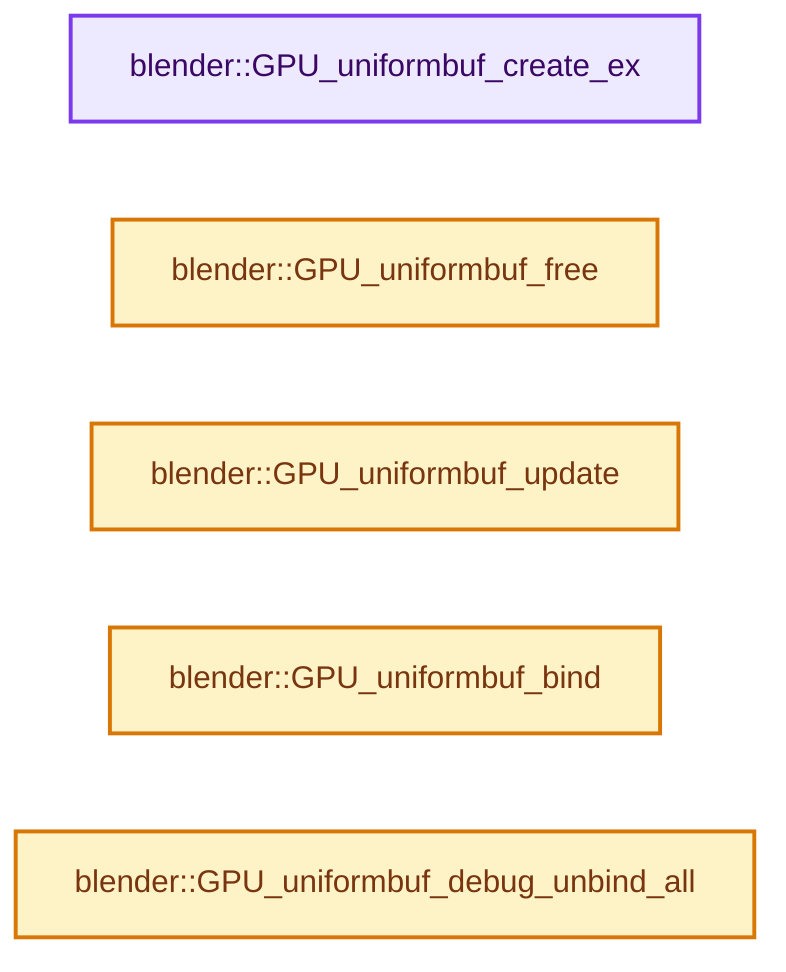
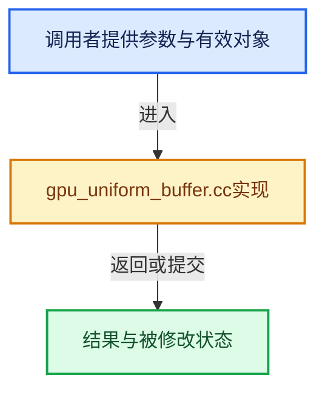

# 实现依赖专题：source/blender/gpu/intern/gpu_uniform_buffer.cc

[实现依赖导航](../../../README.md) · [符号索引](../../../../00-课程指南/02-源码与提交索引/符号依赖与实现索引.md)

本专题从正文实际调用进入，集中保存共享实现。函数有稳定锚点，可从调用处直接跳到对应完整函数；递归与互相调用通过回链组织。

## 本文件的实现关系






## 完整成员与函数实现

<a id="f-a0ba5479ae2a63ac"></a>

### `blender::GPU_uniformbuf_create_ex`

实现位置：[source/blender/gpu/intern/gpu_uniform_buffer.cc](../../../../../../../../source/blender/gpu/intern/gpu_uniform_buffer.cc) · L302—L316。

接口参数：

- `size_t size`
- `const void *data`
- `const char *name`

**教学注释版**

<!-- annotated:297cae4294a912 -->

```cpp
gpu::UniformBuf *GPU_uniformbuf_create_ex(size_t size, const void *data, const char *name)
{
  UniformBuf *ubo = GPUBackend::get()->uniformbuf_alloc(size, name);
  /* Direct init. */
  if (data != nullptr) {
    ubo->update(data);
  }
  else if (G.debug & G_DEBUG_GPU) {
    /* Fill the buffer with poison values.
     * (NaN for floats, -1 for `int` and "max value" for `uint`). */
    Vector<uchar> uninitialized_data(size, 0xFF);
    // [讲解] uninitialized_data.data：提供当前存储或有效范围的地址。
    ubo->update(uninitialized_data.data());
  }
  return ubo;
}
```

<details>
<summary>核对原始源码：source/blender/gpu/intern/gpu_uniform_buffer.cc · L302—L316</summary>

<!-- original:297cae4294a912:source/blender/gpu/intern/gpu_uniform_buffer.cc:302:316 -->

```cpp
gpu::UniformBuf *GPU_uniformbuf_create_ex(size_t size, const void *data, const char *name)
{
  UniformBuf *ubo = GPUBackend::get()->uniformbuf_alloc(size, name);
  /* Direct init. */
  if (data != nullptr) {
    ubo->update(data);
  }
  else if (G.debug & G_DEBUG_GPU) {
    /* Fill the buffer with poison values.
     * (NaN for floats, -1 for `int` and "max value" for `uint`). */
    Vector<uchar> uninitialized_data(size, 0xFF);
    ubo->update(uninitialized_data.data());
  }
  return ubo;
}
```

</details>

**结果出口**

- `return ubo;`

**继续追踪实现**

- `GPUBackend::get()->uniformbuf_alloc` → [调用协议](../../../../00-课程指南/01-路线与规范/模板宏与动态分派协议.md)：接收对象类型依赖auto、返回值或模板实例；不按同名猜测目标。调用位置L304。
- `GPUBackend::get` → [blender::GPUBackend::get · L642](gpu_context.cc.md#f-c876dc1cb5bd7700)。
- `ubo->update` → [blender::update · L121](../../../04-Nodes节点系统/texture/node_texture_tree.cc.md#f-7591916c55b3dfe3)；[blender::update · L76](../../../04-Nodes节点系统/texture/nodes/node_texture_separate_color.cc.md#f-f216062a9f7b7859)；[blender::update · L54](../../../04-Nodes节点系统/texture/nodes/node_texture_combine_color.cc.md#f-9377b7191cf4cec4)；[blender::update · L106](../../../04-Nodes节点系统/composite/node_composite_tree.cc.md#f-7565befdaeb2a373)。同名重载需按实参类型选择。
- `uninitialized_data.data` → [blender::Vector::data · L954](../../../../01-基础容器与现代CPP/12-Vector异常安全与边界.md#f-6e441591404715bc)；[blender::Vector::data · L962](../../../../01-基础容器与现代CPP/12-Vector异常安全与边界.md#f-4bc78d4954c1021a)。同名重载需按实参类型选择。

<a id="f-db64ab63c2586626"></a>

### `blender::GPU_uniformbuf_free`

实现位置：[source/blender/gpu/intern/gpu_uniform_buffer.cc](../../../../../../../../source/blender/gpu/intern/gpu_uniform_buffer.cc) · L339—L342。

接口参数：

- `gpu::UniformBuf *ubo`

**教学注释版**

<!-- annotated:521c5f0c9c6eef -->

```cpp
void GPU_uniformbuf_free(gpu::UniformBuf *ubo)
{
  delete ubo;
}
```

<details>
<summary>核对原始源码：source/blender/gpu/intern/gpu_uniform_buffer.cc · L339—L342</summary>

<!-- original:521c5f0c9c6eef:source/blender/gpu/intern/gpu_uniform_buffer.cc:339:342 -->

```cpp
void GPU_uniformbuf_free(gpu::UniformBuf *ubo)
{
  delete ubo;
}
```

</details>

**继续追踪实现**

本实现没有需要继续展开的显式调用；检查返回表达式、对象转换和调用者前置条件。

<a id="f-b41c810e912d857a"></a>

### `blender::GPU_uniformbuf_update`

实现位置：[source/blender/gpu/intern/gpu_uniform_buffer.cc](../../../../../../../../source/blender/gpu/intern/gpu_uniform_buffer.cc) · L344—L347。

接口参数：

- `gpu::UniformBuf *ubo`
- `const void *data`

**教学注释版**

<!-- annotated:7ba2a290df0fef -->

```cpp
void GPU_uniformbuf_update(gpu::UniformBuf *ubo, const void *data)
{
  ubo->update(data);
}
```

<details>
<summary>核对原始源码：source/blender/gpu/intern/gpu_uniform_buffer.cc · L344—L347</summary>

<!-- original:7ba2a290df0fef:source/blender/gpu/intern/gpu_uniform_buffer.cc:344:347 -->

```cpp
void GPU_uniformbuf_update(gpu::UniformBuf *ubo, const void *data)
{
  ubo->update(data);
}
```

</details>

**继续追踪实现**

- `ubo->update` → [blender::update · L121](../../../04-Nodes节点系统/texture/node_texture_tree.cc.md#f-7591916c55b3dfe3)；[blender::update · L76](../../../04-Nodes节点系统/texture/nodes/node_texture_separate_color.cc.md#f-f216062a9f7b7859)；[blender::update · L54](../../../04-Nodes节点系统/texture/nodes/node_texture_combine_color.cc.md#f-9377b7191cf4cec4)；[blender::update · L106](../../../04-Nodes节点系统/composite/node_composite_tree.cc.md#f-7565befdaeb2a373)。同名重载需按实参类型选择。

<a id="f-6f7028e200711532"></a>

### `blender::GPU_uniformbuf_bind`

实现位置：[source/blender/gpu/intern/gpu_uniform_buffer.cc](../../../../../../../../source/blender/gpu/intern/gpu_uniform_buffer.cc) · L349—L352。

接口参数：

- `gpu::UniformBuf *ubo`
- `int slot`

**教学注释版**

<!-- annotated:169c6200ca1862 -->

```cpp
void GPU_uniformbuf_bind(gpu::UniformBuf *ubo, int slot)
{
  ubo->bind(slot);
}
```

<details>
<summary>核对原始源码：source/blender/gpu/intern/gpu_uniform_buffer.cc · L349—L352</summary>

<!-- original:169c6200ca1862:source/blender/gpu/intern/gpu_uniform_buffer.cc:349:352 -->

```cpp
void GPU_uniformbuf_bind(gpu::UniformBuf *ubo, int slot)
{
  ubo->bind(slot);
}
```

</details>

**继续追踪实现**

- `ubo->bind` → [blender::GLShader::bind · L1410](../opengl/gl_shader.cc.md#f-7374ce386abefd3f)；[blender::GLBatch::bind · L239](../opengl/gl_batch.cc.md#f-09d832d1583277b2)。同名重载需按实参类型选择。

<a id="f-f085c3d5621ec231"></a>

### `blender::GPU_uniformbuf_debug_unbind_all`

实现位置：[source/blender/gpu/intern/gpu_uniform_buffer.cc](../../../../../../../../source/blender/gpu/intern/gpu_uniform_buffer.cc) · L364—L367。

**教学注释版**

<!-- annotated:ff8b3e757e796c -->

```cpp
void GPU_uniformbuf_debug_unbind_all()
{
  Context::get()->debug_unbind_all_ubo();
}
```

<details>
<summary>核对原始源码：source/blender/gpu/intern/gpu_uniform_buffer.cc · L364—L367</summary>

<!-- original:ff8b3e757e796c:source/blender/gpu/intern/gpu_uniform_buffer.cc:364:367 -->

```cpp
void GPU_uniformbuf_debug_unbind_all()
{
  Context::get()->debug_unbind_all_ubo();
}
```

</details>

**继续追踪实现**

- `Context::get()->debug_unbind_all_ubo` → [调用协议](../../../../00-课程指南/01-路线与规范/模板宏与动态分派协议.md)：接收对象类型依赖auto、返回值或模板实例；不按同名猜测目标。调用位置L366。
- `Context::get` → [blender::gpu::Context::get · L127](gpu_context.cc.md#f-7ca16707244f2d11)。
