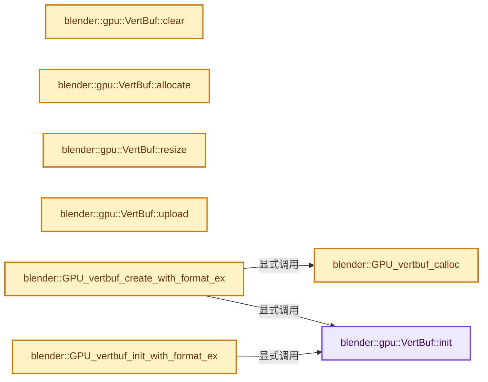
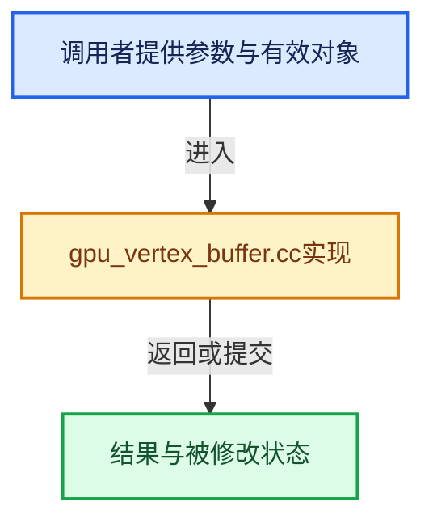

# 实现依赖专题：source/blender/gpu/intern/gpu_vertex_buffer.cc

[实现依赖导航](../../../README.md) · [符号索引](../../../../00-课程指南/02-源码与提交索引/符号依赖与实现索引.md)

本专题从正文实际调用进入，集中保存共享实现。函数有稳定锚点，可从调用处直接跳到对应完整函数；递归与互相调用通过回链组织。

## 本文件的实现关系






## 完整成员与函数实现

<a id="f-4d1d41ce8226c186"></a>

### `blender::gpu::VertBuf::init`

实现位置：[source/blender/gpu/intern/gpu_vertex_buffer.cc](../../../../../../../../source/blender/gpu/intern/gpu_vertex_buffer.cc) · L44—L64。

接口参数：

- `const GPUVertFormat &format`
- `GPUUsageType usage`

**教学注释版**

<!-- annotated:2cee069bee0ef3 -->

```cpp
void VertBuf::init(const GPUVertFormat &format, GPUUsageType usage)
{
#if 0 /* Disabled until Grease pencil. Comply to this. */
  if (usage & GPU_USAGE_FLAG_BUFFER_TEXTURE_ONLY) {
    BLI_assert_msg(format.attr_len == 1,
                   "Only single attribute format are supported for buffer textures");
  }
#endif
  /* Strip extended usage flags. */
  usage_ = usage & ~GPU_USAGE_FLAG_BUFFER_TEXTURE_ONLY;
#ifndef NDEBUG
  /* Store extended usage. */
  extended_usage_ = usage;
#endif
  flag = GPU_VERTBUF_DATA_DIRTY;
  GPU_vertformat_copy(&this->format, format);
  if (!this->format.packed) {
    VertexFormat_pack(&this->format);
  }
  flag |= GPU_VERTBUF_INIT;
}
```

<details>
<summary>核对原始源码：source/blender/gpu/intern/gpu_vertex_buffer.cc · L44—L64</summary>

<!-- original:2cee069bee0ef3:source/blender/gpu/intern/gpu_vertex_buffer.cc:44:64 -->

```cpp
void VertBuf::init(const GPUVertFormat &format, GPUUsageType usage)
{
#if 0 /* Disabled until Grease pencil. Comply to this. */
  if (usage & GPU_USAGE_FLAG_BUFFER_TEXTURE_ONLY) {
    BLI_assert_msg(format.attr_len == 1,
                   "Only single attribute format are supported for buffer textures");
  }
#endif
  /* Strip extended usage flags. */
  usage_ = usage & ~GPU_USAGE_FLAG_BUFFER_TEXTURE_ONLY;
#ifndef NDEBUG
  /* Store extended usage. */
  extended_usage_ = usage;
#endif
  flag = GPU_VERTBUF_DATA_DIRTY;
  GPU_vertformat_copy(&this->format, format);
  if (!this->format.packed) {
    VertexFormat_pack(&this->format);
  }
  flag |= GPU_VERTBUF_INIT;
}
```

</details>

**沿实际写入检查状态**

- `usage_ = usage & ~GPU_USAGE_FLAG_BUFFER_TEXTURE_ONLY;`
- `extended_usage_ = usage;`
- `flag = GPU_VERTBUF_DATA_DIRTY;`
- `flag |= GPU_VERTBUF_INIT;`

**继续追踪实现**

- `BLI_assert_msg` → [BLI_assert_msg · L55](../../../01-BLI基础库/BLI_assert.hh.md#m-695eed20dceb)；[BLI_assert_msg · L64](../../../01-BLI基础库/BLI_assert.hh.md#m-7de5563de4db)。宏定义由构建条件选择。
- `GPU_vertformat_copy` → [blender::GPU_vertformat_copy · L348](gpu_vertex_format.cc.md#f-66c632db5e5374dd)。
- `VertexFormat_pack` → [blender::VertexFormat_pack · L564](gpu_vertex_format.cc.md#f-2ac935f11fa00f23)。

<a id="f-2fbbe3f6ad3d320b"></a>

### `blender::gpu::VertBuf::clear`

实现位置：[source/blender/gpu/intern/gpu_vertex_buffer.cc](../../../../../../../../source/blender/gpu/intern/gpu_vertex_buffer.cc) · L66—L70。

**教学注释版**

<!-- annotated:8fe6ee68f2386f -->

```cpp
void VertBuf::clear()
{
  this->release_data();
  flag = GPU_VERTBUF_INVALID;
}
```

<details>
<summary>核对原始源码：source/blender/gpu/intern/gpu_vertex_buffer.cc · L66—L70</summary>

<!-- original:8fe6ee68f2386f:source/blender/gpu/intern/gpu_vertex_buffer.cc:66:70 -->

```cpp
void VertBuf::clear()
{
  this->release_data();
  flag = GPU_VERTBUF_INVALID;
}
```

</details>

**沿实际写入检查状态**

- `flag = GPU_VERTBUF_INVALID;`

**继续追踪实现**

- `this->release_data` → [blender::gpu::VKVertexBuffer::release_data · L167](../vulkan/vk_vertex_buffer.cc.md#f-38d787f624790d45)；[blender::gpu::GLVertBuf::release_data · L38](../opengl/gl_vertex_buffer.cc.md#f-c2b1e215b5da12eb)。同名重载需按实参类型选择。

<a id="f-586376051588f0f7"></a>

### `blender::gpu::VertBuf::allocate`

实现位置：[source/blender/gpu/intern/gpu_vertex_buffer.cc](../../../../../../../../source/blender/gpu/intern/gpu_vertex_buffer.cc) · L72—L82。

接口参数：

- `uint vert_len`

**教学注释版**

<!-- annotated:5f9e27ee501754 -->

```cpp
void VertBuf::allocate(uint vert_len)
{
  BLI_assert(format.packed);
  /* Catch any unnecessary usage. */
  BLI_assert(vertex_alloc != vert_len || data_ == nullptr);
  vertex_len = vertex_alloc = vert_len;

  this->acquire_data();

  flag |= GPU_VERTBUF_DATA_DIRTY;
}
```

<details>
<summary>核对原始源码：source/blender/gpu/intern/gpu_vertex_buffer.cc · L72—L82</summary>

<!-- original:5f9e27ee501754:source/blender/gpu/intern/gpu_vertex_buffer.cc:72:82 -->

```cpp
void VertBuf::allocate(uint vert_len)
{
  BLI_assert(format.packed);
  /* Catch any unnecessary usage. */
  BLI_assert(vertex_alloc != vert_len || data_ == nullptr);
  vertex_len = vertex_alloc = vert_len;

  this->acquire_data();

  flag |= GPU_VERTBUF_DATA_DIRTY;
}
```

</details>

**沿实际写入检查状态**

- `vertex_len = vertex_alloc = vert_len;`
- `flag |= GPU_VERTBUF_DATA_DIRTY;`

**继续追踪实现**

- `BLI_assert` → [BLI_assert · L48](../../../01-BLI基础库/BLI_assert.hh.md#m-57a88495704d)；[BLI_assert · L63](../../../01-BLI基础库/BLI_assert.hh.md#m-d07050020cb5)。宏定义由构建条件选择。
- `this->acquire_data` → [blender::gpu::VKVertexBuffer::acquire_data · L145](../vulkan/vk_vertex_buffer.cc.md#f-7007b0c3e93fccbb)；[blender::gpu::GLVertBuf::acquire_data · L17](../opengl/gl_vertex_buffer.cc.md#f-0ea2a81da652068e)。同名重载需按实参类型选择。

<a id="f-332e1b45a4a528c0"></a>

### `blender::gpu::VertBuf::resize`

实现位置：[source/blender/gpu/intern/gpu_vertex_buffer.cc](../../../../../../../../source/blender/gpu/intern/gpu_vertex_buffer.cc) · L84—L93。

接口参数：

- `uint vert_len`

**教学注释版**

<!-- annotated:f901b12d5e0982 -->

```cpp
void VertBuf::resize(uint vert_len)
{
  /* Catch any unnecessary usage. */
  BLI_assert(vertex_alloc != vert_len);
  vertex_len = vertex_alloc = vert_len;

  this->resize_data();

  flag |= GPU_VERTBUF_DATA_DIRTY;
}
```

<details>
<summary>核对原始源码：source/blender/gpu/intern/gpu_vertex_buffer.cc · L84—L93</summary>

<!-- original:f901b12d5e0982:source/blender/gpu/intern/gpu_vertex_buffer.cc:84:93 -->

```cpp
void VertBuf::resize(uint vert_len)
{
  /* Catch any unnecessary usage. */
  BLI_assert(vertex_alloc != vert_len);
  vertex_len = vertex_alloc = vert_len;

  this->resize_data();

  flag |= GPU_VERTBUF_DATA_DIRTY;
}
```

</details>

**沿实际写入检查状态**

- `vertex_len = vertex_alloc = vert_len;`
- `flag |= GPU_VERTBUF_DATA_DIRTY;`

**继续追踪实现**

- `BLI_assert` → [BLI_assert · L48](../../../01-BLI基础库/BLI_assert.hh.md#m-57a88495704d)；[BLI_assert · L63](../../../01-BLI基础库/BLI_assert.hh.md#m-d07050020cb5)。宏定义由构建条件选择。
- `this->resize_data` → [blender::gpu::VKVertexBuffer::resize_data · L157](../vulkan/vk_vertex_buffer.cc.md#f-4c72b05866dbbc31)；[blender::gpu::GLVertBuf::resize_data · L28](../opengl/gl_vertex_buffer.cc.md#f-a09b13cac68f760c)。同名重载需按实参类型选择。

<a id="f-71441605320c7902"></a>

### `blender::gpu::VertBuf::upload`

实现位置：[source/blender/gpu/intern/gpu_vertex_buffer.cc](../../../../../../../../source/blender/gpu/intern/gpu_vertex_buffer.cc) · L95—L98。

**教学注释版**

<!-- annotated:57e3b47d0a3b7d -->

```cpp
void VertBuf::upload()
{
  this->upload_data();
}
```

<details>
<summary>核对原始源码：source/blender/gpu/intern/gpu_vertex_buffer.cc · L95—L98</summary>

<!-- original:57e3b47d0a3b7d:source/blender/gpu/intern/gpu_vertex_buffer.cc:95:98 -->

```cpp
void VertBuf::upload()
{
  this->upload_data();
}
```

</details>

**继续追踪实现**

- `this->upload_data` → [blender::gpu::VKVertexBuffer::upload_data · L200](../vulkan/vk_vertex_buffer.cc.md#f-ce298f569168f1a2)；[blender::gpu::VKIndexBuffer::upload_data · L71](../vulkan/vk_index_buffer.cc.md#f-d2df8afcc42600a4)；[blender::gpu::GLVertBuf::upload_data · L54](../opengl/gl_vertex_buffer.cc.md#f-5520393e287282d6)；[blender::gpu::GLIndexBuf::upload_data · L95](../opengl/gl_index_buffer.cc.md#f-451dcc91a4f2ed45)。同名重载需按实参类型选择。

<a id="f-bddd6e0944c513f4"></a>

### `blender::GPU_vertbuf_calloc`

实现位置：[source/blender/gpu/intern/gpu_vertex_buffer.cc](../../../../../../../../source/blender/gpu/intern/gpu_vertex_buffer.cc) · L112—L115。

**教学注释版**

<!-- annotated:74aaf704a4891d -->

```cpp
VertBuf *GPU_vertbuf_calloc()
{
  return GPUBackend::get()->vertbuf_alloc();
}
```

<details>
<summary>核对原始源码：source/blender/gpu/intern/gpu_vertex_buffer.cc · L112—L115</summary>

<!-- original:74aaf704a4891d:source/blender/gpu/intern/gpu_vertex_buffer.cc:112:115 -->

```cpp
VertBuf *GPU_vertbuf_calloc()
{
  return GPUBackend::get()->vertbuf_alloc();
}
```

</details>

**结果出口**

- `return GPUBackend::get()->vertbuf_alloc();`

**继续追踪实现**

- `GPUBackend::get()->vertbuf_alloc` → [调用协议](../../../../00-课程指南/01-路线与规范/模板宏与动态分派协议.md)：接收对象类型依赖auto、返回值或模板实例；不按同名猜测目标。调用位置L114。
- `GPUBackend::get` → [blender::GPUBackend::get · L642](gpu_context.cc.md#f-c876dc1cb5bd7700)。

<a id="f-3c102ab38514393a"></a>

### `blender::GPU_vertbuf_create_with_format_ex`

实现位置：[source/blender/gpu/intern/gpu_vertex_buffer.cc](../../../../../../../../source/blender/gpu/intern/gpu_vertex_buffer.cc) · L117—L122。

接口参数：

- `const GPUVertFormat &format`
- `GPUUsageType usage`

**教学注释版**

<!-- annotated:49634f72b666b8 -->

```cpp
VertBuf *GPU_vertbuf_create_with_format_ex(const GPUVertFormat &format, GPUUsageType usage)
{
  VertBuf *verts = GPU_vertbuf_calloc();
  verts->init(format, usage);
  return verts;
}
```

<details>
<summary>核对原始源码：source/blender/gpu/intern/gpu_vertex_buffer.cc · L117—L122</summary>

<!-- original:49634f72b666b8:source/blender/gpu/intern/gpu_vertex_buffer.cc:117:122 -->

```cpp
VertBuf *GPU_vertbuf_create_with_format_ex(const GPUVertFormat &format, GPUUsageType usage)
{
  VertBuf *verts = GPU_vertbuf_calloc();
  verts->init(format, usage);
  return verts;
}
```

</details>

**结果出口**

- `return verts;`

**继续追踪实现**

- `GPU_vertbuf_calloc` → [blender::GPU_vertbuf_calloc · L112](gpu_vertex_buffer.cc.md#f-bddd6e0944c513f4)。
- `verts->init` → [blender::gpu::VertBuf::init · L44](gpu_vertex_buffer.cc.md#f-4d1d41ce8226c186)。

<a id="f-3e5da22fa9f3e3b7"></a>

### `blender::GPU_vertbuf_init_with_format_ex`

实现位置：[source/blender/gpu/intern/gpu_vertex_buffer.cc](../../../../../../../../source/blender/gpu/intern/gpu_vertex_buffer.cc) · L124—L129。

接口参数：

- `VertBuf &verts`
- `const GPUVertFormat &format`
- `GPUUsageType usage`

**教学注释版**

<!-- annotated:1194b3ab9fd2af -->

```cpp
void GPU_vertbuf_init_with_format_ex(VertBuf &verts,
                                     const GPUVertFormat &format,
                                     GPUUsageType usage)
{
  verts.init(format, usage);
}
```

<details>
<summary>核对原始源码：source/blender/gpu/intern/gpu_vertex_buffer.cc · L124—L129</summary>

<!-- original:1194b3ab9fd2af:source/blender/gpu/intern/gpu_vertex_buffer.cc:124:129 -->

```cpp
void GPU_vertbuf_init_with_format_ex(VertBuf &verts,
                                     const GPUVertFormat &format,
                                     GPUUsageType usage)
{
  verts.init(format, usage);
}
```

</details>

**继续追踪实现**

- `verts.init` → [blender::gpu::VertBuf::init · L44](gpu_vertex_buffer.cc.md#f-4d1d41ce8226c186)。

<a id="f-715cf1b164e85ce8"></a>

### `blender::GPU_vertbuf_init_build_on_device`

实现位置：[source/blender/gpu/intern/gpu_vertex_buffer.cc](../../../../../../../../source/blender/gpu/intern/gpu_vertex_buffer.cc) · L131—L135。

接口参数：

- `VertBuf &verts`
- `const GPUVertFormat &format`
- `uint v_len`

**教学注释版**

<!-- annotated:7553fbe1fe6f77 -->

```cpp
void GPU_vertbuf_init_build_on_device(VertBuf &verts, const GPUVertFormat &format, uint v_len)
{
  GPU_vertbuf_init_with_format_ex(verts, format, GPU_USAGE_DEVICE_ONLY);
  GPU_vertbuf_data_alloc(verts, v_len);
}
```

<details>
<summary>核对原始源码：source/blender/gpu/intern/gpu_vertex_buffer.cc · L131—L135</summary>

<!-- original:7553fbe1fe6f77:source/blender/gpu/intern/gpu_vertex_buffer.cc:131:135 -->

```cpp
void GPU_vertbuf_init_build_on_device(VertBuf &verts, const GPUVertFormat &format, uint v_len)
{
  GPU_vertbuf_init_with_format_ex(verts, format, GPU_USAGE_DEVICE_ONLY);
  GPU_vertbuf_data_alloc(verts, v_len);
}
```

</details>

**继续追踪实现**

- `GPU_vertbuf_init_with_format_ex` → [blender::GPU_vertbuf_init_with_format_ex · L124](gpu_vertex_buffer.cc.md#f-3e5da22fa9f3e3b7)。
- `GPU_vertbuf_data_alloc` → [blender::GPU_vertbuf_data_alloc · L172](gpu_vertex_buffer.cc.md#f-8ee5cf106e0f2b0f)。

<a id="f-abf244a18691f929"></a>

### `blender::GPU_vertbuf_create_on_device`

实现位置：[source/blender/gpu/intern/gpu_vertex_buffer.cc](../../../../../../../../source/blender/gpu/intern/gpu_vertex_buffer.cc) · L137—L142。

接口参数：

- `const GPUVertFormat &format`
- `uint v_len`

**教学注释版**

<!-- annotated:32a15b7819f025 -->

```cpp
VertBuf *GPU_vertbuf_create_on_device(const GPUVertFormat &format, uint v_len)
{
  VertBuf *verts = GPU_vertbuf_create_with_format_ex(format, GPU_USAGE_DEVICE_ONLY);
  GPU_vertbuf_data_alloc(*verts, v_len);
  return verts;
}
```

<details>
<summary>核对原始源码：source/blender/gpu/intern/gpu_vertex_buffer.cc · L137—L142</summary>

<!-- original:32a15b7819f025:source/blender/gpu/intern/gpu_vertex_buffer.cc:137:142 -->

```cpp
VertBuf *GPU_vertbuf_create_on_device(const GPUVertFormat &format, uint v_len)
{
  VertBuf *verts = GPU_vertbuf_create_with_format_ex(format, GPU_USAGE_DEVICE_ONLY);
  GPU_vertbuf_data_alloc(*verts, v_len);
  return verts;
}
```

</details>

**结果出口**

- `return verts;`

**继续追踪实现**

- `GPU_vertbuf_create_with_format_ex` → [blender::GPU_vertbuf_create_with_format_ex · L117](gpu_vertex_buffer.cc.md#f-3c102ab38514393a)。
- `GPU_vertbuf_data_alloc` → [blender::GPU_vertbuf_data_alloc · L172](gpu_vertex_buffer.cc.md#f-8ee5cf106e0f2b0f)。

<a id="f-05a0c4598ede18a4"></a>

### `blender::GPU_vertbuf_discard`

实现位置：[source/blender/gpu/intern/gpu_vertex_buffer.cc](../../../../../../../../source/blender/gpu/intern/gpu_vertex_buffer.cc) · L154—L158。

接口参数：

- `VertBuf *verts`

**教学注释版**

<!-- annotated:78224e4349cfab -->

```cpp
void GPU_vertbuf_discard(VertBuf *verts)
{
  verts->clear();
  verts->reference_remove();
}
```

<details>
<summary>核对原始源码：source/blender/gpu/intern/gpu_vertex_buffer.cc · L154—L158</summary>

<!-- original:78224e4349cfab:source/blender/gpu/intern/gpu_vertex_buffer.cc:154:158 -->

```cpp
void GPU_vertbuf_discard(VertBuf *verts)
{
  verts->clear();
  verts->reference_remove();
}
```

</details>

**继续追踪实现**

- `verts->clear` → [blender::gpu::VertBuf::clear · L66](gpu_vertex_buffer.cc.md#f-2fbbe3f6ad3d320b)。
- `verts->reference_remove` → [blender::gpu::VertBuf::reference_remove · L202](../GPU_vertex_buffer.hh.md#f-85bf9acb77c5c26b)。

<a id="f-8ee5cf106e0f2b0f"></a>

### `blender::GPU_vertbuf_data_alloc`

实现位置：[source/blender/gpu/intern/gpu_vertex_buffer.cc](../../../../../../../../source/blender/gpu/intern/gpu_vertex_buffer.cc) · L172—L175。

接口参数：

- `VertBuf &verts`
- `uint v_len`

**教学注释版**

<!-- annotated:25fa9b352ebf8e -->

```cpp
void GPU_vertbuf_data_alloc(VertBuf &verts, uint v_len)
{
  verts.allocate(v_len);
}
```

<details>
<summary>核对原始源码：source/blender/gpu/intern/gpu_vertex_buffer.cc · L172—L175</summary>

<!-- original:25fa9b352ebf8e:source/blender/gpu/intern/gpu_vertex_buffer.cc:172:175 -->

```cpp
void GPU_vertbuf_data_alloc(VertBuf &verts, uint v_len)
{
  verts.allocate(v_len);
}
```

</details>

**继续追踪实现**

- `verts.allocate` → [blender::gpu::VertBuf::allocate · L72](gpu_vertex_buffer.cc.md#f-586376051588f0f7)。

<a id="f-d65057a6de0dcd9a"></a>

### `blender::GPU_vertbuf_data_resize`

实现位置：[source/blender/gpu/intern/gpu_vertex_buffer.cc](../../../../../../../../source/blender/gpu/intern/gpu_vertex_buffer.cc) · L177—L180。

接口参数：

- `VertBuf &verts`
- `uint v_len`

**教学注释版**

<!-- annotated:b7e24c5f6cfc89 -->

```cpp
void GPU_vertbuf_data_resize(VertBuf &verts, uint v_len)
{
  verts.resize(v_len);
}
```

<details>
<summary>核对原始源码：source/blender/gpu/intern/gpu_vertex_buffer.cc · L177—L180</summary>

<!-- original:b7e24c5f6cfc89:source/blender/gpu/intern/gpu_vertex_buffer.cc:177:180 -->

```cpp
void GPU_vertbuf_data_resize(VertBuf &verts, uint v_len)
{
  verts.resize(v_len);
}
```

</details>

**继续追踪实现**

- `verts.resize` → [blender::gpu::VertBuf::resize · L84](gpu_vertex_buffer.cc.md#f-332e1b45a4a528c0)。

<a id="f-287714dbd5ac8d57"></a>

### `blender::GPU_vertbuf_data_len_set`

实现位置：[source/blender/gpu/intern/gpu_vertex_buffer.cc](../../../../../../../../source/blender/gpu/intern/gpu_vertex_buffer.cc) · L182—L187。

接口参数：

- `VertBuf &verts`
- `uint v_len`

**教学注释版**

<!-- annotated:c3b67de9649693 -->

```cpp
void GPU_vertbuf_data_len_set(VertBuf &verts, uint v_len)
{
  BLI_assert(verts.data<uchar>().data() != nullptr); /* Only for dynamic data. */
  BLI_assert(v_len <= verts.vertex_alloc);
  verts.vertex_len = v_len;
}
```

<details>
<summary>核对原始源码：source/blender/gpu/intern/gpu_vertex_buffer.cc · L182—L187</summary>

<!-- original:c3b67de9649693:source/blender/gpu/intern/gpu_vertex_buffer.cc:182:187 -->

```cpp
void GPU_vertbuf_data_len_set(VertBuf &verts, uint v_len)
{
  BLI_assert(verts.data<uchar>().data() != nullptr); /* Only for dynamic data. */
  BLI_assert(v_len <= verts.vertex_alloc);
  verts.vertex_len = v_len;
}
```

</details>

**沿实际写入检查状态**

- `verts.vertex_len = v_len;`

**继续追踪实现**

- `BLI_assert` → [BLI_assert · L48](../../../01-BLI基础库/BLI_assert.hh.md#m-57a88495704d)；[BLI_assert · L63](../../../01-BLI基础库/BLI_assert.hh.md#m-d07050020cb5)。宏定义由构建条件选择。
- `verts.data<uchar>().data` → [调用协议](../../../../00-课程指南/01-路线与规范/模板宏与动态分派协议.md)：接收对象类型依赖auto、返回值或模板实例；不按同名猜测目标。调用位置L184。
- `verts.data<uchar>` → [blender::gpu::VertBuf::data · L220](../GPU_vertex_buffer.hh.md#f-e72412fdddda8bf5)。

<a id="f-ae856d9873ac8da9"></a>

### `blender::GPU_vertbuf_attr_set`

实现位置：[source/blender/gpu/intern/gpu_vertex_buffer.cc](../../../../../../../../source/blender/gpu/intern/gpu_vertex_buffer.cc) · L189—L199。

接口参数：

- `VertBuf *verts`
- `uint a_idx`
- `uint v_idx`
- `const void *data`

**教学注释版**

<!-- annotated:12bb0d841ebfec -->

```cpp
void GPU_vertbuf_attr_set(VertBuf *verts, uint a_idx, uint v_idx, const void *data)
{
  BLI_assert(verts->get_usage_type() != GPU_USAGE_DEVICE_ONLY);
  const GPUVertFormat *format = &verts->format;
  const GPUVertAttr *a = &format->attrs[a_idx];
  BLI_assert(v_idx < verts->vertex_alloc);
  BLI_assert(a_idx < format->attr_len);
  BLI_assert(verts->data<uchar>().data() != nullptr);
  verts->flag |= GPU_VERTBUF_DATA_DIRTY;
  // [讲解] memcpy：复制字节，源与目标不应重叠。类型生命周期、对齐和可复制表示须由调用者证明，不是任意对象的复制构造。
  memcpy(verts->data<uchar>().data() + a->offset + v_idx * format->stride, data, a->type.size());
}
```

<details>
<summary>核对原始源码：source/blender/gpu/intern/gpu_vertex_buffer.cc · L189—L199</summary>

<!-- original:12bb0d841ebfec:source/blender/gpu/intern/gpu_vertex_buffer.cc:189:199 -->

```cpp
void GPU_vertbuf_attr_set(VertBuf *verts, uint a_idx, uint v_idx, const void *data)
{
  BLI_assert(verts->get_usage_type() != GPU_USAGE_DEVICE_ONLY);
  const GPUVertFormat *format = &verts->format;
  const GPUVertAttr *a = &format->attrs[a_idx];
  BLI_assert(v_idx < verts->vertex_alloc);
  BLI_assert(a_idx < format->attr_len);
  BLI_assert(verts->data<uchar>().data() != nullptr);
  verts->flag |= GPU_VERTBUF_DATA_DIRTY;
  memcpy(verts->data<uchar>().data() + a->offset + v_idx * format->stride, data, a->type.size());
}
```

</details>

**沿实际写入检查状态**

- `verts->flag |= GPU_VERTBUF_DATA_DIRTY;`

**继续追踪实现**

- `BLI_assert` → [BLI_assert · L48](../../../01-BLI基础库/BLI_assert.hh.md#m-57a88495704d)；[BLI_assert · L63](../../../01-BLI基础库/BLI_assert.hh.md#m-d07050020cb5)。宏定义由构建条件选择。
- `verts->get_usage_type` → [blender::gpu::VertBuf::get_usage_type · L211](../GPU_vertex_buffer.hh.md#f-9526c8580505f308)。
- `verts->data<uchar>().data` → [调用协议](../../../../00-课程指南/01-路线与规范/模板宏与动态分派协议.md)：接收对象类型依赖auto、返回值或模板实例；不按同名猜测目标。调用位置L196。
- `verts->data<uchar>` → [blender::gpu::VertBuf::data · L220](../GPU_vertex_buffer.hh.md#f-e72412fdddda8bf5)。
- `memcpy` → [外部契约](https://eel.is/c++draft/cstring.syn)：复制字节，源与目标不应重叠。类型生命周期、对齐和可复制表示须由调用者证明，不是任意对象的复制构造。
- `a->type.size` → [调用协议](../../../../00-课程指南/01-路线与规范/模板宏与动态分派协议.md)：接收对象类型依赖auto、返回值或模板实例；不按同名猜测目标。调用位置L198。

<a id="f-d59c0f6c50a21df9"></a>

### `blender::GPU_vertbuf_attr_fill`

实现位置：[source/blender/gpu/intern/gpu_vertex_buffer.cc](../../../../../../../../source/blender/gpu/intern/gpu_vertex_buffer.cc) · L201—L209。

接口参数：

- `VertBuf *verts`
- `uint a_idx`
- `const void *data`

**教学注释版**

<!-- annotated:0edca40c034c3e -->

```cpp
void GPU_vertbuf_attr_fill(VertBuf *verts, uint a_idx, const void *data)
{
  const GPUVertFormat *format = &verts->format;
  BLI_assert(a_idx < format->attr_len);
  const GPUVertAttr *a = &format->attrs[a_idx];
  const uint stride = a->type.size(); /* tightly packed input data */
  verts->flag |= GPU_VERTBUF_DATA_DIRTY;
  GPU_vertbuf_attr_fill_stride(verts, a_idx, stride, data);
}
```

<details>
<summary>核对原始源码：source/blender/gpu/intern/gpu_vertex_buffer.cc · L201—L209</summary>

<!-- original:0edca40c034c3e:source/blender/gpu/intern/gpu_vertex_buffer.cc:201:209 -->

```cpp
void GPU_vertbuf_attr_fill(VertBuf *verts, uint a_idx, const void *data)
{
  const GPUVertFormat *format = &verts->format;
  BLI_assert(a_idx < format->attr_len);
  const GPUVertAttr *a = &format->attrs[a_idx];
  const uint stride = a->type.size(); /* tightly packed input data */
  verts->flag |= GPU_VERTBUF_DATA_DIRTY;
  GPU_vertbuf_attr_fill_stride(verts, a_idx, stride, data);
}
```

</details>

**沿实际写入检查状态**

- `verts->flag |= GPU_VERTBUF_DATA_DIRTY;`

**继续追踪实现**

- `BLI_assert` → [BLI_assert · L48](../../../01-BLI基础库/BLI_assert.hh.md#m-57a88495704d)；[BLI_assert · L63](../../../01-BLI基础库/BLI_assert.hh.md#m-d07050020cb5)。宏定义由构建条件选择。
- `a->type.size` → [调用协议](../../../../00-课程指南/01-路线与规范/模板宏与动态分派协议.md)：接收对象类型依赖auto、返回值或模板实例；不按同名猜测目标。调用位置L206。
- `GPU_vertbuf_attr_fill_stride` → [blender::GPU_vertbuf_attr_fill_stride · L221](gpu_vertex_buffer.cc.md#f-2e883df0aeabeda7)。

<a id="f-2e883df0aeabeda7"></a>

### `blender::GPU_vertbuf_attr_fill_stride`

实现位置：[source/blender/gpu/intern/gpu_vertex_buffer.cc](../../../../../../../../source/blender/gpu/intern/gpu_vertex_buffer.cc) · L221—L243。

接口参数：

- `VertBuf *verts`
- `uint a_idx`
- `uint stride`
- `const void *data`

**教学注释版**

<!-- annotated:2676cc8247b69c -->

```cpp
void GPU_vertbuf_attr_fill_stride(VertBuf *verts, uint a_idx, uint stride, const void *data)
{
  BLI_assert(verts->get_usage_type() != GPU_USAGE_DEVICE_ONLY);
  const GPUVertFormat *format = &verts->format;
  const GPUVertAttr *a = &format->attrs[a_idx];
  BLI_assert(a_idx < format->attr_len);
  BLI_assert(verts->data<uchar>().data() != nullptr);
  verts->flag |= GPU_VERTBUF_DATA_DIRTY;
  const uint vertex_len = verts->vertex_len;

  if (format->attr_len == 1 && stride == format->stride) {
    /* we can copy it all at once */
    // [讲解] memcpy：复制字节，源与目标不应重叠。类型生命周期、对齐和可复制表示须由调用者证明，不是任意对象的复制构造。
    memcpy(verts->data<uchar>().data(), data, vertex_len * a->type.size());
  }
  else {
    /* we must copy it per vertex */
    for (uint v = 0; v < vertex_len; v++) {
      memcpy(verts->data<uchar>().data() + a->offset + v * format->stride,
             static_cast<const uchar *>(data) + v * stride,
             a->type.size());
    }
  }
}
```

<details>
<summary>核对原始源码：source/blender/gpu/intern/gpu_vertex_buffer.cc · L221—L243</summary>

<!-- original:2676cc8247b69c:source/blender/gpu/intern/gpu_vertex_buffer.cc:221:243 -->

```cpp
void GPU_vertbuf_attr_fill_stride(VertBuf *verts, uint a_idx, uint stride, const void *data)
{
  BLI_assert(verts->get_usage_type() != GPU_USAGE_DEVICE_ONLY);
  const GPUVertFormat *format = &verts->format;
  const GPUVertAttr *a = &format->attrs[a_idx];
  BLI_assert(a_idx < format->attr_len);
  BLI_assert(verts->data<uchar>().data() != nullptr);
  verts->flag |= GPU_VERTBUF_DATA_DIRTY;
  const uint vertex_len = verts->vertex_len;

  if (format->attr_len == 1 && stride == format->stride) {
    /* we can copy it all at once */
    memcpy(verts->data<uchar>().data(), data, vertex_len * a->type.size());
  }
  else {
    /* we must copy it per vertex */
    for (uint v = 0; v < vertex_len; v++) {
      memcpy(verts->data<uchar>().data() + a->offset + v * format->stride,
             static_cast<const uchar *>(data) + v * stride,
             a->type.size());
    }
  }
}
```

</details>

**沿实际写入检查状态**

- `verts->flag |= GPU_VERTBUF_DATA_DIRTY;`

**继续追踪实现**

- `BLI_assert` → [BLI_assert · L48](../../../01-BLI基础库/BLI_assert.hh.md#m-57a88495704d)；[BLI_assert · L63](../../../01-BLI基础库/BLI_assert.hh.md#m-d07050020cb5)。宏定义由构建条件选择。
- `verts->get_usage_type` → [blender::gpu::VertBuf::get_usage_type · L211](../GPU_vertex_buffer.hh.md#f-9526c8580505f308)。
- `verts->data<uchar>().data` → [调用协议](../../../../00-课程指南/01-路线与规范/模板宏与动态分派协议.md)：接收对象类型依赖auto、返回值或模板实例；不按同名猜测目标。调用位置L227。
- `verts->data<uchar>` → [blender::gpu::VertBuf::data · L220](../GPU_vertex_buffer.hh.md#f-e72412fdddda8bf5)。
- `memcpy` → [外部契约](https://eel.is/c++draft/cstring.syn)：复制字节，源与目标不应重叠。类型生命周期、对齐和可复制表示须由调用者证明，不是任意对象的复制构造。
- `a->type.size` → [调用协议](../../../../00-课程指南/01-路线与规范/模板宏与动态分派协议.md)：接收对象类型依赖auto、返回值或模板实例；不按同名猜测目标。调用位置L233。

<a id="f-00aeac0bf6fcdb36"></a>

### `blender::GPU_vertbuf_attr_get_raw_data`

实现位置：[source/blender/gpu/intern/gpu_vertex_buffer.cc](../../../../../../../../source/blender/gpu/intern/gpu_vertex_buffer.cc) · L245—L261。

接口参数：

- `VertBuf *verts`
- `uint a_idx`
- `GPUVertBufRaw *access`

**教学注释版**

<!-- annotated:f08be40653e8e2 -->

```cpp
void GPU_vertbuf_attr_get_raw_data(VertBuf *verts, uint a_idx, GPUVertBufRaw *access)
{
  const GPUVertFormat *format = &verts->format;
  const GPUVertAttr *a = &format->attrs[a_idx];
  BLI_assert(a_idx < format->attr_len);
  BLI_assert(verts->data<uchar>().data() != nullptr);

  verts->flag |= GPU_VERTBUF_DATA_DIRTY;
  verts->flag &= ~GPU_VERTBUF_DATA_UPLOADED;
  access->size = a->type.size();
  access->stride = format->stride;
  access->data = static_cast<uchar *>(verts->data<uchar>().data()) + a->offset;
  access->data_init = access->data;
#ifndef NDEBUG
  access->_data_end = access->data_init + size_t(verts->vertex_alloc * format->stride);
#endif
}
```

<details>
<summary>核对原始源码：source/blender/gpu/intern/gpu_vertex_buffer.cc · L245—L261</summary>

<!-- original:f08be40653e8e2:source/blender/gpu/intern/gpu_vertex_buffer.cc:245:261 -->

```cpp
void GPU_vertbuf_attr_get_raw_data(VertBuf *verts, uint a_idx, GPUVertBufRaw *access)
{
  const GPUVertFormat *format = &verts->format;
  const GPUVertAttr *a = &format->attrs[a_idx];
  BLI_assert(a_idx < format->attr_len);
  BLI_assert(verts->data<uchar>().data() != nullptr);

  verts->flag |= GPU_VERTBUF_DATA_DIRTY;
  verts->flag &= ~GPU_VERTBUF_DATA_UPLOADED;
  access->size = a->type.size();
  access->stride = format->stride;
  access->data = static_cast<uchar *>(verts->data<uchar>().data()) + a->offset;
  access->data_init = access->data;
#ifndef NDEBUG
  access->_data_end = access->data_init + size_t(verts->vertex_alloc * format->stride);
#endif
}
```

</details>

**沿实际写入检查状态**

- `verts->flag |= GPU_VERTBUF_DATA_DIRTY;`
- `verts->flag &= ~GPU_VERTBUF_DATA_UPLOADED;`
- `access->size = a->type.size();`
- `access->stride = format->stride;`
- `access->data = static_cast<uchar *>(verts->data<uchar>().data()) + a->offset;`
- `access->data_init = access->data;`
- `access->_data_end = access->data_init + size_t(verts->vertex_alloc * format->stride);`

**继续追踪实现**

- `BLI_assert` → [BLI_assert · L48](../../../01-BLI基础库/BLI_assert.hh.md#m-57a88495704d)；[BLI_assert · L63](../../../01-BLI基础库/BLI_assert.hh.md#m-d07050020cb5)。宏定义由构建条件选择。
- `verts->data<uchar>().data` → [调用协议](../../../../00-课程指南/01-路线与规范/模板宏与动态分派协议.md)：接收对象类型依赖auto、返回值或模板实例；不按同名猜测目标。调用位置L250。
- `verts->data<uchar>` → [blender::gpu::VertBuf::data · L220](../GPU_vertex_buffer.hh.md#f-e72412fdddda8bf5)。
- `a->type.size` → [调用协议](../../../../00-课程指南/01-路线与规范/模板宏与动态分派协议.md)：接收对象类型依赖auto、返回值或模板实例；不按同名猜测目标。调用位置L254。

<a id="f-7c66ff8de8245148"></a>

### `blender::GPU_vertbuf_get_format`

实现位置：[source/blender/gpu/intern/gpu_vertex_buffer.cc](../../../../../../../../source/blender/gpu/intern/gpu_vertex_buffer.cc) · L265—L268。

接口参数：

- `const VertBuf *verts`

**教学注释版**

<!-- annotated:1a852a16062d9f -->

```cpp
const GPUVertFormat *GPU_vertbuf_get_format(const VertBuf *verts)
{
  return &verts->format;
}
```

<details>
<summary>核对原始源码：source/blender/gpu/intern/gpu_vertex_buffer.cc · L265—L268</summary>

<!-- original:1a852a16062d9f:source/blender/gpu/intern/gpu_vertex_buffer.cc:265:268 -->

```cpp
const GPUVertFormat *GPU_vertbuf_get_format(const VertBuf *verts)
{
  return &verts->format;
}
```

</details>

**结果出口**

- `return &verts->format;`

**继续追踪实现**

本实现没有需要继续展开的显式调用；检查返回表达式、对象转换和调用者前置条件。

<a id="f-54af379c146bc0bb"></a>

### `blender::GPU_vertbuf_get_vertex_len`

实现位置：[source/blender/gpu/intern/gpu_vertex_buffer.cc](../../../../../../../../source/blender/gpu/intern/gpu_vertex_buffer.cc) · L275—L278。

接口参数：

- `const VertBuf *verts`

**教学注释版**

<!-- annotated:af4f1d0ba810a4 -->

```cpp
uint GPU_vertbuf_get_vertex_len(const VertBuf *verts)
{
  return verts->vertex_len;
}
```

<details>
<summary>核对原始源码：source/blender/gpu/intern/gpu_vertex_buffer.cc · L275—L278</summary>

<!-- original:af4f1d0ba810a4:source/blender/gpu/intern/gpu_vertex_buffer.cc:275:278 -->

```cpp
uint GPU_vertbuf_get_vertex_len(const VertBuf *verts)
{
  return verts->vertex_len;
}
```

</details>

**结果出口**

- `return verts->vertex_len;`

**继续追踪实现**

本实现没有需要继续展开的显式调用；检查返回表达式、对象转换和调用者前置条件。

<a id="f-f829d4bfa0418171"></a>

### `blender::GPU_vertbuf_get_status`

实现位置：[source/blender/gpu/intern/gpu_vertex_buffer.cc](../../../../../../../../source/blender/gpu/intern/gpu_vertex_buffer.cc) · L280—L283。

接口参数：

- `const VertBuf *verts`

**教学注释版**

<!-- annotated:98d3804d66aa90 -->

```cpp
GPUVertBufStatus GPU_vertbuf_get_status(const VertBuf *verts)
{
  return verts->flag;
}
```

<details>
<summary>核对原始源码：source/blender/gpu/intern/gpu_vertex_buffer.cc · L280—L283</summary>

<!-- original:98d3804d66aa90:source/blender/gpu/intern/gpu_vertex_buffer.cc:280:283 -->

```cpp
GPUVertBufStatus GPU_vertbuf_get_status(const VertBuf *verts)
{
  return verts->flag;
}
```

</details>

**结果出口**

- `return verts->flag;`

**继续追踪实现**

本实现没有需要继续展开的显式调用；检查返回表达式、对象转换和调用者前置条件。

<a id="f-9fdbfbaeef33be26"></a>

### `blender::GPU_vertbuf_tag_dirty`

实现位置：[source/blender/gpu/intern/gpu_vertex_buffer.cc](../../../../../../../../source/blender/gpu/intern/gpu_vertex_buffer.cc) · L285—L288。

接口参数：

- `VertBuf *verts`

**教学注释版**

<!-- annotated:294be096906d53 -->

```cpp
void GPU_vertbuf_tag_dirty(VertBuf *verts)
{
  verts->flag |= GPU_VERTBUF_DATA_DIRTY;
}
```

<details>
<summary>核对原始源码：source/blender/gpu/intern/gpu_vertex_buffer.cc · L285—L288</summary>

<!-- original:294be096906d53:source/blender/gpu/intern/gpu_vertex_buffer.cc:285:288 -->

```cpp
void GPU_vertbuf_tag_dirty(VertBuf *verts)
{
  verts->flag |= GPU_VERTBUF_DATA_DIRTY;
}
```

</details>

**沿实际写入检查状态**

- `verts->flag |= GPU_VERTBUF_DATA_DIRTY;`

**继续追踪实现**

本实现没有需要继续展开的显式调用；检查返回表达式、对象转换和调用者前置条件。

<a id="f-f2ce61da8df3615a"></a>

### `blender::GPU_vertbuf_use`

实现位置：[source/blender/gpu/intern/gpu_vertex_buffer.cc](../../../../../../../../source/blender/gpu/intern/gpu_vertex_buffer.cc) · L295—L298。

接口参数：

- `VertBuf *verts`

**教学注释版**

<!-- annotated:a3b550c80bfbd5 -->

```cpp
void GPU_vertbuf_use(VertBuf *verts)
{
  verts->upload();
}
```

<details>
<summary>核对原始源码：source/blender/gpu/intern/gpu_vertex_buffer.cc · L295—L298</summary>

<!-- original:a3b550c80bfbd5:source/blender/gpu/intern/gpu_vertex_buffer.cc:295:298 -->

```cpp
void GPU_vertbuf_use(VertBuf *verts)
{
  verts->upload();
}
```

</details>

**继续追踪实现**

- `verts->upload` → [blender::gpu::VertBuf::upload · L95](gpu_vertex_buffer.cc.md#f-71441605320c7902)。

<a id="f-35fc963b37cbd67c"></a>

### `blender::GPU_vertbuf_bind_as_ssbo`

实现位置：[source/blender/gpu/intern/gpu_vertex_buffer.cc](../../../../../../../../source/blender/gpu/intern/gpu_vertex_buffer.cc) · L305—L308。

接口参数：

- `VertBuf *verts`
- `int binding`

**教学注释版**

<!-- annotated:e968ecf060fb2f -->

```cpp
void GPU_vertbuf_bind_as_ssbo(VertBuf *verts, int binding)
{
  verts->bind_as_ssbo(binding);
}
```

<details>
<summary>核对原始源码：source/blender/gpu/intern/gpu_vertex_buffer.cc · L305—L308</summary>

<!-- original:e968ecf060fb2f:source/blender/gpu/intern/gpu_vertex_buffer.cc:305:308 -->

```cpp
void GPU_vertbuf_bind_as_ssbo(VertBuf *verts, int binding)
{
  verts->bind_as_ssbo(binding);
}
```

</details>

**继续追踪实现**

- `verts->bind_as_ssbo` → [调用协议](../../../../00-课程指南/01-路线与规范/模板宏与动态分派协议.md)：由接收对象具体类型或运行时策略提供实现。调用位置L307。

<a id="f-dbb703497ad88d1b"></a>

### `blender::GPU_vertbuf_update_sub`

实现位置：[source/blender/gpu/intern/gpu_vertex_buffer.cc](../../../../../../../../source/blender/gpu/intern/gpu_vertex_buffer.cc) · L315—L318。

接口参数：

- `VertBuf *verts`
- `uint start`
- `uint len`
- `const void *data`

**教学注释版**

<!-- annotated:a536e875a2e037 -->

```cpp
void GPU_vertbuf_update_sub(VertBuf *verts, uint start, uint len, const void *data)
{
  verts->update_sub(start, len, data);
}
```

<details>
<summary>核对原始源码：source/blender/gpu/intern/gpu_vertex_buffer.cc · L315—L318</summary>

<!-- original:a536e875a2e037:source/blender/gpu/intern/gpu_vertex_buffer.cc:315:318 -->

```cpp
void GPU_vertbuf_update_sub(VertBuf *verts, uint start, uint len, const void *data)
{
  verts->update_sub(start, len, data);
}
```

</details>

**继续追踪实现**

- `verts->update_sub` → [调用协议](../../../../00-课程指南/01-路线与规范/模板宏与动态分派协议.md)：由接收对象具体类型或运行时策略提供实现。调用位置L317。
