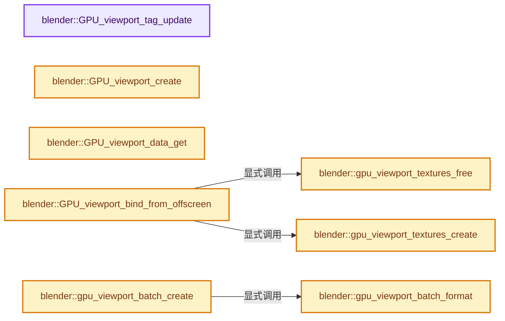
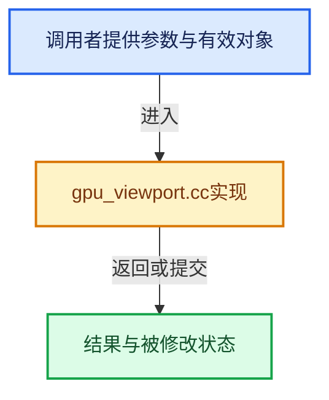

# 实现依赖专题：source/blender/gpu/intern/gpu_viewport.cc

[实现依赖导航](../../../README.md) · [符号索引](../../../../00-课程指南/02-源码与提交索引/符号依赖与实现索引.md)

本专题从正文实际调用进入，集中保存共享实现。函数有稳定锚点，可从调用处直接跳到对应完整函数；递归与互相调用通过回链组织。

## 本文件的实现关系






## 完整成员与函数实现

<a id="f-0d7c74285f38e10d"></a>

### `blender::GPU_viewport_tag_update`

实现位置：[source/blender/gpu/intern/gpu_viewport.cc](../../../../../../../../source/blender/gpu/intern/gpu_viewport.cc) · L99—L102。

接口参数：

- `GPUViewport *viewport`

**教学注释版**

<!-- annotated:bd1c56ec0edf6b -->

```cpp
void GPU_viewport_tag_update(GPUViewport *viewport)
{
  viewport->flag |= DO_UPDATE;
}
```

<details>
<summary>核对原始源码：source/blender/gpu/intern/gpu_viewport.cc · L99—L102</summary>

<!-- original:bd1c56ec0edf6b:source/blender/gpu/intern/gpu_viewport.cc:99:102 -->

```cpp
void GPU_viewport_tag_update(GPUViewport *viewport)
{
  viewport->flag |= DO_UPDATE;
}
```

</details>

**沿实际写入检查状态**

- `viewport->flag |= DO_UPDATE;`

**继续追踪实现**

本实现没有需要继续展开的显式调用；检查返回表达式、对象转换和调用者前置条件。

<a id="f-f1071e96ef089daf"></a>

### `blender::GPU_viewport_create`

实现位置：[source/blender/gpu/intern/gpu_viewport.cc](../../../../../../../../source/blender/gpu/intern/gpu_viewport.cc) · L111—L118。

**教学注释版**

<!-- annotated:94ff7c1f8f7a71 -->

```cpp
GPUViewport *GPU_viewport_create()
{
  GPUViewport *viewport = MEM_new<GPUViewport>("GPUViewport");
  viewport->do_color_management = false;
  viewport->size[0] = viewport->size[1] = -1;
  viewport->active_view = 0;
  return viewport;
}
```

<details>
<summary>核对原始源码：source/blender/gpu/intern/gpu_viewport.cc · L111—L118</summary>

<!-- original:94ff7c1f8f7a71:source/blender/gpu/intern/gpu_viewport.cc:111:118 -->

```cpp
GPUViewport *GPU_viewport_create()
{
  GPUViewport *viewport = MEM_new<GPUViewport>("GPUViewport");
  viewport->do_color_management = false;
  viewport->size[0] = viewport->size[1] = -1;
  viewport->active_view = 0;
  return viewport;
}
```

</details>

**沿实际写入检查状态**

- `viewport->do_color_management = false;`
- `viewport->size[0] = viewport->size[1] = -1;`
- `viewport->active_view = 0;`

**结果出口**

- `return viewport;`

**继续追踪实现**

- `MEM_new<GPUViewport>` → [MEM_new · L351](../../../07-Intern运行时与平台/guardedalloc/MEM_guardedalloc.h.md#f-115f9b6784f89912)。

<a id="f-84b281be8e8cd5cf"></a>

### `blender::GPU_viewport_data_get`

实现位置：[source/blender/gpu/intern/gpu_viewport.cc](../../../../../../../../source/blender/gpu/intern/gpu_viewport.cc) · L127—L130。

接口参数：

- `GPUViewport *viewport`

**教学注释版**

<!-- annotated:8dafec0624821d -->

```cpp
DRWData **GPU_viewport_data_get(GPUViewport *viewport)
{
  return &viewport->draw_data;
}
```

<details>
<summary>核对原始源码：source/blender/gpu/intern/gpu_viewport.cc · L127—L130</summary>

<!-- original:8dafec0624821d:source/blender/gpu/intern/gpu_viewport.cc:127:130 -->

```cpp
DRWData **GPU_viewport_data_get(GPUViewport *viewport)
{
  return &viewport->draw_data;
}
```

</details>

**结果出口**

- `return &viewport->draw_data;`

**继续追踪实现**

本实现没有需要继续展开的显式调用；检查返回表达式、对象转换和调用者前置条件。

<a id="f-83c5c4561e6923b4"></a>

### `blender::gpu_viewport_textures_create`

实现位置：[source/blender/gpu/intern/gpu_viewport.cc](../../../../../../../../source/blender/gpu/intern/gpu_viewport.cc) · L132—L191。

接口参数：

- `GPUViewport *viewport`

**教学注释版**

<!-- annotated:1a6f9ab019a6de -->

```cpp
static void gpu_viewport_textures_create(GPUViewport *viewport)
{
  int *size = viewport->size;
  float const empty_pixel[4] = {0.0f, 0.0f, 0.0f, 0.0f};
  eGPUTextureUsage usage = GPU_TEXTURE_USAGE_SHADER_READ | GPU_TEXTURE_USAGE_ATTACHMENT;

  if (viewport->color_render_tx[0] == nullptr) {

    /* NOTE: dtxl_color texture requires write support as it may be written to by the viewport
     * compositor. */
    viewport->color_render_tx[0] = GPU_texture_create_2d("dtxl_color",
                                                         UNPACK2(size),
                                                         1,
                                                         gpu::TextureFormat::SFLOAT_16_16_16_16,
                                                         usage | GPU_TEXTURE_USAGE_SHADER_WRITE,
                                                         nullptr);
    viewport->color_overlay_tx[0] = GPU_texture_create_2d(
        "dtxl_color_overlay", UNPACK2(size), 1, gpu::TextureFormat::SRGBA_8_8_8_8, usage, nullptr);

    GPU_texture_clear(viewport->color_render_tx[0], GPU_DATA_FLOAT, empty_pixel);
    GPU_texture_clear(viewport->color_overlay_tx[0], GPU_DATA_FLOAT, empty_pixel);
  }

  if ((viewport->flag & GPU_VIEWPORT_STEREO) != 0 && viewport->color_render_tx[1] == nullptr) {
    viewport->color_render_tx[1] = GPU_texture_create_2d("dtxl_color_stereo",
                                                         UNPACK2(size),
                                                         1,
                                                         gpu::TextureFormat::SFLOAT_16_16_16_16,
                                                         usage | GPU_TEXTURE_USAGE_SHADER_WRITE,
                                                         nullptr);
    viewport->color_overlay_tx[1] = GPU_texture_create_2d("dtxl_color_overlay_stereo",
                                                          UNPACK2(size),
                                                          1,
                                                          gpu::TextureFormat::SRGBA_8_8_8_8,
                                                          usage,
                                                          nullptr);

    GPU_texture_clear(viewport->color_render_tx[1], GPU_DATA_FLOAT, empty_pixel);
    GPU_texture_clear(viewport->color_overlay_tx[1], GPU_DATA_FLOAT, empty_pixel);
  }

  /* Can be shared with #GPUOffscreen. */
  if (viewport->depth_tx == nullptr) {
    /* Depth texture can be read back by gizmos #view3d_depths_create. */
    /* Swizzle flag is needed by Workbench Volumes to read the stencil view. */
    viewport->depth_tx = GPU_texture_create_2d("dtxl_depth",
                                               UNPACK2(size),
                                               1,
                                               gpu::TextureFormat::SFLOAT_32_DEPTH_UINT_8,
                                               usage | GPU_TEXTURE_USAGE_HOST_READ |
                                                   GPU_TEXTURE_USAGE_FORMAT_VIEW,
                                               nullptr);
    const float depth_clear = 0.0f;
    GPU_texture_clear(viewport->depth_tx, GPU_DATA_FLOAT, &depth_clear);
  }

  if (!viewport->depth_tx || !viewport->color_render_tx[0] || !viewport->color_overlay_tx[0]) {
    GPU_viewport_free(viewport);
  }
}
```

<details>
<summary>核对原始源码：source/blender/gpu/intern/gpu_viewport.cc · L132—L191</summary>

<!-- original:1a6f9ab019a6de:source/blender/gpu/intern/gpu_viewport.cc:132:191 -->

```cpp
static void gpu_viewport_textures_create(GPUViewport *viewport)
{
  int *size = viewport->size;
  float const empty_pixel[4] = {0.0f, 0.0f, 0.0f, 0.0f};
  eGPUTextureUsage usage = GPU_TEXTURE_USAGE_SHADER_READ | GPU_TEXTURE_USAGE_ATTACHMENT;

  if (viewport->color_render_tx[0] == nullptr) {

    /* NOTE: dtxl_color texture requires write support as it may be written to by the viewport
     * compositor. */
    viewport->color_render_tx[0] = GPU_texture_create_2d("dtxl_color",
                                                         UNPACK2(size),
                                                         1,
                                                         gpu::TextureFormat::SFLOAT_16_16_16_16,
                                                         usage | GPU_TEXTURE_USAGE_SHADER_WRITE,
                                                         nullptr);
    viewport->color_overlay_tx[0] = GPU_texture_create_2d(
        "dtxl_color_overlay", UNPACK2(size), 1, gpu::TextureFormat::SRGBA_8_8_8_8, usage, nullptr);

    GPU_texture_clear(viewport->color_render_tx[0], GPU_DATA_FLOAT, empty_pixel);
    GPU_texture_clear(viewport->color_overlay_tx[0], GPU_DATA_FLOAT, empty_pixel);
  }

  if ((viewport->flag & GPU_VIEWPORT_STEREO) != 0 && viewport->color_render_tx[1] == nullptr) {
    viewport->color_render_tx[1] = GPU_texture_create_2d("dtxl_color_stereo",
                                                         UNPACK2(size),
                                                         1,
                                                         gpu::TextureFormat::SFLOAT_16_16_16_16,
                                                         usage | GPU_TEXTURE_USAGE_SHADER_WRITE,
                                                         nullptr);
    viewport->color_overlay_tx[1] = GPU_texture_create_2d("dtxl_color_overlay_stereo",
                                                          UNPACK2(size),
                                                          1,
                                                          gpu::TextureFormat::SRGBA_8_8_8_8,
                                                          usage,
                                                          nullptr);

    GPU_texture_clear(viewport->color_render_tx[1], GPU_DATA_FLOAT, empty_pixel);
    GPU_texture_clear(viewport->color_overlay_tx[1], GPU_DATA_FLOAT, empty_pixel);
  }

  /* Can be shared with #GPUOffscreen. */
  if (viewport->depth_tx == nullptr) {
    /* Depth texture can be read back by gizmos #view3d_depths_create. */
    /* Swizzle flag is needed by Workbench Volumes to read the stencil view. */
    viewport->depth_tx = GPU_texture_create_2d("dtxl_depth",
                                               UNPACK2(size),
                                               1,
                                               gpu::TextureFormat::SFLOAT_32_DEPTH_UINT_8,
                                               usage | GPU_TEXTURE_USAGE_HOST_READ |
                                                   GPU_TEXTURE_USAGE_FORMAT_VIEW,
                                               nullptr);
    const float depth_clear = 0.0f;
    GPU_texture_clear(viewport->depth_tx, GPU_DATA_FLOAT, &depth_clear);
  }

  if (!viewport->depth_tx || !viewport->color_render_tx[0] || !viewport->color_overlay_tx[0]) {
    GPU_viewport_free(viewport);
  }
}
```

</details>

**沿实际写入检查状态**

- `viewport->color_render_tx[0] = GPU_texture_create_2d("dtxl_color",`
- `viewport->color_overlay_tx[0] = GPU_texture_create_2d(`
- `viewport->color_render_tx[1] = GPU_texture_create_2d("dtxl_color_stereo",`
- `viewport->color_overlay_tx[1] = GPU_texture_create_2d("dtxl_color_overlay_stereo",`
- `viewport->depth_tx = GPU_texture_create_2d("dtxl_depth",`

**继续追踪实现**

- `GPU_texture_create_2d` → [blender::GPU_texture_create_2d · L308](gpu_texture.cc.md#f-5aa2a42234aebbda)。
- `UNPACK2` → [UNPACK2 · L22](../../../07-Intern运行时与平台/ghost/intern/GHOST_utildefines.hh.md#m-00ad768fe1c1)；[UNPACK2 · L234](../../../01-BLI基础库/BLI_utildefines.hh.md#m-96ff8266d239)；[UNPACK2 · L13](../shaders/common/gpu_shader_utildefines.bsl.hh.md#m-8316603fb9a6)。宏定义由构建条件选择。
- `GPU_texture_clear` → [blender::GPU_texture_clear · L583](gpu_texture.cc.md#f-5c978eb203430df2)。
- `GPU_viewport_free` → [blender::GPU_viewport_free · L632](gpu_viewport.cc.md#f-9ba1bcfa54b62923)。

<a id="f-a06b0f5e25dd97e2"></a>

### `blender::gpu_viewport_textures_free`

实现位置：[source/blender/gpu/intern/gpu_viewport.cc](../../../../../../../../source/blender/gpu/intern/gpu_viewport.cc) · L193—L205。

接口参数：

- `GPUViewport *viewport`

**教学注释版**

<!-- annotated:a42c53acc92fd3 -->

```cpp
static void gpu_viewport_textures_free(GPUViewport *viewport)
{
  GPU_FRAMEBUFFER_FREE_SAFE(viewport->stereo_comp_fb);
  GPU_FRAMEBUFFER_FREE_SAFE(viewport->render_fb);
  GPU_FRAMEBUFFER_FREE_SAFE(viewport->overlay_fb);

  for (int i = 0; i < 2; i++) {
    GPU_TEXTURE_FREE_SAFE(viewport->color_render_tx[i]);
    GPU_TEXTURE_FREE_SAFE(viewport->color_overlay_tx[i]);
  }

  GPU_TEXTURE_FREE_SAFE(viewport->depth_tx);
}
```

<details>
<summary>核对原始源码：source/blender/gpu/intern/gpu_viewport.cc · L193—L205</summary>

<!-- original:a42c53acc92fd3:source/blender/gpu/intern/gpu_viewport.cc:193:205 -->

```cpp
static void gpu_viewport_textures_free(GPUViewport *viewport)
{
  GPU_FRAMEBUFFER_FREE_SAFE(viewport->stereo_comp_fb);
  GPU_FRAMEBUFFER_FREE_SAFE(viewport->render_fb);
  GPU_FRAMEBUFFER_FREE_SAFE(viewport->overlay_fb);

  for (int i = 0; i < 2; i++) {
    GPU_TEXTURE_FREE_SAFE(viewport->color_render_tx[i]);
    GPU_TEXTURE_FREE_SAFE(viewport->color_overlay_tx[i]);
  }

  GPU_TEXTURE_FREE_SAFE(viewport->depth_tx);
}
```

</details>

**继续追踪实现**

- `GPU_FRAMEBUFFER_FREE_SAFE` → [GPU_FRAMEBUFFER_FREE_SAFE · L90](../GPU_framebuffer.hh.md#m-be42e1859b08)。宏定义由构建条件选择。
- `GPU_TEXTURE_FREE_SAFE` → [GPU_TEXTURE_FREE_SAFE · L902](../GPU_texture.hh.md#m-fa9785b115fa)。宏定义由构建条件选择。

<a id="f-d8289e4f43d94cc3"></a>

### `blender::GPU_viewport_bind_from_offscreen`

实现位置：[source/blender/gpu/intern/gpu_viewport.cc](../../../../../../../../source/blender/gpu/intern/gpu_viewport.cc) · L225—L246。

接口参数：

- `GPUViewport *viewport`
- `GPUOffScreen *ofs`
- `bool is_xr_surface`

**教学注释版**

<!-- annotated:faf577dfd0fb01 -->

```cpp
void GPU_viewport_bind_from_offscreen(GPUViewport *viewport, GPUOffScreen *ofs, bool is_xr_surface)
{
  gpu::Texture *color, *depth;
  gpu::FrameBuffer *fb;
  viewport->size[0] = GPU_offscreen_width(ofs);
  viewport->size[1] = GPU_offscreen_height(ofs);

  GPU_offscreen_viewport_data_get(ofs, &fb, &color, &depth);

  /* XR surfaces will already check for texture size changes and free if necessary (see
   * #wm_xr_session_surface_offscreen_ensure()), so don't free here as it has a significant
   * performance impact (leads to texture re-creation in #gpu_viewport_textures_create() every VR
   * drawing iteration). */
  if (!is_xr_surface) {
    gpu_viewport_textures_free(viewport);
  }

  /* This is the only texture we can share. */
  viewport->depth_tx = depth;

  gpu_viewport_textures_create(viewport);
}
```

<details>
<summary>核对原始源码：source/blender/gpu/intern/gpu_viewport.cc · L225—L246</summary>

<!-- original:faf577dfd0fb01:source/blender/gpu/intern/gpu_viewport.cc:225:246 -->

```cpp
void GPU_viewport_bind_from_offscreen(GPUViewport *viewport, GPUOffScreen *ofs, bool is_xr_surface)
{
  gpu::Texture *color, *depth;
  gpu::FrameBuffer *fb;
  viewport->size[0] = GPU_offscreen_width(ofs);
  viewport->size[1] = GPU_offscreen_height(ofs);

  GPU_offscreen_viewport_data_get(ofs, &fb, &color, &depth);

  /* XR surfaces will already check for texture size changes and free if necessary (see
   * #wm_xr_session_surface_offscreen_ensure()), so don't free here as it has a significant
   * performance impact (leads to texture re-creation in #gpu_viewport_textures_create() every VR
   * drawing iteration). */
  if (!is_xr_surface) {
    gpu_viewport_textures_free(viewport);
  }

  /* This is the only texture we can share. */
  viewport->depth_tx = depth;

  gpu_viewport_textures_create(viewport);
}
```

</details>

**沿实际写入检查状态**

- `viewport->size[0] = GPU_offscreen_width(ofs);`
- `viewport->size[1] = GPU_offscreen_height(ofs);`
- `viewport->depth_tx = depth;`

**继续追踪实现**

- `GPU_offscreen_width` → [blender::GPU_offscreen_width · L865](gpu_framebuffer.cc.md#f-c2fab8ea4cbaaf48)。
- `GPU_offscreen_height` → [blender::GPU_offscreen_height · L870](gpu_framebuffer.cc.md#f-2bee374c0e52d0e3)。
- `GPU_offscreen_viewport_data_get` → [blender::GPU_offscreen_viewport_data_get · L885](gpu_framebuffer.cc.md#f-b325e3463b2848c6)。
- `gpu_viewport_textures_free` → [blender::gpu_viewport_textures_free · L193](gpu_viewport.cc.md#f-a06b0f5e25dd97e2)。
- `gpu_viewport_textures_create` → [blender::gpu_viewport_textures_create · L132](gpu_viewport.cc.md#f-83c5c4561e6923b4)。

<a id="f-6419a3e79283ee85"></a>

### `blender::gpu_viewport_batch_format`

实现位置：[source/blender/gpu/intern/gpu_viewport.cc](../../../../../../../../source/blender/gpu/intern/gpu_viewport.cc) · L364—L374。

**教学注释版**

<!-- annotated:d132136ec5f0e3 -->

```cpp
static const GPUVertFormat &gpu_viewport_batch_format()
{
  if (g_viewport.format.attr_len == 0) {
    GPUVertFormat *format = &g_viewport.format;
    g_viewport.attr_id.pos = GPU_vertformat_attr_add(
        format, "pos", gpu::VertAttrType::SFLOAT_32_32);
    g_viewport.attr_id.tex_coord = GPU_vertformat_attr_add(
        format, "texCoord", gpu::VertAttrType::SFLOAT_32_32);
  }
  return g_viewport.format;
}
```

<details>
<summary>核对原始源码：source/blender/gpu/intern/gpu_viewport.cc · L364—L374</summary>

<!-- original:d132136ec5f0e3:source/blender/gpu/intern/gpu_viewport.cc:364:374 -->

```cpp
static const GPUVertFormat &gpu_viewport_batch_format()
{
  if (g_viewport.format.attr_len == 0) {
    GPUVertFormat *format = &g_viewport.format;
    g_viewport.attr_id.pos = GPU_vertformat_attr_add(
        format, "pos", gpu::VertAttrType::SFLOAT_32_32);
    g_viewport.attr_id.tex_coord = GPU_vertformat_attr_add(
        format, "texCoord", gpu::VertAttrType::SFLOAT_32_32);
  }
  return g_viewport.format;
}
```

</details>

**沿实际写入检查状态**

- `g_viewport.attr_id.pos = GPU_vertformat_attr_add(`
- `g_viewport.attr_id.tex_coord = GPU_vertformat_attr_add(`

**结果出口**

- `return g_viewport.format;`

**继续追踪实现**

- `GPU_vertformat_attr_add` → [blender::GPU_vertformat_attr_add · L389](gpu_vertex_format.cc.md#f-a36e23f37b97fff4)。

<a id="f-3ab9031cf919a87e"></a>

### `blender::gpu_viewport_batch_create`

实现位置：[source/blender/gpu/intern/gpu_viewport.cc](../../../../../../../../source/blender/gpu/intern/gpu_viewport.cc) · L376—L404。

接口参数：

- `const rctf *rect_pos`
- `const rctf *rect_uv`

**教学注释版**

<!-- annotated:71c1ea5b7f0530 -->

```cpp
static gpu::Batch *gpu_viewport_batch_create(const rctf *rect_pos, const rctf *rect_uv)
{
  gpu::VertBuf *vbo = GPU_vertbuf_create_with_format(gpu_viewport_batch_format());
  const uint vbo_len = 4;
  GPU_vertbuf_data_alloc(*vbo, vbo_len);

  GPUVertBufRaw pos_step, tex_coord_step;
  GPU_vertbuf_attr_get_raw_data(vbo, g_viewport.attr_id.pos, &pos_step);
  GPU_vertbuf_attr_get_raw_data(vbo, g_viewport.attr_id.tex_coord, &tex_coord_step);

  copy_v2_fl2(
      static_cast<float *>(GPU_vertbuf_raw_step(&pos_step)), rect_pos->xmin, rect_pos->ymin);
  copy_v2_fl2(
      static_cast<float *>(GPU_vertbuf_raw_step(&tex_coord_step)), rect_uv->xmin, rect_uv->ymin);
  copy_v2_fl2(
      static_cast<float *>(GPU_vertbuf_raw_step(&pos_step)), rect_pos->xmax, rect_pos->ymin);
  copy_v2_fl2(
      static_cast<float *>(GPU_vertbuf_raw_step(&tex_coord_step)), rect_uv->xmax, rect_uv->ymin);
  copy_v2_fl2(
      static_cast<float *>(GPU_vertbuf_raw_step(&pos_step)), rect_pos->xmin, rect_pos->ymax);
  copy_v2_fl2(
      static_cast<float *>(GPU_vertbuf_raw_step(&tex_coord_step)), rect_uv->xmin, rect_uv->ymax);
  copy_v2_fl2(
      static_cast<float *>(GPU_vertbuf_raw_step(&pos_step)), rect_pos->xmax, rect_pos->ymax);
  copy_v2_fl2(
      static_cast<float *>(GPU_vertbuf_raw_step(&tex_coord_step)), rect_uv->xmax, rect_uv->ymax);

  return GPU_batch_create_ex(GPU_PRIM_TRI_STRIP, vbo, nullptr, GPU_BATCH_OWNS_VBO);
}
```

<details>
<summary>核对原始源码：source/blender/gpu/intern/gpu_viewport.cc · L376—L404</summary>

<!-- original:71c1ea5b7f0530:source/blender/gpu/intern/gpu_viewport.cc:376:404 -->

```cpp
static gpu::Batch *gpu_viewport_batch_create(const rctf *rect_pos, const rctf *rect_uv)
{
  gpu::VertBuf *vbo = GPU_vertbuf_create_with_format(gpu_viewport_batch_format());
  const uint vbo_len = 4;
  GPU_vertbuf_data_alloc(*vbo, vbo_len);

  GPUVertBufRaw pos_step, tex_coord_step;
  GPU_vertbuf_attr_get_raw_data(vbo, g_viewport.attr_id.pos, &pos_step);
  GPU_vertbuf_attr_get_raw_data(vbo, g_viewport.attr_id.tex_coord, &tex_coord_step);

  copy_v2_fl2(
      static_cast<float *>(GPU_vertbuf_raw_step(&pos_step)), rect_pos->xmin, rect_pos->ymin);
  copy_v2_fl2(
      static_cast<float *>(GPU_vertbuf_raw_step(&tex_coord_step)), rect_uv->xmin, rect_uv->ymin);
  copy_v2_fl2(
      static_cast<float *>(GPU_vertbuf_raw_step(&pos_step)), rect_pos->xmax, rect_pos->ymin);
  copy_v2_fl2(
      static_cast<float *>(GPU_vertbuf_raw_step(&tex_coord_step)), rect_uv->xmax, rect_uv->ymin);
  copy_v2_fl2(
      static_cast<float *>(GPU_vertbuf_raw_step(&pos_step)), rect_pos->xmin, rect_pos->ymax);
  copy_v2_fl2(
      static_cast<float *>(GPU_vertbuf_raw_step(&tex_coord_step)), rect_uv->xmin, rect_uv->ymax);
  copy_v2_fl2(
      static_cast<float *>(GPU_vertbuf_raw_step(&pos_step)), rect_pos->xmax, rect_pos->ymax);
  copy_v2_fl2(
      static_cast<float *>(GPU_vertbuf_raw_step(&tex_coord_step)), rect_uv->xmax, rect_uv->ymax);

  return GPU_batch_create_ex(GPU_PRIM_TRI_STRIP, vbo, nullptr, GPU_BATCH_OWNS_VBO);
}
```

</details>

**结果出口**

- `return GPU_batch_create_ex(GPU_PRIM_TRI_STRIP, vbo, nullptr, GPU_BATCH_OWNS_VBO);`

**继续追踪实现**

- `GPU_vertbuf_create_with_format` → [blender::GPU_vertbuf_create_with_format · L71](../GPU_vertex_buffer.hh.md#f-bd43fe034e852138)。
- `gpu_viewport_batch_format` → [blender::gpu_viewport_batch_format · L364](gpu_viewport.cc.md#f-6419a3e79283ee85)。
- `GPU_vertbuf_data_alloc` → [blender::GPU_vertbuf_data_alloc · L172](gpu_vertex_buffer.cc.md#f-8ee5cf106e0f2b0f)。
- `GPU_vertbuf_attr_get_raw_data` → [blender::GPU_vertbuf_attr_get_raw_data · L245](gpu_vertex_buffer.cc.md#f-00aeac0bf6fcdb36)。
- `copy_v2_fl2` → [blender::copy_v2_fl2 · L234](../../../01-BLI基础库/intern/math_vector_inline.cc.md#f-226daf6ca03c8844)。
- `GPU_vertbuf_raw_step` → [blender::GPU_vertbuf_raw_step · L329](../GPU_vertex_buffer.hh.md#f-a206297b58614393)。
- `GPU_batch_create_ex` → [blender::GPU_batch_create_ex · L53](gpu_batch.cc.md#f-d3825f4a720aba94)。

<a id="f-bf5c70ae2d51b623"></a>

### `blender::gpu_viewport_batch_get`

实现位置：[source/blender/gpu/intern/gpu_viewport.cc](../../../../../../../../source/blender/gpu/intern/gpu_viewport.cc) · L406—L427。

接口参数：

- `GPUViewport *viewport`
- `const rctf *rect_pos`
- `const rctf *rect_uv`

**教学注释版**

<!-- annotated:4273edf3c7ec48 -->

```cpp
static gpu::Batch *gpu_viewport_batch_get(GPUViewport *viewport,
                                          const rctf *rect_pos,
                                          const rctf *rect_uv)
{
  const float compare_limit = 0.0001f;
  const bool parameters_changed =
      (!BLI_rctf_compare(
           &viewport->batch.last_used_parameters.rect_pos, rect_pos, compare_limit) ||
       !BLI_rctf_compare(&viewport->batch.last_used_parameters.rect_uv, rect_uv, compare_limit));

  if (viewport->batch.batch && parameters_changed) {
    GPU_batch_discard(viewport->batch.batch);
    viewport->batch.batch = nullptr;
  }

  if (!viewport->batch.batch) {
    viewport->batch.batch = gpu_viewport_batch_create(rect_pos, rect_uv);
    viewport->batch.last_used_parameters.rect_pos = *rect_pos;
    viewport->batch.last_used_parameters.rect_uv = *rect_uv;
  }
  return viewport->batch.batch;
}
```

<details>
<summary>核对原始源码：source/blender/gpu/intern/gpu_viewport.cc · L406—L427</summary>

<!-- original:4273edf3c7ec48:source/blender/gpu/intern/gpu_viewport.cc:406:427 -->

```cpp
static gpu::Batch *gpu_viewport_batch_get(GPUViewport *viewport,
                                          const rctf *rect_pos,
                                          const rctf *rect_uv)
{
  const float compare_limit = 0.0001f;
  const bool parameters_changed =
      (!BLI_rctf_compare(
           &viewport->batch.last_used_parameters.rect_pos, rect_pos, compare_limit) ||
       !BLI_rctf_compare(&viewport->batch.last_used_parameters.rect_uv, rect_uv, compare_limit));

  if (viewport->batch.batch && parameters_changed) {
    GPU_batch_discard(viewport->batch.batch);
    viewport->batch.batch = nullptr;
  }

  if (!viewport->batch.batch) {
    viewport->batch.batch = gpu_viewport_batch_create(rect_pos, rect_uv);
    viewport->batch.last_used_parameters.rect_pos = *rect_pos;
    viewport->batch.last_used_parameters.rect_uv = *rect_uv;
  }
  return viewport->batch.batch;
}
```

</details>

**沿实际写入检查状态**

- `viewport->batch.batch = nullptr;`
- `viewport->batch.batch = gpu_viewport_batch_create(rect_pos, rect_uv);`
- `viewport->batch.last_used_parameters.rect_pos = *rect_pos;`
- `viewport->batch.last_used_parameters.rect_uv = *rect_uv;`

**结果出口**

- `return viewport->batch.batch;`

**继续追踪实现**

- `BLI_rctf_compare` → [blender::BLI_rctf_compare · L882](../../../01-BLI基础库/intern/rct.cc.md#f-ca13d2ea14373b4e)。
- `GPU_batch_discard` → [blender::GPU_batch_discard · L129](gpu_batch.cc.md#f-7046ba62f4ac537b)。
- `gpu_viewport_batch_create` → [blender::gpu_viewport_batch_create · L376](gpu_viewport.cc.md#f-3ab9031cf919a87e)。

<a id="f-bfe35b64bbe82ff8"></a>

### `blender::gpu_viewport_batch_free`

实现位置：[source/blender/gpu/intern/gpu_viewport.cc](../../../../../../../../source/blender/gpu/intern/gpu_viewport.cc) · L429—L435。

接口参数：

- `GPUViewport *viewport`

**教学注释版**

<!-- annotated:789df7c22212f4 -->

```cpp
static void gpu_viewport_batch_free(GPUViewport *viewport)
{
  if (viewport->batch.batch) {
    GPU_batch_discard(viewport->batch.batch);
    viewport->batch.batch = nullptr;
  }
}
```

<details>
<summary>核对原始源码：source/blender/gpu/intern/gpu_viewport.cc · L429—L435</summary>

<!-- original:789df7c22212f4:source/blender/gpu/intern/gpu_viewport.cc:429:435 -->

```cpp
static void gpu_viewport_batch_free(GPUViewport *viewport)
{
  if (viewport->batch.batch) {
    GPU_batch_discard(viewport->batch.batch);
    viewport->batch.batch = nullptr;
  }
}
```

</details>

**沿实际写入检查状态**

- `viewport->batch.batch = nullptr;`

**继续追踪实现**

- `GPU_batch_discard` → [blender::GPU_batch_discard · L129](gpu_batch.cc.md#f-7046ba62f4ac537b)。

<a id="f-8a9790d4b34d2fd5"></a>

### `blender::gpu_viewport_draw_colormanaged`

实现位置：[source/blender/gpu/intern/gpu_viewport.cc](../../../../../../../../source/blender/gpu/intern/gpu_viewport.cc) · L439—L488。

接口参数：

- `GPUViewport *viewport`
- `int view`
- `const rctf *rect_pos`
- `const rctf *rect_uv`
- `bool display_colorspace`
- `bool do_overlay_merge`

**教学注释版**

<!-- annotated:37d97d4105c188 -->

```cpp
static void gpu_viewport_draw_colormanaged(GPUViewport *viewport,
                                           int view,
                                           const rctf *rect_pos,
                                           const rctf *rect_uv,
                                           bool display_colorspace,
                                           bool do_overlay_merge)
{
  gpu::Texture *color = viewport->color_render_tx[view];
  gpu::Texture *color_overlay = viewport->color_overlay_tx[view];

  bool use_ocio = false;

  if (viewport->do_color_management && display_colorspace) {
    /* During the binding process the last used VertexFormat is tested and can assert as it is not
     * valid. By calling the `immVertexFormat` the last used VertexFormat is reset and the assert
     * does not happen. This solves a chicken and egg problem when using GPUBatches. GPUBatches
     * contain the correct vertex format, but can only bind after the shader is bound.
     *
     * Image/UV editor still uses imm, after that has been changed we could move this fix to the
     * OCIO. */
    immVertexFormat();
    use_ocio = IMB_colormanagement_setup_glsl_draw_from_space(&viewport->view_settings,
                                                              &viewport->display_settings,
                                                              nullptr,
                                                              viewport->dither,
                                                              false,
                                                              do_overlay_merge);
  }

  gpu::Batch *batch = gpu_viewport_batch_get(viewport, rect_pos, rect_uv);
  if (use_ocio) {
    GPU_batch_program_set_imm_shader(batch);
  }
  else {
    GPU_batch_program_set_builtin(batch, GPU_SHADER_2D_IMAGE_OVERLAYS_MERGE);
    GPU_batch_uniform_1i(batch, "overlay", do_overlay_merge);
    GPU_batch_uniform_1i(batch, "display_transform", display_colorspace);
    GPU_batch_uniform_1i(batch, "use_hdr_display", viewport->use_hdr_display);
  }

  GPU_texture_bind(color, 0);
  GPU_texture_bind(color_overlay, 1);
  GPU_batch_draw(batch);
  GPU_texture_unbind(color);
  GPU_texture_unbind(color_overlay);

  if (use_ocio) {
    IMB_colormanagement_finish_glsl_draw();
  }
}
```

<details>
<summary>核对原始源码：source/blender/gpu/intern/gpu_viewport.cc · L439—L488</summary>

<!-- original:37d97d4105c188:source/blender/gpu/intern/gpu_viewport.cc:439:488 -->

```cpp
static void gpu_viewport_draw_colormanaged(GPUViewport *viewport,
                                           int view,
                                           const rctf *rect_pos,
                                           const rctf *rect_uv,
                                           bool display_colorspace,
                                           bool do_overlay_merge)
{
  gpu::Texture *color = viewport->color_render_tx[view];
  gpu::Texture *color_overlay = viewport->color_overlay_tx[view];

  bool use_ocio = false;

  if (viewport->do_color_management && display_colorspace) {
    /* During the binding process the last used VertexFormat is tested and can assert as it is not
     * valid. By calling the `immVertexFormat` the last used VertexFormat is reset and the assert
     * does not happen. This solves a chicken and egg problem when using GPUBatches. GPUBatches
     * contain the correct vertex format, but can only bind after the shader is bound.
     *
     * Image/UV editor still uses imm, after that has been changed we could move this fix to the
     * OCIO. */
    immVertexFormat();
    use_ocio = IMB_colormanagement_setup_glsl_draw_from_space(&viewport->view_settings,
                                                              &viewport->display_settings,
                                                              nullptr,
                                                              viewport->dither,
                                                              false,
                                                              do_overlay_merge);
  }

  gpu::Batch *batch = gpu_viewport_batch_get(viewport, rect_pos, rect_uv);
  if (use_ocio) {
    GPU_batch_program_set_imm_shader(batch);
  }
  else {
    GPU_batch_program_set_builtin(batch, GPU_SHADER_2D_IMAGE_OVERLAYS_MERGE);
    GPU_batch_uniform_1i(batch, "overlay", do_overlay_merge);
    GPU_batch_uniform_1i(batch, "display_transform", display_colorspace);
    GPU_batch_uniform_1i(batch, "use_hdr_display", viewport->use_hdr_display);
  }

  GPU_texture_bind(color, 0);
  GPU_texture_bind(color_overlay, 1);
  GPU_batch_draw(batch);
  GPU_texture_unbind(color);
  GPU_texture_unbind(color_overlay);

  if (use_ocio) {
    IMB_colormanagement_finish_glsl_draw();
  }
}
```

</details>

**沿实际写入检查状态**

- `use_ocio = IMB_colormanagement_setup_glsl_draw_from_space(&viewport->view_settings,`

**继续追踪实现**

- `immVertexFormat` → [blender::immVertexFormat · L41](gpu_immediate.cc.md#f-cc131113ee25fc66)。
- `IMB_colormanagement_setup_glsl_draw_from_space` → [blender::IMB_colormanagement_setup_glsl_draw_from_space · L4206](../../imbuf/intern/colormanagement.cc.md#f-c60edf5cbf26d818)。
- `gpu_viewport_batch_get` → [blender::gpu_viewport_batch_get · L406](gpu_viewport.cc.md#f-bf5c70ae2d51b623)。
- `GPU_batch_program_set_imm_shader` → [blender::GPU_batch_program_set_imm_shader · L508](gpu_batch.cc.md#f-c98a7eb0bbe438f6)。
- `GPU_batch_program_set_builtin` → [blender::GPU_batch_program_set_builtin · L503](gpu_batch.cc.md#f-c304e4bdc1ab3afb)。
- `GPU_batch_uniform_1i` → [GPU_batch_uniform_1i · L265](../GPU_batch.hh.md#m-97bf204d309c)。宏定义由构建条件选择。
- `GPU_texture_bind` → [blender::GPU_texture_bind · L633](gpu_texture.cc.md#f-5c590570f3fbea5c)。
- `GPU_batch_draw` → [blender::GPU_batch_draw · L392](gpu_batch.cc.md#f-029a8f563534ed88)。
- `GPU_texture_unbind` → [blender::GPU_texture_unbind · L639](gpu_texture.cc.md#f-4bd2dd4244c18f3f)。
- `IMB_colormanagement_finish_glsl_draw` → [blender::IMB_colormanagement_finish_glsl_draw · L4308](../../imbuf/intern/colormanagement.cc.md#f-593531b26d429af7)。

<a id="f-055468091334b95f"></a>

### `blender::GPU_viewport_unbind_from_offscreen`

实现位置：[source/blender/gpu/intern/gpu_viewport.cc](../../../../../../../../source/blender/gpu/intern/gpu_viewport.cc) · L546—L577。

接口参数：

- `GPUViewport *viewport`
- `GPUOffScreen *ofs`
- `bool display_colorspace`
- `bool do_overlay_merge`

**教学注释版**

<!-- annotated:800871c36f7891 -->

```cpp
void GPU_viewport_unbind_from_offscreen(GPUViewport *viewport,
                                        GPUOffScreen *ofs,
                                        bool display_colorspace,
                                        bool do_overlay_merge)
{
  const int view = 0;

  if (viewport->color_render_tx[view] == nullptr) {
    return;
  }

  GPU_depth_test(GPU_DEPTH_NONE);
  GPU_offscreen_bind(ofs, false);

  rctf pos_rect{};
  pos_rect.xmin = -1.0f;
  pos_rect.ymin = -1.0f;
  pos_rect.xmax = 1.0f;
  pos_rect.ymax = 1.0f;

  rctf uv_rect{};
  uv_rect.xmin = 0.0f;
  uv_rect.ymin = 0.0f;
  uv_rect.xmax = 1.0f;
  uv_rect.ymax = 1.0f;

  gpu_viewport_draw_colormanaged(
      viewport, view, &pos_rect, &uv_rect, display_colorspace, do_overlay_merge);

  /* This one is from the offscreen. Don't free it with the viewport. */
  viewport->depth_tx = nullptr;
}
```

<details>
<summary>核对原始源码：source/blender/gpu/intern/gpu_viewport.cc · L546—L577</summary>

<!-- original:800871c36f7891:source/blender/gpu/intern/gpu_viewport.cc:546:577 -->

```cpp
void GPU_viewport_unbind_from_offscreen(GPUViewport *viewport,
                                        GPUOffScreen *ofs,
                                        bool display_colorspace,
                                        bool do_overlay_merge)
{
  const int view = 0;

  if (viewport->color_render_tx[view] == nullptr) {
    return;
  }

  GPU_depth_test(GPU_DEPTH_NONE);
  GPU_offscreen_bind(ofs, false);

  rctf pos_rect{};
  pos_rect.xmin = -1.0f;
  pos_rect.ymin = -1.0f;
  pos_rect.xmax = 1.0f;
  pos_rect.ymax = 1.0f;

  rctf uv_rect{};
  uv_rect.xmin = 0.0f;
  uv_rect.ymin = 0.0f;
  uv_rect.xmax = 1.0f;
  uv_rect.ymax = 1.0f;

  gpu_viewport_draw_colormanaged(
      viewport, view, &pos_rect, &uv_rect, display_colorspace, do_overlay_merge);

  /* This one is from the offscreen. Don't free it with the viewport. */
  viewport->depth_tx = nullptr;
}
```

</details>

**沿实际写入检查状态**

- `pos_rect.xmin = -1.0f;`
- `pos_rect.ymin = -1.0f;`
- `pos_rect.xmax = 1.0f;`
- `pos_rect.ymax = 1.0f;`
- `uv_rect.xmin = 0.0f;`
- `uv_rect.ymin = 0.0f;`
- `uv_rect.xmax = 1.0f;`
- `uv_rect.ymax = 1.0f;`
- `viewport->depth_tx = nullptr;`

**继续追踪实现**

- `GPU_depth_test` → [blender::GPU_depth_test · L70](gpu_state.cc.md#f-b3b9ee4be7572808)。
- `GPU_offscreen_bind` → [blender::GPU_offscreen_bind · L812](gpu_framebuffer.cc.md#f-8602ad78866608d1)。
- `gpu_viewport_draw_colormanaged` → [blender::gpu_viewport_draw_colormanaged · L439](gpu_viewport.cc.md#f-8a9790d4b34d2fd5)。

<a id="f-cb49bb5ce8e2b0e0"></a>

### `blender::GPU_viewport_active_view_get`

实现位置：[source/blender/gpu/intern/gpu_viewport.cc](../../../../../../../../source/blender/gpu/intern/gpu_viewport.cc) · L585—L588。

接口参数：

- `GPUViewport *viewport`

**教学注释版**

<!-- annotated:c88f9181c49244 -->

```cpp
int GPU_viewport_active_view_get(GPUViewport *viewport)
{
  return viewport->active_view;
}
```

<details>
<summary>核对原始源码：source/blender/gpu/intern/gpu_viewport.cc · L585—L588</summary>

<!-- original:c88f9181c49244:source/blender/gpu/intern/gpu_viewport.cc:585:588 -->

```cpp
int GPU_viewport_active_view_get(GPUViewport *viewport)
{
  return viewport->active_view;
}
```

</details>

**结果出口**

- `return viewport->active_view;`

**继续追踪实现**

本实现没有需要继续展开的显式调用；检查返回表达式、对象转换和调用者前置条件。

<a id="f-bf322b0ba509ea3f"></a>

### `blender::GPU_viewport_color_texture`

实现位置：[source/blender/gpu/intern/gpu_viewport.cc](../../../../../../../../source/blender/gpu/intern/gpu_viewport.cc) · L595—L598。

接口参数：

- `GPUViewport *viewport`
- `int view`

**教学注释版**

<!-- annotated:a25394bcd92266 -->

```cpp
gpu::Texture *GPU_viewport_color_texture(GPUViewport *viewport, int view)
{
  return viewport->color_render_tx[view];
}
```

<details>
<summary>核对原始源码：source/blender/gpu/intern/gpu_viewport.cc · L595—L598</summary>

<!-- original:a25394bcd92266:source/blender/gpu/intern/gpu_viewport.cc:595:598 -->

```cpp
gpu::Texture *GPU_viewport_color_texture(GPUViewport *viewport, int view)
{
  return viewport->color_render_tx[view];
}
```

</details>

**结果出口**

- `return viewport->color_render_tx[view];`

**继续追踪实现**

本实现没有需要继续展开的显式调用；检查返回表达式、对象转换和调用者前置条件。

<a id="f-6e6d24adf67c6e66"></a>

### `blender::GPU_viewport_overlay_texture`

实现位置：[source/blender/gpu/intern/gpu_viewport.cc](../../../../../../../../source/blender/gpu/intern/gpu_viewport.cc) · L600—L603。

接口参数：

- `GPUViewport *viewport`
- `int view`

**教学注释版**

<!-- annotated:1e47ee951f578f -->

```cpp
gpu::Texture *GPU_viewport_overlay_texture(GPUViewport *viewport, int view)
{
  return viewport->color_overlay_tx[view];
}
```

<details>
<summary>核对原始源码：source/blender/gpu/intern/gpu_viewport.cc · L600—L603</summary>

<!-- original:1e47ee951f578f:source/blender/gpu/intern/gpu_viewport.cc:600:603 -->

```cpp
gpu::Texture *GPU_viewport_overlay_texture(GPUViewport *viewport, int view)
{
  return viewport->color_overlay_tx[view];
}
```

</details>

**结果出口**

- `return viewport->color_overlay_tx[view];`

**继续追踪实现**

本实现没有需要继续展开的显式调用；检查返回表达式、对象转换和调用者前置条件。

<a id="f-10a604de746d48f5"></a>

### `blender::GPU_viewport_depth_texture`

实现位置：[source/blender/gpu/intern/gpu_viewport.cc](../../../../../../../../source/blender/gpu/intern/gpu_viewport.cc) · L605—L608。

接口参数：

- `GPUViewport *viewport`

**教学注释版**

<!-- annotated:1edf428552afd6 -->

```cpp
gpu::Texture *GPU_viewport_depth_texture(GPUViewport *viewport)
{
  return viewport->depth_tx;
}
```

<details>
<summary>核对原始源码：source/blender/gpu/intern/gpu_viewport.cc · L605—L608</summary>

<!-- original:1edf428552afd6:source/blender/gpu/intern/gpu_viewport.cc:605:608 -->

```cpp
gpu::Texture *GPU_viewport_depth_texture(GPUViewport *viewport)
{
  return viewport->depth_tx;
}
```

</details>

**结果出口**

- `return viewport->depth_tx;`

**继续追踪实现**

本实现没有需要继续展开的显式调用；检查返回表达式、对象转换和调用者前置条件。

<a id="f-9ba1bcfa54b62923"></a>

### `blender::GPU_viewport_free`

实现位置：[source/blender/gpu/intern/gpu_viewport.cc](../../../../../../../../source/blender/gpu/intern/gpu_viewport.cc) · L632—L644。

接口参数：

- `GPUViewport *viewport`

**教学注释版**

<!-- annotated:52def313d196cc -->

```cpp
void GPU_viewport_free(GPUViewport *viewport)
{
  if (viewport->draw_data) {
    DRW_viewport_data_free(viewport->draw_data);
  }

  gpu_viewport_textures_free(viewport);

  BKE_color_managed_view_settings_free(&viewport->view_settings);
  gpu_viewport_batch_free(viewport);

  MEM_delete(viewport);
}
```

<details>
<summary>核对原始源码：source/blender/gpu/intern/gpu_viewport.cc · L632—L644</summary>

<!-- original:52def313d196cc:source/blender/gpu/intern/gpu_viewport.cc:632:644 -->

```cpp
void GPU_viewport_free(GPUViewport *viewport)
{
  if (viewport->draw_data) {
    DRW_viewport_data_free(viewport->draw_data);
  }

  gpu_viewport_textures_free(viewport);

  BKE_color_managed_view_settings_free(&viewport->view_settings);
  gpu_viewport_batch_free(viewport);

  MEM_delete(viewport);
}
```

</details>

**继续追踪实现**

- `DRW_viewport_data_free` → [blender::DRW_viewport_data_free · L420](../../draw/intern/draw_context.cc.md#f-cb85c63f7b574686)。
- `gpu_viewport_textures_free` → [blender::gpu_viewport_textures_free · L193](gpu_viewport.cc.md#f-a06b0f5e25dd97e2)。
- `BKE_color_managed_view_settings_free` → [blender::BKE_color_managed_view_settings_free · L2125](../../../02-BKE几何与数据/intern/colortools.cc.md#f-bd5fbe8eb2acb4f3)。
- `gpu_viewport_batch_free` → [blender::gpu_viewport_batch_free · L429](gpu_viewport.cc.md#f-bfe35b64bbe82ff8)。
- `MEM_delete` → [MEM_delete · L400](../../../07-Intern运行时与平台/guardedalloc/MEM_guardedalloc.h.md#f-9049ffdd1682887c)。
