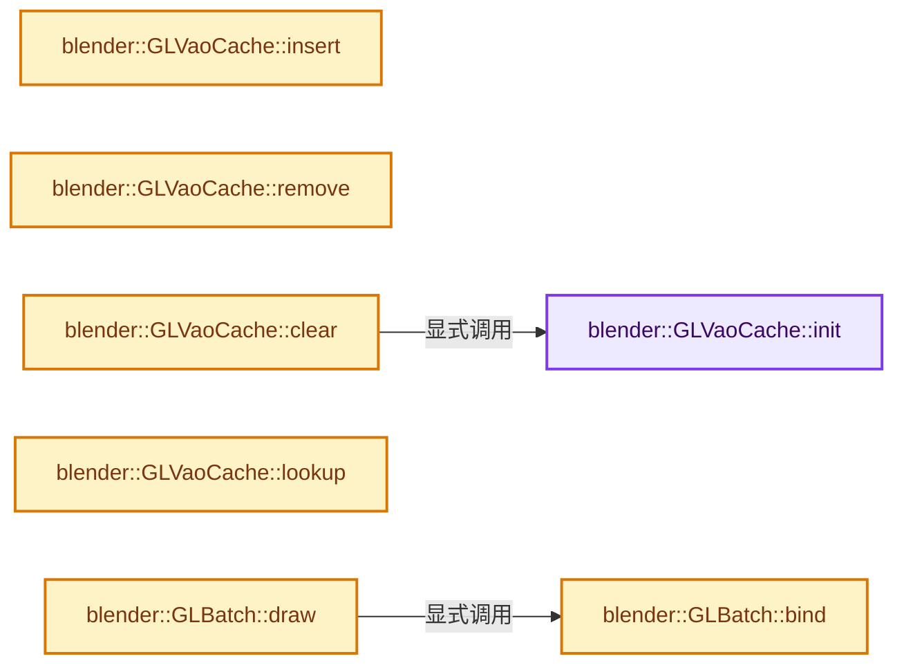
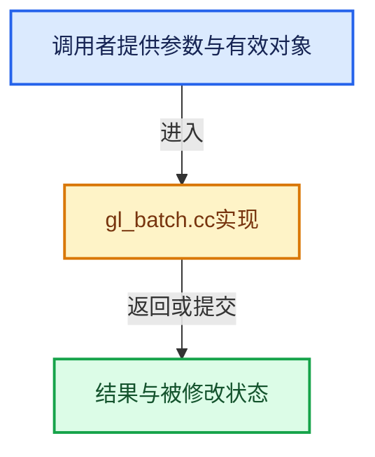

# 实现依赖专题：source/blender/gpu/opengl/gl_batch.cc

[实现依赖导航](../../../README.md) · [符号索引](../../../../00-课程指南/02-源码与提交索引/符号依赖与实现索引.md)

本专题从正文实际调用进入，集中保存共享实现。函数有稳定锚点，可从调用处直接跳到对应完整函数；递归与互相调用通过回链组织。

## 本文件的实现关系






## 完整成员与函数实现

<a id="f-c3e34d2d3f5ed8dc"></a>

### `blender::GLVaoCache::init`

实现位置：[source/blender/gpu/opengl/gl_batch.cc](../../../../../../../../source/blender/gpu/opengl/gl_batch.cc) · L48—L60。

**教学注释版**

<!-- annotated:51b00c4132df47 -->

```cpp
void GLVaoCache::init()
{
  context_ = nullptr;
  interface_ = nullptr;
  is_dynamic_vao_count = false;
  for (int i = 0; i < GPU_VAO_STATIC_LEN; i++) {
    static_vaos.interfaces[i] = nullptr;
    static_vaos.vao_ids[i] = 0;
  }
  vao_base_instance_ = 0;
  base_instance_ = 0;
  vao_id_ = 0;
}
```

<details>
<summary>核对原始源码：source/blender/gpu/opengl/gl_batch.cc · L48—L60</summary>

<!-- original:51b00c4132df47:source/blender/gpu/opengl/gl_batch.cc:48:60 -->

```cpp
void GLVaoCache::init()
{
  context_ = nullptr;
  interface_ = nullptr;
  is_dynamic_vao_count = false;
  for (int i = 0; i < GPU_VAO_STATIC_LEN; i++) {
    static_vaos.interfaces[i] = nullptr;
    static_vaos.vao_ids[i] = 0;
  }
  vao_base_instance_ = 0;
  base_instance_ = 0;
  vao_id_ = 0;
}
```

</details>

**沿实际写入检查状态**

- `context_ = nullptr;`
- `interface_ = nullptr;`
- `is_dynamic_vao_count = false;`
- `static_vaos.interfaces[i] = nullptr;`
- `static_vaos.vao_ids[i] = 0;`
- `vao_base_instance_ = 0;`
- `base_instance_ = 0;`
- `vao_id_ = 0;`

**继续追踪实现**

本实现没有需要继续展开的显式调用；检查返回表达式、对象转换和调用者前置条件。

<a id="f-4bede76b1421c1f7"></a>

### `blender::GLVaoCache::insert`

实现位置：[source/blender/gpu/opengl/gl_batch.cc](../../../../../../../../source/blender/gpu/opengl/gl_batch.cc) · L62—L117。

接口参数：

- `const GLShaderInterface *interface`
- `GLuint vao`

**教学注释版**

<!-- annotated:33fa11cd36eb9c -->

```cpp
void GLVaoCache::insert(const GLShaderInterface *interface, GLuint vao)
{
  /* Now insert the cache. */
  if (!is_dynamic_vao_count) {
    int i; /* find first unused slot */
    for (i = 0; i < GPU_VAO_STATIC_LEN; i++) {
      if (static_vaos.vao_ids[i] == 0) {
        break;
      }
    }

    if (i < GPU_VAO_STATIC_LEN) {
      static_vaos.interfaces[i] = interface;
      static_vaos.vao_ids[i] = vao;
    }
    else {
      /* Erase previous entries, they will be added back if drawn again. */
      for (int i = 0; i < GPU_VAO_STATIC_LEN; i++) {
        if (static_vaos.interfaces[i] != nullptr) {
          const_cast<GLShaderInterface *>(static_vaos.interfaces[i])->ref_remove(this);
          context_->vao_free(static_vaos.vao_ids[i]);
        }
      }
      /* Not enough place switch to dynamic. */
      is_dynamic_vao_count = true;
      /* Init dynamic arrays and let the branch below set the values. */
      dynamic_vaos.count = GPU_BATCH_VAO_DYN_ALLOC_COUNT;
      dynamic_vaos.interfaces = MEM_new_array_zeroed<const GLShaderInterface *>(
          dynamic_vaos.count, "dyn vaos interfaces");
      dynamic_vaos.vao_ids = MEM_new_array_zeroed<GLuint>(dynamic_vaos.count, "dyn vaos ids");
    }
  }

  if (is_dynamic_vao_count) {
    int i; /* find first unused slot */
    for (i = 0; i < dynamic_vaos.count; i++) {
      if (dynamic_vaos.vao_ids[i] == 0) {
        break;
      }
    }

    if (i == dynamic_vaos.count) {
      /* Not enough place, realloc the array. */
      i = dynamic_vaos.count;
      dynamic_vaos.count += GPU_BATCH_VAO_DYN_ALLOC_COUNT;
      dynamic_vaos.interfaces = static_cast<const GLShaderInterface **>(MEM_realloc_zeroed(
          (void *)dynamic_vaos.interfaces, sizeof(GLShaderInterface *) * dynamic_vaos.count));
      dynamic_vaos.vao_ids = static_cast<GLuint *>(
          MEM_realloc_zeroed(dynamic_vaos.vao_ids, sizeof(GLuint) * dynamic_vaos.count));
    }
    dynamic_vaos.interfaces[i] = interface;
    dynamic_vaos.vao_ids[i] = vao;
  }

  const_cast<GLShaderInterface *>(interface)->ref_add(this);
}
```

<details>
<summary>核对原始源码：source/blender/gpu/opengl/gl_batch.cc · L62—L117</summary>

<!-- original:33fa11cd36eb9c:source/blender/gpu/opengl/gl_batch.cc:62:117 -->

```cpp
void GLVaoCache::insert(const GLShaderInterface *interface, GLuint vao)
{
  /* Now insert the cache. */
  if (!is_dynamic_vao_count) {
    int i; /* find first unused slot */
    for (i = 0; i < GPU_VAO_STATIC_LEN; i++) {
      if (static_vaos.vao_ids[i] == 0) {
        break;
      }
    }

    if (i < GPU_VAO_STATIC_LEN) {
      static_vaos.interfaces[i] = interface;
      static_vaos.vao_ids[i] = vao;
    }
    else {
      /* Erase previous entries, they will be added back if drawn again. */
      for (int i = 0; i < GPU_VAO_STATIC_LEN; i++) {
        if (static_vaos.interfaces[i] != nullptr) {
          const_cast<GLShaderInterface *>(static_vaos.interfaces[i])->ref_remove(this);
          context_->vao_free(static_vaos.vao_ids[i]);
        }
      }
      /* Not enough place switch to dynamic. */
      is_dynamic_vao_count = true;
      /* Init dynamic arrays and let the branch below set the values. */
      dynamic_vaos.count = GPU_BATCH_VAO_DYN_ALLOC_COUNT;
      dynamic_vaos.interfaces = MEM_new_array_zeroed<const GLShaderInterface *>(
          dynamic_vaos.count, "dyn vaos interfaces");
      dynamic_vaos.vao_ids = MEM_new_array_zeroed<GLuint>(dynamic_vaos.count, "dyn vaos ids");
    }
  }

  if (is_dynamic_vao_count) {
    int i; /* find first unused slot */
    for (i = 0; i < dynamic_vaos.count; i++) {
      if (dynamic_vaos.vao_ids[i] == 0) {
        break;
      }
    }

    if (i == dynamic_vaos.count) {
      /* Not enough place, realloc the array. */
      i = dynamic_vaos.count;
      dynamic_vaos.count += GPU_BATCH_VAO_DYN_ALLOC_COUNT;
      dynamic_vaos.interfaces = static_cast<const GLShaderInterface **>(MEM_realloc_zeroed(
          (void *)dynamic_vaos.interfaces, sizeof(GLShaderInterface *) * dynamic_vaos.count));
      dynamic_vaos.vao_ids = static_cast<GLuint *>(
          MEM_realloc_zeroed(dynamic_vaos.vao_ids, sizeof(GLuint) * dynamic_vaos.count));
    }
    dynamic_vaos.interfaces[i] = interface;
    dynamic_vaos.vao_ids[i] = vao;
  }

  const_cast<GLShaderInterface *>(interface)->ref_add(this);
}
```

</details>

**沿实际写入检查状态**

- `static_vaos.interfaces[i] = interface;`
- `static_vaos.vao_ids[i] = vao;`
- `is_dynamic_vao_count = true;`
- `dynamic_vaos.count = GPU_BATCH_VAO_DYN_ALLOC_COUNT;`
- `dynamic_vaos.interfaces = MEM_new_array_zeroed<const GLShaderInterface *>(`
- `dynamic_vaos.vao_ids = MEM_new_array_zeroed<GLuint>(dynamic_vaos.count, "dyn vaos ids");`
- `i = dynamic_vaos.count;`
- `dynamic_vaos.count += GPU_BATCH_VAO_DYN_ALLOC_COUNT;`
- `dynamic_vaos.interfaces = static_cast<const GLShaderInterface **>(MEM_realloc_zeroed(`
- `dynamic_vaos.vao_ids = static_cast<GLuint *>(`
- `dynamic_vaos.interfaces[i] = interface;`
- `dynamic_vaos.vao_ids[i] = vao;`

**继续追踪实现**

- `const_cast<GLShaderInterface *>(static_vaos.interfaces[i])->ref_remove` → [调用协议](../../../../00-课程指南/01-路线与规范/模板宏与动态分派协议.md)：接收对象类型依赖auto、返回值或模板实例；不按同名猜测目标。调用位置L81。
- `context_->vao_free` → [调用协议](../../../../00-课程指南/01-路线与规范/模板宏与动态分派协议.md)：接收对象类型依赖auto、返回值或模板实例；不按同名猜测目标。调用位置L82。
- `MEM_new_array_zeroed<const GLShaderInterface *>` → [MEM_new_array_zeroed · L566](../../../07-Intern运行时与平台/guardedalloc/MEM_guardedalloc.h.md#f-3a0cf63fb5216500)；[MEM_new_array_zeroed · L119](../../../07-Intern运行时与平台/guardedalloc/intern/mallocn.cc.md#f-6825557da566fdbe)。同名重载需按实参类型选择。
- `MEM_new_array_zeroed<GLuint>` → [MEM_new_array_zeroed · L566](../../../07-Intern运行时与平台/guardedalloc/MEM_guardedalloc.h.md#f-3a0cf63fb5216500)；[MEM_new_array_zeroed · L119](../../../07-Intern运行时与平台/guardedalloc/intern/mallocn.cc.md#f-6825557da566fdbe)。同名重载需按实参类型选择。
- `MEM_realloc_zeroed` → [MEM_realloc_zeroed · L119](../../../07-Intern运行时与平台/guardedalloc/MEM_guardedalloc.h.md#m-db4054295a6d)。宏定义由构建条件选择。
- `const_cast<GLShaderInterface *>(interface)->ref_add` → [调用协议](../../../../00-课程指南/01-路线与规范/模板宏与动态分派协议.md)：接收对象类型依赖auto、返回值或模板实例；不按同名猜测目标。调用位置L116。

<a id="f-d4b662c914d2cf92"></a>

### `blender::GLVaoCache::remove`

实现位置：[source/blender/gpu/opengl/gl_batch.cc](../../../../../../../../source/blender/gpu/opengl/gl_batch.cc) · L119—L138。

接口参数：

- `const GLShaderInterface *interface`

**教学注释版**

<!-- annotated:f50dbf44f55443 -->

```cpp
void GLVaoCache::remove(const GLShaderInterface *interface)
{
  const int count = (is_dynamic_vao_count) ? dynamic_vaos.count : GPU_VAO_STATIC_LEN;
  GLuint *vaos = (is_dynamic_vao_count) ? dynamic_vaos.vao_ids : static_vaos.vao_ids;
  const GLShaderInterface **interfaces = (is_dynamic_vao_count) ? dynamic_vaos.interfaces :
                                                                  static_vaos.interfaces;
  for (int i = 0; i < count; i++) {
    if (interfaces[i] == interface) {
      context_->vao_free(vaos[i]);
      vaos[i] = 0;
      interfaces[i] = nullptr;
      break; /* cannot have duplicates */
    }
  }

  if (interface_ == interface) {
    interface_ = nullptr;
    vao_id_ = 0;
  }
}
```

<details>
<summary>核对原始源码：source/blender/gpu/opengl/gl_batch.cc · L119—L138</summary>

<!-- original:f50dbf44f55443:source/blender/gpu/opengl/gl_batch.cc:119:138 -->

```cpp
void GLVaoCache::remove(const GLShaderInterface *interface)
{
  const int count = (is_dynamic_vao_count) ? dynamic_vaos.count : GPU_VAO_STATIC_LEN;
  GLuint *vaos = (is_dynamic_vao_count) ? dynamic_vaos.vao_ids : static_vaos.vao_ids;
  const GLShaderInterface **interfaces = (is_dynamic_vao_count) ? dynamic_vaos.interfaces :
                                                                  static_vaos.interfaces;
  for (int i = 0; i < count; i++) {
    if (interfaces[i] == interface) {
      context_->vao_free(vaos[i]);
      vaos[i] = 0;
      interfaces[i] = nullptr;
      break; /* cannot have duplicates */
    }
  }

  if (interface_ == interface) {
    interface_ = nullptr;
    vao_id_ = 0;
  }
}
```

</details>

**沿实际写入检查状态**

- `vaos[i] = 0;`
- `interfaces[i] = nullptr;`
- `interface_ = nullptr;`
- `vao_id_ = 0;`

**继续追踪实现**

- `context_->vao_free` → [调用协议](../../../../00-课程指南/01-路线与规范/模板宏与动态分派协议.md)：接收对象类型依赖auto、返回值或模板实例；不按同名猜测目标。调用位置L127。

<a id="f-df1d6a2626841273"></a>

### `blender::GLVaoCache::clear`

实现位置：[source/blender/gpu/opengl/gl_batch.cc](../../../../../../../../source/blender/gpu/opengl/gl_batch.cc) · L140—L180。

**教学注释版**

<!-- annotated:0fb84f8d5a5869 -->

```cpp
void GLVaoCache::clear()
{
  GLContext *ctx = GLContext::get();
  const int count = (is_dynamic_vao_count) ? dynamic_vaos.count : GPU_VAO_STATIC_LEN;
  GLuint *vaos = (is_dynamic_vao_count) ? dynamic_vaos.vao_ids : static_vaos.vao_ids;
  const GLShaderInterface **interfaces = (is_dynamic_vao_count) ? dynamic_vaos.interfaces :
                                                                  static_vaos.interfaces;
  /* Early out, nothing to free. */
  if (context_ == nullptr) {
    return;
  }

  if (context_ == ctx) {
    glDeleteVertexArrays(count, vaos);
    glDeleteVertexArrays(1, &vao_base_instance_);
  }
  else {
    /* TODO(fclem): Slow way. Could avoid multiple mutex lock here */
    for (int i = 0; i < count; i++) {
      context_->vao_free(vaos[i]);
    }
    context_->vao_free(vao_base_instance_);
  }

  for (int i = 0; i < count; i++) {
    if (interfaces[i] != nullptr) {
      const_cast<GLShaderInterface *>(interfaces[i])->ref_remove(this);
    }
  }

  if (is_dynamic_vao_count) {
    MEM_delete(dynamic_vaos.interfaces);
    MEM_delete(dynamic_vaos.vao_ids);
  }

  if (context_) {
    context_->vao_cache_unregister(this);
  }
  /* Reinitialize. */
  this->init();
}
```

<details>
<summary>核对原始源码：source/blender/gpu/opengl/gl_batch.cc · L140—L180</summary>

<!-- original:0fb84f8d5a5869:source/blender/gpu/opengl/gl_batch.cc:140:180 -->

```cpp
void GLVaoCache::clear()
{
  GLContext *ctx = GLContext::get();
  const int count = (is_dynamic_vao_count) ? dynamic_vaos.count : GPU_VAO_STATIC_LEN;
  GLuint *vaos = (is_dynamic_vao_count) ? dynamic_vaos.vao_ids : static_vaos.vao_ids;
  const GLShaderInterface **interfaces = (is_dynamic_vao_count) ? dynamic_vaos.interfaces :
                                                                  static_vaos.interfaces;
  /* Early out, nothing to free. */
  if (context_ == nullptr) {
    return;
  }

  if (context_ == ctx) {
    glDeleteVertexArrays(count, vaos);
    glDeleteVertexArrays(1, &vao_base_instance_);
  }
  else {
    /* TODO(fclem): Slow way. Could avoid multiple mutex lock here */
    for (int i = 0; i < count; i++) {
      context_->vao_free(vaos[i]);
    }
    context_->vao_free(vao_base_instance_);
  }

  for (int i = 0; i < count; i++) {
    if (interfaces[i] != nullptr) {
      const_cast<GLShaderInterface *>(interfaces[i])->ref_remove(this);
    }
  }

  if (is_dynamic_vao_count) {
    MEM_delete(dynamic_vaos.interfaces);
    MEM_delete(dynamic_vaos.vao_ids);
  }

  if (context_) {
    context_->vao_cache_unregister(this);
  }
  /* Reinitialize. */
  this->init();
}
```

</details>

**继续追踪实现**

- `GLContext::get` → [blender::gpu::GLContext::get · L143](gl_context.hh.md#f-2d6c70989abeb59b)。
- `glDeleteVertexArrays` → [调用协议](../../../../00-课程指南/01-路线与规范/模板宏与动态分派协议.md)：函数指针、局部可调用对象或未展开的宏；必须结合调用者环境。调用位置L153。
- `context_->vao_free` → [调用协议](../../../../00-课程指南/01-路线与规范/模板宏与动态分派协议.md)：接收对象类型依赖auto、返回值或模板实例；不按同名猜测目标。调用位置L159。
- `const_cast<GLShaderInterface *>(interfaces[i])->ref_remove` → [调用协议](../../../../00-课程指南/01-路线与规范/模板宏与动态分派协议.md)：接收对象类型依赖auto、返回值或模板实例；不按同名猜测目标。调用位置L166。
- `MEM_delete` → [MEM_delete · L400](../../../07-Intern运行时与平台/guardedalloc/MEM_guardedalloc.h.md#f-9049ffdd1682887c)。
- `context_->vao_cache_unregister` → [调用协议](../../../../00-课程指南/01-路线与规范/模板宏与动态分派协议.md)：接收对象类型依赖auto、返回值或模板实例；不按同名猜测目标。调用位置L176。
- `this->init` → [blender::GLVaoCache::init · L48](gl_batch.cc.md#f-c3e34d2d3f5ed8dc)。

<a id="f-e4f56cc3d9a969de"></a>

### `blender::GLVaoCache::lookup`

实现位置：[source/blender/gpu/opengl/gl_batch.cc](../../../../../../../../source/blender/gpu/opengl/gl_batch.cc) · L182—L193。

接口参数：

- `const GLShaderInterface *interface`

**教学注释版**

<!-- annotated:e81a5bbf455a05 -->

```cpp
GLuint GLVaoCache::lookup(const GLShaderInterface *interface)
{
  const int count = (is_dynamic_vao_count) ? dynamic_vaos.count : GPU_VAO_STATIC_LEN;
  const GLShaderInterface **interfaces = (is_dynamic_vao_count) ? dynamic_vaos.interfaces :
                                                                  static_vaos.interfaces;
  for (int i = 0; i < count; i++) {
    if (interfaces[i] == interface) {
      return (is_dynamic_vao_count) ? dynamic_vaos.vao_ids[i] : static_vaos.vao_ids[i];
    }
  }
  return 0;
}
```

<details>
<summary>核对原始源码：source/blender/gpu/opengl/gl_batch.cc · L182—L193</summary>

<!-- original:e81a5bbf455a05:source/blender/gpu/opengl/gl_batch.cc:182:193 -->

```cpp
GLuint GLVaoCache::lookup(const GLShaderInterface *interface)
{
  const int count = (is_dynamic_vao_count) ? dynamic_vaos.count : GPU_VAO_STATIC_LEN;
  const GLShaderInterface **interfaces = (is_dynamic_vao_count) ? dynamic_vaos.interfaces :
                                                                  static_vaos.interfaces;
  for (int i = 0; i < count; i++) {
    if (interfaces[i] == interface) {
      return (is_dynamic_vao_count) ? dynamic_vaos.vao_ids[i] : static_vaos.vao_ids[i];
    }
  }
  return 0;
}
```

</details>

**结果出口**

- `return (is_dynamic_vao_count) ? dynamic_vaos.vao_ids[i] : static_vaos.vao_ids[i];`
- `return 0;`

**继续追踪实现**

本实现没有需要继续展开的显式调用；检查返回表达式、对象转换和调用者前置条件。

<a id="f-09d832d1583277b2"></a>

### `blender::GLBatch::bind`

实现位置：[source/blender/gpu/opengl/gl_batch.cc](../../../../../../../../source/blender/gpu/opengl/gl_batch.cc) · L239—L249。

**教学注释版**

<!-- annotated:630c18bfb0684e -->

```cpp
void GLBatch::bind()
{
  GLContext::get()->state_manager->apply_state();

  if (flag & GPU_BATCH_DIRTY) {
    flag &= ~GPU_BATCH_DIRTY;
    vao_cache_.clear();
  }

  glBindVertexArray(vao_cache_.vao_get(this));
}
```

<details>
<summary>核对原始源码：source/blender/gpu/opengl/gl_batch.cc · L239—L249</summary>

<!-- original:630c18bfb0684e:source/blender/gpu/opengl/gl_batch.cc:239:249 -->

```cpp
void GLBatch::bind()
{
  GLContext::get()->state_manager->apply_state();

  if (flag & GPU_BATCH_DIRTY) {
    flag &= ~GPU_BATCH_DIRTY;
    vao_cache_.clear();
  }

  glBindVertexArray(vao_cache_.vao_get(this));
}
```

</details>

**沿实际写入检查状态**

- `flag &= ~GPU_BATCH_DIRTY;`

**继续追踪实现**

- `GLContext::get()->state_manager->apply_state` → [调用协议](../../../../00-课程指南/01-路线与规范/模板宏与动态分派协议.md)：接收对象类型依赖auto、返回值或模板实例；不按同名猜测目标。调用位置L241。
- `GLContext::get` → [blender::gpu::GLContext::get · L143](gl_context.hh.md#f-2d6c70989abeb59b)。
- `vao_cache_.clear` → [调用协议](../../../../00-课程指南/01-路线与规范/模板宏与动态分派协议.md)：接收对象类型依赖auto、返回值或模板实例；不按同名猜测目标。调用位置L245。
- `glBindVertexArray` → [调用协议](../../../../00-课程指南/01-路线与规范/模板宏与动态分派协议.md)：函数指针、局部可调用对象或未展开的宏；必须结合调用者环境。调用位置L248。
- `vao_cache_.vao_get` → [调用协议](../../../../00-课程指南/01-路线与规范/模板宏与动态分派协议.md)：接收对象类型依赖auto、返回值或模板实例；不按同名猜测目标。调用位置L248。

<a id="f-e45fa0092fe6579f"></a>

### `blender::GLBatch::draw`

实现位置：[source/blender/gpu/opengl/gl_batch.cc](../../../../../../../../source/blender/gpu/opengl/gl_batch.cc) · L251—L273。

接口参数：

- `int v_first`
- `int v_count`
- `int i_first`
- `int i_count`

**教学注释版**

<!-- annotated:5534cc2f756795 -->

```cpp
void GLBatch::draw(int v_first, int v_count, int i_first, int i_count)
{
  GL_CHECK_RESOURCES("Batch");

  this->bind();

  BLI_assert(v_count > 0 && i_count > 0);

  GLenum gl_type = to_gl(prim_type);

  if (elem) {
    const GLIndexBuf *el = this->elem_();
    GLenum index_type = to_gl(el->index_type_);
    GLint base_index = el->index_base_;
    void *v_first_ofs = el->offset_ptr(v_first);

    glDrawElementsInstancedBaseVertexBaseInstance(
        gl_type, v_count, index_type, v_first_ofs, i_count, base_index, i_first);
  }
  else {
    glDrawArraysInstancedBaseInstance(gl_type, v_first, v_count, i_count, i_first);
  }
}
```

<details>
<summary>核对原始源码：source/blender/gpu/opengl/gl_batch.cc · L251—L273</summary>

<!-- original:5534cc2f756795:source/blender/gpu/opengl/gl_batch.cc:251:273 -->

```cpp
void GLBatch::draw(int v_first, int v_count, int i_first, int i_count)
{
  GL_CHECK_RESOURCES("Batch");

  this->bind();

  BLI_assert(v_count > 0 && i_count > 0);

  GLenum gl_type = to_gl(prim_type);

  if (elem) {
    const GLIndexBuf *el = this->elem_();
    GLenum index_type = to_gl(el->index_type_);
    GLint base_index = el->index_base_;
    void *v_first_ofs = el->offset_ptr(v_first);

    glDrawElementsInstancedBaseVertexBaseInstance(
        gl_type, v_count, index_type, v_first_ofs, i_count, base_index, i_first);
  }
  else {
    glDrawArraysInstancedBaseInstance(gl_type, v_first, v_count, i_count, i_first);
  }
}
```

</details>

**继续追踪实现**

- `GL_CHECK_RESOURCES` → [GL_CHECK_RESOURCES · L14](gl_debug.hh.md#m-582202c6e6a9)；[GL_CHECK_RESOURCES · L16](gl_debug.hh.md#m-69a8cf4ed7e4)。宏定义由构建条件选择。
- `this->bind` → [blender::GLBatch::bind · L239](gl_batch.cc.md#f-09d832d1583277b2)。
- `BLI_assert` → [BLI_assert · L48](../../../01-BLI基础库/BLI_assert.hh.md#m-57a88495704d)；[BLI_assert · L63](../../../01-BLI基础库/BLI_assert.hh.md#m-d07050020cb5)。宏定义由构建条件选择。
- `to_gl` → [blender::gpu::to_gl · L63](gl_vertex_buffer.hh.md#f-3759e26048aba930)；[blender::gpu::to_gl · L79](gl_vertex_buffer.hh.md#f-564f569c2795e2e0)；[blender::gpu::to_gl · L231](gl_texture.hh.md#f-a55d68142cdbbec1)；[blender::gpu::to_gl · L610](gl_texture.cc.md#f-d765dcd5ade0fd47)；[blender::gpu::to_gl · L120](gl_state.hh.md#f-7d9342a10afa8867)；[blender::gpu::to_gl · L46](gl_query.hh.md#f-462795db7ca2fcc5)；[blender::gpu::to_gl · L19](gl_primitive.hh.md#f-880255f821d74df2)；[blender::gpu::to_gl · L68](gl_index_buffer.hh.md#f-64d92f0eefbd7427)；[blender::gpu::to_gl · L131](gl_framebuffer.hh.md#f-c2fdb3b51bc2e0c0)；[blender::gpu::to_gl · L157](gl_framebuffer.hh.md#f-429e055bc6a7fafe)。同名重载需按实参类型选择。
- `this->elem_` → [blender::gpu::GLBatch::elem_ · L102](gl_batch.hh.md#f-20e196a03066c355)。
- `el->offset_ptr` → [blender::gpu::GLIndexBuf::offset_ptr · L35](gl_index_buffer.hh.md#f-734fb52e1a866ec5)。
- `glDrawElementsInstancedBaseVertexBaseInstance` → [调用协议](../../../../00-课程指南/01-路线与规范/模板宏与动态分派协议.md)：函数指针、局部可调用对象或未展开的宏；必须结合调用者环境。调用位置L267。
- `glDrawArraysInstancedBaseInstance` → [调用协议](../../../../00-课程指南/01-路线与规范/模板宏与动态分派协议.md)：函数指针、局部可调用对象或未展开的宏；必须结合调用者环境。调用位置L271。
