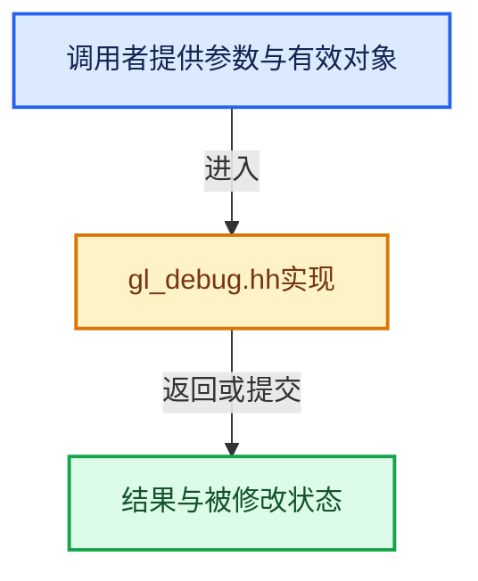

# 实现依赖专题：source/blender/gpu/opengl/gl_debug.hh

[实现依赖导航](../../../README.md) · [符号索引](../../../../00-课程指南/02-源码与提交索引/符号依赖与实现索引.md)

本专题从正文实际调用进入，集中保存共享实现。函数有稳定锚点，可从调用处直接跳到对应完整函数；递归与互相调用通过回链组织。

## 本文件的实现关系





<a id="m-582202c6e6a9"></a>

## 宏 `GL_CHECK_RESOURCES`

<!-- annotated:c3d543d26e1ec8 -->

```cpp
#  define GL_CHECK_RESOURCES(info) debug::check_gl_resources(info)
#else
```

<details>
<summary>核对原始源码：source/blender/gpu/opengl/gl_debug.hh · L14—L15</summary>

<!-- original:c3d543d26e1ec8:source/blender/gpu/opengl/gl_debug.hh:14:15 -->

```cpp
#  define GL_CHECK_RESOURCES(info) debug::check_gl_resources(info)
#else
```

</details>

宏在预处理阶段展开，参数替换、重复求值和条件编译应直接从该定义检查。与普通函数不同，宏不会自动提供参数类型检查；构建配置选择哪个定义需结合外围条件。

<a id="m-69a8cf4ed7e4"></a>

## 宏 `GL_CHECK_RESOURCES`

<!-- annotated:d525325f1aeb7f -->

```cpp
#  define GL_CHECK_RESOURCES(info)
#endif
```

<details>
<summary>核对原始源码：source/blender/gpu/opengl/gl_debug.hh · L16—L17</summary>

<!-- original:d525325f1aeb7f:source/blender/gpu/opengl/gl_debug.hh:16:17 -->

```cpp
#  define GL_CHECK_RESOURCES(info)
#endif
```

</details>

宏在预处理阶段展开，参数替换、重复求值和条件编译应直接从该定义检查。与普通函数不同，宏不会自动提供参数类型检查；构建配置选择哪个定义需结合外围条件。

## 完整成员与函数实现
