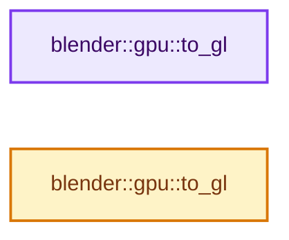
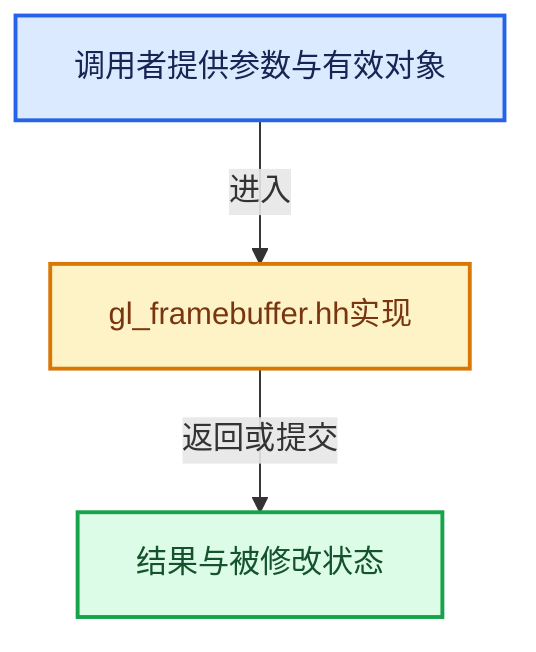

# 实现依赖专题：source/blender/gpu/opengl/gl_framebuffer.hh

[实现依赖导航](../../../README.md) · [符号索引](../../../../00-课程指南/02-源码与提交索引/符号依赖与实现索引.md)

本专题从正文实际调用进入，集中保存共享实现。函数有稳定锚点，可从调用处直接跳到对应完整函数；递归与互相调用通过回链组织。

## 本文件的实现关系






## 完整成员与函数实现

<a id="f-c2fdb3b51bc2e0c0"></a>

### `blender::gpu::to_gl`

实现位置：[source/blender/gpu/opengl/gl_framebuffer.hh](../../../../../../../../source/blender/gpu/opengl/gl_framebuffer.hh) · L131—L155。

接口参数：

- `const GPUAttachmentType type`

**教学注释版**

<!-- annotated:87ebd9a32e2eee -->

```cpp
static inline GLenum to_gl(const GPUAttachmentType type)
{
#define ATTACHMENT(X) \
  case GPU_FB_##X: { \
    return GL_##X; \
  } \
    ((void)0)

  switch (type) {
    ATTACHMENT(DEPTH_ATTACHMENT);
    ATTACHMENT(DEPTH_STENCIL_ATTACHMENT);
    ATTACHMENT(COLOR_ATTACHMENT0);
    ATTACHMENT(COLOR_ATTACHMENT1);
    ATTACHMENT(COLOR_ATTACHMENT2);
    ATTACHMENT(COLOR_ATTACHMENT3);
    ATTACHMENT(COLOR_ATTACHMENT4);
    ATTACHMENT(COLOR_ATTACHMENT5);
    ATTACHMENT(COLOR_ATTACHMENT6);
    ATTACHMENT(COLOR_ATTACHMENT7);
    default:
      BLI_assert(0);
      return GL_COLOR_ATTACHMENT0;
  }
#undef ATTACHMENT
}
```

<details>
<summary>核对原始源码：source/blender/gpu/opengl/gl_framebuffer.hh · L131—L155</summary>

<!-- original:87ebd9a32e2eee:source/blender/gpu/opengl/gl_framebuffer.hh:131:155 -->

```cpp
static inline GLenum to_gl(const GPUAttachmentType type)
{
#define ATTACHMENT(X) \
  case GPU_FB_##X: { \
    return GL_##X; \
  } \
    ((void)0)

  switch (type) {
    ATTACHMENT(DEPTH_ATTACHMENT);
    ATTACHMENT(DEPTH_STENCIL_ATTACHMENT);
    ATTACHMENT(COLOR_ATTACHMENT0);
    ATTACHMENT(COLOR_ATTACHMENT1);
    ATTACHMENT(COLOR_ATTACHMENT2);
    ATTACHMENT(COLOR_ATTACHMENT3);
    ATTACHMENT(COLOR_ATTACHMENT4);
    ATTACHMENT(COLOR_ATTACHMENT5);
    ATTACHMENT(COLOR_ATTACHMENT6);
    ATTACHMENT(COLOR_ATTACHMENT7);
    default:
      BLI_assert(0);
      return GL_COLOR_ATTACHMENT0;
  }
#undef ATTACHMENT
}
```

</details>

**结果出口**

- `return GL_##X; \`
- `return GL_COLOR_ATTACHMENT0;`

**继续追踪实现**

- `ATTACHMENT` → [调用协议](../../../../00-课程指南/01-路线与规范/模板宏与动态分派协议.md)：函数指针、局部可调用对象或未展开的宏；必须结合调用者环境。调用位置L140。
- `BLI_assert` → [BLI_assert · L48](../../../01-BLI基础库/BLI_assert.hh.md#m-57a88495704d)；[BLI_assert · L63](../../../01-BLI基础库/BLI_assert.hh.md#m-d07050020cb5)。宏定义由构建条件选择。

<a id="f-429e055bc6a7fafe"></a>

### `blender::gpu::to_gl`

实现位置：[source/blender/gpu/opengl/gl_framebuffer.hh](../../../../../../../../source/blender/gpu/opengl/gl_framebuffer.hh) · L157—L164。

接口参数：

- `const GPUFrameBufferBits bits`

**教学注释版**

<!-- annotated:f021d6bddadd32 -->

```cpp
static inline GLbitfield to_gl(const GPUFrameBufferBits bits)
{
  GLbitfield mask = 0;
  mask |= (bits & GPU_DEPTH_BIT) ? GL_DEPTH_BUFFER_BIT : 0;
  mask |= (bits & GPU_STENCIL_BIT) ? GL_STENCIL_BUFFER_BIT : 0;
  mask |= (bits & GPU_COLOR_BIT) ? GL_COLOR_BUFFER_BIT : 0;
  return mask;
}
```

<details>
<summary>核对原始源码：source/blender/gpu/opengl/gl_framebuffer.hh · L157—L164</summary>

<!-- original:f021d6bddadd32:source/blender/gpu/opengl/gl_framebuffer.hh:157:164 -->

```cpp
static inline GLbitfield to_gl(const GPUFrameBufferBits bits)
{
  GLbitfield mask = 0;
  mask |= (bits & GPU_DEPTH_BIT) ? GL_DEPTH_BUFFER_BIT : 0;
  mask |= (bits & GPU_STENCIL_BIT) ? GL_STENCIL_BUFFER_BIT : 0;
  mask |= (bits & GPU_COLOR_BIT) ? GL_COLOR_BUFFER_BIT : 0;
  return mask;
}
```

</details>

**沿实际写入检查状态**

- `mask |= (bits & GPU_DEPTH_BIT) ? GL_DEPTH_BUFFER_BIT : 0;`
- `mask |= (bits & GPU_STENCIL_BIT) ? GL_STENCIL_BUFFER_BIT : 0;`
- `mask |= (bits & GPU_COLOR_BIT) ? GL_COLOR_BUFFER_BIT : 0;`

**结果出口**

- `return mask;`

**继续追踪实现**

本实现没有需要继续展开的显式调用；检查返回表达式、对象转换和调用者前置条件。
