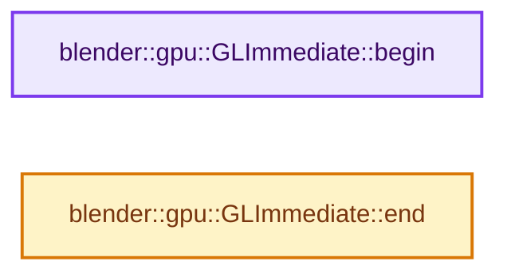
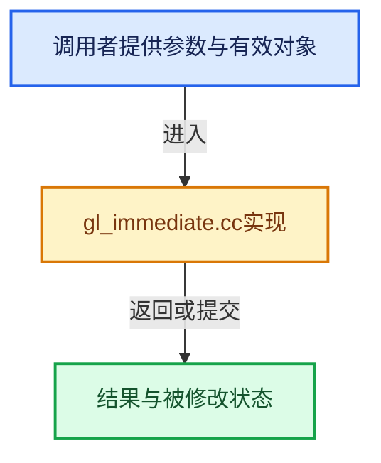

# 实现依赖专题：source/blender/gpu/opengl/gl_immediate.cc

[实现依赖导航](../../../README.md) · [符号索引](../../../../00-课程指南/02-源码与提交索引/符号依赖与实现索引.md)

本专题从正文实际调用进入，集中保存共享实现。函数有稳定锚点，可从调用处直接跳到对应完整函数；递归与互相调用通过回链组织。

## 本文件的实现关系






## 完整成员与函数实现

<a id="f-4d654ef607d0fd7d"></a>

### `blender::gpu::GLImmediate::begin`

实现位置：[source/blender/gpu/opengl/gl_immediate.cc](../../../../../../../../source/blender/gpu/opengl/gl_immediate.cc) · L67—L136。

**教学注释版**

<!-- annotated:fe6d14aaa802d6 -->

```cpp
uchar *GLImmediate::begin()
{
  /* How many bytes do we need for this draw call? */
  const size_t bytes_needed = vertex_buffer_size(&vertex_format, vertex_len);
  /* Does the current buffer have enough room? */
  const size_t available_bytes = buffer_size() - buffer_offset();

#ifndef NDEBUG
  if (this->shader->is_polyline) {
    /* Silence error. These are bound inside `immEnd()`. */
    GLContext::get()->bound_ssbo_slots |= 1 << GPU_SSBO_POLYLINE_POS_BUF_SLOT;
    GLContext::get()->bound_ssbo_slots |= 1 << GPU_SSBO_POLYLINE_COL_BUF_SLOT;
    GLContext::get()->bound_ssbo_slots |= 1 << GPU_SSBO_INDEX_BUF_SLOT;
  }
#endif

  GL_CHECK_RESOURCES("Immediate");

  glBindBuffer(GL_ARRAY_BUFFER, vbo_id());

  bool recreate_buffer = false;
  if (bytes_needed > buffer_size()) {
    /* expand the internal buffer */
    buffer_size() = bytes_needed;
    recreate_buffer = true;
  }
  else if (bytes_needed < DEFAULT_INTERNAL_BUFFER_SIZE &&
           buffer_size() > DEFAULT_INTERNAL_BUFFER_SIZE)
  {
    /* shrink the internal buffer */
    buffer_size() = DEFAULT_INTERNAL_BUFFER_SIZE;
    recreate_buffer = true;
  }

  uint vert_alignment = vertex_format.stride;
  if (this->shader->is_polyline) {
    /* Polyline needs to bind the buffer as SSBO.
     * The start of the range needs to match the SSBO alignment requirements. */
    vert_alignment = ceil_to_multiple_u(vert_alignment, GPU_storage_buffer_alignment());
  }
  /* Ensure vertex data is aligned. Might waste a little space, but it's safe. */
  const uint pre_padding = padding(buffer_offset(), vert_alignment);

  if (!recreate_buffer && ((bytes_needed + pre_padding) <= available_bytes)) {
    buffer_offset() += pre_padding;
  }
  else {
    /* orphan this buffer & start with a fresh one */
    glBufferData(GL_ARRAY_BUFFER, buffer_size(), nullptr, GL_DYNAMIC_DRAW);
    buffer_offset() = 0;
  }

#ifndef NDEBUG
  {
    GLint bufsize;
    glGetBufferParameteriv(GL_ARRAY_BUFFER, GL_BUFFER_SIZE, &bufsize);
    BLI_assert(buffer_offset() + bytes_needed <= bufsize);
  }
#endif

  GLbitfield access = GL_MAP_WRITE_BIT | GL_MAP_UNSYNCHRONIZED_BIT;
  if (!strict_vertex_len) {
    access |= GL_MAP_FLUSH_EXPLICIT_BIT;
  }
  void *data = glMapBufferRange(GL_ARRAY_BUFFER, buffer_offset(), bytes_needed, access);
  BLI_assert(data != nullptr);

  bytes_mapped_ = bytes_needed;
  return static_cast<uchar *>(data);
}
```

<details>
<summary>核对原始源码：source/blender/gpu/opengl/gl_immediate.cc · L67—L136</summary>

<!-- original:fe6d14aaa802d6:source/blender/gpu/opengl/gl_immediate.cc:67:136 -->

```cpp
uchar *GLImmediate::begin()
{
  /* How many bytes do we need for this draw call? */
  const size_t bytes_needed = vertex_buffer_size(&vertex_format, vertex_len);
  /* Does the current buffer have enough room? */
  const size_t available_bytes = buffer_size() - buffer_offset();

#ifndef NDEBUG
  if (this->shader->is_polyline) {
    /* Silence error. These are bound inside `immEnd()`. */
    GLContext::get()->bound_ssbo_slots |= 1 << GPU_SSBO_POLYLINE_POS_BUF_SLOT;
    GLContext::get()->bound_ssbo_slots |= 1 << GPU_SSBO_POLYLINE_COL_BUF_SLOT;
    GLContext::get()->bound_ssbo_slots |= 1 << GPU_SSBO_INDEX_BUF_SLOT;
  }
#endif

  GL_CHECK_RESOURCES("Immediate");

  glBindBuffer(GL_ARRAY_BUFFER, vbo_id());

  bool recreate_buffer = false;
  if (bytes_needed > buffer_size()) {
    /* expand the internal buffer */
    buffer_size() = bytes_needed;
    recreate_buffer = true;
  }
  else if (bytes_needed < DEFAULT_INTERNAL_BUFFER_SIZE &&
           buffer_size() > DEFAULT_INTERNAL_BUFFER_SIZE)
  {
    /* shrink the internal buffer */
    buffer_size() = DEFAULT_INTERNAL_BUFFER_SIZE;
    recreate_buffer = true;
  }

  uint vert_alignment = vertex_format.stride;
  if (this->shader->is_polyline) {
    /* Polyline needs to bind the buffer as SSBO.
     * The start of the range needs to match the SSBO alignment requirements. */
    vert_alignment = ceil_to_multiple_u(vert_alignment, GPU_storage_buffer_alignment());
  }
  /* Ensure vertex data is aligned. Might waste a little space, but it's safe. */
  const uint pre_padding = padding(buffer_offset(), vert_alignment);

  if (!recreate_buffer && ((bytes_needed + pre_padding) <= available_bytes)) {
    buffer_offset() += pre_padding;
  }
  else {
    /* orphan this buffer & start with a fresh one */
    glBufferData(GL_ARRAY_BUFFER, buffer_size(), nullptr, GL_DYNAMIC_DRAW);
    buffer_offset() = 0;
  }

#ifndef NDEBUG
  {
    GLint bufsize;
    glGetBufferParameteriv(GL_ARRAY_BUFFER, GL_BUFFER_SIZE, &bufsize);
    BLI_assert(buffer_offset() + bytes_needed <= bufsize);
  }
#endif

  GLbitfield access = GL_MAP_WRITE_BIT | GL_MAP_UNSYNCHRONIZED_BIT;
  if (!strict_vertex_len) {
    access |= GL_MAP_FLUSH_EXPLICIT_BIT;
  }
  void *data = glMapBufferRange(GL_ARRAY_BUFFER, buffer_offset(), bytes_needed, access);
  BLI_assert(data != nullptr);

  bytes_mapped_ = bytes_needed;
  return static_cast<uchar *>(data);
}
```

</details>

**沿实际写入检查状态**

- `recreate_buffer = true;`
- `vert_alignment = ceil_to_multiple_u(vert_alignment, GPU_storage_buffer_alignment());`
- `access |= GL_MAP_FLUSH_EXPLICIT_BIT;`
- `bytes_mapped_ = bytes_needed;`

**结果出口**

- `return static_cast<uchar *>(data);`

**继续追踪实现**

- `vertex_buffer_size` → [blender::vertex_buffer_size · L360](../intern/gpu_vertex_format.cc.md#f-4bf048994dbfc23a)。
- `buffer_size` → [调用协议](../../../../00-课程指南/01-路线与规范/模板宏与动态分派协议.md)：函数指针、局部可调用对象或未展开的宏；必须结合调用者环境。调用位置L72。
- `buffer_offset` → [blender::gpu::GLImmediate::buffer_offset · L53](gl_immediate.hh.md#f-2d0b0b946653f649)。
- `GLContext::get` → [blender::gpu::GLContext::get · L143](gl_context.hh.md#f-2d6c70989abeb59b)。
- `GL_CHECK_RESOURCES` → [GL_CHECK_RESOURCES · L14](gl_debug.hh.md#m-582202c6e6a9)；[GL_CHECK_RESOURCES · L16](gl_debug.hh.md#m-69a8cf4ed7e4)。宏定义由构建条件选择。
- `glBindBuffer` → [调用协议](../../../../00-课程指南/01-路线与规范/模板宏与动态分派协议.md)：函数指针、局部可调用对象或未展开的宏；必须结合调用者环境。调用位置L85。
- `vbo_id` → [blender::gpu::GLImmediate::vbo_id · L48](gl_immediate.hh.md#f-fddfa219b940d285)。
- `ceil_to_multiple_u` → [blender::ceil_to_multiple_u · L245](../../../01-BLI基础库/intern/math_base_inline.cc.md#f-b6a8b97456313c88)。
- `GPU_storage_buffer_alignment` → [blender::GPU_storage_buffer_alignment · L212](../intern/gpu_capabilities.cc.md#f-86a9e42b396e1168)。
- `padding` → [blender::padding · L545](../intern/gpu_vertex_format.cc.md#f-349bf76ecb60a148)。
- `glBufferData` → [调用协议](../../../../00-课程指南/01-路线与规范/模板宏与动态分派协议.md)：函数指针、局部可调用对象或未展开的宏；必须结合调用者环境。调用位置L115。
- `glGetBufferParameteriv` → [调用协议](../../../../00-课程指南/01-路线与规范/模板宏与动态分派协议.md)：函数指针、局部可调用对象或未展开的宏；必须结合调用者环境。调用位置L122。
- `BLI_assert` → [BLI_assert · L48](../../../01-BLI基础库/BLI_assert.hh.md#m-57a88495704d)；[BLI_assert · L63](../../../01-BLI基础库/BLI_assert.hh.md#m-d07050020cb5)。宏定义由构建条件选择。
- `glMapBufferRange` → [调用协议](../../../../00-课程指南/01-路线与规范/模板宏与动态分派协议.md)：函数指针、局部可调用对象或未展开的宏；必须结合调用者环境。调用位置L131。

<a id="f-4399e008138c6e0e"></a>

### `blender::gpu::GLImmediate::end`

实现位置：[source/blender/gpu/opengl/gl_immediate.cc](../../../../../../../../source/blender/gpu/opengl/gl_immediate.cc) · L138—L194。

**教学注释版**

<!-- annotated:f2ae67b9c169d7 -->

```cpp
void GLImmediate::end()
{
  BLI_assert(prim_type != GPU_PRIM_NONE); /* make sure we're between a Begin/End pair */

  uint buffer_bytes_used = bytes_mapped_;
  if (!strict_vertex_len) {
    if (vertex_idx != vertex_len) {
      vertex_len = vertex_idx;
      buffer_bytes_used = vertex_buffer_size(&vertex_format, vertex_len);
      /* unused buffer bytes are available to the next immBegin */
    }
    /* tell OpenGL what range was modified so it doesn't copy the whole mapped range */
    glFlushMappedBufferRange(GL_ARRAY_BUFFER, 0, buffer_bytes_used);
  }
  glUnmapBuffer(GL_ARRAY_BUFFER);

  if (vertex_len == 0) {
    /* NOOP. Nothing to draw. */
  }
  else if (this->shader->is_polyline) {
    GLintptr offset = buffer_offset();
    GLenum target = GL_SHADER_STORAGE_BUFFER;
    glBindBufferRange(target, GPU_SSBO_POLYLINE_POS_BUF_SLOT, vbo_id(), offset, buffer_bytes_used);
    glBindBufferRange(target, GPU_SSBO_POLYLINE_COL_BUF_SLOT, vbo_id(), offset, buffer_bytes_used);
    /* Not used. Satisfy the binding. */
    glBindBufferRange(target, GPU_SSBO_INDEX_BUF_SLOT, vbo_id(), offset, buffer_bytes_used);

    this->polyline_draw_workaround(0);

#ifndef NDEBUG
    GLContext::get()->bound_ssbo_slots &= ~(1 << GPU_SSBO_POLYLINE_POS_BUF_SLOT);
    GLContext::get()->bound_ssbo_slots &= ~(1 << GPU_SSBO_POLYLINE_COL_BUF_SLOT);
    GLContext::get()->bound_ssbo_slots &= ~(1 << GPU_SSBO_INDEX_BUF_SLOT);
#endif
  }
  else {
    GLContext::get()->state_manager->apply_state();

    /* We convert the offset in vertex offset from the buffer's start.
     * This works because we added some padding to align the first vertex. */
    uint v_first = buffer_offset() / vertex_format.stride;
    GLVertArray::update_bindings(
        vao_id_, v_first, &vertex_format, reinterpret_cast<Shader *>(shader)->interface);

    /* Update matrices. */
    GPU_shader_bind(shader);

    glDrawArrays(to_gl(prim_type), 0, vertex_len);

    /* These lines are causing crash on startup on some old GPU + drivers.
     * They are not required so just comment them. (#55722) */
    // glBindBuffer(GL_ARRAY_BUFFER, 0);
    // glBindVertexArray(0);
  }

  buffer_offset() += buffer_bytes_used;
}
```

<details>
<summary>核对原始源码：source/blender/gpu/opengl/gl_immediate.cc · L138—L194</summary>

<!-- original:f2ae67b9c169d7:source/blender/gpu/opengl/gl_immediate.cc:138:194 -->

```cpp
void GLImmediate::end()
{
  BLI_assert(prim_type != GPU_PRIM_NONE); /* make sure we're between a Begin/End pair */

  uint buffer_bytes_used = bytes_mapped_;
  if (!strict_vertex_len) {
    if (vertex_idx != vertex_len) {
      vertex_len = vertex_idx;
      buffer_bytes_used = vertex_buffer_size(&vertex_format, vertex_len);
      /* unused buffer bytes are available to the next immBegin */
    }
    /* tell OpenGL what range was modified so it doesn't copy the whole mapped range */
    glFlushMappedBufferRange(GL_ARRAY_BUFFER, 0, buffer_bytes_used);
  }
  glUnmapBuffer(GL_ARRAY_BUFFER);

  if (vertex_len == 0) {
    /* NOOP. Nothing to draw. */
  }
  else if (this->shader->is_polyline) {
    GLintptr offset = buffer_offset();
    GLenum target = GL_SHADER_STORAGE_BUFFER;
    glBindBufferRange(target, GPU_SSBO_POLYLINE_POS_BUF_SLOT, vbo_id(), offset, buffer_bytes_used);
    glBindBufferRange(target, GPU_SSBO_POLYLINE_COL_BUF_SLOT, vbo_id(), offset, buffer_bytes_used);
    /* Not used. Satisfy the binding. */
    glBindBufferRange(target, GPU_SSBO_INDEX_BUF_SLOT, vbo_id(), offset, buffer_bytes_used);

    this->polyline_draw_workaround(0);

#ifndef NDEBUG
    GLContext::get()->bound_ssbo_slots &= ~(1 << GPU_SSBO_POLYLINE_POS_BUF_SLOT);
    GLContext::get()->bound_ssbo_slots &= ~(1 << GPU_SSBO_POLYLINE_COL_BUF_SLOT);
    GLContext::get()->bound_ssbo_slots &= ~(1 << GPU_SSBO_INDEX_BUF_SLOT);
#endif
  }
  else {
    GLContext::get()->state_manager->apply_state();

    /* We convert the offset in vertex offset from the buffer's start.
     * This works because we added some padding to align the first vertex. */
    uint v_first = buffer_offset() / vertex_format.stride;
    GLVertArray::update_bindings(
        vao_id_, v_first, &vertex_format, reinterpret_cast<Shader *>(shader)->interface);

    /* Update matrices. */
    GPU_shader_bind(shader);

    glDrawArrays(to_gl(prim_type), 0, vertex_len);

    /* These lines are causing crash on startup on some old GPU + drivers.
     * They are not required so just comment them. (#55722) */
    // glBindBuffer(GL_ARRAY_BUFFER, 0);
    // glBindVertexArray(0);
  }

  buffer_offset() += buffer_bytes_used;
}
```

</details>

**沿实际写入检查状态**

- `vertex_len = vertex_idx;`
- `buffer_bytes_used = vertex_buffer_size(&vertex_format, vertex_len);`

**继续追踪实现**

- `BLI_assert` → [BLI_assert · L48](../../../01-BLI基础库/BLI_assert.hh.md#m-57a88495704d)；[BLI_assert · L63](../../../01-BLI基础库/BLI_assert.hh.md#m-d07050020cb5)。宏定义由构建条件选择。
- `vertex_buffer_size` → [blender::vertex_buffer_size · L360](../intern/gpu_vertex_format.cc.md#f-4bf048994dbfc23a)。
- `glFlushMappedBufferRange` → [调用协议](../../../../00-课程指南/01-路线与规范/模板宏与动态分派协议.md)：函数指针、局部可调用对象或未展开的宏；必须结合调用者环境。调用位置L150。
- `glUnmapBuffer` → [调用协议](../../../../00-课程指南/01-路线与规范/模板宏与动态分派协议.md)：函数指针、局部可调用对象或未展开的宏；必须结合调用者环境。调用位置L152。
- `buffer_offset` → [blender::gpu::GLImmediate::buffer_offset · L53](gl_immediate.hh.md#f-2d0b0b946653f649)。
- `glBindBufferRange` → [调用协议](../../../../00-课程指南/01-路线与规范/模板宏与动态分派协议.md)：函数指针、局部可调用对象或未展开的宏；必须结合调用者环境。调用位置L160。
- `vbo_id` → [blender::gpu::GLImmediate::vbo_id · L48](gl_immediate.hh.md#f-fddfa219b940d285)。
- `this->polyline_draw_workaround` → [调用协议](../../../../00-课程指南/01-路线与规范/模板宏与动态分派协议.md)：由接收对象具体类型或运行时策略提供实现。调用位置L165。
- `GLContext::get` → [blender::gpu::GLContext::get · L143](gl_context.hh.md#f-2d6c70989abeb59b)。
- `GLContext::get()->state_manager->apply_state` → [调用协议](../../../../00-课程指南/01-路线与规范/模板宏与动态分派协议.md)：接收对象类型依赖auto、返回值或模板实例；不按同名猜测目标。调用位置L174。
- `GLVertArray::update_bindings` → [blender::gpu::GLVertArray::update_bindings · L82](gl_vertex_array.cc.md#f-3f5e62d86577f342)；[blender::gpu::GLVertArray::update_bindings · L120](gl_vertex_array.cc.md#f-19013653652bc674)。同名重载需按实参类型选择。
- `GPU_shader_bind` → [blender::GPU_shader_bind · L387](../intern/gpu_shader.cc.md#f-a879eef1816db611)。
- `glDrawArrays` → [调用协议](../../../../00-课程指南/01-路线与规范/模板宏与动态分派协议.md)：函数指针、局部可调用对象或未展开的宏；必须结合调用者环境。调用位置L185。
- `to_gl` → [blender::gpu::to_gl · L63](gl_vertex_buffer.hh.md#f-3759e26048aba930)；[blender::gpu::to_gl · L79](gl_vertex_buffer.hh.md#f-564f569c2795e2e0)；[blender::gpu::to_gl · L231](gl_texture.hh.md#f-a55d68142cdbbec1)；[blender::gpu::to_gl · L610](gl_texture.cc.md#f-d765dcd5ade0fd47)；[blender::gpu::to_gl · L120](gl_state.hh.md#f-7d9342a10afa8867)；[blender::gpu::to_gl · L46](gl_query.hh.md#f-462795db7ca2fcc5)；[blender::gpu::to_gl · L19](gl_primitive.hh.md#f-880255f821d74df2)；[blender::gpu::to_gl · L68](gl_index_buffer.hh.md#f-64d92f0eefbd7427)；[blender::gpu::to_gl · L131](gl_framebuffer.hh.md#f-c2fdb3b51bc2e0c0)；[blender::gpu::to_gl · L157](gl_framebuffer.hh.md#f-429e055bc6a7fafe)。同名重载需按实参类型选择。
