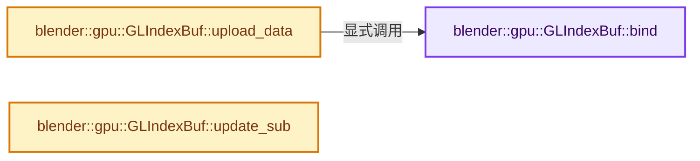
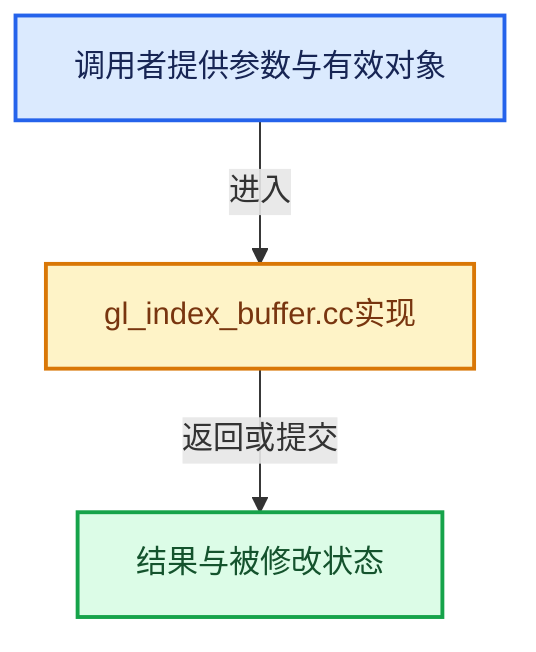

# 实现依赖专题：source/blender/gpu/opengl/gl_index_buffer.cc

[实现依赖导航](../../../README.md) · [符号索引](../../../../00-课程指南/02-源码与提交索引/符号依赖与实现索引.md)

本专题从正文实际调用进入，集中保存共享实现。函数有稳定锚点，可从调用处直接跳到对应完整函数；递归与互相调用通过回链组织。

## 本文件的实现关系






## 完整成员与函数实现

<a id="f-481744e33ea933d7"></a>

### `blender::gpu::GLIndexBuf::bind`

实现位置：[source/blender/gpu/opengl/gl_index_buffer.cc](../../../../../../../../source/blender/gpu/opengl/gl_index_buffer.cc) · L20—L46。

**教学注释版**

<!-- annotated:9b84085043decb -->

```cpp
void GLIndexBuf::bind()
{
  if (is_subrange_) {
    static_cast<GLIndexBuf *>(src_)->bind();
    return;
  }

  const bool allocate_on_device = ibo_id_ == 0;
  if (allocate_on_device) {
    glGenBuffers(1, &ibo_id_);
  }

  glBindBuffer(GL_ELEMENT_ARRAY_BUFFER, ibo_id_);

  if (data_ != nullptr || allocate_on_device) {
    size_t size = this->size_get();
    /* Pad the buffer to avoid out of bound reads when using vertex pulling mode. */
    glBufferData(GL_ELEMENT_ARRAY_BUFFER, ceil_to_multiple_ul(size, 16), nullptr, GL_STATIC_DRAW);

    if (data_ != nullptr) {
      /* Sends data to GPU. */
      glBufferSubData(GL_ELEMENT_ARRAY_BUFFER, 0, size, data_);
    }
    /* No need to keep copy of data in system memory. */
    MEM_SAFE_DELETE_VOID(data_);
  }
}
```

<details>
<summary>核对原始源码：source/blender/gpu/opengl/gl_index_buffer.cc · L20—L46</summary>

<!-- original:9b84085043decb:source/blender/gpu/opengl/gl_index_buffer.cc:20:46 -->

```cpp
void GLIndexBuf::bind()
{
  if (is_subrange_) {
    static_cast<GLIndexBuf *>(src_)->bind();
    return;
  }

  const bool allocate_on_device = ibo_id_ == 0;
  if (allocate_on_device) {
    glGenBuffers(1, &ibo_id_);
  }

  glBindBuffer(GL_ELEMENT_ARRAY_BUFFER, ibo_id_);

  if (data_ != nullptr || allocate_on_device) {
    size_t size = this->size_get();
    /* Pad the buffer to avoid out of bound reads when using vertex pulling mode. */
    glBufferData(GL_ELEMENT_ARRAY_BUFFER, ceil_to_multiple_ul(size, 16), nullptr, GL_STATIC_DRAW);

    if (data_ != nullptr) {
      /* Sends data to GPU. */
      glBufferSubData(GL_ELEMENT_ARRAY_BUFFER, 0, size, data_);
    }
    /* No need to keep copy of data in system memory. */
    MEM_SAFE_DELETE_VOID(data_);
  }
}
```

</details>

**继续追踪实现**

- `static_cast<GLIndexBuf *>(src_)->bind` → [调用协议](../../../../00-课程指南/01-路线与规范/模板宏与动态分派协议.md)：接收对象类型依赖auto、返回值或模板实例；不按同名猜测目标。调用位置L23。
- `glGenBuffers` → [调用协议](../../../../00-课程指南/01-路线与规范/模板宏与动态分派协议.md)：函数指针、局部可调用对象或未展开的宏；必须结合调用者环境。调用位置L29。
- `glBindBuffer` → [调用协议](../../../../00-课程指南/01-路线与规范/模板宏与动态分派协议.md)：函数指针、局部可调用对象或未展开的宏；必须结合调用者环境。调用位置L32。
- `this->size_get` → [调用协议](../../../../00-课程指南/01-路线与规范/模板宏与动态分派协议.md)：由接收对象具体类型或运行时策略提供实现。调用位置L35。
- `glBufferData` → [调用协议](../../../../00-课程指南/01-路线与规范/模板宏与动态分派协议.md)：函数指针、局部可调用对象或未展开的宏；必须结合调用者环境。调用位置L37。
- `ceil_to_multiple_ul` → [blender::ceil_to_multiple_ul · L250](../../../01-BLI基础库/intern/math_base_inline.cc.md#f-2d8b440555643252)。
- `glBufferSubData` → [调用协议](../../../../00-课程指南/01-路线与规范/模板宏与动态分派协议.md)：函数指针、局部可调用对象或未展开的宏；必须结合调用者环境。调用位置L41。
- `MEM_SAFE_DELETE_VOID` → [MEM_SAFE_DELETE_VOID · L448](../../../07-Intern运行时与平台/guardedalloc/MEM_guardedalloc.h.md#m-66e7eff3d7bc)。宏定义由构建条件选择。

<a id="f-451dcc91a4f2ed45"></a>

### `blender::gpu::GLIndexBuf::upload_data`

实现位置：[source/blender/gpu/opengl/gl_index_buffer.cc](../../../../../../../../source/blender/gpu/opengl/gl_index_buffer.cc) · L95—L98。

**教学注释版**

<!-- annotated:9a287a68fb0a8e -->

```cpp
void GLIndexBuf::upload_data()
{
  bind();
}
```

<details>
<summary>核对原始源码：source/blender/gpu/opengl/gl_index_buffer.cc · L95—L98</summary>

<!-- original:9a287a68fb0a8e:source/blender/gpu/opengl/gl_index_buffer.cc:95:98 -->

```cpp
void GLIndexBuf::upload_data()
{
  bind();
}
```

</details>

**继续追踪实现**

- `bind` → [blender::gpu::GLIndexBuf::bind · L20](gl_index_buffer.cc.md#f-481744e33ea933d7)。

<a id="f-5753e4749840c965"></a>

### `blender::gpu::GLIndexBuf::update_sub`

实现位置：[source/blender/gpu/opengl/gl_index_buffer.cc](../../../../../../../../source/blender/gpu/opengl/gl_index_buffer.cc) · L100—L103。

接口参数：

- `uint start`
- `uint len`
- `const void *data`

**教学注释版**

<!-- annotated:d81dd6e7e7a77b -->

```cpp
void GLIndexBuf::update_sub(uint start, uint len, const void *data)
{
  glBufferSubData(GL_ELEMENT_ARRAY_BUFFER, start, len, data);
}
```

<details>
<summary>核对原始源码：source/blender/gpu/opengl/gl_index_buffer.cc · L100—L103</summary>

<!-- original:d81dd6e7e7a77b:source/blender/gpu/opengl/gl_index_buffer.cc:100:103 -->

```cpp
void GLIndexBuf::update_sub(uint start, uint len, const void *data)
{
  glBufferSubData(GL_ELEMENT_ARRAY_BUFFER, start, len, data);
}
```

</details>

**继续追踪实现**

- `glBufferSubData` → [调用协议](../../../../00-课程指南/01-路线与规范/模板宏与动态分派协议.md)：函数指针、局部可调用对象或未展开的宏；必须结合调用者环境。调用位置L102。
