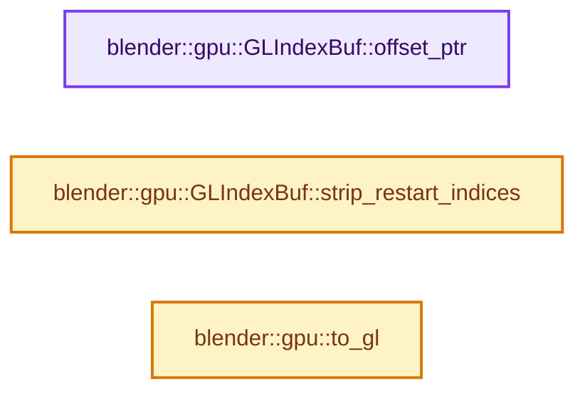

# 实现依赖专题：source/blender/gpu/opengl/gl_index_buffer.hh

[实现依赖导航](../../../README.md) · [符号索引](../../../../00-课程指南/02-源码与提交索引/符号依赖与实现索引.md)

本专题从正文实际调用进入，集中保存共享实现。函数有稳定锚点，可从调用处直接跳到对应完整函数；递归与互相调用通过回链组织。

## 本文件的实现关系




## 完整成员与函数实现

<a id="f-734fb52e1a866ec5"></a>

### `blender::gpu::GLIndexBuf::offset_ptr`

实现位置：[source/blender/gpu/opengl/gl_index_buffer.hh](../../../../../../../../source/blender/gpu/opengl/gl_index_buffer.hh) · L35—L42。

接口参数：

- `uint additional_vertex_offset`

**教学注释版**

<!-- annotated:5cf24065af2ead -->

```cpp
  void *offset_ptr(uint additional_vertex_offset) const
  {
    additional_vertex_offset += index_start_;
    if (index_type_ == GPU_INDEX_U32) {
      return reinterpret_cast<void *>(intptr_t(additional_vertex_offset) * sizeof(GLuint));
    }
    return reinterpret_cast<void *>(intptr_t(additional_vertex_offset) * sizeof(GLushort));
  }
```

<details>
<summary>核对原始源码：source/blender/gpu/opengl/gl_index_buffer.hh · L35—L42</summary>

<!-- original:5cf24065af2ead:source/blender/gpu/opengl/gl_index_buffer.hh:35:42 -->

```cpp
  void *offset_ptr(uint additional_vertex_offset) const
  {
    additional_vertex_offset += index_start_;
    if (index_type_ == GPU_INDEX_U32) {
      return reinterpret_cast<void *>(intptr_t(additional_vertex_offset) * sizeof(GLuint));
    }
    return reinterpret_cast<void *>(intptr_t(additional_vertex_offset) * sizeof(GLushort));
  }
```

</details>

**沿实际写入检查状态**

- `additional_vertex_offset += index_start_;`

**结果出口**

- `return reinterpret_cast<void *>(intptr_t(additional_vertex_offset) * sizeof(GLuint));`
- `return reinterpret_cast<void *>(intptr_t(additional_vertex_offset) * sizeof(GLushort));`

**继续追踪实现**

本实现没有需要继续展开的显式调用；检查返回表达式、对象转换和调用者前置条件。

<a id="f-dec0d5f4f3dd1b10"></a>

### `blender::gpu::GLIndexBuf::strip_restart_indices`

实现位置：[source/blender/gpu/opengl/gl_index_buffer.hh](../../../../../../../../source/blender/gpu/opengl/gl_index_buffer.hh) · L60—L63。

**教学注释版**

<!-- annotated:1106ac43234567 -->

```cpp
  void strip_restart_indices() override
  {
    /* No-op. */
  }
```

<details>
<summary>核对原始源码：source/blender/gpu/opengl/gl_index_buffer.hh · L60—L63</summary>

<!-- original:1106ac43234567:source/blender/gpu/opengl/gl_index_buffer.hh:60:63 -->

```cpp
  void strip_restart_indices() override
  {
    /* No-op. */
  }
```

</details>

**继续追踪实现**

本实现没有需要继续展开的显式调用；检查返回表达式、对象转换和调用者前置条件。

<a id="f-64d92f0eefbd7427"></a>

### `blender::gpu::to_gl`

实现位置：[source/blender/gpu/opengl/gl_index_buffer.hh](../../../../../../../../source/blender/gpu/opengl/gl_index_buffer.hh) · L68—L71。

接口参数：

- `GPUIndexBufType type`

**教学注释版**

<!-- annotated:de60291b278382 -->

```cpp
static inline GLenum to_gl(GPUIndexBufType type)
{
  return (type == GPU_INDEX_U32) ? GL_UNSIGNED_INT : GL_UNSIGNED_SHORT;
}
```

<details>
<summary>核对原始源码：source/blender/gpu/opengl/gl_index_buffer.hh · L68—L71</summary>

<!-- original:de60291b278382:source/blender/gpu/opengl/gl_index_buffer.hh:68:71 -->

```cpp
static inline GLenum to_gl(GPUIndexBufType type)
{
  return (type == GPU_INDEX_U32) ? GL_UNSIGNED_INT : GL_UNSIGNED_SHORT;
}
```

</details>

**结果出口**

- `return (type == GPU_INDEX_U32) ? GL_UNSIGNED_INT : GL_UNSIGNED_SHORT;`

**继续追踪实现**

本实现没有需要继续展开的显式调用；检查返回表达式、对象转换和调用者前置条件。
