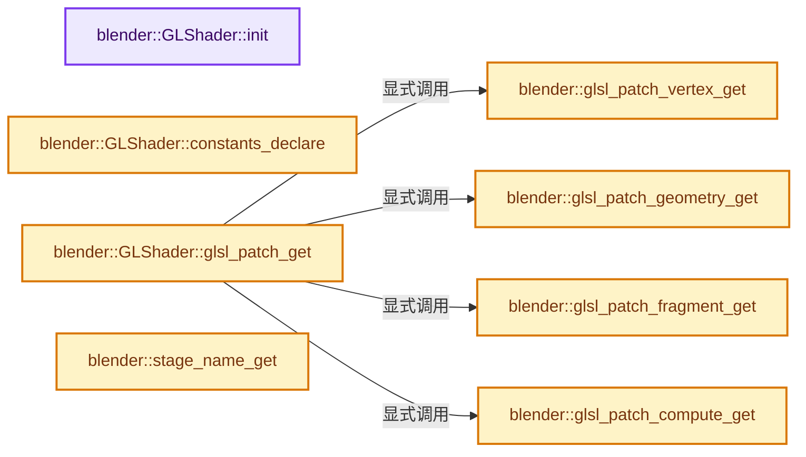
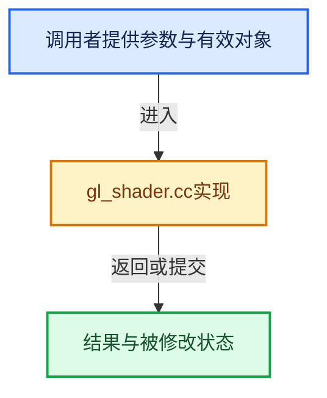

# 实现依赖专题：source/blender/gpu/opengl/gl_shader.cc

[实现依赖导航](../../../README.md) · [符号索引](../../../../00-课程指南/02-源码与提交索引/符号依赖与实现索引.md)

本专题从正文实际调用进入，集中保存共享实现。函数有稳定锚点，可从调用处直接跳到对应完整函数；递归与互相调用通过回链组织。

## 本文件的实现关系






## 完整成员与函数实现

<a id="f-8fd00738797837a9"></a>

### `blender::GLShader::init`

实现位置：[source/blender/gpu/opengl/gl_shader.cc](../../../../../../../../source/blender/gpu/opengl/gl_shader.cc) · L80—L99。

接口参数：

- `const shader::ShaderCreateInfo &info`
- `bool is_codegen_only`

**教学注释版**

<!-- annotated:f800d7d78e61e2 -->

```cpp
void GLShader::init(const shader::ShaderCreateInfo &info, bool is_codegen_only)
{
  is_codegen_only_ = is_codegen_only;

  /* Extract the constants names from info and store them locally. */
  for (const SpecializationConstant &constant : info.specialization_constants_) {
    specialization_constant_names_.append(constant.name.c_str());
  }

  /* NOTE: This is not threadsafe with regards to the specialization constants state access.
   * The shader creation must be externally synchronized. */
  main_program_ = program_cache_
                      .lookup_or_add_cb(constants->values,
                                        // [讲解] std::make_unique<GLProgram>：创建独占拥有的对象，拥有关系可移动，get返回的借用指针不自动延长寿命。
                                        []() { return std::make_unique<GLProgram>(); })
                      .get();
  if (!main_program_->program_id) {
    main_program_->program_id = glCreateProgram();
    debug::object_label(GL_PROGRAM, main_program_->program_id, name);
  }
}
```

<details>
<summary>核对原始源码：source/blender/gpu/opengl/gl_shader.cc · L80—L99</summary>

<!-- original:f800d7d78e61e2:source/blender/gpu/opengl/gl_shader.cc:80:99 -->

```cpp
void GLShader::init(const shader::ShaderCreateInfo &info, bool is_codegen_only)
{
  is_codegen_only_ = is_codegen_only;

  /* Extract the constants names from info and store them locally. */
  for (const SpecializationConstant &constant : info.specialization_constants_) {
    specialization_constant_names_.append(constant.name.c_str());
  }

  /* NOTE: This is not threadsafe with regards to the specialization constants state access.
   * The shader creation must be externally synchronized. */
  main_program_ = program_cache_
                      .lookup_or_add_cb(constants->values,
                                        []() { return std::make_unique<GLProgram>(); })
                      .get();
  if (!main_program_->program_id) {
    main_program_->program_id = glCreateProgram();
    debug::object_label(GL_PROGRAM, main_program_->program_id, name);
  }
}
```

</details>

**沿实际写入检查状态**

- `is_codegen_only_ = is_codegen_only;`
- `main_program_ = program_cache_`
- `main_program_->program_id = glCreateProgram();`

**继续追踪实现**

- `specialization_constant_names_.append` → [调用协议](../../../../00-课程指南/01-路线与规范/模板宏与动态分派协议.md)：接收对象类型依赖auto、返回值或模板实例；不按同名猜测目标。调用位置L86。
- `constant.name.c_str` → [调用协议](../../../../00-课程指南/01-路线与规范/模板宏与动态分派协议.md)：接收对象类型依赖auto、返回值或模板实例；不按同名猜测目标。调用位置L86。
- `program_cache_ .lookup_or_add_cb(constants->values, []() { return std::make_unique<GLProgram>(); }) .get` → [调用协议](../../../../00-课程指南/01-路线与规范/模板宏与动态分派协议.md)：接收对象类型依赖auto、返回值或模板实例；不按同名猜测目标。调用位置L91。
- `program_cache_ .lookup_or_add_cb` → [调用协议](../../../../00-课程指南/01-路线与规范/模板宏与动态分派协议.md)：接收对象类型依赖auto、返回值或模板实例；不按同名猜测目标。调用位置L91。
- `std::make_unique<GLProgram>` → [外部契约](https://eel.is/c++draft/unique.ptr.create)：创建独占拥有的对象，拥有关系可移动，get返回的借用指针不自动延长寿命。
- `glCreateProgram` → [调用协议](../../../../00-课程指南/01-路线与规范/模板宏与动态分派协议.md)：函数指针、局部可调用对象或未展开的宏；必须结合调用者环境。调用位置L96。
- `debug::object_label` → [blender::gpu::debug::object_label · L331](gl_debug.cc.md#f-55513c68e8b2a6b5)。

<a id="f-97e276fac1c201f4"></a>

### `blender::GLShader::constants_declare`

实现位置：[source/blender/gpu/opengl/gl_shader.cc](../../../../../../../../source/blender/gpu/opengl/gl_shader.cc) · L641—L671。

接口参数：

- `const shader::SpecializationConstants &constants_state`

**教学注释版**

<!-- annotated:097ba955985c70 -->

```cpp
std::string GLShader::constants_declare(
    const shader::SpecializationConstants &constants_state) const
{
  std::stringstream ss;

  for (int constant_index : IndexRange(constants_state.types.size())) {
    const StringRefNull name = specialization_constant_names_[constant_index];
    gpu::shader::Type constant_type = constants_state.types[constant_index];
    const SpecializationConstant::Value &value = constants_state.values[constant_index];

    switch (constant_type) {
      case Type::int_t:
        ss << "const int " << name << "=" << std::to_string(value.i) << ";\n";
        break;
      case Type::uint_t:
        ss << "const uint " << name << "=" << std::to_string(value.u) << "u;\n";
        break;
      case Type::bool_t:
        ss << "const bool " << name << "=" << (value.u ? "true" : "false") << ";\n";
        break;
      case Type::float_t:
        /* Use uint representation to allow exact same bit pattern even if NaN. */
        ss << "const float " << name << "= uintBitsToFloat(" << std::to_string(value.u) << "u);\n";
        break;
      default:
        BLI_assert_unreachable();
        break;
    }
  }
  return ss.str();
}
```

<details>
<summary>核对原始源码：source/blender/gpu/opengl/gl_shader.cc · L641—L671</summary>

<!-- original:097ba955985c70:source/blender/gpu/opengl/gl_shader.cc:641:671 -->

```cpp
std::string GLShader::constants_declare(
    const shader::SpecializationConstants &constants_state) const
{
  std::stringstream ss;

  for (int constant_index : IndexRange(constants_state.types.size())) {
    const StringRefNull name = specialization_constant_names_[constant_index];
    gpu::shader::Type constant_type = constants_state.types[constant_index];
    const SpecializationConstant::Value &value = constants_state.values[constant_index];

    switch (constant_type) {
      case Type::int_t:
        ss << "const int " << name << "=" << std::to_string(value.i) << ";\n";
        break;
      case Type::uint_t:
        ss << "const uint " << name << "=" << std::to_string(value.u) << "u;\n";
        break;
      case Type::bool_t:
        ss << "const bool " << name << "=" << (value.u ? "true" : "false") << ";\n";
        break;
      case Type::float_t:
        /* Use uint representation to allow exact same bit pattern even if NaN. */
        ss << "const float " << name << "= uintBitsToFloat(" << std::to_string(value.u) << "u);\n";
        break;
      default:
        BLI_assert_unreachable();
        break;
    }
  }
  return ss.str();
}
```

</details>

**结果出口**

- `return ss.str();`

**继续追踪实现**

- `IndexRange` → [blender::IndexRange](../../../01-BLI基础库/BLI_index_range.hh.md#t-caa3466d6776)；[blender::gpu::shader::parser::IndexRange](../shader_tool/utils.hh.md#t-82d2bd4ea71c)；[blender::IndexRange](../../makesdna/DNA_node_types.h.md#t-0448cc889d39)。
- `constants_state.types.size` → [调用协议](../../../../00-课程指南/01-路线与规范/模板宏与动态分派协议.md)：接收对象类型依赖auto、返回值或模板实例；不按同名猜测目标。调用位置L646。
- `std::to_string` → [外部契约](https://eel.is/c++draft/)：这个边界按实际表达式及所属类型核对参数、返回值、寿命与失败行为。这里提供接口入口，不声称已解释该第三方版本的内部实现。
- `BLI_assert_unreachable` → [BLI_assert_unreachable · L77](../../../01-BLI基础库/BLI_assert.hh.md#m-7a2d91a67d8e)。宏定义由构建条件选择。
- `ss.str` → [外部契约](https://eel.is/c++draft/)：这个边界按实际表达式及所属类型核对参数、返回值、寿命与失败行为。这里提供接口入口，不声称已解释该第三方版本的内部实现。

<a id="f-14b81734d3150800"></a>

### `blender::glsl_patch_vertex_get`

实现位置：[source/blender/gpu/opengl/gl_shader.cc](../../../../../../../../source/blender/gpu/opengl/gl_shader.cc) · L1044—L1089。

**教学注释版**

<!-- annotated:cb10c9a66f8fcd -->

```cpp
static StringRefNull glsl_patch_vertex_get()
{
  /** Used for shader patching. Init once. */
  static std::string patch = []() {
    std::stringstream ss;
    /* Version need to go first. */
    ss << "#version 430\n";

    /* Enable extensions for features that are not part of our base GLSL version
     * don't use an extension for something already available! */
    {
      /* Required extension. */
      ss << "#extension GL_ARB_shader_draw_parameters : enable\n";
      ss << "#define GPU_ARB_shader_draw_parameters\n";
      ss << "#define gpu_BaseInstance gl_BaseInstanceARB\n";
      ss << "#define GPU_ARB_clip_control\n";
    }
    if (GLContext::layered_rendering_support) {
      ss << "#extension GL_ARB_shader_viewport_layer_array: enable\n";
    }
    if (!GLContext::layered_rendering_support && GLContext::vertex_shader_layer_support) {
      ss << "#extension GL_AMD_vertex_shader_layer: enable\n";
    }
    if (!GLContext::layered_rendering_support && GLContext::vertex_shader_viewport_index_support) {
      ss << "#extension GL_AMD_vertex_shader_viewport_index: enable\n";
    }
    if (GLContext::native_barycentric_support) {
      ss << "#extension GL_AMD_shader_explicit_vertex_parameter: enable\n";
    }

    /* Vulkan GLSL compatibility. */
    ss << "#define gpu_InstanceIndex (gl_InstanceID + gpu_BaseInstance)\n";

    /* Array compatibility. */
    ss << "#define gpu_Array(_type) _type[]\n";

    /* Needs to have this defined upfront for configuring shader defines. */
    ss << "#define GPU_VERTEX_SHADER\n";

    shader::GeneratedSource extensions{"gpu_shader_glsl_extension.glsl", {}, ss.str()};
    shader::GeneratedSourceList sources{extensions};
    return fmt::to_string(fmt::join(
        gpu_shader_dependency_get_resolved_source("gpu_shader_compat_glsl.glsl", sources), ""));
  }();
  return patch;
}
```

<details>
<summary>核对原始源码：source/blender/gpu/opengl/gl_shader.cc · L1044—L1089</summary>

<!-- original:cb10c9a66f8fcd:source/blender/gpu/opengl/gl_shader.cc:1044:1089 -->

```cpp
static StringRefNull glsl_patch_vertex_get()
{
  /** Used for shader patching. Init once. */
  static std::string patch = []() {
    std::stringstream ss;
    /* Version need to go first. */
    ss << "#version 430\n";

    /* Enable extensions for features that are not part of our base GLSL version
     * don't use an extension for something already available! */
    {
      /* Required extension. */
      ss << "#extension GL_ARB_shader_draw_parameters : enable\n";
      ss << "#define GPU_ARB_shader_draw_parameters\n";
      ss << "#define gpu_BaseInstance gl_BaseInstanceARB\n";
      ss << "#define GPU_ARB_clip_control\n";
    }
    if (GLContext::layered_rendering_support) {
      ss << "#extension GL_ARB_shader_viewport_layer_array: enable\n";
    }
    if (!GLContext::layered_rendering_support && GLContext::vertex_shader_layer_support) {
      ss << "#extension GL_AMD_vertex_shader_layer: enable\n";
    }
    if (!GLContext::layered_rendering_support && GLContext::vertex_shader_viewport_index_support) {
      ss << "#extension GL_AMD_vertex_shader_viewport_index: enable\n";
    }
    if (GLContext::native_barycentric_support) {
      ss << "#extension GL_AMD_shader_explicit_vertex_parameter: enable\n";
    }

    /* Vulkan GLSL compatibility. */
    ss << "#define gpu_InstanceIndex (gl_InstanceID + gpu_BaseInstance)\n";

    /* Array compatibility. */
    ss << "#define gpu_Array(_type) _type[]\n";

    /* Needs to have this defined upfront for configuring shader defines. */
    ss << "#define GPU_VERTEX_SHADER\n";

    shader::GeneratedSource extensions{"gpu_shader_glsl_extension.glsl", {}, ss.str()};
    shader::GeneratedSourceList sources{extensions};
    return fmt::to_string(fmt::join(
        gpu_shader_dependency_get_resolved_source("gpu_shader_compat_glsl.glsl", sources), ""));
  }();
  return patch;
}
```

</details>

**结果出口**

- `return fmt::to_string(fmt::join(`
- `return patch;`

**继续追踪实现**

- `[]() { std::stringstream ss; /* Version need to go first. */ ss << "#version 430\n"; /* Enable extensions for features that are not part of our base GLSL version * don't use an ext …（完整表达式见本函数源码）` → [blender::() · L390](../../../01-BLI基础库/BLI_math_vector_types.hh.md#f-26f597afed18e002)。
- `ss.str` → [外部契约](https://eel.is/c++draft/)：这个边界按实际表达式及所属类型核对参数、返回值、寿命与失败行为。这里提供接口入口，不声称已解释该第三方版本的内部实现。
- `fmt::to_string` → [外部契约](https://fmt.dev/latest/api/)：按fmt接口的格式字符串与参数类型契约使用，格式化不改变被格式化对象的拥有关系。
- `fmt::join` → [外部契约](https://fmt.dev/latest/api/)：按fmt接口的格式字符串与参数类型契约使用，格式化不改变被格式化对象的拥有关系。
- `gpu_shader_dependency_get_resolved_source` → [blender::gpu::shader::gpu_shader_dependency_get_resolved_source · L703](../intern/gpu_shader_dependency.cc.md#f-eed1e38bd527e5aa)。

<a id="f-59360367919352d5"></a>

### `blender::glsl_patch_geometry_get`

实现位置：[source/blender/gpu/opengl/gl_shader.cc](../../../../../../../../source/blender/gpu/opengl/gl_shader.cc) · L1091—L1116。

**教学注释版**

<!-- annotated:b33e22e777cbcc -->

```cpp
static StringRefNull glsl_patch_geometry_get()
{
  /** Used for shader patching. Init once. */
  static std::string patch = []() {
    std::stringstream ss;
    /* Version need to go first. */
    ss << "#version 430\n";

    if (GLContext::native_barycentric_support) {
      ss << "#extension GL_AMD_shader_explicit_vertex_parameter: enable\n";
    }
    ss << "#define GPU_ARB_clip_control\n";

    /* Array compatibility. */
    ss << "#define gpu_Array(_type) _type[]\n";

    /* Needs to have this defined upfront for configuring shader defines. */
    ss << "#define GPU_GEOMETRY_SHADER\n";

    shader::GeneratedSource extensions{"gpu_shader_glsl_extension.glsl", {}, ss.str()};
    shader::GeneratedSourceList sources{extensions};
    return fmt::to_string(fmt::join(
        gpu_shader_dependency_get_resolved_source("gpu_shader_compat_glsl.glsl", sources), ""));
  }();
  return patch;
}
```

<details>
<summary>核对原始源码：source/blender/gpu/opengl/gl_shader.cc · L1091—L1116</summary>

<!-- original:b33e22e777cbcc:source/blender/gpu/opengl/gl_shader.cc:1091:1116 -->

```cpp
static StringRefNull glsl_patch_geometry_get()
{
  /** Used for shader patching. Init once. */
  static std::string patch = []() {
    std::stringstream ss;
    /* Version need to go first. */
    ss << "#version 430\n";

    if (GLContext::native_barycentric_support) {
      ss << "#extension GL_AMD_shader_explicit_vertex_parameter: enable\n";
    }
    ss << "#define GPU_ARB_clip_control\n";

    /* Array compatibility. */
    ss << "#define gpu_Array(_type) _type[]\n";

    /* Needs to have this defined upfront for configuring shader defines. */
    ss << "#define GPU_GEOMETRY_SHADER\n";

    shader::GeneratedSource extensions{"gpu_shader_glsl_extension.glsl", {}, ss.str()};
    shader::GeneratedSourceList sources{extensions};
    return fmt::to_string(fmt::join(
        gpu_shader_dependency_get_resolved_source("gpu_shader_compat_glsl.glsl", sources), ""));
  }();
  return patch;
}
```

</details>

**结果出口**

- `return fmt::to_string(fmt::join(`
- `return patch;`

**继续追踪实现**

- `[]() { std::stringstream ss; /* Version need to go first. */ ss << "#version 430\n"; if (GLContext::native_barycentric_support) { ss << "#extension GL_AMD_shader_explicit_vertex_pa …（完整表达式见本函数源码）` → [blender::() · L390](../../../01-BLI基础库/BLI_math_vector_types.hh.md#f-26f597afed18e002)。
- `ss.str` → [外部契约](https://eel.is/c++draft/)：这个边界按实际表达式及所属类型核对参数、返回值、寿命与失败行为。这里提供接口入口，不声称已解释该第三方版本的内部实现。
- `fmt::to_string` → [外部契约](https://fmt.dev/latest/api/)：按fmt接口的格式字符串与参数类型契约使用，格式化不改变被格式化对象的拥有关系。
- `fmt::join` → [外部契约](https://fmt.dev/latest/api/)：按fmt接口的格式字符串与参数类型契约使用，格式化不改变被格式化对象的拥有关系。
- `gpu_shader_dependency_get_resolved_source` → [blender::gpu::shader::gpu_shader_dependency_get_resolved_source · L703](../intern/gpu_shader_dependency.cc.md#f-eed1e38bd527e5aa)。

<a id="f-3863d64e889c4c1a"></a>

### `blender::glsl_patch_fragment_get`

实现位置：[source/blender/gpu/opengl/gl_shader.cc](../../../../../../../../source/blender/gpu/opengl/gl_shader.cc) · L1118—L1154。

**教学注释版**

<!-- annotated:9e8004ef0517b2 -->

```cpp
static StringRefNull glsl_patch_fragment_get()
{
  /** Used for shader patching. Init once. */
  static std::string patch = []() {
    std::stringstream ss;
    /* Version need to go first. */
    ss << "#version 430\n";

    if (GLContext::native_barycentric_support) {
      ss << "#extension GL_AMD_shader_explicit_vertex_parameter: enable\n";
    }
    if (GLContext::framebuffer_fetch_support) {
      ss << "#extension GL_EXT_shader_framebuffer_fetch: enable\n";
    }
    if (GLContext::derivative_control_support) {
      ss << "#extension GL_ARB_derivative_control: enable\n";
      ss << "#define GPU_ARB_derivative_control\n";
    }
    if (GPU_stencil_export_support()) {
      ss << "#extension GL_ARB_shader_stencil_export: enable\n";
      ss << "#define GPU_ARB_shader_stencil_export\n";
    }
    ss << "#define GPU_ARB_clip_control\n";

    /* Array compatibility. */
    ss << "#define gpu_Array(_type) _type[]\n";

    /* Needs to have this defined upfront for configuring shader defines. */
    ss << "#define GPU_FRAGMENT_SHADER\n";

    shader::GeneratedSource extensions{"gpu_shader_glsl_extension.glsl", {}, ss.str()};
    shader::GeneratedSourceList sources{extensions};
    return fmt::to_string(fmt::join(
        gpu_shader_dependency_get_resolved_source("gpu_shader_compat_glsl.glsl", sources), ""));
  }();
  return patch;
}
```

<details>
<summary>核对原始源码：source/blender/gpu/opengl/gl_shader.cc · L1118—L1154</summary>

<!-- original:9e8004ef0517b2:source/blender/gpu/opengl/gl_shader.cc:1118:1154 -->

```cpp
static StringRefNull glsl_patch_fragment_get()
{
  /** Used for shader patching. Init once. */
  static std::string patch = []() {
    std::stringstream ss;
    /* Version need to go first. */
    ss << "#version 430\n";

    if (GLContext::native_barycentric_support) {
      ss << "#extension GL_AMD_shader_explicit_vertex_parameter: enable\n";
    }
    if (GLContext::framebuffer_fetch_support) {
      ss << "#extension GL_EXT_shader_framebuffer_fetch: enable\n";
    }
    if (GLContext::derivative_control_support) {
      ss << "#extension GL_ARB_derivative_control: enable\n";
      ss << "#define GPU_ARB_derivative_control\n";
    }
    if (GPU_stencil_export_support()) {
      ss << "#extension GL_ARB_shader_stencil_export: enable\n";
      ss << "#define GPU_ARB_shader_stencil_export\n";
    }
    ss << "#define GPU_ARB_clip_control\n";

    /* Array compatibility. */
    ss << "#define gpu_Array(_type) _type[]\n";

    /* Needs to have this defined upfront for configuring shader defines. */
    ss << "#define GPU_FRAGMENT_SHADER\n";

    shader::GeneratedSource extensions{"gpu_shader_glsl_extension.glsl", {}, ss.str()};
    shader::GeneratedSourceList sources{extensions};
    return fmt::to_string(fmt::join(
        gpu_shader_dependency_get_resolved_source("gpu_shader_compat_glsl.glsl", sources), ""));
  }();
  return patch;
}
```

</details>

**结果出口**

- `return fmt::to_string(fmt::join(`
- `return patch;`

**继续追踪实现**

- `[]() { std::stringstream ss; /* Version need to go first. */ ss << "#version 430\n"; if (GLContext::native_barycentric_support) { ss << "#extension GL_AMD_shader_explicit_vertex_pa …（完整表达式见本函数源码）` → [blender::() · L390](../../../01-BLI基础库/BLI_math_vector_types.hh.md#f-26f597afed18e002)。
- `GPU_stencil_export_support` → [blender::GPU_stencil_export_support · L172](../intern/gpu_capabilities.cc.md#f-558d7d902e88c908)。
- `ss.str` → [外部契约](https://eel.is/c++draft/)：这个边界按实际表达式及所属类型核对参数、返回值、寿命与失败行为。这里提供接口入口，不声称已解释该第三方版本的内部实现。
- `fmt::to_string` → [外部契约](https://fmt.dev/latest/api/)：按fmt接口的格式字符串与参数类型契约使用，格式化不改变被格式化对象的拥有关系。
- `fmt::join` → [外部契约](https://fmt.dev/latest/api/)：按fmt接口的格式字符串与参数类型契约使用，格式化不改变被格式化对象的拥有关系。
- `gpu_shader_dependency_get_resolved_source` → [blender::gpu::shader::gpu_shader_dependency_get_resolved_source · L703](../intern/gpu_shader_dependency.cc.md#f-eed1e38bd527e5aa)。

<a id="f-b1a4544b89fddc48"></a>

### `blender::glsl_patch_compute_get`

实现位置：[source/blender/gpu/opengl/gl_shader.cc](../../../../../../../../source/blender/gpu/opengl/gl_shader.cc) · L1156—L1178。

**教学注释版**

<!-- annotated:612ef0cd64cb66 -->

```cpp
static StringRefNull glsl_patch_compute_get()
{
  /** Used for shader patching. Init once. */
  static std::string patch = []() {
    std::stringstream ss;
    /* Version need to go first. */
    ss << "#version 430\n";

    /* Array compatibility. */
    ss << "#define gpu_Array(_type) _type[]\n";

    /* Needs to have this defined upfront for configuring shader defines. */
    ss << "#define GPU_COMPUTE_SHADER\n";

    ss << "#define GPU_ARB_clip_control\n";

    shader::GeneratedSource extensions{"gpu_shader_glsl_extension.glsl", {}, ss.str()};
    shader::GeneratedSourceList sources{extensions};
    return fmt::to_string(fmt::join(
        gpu_shader_dependency_get_resolved_source("gpu_shader_compat_glsl.glsl", sources), ""));
  }();
  return patch;
}
```

<details>
<summary>核对原始源码：source/blender/gpu/opengl/gl_shader.cc · L1156—L1178</summary>

<!-- original:612ef0cd64cb66:source/blender/gpu/opengl/gl_shader.cc:1156:1178 -->

```cpp
static StringRefNull glsl_patch_compute_get()
{
  /** Used for shader patching. Init once. */
  static std::string patch = []() {
    std::stringstream ss;
    /* Version need to go first. */
    ss << "#version 430\n";

    /* Array compatibility. */
    ss << "#define gpu_Array(_type) _type[]\n";

    /* Needs to have this defined upfront for configuring shader defines. */
    ss << "#define GPU_COMPUTE_SHADER\n";

    ss << "#define GPU_ARB_clip_control\n";

    shader::GeneratedSource extensions{"gpu_shader_glsl_extension.glsl", {}, ss.str()};
    shader::GeneratedSourceList sources{extensions};
    return fmt::to_string(fmt::join(
        gpu_shader_dependency_get_resolved_source("gpu_shader_compat_glsl.glsl", sources), ""));
  }();
  return patch;
}
```

</details>

**结果出口**

- `return fmt::to_string(fmt::join(`
- `return patch;`

**继续追踪实现**

- `[]() { std::stringstream ss; /* Version need to go first. */ ss << "#version 430\n"; /* Array compatibility. */ ss << "#define gpu_Array(_type) _type[]\n"; /* Needs to have this de …（完整表达式见本函数源码）` → [blender::() · L390](../../../01-BLI基础库/BLI_math_vector_types.hh.md#f-26f597afed18e002)。
- `ss.str` → [外部契约](https://eel.is/c++draft/)：这个边界按实际表达式及所属类型核对参数、返回值、寿命与失败行为。这里提供接口入口，不声称已解释该第三方版本的内部实现。
- `fmt::to_string` → [外部契约](https://fmt.dev/latest/api/)：按fmt接口的格式字符串与参数类型契约使用，格式化不改变被格式化对象的拥有关系。
- `fmt::join` → [外部契约](https://fmt.dev/latest/api/)：按fmt接口的格式字符串与参数类型契约使用，格式化不改变被格式化对象的拥有关系。
- `gpu_shader_dependency_get_resolved_source` → [blender::gpu::shader::gpu_shader_dependency_get_resolved_source · L703](../intern/gpu_shader_dependency.cc.md#f-eed1e38bd527e5aa)。

<a id="f-b7f3a0a5cb372ff4"></a>

### `blender::GLShader::glsl_patch_get`

实现位置：[source/blender/gpu/opengl/gl_shader.cc](../../../../../../../../source/blender/gpu/opengl/gl_shader.cc) · L1180—L1196。

接口参数：

- `GLenum gl_stage`

**教学注释版**

<!-- annotated:0eb271437350db -->

```cpp
StringRefNull GLShader::glsl_patch_get(GLenum gl_stage)
{
  if (gl_stage == GL_VERTEX_SHADER) {
    return glsl_patch_vertex_get();
  }
  if (gl_stage == GL_GEOMETRY_SHADER) {
    return glsl_patch_geometry_get();
  }
  if (gl_stage == GL_FRAGMENT_SHADER) {
    return glsl_patch_fragment_get();
  }
  if (gl_stage == GL_COMPUTE_SHADER) {
    return glsl_patch_compute_get();
  }
  BLI_assert_unreachable();
  return "";
}
```

<details>
<summary>核对原始源码：source/blender/gpu/opengl/gl_shader.cc · L1180—L1196</summary>

<!-- original:0eb271437350db:source/blender/gpu/opengl/gl_shader.cc:1180:1196 -->

```cpp
StringRefNull GLShader::glsl_patch_get(GLenum gl_stage)
{
  if (gl_stage == GL_VERTEX_SHADER) {
    return glsl_patch_vertex_get();
  }
  if (gl_stage == GL_GEOMETRY_SHADER) {
    return glsl_patch_geometry_get();
  }
  if (gl_stage == GL_FRAGMENT_SHADER) {
    return glsl_patch_fragment_get();
  }
  if (gl_stage == GL_COMPUTE_SHADER) {
    return glsl_patch_compute_get();
  }
  BLI_assert_unreachable();
  return "";
}
```

</details>

**结果出口**

- `return glsl_patch_vertex_get();`
- `return glsl_patch_geometry_get();`
- `return glsl_patch_fragment_get();`
- `return glsl_patch_compute_get();`
- `return "";`

**继续追踪实现**

- `glsl_patch_vertex_get` → [blender::glsl_patch_vertex_get · L1044](gl_shader.cc.md#f-14b81734d3150800)。
- `glsl_patch_geometry_get` → [blender::glsl_patch_geometry_get · L1091](gl_shader.cc.md#f-59360367919352d5)。
- `glsl_patch_fragment_get` → [blender::glsl_patch_fragment_get · L1118](gl_shader.cc.md#f-3863d64e889c4c1a)。
- `glsl_patch_compute_get` → [blender::glsl_patch_compute_get · L1156](gl_shader.cc.md#f-b1a4544b89fddc48)。
- `BLI_assert_unreachable` → [BLI_assert_unreachable · L77](../../../01-BLI基础库/BLI_assert.hh.md#m-7a2d91a67d8e)。宏定义由构建条件选择。

<a id="f-bfc29a844048a5e7"></a>

### `blender::stage_name_get`

实现位置：[source/blender/gpu/opengl/gl_shader.cc](../../../../../../../../source/blender/gpu/opengl/gl_shader.cc) · L1198—L1211。

接口参数：

- `GLenum gl_stage`

**教学注释版**

<!-- annotated:44c9d0a9815ede -->

```cpp
static StringRefNull stage_name_get(GLenum gl_stage)
{
  switch (gl_stage) {
    case GL_VERTEX_SHADER:
      return "vertex";
    case GL_GEOMETRY_SHADER:
      return "geometry";
    case GL_FRAGMENT_SHADER:
      return "fragment";
    case GL_COMPUTE_SHADER:
      return "compute";
  }
  return "";
}
```

<details>
<summary>核对原始源码：source/blender/gpu/opengl/gl_shader.cc · L1198—L1211</summary>

<!-- original:44c9d0a9815ede:source/blender/gpu/opengl/gl_shader.cc:1198:1211 -->

```cpp
static StringRefNull stage_name_get(GLenum gl_stage)
{
  switch (gl_stage) {
    case GL_VERTEX_SHADER:
      return "vertex";
    case GL_GEOMETRY_SHADER:
      return "geometry";
    case GL_FRAGMENT_SHADER:
      return "fragment";
    case GL_COMPUTE_SHADER:
      return "compute";
  }
  return "";
}
```

</details>

**结果出口**

- `return "vertex";`
- `return "geometry";`
- `return "fragment";`
- `return "compute";`
- `return "";`

**继续追踪实现**

本实现没有需要继续展开的显式调用；检查返回表达式、对象转换和调用者前置条件。

<a id="f-fcf1e4b3163af3cf"></a>

### `blender::GLShader::create_shader_stage`

实现位置：[source/blender/gpu/opengl/gl_shader.cc](../../../../../../../../source/blender/gpu/opengl/gl_shader.cc) · L1213—L1312。

接口参数：

- `GLenum gl_stage`
- `MutableSpan<StringRefNull> sources`
- `GLSources &gl_sources`
- `const shader::SpecializationConstants &constants_state`

**教学注释版**

<!-- annotated:4c5ad1f425d76e -->

```cpp
GLuint GLShader::create_shader_stage(GLenum gl_stage,
                                     MutableSpan<StringRefNull> sources,
                                     GLSources &gl_sources,
                                     const shader::SpecializationConstants &constants_state)
{
  /* Patch the shader sources to include specialization constants. */
  std::string constants_source;
  Vector<StringRefNull> recreated_sources;
  if (has_specialization_constants()) {
    constants_source = constants_declare(constants_state);
    // [讲解] sources.is_empty：查询视图长度或生成对应有效索引区间。
    if (sources.is_empty()) {
      recreated_sources = gl_sources.sources_get();
      sources = recreated_sources;
    }
  }

  /* Patch the shader code using the first source slot. */
  sources[SOURCES_INDEX_VERSION] = glsl_patch_get(gl_stage);
  sources[SOURCES_INDEX_SPECIALIZATION_CONSTANTS] = constants_source;

  if (is_codegen_only_) {
    gl_sources[SOURCES_INDEX_VERSION].source = std::string(sources[SOURCES_INDEX_VERSION]);
    gl_sources[SOURCES_INDEX_SPECIALIZATION_CONSTANTS].source = std::string(
        sources[SOURCES_INDEX_SPECIALIZATION_CONSTANTS]);
  }

  if (DEBUG_LOG_SHADER_SRC_ON_ERROR) {
    /* Store the generated source for printing in case the link fails. */
    StringRefNull source_type = stage_name_get(gl_stage);

    debug_source += "\n\n----------" + source_type + "----------\n\n";
    for (StringRefNull source : sources) {
      debug_source.append(source);
    }
  }

  if (is_codegen_only_) {
    /* Only build the sources. */
    return 0;
  }

  GLuint shader = glCreateShader(gl_stage);
  if (shader == 0) {
    fprintf(stderr, "GLShader: Error: Could not create shader object.\n");
    return 0;
  }

  std::string concat_source = fmt::to_string(fmt::join(sources, ""));

  std::string full_name = this->name_get() + "_" + stage_name_get(gl_stage);

  dump_source_to_disk(this->name_get(), full_name, ".glsl", concat_source);
  if (!this->skip_preprocessor) {
    concat_source = run_preprocessor(concat_source, G.debug & G_DEBUG_GPU_SHADER_NO_DCE);
    dump_source_to_disk(this->name_get(), full_name + ".expanded", ".glsl", concat_source);
  }

  /* Patch line directives so that we can make error reporting consistent. */
  size_t start_pos = 0;
  while ((start_pos = concat_source.find("#line ", start_pos)) != std::string::npos) {
    concat_source[start_pos] = '/';
    concat_source[start_pos + 1] = '/';
  }

  const char *str_ptr = concat_source.c_str();
  glShaderSource(shader, 1, &str_ptr, nullptr);
  glCompileShader(shader);

  GLint status;
  glGetShaderiv(shader, GL_COMPILE_STATUS, &status);
  if (!status || (G.debug & G_DEBUG_GPU)) {
    char log[5000] = "";
    glGetShaderInfoLog(shader, sizeof(log), nullptr, log);
    if (log[0] != '\0') {
      GLLogParser parser;
      switch (gl_stage) {
        case GL_VERTEX_SHADER:
          this->print_log(sources, log, "VertShader", !status, &parser);
          break;
        case GL_GEOMETRY_SHADER:
          this->print_log(sources, log, "GeomShader", !status, &parser);
          break;
        case GL_FRAGMENT_SHADER:
          this->print_log(sources, log, "FragShader", !status, &parser);
          break;
        case GL_COMPUTE_SHADER:
          this->print_log(sources, log, "ComputeShader", !status, &parser);
          break;
      }
    }
  }
  if (!status) {
    glDeleteShader(shader);
    compilation_failed_ = true;
    return 0;
  }

  debug::object_label(gl_stage, shader, name);
  return shader;
}
```

<details>
<summary>核对原始源码：source/blender/gpu/opengl/gl_shader.cc · L1213—L1312</summary>

<!-- original:4c5ad1f425d76e:source/blender/gpu/opengl/gl_shader.cc:1213:1312 -->

```cpp
GLuint GLShader::create_shader_stage(GLenum gl_stage,
                                     MutableSpan<StringRefNull> sources,
                                     GLSources &gl_sources,
                                     const shader::SpecializationConstants &constants_state)
{
  /* Patch the shader sources to include specialization constants. */
  std::string constants_source;
  Vector<StringRefNull> recreated_sources;
  if (has_specialization_constants()) {
    constants_source = constants_declare(constants_state);
    if (sources.is_empty()) {
      recreated_sources = gl_sources.sources_get();
      sources = recreated_sources;
    }
  }

  /* Patch the shader code using the first source slot. */
  sources[SOURCES_INDEX_VERSION] = glsl_patch_get(gl_stage);
  sources[SOURCES_INDEX_SPECIALIZATION_CONSTANTS] = constants_source;

  if (is_codegen_only_) {
    gl_sources[SOURCES_INDEX_VERSION].source = std::string(sources[SOURCES_INDEX_VERSION]);
    gl_sources[SOURCES_INDEX_SPECIALIZATION_CONSTANTS].source = std::string(
        sources[SOURCES_INDEX_SPECIALIZATION_CONSTANTS]);
  }

  if (DEBUG_LOG_SHADER_SRC_ON_ERROR) {
    /* Store the generated source for printing in case the link fails. */
    StringRefNull source_type = stage_name_get(gl_stage);

    debug_source += "\n\n----------" + source_type + "----------\n\n";
    for (StringRefNull source : sources) {
      debug_source.append(source);
    }
  }

  if (is_codegen_only_) {
    /* Only build the sources. */
    return 0;
  }

  GLuint shader = glCreateShader(gl_stage);
  if (shader == 0) {
    fprintf(stderr, "GLShader: Error: Could not create shader object.\n");
    return 0;
  }

  std::string concat_source = fmt::to_string(fmt::join(sources, ""));

  std::string full_name = this->name_get() + "_" + stage_name_get(gl_stage);

  dump_source_to_disk(this->name_get(), full_name, ".glsl", concat_source);
  if (!this->skip_preprocessor) {
    concat_source = run_preprocessor(concat_source, G.debug & G_DEBUG_GPU_SHADER_NO_DCE);
    dump_source_to_disk(this->name_get(), full_name + ".expanded", ".glsl", concat_source);
  }

  /* Patch line directives so that we can make error reporting consistent. */
  size_t start_pos = 0;
  while ((start_pos = concat_source.find("#line ", start_pos)) != std::string::npos) {
    concat_source[start_pos] = '/';
    concat_source[start_pos + 1] = '/';
  }

  const char *str_ptr = concat_source.c_str();
  glShaderSource(shader, 1, &str_ptr, nullptr);
  glCompileShader(shader);

  GLint status;
  glGetShaderiv(shader, GL_COMPILE_STATUS, &status);
  if (!status || (G.debug & G_DEBUG_GPU)) {
    char log[5000] = "";
    glGetShaderInfoLog(shader, sizeof(log), nullptr, log);
    if (log[0] != '\0') {
      GLLogParser parser;
      switch (gl_stage) {
        case GL_VERTEX_SHADER:
          this->print_log(sources, log, "VertShader", !status, &parser);
          break;
        case GL_GEOMETRY_SHADER:
          this->print_log(sources, log, "GeomShader", !status, &parser);
          break;
        case GL_FRAGMENT_SHADER:
          this->print_log(sources, log, "FragShader", !status, &parser);
          break;
        case GL_COMPUTE_SHADER:
          this->print_log(sources, log, "ComputeShader", !status, &parser);
          break;
      }
    }
  }
  if (!status) {
    glDeleteShader(shader);
    compilation_failed_ = true;
    return 0;
  }

  debug::object_label(gl_stage, shader, name);
  return shader;
}
```

</details>

**沿实际写入检查状态**

- `constants_source = constants_declare(constants_state);`
- `recreated_sources = gl_sources.sources_get();`
- `sources = recreated_sources;`
- `sources[SOURCES_INDEX_VERSION] = glsl_patch_get(gl_stage);`
- `sources[SOURCES_INDEX_SPECIALIZATION_CONSTANTS] = constants_source;`
- `gl_sources[SOURCES_INDEX_VERSION].source = std::string(sources[SOURCES_INDEX_VERSION]);`
- `gl_sources[SOURCES_INDEX_SPECIALIZATION_CONSTANTS].source = std::string(`
- `debug_source += "\n\n----------" + source_type + "----------\n\n";`
- `concat_source = run_preprocessor(concat_source, G.debug & G_DEBUG_GPU_SHADER_NO_DCE);`
- `concat_source[start_pos] = '/';`
- `compilation_failed_ = true;`

**结果出口**

- `return 0;`
- `return shader;`

**继续追踪实现**

- `has_specialization_constants` → [blender::gpu::GLShader::has_specialization_constants · L186](gl_shader.hh.md#f-597a96b8735587f1)。
- `constants_declare` → [blender::GLShader::constants_declare · L641](gl_shader.cc.md#f-97e276fac1c201f4)。
- `sources.is_empty` → [blender::MutableSpan::is_empty · L515](../../../../01-基础容器与现代CPP/06-MutableSpan可写视图.md#f-be88df1422757437)。
- `gl_sources.sources_get` → [blender::GLSources::sources_get · L1511](gl_shader.cc.md#f-e15e923ee379565f)。
- `glsl_patch_get` → [blender::GLShader::glsl_patch_get · L1180](gl_shader.cc.md#f-b7f3a0a5cb372ff4)。
- `std::string` → [外部契约](https://eel.is/c++draft/)：这个边界按实际表达式及所属类型核对参数、返回值、寿命与失败行为。这里提供接口入口，不声称已解释该第三方版本的内部实现。
- `stage_name_get` → [blender::stage_name_get · L1198](gl_shader.cc.md#f-bfc29a844048a5e7)。
- `debug_source.append` → [调用协议](../../../../00-课程指南/01-路线与规范/模板宏与动态分派协议.md)：接收对象类型依赖auto、返回值或模板实例；不按同名猜测目标。调用位置L1245。
- `glCreateShader` → [调用协议](../../../../00-课程指南/01-路线与规范/模板宏与动态分派协议.md)：函数指针、局部可调用对象或未展开的宏；必须结合调用者环境。调用位置L1254。
- `fprintf` → [外部契约](https://eel.is/c++draft/)：这个边界按实际表达式及所属类型核对参数、返回值、寿命与失败行为。这里提供接口入口，不声称已解释该第三方版本的内部实现。
- `fmt::to_string` → [外部契约](https://fmt.dev/latest/api/)：按fmt接口的格式字符串与参数类型契约使用，格式化不改变被格式化对象的拥有关系。
- `fmt::join` → [外部契约](https://fmt.dev/latest/api/)：按fmt接口的格式字符串与参数类型契约使用，格式化不改变被格式化对象的拥有关系。
- `this->name_get` → [调用协议](../../../../00-课程指南/01-路线与规范/模板宏与动态分派协议.md)：由接收对象具体类型或运行时策略提供实现。调用位置L1262。
- `dump_source_to_disk` → [blender::gpu::Shader::dump_source_to_disk · L43](../intern/gpu_shader.cc.md#f-1f17d534da7fac4e)。
- `run_preprocessor` → [blender::gpu::Shader::run_preprocessor · L1654](../intern/gpu_shader_preprocessor.cc.md#f-aa2ca0d8385ce53a)。
- `concat_source.find` → [外部契约](https://eel.is/c++draft/)：这个边界按实际表达式及所属类型核对参数、返回值、寿命与失败行为。这里提供接口入口，不声称已解释该第三方版本的内部实现。
- `concat_source.c_str` → [外部契约](https://eel.is/c++draft/)：这个边界按实际表达式及所属类型核对参数、返回值、寿命与失败行为。这里提供接口入口，不声称已解释该第三方版本的内部实现。
- `glShaderSource` → [调用协议](../../../../00-课程指南/01-路线与规范/模板宏与动态分派协议.md)：函数指针、局部可调用对象或未展开的宏；必须结合调用者环境。调用位置L1278。
- `glCompileShader` → [调用协议](../../../../00-课程指南/01-路线与规范/模板宏与动态分派协议.md)：函数指针、局部可调用对象或未展开的宏；必须结合调用者环境。调用位置L1279。
- `glGetShaderiv` → [调用协议](../../../../00-课程指南/01-路线与规范/模板宏与动态分派协议.md)：函数指针、局部可调用对象或未展开的宏；必须结合调用者环境。调用位置L1282。
- `glGetShaderInfoLog` → [调用协议](../../../../00-课程指南/01-路线与规范/模板宏与动态分派协议.md)：函数指针、局部可调用对象或未展开的宏；必须结合调用者环境。调用位置L1285。
- `this->print_log` → [blender::gpu::Shader::print_log · L43](../intern/gpu_shader_log.cc.md#f-fff423e194be653a)。
- `glDeleteShader` → [调用协议](../../../../00-课程指南/01-路线与规范/模板宏与动态分派协议.md)：函数指针、局部可调用对象或未展开的宏；必须结合调用者环境。调用位置L1305。
- `debug::object_label` → [blender::gpu::debug::object_label · L331](gl_debug.cc.md#f-55513c68e8b2a6b5)。

<a id="f-7374ce386abefd3f"></a>

### `blender::GLShader::bind`

实现位置：[source/blender/gpu/opengl/gl_shader.cc](../../../../../../../../source/blender/gpu/opengl/gl_shader.cc) · L1410—L1414。

接口参数：

- `const shader::SpecializationConstants *constants_state`

**教学注释版**

<!-- annotated:75a641bb78d12e -->

```cpp
void GLShader::bind(const shader::SpecializationConstants *constants_state)
{
  GLProgram &program = program_get(constants_state);
  glUseProgram(program.program_id);
}
```

<details>
<summary>核对原始源码：source/blender/gpu/opengl/gl_shader.cc · L1410—L1414</summary>

<!-- original:75a641bb78d12e:source/blender/gpu/opengl/gl_shader.cc:1410:1414 -->

```cpp
void GLShader::bind(const shader::SpecializationConstants *constants_state)
{
  GLProgram &program = program_get(constants_state);
  glUseProgram(program.program_id);
}
```

</details>

**继续追踪实现**

- `program_get` → [blender::GLShader::program_get · L1592](gl_shader.cc.md#f-8a2a6f79bee38bf8)。
- `glUseProgram` → [调用协议](../../../../00-课程指南/01-路线与规范/模板宏与动态分派协议.md)：函数指针、局部可调用对象或未展开的宏；必须结合调用者环境。调用位置L1413。

<a id="f-cfcdd31d4ba1279b"></a>

### `blender::GLShader::unbind`

实现位置：[source/blender/gpu/opengl/gl_shader.cc](../../../../../../../../source/blender/gpu/opengl/gl_shader.cc) · L1416—L1421。

**教学注释版**

<!-- annotated:dc562651e0e1fa -->

```cpp
void GLShader::unbind()
{
#ifndef NDEBUG
  glUseProgram(0);
#endif
}
```

<details>
<summary>核对原始源码：source/blender/gpu/opengl/gl_shader.cc · L1416—L1421</summary>

<!-- original:dc562651e0e1fa:source/blender/gpu/opengl/gl_shader.cc:1416:1421 -->

```cpp
void GLShader::unbind()
{
#ifndef NDEBUG
  glUseProgram(0);
#endif
}
```

</details>

**继续追踪实现**

- `glUseProgram` → [调用协议](../../../../00-课程指南/01-路线与规范/模板宏与动态分派协议.md)：函数指针、局部可调用对象或未展开的宏；必须结合调用者环境。调用位置L1419。

<a id="f-5918f2e48c2fe8fd"></a>

### `blender::GLShader::uniform_float`

实现位置：[source/blender/gpu/opengl/gl_shader.cc](../../../../../../../../source/blender/gpu/opengl/gl_shader.cc) · L1429—L1454。

接口参数：

- `int location`
- `int comp_len`
- `int array_size`
- `const float *data`

**教学注释版**

<!-- annotated:423500ccecf769 -->

```cpp
void GLShader::uniform_float(int location, int comp_len, int array_size, const float *data)
{
  switch (comp_len) {
    case 1:
      glUniform1fv(location, array_size, data);
      break;
    case 2:
      glUniform2fv(location, array_size, data);
      break;
    case 3:
      glUniform3fv(location, array_size, data);
      break;
    case 4:
      glUniform4fv(location, array_size, data);
      break;
    case 9:
      glUniformMatrix3fv(location, array_size, 0, data);
      break;
    case 16:
      glUniformMatrix4fv(location, array_size, 0, data);
      break;
    default:
      BLI_assert(0);
      break;
  }
}
```

<details>
<summary>核对原始源码：source/blender/gpu/opengl/gl_shader.cc · L1429—L1454</summary>

<!-- original:423500ccecf769:source/blender/gpu/opengl/gl_shader.cc:1429:1454 -->

```cpp
void GLShader::uniform_float(int location, int comp_len, int array_size, const float *data)
{
  switch (comp_len) {
    case 1:
      glUniform1fv(location, array_size, data);
      break;
    case 2:
      glUniform2fv(location, array_size, data);
      break;
    case 3:
      glUniform3fv(location, array_size, data);
      break;
    case 4:
      glUniform4fv(location, array_size, data);
      break;
    case 9:
      glUniformMatrix3fv(location, array_size, 0, data);
      break;
    case 16:
      glUniformMatrix4fv(location, array_size, 0, data);
      break;
    default:
      BLI_assert(0);
      break;
  }
}
```

</details>

**继续追踪实现**

- `glUniform1fv` → [调用协议](../../../../00-课程指南/01-路线与规范/模板宏与动态分派协议.md)：函数指针、局部可调用对象或未展开的宏；必须结合调用者环境。调用位置L1433。
- `glUniform2fv` → [调用协议](../../../../00-课程指南/01-路线与规范/模板宏与动态分派协议.md)：函数指针、局部可调用对象或未展开的宏；必须结合调用者环境。调用位置L1436。
- `glUniform3fv` → [调用协议](../../../../00-课程指南/01-路线与规范/模板宏与动态分派协议.md)：函数指针、局部可调用对象或未展开的宏；必须结合调用者环境。调用位置L1439。
- `glUniform4fv` → [调用协议](../../../../00-课程指南/01-路线与规范/模板宏与动态分派协议.md)：函数指针、局部可调用对象或未展开的宏；必须结合调用者环境。调用位置L1442。
- `glUniformMatrix3fv` → [调用协议](../../../../00-课程指南/01-路线与规范/模板宏与动态分派协议.md)：函数指针、局部可调用对象或未展开的宏；必须结合调用者环境。调用位置L1445。
- `glUniformMatrix4fv` → [调用协议](../../../../00-课程指南/01-路线与规范/模板宏与动态分派协议.md)：函数指针、局部可调用对象或未展开的宏；必须结合调用者环境。调用位置L1448。
- `BLI_assert` → [BLI_assert · L48](../../../01-BLI基础库/BLI_assert.hh.md#m-57a88495704d)；[BLI_assert · L63](../../../01-BLI基础库/BLI_assert.hh.md#m-d07050020cb5)。宏定义由构建条件选择。

<a id="f-fdac796aaec5a43d"></a>

### `blender::GLShader::uniform_int`

实现位置：[source/blender/gpu/opengl/gl_shader.cc](../../../../../../../../source/blender/gpu/opengl/gl_shader.cc) · L1456—L1475。

接口参数：

- `int location`
- `int comp_len`
- `int array_size`
- `const int *data`

**教学注释版**

<!-- annotated:1f2abb82cf4aba -->

```cpp
void GLShader::uniform_int(int location, int comp_len, int array_size, const int *data)
{
  switch (comp_len) {
    case 1:
      glUniform1iv(location, array_size, data);
      break;
    case 2:
      glUniform2iv(location, array_size, data);
      break;
    case 3:
      glUniform3iv(location, array_size, data);
      break;
    case 4:
      glUniform4iv(location, array_size, data);
      break;
    default:
      BLI_assert(0);
      break;
  }
}
```

<details>
<summary>核对原始源码：source/blender/gpu/opengl/gl_shader.cc · L1456—L1475</summary>

<!-- original:1f2abb82cf4aba:source/blender/gpu/opengl/gl_shader.cc:1456:1475 -->

```cpp
void GLShader::uniform_int(int location, int comp_len, int array_size, const int *data)
{
  switch (comp_len) {
    case 1:
      glUniform1iv(location, array_size, data);
      break;
    case 2:
      glUniform2iv(location, array_size, data);
      break;
    case 3:
      glUniform3iv(location, array_size, data);
      break;
    case 4:
      glUniform4iv(location, array_size, data);
      break;
    default:
      BLI_assert(0);
      break;
  }
}
```

</details>

**继续追踪实现**

- `glUniform1iv` → [调用协议](../../../../00-课程指南/01-路线与规范/模板宏与动态分派协议.md)：函数指针、局部可调用对象或未展开的宏；必须结合调用者环境。调用位置L1460。
- `glUniform2iv` → [调用协议](../../../../00-课程指南/01-路线与规范/模板宏与动态分派协议.md)：函数指针、局部可调用对象或未展开的宏；必须结合调用者环境。调用位置L1463。
- `glUniform3iv` → [调用协议](../../../../00-课程指南/01-路线与规范/模板宏与动态分派协议.md)：函数指针、局部可调用对象或未展开的宏；必须结合调用者环境。调用位置L1466。
- `glUniform4iv` → [调用协议](../../../../00-课程指南/01-路线与规范/模板宏与动态分派协议.md)：函数指针、局部可调用对象或未展开的宏；必须结合调用者环境。调用位置L1469。
- `BLI_assert` → [BLI_assert · L48](../../../01-BLI基础库/BLI_assert.hh.md#m-57a88495704d)；[BLI_assert · L63](../../../01-BLI基础库/BLI_assert.hh.md#m-d07050020cb5)。宏定义由构建条件选择。

<a id="f-e15e923ee379565f"></a>

### `blender::GLSources::sources_get`

实现位置：[source/blender/gpu/opengl/gl_shader.cc](../../../../../../../../source/blender/gpu/opengl/gl_shader.cc) · L1511—L1525。

**教学注释版**

<!-- annotated:9b2e0cde60d1be -->

```cpp
Vector<StringRefNull> GLSources::sources_get() const
{
  Vector<StringRefNull> result;
  // [讲解] result.reserve：确保可容纳至少min_capacity个元素；当前size和已有元素值不因容量请求本身而增加。
  result.reserve(size());

  for (const GLSource &source : *this) {
    if (source.source_ref) {
      // [讲解] result.append：在尾部建立新元素，必要时先扩大存储。
      result.append(*source.source_ref);
    }
    else {
      result.append(source.source);
    }
  }
  return result;
}
```

<details>
<summary>核对原始源码：source/blender/gpu/opengl/gl_shader.cc · L1511—L1525</summary>

<!-- original:9b2e0cde60d1be:source/blender/gpu/opengl/gl_shader.cc:1511:1525 -->

```cpp
Vector<StringRefNull> GLSources::sources_get() const
{
  Vector<StringRefNull> result;
  result.reserve(size());

  for (const GLSource &source : *this) {
    if (source.source_ref) {
      result.append(*source.source_ref);
    }
    else {
      result.append(source.source);
    }
  }
  return result;
}
```

</details>

**结果出口**

- `return result;`

**继续追踪实现**

- `result.reserve` → [blender::Vector::reserve · L405](../../../../01-基础容器与现代CPP/10-Vector扩容与增长.md#f-4cf9c0f00e01102e)。
- `size` → [blender::GLSourcesBaked::size · L1541](gl_shader.cc.md#f-5b5b539d533c6792)。
- `result.append` → [blender::Vector::append · L498](../../../../01-基础容器与现代CPP/11-Vector插入删除与重排.md#f-5bde268a69e443ec)；[blender::Vector::append · L502](../../../../01-基础容器与现代CPP/11-Vector插入删除与重排.md#f-591e0b15e6308532)。同名重载需按实参类型选择。

<a id="f-5b5b539d533c6792"></a>

### `blender::GLSourcesBaked::size`

实现位置：[source/blender/gpu/opengl/gl_shader.cc](../../../../../../../../source/blender/gpu/opengl/gl_shader.cc) · L1541—L1549。

**教学注释版**

<!-- annotated:0ba8242bdcffa3 -->

```cpp
size_t GLSourcesBaked::size()
{
  size_t result = 0;
  result += comp.empty() ? 0 : comp.size() + sizeof('\0');
  result += vert.empty() ? 0 : vert.size() + sizeof('\0');
  result += geom.empty() ? 0 : geom.size() + sizeof('\0');
  result += frag.empty() ? 0 : frag.size() + sizeof('\0');
  return result;
}
```

<details>
<summary>核对原始源码：source/blender/gpu/opengl/gl_shader.cc · L1541—L1549</summary>

<!-- original:0ba8242bdcffa3:source/blender/gpu/opengl/gl_shader.cc:1541:1549 -->

```cpp
size_t GLSourcesBaked::size()
{
  size_t result = 0;
  result += comp.empty() ? 0 : comp.size() + sizeof('\0');
  result += vert.empty() ? 0 : vert.size() + sizeof('\0');
  result += geom.empty() ? 0 : geom.size() + sizeof('\0');
  result += frag.empty() ? 0 : frag.size() + sizeof('\0');
  return result;
}
```

</details>

**沿实际写入检查状态**

- `result += comp.empty() ? 0 : comp.size() + sizeof('\0');`
- `result += vert.empty() ? 0 : vert.size() + sizeof('\0');`
- `result += geom.empty() ? 0 : geom.size() + sizeof('\0');`
- `result += frag.empty() ? 0 : frag.size() + sizeof('\0');`

**结果出口**

- `return result;`

**继续追踪实现**

- `comp.empty` → [调用协议](../../../../00-课程指南/01-路线与规范/模板宏与动态分派协议.md)：接收对象类型依赖auto、返回值或模板实例；不按同名猜测目标。调用位置L1544。
- `comp.size` → [调用协议](../../../../00-课程指南/01-路线与规范/模板宏与动态分派协议.md)：接收对象类型依赖auto、返回值或模板实例；不按同名猜测目标。调用位置L1544。
- `vert.empty` → [调用协议](../../../../00-课程指南/01-路线与规范/模板宏与动态分派协议.md)：接收对象类型依赖auto、返回值或模板实例；不按同名猜测目标。调用位置L1545。
- `vert.size` → [调用协议](../../../../00-课程指南/01-路线与规范/模板宏与动态分派协议.md)：接收对象类型依赖auto、返回值或模板实例；不按同名猜测目标。调用位置L1545。
- `geom.empty` → [调用协议](../../../../00-课程指南/01-路线与规范/模板宏与动态分派协议.md)：接收对象类型依赖auto、返回值或模板实例；不按同名猜测目标。调用位置L1546。
- `geom.size` → [调用协议](../../../../00-课程指南/01-路线与规范/模板宏与动态分派协议.md)：接收对象类型依赖auto、返回值或模板实例；不按同名猜测目标。调用位置L1546。
- `frag.empty` → [调用协议](../../../../00-课程指南/01-路线与规范/模板宏与动态分派协议.md)：接收对象类型依赖auto、返回值或模板实例；不按同名猜测目标。调用位置L1547。
- `frag.size` → [调用协议](../../../../00-课程指南/01-路线与规范/模板宏与动态分派协议.md)：接收对象类型依赖auto、返回值或模板实例；不按同名猜测目标。调用位置L1547。

<a id="f-95e37525929d95e6"></a>

### `blender::GLShader::GLProgram::program_link`

实现位置：[source/blender/gpu/opengl/gl_shader.cc](../../../../../../../../source/blender/gpu/opengl/gl_shader.cc) · L1568—L1590。

接口参数：

- `StringRefNull shader_name`

**教学注释版**

<!-- annotated:f31c14f0fa90db -->

```cpp
void GLShader::GLProgram::program_link(StringRefNull shader_name)
{
  if (this->program_id == 0) {
    this->program_id = glCreateProgram();
    debug::object_label(GL_PROGRAM, this->program_id, shader_name.c_str());
  }

  GLuint program_id = this->program_id;

  if (this->vert_shader) {
    glAttachShader(program_id, this->vert_shader);
  }
  if (this->geom_shader) {
    glAttachShader(program_id, this->geom_shader);
  }
  if (this->frag_shader) {
    glAttachShader(program_id, this->frag_shader);
  }
  if (this->compute_shader) {
    glAttachShader(program_id, this->compute_shader);
  }
  glLinkProgram(program_id);
}
```

<details>
<summary>核对原始源码：source/blender/gpu/opengl/gl_shader.cc · L1568—L1590</summary>

<!-- original:f31c14f0fa90db:source/blender/gpu/opengl/gl_shader.cc:1568:1590 -->

```cpp
void GLShader::GLProgram::program_link(StringRefNull shader_name)
{
  if (this->program_id == 0) {
    this->program_id = glCreateProgram();
    debug::object_label(GL_PROGRAM, this->program_id, shader_name.c_str());
  }

  GLuint program_id = this->program_id;

  if (this->vert_shader) {
    glAttachShader(program_id, this->vert_shader);
  }
  if (this->geom_shader) {
    glAttachShader(program_id, this->geom_shader);
  }
  if (this->frag_shader) {
    glAttachShader(program_id, this->frag_shader);
  }
  if (this->compute_shader) {
    glAttachShader(program_id, this->compute_shader);
  }
  glLinkProgram(program_id);
}
```

</details>

**沿实际写入检查状态**

- `this->program_id = glCreateProgram();`

**继续追踪实现**

- `glCreateProgram` → [调用协议](../../../../00-课程指南/01-路线与规范/模板宏与动态分派协议.md)：函数指针、局部可调用对象或未展开的宏；必须结合调用者环境。调用位置L1571。
- `debug::object_label` → [blender::gpu::debug::object_label · L331](gl_debug.cc.md#f-55513c68e8b2a6b5)。
- `shader_name.c_str` → [blender::StringRefNull::c_str · L544](../../../../01-基础容器与现代CPP/15-StringRef字符串视图.md#f-4a8bbfe1e6d00757)。
- `glAttachShader` → [调用协议](../../../../00-课程指南/01-路线与规范/模板宏与动态分派协议.md)：函数指针、局部可调用对象或未展开的宏；必须结合调用者环境。调用位置L1578。
- `glLinkProgram` → [调用协议](../../../../00-课程指南/01-路线与规范/模板宏与动态分派协议.md)：函数指针、局部可调用对象或未展开的宏；必须结合调用者环境。调用位置L1589。

<a id="f-8a2a6f79bee38bf8"></a>

### `blender::GLShader::program_get`

实现位置：[source/blender/gpu/opengl/gl_shader.cc](../../../../../../../../source/blender/gpu/opengl/gl_shader.cc) · L1592—L1656。

接口参数：

- `const shader::SpecializationConstants *constants_state`

**教学注释版**

<!-- annotated:25362f99fe5ef0 -->

```cpp
GLShader::GLProgram &GLShader::program_get(const shader::SpecializationConstants *constants_state)
{
  BLI_assert(constants_state == nullptr || this->has_specialization_constants() == true);

  if (constants_state == nullptr) {
    /* Early exit for shaders that doesn't use specialization constants. */
    BLI_assert(main_program_);
    return *main_program_;
  }

  program_cache_mutex_.lock();

  GLProgram &program = *program_cache_.lookup_or_add_cb(
      // [讲解] std::make_unique<GLProgram>：创建独占拥有的对象，拥有关系可移动，get返回的借用指针不自动延长寿命。
      constants_state->values, []() { return std::make_unique<GLProgram>(); });

  program_cache_mutex_.unlock();

  /* Avoid two threads trying to specialize the same shader at the same time. */
  std::scoped_lock lock(program.compilation_mutex);

  if (program.program_id != 0) {
    /* Specialization is already compiled. */
    return program;
  }

  if (!vertex_sources_.is_empty()) {
    program.vert_shader = create_shader_stage(
        GL_VERTEX_SHADER, {}, vertex_sources_, *constants_state);
  }
  if (!geometry_sources_.is_empty()) {
    program.geom_shader = create_shader_stage(
        GL_GEOMETRY_SHADER, {}, geometry_sources_, *constants_state);
  }
  if (!fragment_sources_.is_empty()) {
    program.frag_shader = create_shader_stage(
        GL_FRAGMENT_SHADER, {}, fragment_sources_, *constants_state);
  }
  if (!compute_sources_.is_empty()) {
    program.compute_shader = create_shader_stage(
        GL_COMPUTE_SHADER, {}, compute_sources_, *constants_state);
  }

  if (is_codegen_only_) {
    program.program_id = glCreateProgram();
    debug::object_label(GL_PROGRAM, program.program_id, name);
    return program;
  }

  GPU_debug_group_begin(GPU_DEBUG_SHADER_SPECIALIZATION_GROUP);
  GPU_debug_group_begin(this->name);

  program.program_link(name);

  /* Ensure the specialization compiled correctly.
   * Specialization compilation should never fail, but adding this check seems to bypass an
   * internal Nvidia driver issue (See #142046). */
  GLint status;
  glGetProgramiv(program.program_id, GL_LINK_STATUS, &status);
  BLI_assert(status);

  GPU_debug_group_end();
  GPU_debug_group_end();

  return program;
}
```

<details>
<summary>核对原始源码：source/blender/gpu/opengl/gl_shader.cc · L1592—L1656</summary>

<!-- original:25362f99fe5ef0:source/blender/gpu/opengl/gl_shader.cc:1592:1656 -->

```cpp
GLShader::GLProgram &GLShader::program_get(const shader::SpecializationConstants *constants_state)
{
  BLI_assert(constants_state == nullptr || this->has_specialization_constants() == true);

  if (constants_state == nullptr) {
    /* Early exit for shaders that doesn't use specialization constants. */
    BLI_assert(main_program_);
    return *main_program_;
  }

  program_cache_mutex_.lock();

  GLProgram &program = *program_cache_.lookup_or_add_cb(
      constants_state->values, []() { return std::make_unique<GLProgram>(); });

  program_cache_mutex_.unlock();

  /* Avoid two threads trying to specialize the same shader at the same time. */
  std::scoped_lock lock(program.compilation_mutex);

  if (program.program_id != 0) {
    /* Specialization is already compiled. */
    return program;
  }

  if (!vertex_sources_.is_empty()) {
    program.vert_shader = create_shader_stage(
        GL_VERTEX_SHADER, {}, vertex_sources_, *constants_state);
  }
  if (!geometry_sources_.is_empty()) {
    program.geom_shader = create_shader_stage(
        GL_GEOMETRY_SHADER, {}, geometry_sources_, *constants_state);
  }
  if (!fragment_sources_.is_empty()) {
    program.frag_shader = create_shader_stage(
        GL_FRAGMENT_SHADER, {}, fragment_sources_, *constants_state);
  }
  if (!compute_sources_.is_empty()) {
    program.compute_shader = create_shader_stage(
        GL_COMPUTE_SHADER, {}, compute_sources_, *constants_state);
  }

  if (is_codegen_only_) {
    program.program_id = glCreateProgram();
    debug::object_label(GL_PROGRAM, program.program_id, name);
    return program;
  }

  GPU_debug_group_begin(GPU_DEBUG_SHADER_SPECIALIZATION_GROUP);
  GPU_debug_group_begin(this->name);

  program.program_link(name);

  /* Ensure the specialization compiled correctly.
   * Specialization compilation should never fail, but adding this check seems to bypass an
   * internal Nvidia driver issue (See #142046). */
  GLint status;
  glGetProgramiv(program.program_id, GL_LINK_STATUS, &status);
  BLI_assert(status);

  GPU_debug_group_end();
  GPU_debug_group_end();

  return program;
}
```

</details>

**沿实际写入检查状态**

- `program.vert_shader = create_shader_stage(`
- `program.geom_shader = create_shader_stage(`
- `program.frag_shader = create_shader_stage(`
- `program.compute_shader = create_shader_stage(`
- `program.program_id = glCreateProgram();`

**结果出口**

- `return *main_program_;`
- `return program;`

**继续追踪实现**

- `BLI_assert` → [BLI_assert · L48](../../../01-BLI基础库/BLI_assert.hh.md#m-57a88495704d)；[BLI_assert · L63](../../../01-BLI基础库/BLI_assert.hh.md#m-d07050020cb5)。宏定义由构建条件选择。
- `this->has_specialization_constants` → [blender::gpu::GLShader::has_specialization_constants · L186](gl_shader.hh.md#f-597a96b8735587f1)。
- `program_cache_mutex_.lock` → [调用协议](../../../../00-课程指南/01-路线与规范/模板宏与动态分派协议.md)：接收对象类型依赖auto、返回值或模板实例；不按同名猜测目标。调用位置L1602。
- `program_cache_.lookup_or_add_cb` → [调用协议](../../../../00-课程指南/01-路线与规范/模板宏与动态分派协议.md)：接收对象类型依赖auto、返回值或模板实例；不按同名猜测目标。调用位置L1604。
- `std::make_unique<GLProgram>` → [外部契约](https://eel.is/c++draft/unique.ptr.create)：创建独占拥有的对象，拥有关系可移动，get返回的借用指针不自动延长寿命。
- `program_cache_mutex_.unlock` → [调用协议](../../../../00-课程指南/01-路线与规范/模板宏与动态分派协议.md)：接收对象类型依赖auto、返回值或模板实例；不按同名猜测目标。调用位置L1607。
- `vertex_sources_.is_empty` → [调用协议](../../../../00-课程指南/01-路线与规范/模板宏与动态分派协议.md)：接收对象类型依赖auto、返回值或模板实例；不按同名猜测目标。调用位置L1617。
- `create_shader_stage` → [blender::GLShader::create_shader_stage · L1213](gl_shader.cc.md#f-fcf1e4b3163af3cf)。
- `geometry_sources_.is_empty` → [调用协议](../../../../00-课程指南/01-路线与规范/模板宏与动态分派协议.md)：接收对象类型依赖auto、返回值或模板实例；不按同名猜测目标。调用位置L1621。
- `fragment_sources_.is_empty` → [调用协议](../../../../00-课程指南/01-路线与规范/模板宏与动态分派协议.md)：接收对象类型依赖auto、返回值或模板实例；不按同名猜测目标。调用位置L1625。
- `compute_sources_.is_empty` → [调用协议](../../../../00-课程指南/01-路线与规范/模板宏与动态分派协议.md)：接收对象类型依赖auto、返回值或模板实例；不按同名猜测目标。调用位置L1629。
- `glCreateProgram` → [调用协议](../../../../00-课程指南/01-路线与规范/模板宏与动态分派协议.md)：函数指针、局部可调用对象或未展开的宏；必须结合调用者环境。调用位置L1635。
- `debug::object_label` → [blender::gpu::debug::object_label · L331](gl_debug.cc.md#f-55513c68e8b2a6b5)。
- `GPU_debug_group_begin` → [blender::GPU_debug_group_begin · L23](../intern/gpu_debug.cc.md#f-c74a16ba40e0e7a7)。
- `program.program_link` → [blender::GLShader::GLProgram::program_link · L1568](gl_shader.cc.md#f-95e37525929d95e6)。
- `glGetProgramiv` → [调用协议](../../../../00-课程指南/01-路线与规范/模板宏与动态分派协议.md)：函数指针、局部可调用对象或未展开的宏；必须结合调用者环境。调用位置L1649。
- `GPU_debug_group_end` → [blender::GPU_debug_group_end · L34](../intern/gpu_debug.cc.md#f-6d1ac356d118d5ac)。

<a id="f-45abfb9d0fc827f9"></a>

### `blender::GLCompilerWorker::release`

实现位置：[source/blender/gpu/opengl/gl_shader.cc](../../../../../../../../source/blender/gpu/opengl/gl_shader.cc) · L1820—L1823。

**教学注释版**

<!-- annotated:362f887ab87e39 -->

```cpp
void GLCompilerWorker::release()
{
  state_ = AVAILABLE;
}
```

<details>
<summary>核对原始源码：source/blender/gpu/opengl/gl_shader.cc · L1820—L1823</summary>

<!-- original:362f887ab87e39:source/blender/gpu/opengl/gl_shader.cc:1820:1823 -->

```cpp
void GLCompilerWorker::release()
{
  state_ = AVAILABLE;
}
```

</details>

**沿实际写入检查状态**

- `state_ = AVAILABLE;`

**继续追踪实现**

本实现没有需要继续展开的显式调用；检查返回表达式、对象转换和调用者前置条件。
