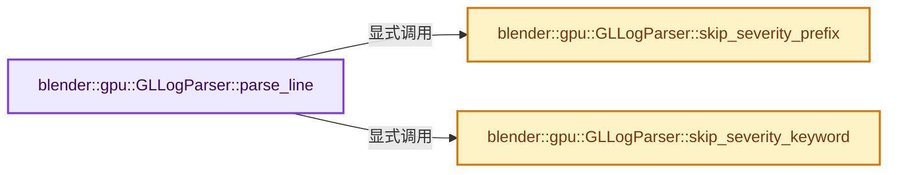
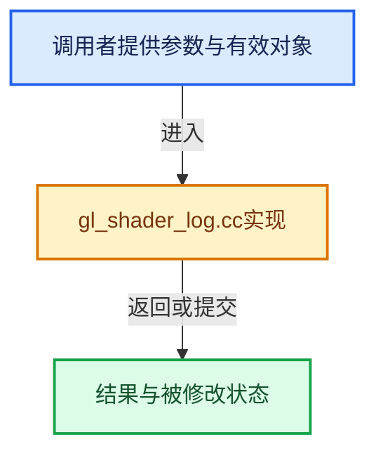

# 实现依赖专题：source/blender/gpu/opengl/gl_shader_log.cc

[实现依赖导航](../../../README.md) · [符号索引](../../../../00-课程指南/02-源码与提交索引/符号依赖与实现索引.md)

本专题从正文实际调用进入，集中保存共享实现。函数有稳定锚点，可从调用处直接跳到对应完整函数；递归与互相调用通过回链组织。

## 本文件的实现关系






## 完整成员与函数实现

<a id="f-57be06e81261b99e"></a>

### `blender::gpu::GLLogParser::parse_line`

实现位置：[source/blender/gpu/opengl/gl_shader_log.cc](../../../../../../../../source/blender/gpu/opengl/gl_shader_log.cc) · L15—L83。

接口参数：

- `const char *source_combined`
- `const char *log_line`
- `GPULogItem &log_item`

**教学注释版**

<!-- annotated:86f24c6a5c1d4b -->

```cpp
const char *GLLogParser::parse_line(const char *source_combined,
                                    const char *log_line,
                                    GPULogItem &log_item)
{
  /* Skip ERROR: or WARNING:. */
  log_line = skip_severity_prefix(log_line, log_item);
  log_line = skip_separators(log_line, "(: ");

  /* Parse error line & char numbers. */
  if (at_number(log_line)) {
    const char *error_line_number_end;
    log_item.cursor.row = parse_number(log_line, &error_line_number_end);
    /* Try to fetch the error character (not always available). */
    if (at_any(error_line_number_end, "(:") && at_number(&error_line_number_end[1])) {
      log_item.cursor.column = parse_number(error_line_number_end + 1, &log_line);
    }
    else {
      log_line = error_line_number_end;
    }
    /* There can be a 3rd number (case of mesa driver). */
    if (at_any(log_line, "(:") && at_number(&log_line[1])) {
      log_item.cursor.source = log_item.cursor.row;
      log_item.cursor.row = log_item.cursor.column;
      log_item.cursor.column = parse_number(log_line + 1, &error_line_number_end);
      log_line = error_line_number_end;
    }
  }

  if ((log_item.cursor.row != -1) && (log_item.cursor.column != -1)) {
    if (GPU_type_matches(GPU_DEVICE_NVIDIA, GPU_OS_ANY, GPU_DRIVER_OFFICIAL)) {
      /* source:row */
      log_item.cursor.source = log_item.cursor.row;
      log_item.cursor.row = log_item.cursor.column;
      log_item.cursor.column = -1;
    }
    else if (GPU_type_matches(GPU_DEVICE_ATI, GPU_OS_UNIX, GPU_DRIVER_OFFICIAL)) {
      /* source:row */
      log_item.cursor.source = log_item.cursor.row;
      log_item.cursor.row = log_item.cursor.column;
      log_item.cursor.column = -1;
    }
    else {
      /* line:char */
    }
  }

  if (log_item.cursor.row != -1) {
    /* Get to the wanted line. */
    size_t line_start_character = line_start_get(source_combined, log_item.cursor.row);
    if (line_start_character != -1) {
      StringRef filename = filename_get(source_combined, line_start_character);
      size_t line_number = source_line_get(source_combined, line_start_character);
      log_item.cursor.file_name_and_error_line = std::string(filename) + ':' +
                                                 std::to_string(line_number);
      if (log_item.cursor.column != -1) {
        log_item.cursor.file_name_and_error_line += ':' +
                                                    std::to_string(log_item.cursor.column + 1);
      }
    }
  }

  log_line = skip_separators(log_line, ":) ");

  /* Skip to message. Avoid redundant info. */
  log_line = skip_severity_keyword(log_line, log_item);
  log_line = skip_separators(log_line, ":) ");

  return log_line;
}
```

<details>
<summary>核对原始源码：source/blender/gpu/opengl/gl_shader_log.cc · L15—L83</summary>

<!-- original:86f24c6a5c1d4b:source/blender/gpu/opengl/gl_shader_log.cc:15:83 -->

```cpp
const char *GLLogParser::parse_line(const char *source_combined,
                                    const char *log_line,
                                    GPULogItem &log_item)
{
  /* Skip ERROR: or WARNING:. */
  log_line = skip_severity_prefix(log_line, log_item);
  log_line = skip_separators(log_line, "(: ");

  /* Parse error line & char numbers. */
  if (at_number(log_line)) {
    const char *error_line_number_end;
    log_item.cursor.row = parse_number(log_line, &error_line_number_end);
    /* Try to fetch the error character (not always available). */
    if (at_any(error_line_number_end, "(:") && at_number(&error_line_number_end[1])) {
      log_item.cursor.column = parse_number(error_line_number_end + 1, &log_line);
    }
    else {
      log_line = error_line_number_end;
    }
    /* There can be a 3rd number (case of mesa driver). */
    if (at_any(log_line, "(:") && at_number(&log_line[1])) {
      log_item.cursor.source = log_item.cursor.row;
      log_item.cursor.row = log_item.cursor.column;
      log_item.cursor.column = parse_number(log_line + 1, &error_line_number_end);
      log_line = error_line_number_end;
    }
  }

  if ((log_item.cursor.row != -1) && (log_item.cursor.column != -1)) {
    if (GPU_type_matches(GPU_DEVICE_NVIDIA, GPU_OS_ANY, GPU_DRIVER_OFFICIAL)) {
      /* source:row */
      log_item.cursor.source = log_item.cursor.row;
      log_item.cursor.row = log_item.cursor.column;
      log_item.cursor.column = -1;
    }
    else if (GPU_type_matches(GPU_DEVICE_ATI, GPU_OS_UNIX, GPU_DRIVER_OFFICIAL)) {
      /* source:row */
      log_item.cursor.source = log_item.cursor.row;
      log_item.cursor.row = log_item.cursor.column;
      log_item.cursor.column = -1;
    }
    else {
      /* line:char */
    }
  }

  if (log_item.cursor.row != -1) {
    /* Get to the wanted line. */
    size_t line_start_character = line_start_get(source_combined, log_item.cursor.row);
    if (line_start_character != -1) {
      StringRef filename = filename_get(source_combined, line_start_character);
      size_t line_number = source_line_get(source_combined, line_start_character);
      log_item.cursor.file_name_and_error_line = std::string(filename) + ':' +
                                                 std::to_string(line_number);
      if (log_item.cursor.column != -1) {
        log_item.cursor.file_name_and_error_line += ':' +
                                                    std::to_string(log_item.cursor.column + 1);
      }
    }
  }

  log_line = skip_separators(log_line, ":) ");

  /* Skip to message. Avoid redundant info. */
  log_line = skip_severity_keyword(log_line, log_item);
  log_line = skip_separators(log_line, ":) ");

  return log_line;
}
```

</details>

**沿实际写入检查状态**

- `log_line = skip_severity_prefix(log_line, log_item);`
- `log_line = skip_separators(log_line, "(: ");`
- `log_item.cursor.row = parse_number(log_line, &error_line_number_end);`
- `log_item.cursor.column = parse_number(error_line_number_end + 1, &log_line);`
- `log_line = error_line_number_end;`
- `log_item.cursor.source = log_item.cursor.row;`
- `log_item.cursor.row = log_item.cursor.column;`
- `log_item.cursor.column = parse_number(log_line + 1, &error_line_number_end);`
- `log_item.cursor.column = -1;`
- `log_item.cursor.file_name_and_error_line = std::string(filename) + ':' +`
- `log_item.cursor.file_name_and_error_line += ':' +`
- `log_line = skip_separators(log_line, ":) ");`
- `log_line = skip_severity_keyword(log_line, log_item);`

**结果出口**

- `return log_line;`

**继续追踪实现**

- `skip_severity_prefix` → [blender::gpu::GLLogParser::skip_severity_prefix · L85](gl_shader_log.cc.md#f-23e8b175b895949c)。
- `skip_separators` → [blender::gpu::GPULogParser::skip_separators · L297](../intern/gpu_shader_log.cc.md#f-cd8fc24d4e26a018)。
- `at_number` → [blender::gpu::GPULogParser::at_number · L317](../intern/gpu_shader_log.cc.md#f-e14d9a3b16837238)。
- `parse_number` → [blender::gpu::GPULogParser::parse_number · L327](../intern/gpu_shader_log.cc.md#f-b6bc341be2b6e2cf)。
- `at_any` → [blender::gpu::GPULogParser::at_any · L322](../intern/gpu_shader_log.cc.md#f-61d70da09aed45ec)。
- `GPU_type_matches` → [blender::GPU_type_matches · L169](../intern/gpu_platform.cc.md#f-45e7e6875f4b674b)。
- `line_start_get` → [blender::gpu::GPULogParser::line_start_get · L332](../intern/gpu_shader_log.cc.md#f-b8c61af03e75cdbd)。
- `filename_get` → [blender::gpu::GPULogParser::filename_get · L348](../intern/gpu_shader_log.cc.md#f-ea9f94085e30c06b)。
- `source_line_get` → [blender::gpu::GPULogParser::source_line_get · L364](../intern/gpu_shader_log.cc.md#f-0aad1899e03c2525)。
- `std::string` → [外部契约](https://eel.is/c++draft/)：这个边界按实际表达式及所属类型核对参数、返回值、寿命与失败行为。这里提供接口入口，不声称已解释该第三方版本的内部实现。
- `std::to_string` → [外部契约](https://eel.is/c++draft/)：这个边界按实际表达式及所属类型核对参数、返回值、寿命与失败行为。这里提供接口入口，不声称已解释该第三方版本的内部实现。
- `skip_severity_keyword` → [blender::gpu::GLLogParser::skip_severity_keyword · L90](gl_shader_log.cc.md#f-84d3c9b593993d53)。

<a id="f-23e8b175b895949c"></a>

### `blender::gpu::GLLogParser::skip_severity_prefix`

实现位置：[source/blender/gpu/opengl/gl_shader_log.cc](../../../../../../../../source/blender/gpu/opengl/gl_shader_log.cc) · L85—L88。

接口参数：

- `const char *log_line`
- `GPULogItem &log_item`

**教学注释版**

<!-- annotated:3351ac096749c7 -->

```cpp
const char *GLLogParser::skip_severity_prefix(const char *log_line, GPULogItem &log_item)
{
  return skip_severity(log_line, log_item, "ERROR", "WARNING", "NOTE");
}
```

<details>
<summary>核对原始源码：source/blender/gpu/opengl/gl_shader_log.cc · L85—L88</summary>

<!-- original:3351ac096749c7:source/blender/gpu/opengl/gl_shader_log.cc:85:88 -->

```cpp
const char *GLLogParser::skip_severity_prefix(const char *log_line, GPULogItem &log_item)
{
  return skip_severity(log_line, log_item, "ERROR", "WARNING", "NOTE");
}
```

</details>

**结果出口**

- `return skip_severity(log_line, log_item, "ERROR", "WARNING", "NOTE");`

**继续追踪实现**

- `skip_severity` → [blender::gpu::GPULogParser::skip_severity · L276](../intern/gpu_shader_log.cc.md#f-30864ad1cb97f7fa)。

<a id="f-84d3c9b593993d53"></a>

### `blender::gpu::GLLogParser::skip_severity_keyword`

实现位置：[source/blender/gpu/opengl/gl_shader_log.cc](../../../../../../../../source/blender/gpu/opengl/gl_shader_log.cc) · L90—L93。

接口参数：

- `const char *log_line`
- `GPULogItem &log_item`

**教学注释版**

<!-- annotated:35173f15f173d0 -->

```cpp
const char *GLLogParser::skip_severity_keyword(const char *log_line, GPULogItem &log_item)
{
  return skip_severity(log_line, log_item, "error", "warning", "note");
}
```

<details>
<summary>核对原始源码：source/blender/gpu/opengl/gl_shader_log.cc · L90—L93</summary>

<!-- original:35173f15f173d0:source/blender/gpu/opengl/gl_shader_log.cc:90:93 -->

```cpp
const char *GLLogParser::skip_severity_keyword(const char *log_line, GPULogItem &log_item)
{
  return skip_severity(log_line, log_item, "error", "warning", "note");
}
```

</details>

**结果出口**

- `return skip_severity(log_line, log_item, "error", "warning", "note");`

**继续追踪实现**

- `skip_severity` → [blender::gpu::GPULogParser::skip_severity · L276](../intern/gpu_shader_log.cc.md#f-30864ad1cb97f7fa)。
