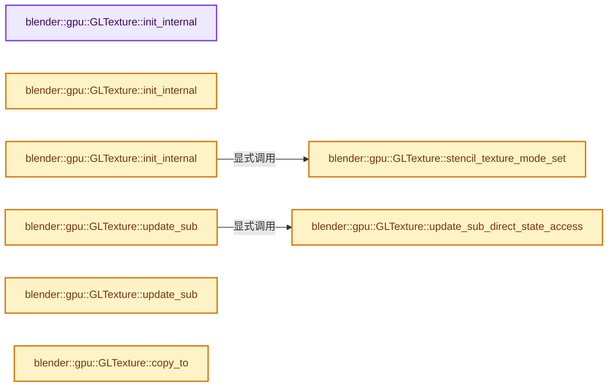
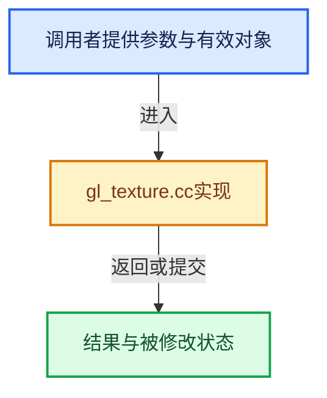

# 实现依赖专题：source/blender/gpu/opengl/gl_texture.cc

[实现依赖导航](../../../README.md) · [符号索引](../../../../00-课程指南/02-源码与提交索引/符号依赖与实现索引.md)

本专题从正文实际调用进入，集中保存共享实现。函数有稳定锚点，可从调用处直接跳到对应完整函数；递归与互相调用通过回链组织。

## 本文件的实现关系






## 完整成员与函数实现

<a id="f-b7777c443e3cc7b0"></a>

### `blender::gpu::GLTexture::init_internal`

实现位置：[source/blender/gpu/opengl/gl_texture.cc](../../../../../../../../source/blender/gpu/opengl/gl_texture.cc) · L58—L97。

**教学注释版**

<!-- annotated:33e1132824a6a1 -->

```cpp
bool GLTexture::init_internal()
{
  target_ = to_gl_target(type_);

  /* We need to bind once to define the texture type. */
  GLContext::state_manager_active_get()->texture_bind_temp(this);

  if (!this->proxy_check(0)) {
    return false;
  }

  GLenum internal_format = to_gl_internal_format(format_);
  const bool is_cubemap = bool(type_ == GPU_TEXTURE_CUBE);
  const int dimensions = (is_cubemap) ? 2 : this->dimensions_count();

  switch (dimensions) {
    default:
    case 1:
      glTexStorage1D(target_, mipmaps_, internal_format, w_);
      break;
    case 2:
      glTexStorage2D(target_, mipmaps_, internal_format, w_, h_);
      break;
    case 3:
      glTexStorage3D(target_, mipmaps_, internal_format, w_, h_, d_);
      break;
  }
  this->mip_range_set(0, mipmaps_ - 1);

  /* Avoid issue with formats not supporting filtering. Nearest by default. */
  if (GLContext::direct_state_access_support) {
    glTextureParameteri(tex_id_, GL_TEXTURE_MIN_FILTER, GL_NEAREST);
  }
  else {
    glTexParameteri(target_, GL_TEXTURE_MIN_FILTER, GL_NEAREST);
  }

  debug::object_label(GL_TEXTURE, tex_id_, name_.c_str());
  return true;
}
```

<details>
<summary>核对原始源码：source/blender/gpu/opengl/gl_texture.cc · L58—L97</summary>

<!-- original:33e1132824a6a1:source/blender/gpu/opengl/gl_texture.cc:58:97 -->

```cpp
bool GLTexture::init_internal()
{
  target_ = to_gl_target(type_);

  /* We need to bind once to define the texture type. */
  GLContext::state_manager_active_get()->texture_bind_temp(this);

  if (!this->proxy_check(0)) {
    return false;
  }

  GLenum internal_format = to_gl_internal_format(format_);
  const bool is_cubemap = bool(type_ == GPU_TEXTURE_CUBE);
  const int dimensions = (is_cubemap) ? 2 : this->dimensions_count();

  switch (dimensions) {
    default:
    case 1:
      glTexStorage1D(target_, mipmaps_, internal_format, w_);
      break;
    case 2:
      glTexStorage2D(target_, mipmaps_, internal_format, w_, h_);
      break;
    case 3:
      glTexStorage3D(target_, mipmaps_, internal_format, w_, h_, d_);
      break;
  }
  this->mip_range_set(0, mipmaps_ - 1);

  /* Avoid issue with formats not supporting filtering. Nearest by default. */
  if (GLContext::direct_state_access_support) {
    glTextureParameteri(tex_id_, GL_TEXTURE_MIN_FILTER, GL_NEAREST);
  }
  else {
    glTexParameteri(target_, GL_TEXTURE_MIN_FILTER, GL_NEAREST);
  }

  debug::object_label(GL_TEXTURE, tex_id_, name_.c_str());
  return true;
}
```

</details>

**沿实际写入检查状态**

- `target_ = to_gl_target(type_);`

**结果出口**

- `return false;`
- `return true;`

**继续追踪实现**

- `to_gl_target` → [blender::gpu::to_gl_target · L159](gl_texture.hh.md#f-19fabf8e43c1187c)。
- `GLContext::state_manager_active_get()->texture_bind_temp` → [调用协议](../../../../00-课程指南/01-路线与规范/模板宏与动态分派协议.md)：接收对象类型依赖auto、返回值或模板实例；不按同名猜测目标。调用位置L63。
- `GLContext::state_manager_active_get` → [blender::gpu::GLContext::state_manager_active_get · L148](gl_context.hh.md#f-bcf280500593b7e8)。
- `this->proxy_check` → [blender::gpu::GLTexture::proxy_check · L744](gl_texture.cc.md#f-3170c02532b0a935)。
- `to_gl_internal_format` → [blender::gpu::to_gl_internal_format · L143](gl_texture.hh.md#f-8e6944858a55ad2e)。
- `this->dimensions_count` → [blender::gpu::Texture::dimensions_count · L257](../intern/gpu_texture_private.hh.md#f-c961bd9805205442)。
- `glTexStorage1D` → [调用协议](../../../../00-课程指南/01-路线与规范/模板宏与动态分派协议.md)：函数指针、局部可调用对象或未展开的宏；必须结合调用者环境。调用位置L76。
- `glTexStorage2D` → [调用协议](../../../../00-课程指南/01-路线与规范/模板宏与动态分派协议.md)：函数指针、局部可调用对象或未展开的宏；必须结合调用者环境。调用位置L79。
- `glTexStorage3D` → [调用协议](../../../../00-课程指南/01-路线与规范/模板宏与动态分派协议.md)：函数指针、局部可调用对象或未展开的宏；必须结合调用者环境。调用位置L82。
- `this->mip_range_set` → [blender::gpu::GLTexture::mip_range_set · L562](gl_texture.cc.md#f-bbb0816b8eee0419)。
- `glTextureParameteri` → [调用协议](../../../../00-课程指南/01-路线与规范/模板宏与动态分派协议.md)：函数指针、局部可调用对象或未展开的宏；必须结合调用者环境。调用位置L89。
- `glTexParameteri` → [调用协议](../../../../00-课程指南/01-路线与规范/模板宏与动态分派协议.md)：函数指针、局部可调用对象或未展开的宏；必须结合调用者环境。调用位置L92。
- `debug::object_label` → [blender::gpu::debug::object_label · L331](gl_debug.cc.md#f-55513c68e8b2a6b5)。
- `name_.c_str` → [调用协议](../../../../00-课程指南/01-路线与规范/模板宏与动态分派协议.md)：接收对象类型依赖auto、返回值或模板实例；不按同名猜测目标。调用位置L95。

<a id="f-712e831adba48747"></a>

### `blender::gpu::GLTexture::init_internal`

实现位置：[source/blender/gpu/opengl/gl_texture.cc](../../../../../../../../source/blender/gpu/opengl/gl_texture.cc) · L99—L119。

接口参数：

- `VertBuf *vbo`

**教学注释版**

<!-- annotated:b32c8c57fef842 -->

```cpp
bool GLTexture::init_internal(VertBuf *vbo)
{
  GLVertBuf *gl_vbo = static_cast<GLVertBuf *>(vbo);
  target_ = to_gl_target(type_);

  /* We need to bind once to define the texture type. */
  GLContext::state_manager_active_get()->texture_bind_temp(this);

  GLenum internal_format = to_gl_internal_format(format_);

  if (GLContext::direct_state_access_support) {
    glTextureBuffer(tex_id_, internal_format, gl_vbo->vbo_id_);
  }
  else {
    glTexBuffer(target_, internal_format, gl_vbo->vbo_id_);
  }

  debug::object_label(GL_TEXTURE, tex_id_, name_.c_str());

  return true;
}
```

<details>
<summary>核对原始源码：source/blender/gpu/opengl/gl_texture.cc · L99—L119</summary>

<!-- original:b32c8c57fef842:source/blender/gpu/opengl/gl_texture.cc:99:119 -->

```cpp
bool GLTexture::init_internal(VertBuf *vbo)
{
  GLVertBuf *gl_vbo = static_cast<GLVertBuf *>(vbo);
  target_ = to_gl_target(type_);

  /* We need to bind once to define the texture type. */
  GLContext::state_manager_active_get()->texture_bind_temp(this);

  GLenum internal_format = to_gl_internal_format(format_);

  if (GLContext::direct_state_access_support) {
    glTextureBuffer(tex_id_, internal_format, gl_vbo->vbo_id_);
  }
  else {
    glTexBuffer(target_, internal_format, gl_vbo->vbo_id_);
  }

  debug::object_label(GL_TEXTURE, tex_id_, name_.c_str());

  return true;
}
```

</details>

**沿实际写入检查状态**

- `target_ = to_gl_target(type_);`

**结果出口**

- `return true;`

**继续追踪实现**

- `to_gl_target` → [blender::gpu::to_gl_target · L159](gl_texture.hh.md#f-19fabf8e43c1187c)。
- `GLContext::state_manager_active_get()->texture_bind_temp` → [调用协议](../../../../00-课程指南/01-路线与规范/模板宏与动态分派协议.md)：接收对象类型依赖auto、返回值或模板实例；不按同名猜测目标。调用位置L105。
- `GLContext::state_manager_active_get` → [blender::gpu::GLContext::state_manager_active_get · L148](gl_context.hh.md#f-bcf280500593b7e8)。
- `to_gl_internal_format` → [blender::gpu::to_gl_internal_format · L143](gl_texture.hh.md#f-8e6944858a55ad2e)。
- `glTextureBuffer` → [调用协议](../../../../00-课程指南/01-路线与规范/模板宏与动态分派协议.md)：函数指针、局部可调用对象或未展开的宏；必须结合调用者环境。调用位置L110。
- `glTexBuffer` → [调用协议](../../../../00-课程指南/01-路线与规范/模板宏与动态分派协议.md)：函数指针、局部可调用对象或未展开的宏；必须结合调用者环境。调用位置L113。
- `debug::object_label` → [blender::gpu::debug::object_label · L331](gl_debug.cc.md#f-55513c68e8b2a6b5)。
- `name_.c_str` → [调用协议](../../../../00-课程指南/01-路线与规范/模板宏与动态分派协议.md)：接收对象类型依赖auto、返回值或模板实例；不按同名猜测目标。调用位置L116。

<a id="f-b5d454ede7a94c20"></a>

### `blender::gpu::GLTexture::init_internal`

实现位置：[source/blender/gpu/opengl/gl_texture.cc](../../../../../../../../source/blender/gpu/opengl/gl_texture.cc) · L121—L144。

接口参数：

- `gpu::Texture *src`
- `bool use_stencil`

**教学注释版**

<!-- annotated:db03e87120af25 -->

```cpp
bool GLTexture::init_internal(gpu::Texture *src, bool use_stencil)
{
  const GLTexture *gl_src = static_cast<const GLTexture *>(src);
  GLenum internal_format = to_gl_internal_format(format_);
  target_ = to_gl_target(type_);

  glTextureView(tex_id_,
                target_,
                gl_src->tex_id_,
                internal_format,
                mip_min_,
                mipmaps_,
                view_layer_start_,
                layer_count());

  debug::object_label(GL_TEXTURE, tex_id_, name_.c_str());

  /* Stencil view support. */
  if (ELEM(format_, TextureFormat::SFLOAT_32_DEPTH_UINT_8)) {
    stencil_texture_mode_set(use_stencil);
  }

  return true;
}
```

<details>
<summary>核对原始源码：source/blender/gpu/opengl/gl_texture.cc · L121—L144</summary>

<!-- original:db03e87120af25:source/blender/gpu/opengl/gl_texture.cc:121:144 -->

```cpp
bool GLTexture::init_internal(gpu::Texture *src, bool use_stencil)
{
  const GLTexture *gl_src = static_cast<const GLTexture *>(src);
  GLenum internal_format = to_gl_internal_format(format_);
  target_ = to_gl_target(type_);

  glTextureView(tex_id_,
                target_,
                gl_src->tex_id_,
                internal_format,
                mip_min_,
                mipmaps_,
                view_layer_start_,
                layer_count());

  debug::object_label(GL_TEXTURE, tex_id_, name_.c_str());

  /* Stencil view support. */
  if (ELEM(format_, TextureFormat::SFLOAT_32_DEPTH_UINT_8)) {
    stencil_texture_mode_set(use_stencil);
  }

  return true;
}
```

</details>

**沿实际写入检查状态**

- `target_ = to_gl_target(type_);`

**结果出口**

- `return true;`

**继续追踪实现**

- `to_gl_internal_format` → [blender::gpu::to_gl_internal_format · L143](gl_texture.hh.md#f-8e6944858a55ad2e)。
- `to_gl_target` → [blender::gpu::to_gl_target · L159](gl_texture.hh.md#f-19fabf8e43c1187c)。
- `glTextureView` → [调用协议](../../../../00-课程指南/01-路线与规范/模板宏与动态分派协议.md)：函数指针、局部可调用对象或未展开的宏；必须结合调用者环境。调用位置L127。
- `layer_count` → [blender::gpu::Texture::layer_count · L274](../intern/gpu_texture_private.hh.md#f-ae5bba132ad53865)。
- `debug::object_label` → [blender::gpu::debug::object_label · L331](gl_debug.cc.md#f-55513c68e8b2a6b5)。
- `name_.c_str` → [调用协议](../../../../00-课程指南/01-路线与规范/模板宏与动态分派协议.md)：接收对象类型依赖auto、返回值或模板实例；不按同名猜测目标。调用位置L136。
- `ELEM` → [ELEM · L88](../../../07-Intern运行时与平台/ghost/intern/GHOST_utildefines.hh.md#m-d28724a15928)；[ELEM · L135](../../../01-BLI基础库/BLI_utildefines.hh.md#m-d6572de7cae0)。宏定义由构建条件选择。
- `stencil_texture_mode_set` → [blender::gpu::GLTexture::stencil_texture_mode_set · L549](gl_texture.cc.md#f-658af84de483c2c3)。

<a id="f-82d98816fad892d4"></a>

### `blender::gpu::GLTexture::update_sub_direct_state_access`

实现位置：[source/blender/gpu/opengl/gl_texture.cc](../../../../../../../../source/blender/gpu/opengl/gl_texture.cc) · L152—L188。

接口参数：

- `int mip`
- `int offset[3]`
- `int extent[3]`
- `GLenum format`
- `GLenum type`
- `const void *data`

**教学注释版**

<!-- annotated:03d296fd0ddcb1 -->

```cpp
void GLTexture::update_sub_direct_state_access(
    int mip, int offset[3], int extent[3], GLenum format, GLenum type, const void *data)
{
  if (format_flag_ & GPU_FORMAT_COMPRESSED) {
    size_t size = ((extent[0] + 3) / 4) * ((extent[1] + 3) / 4) * to_block_size(format_);
    switch (this->dimensions_count()) {
      default:
      case 1:
        glCompressedTextureSubImage1D(tex_id_, mip, offset[0], extent[0], format, size, data);
        break;
      case 2:
        glCompressedTextureSubImage2D(
            tex_id_, mip, UNPACK2(offset), UNPACK2(extent), format, size, data);
        break;
      case 3:
        glCompressedTextureSubImage3D(
            tex_id_, mip, UNPACK3(offset), UNPACK3(extent), format, size, data);
        break;
    }
  }
  else {
    switch (this->dimensions_count()) {
      default:
      case 1:
        glTextureSubImage1D(tex_id_, mip, offset[0], extent[0], format, type, data);
        break;
      case 2:
        glTextureSubImage2D(tex_id_, mip, UNPACK2(offset), UNPACK2(extent), format, type, data);
        break;
      case 3:
        glTextureSubImage3D(tex_id_, mip, UNPACK3(offset), UNPACK3(extent), format, type, data);
        break;
    }
  }

  has_pixels_ = true;
}
```

<details>
<summary>核对原始源码：source/blender/gpu/opengl/gl_texture.cc · L152—L188</summary>

<!-- original:03d296fd0ddcb1:source/blender/gpu/opengl/gl_texture.cc:152:188 -->

```cpp
void GLTexture::update_sub_direct_state_access(
    int mip, int offset[3], int extent[3], GLenum format, GLenum type, const void *data)
{
  if (format_flag_ & GPU_FORMAT_COMPRESSED) {
    size_t size = ((extent[0] + 3) / 4) * ((extent[1] + 3) / 4) * to_block_size(format_);
    switch (this->dimensions_count()) {
      default:
      case 1:
        glCompressedTextureSubImage1D(tex_id_, mip, offset[0], extent[0], format, size, data);
        break;
      case 2:
        glCompressedTextureSubImage2D(
            tex_id_, mip, UNPACK2(offset), UNPACK2(extent), format, size, data);
        break;
      case 3:
        glCompressedTextureSubImage3D(
            tex_id_, mip, UNPACK3(offset), UNPACK3(extent), format, size, data);
        break;
    }
  }
  else {
    switch (this->dimensions_count()) {
      default:
      case 1:
        glTextureSubImage1D(tex_id_, mip, offset[0], extent[0], format, type, data);
        break;
      case 2:
        glTextureSubImage2D(tex_id_, mip, UNPACK2(offset), UNPACK2(extent), format, type, data);
        break;
      case 3:
        glTextureSubImage3D(tex_id_, mip, UNPACK3(offset), UNPACK3(extent), format, type, data);
        break;
    }
  }

  has_pixels_ = true;
}
```

</details>

**沿实际写入检查状态**

- `has_pixels_ = true;`

**继续追踪实现**

- `to_block_size` → [blender::gpu::to_block_size · L400](../intern/gpu_texture_private.hh.md#f-807ba29337528ecf)。
- `this->dimensions_count` → [blender::gpu::Texture::dimensions_count · L257](../intern/gpu_texture_private.hh.md#f-c961bd9805205442)。
- `glCompressedTextureSubImage1D` → [调用协议](../../../../00-课程指南/01-路线与规范/模板宏与动态分派协议.md)：函数指针、局部可调用对象或未展开的宏；必须结合调用者环境。调用位置L160。
- `glCompressedTextureSubImage2D` → [调用协议](../../../../00-课程指南/01-路线与规范/模板宏与动态分派协议.md)：函数指针、局部可调用对象或未展开的宏；必须结合调用者环境。调用位置L163。
- `UNPACK2` → [UNPACK2 · L22](../../../07-Intern运行时与平台/ghost/intern/GHOST_utildefines.hh.md#m-00ad768fe1c1)；[UNPACK2 · L234](../../../01-BLI基础库/BLI_utildefines.hh.md#m-96ff8266d239)；[UNPACK2 · L13](../shaders/common/gpu_shader_utildefines.bsl.hh.md#m-8316603fb9a6)。宏定义由构建条件选择。
- `glCompressedTextureSubImage3D` → [调用协议](../../../../00-课程指南/01-路线与规范/模板宏与动态分派协议.md)：函数指针、局部可调用对象或未展开的宏；必须结合调用者环境。调用位置L167。
- `UNPACK3` → [UNPACK3 · L23](../../../07-Intern运行时与平台/ghost/intern/GHOST_utildefines.hh.md#m-f882324eb80a)；[UNPACK3 · L235](../../../01-BLI基础库/BLI_utildefines.hh.md#m-bbbbdcf09d3b)；[UNPACK3 · L14](../shaders/common/gpu_shader_utildefines.bsl.hh.md#m-b4e3357a0310)。宏定义由构建条件选择。
- `glTextureSubImage1D` → [调用协议](../../../../00-课程指南/01-路线与规范/模板宏与动态分派协议.md)：函数指针、局部可调用对象或未展开的宏；必须结合调用者环境。调用位置L176。
- `glTextureSubImage2D` → [调用协议](../../../../00-课程指南/01-路线与规范/模板宏与动态分派协议.md)：函数指针、局部可调用对象或未展开的宏；必须结合调用者环境。调用位置L179。
- `glTextureSubImage3D` → [调用协议](../../../../00-课程指南/01-路线与规范/模板宏与动态分派协议.md)：函数指针、局部可调用对象或未展开的宏；必须结合调用者环境。调用位置L182。

<a id="f-6ab5a387083426bc"></a>

### `blender::gpu::GLTexture::update_sub`

实现位置：[source/blender/gpu/opengl/gl_texture.cc](../../../../../../../../source/blender/gpu/opengl/gl_texture.cc) · L190—L356。

接口参数：

- `int mip`
- `int offset[3]`
- `int extent[3]`
- `eGPUDataFormat type`
- `const void *data`
- `const uint unpack_row_length`

**教学注释版**

<!-- annotated:6bcc8e197d12c1 -->

```cpp
void GLTexture::update_sub(int mip,
                           int offset[3],
                           int extent[3],
                           eGPUDataFormat type,
                           const void *data,
                           const uint unpack_row_length)
{
  BLI_assert(validate_data_format(format_, type));
  BLI_assert(data != nullptr);

  if (mip >= mipmaps_) {
    debug::raise_gl_error("Updating a miplvl on a texture too small to have this many levels.");
    return;
  }

  /* If `unpack_row_length` is 0, rows are sequentially stored. Otherwise we unpack data
   * into a staging block, so the half conversion below doesn't happen on the full input. */
  const bool do_texture_unpack = !ELEM(unpack_row_length, 0, extent[0]);

  /* Unpack `data` if `unpack_row_length` is set. */
  std::unique_ptr<uint8_t, MEM_smart_ptr_deleter<uint8_t>> unpack_buffer = nullptr;
  if (do_texture_unpack) {
    BLI_assert_msg(!(format_flag_ & GPU_FORMAT_COMPRESSED),
                   "Compressed data with unpack_row_length != 0 is not supported.");
    BLI_assert_msg(extent[2] <= 1,
                   "3D texture data with unpack_row_length != 0 is not supported.");

    size_t src_row_stride = unpack_row_length * to_bytesize(format_, type);
    size_t dst_row_stride = max_ii(extent[0], 1) * to_bytesize(format_, type);
    size_t dst_total_count = dst_row_stride * max_ii(extent[1], 1) * max_ii(extent[2], 1);

    /* Allocate buffer to size necessary for gather */
    unpack_buffer.reset(
        // [讲解] MEM_new_uninitialized_aligned：把公开MEM分配接口转交给当前选择的对齐分配后端。
        static_cast<uint8_t *>(MEM_new_uninitialized_aligned(dst_total_count, 128, __func__)));

    /* Strided loop; we advance source and destination pointers separately during a gather. */
    const uint8_t *src_ptr = static_cast<const uint8_t *>(data);
    uint8_t *dst_ptr = unpack_buffer.get();
    for (int y = 0; y < max_ii(extent[1], 1); ++y) {
      // [讲解] std::memcpy：复制字节，源与目标不应重叠。类型生命周期、对齐和可复制表示须由调用者证明，不是任意对象的复制构造。
      std::memcpy(dst_ptr, src_ptr, dst_row_stride);
      src_ptr += src_row_stride;
      dst_ptr += dst_row_stride;
    }

    /* Replace the 'data' ptr with `unpack_buffer`,
     * which has lifetime in the function scope. */
    data = unpack_buffer.get();
  }

  GLenum gl_type = to_gl(type);

  /* If `data` is float and target storage is half, convert to half */
  std::unique_ptr<uint16_t, MEM_smart_ptr_deleter<uint16_t>> clamped_half_buffer = nullptr;
  if (type == GPU_DATA_FLOAT && is_half_float(format_)) {
    size_t dst_pixel_count = max_ii(extent[0], 1) * max_ii(extent[1], 1) * max_ii(extent[2], 1);
    size_t dst_total_count = to_component_len(format_) * dst_pixel_count;

    /* Allocate buffer to size necessary for conversion.. */
    clamped_half_buffer.reset(static_cast<uint16_t *>(
        MEM_new_uninitialized_aligned(sizeof(uint16_t) * dst_total_count, 128, __func__)));

    Span<float> src(static_cast<const float *>(data), dst_total_count);
    MutableSpan<uint16_t> dst(static_cast<uint16_t *>(clamped_half_buffer.get()), dst_total_count);

    constexpr int64_t chunk_size = 4 * 1024 * 1024;
    threading::parallel_for(IndexRange(dst_total_count), chunk_size, [&](const IndexRange range) {
      /* Doing float to half conversion manually to avoid implementation specific behavior
       * regarding Inf and NaNs. Use make finite version to avoid unexpected black pixels on
       * certain implementation. For platform parity we clamp these infinite values to finite
       * values. */
      math::float_to_half_make_finite_array(
          // [讲解] src.slice：建立原连续范围的子视图。
          src.slice(range).data(), dst.slice(range).data(), range.size());
    });

    /* Replace the 'data' ptr with `clamped_half_buffer`,
     * which has lifetime in the function scope. */
    data = clamped_half_buffer.get();
    gl_type = to_gl(GPU_DATA_HALF_FLOAT);

    /* If the `data` ptr was previously replaced by `unpack_buffer`,
     * clear `unpack_buffer` as it is no longer necessary. */
    if (do_texture_unpack) {
      unpack_buffer.reset(nullptr);
    }
  }

  /* 16-bit integer formats with integer data does not seem to work correctly in all GPU drivers,
   * so convert to short and use GL_SHORT. */
  std::unique_ptr<int16_t, MEM_smart_ptr_deleter<int16_t>> short_buffer = nullptr;
  if (type == GPU_DATA_INT && is_half_integer(format_)) {
    size_t dst_pixel_count = max_ii(extent[0], 1) * max_ii(extent[1], 1) * max_ii(extent[2], 1);
    size_t dst_total_count = to_component_len(format_) * dst_pixel_count;

    short_buffer.reset(static_cast<int16_t *>(
        MEM_new_uninitialized_aligned(sizeof(int16_t) * dst_total_count, 128, __func__)));

    Span<int32_t> src(static_cast<const int32_t *>(data), dst_total_count);
    MutableSpan<int16_t> dst(static_cast<int16_t *>(short_buffer.get()), dst_total_count);

    constexpr int64_t chunk_size = 4 * 1024 * 1024;
    threading::parallel_for(IndexRange(dst_total_count), chunk_size, [&](const IndexRange range) {
      for (const int64_t i : range) {
        dst[i] = int16_t(src[i]);
      }
    });

    /* Replace the 'data' ptr with `short_buffer`, which has lifetime in the function scope. */
    data = short_buffer.get();
    gl_type = GL_SHORT;

    /* If the `data` ptr was previously replaced by `unpack_buffer`,
     * clear `unpack_buffer` as it is no longer necessary. */
    if (do_texture_unpack) {
      unpack_buffer.reset(nullptr);
    }
  }

  const int dimensions = this->dimensions_count();
  GLenum gl_format = to_gl_data_format(format_);

  /* Some drivers have issues with cubemap & glTextureSubImage3D even if it is correct. */
  if (GLContext::direct_state_access_support && (type_ != GPU_TEXTURE_CUBE)) {
    this->update_sub_direct_state_access(mip, offset, extent, gl_format, gl_type, data);
    return;
  }

  GLContext::state_manager_active_get()->texture_bind_temp(this);
  if (type_ == GPU_TEXTURE_CUBE) {
    for (int i = 0; i < extent[2]; i++) {
      GLenum target = GL_TEXTURE_CUBE_MAP_POSITIVE_X + offset[2] + i;
      glTexSubImage2D(target, mip, UNPACK2(offset), UNPACK2(extent), gl_format, gl_type, data);
    }
  }
  else if (format_flag_ & GPU_FORMAT_COMPRESSED) {
    size_t size = ((extent[0] + 3) / 4) * ((extent[1] + 3) / 4) * to_block_size(format_);
    switch (dimensions) {
      default:
      case 1:
        glCompressedTexSubImage1D(target_, mip, offset[0], extent[0], gl_format, size, data);
        break;
      case 2:
        glCompressedTexSubImage2D(
            target_, mip, UNPACK2(offset), UNPACK2(extent), gl_format, size, data);
        break;
      case 3:
        glCompressedTexSubImage3D(
            target_, mip, UNPACK3(offset), UNPACK3(extent), gl_format, size, data);
        break;
    }
  }
  else {
    switch (dimensions) {
      default:
      case 1:
        glTexSubImage1D(target_, mip, offset[0], extent[0], gl_format, gl_type, data);
        break;
      case 2:
        glTexSubImage2D(target_, mip, UNPACK2(offset), UNPACK2(extent), gl_format, gl_type, data);
        break;
      case 3:
        glTexSubImage3D(target_, mip, UNPACK3(offset), UNPACK3(extent), gl_format, gl_type, data);
        break;
    }
  }

  has_pixels_ = true;
}
```

<details>
<summary>核对原始源码：source/blender/gpu/opengl/gl_texture.cc · L190—L356</summary>

<!-- original:6bcc8e197d12c1:source/blender/gpu/opengl/gl_texture.cc:190:356 -->

```cpp
void GLTexture::update_sub(int mip,
                           int offset[3],
                           int extent[3],
                           eGPUDataFormat type,
                           const void *data,
                           const uint unpack_row_length)
{
  BLI_assert(validate_data_format(format_, type));
  BLI_assert(data != nullptr);

  if (mip >= mipmaps_) {
    debug::raise_gl_error("Updating a miplvl on a texture too small to have this many levels.");
    return;
  }

  /* If `unpack_row_length` is 0, rows are sequentially stored. Otherwise we unpack data
   * into a staging block, so the half conversion below doesn't happen on the full input. */
  const bool do_texture_unpack = !ELEM(unpack_row_length, 0, extent[0]);

  /* Unpack `data` if `unpack_row_length` is set. */
  std::unique_ptr<uint8_t, MEM_smart_ptr_deleter<uint8_t>> unpack_buffer = nullptr;
  if (do_texture_unpack) {
    BLI_assert_msg(!(format_flag_ & GPU_FORMAT_COMPRESSED),
                   "Compressed data with unpack_row_length != 0 is not supported.");
    BLI_assert_msg(extent[2] <= 1,
                   "3D texture data with unpack_row_length != 0 is not supported.");

    size_t src_row_stride = unpack_row_length * to_bytesize(format_, type);
    size_t dst_row_stride = max_ii(extent[0], 1) * to_bytesize(format_, type);
    size_t dst_total_count = dst_row_stride * max_ii(extent[1], 1) * max_ii(extent[2], 1);

    /* Allocate buffer to size necessary for gather */
    unpack_buffer.reset(
        static_cast<uint8_t *>(MEM_new_uninitialized_aligned(dst_total_count, 128, __func__)));

    /* Strided loop; we advance source and destination pointers separately during a gather. */
    const uint8_t *src_ptr = static_cast<const uint8_t *>(data);
    uint8_t *dst_ptr = unpack_buffer.get();
    for (int y = 0; y < max_ii(extent[1], 1); ++y) {
      std::memcpy(dst_ptr, src_ptr, dst_row_stride);
      src_ptr += src_row_stride;
      dst_ptr += dst_row_stride;
    }

    /* Replace the 'data' ptr with `unpack_buffer`,
     * which has lifetime in the function scope. */
    data = unpack_buffer.get();
  }

  GLenum gl_type = to_gl(type);

  /* If `data` is float and target storage is half, convert to half */
  std::unique_ptr<uint16_t, MEM_smart_ptr_deleter<uint16_t>> clamped_half_buffer = nullptr;
  if (type == GPU_DATA_FLOAT && is_half_float(format_)) {
    size_t dst_pixel_count = max_ii(extent[0], 1) * max_ii(extent[1], 1) * max_ii(extent[2], 1);
    size_t dst_total_count = to_component_len(format_) * dst_pixel_count;

    /* Allocate buffer to size necessary for conversion.. */
    clamped_half_buffer.reset(static_cast<uint16_t *>(
        MEM_new_uninitialized_aligned(sizeof(uint16_t) * dst_total_count, 128, __func__)));

    Span<float> src(static_cast<const float *>(data), dst_total_count);
    MutableSpan<uint16_t> dst(static_cast<uint16_t *>(clamped_half_buffer.get()), dst_total_count);

    constexpr int64_t chunk_size = 4 * 1024 * 1024;
    threading::parallel_for(IndexRange(dst_total_count), chunk_size, [&](const IndexRange range) {
      /* Doing float to half conversion manually to avoid implementation specific behavior
       * regarding Inf and NaNs. Use make finite version to avoid unexpected black pixels on
       * certain implementation. For platform parity we clamp these infinite values to finite
       * values. */
      math::float_to_half_make_finite_array(
          src.slice(range).data(), dst.slice(range).data(), range.size());
    });

    /* Replace the 'data' ptr with `clamped_half_buffer`,
     * which has lifetime in the function scope. */
    data = clamped_half_buffer.get();
    gl_type = to_gl(GPU_DATA_HALF_FLOAT);

    /* If the `data` ptr was previously replaced by `unpack_buffer`,
     * clear `unpack_buffer` as it is no longer necessary. */
    if (do_texture_unpack) {
      unpack_buffer.reset(nullptr);
    }
  }

  /* 16-bit integer formats with integer data does not seem to work correctly in all GPU drivers,
   * so convert to short and use GL_SHORT. */
  std::unique_ptr<int16_t, MEM_smart_ptr_deleter<int16_t>> short_buffer = nullptr;
  if (type == GPU_DATA_INT && is_half_integer(format_)) {
    size_t dst_pixel_count = max_ii(extent[0], 1) * max_ii(extent[1], 1) * max_ii(extent[2], 1);
    size_t dst_total_count = to_component_len(format_) * dst_pixel_count;

    short_buffer.reset(static_cast<int16_t *>(
        MEM_new_uninitialized_aligned(sizeof(int16_t) * dst_total_count, 128, __func__)));

    Span<int32_t> src(static_cast<const int32_t *>(data), dst_total_count);
    MutableSpan<int16_t> dst(static_cast<int16_t *>(short_buffer.get()), dst_total_count);

    constexpr int64_t chunk_size = 4 * 1024 * 1024;
    threading::parallel_for(IndexRange(dst_total_count), chunk_size, [&](const IndexRange range) {
      for (const int64_t i : range) {
        dst[i] = int16_t(src[i]);
      }
    });

    /* Replace the 'data' ptr with `short_buffer`, which has lifetime in the function scope. */
    data = short_buffer.get();
    gl_type = GL_SHORT;

    /* If the `data` ptr was previously replaced by `unpack_buffer`,
     * clear `unpack_buffer` as it is no longer necessary. */
    if (do_texture_unpack) {
      unpack_buffer.reset(nullptr);
    }
  }

  const int dimensions = this->dimensions_count();
  GLenum gl_format = to_gl_data_format(format_);

  /* Some drivers have issues with cubemap & glTextureSubImage3D even if it is correct. */
  if (GLContext::direct_state_access_support && (type_ != GPU_TEXTURE_CUBE)) {
    this->update_sub_direct_state_access(mip, offset, extent, gl_format, gl_type, data);
    return;
  }

  GLContext::state_manager_active_get()->texture_bind_temp(this);
  if (type_ == GPU_TEXTURE_CUBE) {
    for (int i = 0; i < extent[2]; i++) {
      GLenum target = GL_TEXTURE_CUBE_MAP_POSITIVE_X + offset[2] + i;
      glTexSubImage2D(target, mip, UNPACK2(offset), UNPACK2(extent), gl_format, gl_type, data);
    }
  }
  else if (format_flag_ & GPU_FORMAT_COMPRESSED) {
    size_t size = ((extent[0] + 3) / 4) * ((extent[1] + 3) / 4) * to_block_size(format_);
    switch (dimensions) {
      default:
      case 1:
        glCompressedTexSubImage1D(target_, mip, offset[0], extent[0], gl_format, size, data);
        break;
      case 2:
        glCompressedTexSubImage2D(
            target_, mip, UNPACK2(offset), UNPACK2(extent), gl_format, size, data);
        break;
      case 3:
        glCompressedTexSubImage3D(
            target_, mip, UNPACK3(offset), UNPACK3(extent), gl_format, size, data);
        break;
    }
  }
  else {
    switch (dimensions) {
      default:
      case 1:
        glTexSubImage1D(target_, mip, offset[0], extent[0], gl_format, gl_type, data);
        break;
      case 2:
        glTexSubImage2D(target_, mip, UNPACK2(offset), UNPACK2(extent), gl_format, gl_type, data);
        break;
      case 3:
        glTexSubImage3D(target_, mip, UNPACK3(offset), UNPACK3(extent), gl_format, gl_type, data);
        break;
    }
  }

  has_pixels_ = true;
}
```

</details>

**沿实际写入检查状态**

- `src_ptr += src_row_stride;`
- `dst_ptr += dst_row_stride;`
- `data = unpack_buffer.get();`
- `data = clamped_half_buffer.get();`
- `gl_type = to_gl(GPU_DATA_HALF_FLOAT);`
- `dst[i] = int16_t(src[i]);`
- `data = short_buffer.get();`
- `gl_type = GL_SHORT;`
- `has_pixels_ = true;`

**继续追踪实现**

- `BLI_assert` → [BLI_assert · L48](../../../01-BLI基础库/BLI_assert.hh.md#m-57a88495704d)；[BLI_assert · L63](../../../01-BLI基础库/BLI_assert.hh.md#m-d07050020cb5)。宏定义由构建条件选择。
- `validate_data_format` → [blender::gpu::validate_data_format · L596](../intern/gpu_texture_private.hh.md#f-3a81f93170ecd217)。
- `debug::raise_gl_error` → [blender::gpu::debug::raise_gl_error · L278](gl_debug.cc.md#f-3a430e50ffaf4878)。
- `ELEM` → [ELEM · L88](../../../07-Intern运行时与平台/ghost/intern/GHOST_utildefines.hh.md#m-d28724a15928)；[ELEM · L135](../../../01-BLI基础库/BLI_utildefines.hh.md#m-d6572de7cae0)。宏定义由构建条件选择。
- `BLI_assert_msg` → [BLI_assert_msg · L55](../../../01-BLI基础库/BLI_assert.hh.md#m-695eed20dceb)；[BLI_assert_msg · L64](../../../01-BLI基础库/BLI_assert.hh.md#m-7de5563de4db)。宏定义由构建条件选择。
- `to_bytesize` → [blender::gpu::to_bytesize · L31](../GPU_index_buffer.hh.md#f-efdc25ce42dc43f3)；[blender::gpu::to_bytesize · L231](../GPU_format.hh.md#f-e6ecc4e3bd53a46f)；[blender::gpu::to_bytesize · L395](../intern/gpu_texture_private.hh.md#f-a10860ed9785f89d)；[blender::gpu::to_bytesize · L559](../intern/gpu_texture_private.hh.md#f-7e05648123684a02)；[blender::gpu::to_bytesize · L579](../intern/gpu_texture_private.hh.md#f-8ad1c9330f26cf28)。同名重载需按实参类型选择。
- `max_ii` → [blender::max_ii · L368](../../../01-BLI基础库/intern/math_base_inline.cc.md#f-c45aa7b373adb94c)。
- `unpack_buffer.reset` → [外部契约](https://eel.is/c++draft/)：这个边界按实际表达式及所属类型核对参数、返回值、寿命与失败行为。这里提供接口入口，不声称已解释该第三方版本的内部实现。
- `MEM_new_uninitialized_aligned` → [MEM_new_uninitialized_aligned · L134](../../../07-Intern运行时与平台/guardedalloc/intern/mallocn.cc.md#f-9f3d21bd7da93c68)。
- `unpack_buffer.get` → [外部契约](https://eel.is/c++draft/)：这个边界按实际表达式及所属类型核对参数、返回值、寿命与失败行为。这里提供接口入口，不声称已解释该第三方版本的内部实现。
- `std::memcpy` → [外部契约](https://eel.is/c++draft/cstring.syn)：复制字节，源与目标不应重叠。类型生命周期、对齐和可复制表示须由调用者证明，不是任意对象的复制构造。
- `to_gl` → [blender::gpu::to_gl · L610](gl_texture.cc.md#f-d765dcd5ade0fd47)。
- `is_half_float` → [blender::gpu::is_half_float · L21](../intern/gpu_texture_private.hh.md#f-140829c6e9b3837a)。
- `to_component_len` → [blender::gpu::to_component_len · L554](../intern/gpu_texture_private.hh.md#f-24ff7034456d5942)。
- `clamped_half_buffer.reset` → [外部契约](https://eel.is/c++draft/)：这个边界按实际表达式及所属类型核对参数、返回值、寿命与失败行为。这里提供接口入口，不声称已解释该第三方版本的内部实现。
- `clamped_half_buffer.get` → [外部契约](https://eel.is/c++draft/)：这个边界按实际表达式及所属类型核对参数、返回值、寿命与失败行为。这里提供接口入口，不声称已解释该第三方版本的内部实现。
- `threading::parallel_for` → [blender::threading::parallel_for · L68](../../../../11-Depsgraph与并行任务系统/07-任务池与TBB接入.md#f-838294754c24426c)。
- `IndexRange` → [blender::IndexRange](../../../01-BLI基础库/BLI_index_range.hh.md#t-caa3466d6776)；[blender::gpu::shader::parser::IndexRange](../shader_tool/utils.hh.md#t-82d2bd4ea71c)；[blender::IndexRange](../../makesdna/DNA_node_types.h.md#t-0448cc889d39)。
- `math::float_to_half_make_finite_array` → [blender::math::float_to_half_make_finite_array · L355](../../../01-BLI基础库/intern/math_half.cc.md#f-ccbb2502bea18165)。
- `src.slice(range).data` → [调用协议](../../../../00-课程指南/01-路线与规范/模板宏与动态分派协议.md)：接收对象类型依赖auto、返回值或模板实例；不按同名猜测目标。调用位置L261。
- `src.slice` → [blender::Span::slice · L141](../../../../01-基础容器与现代CPP/05-Span只读连续视图.md#f-380a0e8fdcbd53cc)；[blender::Span::slice · L149](../../../../01-基础容器与现代CPP/05-Span只读连续视图.md#f-9b9c15e78dd54eec)。同名重载需按实参类型选择。
- `dst.slice(range).data` → [调用协议](../../../../00-课程指南/01-路线与规范/模板宏与动态分派协议.md)：接收对象类型依赖auto、返回值或模板实例；不按同名猜测目标。调用位置L261。
- `dst.slice` → [blender::MutableSpan::slice · L579](../../../../01-基础容器与现代CPP/06-MutableSpan可写视图.md#f-6808b4aefbf58808)；[blender::MutableSpan::slice · L587](../../../../01-基础容器与现代CPP/06-MutableSpan可写视图.md#f-c05b010821861e4f)。同名重载需按实参类型选择。
- `range.size` → [blender::IndexRange::size · L156](../../../../01-基础容器与现代CPP/04-IndexRange连续整数区间.md#f-05f66c3ebb2fdfec)。
- `is_half_integer` → [blender::gpu::is_half_integer · L34](../intern/gpu_texture_private.hh.md#f-9f53e5f5a2f44594)。
- `short_buffer.reset` → [外部契约](https://eel.is/c++draft/)：这个边界按实际表达式及所属类型核对参数、返回值、寿命与失败行为。这里提供接口入口，不声称已解释该第三方版本的内部实现。
- `short_buffer.get` → [外部契约](https://eel.is/c++draft/)：这个边界按实际表达式及所属类型核对参数、返回值、寿命与失败行为。这里提供接口入口，不声称已解释该第三方版本的内部实现。
- `this->dimensions_count` → [blender::gpu::Texture::dimensions_count · L257](../intern/gpu_texture_private.hh.md#f-c961bd9805205442)。
- `to_gl_data_format` → [blender::gpu::to_gl_data_format · L256](gl_texture.hh.md#f-b5b89a761fd75c7e)。
- `this->update_sub_direct_state_access` → [blender::gpu::GLTexture::update_sub_direct_state_access · L152](gl_texture.cc.md#f-82d98816fad892d4)。
- `GLContext::state_manager_active_get()->texture_bind_temp` → [调用协议](../../../../00-课程指南/01-路线与规范/模板宏与动态分派协议.md)：接收对象类型依赖auto、返回值或模板实例；不按同名猜测目标。调用位置L316。
- `GLContext::state_manager_active_get` → [blender::gpu::GLContext::state_manager_active_get · L148](gl_context.hh.md#f-bcf280500593b7e8)。
- `glTexSubImage2D` → [调用协议](../../../../00-课程指南/01-路线与规范/模板宏与动态分派协议.md)：函数指针、局部可调用对象或未展开的宏；必须结合调用者环境。调用位置L320。
- `UNPACK2` → [UNPACK2 · L22](../../../07-Intern运行时与平台/ghost/intern/GHOST_utildefines.hh.md#m-00ad768fe1c1)；[UNPACK2 · L234](../../../01-BLI基础库/BLI_utildefines.hh.md#m-96ff8266d239)；[UNPACK2 · L13](../shaders/common/gpu_shader_utildefines.bsl.hh.md#m-8316603fb9a6)。宏定义由构建条件选择。
- `to_block_size` → [blender::gpu::to_block_size · L400](../intern/gpu_texture_private.hh.md#f-807ba29337528ecf)。
- `glCompressedTexSubImage1D` → [调用协议](../../../../00-课程指南/01-路线与规范/模板宏与动态分派协议.md)：函数指针、局部可调用对象或未展开的宏；必须结合调用者环境。调用位置L328。
- `glCompressedTexSubImage2D` → [调用协议](../../../../00-课程指南/01-路线与规范/模板宏与动态分派协议.md)：函数指针、局部可调用对象或未展开的宏；必须结合调用者环境。调用位置L331。
- `glCompressedTexSubImage3D` → [调用协议](../../../../00-课程指南/01-路线与规范/模板宏与动态分派协议.md)：函数指针、局部可调用对象或未展开的宏；必须结合调用者环境。调用位置L335。
- `UNPACK3` → [UNPACK3 · L23](../../../07-Intern运行时与平台/ghost/intern/GHOST_utildefines.hh.md#m-f882324eb80a)；[UNPACK3 · L235](../../../01-BLI基础库/BLI_utildefines.hh.md#m-bbbbdcf09d3b)；[UNPACK3 · L14](../shaders/common/gpu_shader_utildefines.bsl.hh.md#m-b4e3357a0310)。宏定义由构建条件选择。
- `glTexSubImage1D` → [调用协议](../../../../00-课程指南/01-路线与规范/模板宏与动态分派协议.md)：函数指针、局部可调用对象或未展开的宏；必须结合调用者环境。调用位置L344。
- `glTexSubImage3D` → [调用协议](../../../../00-课程指南/01-路线与规范/模板宏与动态分派协议.md)：函数指针、局部可调用对象或未展开的宏；必须结合调用者环境。调用位置L350。

<a id="f-6aab12c617050ffb"></a>

### `blender::gpu::GLTexture::update_sub`

实现位置：[source/blender/gpu/opengl/gl_texture.cc](../../../../../../../../source/blender/gpu/opengl/gl_texture.cc) · L358—L392。

接口参数：

- `int offset[3]`
- `int extent[3]`
- `eGPUDataFormat format`
- `GPUPixelBuffer *pixbuf`

**教学注释版**

<!-- annotated:921f9928518e1d -->

```cpp
void GLTexture::update_sub(int offset[3],
                           int extent[3],
                           eGPUDataFormat format,
                           GPUPixelBuffer *pixbuf)
{
  /* Update texture from pixel buffer. */
  BLI_assert(validate_data_format(format_, format));
  BLI_assert(pixbuf != nullptr);

  const int dimensions = this->dimensions_count();
  GLenum gl_format = to_gl_data_format(format_);
  GLenum gl_type = to_gl(format);

  /* Temporarily Bind texture. */
  GLContext::state_manager_active_get()->texture_bind_temp(this);

  /* Bind pixel buffer for source data. */
  GLint pix_buf_handle = GLint(GPU_pixel_buffer_get_native_handle(pixbuf).handle);
  glBindBuffer(GL_PIXEL_UNPACK_BUFFER, pix_buf_handle);

  switch (dimensions) {
    default:
    case 1:
      glTexSubImage1D(target_, 0, offset[0], extent[0], gl_format, gl_type, nullptr);
      break;
    case 2:
      glTexSubImage2D(target_, 0, UNPACK2(offset), UNPACK2(extent), gl_format, gl_type, nullptr);
      break;
    case 3:
      glTexSubImage3D(target_, 0, UNPACK3(offset), UNPACK3(extent), gl_format, gl_type, nullptr);
      break;
  }

  glBindBuffer(GL_PIXEL_UNPACK_BUFFER, 0);
}
```

<details>
<summary>核对原始源码：source/blender/gpu/opengl/gl_texture.cc · L358—L392</summary>

<!-- original:921f9928518e1d:source/blender/gpu/opengl/gl_texture.cc:358:392 -->

```cpp
void GLTexture::update_sub(int offset[3],
                           int extent[3],
                           eGPUDataFormat format,
                           GPUPixelBuffer *pixbuf)
{
  /* Update texture from pixel buffer. */
  BLI_assert(validate_data_format(format_, format));
  BLI_assert(pixbuf != nullptr);

  const int dimensions = this->dimensions_count();
  GLenum gl_format = to_gl_data_format(format_);
  GLenum gl_type = to_gl(format);

  /* Temporarily Bind texture. */
  GLContext::state_manager_active_get()->texture_bind_temp(this);

  /* Bind pixel buffer for source data. */
  GLint pix_buf_handle = GLint(GPU_pixel_buffer_get_native_handle(pixbuf).handle);
  glBindBuffer(GL_PIXEL_UNPACK_BUFFER, pix_buf_handle);

  switch (dimensions) {
    default:
    case 1:
      glTexSubImage1D(target_, 0, offset[0], extent[0], gl_format, gl_type, nullptr);
      break;
    case 2:
      glTexSubImage2D(target_, 0, UNPACK2(offset), UNPACK2(extent), gl_format, gl_type, nullptr);
      break;
    case 3:
      glTexSubImage3D(target_, 0, UNPACK3(offset), UNPACK3(extent), gl_format, gl_type, nullptr);
      break;
  }

  glBindBuffer(GL_PIXEL_UNPACK_BUFFER, 0);
}
```

</details>

**继续追踪实现**

- `BLI_assert` → [BLI_assert · L48](../../../01-BLI基础库/BLI_assert.hh.md#m-57a88495704d)；[BLI_assert · L63](../../../01-BLI基础库/BLI_assert.hh.md#m-d07050020cb5)。宏定义由构建条件选择。
- `validate_data_format` → [blender::gpu::validate_data_format · L596](../intern/gpu_texture_private.hh.md#f-3a81f93170ecd217)。
- `this->dimensions_count` → [blender::gpu::Texture::dimensions_count · L257](../intern/gpu_texture_private.hh.md#f-c961bd9805205442)。
- `to_gl_data_format` → [blender::gpu::to_gl_data_format · L256](gl_texture.hh.md#f-b5b89a761fd75c7e)。
- `to_gl` → [blender::gpu::to_gl · L610](gl_texture.cc.md#f-d765dcd5ade0fd47)。
- `GLContext::state_manager_active_get()->texture_bind_temp` → [调用协议](../../../../00-课程指南/01-路线与规范/模板宏与动态分派协议.md)：接收对象类型依赖auto、返回值或模板实例；不按同名猜测目标。调用位置L372。
- `GLContext::state_manager_active_get` → [blender::gpu::GLContext::state_manager_active_get · L148](gl_context.hh.md#f-bcf280500593b7e8)。
- `GLint` → [调用协议](../../../../00-课程指南/01-路线与规范/模板宏与动态分派协议.md)：函数指针、局部可调用对象或未展开的宏；必须结合调用者环境。调用位置L375。
- `GPU_pixel_buffer_get_native_handle` → [blender::GPU_pixel_buffer_get_native_handle · L1072](../intern/gpu_texture.cc.md#f-33e3c065ceb71204)。
- `glBindBuffer` → [调用协议](../../../../00-课程指南/01-路线与规范/模板宏与动态分派协议.md)：函数指针、局部可调用对象或未展开的宏；必须结合调用者环境。调用位置L376。
- `glTexSubImage1D` → [调用协议](../../../../00-课程指南/01-路线与规范/模板宏与动态分派协议.md)：函数指针、局部可调用对象或未展开的宏；必须结合调用者环境。调用位置L381。
- `glTexSubImage2D` → [调用协议](../../../../00-课程指南/01-路线与规范/模板宏与动态分派协议.md)：函数指针、局部可调用对象或未展开的宏；必须结合调用者环境。调用位置L384。
- `UNPACK2` → [UNPACK2 · L22](../../../07-Intern运行时与平台/ghost/intern/GHOST_utildefines.hh.md#m-00ad768fe1c1)；[UNPACK2 · L234](../../../01-BLI基础库/BLI_utildefines.hh.md#m-96ff8266d239)；[UNPACK2 · L13](../shaders/common/gpu_shader_utildefines.bsl.hh.md#m-8316603fb9a6)。宏定义由构建条件选择。
- `glTexSubImage3D` → [调用协议](../../../../00-课程指南/01-路线与规范/模板宏与动态分派协议.md)：函数指针、局部可调用对象或未展开的宏；必须结合调用者环境。调用位置L387。
- `UNPACK3` → [UNPACK3 · L23](../../../07-Intern运行时与平台/ghost/intern/GHOST_utildefines.hh.md#m-f882324eb80a)；[UNPACK3 · L235](../../../01-BLI基础库/BLI_utildefines.hh.md#m-bbbbdcf09d3b)；[UNPACK3 · L14](../shaders/common/gpu_shader_utildefines.bsl.hh.md#m-b4e3357a0310)。宏定义由构建条件选择。

<a id="f-cd7e6784ea29655e"></a>

### `blender::gpu::GLTexture::copy_to`

实现位置：[source/blender/gpu/opengl/gl_texture.cc](../../../../../../../../source/blender/gpu/opengl/gl_texture.cc) · L441—L481。

接口参数：

- `Texture *dst_`
- `IndexRange mip_levels`

**教学注释版**

<!-- annotated:dd7730af039585 -->

```cpp
void GLTexture::copy_to(Texture *dst_, IndexRange mip_levels)
{
  GLTexture *dst = static_cast<GLTexture *>(dst_);
  GLTexture *src = this;

  // [讲解] std::max：按比较关系选取较大值。本讲解中的增长公式同时满足最低请求和几何增长；若保存返回引用，还需注意实参寿命。
  BLI_assert(src->w_ == dst->w_ && std::max(src->h_, 1) == std::max(dst->h_, 1) &&
             std::max(src->d_, 1) == std::max(dst->d_, 1));
  BLI_assert((src->format_ == dst->format_) ||
             (src->format_ == TextureFormat::SRGBA_8_8_8_8 &&
              dst->format_ == TextureFormat::UNORM_8_8_8_8) ||
             (src->format_ == TextureFormat::UNORM_8_8_8_8 &&
              dst->format_ == TextureFormat::SRGBA_8_8_8_8));
  BLI_assert((dst->type_ & ~GPU_TEXTURE_ARRAY) & (src->type_ & ~GPU_TEXTURE_ARRAY));

  /* Some drivers have issues with texture views, always make the copy using parent textures. */
  GLTexture *dst_parent = dst->source_texture_ ? static_cast<GLTexture *>(dst->source_texture_) :
                                                 dst;
  GLTexture *src_parent = src->source_texture_ ? static_cast<GLTexture *>(src->source_texture_) :
                                                 src;

  for (int mip : mip_levels) {
    /* NOTE: mip_size_get() won't override any dimension that is equal to 0. */
    int extent[3] = {1, 1, 1};
    this->mip_size_get(mip, extent);
    glCopyImageSubData(src_parent->tex_id_,
                       src_parent->target_,
                       mip + src->mip_min_,
                       0,
                       (src->type_ & GPU_TEXTURE_1D) ? src->view_layer_start_ : 0,
                       (src->type_ & GPU_TEXTURE_1D) ? 0 : src->view_layer_start_,
                       dst_parent->tex_id_,
                       dst_parent->target_,
                       mip + dst->mip_min_,
                       0,
                       (dst->type_ & GPU_TEXTURE_1D) ? dst->view_layer_start_ : 0,
                       (dst->type_ & GPU_TEXTURE_1D) ? 0 : dst->view_layer_start_,
                       UNPACK3(extent));
  }

  has_pixels_ = true;
}
```

<details>
<summary>核对原始源码：source/blender/gpu/opengl/gl_texture.cc · L441—L481</summary>

<!-- original:dd7730af039585:source/blender/gpu/opengl/gl_texture.cc:441:481 -->

```cpp
void GLTexture::copy_to(Texture *dst_, IndexRange mip_levels)
{
  GLTexture *dst = static_cast<GLTexture *>(dst_);
  GLTexture *src = this;

  BLI_assert(src->w_ == dst->w_ && std::max(src->h_, 1) == std::max(dst->h_, 1) &&
             std::max(src->d_, 1) == std::max(dst->d_, 1));
  BLI_assert((src->format_ == dst->format_) ||
             (src->format_ == TextureFormat::SRGBA_8_8_8_8 &&
              dst->format_ == TextureFormat::UNORM_8_8_8_8) ||
             (src->format_ == TextureFormat::UNORM_8_8_8_8 &&
              dst->format_ == TextureFormat::SRGBA_8_8_8_8));
  BLI_assert((dst->type_ & ~GPU_TEXTURE_ARRAY) & (src->type_ & ~GPU_TEXTURE_ARRAY));

  /* Some drivers have issues with texture views, always make the copy using parent textures. */
  GLTexture *dst_parent = dst->source_texture_ ? static_cast<GLTexture *>(dst->source_texture_) :
                                                 dst;
  GLTexture *src_parent = src->source_texture_ ? static_cast<GLTexture *>(src->source_texture_) :
                                                 src;

  for (int mip : mip_levels) {
    /* NOTE: mip_size_get() won't override any dimension that is equal to 0. */
    int extent[3] = {1, 1, 1};
    this->mip_size_get(mip, extent);
    glCopyImageSubData(src_parent->tex_id_,
                       src_parent->target_,
                       mip + src->mip_min_,
                       0,
                       (src->type_ & GPU_TEXTURE_1D) ? src->view_layer_start_ : 0,
                       (src->type_ & GPU_TEXTURE_1D) ? 0 : src->view_layer_start_,
                       dst_parent->tex_id_,
                       dst_parent->target_,
                       mip + dst->mip_min_,
                       0,
                       (dst->type_ & GPU_TEXTURE_1D) ? dst->view_layer_start_ : 0,
                       (dst->type_ & GPU_TEXTURE_1D) ? 0 : dst->view_layer_start_,
                       UNPACK3(extent));
  }

  has_pixels_ = true;
}
```

</details>

**沿实际写入检查状态**

- `has_pixels_ = true;`

**继续追踪实现**

- `BLI_assert` → [BLI_assert · L48](../../../01-BLI基础库/BLI_assert.hh.md#m-57a88495704d)；[BLI_assert · L63](../../../01-BLI基础库/BLI_assert.hh.md#m-d07050020cb5)。宏定义由构建条件选择。
- `std::max` → [外部契约](https://eel.is/c++draft/alg.min.max)：按比较关系选取较大值。本讲解中的增长公式同时满足最低请求和几何增长；若保存返回引用，还需注意实参寿命。
- `this->mip_size_get` → [blender::gpu::Texture::mip_size_get · L217](../intern/gpu_texture_private.hh.md#f-47b3751ad4374e58)；[blender::gpu::Texture::mip_size_get · L237](../intern/gpu_texture_private.hh.md#f-a6329b73c65c6b0e)。同名重载需按实参类型选择。
- `glCopyImageSubData` → [调用协议](../../../../00-课程指南/01-路线与规范/模板宏与动态分派协议.md)：函数指针、局部可调用对象或未展开的宏；必须结合调用者环境。调用位置L465。
- `UNPACK3` → [UNPACK3 · L23](../../../07-Intern运行时与平台/ghost/intern/GHOST_utildefines.hh.md#m-f882324eb80a)；[UNPACK3 · L235](../../../01-BLI基础库/BLI_utildefines.hh.md#m-bbbbdcf09d3b)；[UNPACK3 · L14](../shaders/common/gpu_shader_utildefines.bsl.hh.md#m-b4e3357a0310)。宏定义由构建条件选择。

<a id="f-658af84de483c2c3"></a>

### `blender::gpu::GLTexture::stencil_texture_mode_set`

实现位置：[source/blender/gpu/opengl/gl_texture.cc](../../../../../../../../source/blender/gpu/opengl/gl_texture.cc) · L549—L560。

接口参数：

- `bool use_stencil`

**教学注释版**

<!-- annotated:ce1297b8da4362 -->

```cpp
void GLTexture::stencil_texture_mode_set(bool use_stencil)
{
  BLI_assert(GLContext::stencil_texturing_support);
  GLint value = use_stencil ? GL_STENCIL_INDEX : GL_DEPTH_COMPONENT;
  if (GLContext::direct_state_access_support) {
    glTextureParameteri(tex_id_, GL_DEPTH_STENCIL_TEXTURE_MODE, value);
  }
  else {
    GLContext::state_manager_active_get()->texture_bind_temp(this);
    glTexParameteri(target_, GL_DEPTH_STENCIL_TEXTURE_MODE, value);
  }
}
```

<details>
<summary>核对原始源码：source/blender/gpu/opengl/gl_texture.cc · L549—L560</summary>

<!-- original:ce1297b8da4362:source/blender/gpu/opengl/gl_texture.cc:549:560 -->

```cpp
void GLTexture::stencil_texture_mode_set(bool use_stencil)
{
  BLI_assert(GLContext::stencil_texturing_support);
  GLint value = use_stencil ? GL_STENCIL_INDEX : GL_DEPTH_COMPONENT;
  if (GLContext::direct_state_access_support) {
    glTextureParameteri(tex_id_, GL_DEPTH_STENCIL_TEXTURE_MODE, value);
  }
  else {
    GLContext::state_manager_active_get()->texture_bind_temp(this);
    glTexParameteri(target_, GL_DEPTH_STENCIL_TEXTURE_MODE, value);
  }
}
```

</details>

**继续追踪实现**

- `BLI_assert` → [BLI_assert · L48](../../../01-BLI基础库/BLI_assert.hh.md#m-57a88495704d)；[BLI_assert · L63](../../../01-BLI基础库/BLI_assert.hh.md#m-d07050020cb5)。宏定义由构建条件选择。
- `glTextureParameteri` → [调用协议](../../../../00-课程指南/01-路线与规范/模板宏与动态分派协议.md)：函数指针、局部可调用对象或未展开的宏；必须结合调用者环境。调用位置L554。
- `GLContext::state_manager_active_get()->texture_bind_temp` → [调用协议](../../../../00-课程指南/01-路线与规范/模板宏与动态分派协议.md)：接收对象类型依赖auto、返回值或模板实例；不按同名猜测目标。调用位置L557。
- `GLContext::state_manager_active_get` → [blender::gpu::GLContext::state_manager_active_get · L148](gl_context.hh.md#f-bcf280500593b7e8)。
- `glTexParameteri` → [调用协议](../../../../00-课程指南/01-路线与规范/模板宏与动态分派协议.md)：函数指针、局部可调用对象或未展开的宏；必须结合调用者环境。调用位置L558。

<a id="f-bbb0816b8eee0419"></a>

### `blender::gpu::GLTexture::mip_range_set`

实现位置：[source/blender/gpu/opengl/gl_texture.cc](../../../../../../../../source/blender/gpu/opengl/gl_texture.cc) · L562—L576。

接口参数：

- `int min`
- `int max`

**教学注释版**

<!-- annotated:aab7e84f193915 -->

```cpp
void GLTexture::mip_range_set(int min, int max)
{
  BLI_assert(min <= max && min >= 0 && max <= mipmaps_);
  mip_min_ = min;
  mip_max_ = max;
  if (GLContext::direct_state_access_support) {
    glTextureParameteri(tex_id_, GL_TEXTURE_BASE_LEVEL, min);
    glTextureParameteri(tex_id_, GL_TEXTURE_MAX_LEVEL, max);
  }
  else {
    GLContext::state_manager_active_get()->texture_bind_temp(this);
    glTexParameteri(target_, GL_TEXTURE_BASE_LEVEL, min);
    glTexParameteri(target_, GL_TEXTURE_MAX_LEVEL, max);
  }
}
```

<details>
<summary>核对原始源码：source/blender/gpu/opengl/gl_texture.cc · L562—L576</summary>

<!-- original:aab7e84f193915:source/blender/gpu/opengl/gl_texture.cc:562:576 -->

```cpp
void GLTexture::mip_range_set(int min, int max)
{
  BLI_assert(min <= max && min >= 0 && max <= mipmaps_);
  mip_min_ = min;
  mip_max_ = max;
  if (GLContext::direct_state_access_support) {
    glTextureParameteri(tex_id_, GL_TEXTURE_BASE_LEVEL, min);
    glTextureParameteri(tex_id_, GL_TEXTURE_MAX_LEVEL, max);
  }
  else {
    GLContext::state_manager_active_get()->texture_bind_temp(this);
    glTexParameteri(target_, GL_TEXTURE_BASE_LEVEL, min);
    glTexParameteri(target_, GL_TEXTURE_MAX_LEVEL, max);
  }
}
```

</details>

**沿实际写入检查状态**

- `mip_min_ = min;`
- `mip_max_ = max;`

**继续追踪实现**

- `BLI_assert` → [BLI_assert · L48](../../../01-BLI基础库/BLI_assert.hh.md#m-57a88495704d)；[BLI_assert · L63](../../../01-BLI基础库/BLI_assert.hh.md#m-d07050020cb5)。宏定义由构建条件选择。
- `glTextureParameteri` → [调用协议](../../../../00-课程指南/01-路线与规范/模板宏与动态分派协议.md)：函数指针、局部可调用对象或未展开的宏；必须结合调用者环境。调用位置L568。
- `GLContext::state_manager_active_get()->texture_bind_temp` → [调用协议](../../../../00-课程指南/01-路线与规范/模板宏与动态分派协议.md)：接收对象类型依赖auto、返回值或模板实例；不按同名猜测目标。调用位置L572。
- `GLContext::state_manager_active_get` → [blender::gpu::GLContext::state_manager_active_get · L148](gl_context.hh.md#f-bcf280500593b7e8)。
- `glTexParameteri` → [调用协议](../../../../00-课程指南/01-路线与规范/模板宏与动态分派协议.md)：函数指针、局部可调用对象或未展开的宏；必须结合调用者环境。调用位置L573。

<a id="f-d765dcd5ade0fd47"></a>

### `blender::gpu::to_gl`

实现位置：[source/blender/gpu/opengl/gl_texture.cc](../../../../../../../../source/blender/gpu/opengl/gl_texture.cc) · L610—L625。

接口参数：

- `GPUSamplerExtendMode extend_mode`

**教学注释版**

<!-- annotated:42b07db58c2276 -->

```cpp
static inline GLenum to_gl(GPUSamplerExtendMode extend_mode)
{
  switch (extend_mode) {
    case GPU_SAMPLER_EXTEND_MODE_EXTEND:
      return GL_CLAMP_TO_EDGE;
    case GPU_SAMPLER_EXTEND_MODE_REPEAT:
      return GL_REPEAT;
    case GPU_SAMPLER_EXTEND_MODE_MIRRORED_REPEAT:
      return GL_MIRRORED_REPEAT;
    case GPU_SAMPLER_EXTEND_MODE_CLAMP_TO_BORDER:
      return GL_CLAMP_TO_BORDER;
    default:
      BLI_assert_unreachable();
      return GL_CLAMP_TO_EDGE;
  }
}
```

<details>
<summary>核对原始源码：source/blender/gpu/opengl/gl_texture.cc · L610—L625</summary>

<!-- original:42b07db58c2276:source/blender/gpu/opengl/gl_texture.cc:610:625 -->

```cpp
static inline GLenum to_gl(GPUSamplerExtendMode extend_mode)
{
  switch (extend_mode) {
    case GPU_SAMPLER_EXTEND_MODE_EXTEND:
      return GL_CLAMP_TO_EDGE;
    case GPU_SAMPLER_EXTEND_MODE_REPEAT:
      return GL_REPEAT;
    case GPU_SAMPLER_EXTEND_MODE_MIRRORED_REPEAT:
      return GL_MIRRORED_REPEAT;
    case GPU_SAMPLER_EXTEND_MODE_CLAMP_TO_BORDER:
      return GL_CLAMP_TO_BORDER;
    default:
      BLI_assert_unreachable();
      return GL_CLAMP_TO_EDGE;
  }
}
```

</details>

**结果出口**

- `return GL_CLAMP_TO_EDGE;`
- `return GL_REPEAT;`
- `return GL_MIRRORED_REPEAT;`
- `return GL_CLAMP_TO_BORDER;`

**继续追踪实现**

- `BLI_assert_unreachable` → [BLI_assert_unreachable · L77](../../../01-BLI基础库/BLI_assert.hh.md#m-7a2d91a67d8e)。宏定义由构建条件选择。

<a id="f-3170c02532b0a935"></a>

### `blender::gpu::GLTexture::proxy_check`

实现位置：[source/blender/gpu/opengl/gl_texture.cc](../../../../../../../../source/blender/gpu/opengl/gl_texture.cc) · L744—L837。

接口参数：

- `int mip`

**教学注释版**

<!-- annotated:a06b79af5be04d -->

```cpp
bool GLTexture::proxy_check(int mip)
{
  /* NOTE: This only checks if this mipmap is valid / supported.
   * TODO(fclem): make the check cover the whole mipmap chain. */

  /* Manual validation first, since some implementation have issues with proxy creation. */
  int max_size = GPU_max_texture_size();
  int max_3d_size = GPU_max_texture_3d_size();
  int max_cube_size = GLContext::max_cubemap_size;
  int size[3] = {1, 1, 1};
  this->mip_size_get(mip, size);

  if (type_ & GPU_TEXTURE_ARRAY) {
    if (this->layer_count() > GPU_max_texture_layers()) {
      return false;
    }
  }

  if (type_ == GPU_TEXTURE_3D) {
    if (size[0] > max_3d_size || size[1] > max_3d_size || size[2] > max_3d_size) {
      return false;
    }
  }
  else if ((type_ & ~GPU_TEXTURE_ARRAY) == GPU_TEXTURE_2D) {
    if (size[0] > max_size || size[1] > max_size) {
      return false;
    }
  }
  else if ((type_ & ~GPU_TEXTURE_ARRAY) == GPU_TEXTURE_1D) {
    if (size[0] > max_size) {
      return false;
    }
  }
  else if ((type_ & ~GPU_TEXTURE_ARRAY) == GPU_TEXTURE_CUBE) {
    if (size[0] > max_cube_size) {
      return false;
    }
  }

  if (GPU_type_matches(GPU_DEVICE_ATI, GPU_OS_WIN, GPU_DRIVER_ANY) ||
      GPU_type_matches(GPU_DEVICE_ATI, GPU_OS_UNIX, GPU_DRIVER_OFFICIAL))
  {
    /* Some AMD drivers have a faulty `GL_PROXY_TEXTURE_..` check.
     * (see #55888, #56185, #59351).
     * Checking with `GL_PROXY_TEXTURE_..` doesn't prevent `Out Of Memory` issue,
     * it just states that the OGL implementation can support the texture.
     * So we already manually check the maximum size and maximum number of layers.
     * Same thing happens on Nvidia/macOS 10.15 (#78175). */
    return true;
  }

  GLenum gl_proxy = to_gl_proxy(type_);
  GLenum internal_format = to_gl_internal_format(format_);
  GLenum gl_format = to_gl_data_format(format_);
  GLenum gl_type = to_gl(to_texture_data_format(format_));
  /* Small exception. */
  int dimensions = (type_ == GPU_TEXTURE_CUBE) ? 2 : this->dimensions_count();

  if (format_flag_ & GPU_FORMAT_COMPRESSED) {
    size_t img_size = ((size[0] + 3) / 4) * ((size[1] + 3) / 4) * to_block_size(format_);
    switch (dimensions) {
      default:
      case 1:
        glCompressedTexImage1D(gl_proxy, mip, size[0], 0, gl_format, img_size, nullptr);
        break;
      case 2:
        glCompressedTexImage2D(gl_proxy, mip, UNPACK2(size), 0, gl_format, img_size, nullptr);
        break;
      case 3:
        glCompressedTexImage3D(gl_proxy, mip, UNPACK3(size), 0, gl_format, img_size, nullptr);
        break;
    }
  }
  else {
    switch (dimensions) {
      default:
      case 1:
        glTexImage1D(gl_proxy, mip, internal_format, size[0], 0, gl_format, gl_type, nullptr);
        break;
      case 2:
        glTexImage2D(
            gl_proxy, mip, internal_format, UNPACK2(size), 0, gl_format, gl_type, nullptr);
        break;
      case 3:
        glTexImage3D(
            gl_proxy, mip, internal_format, UNPACK3(size), 0, gl_format, gl_type, nullptr);
        break;
    }
  }

  int width = 0;
  glGetTexLevelParameteriv(gl_proxy, 0, GL_TEXTURE_WIDTH, &width);
  return (width > 0);
}
```

<details>
<summary>核对原始源码：source/blender/gpu/opengl/gl_texture.cc · L744—L837</summary>

<!-- original:a06b79af5be04d:source/blender/gpu/opengl/gl_texture.cc:744:837 -->

```cpp
bool GLTexture::proxy_check(int mip)
{
  /* NOTE: This only checks if this mipmap is valid / supported.
   * TODO(fclem): make the check cover the whole mipmap chain. */

  /* Manual validation first, since some implementation have issues with proxy creation. */
  int max_size = GPU_max_texture_size();
  int max_3d_size = GPU_max_texture_3d_size();
  int max_cube_size = GLContext::max_cubemap_size;
  int size[3] = {1, 1, 1};
  this->mip_size_get(mip, size);

  if (type_ & GPU_TEXTURE_ARRAY) {
    if (this->layer_count() > GPU_max_texture_layers()) {
      return false;
    }
  }

  if (type_ == GPU_TEXTURE_3D) {
    if (size[0] > max_3d_size || size[1] > max_3d_size || size[2] > max_3d_size) {
      return false;
    }
  }
  else if ((type_ & ~GPU_TEXTURE_ARRAY) == GPU_TEXTURE_2D) {
    if (size[0] > max_size || size[1] > max_size) {
      return false;
    }
  }
  else if ((type_ & ~GPU_TEXTURE_ARRAY) == GPU_TEXTURE_1D) {
    if (size[0] > max_size) {
      return false;
    }
  }
  else if ((type_ & ~GPU_TEXTURE_ARRAY) == GPU_TEXTURE_CUBE) {
    if (size[0] > max_cube_size) {
      return false;
    }
  }

  if (GPU_type_matches(GPU_DEVICE_ATI, GPU_OS_WIN, GPU_DRIVER_ANY) ||
      GPU_type_matches(GPU_DEVICE_ATI, GPU_OS_UNIX, GPU_DRIVER_OFFICIAL))
  {
    /* Some AMD drivers have a faulty `GL_PROXY_TEXTURE_..` check.
     * (see #55888, #56185, #59351).
     * Checking with `GL_PROXY_TEXTURE_..` doesn't prevent `Out Of Memory` issue,
     * it just states that the OGL implementation can support the texture.
     * So we already manually check the maximum size and maximum number of layers.
     * Same thing happens on Nvidia/macOS 10.15 (#78175). */
    return true;
  }

  GLenum gl_proxy = to_gl_proxy(type_);
  GLenum internal_format = to_gl_internal_format(format_);
  GLenum gl_format = to_gl_data_format(format_);
  GLenum gl_type = to_gl(to_texture_data_format(format_));
  /* Small exception. */
  int dimensions = (type_ == GPU_TEXTURE_CUBE) ? 2 : this->dimensions_count();

  if (format_flag_ & GPU_FORMAT_COMPRESSED) {
    size_t img_size = ((size[0] + 3) / 4) * ((size[1] + 3) / 4) * to_block_size(format_);
    switch (dimensions) {
      default:
      case 1:
        glCompressedTexImage1D(gl_proxy, mip, size[0], 0, gl_format, img_size, nullptr);
        break;
      case 2:
        glCompressedTexImage2D(gl_proxy, mip, UNPACK2(size), 0, gl_format, img_size, nullptr);
        break;
      case 3:
        glCompressedTexImage3D(gl_proxy, mip, UNPACK3(size), 0, gl_format, img_size, nullptr);
        break;
    }
  }
  else {
    switch (dimensions) {
      default:
      case 1:
        glTexImage1D(gl_proxy, mip, internal_format, size[0], 0, gl_format, gl_type, nullptr);
        break;
      case 2:
        glTexImage2D(
            gl_proxy, mip, internal_format, UNPACK2(size), 0, gl_format, gl_type, nullptr);
        break;
      case 3:
        glTexImage3D(
            gl_proxy, mip, internal_format, UNPACK3(size), 0, gl_format, gl_type, nullptr);
        break;
    }
  }

  int width = 0;
  glGetTexLevelParameteriv(gl_proxy, 0, GL_TEXTURE_WIDTH, &width);
  return (width > 0);
}
```

</details>

**结果出口**

- `return false;`
- `return true;`
- `return (width > 0);`

**继续追踪实现**

- `GPU_max_texture_size` → [blender::GPU_max_texture_size · L34](../intern/gpu_capabilities.cc.md#f-7f18d601f37c1adc)。
- `GPU_max_texture_3d_size` → [blender::GPU_max_texture_3d_size · L39](../intern/gpu_capabilities.cc.md#f-442fe9ee18ec7ca1)。
- `this->mip_size_get` → [blender::gpu::Texture::mip_size_get · L217](../intern/gpu_texture_private.hh.md#f-47b3751ad4374e58)；[blender::gpu::Texture::mip_size_get · L237](../intern/gpu_texture_private.hh.md#f-a6329b73c65c6b0e)。同名重载需按实参类型选择。
- `this->layer_count` → [blender::gpu::Texture::layer_count · L274](../intern/gpu_texture_private.hh.md#f-ae5bba132ad53865)。
- `GPU_max_texture_layers` → [blender::GPU_max_texture_layers · L62](../intern/gpu_capabilities.cc.md#f-cbbae6f5af2bb7d6)。
- `GPU_type_matches` → [blender::GPU_type_matches · L169](../intern/gpu_platform.cc.md#f-45e7e6875f4b674b)。
- `to_gl_proxy` → [blender::gpu::to_gl_proxy · L184](gl_texture.hh.md#f-e9a4fe76a11a3595)。
- `to_gl_internal_format` → [blender::gpu::to_gl_internal_format · L143](gl_texture.hh.md#f-8e6944858a55ad2e)。
- `to_gl_data_format` → [blender::gpu::to_gl_data_format · L256](gl_texture.hh.md#f-b5b89a761fd75c7e)。
- `to_gl` → [blender::gpu::to_gl · L610](gl_texture.cc.md#f-d765dcd5ade0fd47)。
- `to_texture_data_format` → [blender::gpu::to_texture_data_format · L715](../intern/gpu_texture_private.hh.md#f-34cec07ea5aff5d0)。
- `this->dimensions_count` → [blender::gpu::Texture::dimensions_count · L257](../intern/gpu_texture_private.hh.md#f-c961bd9805205442)。
- `to_block_size` → [blender::gpu::to_block_size · L400](../intern/gpu_texture_private.hh.md#f-807ba29337528ecf)。
- `glCompressedTexImage1D` → [调用协议](../../../../00-课程指南/01-路线与规范/模板宏与动态分派协议.md)：函数指针、局部可调用对象或未展开的宏；必须结合调用者环境。调用位置L807。
- `glCompressedTexImage2D` → [调用协议](../../../../00-课程指南/01-路线与规范/模板宏与动态分派协议.md)：函数指针、局部可调用对象或未展开的宏；必须结合调用者环境。调用位置L810。
- `UNPACK2` → [UNPACK2 · L22](../../../07-Intern运行时与平台/ghost/intern/GHOST_utildefines.hh.md#m-00ad768fe1c1)；[UNPACK2 · L234](../../../01-BLI基础库/BLI_utildefines.hh.md#m-96ff8266d239)；[UNPACK2 · L13](../shaders/common/gpu_shader_utildefines.bsl.hh.md#m-8316603fb9a6)。宏定义由构建条件选择。
- `glCompressedTexImage3D` → [调用协议](../../../../00-课程指南/01-路线与规范/模板宏与动态分派协议.md)：函数指针、局部可调用对象或未展开的宏；必须结合调用者环境。调用位置L813。
- `UNPACK3` → [UNPACK3 · L23](../../../07-Intern运行时与平台/ghost/intern/GHOST_utildefines.hh.md#m-f882324eb80a)；[UNPACK3 · L235](../../../01-BLI基础库/BLI_utildefines.hh.md#m-bbbbdcf09d3b)；[UNPACK3 · L14](../shaders/common/gpu_shader_utildefines.bsl.hh.md#m-b4e3357a0310)。宏定义由构建条件选择。
- `glTexImage1D` → [调用协议](../../../../00-课程指南/01-路线与规范/模板宏与动态分派协议.md)：函数指针、局部可调用对象或未展开的宏；必须结合调用者环境。调用位置L821。
- `glTexImage2D` → [调用协议](../../../../00-课程指南/01-路线与规范/模板宏与动态分派协议.md)：函数指针、局部可调用对象或未展开的宏；必须结合调用者环境。调用位置L824。
- `glTexImage3D` → [调用协议](../../../../00-课程指南/01-路线与规范/模板宏与动态分派协议.md)：函数指针、局部可调用对象或未展开的宏；必须结合调用者环境。调用位置L828。
- `glGetTexLevelParameteriv` → [调用协议](../../../../00-课程指南/01-路线与规范/模板宏与动态分派协议.md)：函数指针、局部可调用对象或未展开的宏；必须结合调用者环境。调用位置L835。
