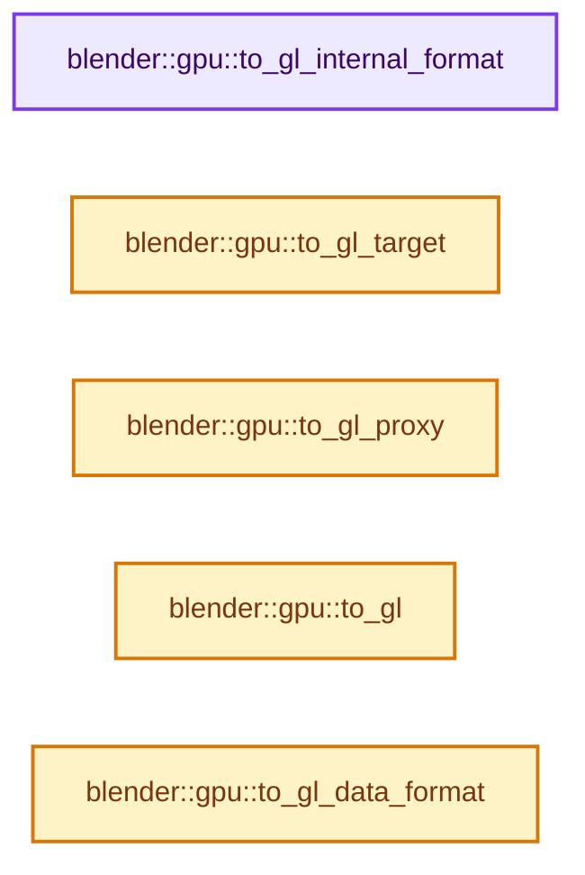
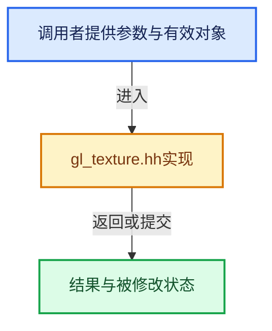

# 实现依赖专题：source/blender/gpu/opengl/gl_texture.hh

[实现依赖导航](../../../README.md) · [符号索引](../../../../00-课程指南/02-源码与提交索引/符号依赖与实现索引.md)

本专题从正文实际调用进入，集中保存共享实现。函数有稳定锚点，可从调用处直接跳到对应完整函数；递归与互相调用通过回链组织。

## 本文件的实现关系






## 完整成员与函数实现

<a id="f-8e6944858a55ad2e"></a>

### `blender::gpu::to_gl_internal_format`

实现位置：[source/blender/gpu/opengl/gl_texture.hh](../../../../../../../../source/blender/gpu/opengl/gl_texture.hh) · L143—L157。

接口参数：

- `TextureFormat format`

**教学注释版**

<!-- annotated:8b0bf597b2e6ac -->

```cpp
inline GLenum to_gl_internal_format(TextureFormat format)
{
#define CASE(a, b, c, blender_enum, d, e, f, gl_pixel_enum, h) \
  case TextureFormat::blender_enum: \
    return GL_##gl_pixel_enum;

  switch (format) {
    GPU_TEXTURE_FORMAT_EXPAND(CASE)
    case TextureFormat::Invalid:
      break;
  }
#undef CASE
  BLI_assert_msg(0, "Texture format incorrect or unsupported");
  return 0;
}
```

<details>
<summary>核对原始源码：source/blender/gpu/opengl/gl_texture.hh · L143—L157</summary>

<!-- original:8b0bf597b2e6ac:source/blender/gpu/opengl/gl_texture.hh:143:157 -->

```cpp
inline GLenum to_gl_internal_format(TextureFormat format)
{
#define CASE(a, b, c, blender_enum, d, e, f, gl_pixel_enum, h) \
  case TextureFormat::blender_enum: \
    return GL_##gl_pixel_enum;

  switch (format) {
    GPU_TEXTURE_FORMAT_EXPAND(CASE)
    case TextureFormat::Invalid:
      break;
  }
#undef CASE
  BLI_assert_msg(0, "Texture format incorrect or unsupported");
  return 0;
}
```

</details>

**结果出口**

- `return GL_##gl_pixel_enum;`
- `return 0;`

**继续追踪实现**

- `GPU_TEXTURE_FORMAT_EXPAND` → [调用协议](../../../../00-课程指南/01-路线与规范/模板宏与动态分派协议.md)：配置相关检测或外部运行时接口。调用位置L150。
- `BLI_assert_msg` → [BLI_assert_msg · L55](../../../01-BLI基础库/BLI_assert.hh.md#m-695eed20dceb)；[BLI_assert_msg · L64](../../../01-BLI基础库/BLI_assert.hh.md#m-7de5563de4db)。宏定义由构建条件选择。

<a id="f-19fabf8e43c1187c"></a>

### `blender::gpu::to_gl_target`

实现位置：[source/blender/gpu/opengl/gl_texture.hh](../../../../../../../../source/blender/gpu/opengl/gl_texture.hh) · L159—L182。

接口参数：

- `GPUTextureType type`

**教学注释版**

<!-- annotated:92de003f532543 -->

```cpp
inline GLenum to_gl_target(GPUTextureType type)
{
  switch (type) {
    case GPU_TEXTURE_1D:
      return GL_TEXTURE_1D;
    case GPU_TEXTURE_1D_ARRAY:
      return GL_TEXTURE_1D_ARRAY;
    case GPU_TEXTURE_2D:
      return GL_TEXTURE_2D;
    case GPU_TEXTURE_2D_ARRAY:
      return GL_TEXTURE_2D_ARRAY;
    case GPU_TEXTURE_3D:
      return GL_TEXTURE_3D;
    case GPU_TEXTURE_CUBE:
      return GL_TEXTURE_CUBE_MAP;
    case GPU_TEXTURE_CUBE_ARRAY:
      return GL_TEXTURE_CUBE_MAP_ARRAY_ARB;
    case GPU_TEXTURE_BUFFER:
      return GL_TEXTURE_BUFFER;
    default:
      BLI_assert(0);
      return GL_TEXTURE_1D;
  }
}
```

<details>
<summary>核对原始源码：source/blender/gpu/opengl/gl_texture.hh · L159—L182</summary>

<!-- original:92de003f532543:source/blender/gpu/opengl/gl_texture.hh:159:182 -->

```cpp
inline GLenum to_gl_target(GPUTextureType type)
{
  switch (type) {
    case GPU_TEXTURE_1D:
      return GL_TEXTURE_1D;
    case GPU_TEXTURE_1D_ARRAY:
      return GL_TEXTURE_1D_ARRAY;
    case GPU_TEXTURE_2D:
      return GL_TEXTURE_2D;
    case GPU_TEXTURE_2D_ARRAY:
      return GL_TEXTURE_2D_ARRAY;
    case GPU_TEXTURE_3D:
      return GL_TEXTURE_3D;
    case GPU_TEXTURE_CUBE:
      return GL_TEXTURE_CUBE_MAP;
    case GPU_TEXTURE_CUBE_ARRAY:
      return GL_TEXTURE_CUBE_MAP_ARRAY_ARB;
    case GPU_TEXTURE_BUFFER:
      return GL_TEXTURE_BUFFER;
    default:
      BLI_assert(0);
      return GL_TEXTURE_1D;
  }
}
```

</details>

**结果出口**

- `return GL_TEXTURE_1D;`
- `return GL_TEXTURE_1D_ARRAY;`
- `return GL_TEXTURE_2D;`
- `return GL_TEXTURE_2D_ARRAY;`
- `return GL_TEXTURE_3D;`
- `return GL_TEXTURE_CUBE_MAP;`
- `return GL_TEXTURE_CUBE_MAP_ARRAY_ARB;`
- `return GL_TEXTURE_BUFFER;`

**继续追踪实现**

- `BLI_assert` → [BLI_assert · L48](../../../01-BLI基础库/BLI_assert.hh.md#m-57a88495704d)；[BLI_assert · L63](../../../01-BLI基础库/BLI_assert.hh.md#m-d07050020cb5)。宏定义由构建条件选择。

<a id="f-e9a4fe76a11a3595"></a>

### `blender::gpu::to_gl_proxy`

实现位置：[source/blender/gpu/opengl/gl_texture.hh](../../../../../../../../source/blender/gpu/opengl/gl_texture.hh) · L184—L206。

接口参数：

- `GPUTextureType type`

**教学注释版**

<!-- annotated:3981ff7667e5aa -->

```cpp
inline GLenum to_gl_proxy(GPUTextureType type)
{
  switch (type) {
    case GPU_TEXTURE_1D:
      return GL_PROXY_TEXTURE_1D;
    case GPU_TEXTURE_1D_ARRAY:
      return GL_PROXY_TEXTURE_1D_ARRAY;
    case GPU_TEXTURE_2D:
      return GL_PROXY_TEXTURE_2D;
    case GPU_TEXTURE_2D_ARRAY:
      return GL_PROXY_TEXTURE_2D_ARRAY;
    case GPU_TEXTURE_3D:
      return GL_PROXY_TEXTURE_3D;
    case GPU_TEXTURE_CUBE:
      return GL_PROXY_TEXTURE_CUBE_MAP;
    case GPU_TEXTURE_CUBE_ARRAY:
      return GL_PROXY_TEXTURE_CUBE_MAP_ARRAY_ARB;
    case GPU_TEXTURE_BUFFER:
    default:
      BLI_assert(0);
      return GL_TEXTURE_1D;
  }
}
```

<details>
<summary>核对原始源码：source/blender/gpu/opengl/gl_texture.hh · L184—L206</summary>

<!-- original:3981ff7667e5aa:source/blender/gpu/opengl/gl_texture.hh:184:206 -->

```cpp
inline GLenum to_gl_proxy(GPUTextureType type)
{
  switch (type) {
    case GPU_TEXTURE_1D:
      return GL_PROXY_TEXTURE_1D;
    case GPU_TEXTURE_1D_ARRAY:
      return GL_PROXY_TEXTURE_1D_ARRAY;
    case GPU_TEXTURE_2D:
      return GL_PROXY_TEXTURE_2D;
    case GPU_TEXTURE_2D_ARRAY:
      return GL_PROXY_TEXTURE_2D_ARRAY;
    case GPU_TEXTURE_3D:
      return GL_PROXY_TEXTURE_3D;
    case GPU_TEXTURE_CUBE:
      return GL_PROXY_TEXTURE_CUBE_MAP;
    case GPU_TEXTURE_CUBE_ARRAY:
      return GL_PROXY_TEXTURE_CUBE_MAP_ARRAY_ARB;
    case GPU_TEXTURE_BUFFER:
    default:
      BLI_assert(0);
      return GL_TEXTURE_1D;
  }
}
```

</details>

**结果出口**

- `return GL_PROXY_TEXTURE_1D;`
- `return GL_PROXY_TEXTURE_1D_ARRAY;`
- `return GL_PROXY_TEXTURE_2D;`
- `return GL_PROXY_TEXTURE_2D_ARRAY;`
- `return GL_PROXY_TEXTURE_3D;`
- `return GL_PROXY_TEXTURE_CUBE_MAP;`
- `return GL_PROXY_TEXTURE_CUBE_MAP_ARRAY_ARB;`
- `return GL_TEXTURE_1D;`

**继续追踪实现**

- `BLI_assert` → [BLI_assert · L48](../../../01-BLI基础库/BLI_assert.hh.md#m-57a88495704d)；[BLI_assert · L63](../../../01-BLI基础库/BLI_assert.hh.md#m-d07050020cb5)。宏定义由构建条件选择。

<a id="f-a55d68142cdbbec1"></a>

### `blender::gpu::to_gl`

实现位置：[source/blender/gpu/opengl/gl_texture.hh](../../../../../../../../source/blender/gpu/opengl/gl_texture.hh) · L231—L254。

接口参数：

- `eGPUDataFormat format`

**教学注释版**

<!-- annotated:1b73f52a1a1a82 -->

```cpp
inline GLenum to_gl(eGPUDataFormat format)
{
  switch (format) {
    case GPU_DATA_FLOAT:
      return GL_FLOAT;
    case GPU_DATA_INT:
      return GL_INT;
    case GPU_DATA_UINT:
      return GL_UNSIGNED_INT;
    case GPU_DATA_UBYTE:
      return GL_UNSIGNED_BYTE;
    case GPU_DATA_UINT_24_8_DEPRECATED:
      return GL_UNSIGNED_INT_24_8;
    case GPU_DATA_2_10_10_10_REV:
      return GL_UNSIGNED_INT_2_10_10_10_REV;
    case GPU_DATA_10_11_11_REV:
      return GL_UNSIGNED_INT_10F_11F_11F_REV;
    case GPU_DATA_HALF_FLOAT:
      return GL_HALF_FLOAT;
    default:
      BLI_assert_msg(0, "Unhandled data format");
      return GL_FLOAT;
  }
}
```

<details>
<summary>核对原始源码：source/blender/gpu/opengl/gl_texture.hh · L231—L254</summary>

<!-- original:1b73f52a1a1a82:source/blender/gpu/opengl/gl_texture.hh:231:254 -->

```cpp
inline GLenum to_gl(eGPUDataFormat format)
{
  switch (format) {
    case GPU_DATA_FLOAT:
      return GL_FLOAT;
    case GPU_DATA_INT:
      return GL_INT;
    case GPU_DATA_UINT:
      return GL_UNSIGNED_INT;
    case GPU_DATA_UBYTE:
      return GL_UNSIGNED_BYTE;
    case GPU_DATA_UINT_24_8_DEPRECATED:
      return GL_UNSIGNED_INT_24_8;
    case GPU_DATA_2_10_10_10_REV:
      return GL_UNSIGNED_INT_2_10_10_10_REV;
    case GPU_DATA_10_11_11_REV:
      return GL_UNSIGNED_INT_10F_11F_11F_REV;
    case GPU_DATA_HALF_FLOAT:
      return GL_HALF_FLOAT;
    default:
      BLI_assert_msg(0, "Unhandled data format");
      return GL_FLOAT;
  }
}
```

</details>

**结果出口**

- `return GL_FLOAT;`
- `return GL_INT;`
- `return GL_UNSIGNED_INT;`
- `return GL_UNSIGNED_BYTE;`
- `return GL_UNSIGNED_INT_24_8;`
- `return GL_UNSIGNED_INT_2_10_10_10_REV;`
- `return GL_UNSIGNED_INT_10F_11F_11F_REV;`
- `return GL_HALF_FLOAT;`

**继续追踪实现**

- `BLI_assert_msg` → [BLI_assert_msg · L55](../../../01-BLI基础库/BLI_assert.hh.md#m-695eed20dceb)；[BLI_assert_msg · L64](../../../01-BLI基础库/BLI_assert.hh.md#m-7de5563de4db)。宏定义由构建条件选择。

<a id="f-b5b89a761fd75c7e"></a>

### `blender::gpu::to_gl_data_format`

实现位置：[source/blender/gpu/opengl/gl_texture.hh](../../../../../../../../source/blender/gpu/opengl/gl_texture.hh) · L256—L353。

接口参数：

- `TextureFormat format`

**教学注释版**

<!-- annotated:551d37b3bb1cf3 -->

```cpp
inline GLenum to_gl_data_format(TextureFormat format)
{
  switch (format) {
    /* Texture & Render-Buffer Formats. */
    case TextureFormat::UNORM_8_8_8_8:
    case TextureFormat::SFLOAT_32_32_32_32:
    case TextureFormat::SFLOAT_16_16_16_16:
    case TextureFormat::UNORM_16_16_16_16:
      return GL_RGBA;
    case TextureFormat::UINT_8_8_8_8:
    case TextureFormat::SINT_8_8_8_8:
    case TextureFormat::SINT_32_32_32_32:
    case TextureFormat::UINT_32_32_32_32:
    case TextureFormat::UINT_16_16_16_16:
    case TextureFormat::SINT_16_16_16_16:
      return GL_RGBA_INTEGER;
    case TextureFormat::UNORM_8_8:
    case TextureFormat::SFLOAT_32_32:
    case TextureFormat::SFLOAT_16_16:
    case TextureFormat::UNORM_16_16:
      return GL_RG;
    case TextureFormat::UINT_8_8:
    case TextureFormat::SINT_8_8:
    case TextureFormat::UINT_32_32:
    case TextureFormat::SINT_32_32:
    case TextureFormat::SINT_16_16:
    case TextureFormat::UINT_16_16:
      return GL_RG_INTEGER;
    case TextureFormat::UNORM_8:
    case TextureFormat::SFLOAT_32:
    case TextureFormat::SFLOAT_16:
    case TextureFormat::UNORM_16:
      return GL_RED;
    case TextureFormat::UINT_8:
    case TextureFormat::SINT_8:
    case TextureFormat::UINT_32:
    case TextureFormat::SINT_32:
    case TextureFormat::UINT_16:
    case TextureFormat::SINT_16:
      return GL_RED_INTEGER;
    /* Special formats texture & render-buffer. */
    case TextureFormat::UINT_10_10_10_2:
    case TextureFormat::UNORM_10_10_10_2:
    case TextureFormat::SRGBA_8_8_8_8:
      return GL_RGBA;
    case TextureFormat::UFLOAT_11_11_10:
      return GL_RGB;
    case TextureFormat::SFLOAT_32_DEPTH_UINT_8:
      return GL_DEPTH_STENCIL;
    /* Texture only formats. */
    case TextureFormat::SNORM_16_16_16_16:
    case TextureFormat::SNORM_8_8_8_8:
      return GL_RGBA;
    case TextureFormat::SFLOAT_16_16_16:
    case TextureFormat::SFLOAT_32_32_32:
    case TextureFormat::SINT_32_32_32:
    case TextureFormat::UINT_32_32_32:
    case TextureFormat::SNORM_16_16_16:
    case TextureFormat::SINT_16_16_16:
    case TextureFormat::UINT_16_16_16:
    case TextureFormat::UNORM_16_16_16:
    case TextureFormat::SNORM_8_8_8:
    case TextureFormat::UNORM_8_8_8:
    case TextureFormat::SINT_8_8_8:
    case TextureFormat::UINT_8_8_8:
      return GL_RGB;
    case TextureFormat::SNORM_16_16:
    case TextureFormat::SNORM_8_8:
      return GL_RG;
    case TextureFormat::SNORM_16:
    case TextureFormat::SNORM_8:
      return GL_RED;
      /* Special formats, texture only. */
    case TextureFormat::SRGB_DXT1:
      return GL_COMPRESSED_SRGB_ALPHA_S3TC_DXT1_EXT;
    case TextureFormat::SRGB_DXT3:
      return GL_COMPRESSED_SRGB_ALPHA_S3TC_DXT3_EXT;
    case TextureFormat::SRGB_DXT5:
      return GL_COMPRESSED_SRGB_ALPHA_S3TC_DXT5_EXT;
    case TextureFormat::SNORM_DXT1:
      return GL_COMPRESSED_RGBA_S3TC_DXT1_EXT;
    case TextureFormat::SNORM_DXT3:
      return GL_COMPRESSED_RGBA_S3TC_DXT3_EXT;
    case TextureFormat::SNORM_DXT5:
      return GL_COMPRESSED_RGBA_S3TC_DXT5_EXT;
    case TextureFormat::SRGBA_8_8_8:
    case TextureFormat::UFLOAT_9_9_9_EXP_5:
      return GL_RGB;
    /* Depth Formats. */
    case TextureFormat::SFLOAT_32_DEPTH:
    case TextureFormat::UNORM_16_DEPTH:
      return GL_DEPTH_COMPONENT;
    case TextureFormat::Invalid:
      break;
  }
  BLI_assert_msg(0, "Texture format incorrect or unsupported\n");
  return 0;
}
```

<details>
<summary>核对原始源码：source/blender/gpu/opengl/gl_texture.hh · L256—L353</summary>

<!-- original:551d37b3bb1cf3:source/blender/gpu/opengl/gl_texture.hh:256:353 -->

```cpp
inline GLenum to_gl_data_format(TextureFormat format)
{
  switch (format) {
    /* Texture & Render-Buffer Formats. */
    case TextureFormat::UNORM_8_8_8_8:
    case TextureFormat::SFLOAT_32_32_32_32:
    case TextureFormat::SFLOAT_16_16_16_16:
    case TextureFormat::UNORM_16_16_16_16:
      return GL_RGBA;
    case TextureFormat::UINT_8_8_8_8:
    case TextureFormat::SINT_8_8_8_8:
    case TextureFormat::SINT_32_32_32_32:
    case TextureFormat::UINT_32_32_32_32:
    case TextureFormat::UINT_16_16_16_16:
    case TextureFormat::SINT_16_16_16_16:
      return GL_RGBA_INTEGER;
    case TextureFormat::UNORM_8_8:
    case TextureFormat::SFLOAT_32_32:
    case TextureFormat::SFLOAT_16_16:
    case TextureFormat::UNORM_16_16:
      return GL_RG;
    case TextureFormat::UINT_8_8:
    case TextureFormat::SINT_8_8:
    case TextureFormat::UINT_32_32:
    case TextureFormat::SINT_32_32:
    case TextureFormat::SINT_16_16:
    case TextureFormat::UINT_16_16:
      return GL_RG_INTEGER;
    case TextureFormat::UNORM_8:
    case TextureFormat::SFLOAT_32:
    case TextureFormat::SFLOAT_16:
    case TextureFormat::UNORM_16:
      return GL_RED;
    case TextureFormat::UINT_8:
    case TextureFormat::SINT_8:
    case TextureFormat::UINT_32:
    case TextureFormat::SINT_32:
    case TextureFormat::UINT_16:
    case TextureFormat::SINT_16:
      return GL_RED_INTEGER;
    /* Special formats texture & render-buffer. */
    case TextureFormat::UINT_10_10_10_2:
    case TextureFormat::UNORM_10_10_10_2:
    case TextureFormat::SRGBA_8_8_8_8:
      return GL_RGBA;
    case TextureFormat::UFLOAT_11_11_10:
      return GL_RGB;
    case TextureFormat::SFLOAT_32_DEPTH_UINT_8:
      return GL_DEPTH_STENCIL;
    /* Texture only formats. */
    case TextureFormat::SNORM_16_16_16_16:
    case TextureFormat::SNORM_8_8_8_8:
      return GL_RGBA;
    case TextureFormat::SFLOAT_16_16_16:
    case TextureFormat::SFLOAT_32_32_32:
    case TextureFormat::SINT_32_32_32:
    case TextureFormat::UINT_32_32_32:
    case TextureFormat::SNORM_16_16_16:
    case TextureFormat::SINT_16_16_16:
    case TextureFormat::UINT_16_16_16:
    case TextureFormat::UNORM_16_16_16:
    case TextureFormat::SNORM_8_8_8:
    case TextureFormat::UNORM_8_8_8:
    case TextureFormat::SINT_8_8_8:
    case TextureFormat::UINT_8_8_8:
      return GL_RGB;
    case TextureFormat::SNORM_16_16:
    case TextureFormat::SNORM_8_8:
      return GL_RG;
    case TextureFormat::SNORM_16:
    case TextureFormat::SNORM_8:
      return GL_RED;
      /* Special formats, texture only. */
    case TextureFormat::SRGB_DXT1:
      return GL_COMPRESSED_SRGB_ALPHA_S3TC_DXT1_EXT;
    case TextureFormat::SRGB_DXT3:
      return GL_COMPRESSED_SRGB_ALPHA_S3TC_DXT3_EXT;
    case TextureFormat::SRGB_DXT5:
      return GL_COMPRESSED_SRGB_ALPHA_S3TC_DXT5_EXT;
    case TextureFormat::SNORM_DXT1:
      return GL_COMPRESSED_RGBA_S3TC_DXT1_EXT;
    case TextureFormat::SNORM_DXT3:
      return GL_COMPRESSED_RGBA_S3TC_DXT3_EXT;
    case TextureFormat::SNORM_DXT5:
      return GL_COMPRESSED_RGBA_S3TC_DXT5_EXT;
    case TextureFormat::SRGBA_8_8_8:
    case TextureFormat::UFLOAT_9_9_9_EXP_5:
      return GL_RGB;
    /* Depth Formats. */
    case TextureFormat::SFLOAT_32_DEPTH:
    case TextureFormat::UNORM_16_DEPTH:
      return GL_DEPTH_COMPONENT;
    case TextureFormat::Invalid:
      break;
  }
  BLI_assert_msg(0, "Texture format incorrect or unsupported\n");
  return 0;
}
```

</details>

**结果出口**

- `return GL_RGBA;`
- `return GL_RGBA_INTEGER;`
- `return GL_RG;`
- `return GL_RG_INTEGER;`
- `return GL_RED;`
- `return GL_RED_INTEGER;`
- `return GL_RGB;`
- `return GL_DEPTH_STENCIL;`
- `return GL_COMPRESSED_SRGB_ALPHA_S3TC_DXT1_EXT;`
- `return GL_COMPRESSED_SRGB_ALPHA_S3TC_DXT3_EXT;`
- `return GL_COMPRESSED_SRGB_ALPHA_S3TC_DXT5_EXT;`
- `return GL_COMPRESSED_RGBA_S3TC_DXT1_EXT;`
- `return GL_COMPRESSED_RGBA_S3TC_DXT3_EXT;`
- `return GL_COMPRESSED_RGBA_S3TC_DXT5_EXT;`
- `return GL_DEPTH_COMPONENT;`
- `return 0;`

**继续追踪实现**

- `BLI_assert_msg` → [BLI_assert_msg · L55](../../../01-BLI基础库/BLI_assert.hh.md#m-695eed20dceb)；[BLI_assert_msg · L64](../../../01-BLI基础库/BLI_assert.hh.md#m-7de5563de4db)。宏定义由构建条件选择。
