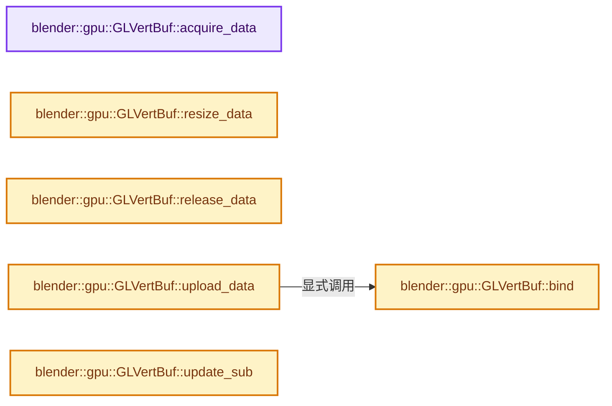

# 实现依赖专题：source/blender/gpu/opengl/gl_vertex_buffer.cc

[实现依赖导航](../../../README.md) · [符号索引](../../../../00-课程指南/02-源码与提交索引/符号依赖与实现索引.md)

本专题从正文实际调用进入，集中保存共享实现。函数有稳定锚点，可从调用处直接跳到对应完整函数；递归与互相调用通过回链组织。

## 本文件的实现关系




## 完整成员与函数实现

<a id="f-0ea2a81da652068e"></a>

### `blender::gpu::GLVertBuf::acquire_data`

实现位置：[source/blender/gpu/opengl/gl_vertex_buffer.cc](../../../../../../../../source/blender/gpu/opengl/gl_vertex_buffer.cc) · L17—L26。

**教学注释版**

<!-- annotated:5b247baf1eb368 -->

```cpp
void GLVertBuf::acquire_data()
{
  if (usage_ == GPU_USAGE_DEVICE_ONLY) {
    return;
  }

  /* Discard previous data if any. */
  MEM_SAFE_DELETE(data_);
  data_ = MEM_new_array_uninitialized<uchar>(this->size_alloc_get(), __func__);
}
```

<details>
<summary>核对原始源码：source/blender/gpu/opengl/gl_vertex_buffer.cc · L17—L26</summary>

<!-- original:5b247baf1eb368:source/blender/gpu/opengl/gl_vertex_buffer.cc:17:26 -->

```cpp
void GLVertBuf::acquire_data()
{
  if (usage_ == GPU_USAGE_DEVICE_ONLY) {
    return;
  }

  /* Discard previous data if any. */
  MEM_SAFE_DELETE(data_);
  data_ = MEM_new_array_uninitialized<uchar>(this->size_alloc_get(), __func__);
}
```

</details>

**沿实际写入检查状态**

- `data_ = MEM_new_array_uninitialized<uchar>(this->size_alloc_get(), __func__);`

**继续追踪实现**

- `MEM_SAFE_DELETE` → [MEM_SAFE_DELETE · L436](../../../07-Intern运行时与平台/guardedalloc/MEM_guardedalloc.h.md#m-eadb3bc5b902)。宏定义由构建条件选择。
- `MEM_new_array_uninitialized<uchar>` → [MEM_new_array_uninitialized · L608](../../../07-Intern运行时与平台/guardedalloc/MEM_guardedalloc.h.md#f-b7103eae8eb57b05)；[MEM_new_array_uninitialized · L129](../../../07-Intern运行时与平台/guardedalloc/intern/mallocn.cc.md#f-bf6ef4ddcfb6e5df)。同名重载需按实参类型选择。
- `this->size_alloc_get` → [blender::gpu::VertBuf::size_alloc_get · L186](../GPU_vertex_buffer.hh.md#f-e679f152211ac8cf)。

<a id="f-a09b13cac68f760c"></a>

### `blender::gpu::GLVertBuf::resize_data`

实现位置：[source/blender/gpu/opengl/gl_vertex_buffer.cc](../../../../../../../../source/blender/gpu/opengl/gl_vertex_buffer.cc) · L28—L36。

**教学注释版**

<!-- annotated:92aef6fcfcad33 -->

```cpp
void GLVertBuf::resize_data()
{
  if (usage_ == GPU_USAGE_DEVICE_ONLY) {
    return;
  }

  data_ = static_cast<uchar *>(
      MEM_realloc_uninitialized(data_, sizeof(uchar) * this->size_alloc_get()));
}
```

<details>
<summary>核对原始源码：source/blender/gpu/opengl/gl_vertex_buffer.cc · L28—L36</summary>

<!-- original:92aef6fcfcad33:source/blender/gpu/opengl/gl_vertex_buffer.cc:28:36 -->

```cpp
void GLVertBuf::resize_data()
{
  if (usage_ == GPU_USAGE_DEVICE_ONLY) {
    return;
  }

  data_ = static_cast<uchar *>(
      MEM_realloc_uninitialized(data_, sizeof(uchar) * this->size_alloc_get()));
}
```

</details>

**沿实际写入检查状态**

- `data_ = static_cast<uchar *>(`

**继续追踪实现**

- `MEM_realloc_uninitialized` → [MEM_realloc_uninitialized · L118](../../../07-Intern运行时与平台/guardedalloc/MEM_guardedalloc.h.md#m-813b7cd3fcff)。宏定义由构建条件选择。
- `this->size_alloc_get` → [blender::gpu::VertBuf::size_alloc_get · L186](../GPU_vertex_buffer.hh.md#f-e679f152211ac8cf)。

<a id="f-c2b1e215b5da12eb"></a>

### `blender::gpu::GLVertBuf::release_data`

实现位置：[source/blender/gpu/opengl/gl_vertex_buffer.cc](../../../../../../../../source/blender/gpu/opengl/gl_vertex_buffer.cc) · L38—L52。

**教学注释版**

<!-- annotated:437e135e05f6af -->

```cpp
void GLVertBuf::release_data()
{
  if (is_wrapper_) {
    return;
  }

  if (vbo_id_ != 0) {
    GPU_TEXTURE_FREE_SAFE(buffer_texture_);
    GLContext::buffer_free(vbo_id_);
    vbo_id_ = 0;
    memory_usage -= vbo_size_;
  }

  MEM_SAFE_DELETE(data_);
}
```

<details>
<summary>核对原始源码：source/blender/gpu/opengl/gl_vertex_buffer.cc · L38—L52</summary>

<!-- original:437e135e05f6af:source/blender/gpu/opengl/gl_vertex_buffer.cc:38:52 -->

```cpp
void GLVertBuf::release_data()
{
  if (is_wrapper_) {
    return;
  }

  if (vbo_id_ != 0) {
    GPU_TEXTURE_FREE_SAFE(buffer_texture_);
    GLContext::buffer_free(vbo_id_);
    vbo_id_ = 0;
    memory_usage -= vbo_size_;
  }

  MEM_SAFE_DELETE(data_);
}
```

</details>

**沿实际写入检查状态**

- `vbo_id_ = 0;`
- `memory_usage -= vbo_size_;`

**继续追踪实现**

- `GPU_TEXTURE_FREE_SAFE` → [GPU_TEXTURE_FREE_SAFE · L902](../GPU_texture.hh.md#m-fa9785b115fa)。宏定义由构建条件选择。
- `GLContext::buffer_free` → [blender::GLContext::buffer_free · L284](gl_context.cc.md#f-51f508546ae90e7b)。
- `MEM_SAFE_DELETE` → [MEM_SAFE_DELETE · L436](../../../07-Intern运行时与平台/guardedalloc/MEM_guardedalloc.h.md#m-eadb3bc5b902)。宏定义由构建条件选择。

<a id="f-5520393e287282d6"></a>

### `blender::gpu::GLVertBuf::upload_data`

实现位置：[source/blender/gpu/opengl/gl_vertex_buffer.cc](../../../../../../../../source/blender/gpu/opengl/gl_vertex_buffer.cc) · L54—L57。

**教学注释版**

<!-- annotated:c427f48679bdf1 -->

```cpp
void GLVertBuf::upload_data()
{
  this->bind();
}
```

<details>
<summary>核对原始源码：source/blender/gpu/opengl/gl_vertex_buffer.cc · L54—L57</summary>

<!-- original:c427f48679bdf1:source/blender/gpu/opengl/gl_vertex_buffer.cc:54:57 -->

```cpp
void GLVertBuf::upload_data()
{
  this->bind();
}
```

</details>

**继续追踪实现**

- `this->bind` → [blender::gpu::GLVertBuf::bind · L59](gl_vertex_buffer.cc.md#f-86019829ff95240a)。

<a id="f-86019829ff95240a"></a>

### `blender::gpu::GLVertBuf::bind`

实现位置：[source/blender/gpu/opengl/gl_vertex_buffer.cc](../../../../../../../../source/blender/gpu/opengl/gl_vertex_buffer.cc) · L59—L88。

**教学注释版**

<!-- annotated:ed85765d4bc17d -->

```cpp
void GLVertBuf::bind()
{
  BLI_assert(GLContext::get() != nullptr);

  if (vbo_id_ == 0) {
    glGenBuffers(1, &vbo_id_);
  }

  glBindBuffer(GL_ARRAY_BUFFER, vbo_id_);

  if (flag & GPU_VERTBUF_DATA_DIRTY) {
    vbo_size_ = this->size_used_get();

    /* This is fine on some systems but will crash on others. */
    BLI_assert(vbo_size_ != 0);
    /* Orphan the vbo to avoid sync then upload data. */
    glBufferData(GL_ARRAY_BUFFER, ceil_to_multiple_ul(vbo_size_, 16), nullptr, to_gl(usage_));
    /* Do not transfer data from host to device when buffer is device only. */
    if (usage_ != GPU_USAGE_DEVICE_ONLY) {
      glBufferSubData(GL_ARRAY_BUFFER, 0, vbo_size_, data_);
    }
    memory_usage += vbo_size_;

    if (usage_ == GPU_USAGE_STATIC) {
      MEM_SAFE_DELETE(data_);
    }
    flag &= ~GPU_VERTBUF_DATA_DIRTY;
    flag |= GPU_VERTBUF_DATA_UPLOADED;
  }
}
```

<details>
<summary>核对原始源码：source/blender/gpu/opengl/gl_vertex_buffer.cc · L59—L88</summary>

<!-- original:ed85765d4bc17d:source/blender/gpu/opengl/gl_vertex_buffer.cc:59:88 -->

```cpp
void GLVertBuf::bind()
{
  BLI_assert(GLContext::get() != nullptr);

  if (vbo_id_ == 0) {
    glGenBuffers(1, &vbo_id_);
  }

  glBindBuffer(GL_ARRAY_BUFFER, vbo_id_);

  if (flag & GPU_VERTBUF_DATA_DIRTY) {
    vbo_size_ = this->size_used_get();

    /* This is fine on some systems but will crash on others. */
    BLI_assert(vbo_size_ != 0);
    /* Orphan the vbo to avoid sync then upload data. */
    glBufferData(GL_ARRAY_BUFFER, ceil_to_multiple_ul(vbo_size_, 16), nullptr, to_gl(usage_));
    /* Do not transfer data from host to device when buffer is device only. */
    if (usage_ != GPU_USAGE_DEVICE_ONLY) {
      glBufferSubData(GL_ARRAY_BUFFER, 0, vbo_size_, data_);
    }
    memory_usage += vbo_size_;

    if (usage_ == GPU_USAGE_STATIC) {
      MEM_SAFE_DELETE(data_);
    }
    flag &= ~GPU_VERTBUF_DATA_DIRTY;
    flag |= GPU_VERTBUF_DATA_UPLOADED;
  }
}
```

</details>

**沿实际写入检查状态**

- `vbo_size_ = this->size_used_get();`
- `memory_usage += vbo_size_;`
- `flag &= ~GPU_VERTBUF_DATA_DIRTY;`
- `flag |= GPU_VERTBUF_DATA_UPLOADED;`

**继续追踪实现**

- `BLI_assert` → [BLI_assert · L48](../../../01-BLI基础库/BLI_assert.hh.md#m-57a88495704d)；[BLI_assert · L63](../../../01-BLI基础库/BLI_assert.hh.md#m-d07050020cb5)。宏定义由构建条件选择。
- `GLContext::get` → [blender::gpu::GLContext::get · L143](gl_context.hh.md#f-2d6c70989abeb59b)。
- `glGenBuffers` → [调用协议](../../../../00-课程指南/01-路线与规范/模板宏与动态分派协议.md)：函数指针、局部可调用对象或未展开的宏；必须结合调用者环境。调用位置L64。
- `glBindBuffer` → [调用协议](../../../../00-课程指南/01-路线与规范/模板宏与动态分派协议.md)：函数指针、局部可调用对象或未展开的宏；必须结合调用者环境。调用位置L67。
- `this->size_used_get` → [blender::gpu::VertBuf::size_used_get · L192](../GPU_vertex_buffer.hh.md#f-fb11c22cfc2ca429)。
- `glBufferData` → [调用协议](../../../../00-课程指南/01-路线与规范/模板宏与动态分派协议.md)：函数指针、局部可调用对象或未展开的宏；必须结合调用者环境。调用位置L75。
- `ceil_to_multiple_ul` → [blender::ceil_to_multiple_ul · L250](../../../01-BLI基础库/intern/math_base_inline.cc.md#f-2d8b440555643252)。
- `to_gl` → [blender::gpu::to_gl · L63](gl_vertex_buffer.hh.md#f-3759e26048aba930)；[blender::gpu::to_gl · L79](gl_vertex_buffer.hh.md#f-564f569c2795e2e0)；[blender::gpu::to_gl · L231](gl_texture.hh.md#f-a55d68142cdbbec1)；[blender::gpu::to_gl · L610](gl_texture.cc.md#f-d765dcd5ade0fd47)；[blender::gpu::to_gl · L120](gl_state.hh.md#f-7d9342a10afa8867)；[blender::gpu::to_gl · L46](gl_query.hh.md#f-462795db7ca2fcc5)；[blender::gpu::to_gl · L19](gl_primitive.hh.md#f-880255f821d74df2)；[blender::gpu::to_gl · L68](gl_index_buffer.hh.md#f-64d92f0eefbd7427)；[blender::gpu::to_gl · L131](gl_framebuffer.hh.md#f-c2fdb3b51bc2e0c0)；[blender::gpu::to_gl · L157](gl_framebuffer.hh.md#f-429e055bc6a7fafe)。同名重载需按实参类型选择。
- `glBufferSubData` → [调用协议](../../../../00-课程指南/01-路线与规范/模板宏与动态分派协议.md)：函数指针、局部可调用对象或未展开的宏；必须结合调用者环境。调用位置L78。
- `MEM_SAFE_DELETE` → [MEM_SAFE_DELETE · L436](../../../07-Intern运行时与平台/guardedalloc/MEM_guardedalloc.h.md#m-eadb3bc5b902)。宏定义由构建条件选择。

<a id="f-b458dbaca6d259e1"></a>

### `blender::gpu::GLVertBuf::update_sub`

实现位置：[source/blender/gpu/opengl/gl_vertex_buffer.cc](../../../../../../../../source/blender/gpu/opengl/gl_vertex_buffer.cc) · L140—L143。

接口参数：

- `uint start`
- `uint len`
- `const void *data`

**教学注释版**

<!-- annotated:a854c8ded39ec8 -->

```cpp
void GLVertBuf::update_sub(uint start, uint len, const void *data)
{
  glBufferSubData(GL_ARRAY_BUFFER, start, len, data);
}
```

<details>
<summary>核对原始源码：source/blender/gpu/opengl/gl_vertex_buffer.cc · L140—L143</summary>

<!-- original:a854c8ded39ec8:source/blender/gpu/opengl/gl_vertex_buffer.cc:140:143 -->

```cpp
void GLVertBuf::update_sub(uint start, uint len, const void *data)
{
  glBufferSubData(GL_ARRAY_BUFFER, start, len, data);
}
```

</details>

**继续追踪实现**

- `glBufferSubData` → [调用协议](../../../../00-课程指南/01-路线与规范/模板宏与动态分派协议.md)：函数指针、局部可调用对象或未展开的宏；必须结合调用者环境。调用位置L142。
