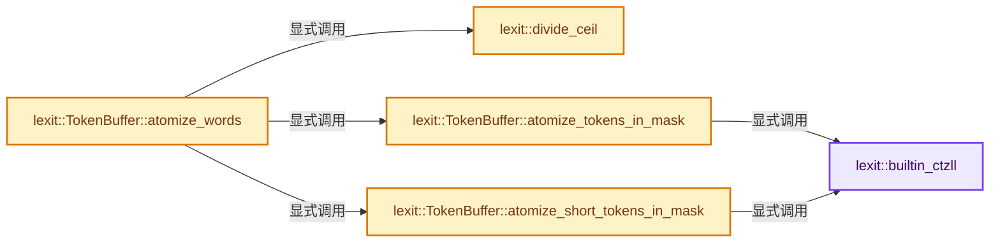
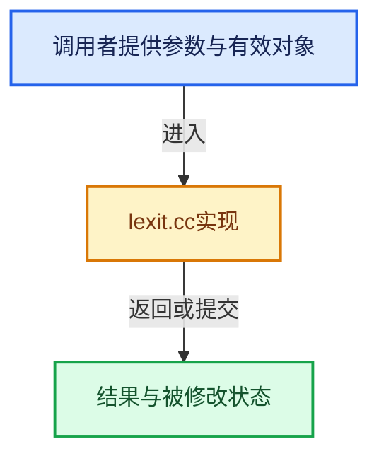

# 实现依赖专题：source/blender/gpu/shader_tool/lexit/lexit.cc

[实现依赖导航](../../../../README.md) · [符号索引](../../../../../00-课程指南/02-源码与提交索引/符号依赖与实现索引.md)

本专题从正文实际调用进入，集中保存共享实现。函数有稳定锚点，可从调用处直接跳到对应完整函数；递归与互相调用通过回链组织。

## 本文件的实现关系






## 完整成员与函数实现

<a id="f-7477b945c44f2cfa"></a>

### `lexit::builtin_ctzll`

实现位置：[source/blender/gpu/shader_tool/lexit/lexit.cc](../../../../../../../../../source/blender/gpu/shader_tool/lexit/lexit.cc) · L27—L36。

接口参数：

- `uint64_t a`

**教学注释版**

<!-- annotated:daa6bdd9ef2a3e -->

```cpp
static int builtin_ctzll(uint64_t a)
{
#ifdef _MSC_VER
  unsigned long ctz;
  _BitScanForward64(&ctz, a);
  return ctz;
#else
  return __builtin_ctzll(a);
#endif
}  // namespace lexit
```

<details>
<summary>核对原始源码：source/blender/gpu/shader_tool/lexit/lexit.cc · L27—L36</summary>

<!-- original:daa6bdd9ef2a3e:source/blender/gpu/shader_tool/lexit/lexit.cc:27:36 -->

```cpp
static int builtin_ctzll(uint64_t a)
{
#ifdef _MSC_VER
  unsigned long ctz;
  _BitScanForward64(&ctz, a);
  return ctz;
#else
  return __builtin_ctzll(a);
#endif
}  // namespace lexit
```

</details>

**结果出口**

- `return ctz;`
- `return __builtin_ctzll(a);`

**继续追踪实现**

- `_BitScanForward64` → [调用协议](../../../../../00-课程指南/01-路线与规范/模板宏与动态分派协议.md)：函数指针、局部可调用对象或未展开的宏；必须结合调用者环境。调用位置L31。
- `__builtin_ctzll` → [调用协议](../../../../../00-课程指南/01-路线与规范/模板宏与动态分派协议.md)：函数指针、局部可调用对象或未展开的宏；必须结合调用者环境。调用位置L34。

<a id="f-f228586b34b00cf5"></a>

### `lexit::divide_ceil`

实现位置：[source/blender/gpu/shader_tool/lexit/lexit.cc](../../../../../../../../../source/blender/gpu/shader_tool/lexit/lexit.cc) · L38—L41。

接口参数：

- `uint32_t a`
- `uint32_t b`

**教学注释版**

<!-- annotated:5161f3dc3efa6f -->

```cpp
static uint32_t divide_ceil(uint32_t a, uint32_t b)
{
  return (a + b - 1) / b;
}
```

<details>
<summary>核对原始源码：source/blender/gpu/shader_tool/lexit/lexit.cc · L38—L41</summary>

<!-- original:5161f3dc3efa6f:source/blender/gpu/shader_tool/lexit/lexit.cc:38:41 -->

```cpp
static uint32_t divide_ceil(uint32_t a, uint32_t b)
{
  return (a + b - 1) / b;
}
```

</details>

**结果出口**

- `return (a + b - 1) / b;`

**继续追踪实现**

本实现没有需要继续展开的显式调用；检查返回表达式、对象转换和调用者前置条件。

<a id="f-95dac04fdffdf946"></a>

### `lexit::TokenBuffer::atomize_words`

实现位置：[source/blender/gpu/shader_tool/lexit/lexit.cc](../../../../../../../../../source/blender/gpu/shader_tool/lexit/lexit.cc) · L671—L756。

接口参数：

- `IdentifierMap &identifiers`
- `const KeywordTable &keywords`

**教学注释版**

<!-- annotated:ed30346223ea82 -->

```cpp
void TokenBuffer::atomize_words(IdentifierMap &identifiers, const KeywordTable &keywords)
{
  static constexpr int stride = 64;

  struct Masks {
    uint64_t mask8, mask16, mask24, mask32;
  };
  /* First scan to create a bitmap of potential matches to avoid wasting cycles iterating over
   * non-words. */
  lexit::Vector<Masks> masks_small_id;
  lexit::Vector<uint64_t> masks_large_id;
  // [讲解] masks_small_id.resize：把有效元素数调整为new_size。增长路径构造新元素，缩小路径销毁尾部对象，最后才提交新的end_。
  masks_small_id.resize(divide_ceil(size_, stride));
  masks_large_id.resize(divide_ceil(size_, stride));

  {
    uint32_t chunk_id = 0;
    uint32_t tok_id = 0;
#if defined(USE_NEON) || defined(USE_SSE4_2)
    using namespace simd;
    for (; tok_id + stride <= size_; tok_id += stride, ++chunk_id) {
      const u8x64 size = u8x64::load(&lengths_[tok_id]);
      const u8x64 type = u8x64::load((uint8_t *)&types_[tok_id]);
      const uint64_t is_word = movemask(type == Word);
      const uint64_t less_8 = movemask(size < 9);
      const uint64_t less_16 = movemask(size < 17);
      const uint64_t less_24 = movemask(size < 25);
      const uint64_t less_32 = movemask(size < 33);

      Masks small;
      small.mask8 = is_word & less_8;
      small.mask16 = is_word & less_16 & ~less_8;
      small.mask24 = is_word & less_24 & ~less_16;
      small.mask32 = is_word & less_32 & ~less_24;
      masks_small_id[chunk_id] = small;
      masks_large_id[chunk_id] = is_word & ~less_32;
    }
#endif
    for (; tok_id < size_; tok_id += stride, ++chunk_id) {
      uint64_t is_word = 0, less_8 = 0, less_16 = 0, less_24 = 0, less_32 = 0;

      for (int i = 0; i < stride && tok_id + i < size_; ++i) {
        const uint8_t size = lengths_[tok_id + i];
        const TokenType type = types_[tok_id + i];
        const uint64_t bit = uint64_t(1) << i;
        /* Generate a masks of all 1s if true, all 0s if false. */
        is_word |= bit & -uint64_t(type == Word);
        less_8 |= bit & -uint64_t(size < 9);
        less_16 |= bit & -uint64_t(size < 17);
        less_24 |= bit & -uint64_t(size < 25);
        less_32 |= bit & -uint64_t(size < 33);
      }

      Masks small;
      small.mask8 = is_word & less_8;
      small.mask16 = is_word & less_16 & ~less_8;
      small.mask24 = is_word & less_24 & ~less_16;
      small.mask32 = is_word & less_32 & ~less_24;
      masks_small_id[chunk_id] = small;
      masks_large_id[chunk_id] = is_word & ~less_32;
    }
  }
  {
    /* Iterate over the bitmasks. */
    const int end = divide_ceil(size_, stride);
    /* The atomize_short_tokens_in_mask can read past the end of each token by 8 bytes.
     * For this reason we process the last chunks that contains the last 8 tokens separately. */
    const int end_safe = divide_ceil(int(size_) - 8, stride) - 1;
    int chunk = 0;
    for (; chunk < end_safe; ++chunk) {
      const Masks small = masks_small_id[chunk];
      atomize_short_tokens_in_mask<1>(small.mask8, chunk * stride, identifiers, keywords);
      atomize_short_tokens_in_mask<2>(small.mask16, chunk * stride, identifiers, keywords);
      atomize_short_tokens_in_mask<3>(small.mask24, chunk * stride, identifiers, keywords);
      atomize_short_tokens_in_mask<4>(small.mask32, chunk * stride, identifiers, keywords);
      atomize_tokens_in_mask(masks_large_id[chunk], chunk * stride, identifiers, keywords);
    }
    for (; chunk < end; ++chunk) {
      const Masks small = masks_small_id[chunk];
      atomize_tokens_in_mask(small.mask8, chunk * stride, identifiers, keywords);
      atomize_tokens_in_mask(small.mask16, chunk * stride, identifiers, keywords);
      atomize_tokens_in_mask(small.mask24, chunk * stride, identifiers, keywords);
      atomize_tokens_in_mask(small.mask32, chunk * stride, identifiers, keywords);
      atomize_tokens_in_mask(masks_large_id[chunk], chunk * stride, identifiers, keywords);
    }
  }
}
```

<details>
<summary>核对原始源码：source/blender/gpu/shader_tool/lexit/lexit.cc · L671—L756</summary>

<!-- original:ed30346223ea82:source/blender/gpu/shader_tool/lexit/lexit.cc:671:756 -->

```cpp
void TokenBuffer::atomize_words(IdentifierMap &identifiers, const KeywordTable &keywords)
{
  static constexpr int stride = 64;

  struct Masks {
    uint64_t mask8, mask16, mask24, mask32;
  };
  /* First scan to create a bitmap of potential matches to avoid wasting cycles iterating over
   * non-words. */
  lexit::Vector<Masks> masks_small_id;
  lexit::Vector<uint64_t> masks_large_id;
  masks_small_id.resize(divide_ceil(size_, stride));
  masks_large_id.resize(divide_ceil(size_, stride));

  {
    uint32_t chunk_id = 0;
    uint32_t tok_id = 0;
#if defined(USE_NEON) || defined(USE_SSE4_2)
    using namespace simd;
    for (; tok_id + stride <= size_; tok_id += stride, ++chunk_id) {
      const u8x64 size = u8x64::load(&lengths_[tok_id]);
      const u8x64 type = u8x64::load((uint8_t *)&types_[tok_id]);
      const uint64_t is_word = movemask(type == Word);
      const uint64_t less_8 = movemask(size < 9);
      const uint64_t less_16 = movemask(size < 17);
      const uint64_t less_24 = movemask(size < 25);
      const uint64_t less_32 = movemask(size < 33);

      Masks small;
      small.mask8 = is_word & less_8;
      small.mask16 = is_word & less_16 & ~less_8;
      small.mask24 = is_word & less_24 & ~less_16;
      small.mask32 = is_word & less_32 & ~less_24;
      masks_small_id[chunk_id] = small;
      masks_large_id[chunk_id] = is_word & ~less_32;
    }
#endif
    for (; tok_id < size_; tok_id += stride, ++chunk_id) {
      uint64_t is_word = 0, less_8 = 0, less_16 = 0, less_24 = 0, less_32 = 0;

      for (int i = 0; i < stride && tok_id + i < size_; ++i) {
        const uint8_t size = lengths_[tok_id + i];
        const TokenType type = types_[tok_id + i];
        const uint64_t bit = uint64_t(1) << i;
        /* Generate a masks of all 1s if true, all 0s if false. */
        is_word |= bit & -uint64_t(type == Word);
        less_8 |= bit & -uint64_t(size < 9);
        less_16 |= bit & -uint64_t(size < 17);
        less_24 |= bit & -uint64_t(size < 25);
        less_32 |= bit & -uint64_t(size < 33);
      }

      Masks small;
      small.mask8 = is_word & less_8;
      small.mask16 = is_word & less_16 & ~less_8;
      small.mask24 = is_word & less_24 & ~less_16;
      small.mask32 = is_word & less_32 & ~less_24;
      masks_small_id[chunk_id] = small;
      masks_large_id[chunk_id] = is_word & ~less_32;
    }
  }
  {
    /* Iterate over the bitmasks. */
    const int end = divide_ceil(size_, stride);
    /* The atomize_short_tokens_in_mask can read past the end of each token by 8 bytes.
     * For this reason we process the last chunks that contains the last 8 tokens separately. */
    const int end_safe = divide_ceil(int(size_) - 8, stride) - 1;
    int chunk = 0;
    for (; chunk < end_safe; ++chunk) {
      const Masks small = masks_small_id[chunk];
      atomize_short_tokens_in_mask<1>(small.mask8, chunk * stride, identifiers, keywords);
      atomize_short_tokens_in_mask<2>(small.mask16, chunk * stride, identifiers, keywords);
      atomize_short_tokens_in_mask<3>(small.mask24, chunk * stride, identifiers, keywords);
      atomize_short_tokens_in_mask<4>(small.mask32, chunk * stride, identifiers, keywords);
      atomize_tokens_in_mask(masks_large_id[chunk], chunk * stride, identifiers, keywords);
    }
    for (; chunk < end; ++chunk) {
      const Masks small = masks_small_id[chunk];
      atomize_tokens_in_mask(small.mask8, chunk * stride, identifiers, keywords);
      atomize_tokens_in_mask(small.mask16, chunk * stride, identifiers, keywords);
      atomize_tokens_in_mask(small.mask24, chunk * stride, identifiers, keywords);
      atomize_tokens_in_mask(small.mask32, chunk * stride, identifiers, keywords);
      atomize_tokens_in_mask(masks_large_id[chunk], chunk * stride, identifiers, keywords);
    }
  }
}
```

</details>

**沿实际写入检查状态**

- `small.mask8 = is_word & less_8;`
- `small.mask16 = is_word & less_16 & ~less_8;`
- `small.mask24 = is_word & less_24 & ~less_16;`
- `small.mask32 = is_word & less_32 & ~less_24;`
- `masks_small_id[chunk_id] = small;`
- `masks_large_id[chunk_id] = is_word & ~less_32;`
- `is_word |= bit & -uint64_t(type == Word);`
- `less_8 |= bit & -uint64_t(size < 9);`
- `less_16 |= bit & -uint64_t(size < 17);`
- `less_24 |= bit & -uint64_t(size < 25);`
- `less_32 |= bit & -uint64_t(size < 33);`

**继续追踪实现**

- `masks_small_id.resize` → [blender::Vector::resize · L418](../../../../../01-基础容器与现代CPP/10-Vector扩容与增长.md#f-059312cabb8abe3a)；[blender::Vector::resize · L439](../../../../../01-基础容器与现代CPP/10-Vector扩容与增长.md#f-ab8f94924ebe2d12)。同名重载需按实参类型选择。
- `divide_ceil` → [lexit::divide_ceil · L38](lexit.cc.md#f-f228586b34b00cf5)。
- `masks_large_id.resize` → [blender::Vector::resize · L418](../../../../../01-基础容器与现代CPP/10-Vector扩容与增长.md#f-059312cabb8abe3a)；[blender::Vector::resize · L439](../../../../../01-基础容器与现代CPP/10-Vector扩容与增长.md#f-ab8f94924ebe2d12)。同名重载需按实参类型选择。
- `u8x64::load` → [调用协议](../../../../../00-课程指南/01-路线与规范/模板宏与动态分派协议.md)：函数指针、局部可调用对象或未展开的宏；必须结合调用者环境。调用位置L691。
- `movemask` → [lexit::simd::movemask · L528](simd.hh.md#f-e13e3c0e134c6eaa)；[lexit::simd::movemask · L552](simd.hh.md#f-e4f07fd67c2396d5)；[lexit::simd::movemask · L573](simd.hh.md#f-3d94b53ec0bfd464)。同名重载需按实参类型选择。
- `atomize_short_tokens_in_mask<1>` → [lexit::TokenBuffer::atomize_short_tokens_in_mask · L782](lexit.cc.md#f-4fd1cee401c24a3c)。
- `atomize_short_tokens_in_mask<2>` → [lexit::TokenBuffer::atomize_short_tokens_in_mask · L782](lexit.cc.md#f-4fd1cee401c24a3c)。
- `atomize_short_tokens_in_mask<3>` → [lexit::TokenBuffer::atomize_short_tokens_in_mask · L782](lexit.cc.md#f-4fd1cee401c24a3c)。
- `atomize_short_tokens_in_mask<4>` → [lexit::TokenBuffer::atomize_short_tokens_in_mask · L782](lexit.cc.md#f-4fd1cee401c24a3c)。
- `atomize_tokens_in_mask` → [lexit::TokenBuffer::atomize_tokens_in_mask · L758](lexit.cc.md#f-fef9f544527a0e3e)。

<a id="f-fef9f544527a0e3e"></a>

### `lexit::TokenBuffer::atomize_tokens_in_mask`

实现位置：[source/blender/gpu/shader_tool/lexit/lexit.cc](../../../../../../../../../source/blender/gpu/shader_tool/lexit/lexit.cc) · L758—L780。

接口参数：

- `uint64_t mask`
- `uint32_t tok_id_base`
- `IdentifierMap &id_map`
- `const KeywordTable &kw_table`

**教学注释版**

<!-- annotated:6d68345f80ba07 -->

```cpp
INLINE_METHOD void TokenBuffer::atomize_tokens_in_mask(uint64_t mask,
                                                       uint32_t tok_id_base,
                                                       IdentifierMap &id_map,
                                                       const KeywordTable &kw_table)
{
  if (mask == 0) [[likely]] {
    return;
  }
  while (mask != 0) {
    const int index = builtin_ctzll(mask);
    const int tok_id = tok_id_base + index;

    const int str_start = offsets_[tok_id];
    const int str_size = offsets_end_[tok_id] - str_start;
    const std::string_view str = {str_.data() + str_start, size_t(str_size)};

    const TokenAtom atom = id_map.lookup_or_add(str);
    atoms_[tok_id] = atom;
    types_[tok_id] = kw_table[atom];
    /* Pop last bit. */
    mask &= (mask - 1);
  }
}
```

<details>
<summary>核对原始源码：source/blender/gpu/shader_tool/lexit/lexit.cc · L758—L780</summary>

<!-- original:6d68345f80ba07:source/blender/gpu/shader_tool/lexit/lexit.cc:758:780 -->

```cpp
INLINE_METHOD void TokenBuffer::atomize_tokens_in_mask(uint64_t mask,
                                                       uint32_t tok_id_base,
                                                       IdentifierMap &id_map,
                                                       const KeywordTable &kw_table)
{
  if (mask == 0) [[likely]] {
    return;
  }
  while (mask != 0) {
    const int index = builtin_ctzll(mask);
    const int tok_id = tok_id_base + index;

    const int str_start = offsets_[tok_id];
    const int str_size = offsets_end_[tok_id] - str_start;
    const std::string_view str = {str_.data() + str_start, size_t(str_size)};

    const TokenAtom atom = id_map.lookup_or_add(str);
    atoms_[tok_id] = atom;
    types_[tok_id] = kw_table[atom];
    /* Pop last bit. */
    mask &= (mask - 1);
  }
}
```

</details>

**沿实际写入检查状态**

- `atoms_[tok_id] = atom;`
- `types_[tok_id] = kw_table[atom];`
- `mask &= (mask - 1);`

**继续追踪实现**

- `builtin_ctzll` → [lexit::builtin_ctzll · L27](lexit.cc.md#f-7477b945c44f2cfa)。
- `str_.data` → [调用协议](../../../../../00-课程指南/01-路线与规范/模板宏与动态分派协议.md)：接收对象类型依赖auto、返回值或模板实例；不按同名猜测目标。调用位置L772。
- `id_map.lookup_or_add` → [lexit::IdentifierMap::lookup_or_add · L140](identifier.hh.md#f-b87c4328f4f33bf0)。

<a id="f-4fd1cee401c24a3c"></a>

### `lexit::TokenBuffer::atomize_short_tokens_in_mask`

实现位置：[source/blender/gpu/shader_tool/lexit/lexit.cc](../../../../../../../../../source/blender/gpu/shader_tool/lexit/lexit.cc) · L782—L804。

接口参数：

- `uint64_t mask`
- `uint32_t tok_id_base`
- `IdentifierMap &id_map`
- `const KeywordTable &kw_table`

**教学注释版**

<!-- annotated:c895a212c29a77 -->

```cpp
template<int Size>
INLINE_METHOD void TokenBuffer::atomize_short_tokens_in_mask(uint64_t mask,
                                                             uint32_t tok_id_base,
                                                             IdentifierMap &id_map,
                                                             const KeywordTable &kw_table)
{
  while (mask != 0) {
    const int index = builtin_ctzll(mask);
    const int tok_id = tok_id_base + index;

    const int str_start = offsets_[tok_id];
    const int str_size = lengths_[tok_id]; /* PaddedString is for small identifier. */

    const std::string_view str = {str_.data() + str_start, size_t(str_size)};
    const PaddedString<Size> padded_str(str);

    const TokenAtom atom = id_map.lookup_or_add(padded_str);
    atoms_[tok_id] = atom;
    types_[tok_id] = kw_table[atom];
    /* Pop last bit. */
    mask &= (mask - 1);
  }
}
```

<details>
<summary>核对原始源码：source/blender/gpu/shader_tool/lexit/lexit.cc · L782—L804</summary>

<!-- original:c895a212c29a77:source/blender/gpu/shader_tool/lexit/lexit.cc:782:804 -->

```cpp
template<int Size>
INLINE_METHOD void TokenBuffer::atomize_short_tokens_in_mask(uint64_t mask,
                                                             uint32_t tok_id_base,
                                                             IdentifierMap &id_map,
                                                             const KeywordTable &kw_table)
{
  while (mask != 0) {
    const int index = builtin_ctzll(mask);
    const int tok_id = tok_id_base + index;

    const int str_start = offsets_[tok_id];
    const int str_size = lengths_[tok_id]; /* PaddedString is for small identifier. */

    const std::string_view str = {str_.data() + str_start, size_t(str_size)};
    const PaddedString<Size> padded_str(str);

    const TokenAtom atom = id_map.lookup_or_add(padded_str);
    atoms_[tok_id] = atom;
    types_[tok_id] = kw_table[atom];
    /* Pop last bit. */
    mask &= (mask - 1);
  }
}
```

</details>

**沿实际写入检查状态**

- `atoms_[tok_id] = atom;`
- `types_[tok_id] = kw_table[atom];`
- `mask &= (mask - 1);`

**继续追踪实现**

- `builtin_ctzll` → [lexit::builtin_ctzll · L27](lexit.cc.md#f-7477b945c44f2cfa)。
- `str_.data` → [调用协议](../../../../../00-课程指南/01-路线与规范/模板宏与动态分派协议.md)：接收对象类型依赖auto、返回值或模板实例；不按同名猜测目标。调用位置L795。
- `id_map.lookup_or_add` → [lexit::IdentifierMap::lookup_or_add · L140](identifier.hh.md#f-b87c4328f4f33bf0)。
