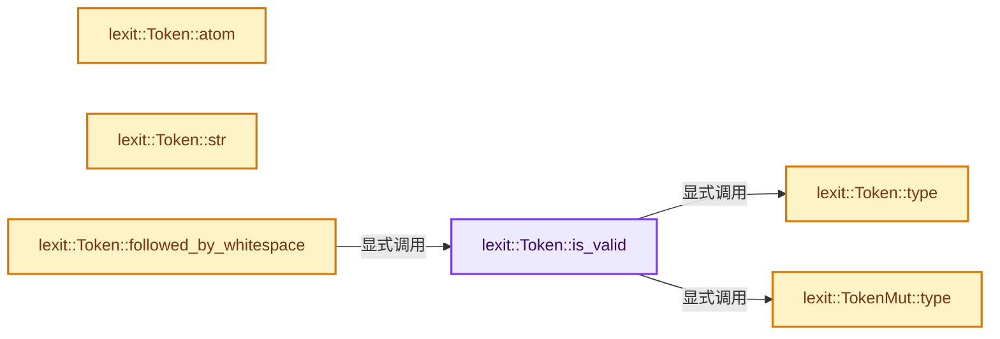
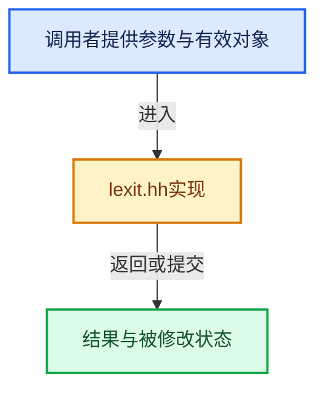

# 实现依赖专题：source/blender/gpu/shader_tool/lexit/lexit.hh

[实现依赖导航](../../../../README.md) · [符号索引](../../../../../00-课程指南/02-源码与提交索引/符号依赖与实现索引.md)

本专题从正文实际调用进入，集中保存共享实现。函数有稳定锚点，可从调用处直接跳到对应完整函数；递归与互相调用通过回链组织。

## 本文件的实现关系






## 相关类型布局与成员入口

<a id="t-54099d12a149"></a>

### `lexit::Token`

原始声明：[source/blender/gpu/shader_tool/lexit/lexit.hh](../../../../../../../../../source/blender/gpu/shader_tool/lexit/lexit.hh) · L44—L104。

成员布局：

- `std::string_view debug_str_`
- `TokenType debug_type_`
- `TokenAtom debug_atom_`
- `TokenBuffer buf_`
- `int32_t index_`
- `int32_t flag`
- `Token invalid`
- `TokenType type`
- `TokenAtom atom`
- `std::string_view str`
- `std::string_view str_with_whitespace`
- `bool followed_by_whitespace`
- `Token next`
- `Token prev`

以下保留类的数据声明与编译条件，成员函数实现通过后面的精确链接阅读。

<!-- annotated:f6517c76ddb99b -->

```cpp
struct Token {
#ifdef LEXIT_DEBUG
  std::string_view debug_str_;
  const TokenType *debug_type_;
  const TokenAtom *debug_atom_;
#endif
  const TokenBuffer *buf_;
  int32_t index_;
  /* General purpose flag. */
  int32_t flag = 0;

  Token(const TokenBuffer *buf, int32_t index);

  /* Invalid token that can still be compared with other tokens. */
  static Token invalid(const TokenBuffer *buf);

```

<details>
<summary>核对原始源码：source/blender/gpu/shader_tool/lexit/lexit.hh · L44—L59</summary>

<!-- original:f6517c76ddb99b:source/blender/gpu/shader_tool/lexit/lexit.hh:44:59 -->

```cpp
struct Token {
#ifdef LEXIT_DEBUG
  std::string_view debug_str_;
  const TokenType *debug_type_;
  const TokenAtom *debug_atom_;
#endif
  const TokenBuffer *buf_;
  int32_t index_;
  /* General purpose flag. */
  int32_t flag = 0;

  Token(const TokenBuffer *buf, int32_t index);

  /* Invalid token that can still be compared with other tokens. */
  static Token invalid(const TokenBuffer *buf);

```

</details>

<!-- annotated:6ea4fa959973dc -->

```cpp

```

<details>
<summary>核对原始源码：source/blender/gpu/shader_tool/lexit/lexit.hh · L64—L64</summary>

<!-- original:6ea4fa959973dc:source/blender/gpu/shader_tool/lexit/lexit.hh:64:64 -->

```cpp

```

</details>

<!-- annotated:2f7b279ee50ae0 -->

```cpp

  const TokenType &type() const;
  const TokenAtom &atom() const;

  std::string_view str() const;
  std::string_view str_with_whitespace() const;

  bool followed_by_whitespace() const;

  Token next(int i = 1) const;
  Token prev(int i = 1) const;

```

<details>
<summary>核对原始源码：source/blender/gpu/shader_tool/lexit/lexit.hh · L73—L84</summary>

<!-- original:2f7b279ee50ae0:source/blender/gpu/shader_tool/lexit/lexit.hh:73:84 -->

```cpp

  const TokenType &type() const;
  const TokenAtom &atom() const;

  std::string_view str() const;
  std::string_view str_with_whitespace() const;

  bool followed_by_whitespace() const;

  Token next(int i = 1) const;
  Token prev(int i = 1) const;

```

</details>

<!-- annotated:83915431c620de -->

```cpp

```

<details>
<summary>核对原始源码：source/blender/gpu/shader_tool/lexit/lexit.hh · L95—L95</summary>

<!-- original:83915431c620de:source/blender/gpu/shader_tool/lexit/lexit.hh:95:95 -->

```cpp

```

</details>

<!-- annotated:988df230f18ed1 -->

```cpp
};
```

<details>
<summary>核对原始源码：source/blender/gpu/shader_tool/lexit/lexit.hh · L104—L104</summary>

<!-- original:988df230f18ed1:source/blender/gpu/shader_tool/lexit/lexit.hh:104:104 -->

```cpp
};
```

</details>

- [is_valid](lexit.hh.md#f-a0a77cb72a96e29c)

## 完整成员与函数实现

<a id="f-a0a77cb72a96e29c"></a>

### `lexit::Token::is_valid`

实现位置：[source/blender/gpu/shader_tool/lexit/lexit.hh](../../../../../../../../../source/blender/gpu/shader_tool/lexit/lexit.hh) · L65—L68。

**教学注释版**

<!-- annotated:7d9388d3f43c94 -->

```cpp
  bool is_valid() const
  {
    return type() != EndOfFile;
  }
```

<details>
<summary>核对原始源码：source/blender/gpu/shader_tool/lexit/lexit.hh · L65—L68</summary>

<!-- original:7d9388d3f43c94:source/blender/gpu/shader_tool/lexit/lexit.hh:65:68 -->

```cpp
  bool is_valid() const
  {
    return type() != EndOfFile;
  }
```

</details>

**结果出口**

- `return type() != EndOfFile;`

**继续追踪实现**

- `type` → [lexit::Token::type · L354](lexit.hh.md#f-64a07b90a070709a)；[lexit::TokenMut::type · L358](lexit.hh.md#f-e930a727118c05b0)。同名重载需按实参类型选择。

<a id="f-64a07b90a070709a"></a>

### `lexit::Token::type`

实现位置：[source/blender/gpu/shader_tool/lexit/lexit.hh](../../../../../../../../../source/blender/gpu/shader_tool/lexit/lexit.hh) · L354—L357。

**教学注释版**

<!-- annotated:5b621285014ba7 -->

```cpp
inline const TokenType &Token::type() const
{
  return buf_->types_[index_];
}
```

<details>
<summary>核对原始源码：source/blender/gpu/shader_tool/lexit/lexit.hh · L354—L357</summary>

<!-- original:5b621285014ba7:source/blender/gpu/shader_tool/lexit/lexit.hh:354:357 -->

```cpp
inline const TokenType &Token::type() const
{
  return buf_->types_[index_];
}
```

</details>

**结果出口**

- `return buf_->types_[index_];`

**继续追踪实现**

本实现没有需要继续展开的显式调用；检查返回表达式、对象转换和调用者前置条件。

<a id="f-e930a727118c05b0"></a>

### `lexit::TokenMut::type`

实现位置：[source/blender/gpu/shader_tool/lexit/lexit.hh](../../../../../../../../../source/blender/gpu/shader_tool/lexit/lexit.hh) · L358—L361。

**教学注释版**

<!-- annotated:2c02322176e17e -->

```cpp
inline TokenType &TokenMut::type()
{
  return const_cast<TokenBuffer *>(buf_)->types_[index_];
}
```

<details>
<summary>核对原始源码：source/blender/gpu/shader_tool/lexit/lexit.hh · L358—L361</summary>

<!-- original:2c02322176e17e:source/blender/gpu/shader_tool/lexit/lexit.hh:358:361 -->

```cpp
inline TokenType &TokenMut::type()
{
  return const_cast<TokenBuffer *>(buf_)->types_[index_];
}
```

</details>

**结果出口**

- `return const_cast<TokenBuffer *>(buf_)->types_[index_];`

**继续追踪实现**

本实现没有需要继续展开的显式调用；检查返回表达式、对象转换和调用者前置条件。

<a id="f-1ff90ce8ed5a7425"></a>

### `lexit::Token::atom`

实现位置：[source/blender/gpu/shader_tool/lexit/lexit.hh](../../../../../../../../../source/blender/gpu/shader_tool/lexit/lexit.hh) · L363—L366。

**教学注释版**

<!-- annotated:d7e3c8770e61ec -->

```cpp
inline const TokenAtom &Token::atom() const
{
  return buf_->atoms_[index_];
}
```

<details>
<summary>核对原始源码：source/blender/gpu/shader_tool/lexit/lexit.hh · L363—L366</summary>

<!-- original:d7e3c8770e61ec:source/blender/gpu/shader_tool/lexit/lexit.hh:363:366 -->

```cpp
inline const TokenAtom &Token::atom() const
{
  return buf_->atoms_[index_];
}
```

</details>

**结果出口**

- `return buf_->atoms_[index_];`

**继续追踪实现**

本实现没有需要继续展开的显式调用；检查返回表达式、对象转换和调用者前置条件。

<a id="f-a2c6425f49731351"></a>

### `lexit::Token::str`

实现位置：[source/blender/gpu/shader_tool/lexit/lexit.hh](../../../../../../../../../source/blender/gpu/shader_tool/lexit/lexit.hh) · L381—L386。

**教学注释版**

<!-- annotated:283d9230711cd2 -->

```cpp
inline std::string_view Token::str() const
{
  int start = buf_->offsets_[index_];
  int end = buf_->offsets_end_[index_];
  return {buf_->str_.data() + start, size_t(end - start)};
}
```

<details>
<summary>核对原始源码：source/blender/gpu/shader_tool/lexit/lexit.hh · L381—L386</summary>

<!-- original:283d9230711cd2:source/blender/gpu/shader_tool/lexit/lexit.hh:381:386 -->

```cpp
inline std::string_view Token::str() const
{
  int start = buf_->offsets_[index_];
  int end = buf_->offsets_end_[index_];
  return {buf_->str_.data() + start, size_t(end - start)};
}
```

</details>

**结果出口**

- `return {buf_->str_.data() + start, size_t(end - start)};`

**继续追踪实现**

- `buf_->str_.data` → [调用协议](../../../../../00-课程指南/01-路线与规范/模板宏与动态分派协议.md)：接收对象类型依赖auto、返回值或模板实例；不按同名猜测目标。调用位置L385。

<a id="f-3d4b54b40f1243b6"></a>

### `lexit::Token::followed_by_whitespace`

实现位置：[source/blender/gpu/shader_tool/lexit/lexit.hh](../../../../../../../../../source/blender/gpu/shader_tool/lexit/lexit.hh) · L395—L399。

**教学注释版**

<!-- annotated:1fd1b3d6c5ab7f -->

```cpp
inline bool Token::followed_by_whitespace() const
{
  // [讲解] assert：检查开发者预期条件，配置可能关闭；不承担完整输入处理或自动修复。
  assert(is_valid());
  return buf_->offsets_end_[index_] != buf_->offsets_[index_ + 1];
}
```

<details>
<summary>核对原始源码：source/blender/gpu/shader_tool/lexit/lexit.hh · L395—L399</summary>

<!-- original:1fd1b3d6c5ab7f:source/blender/gpu/shader_tool/lexit/lexit.hh:395:399 -->

```cpp
inline bool Token::followed_by_whitespace() const
{
  assert(is_valid());
  return buf_->offsets_end_[index_] != buf_->offsets_[index_ + 1];
}
```

</details>

**结果出口**

- `return buf_->offsets_end_[index_] != buf_->offsets_[index_ + 1];`

**继续追踪实现**

- `assert` → [外部契约](https://eel.is/c++draft/assertions)：检查开发者预期条件，配置可能关闭；不承担完整输入处理或自动修复。
- `is_valid` → [lexit::Token::is_valid · L65](lexit.hh.md#f-a0a77cb72a96e29c)。
