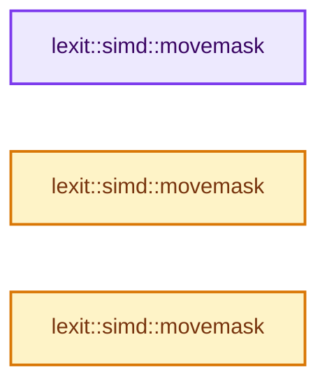
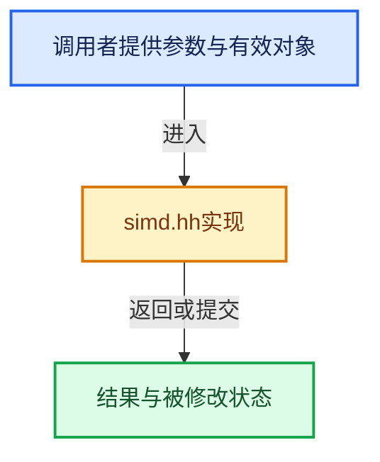

# 实现依赖专题：source/blender/gpu/shader_tool/lexit/simd.hh

[实现依赖导航](../../../../README.md) · [符号索引](../../../../../00-课程指南/02-源码与提交索引/符号依赖与实现索引.md)

本专题从正文实际调用进入，集中保存共享实现。函数有稳定锚点，可从调用处直接跳到对应完整函数；递归与互相调用通过回链组织。

## 本文件的实现关系






## 完整成员与函数实现

<a id="f-e13e3c0e134c6eaa"></a>

### `lexit::simd::movemask`

实现位置：[source/blender/gpu/shader_tool/lexit/simd.hh](../../../../../../../../../source/blender/gpu/shader_tool/lexit/simd.hh) · L528—L549。

接口参数：

- `u8x64 mask`

**教学注释版**

<!-- annotated:0493c32b787d97 -->

```cpp
inline uint64_t movemask(u8x64 mask)
{
  uint64_t result;

#  if defined(USE_NEON)
  const uint8x16_t bits = {1, 2, 4, 8, 16, 32, 64, 128, 1, 2, 4, 8, 16, 32, 64, 128};
  /* Merge lanes with their neighbors (e.g. [1, 2, 4, 8, ...] > [3, 12, 48, ...]).
   * This is equivalent to merging using | and >> operations.
   * Doing it 3 time to collapse the 8 bits. */
  uint8x16_t sum0 = vpaddq_u8(vandq_u8(mask.lanes[0], bits), vandq_u8(mask.lanes[1], bits));
  uint8x16_t sum1 = vpaddq_u8(vandq_u8(mask.lanes[2], bits), vandq_u8(mask.lanes[3], bits));
  sum0 = vpaddq_u8(sum0, sum1);
  sum0 = vpaddq_u8(sum0, sum0);
  result = vgetq_lane_u64(vreinterpretq_u64_u8(sum0), 0);
#  elif defined(USE_SSE4_2)
  result = _mm_movemask_epi8(mask.lanes[3]);
  result = _mm_movemask_epi8(mask.lanes[2]) | (result << 16);
  result = _mm_movemask_epi8(mask.lanes[1]) | (result << 16);
  result = _mm_movemask_epi8(mask.lanes[0]) | (result << 16);
#  endif
  return result;
}
```

<details>
<summary>核对原始源码：source/blender/gpu/shader_tool/lexit/simd.hh · L528—L549</summary>

<!-- original:0493c32b787d97:source/blender/gpu/shader_tool/lexit/simd.hh:528:549 -->

```cpp
inline uint64_t movemask(u8x64 mask)
{
  uint64_t result;

#  if defined(USE_NEON)
  const uint8x16_t bits = {1, 2, 4, 8, 16, 32, 64, 128, 1, 2, 4, 8, 16, 32, 64, 128};
  /* Merge lanes with their neighbors (e.g. [1, 2, 4, 8, ...] > [3, 12, 48, ...]).
   * This is equivalent to merging using | and >> operations.
   * Doing it 3 time to collapse the 8 bits. */
  uint8x16_t sum0 = vpaddq_u8(vandq_u8(mask.lanes[0], bits), vandq_u8(mask.lanes[1], bits));
  uint8x16_t sum1 = vpaddq_u8(vandq_u8(mask.lanes[2], bits), vandq_u8(mask.lanes[3], bits));
  sum0 = vpaddq_u8(sum0, sum1);
  sum0 = vpaddq_u8(sum0, sum0);
  result = vgetq_lane_u64(vreinterpretq_u64_u8(sum0), 0);
#  elif defined(USE_SSE4_2)
  result = _mm_movemask_epi8(mask.lanes[3]);
  result = _mm_movemask_epi8(mask.lanes[2]) | (result << 16);
  result = _mm_movemask_epi8(mask.lanes[1]) | (result << 16);
  result = _mm_movemask_epi8(mask.lanes[0]) | (result << 16);
#  endif
  return result;
}
```

</details>

**沿实际写入检查状态**

- `sum0 = vpaddq_u8(sum0, sum1);`
- `sum0 = vpaddq_u8(sum0, sum0);`
- `result = vgetq_lane_u64(vreinterpretq_u64_u8(sum0), 0);`
- `result = _mm_movemask_epi8(mask.lanes[3]);`
- `result = _mm_movemask_epi8(mask.lanes[2]) | (result << 16);`
- `result = _mm_movemask_epi8(mask.lanes[1]) | (result << 16);`
- `result = _mm_movemask_epi8(mask.lanes[0]) | (result << 16);`

**结果出口**

- `return result;`

**继续追踪实现**

- `vpaddq_u8` → [调用协议](../../../../../00-课程指南/01-路线与规范/模板宏与动态分派协议.md)：函数指针、局部可调用对象或未展开的宏；必须结合调用者环境。调用位置L537。
- `vandq_u8` → [调用协议](../../../../../00-课程指南/01-路线与规范/模板宏与动态分派协议.md)：函数指针、局部可调用对象或未展开的宏；必须结合调用者环境。调用位置L537。
- `vgetq_lane_u64` → [调用协议](../../../../../00-课程指南/01-路线与规范/模板宏与动态分派协议.md)：函数指针、局部可调用对象或未展开的宏；必须结合调用者环境。调用位置L541。
- `vreinterpretq_u64_u8` → [调用协议](../../../../../00-课程指南/01-路线与规范/模板宏与动态分派协议.md)：函数指针、局部可调用对象或未展开的宏；必须结合调用者环境。调用位置L541。
- `_mm_movemask_epi8` → [调用协议](../../../../../00-课程指南/01-路线与规范/模板宏与动态分派协议.md)：函数指针、局部可调用对象或未展开的宏；必须结合调用者环境。调用位置L543。

<a id="f-e4f07fd67c2396d5"></a>

### `lexit::simd::movemask`

实现位置：[source/blender/gpu/shader_tool/lexit/simd.hh](../../../../../../../../../source/blender/gpu/shader_tool/lexit/simd.hh) · L552—L570。

接口参数：

- `u8x32 mask`

**教学注释版**

<!-- annotated:08041d077f287f -->

```cpp
inline uint32_t movemask(u8x32 mask)
{
  uint32_t result;

#  if defined(USE_NEON)
  const uint8x16_t bits = {1, 2, 4, 8, 16, 32, 64, 128, 1, 2, 4, 8, 16, 32, 64, 128};
  /* Merge lanes with their neighbors (e.g. [1, 2, 4, 8, ...] > [3, 12, 48, ...]).
   * This is equivalent to merging using | and >> operations.
   * Doing it 3 time to collapse the 8 bits. */
  uint8x16_t sum = vpaddq_u8(vandq_u8(mask.lanes[0], bits), vandq_u8(mask.lanes[1], bits));
  sum = vpaddq_u8(sum, sum);
  sum = vpaddq_u8(sum, sum);
  result = vgetq_lane_u64(vreinterpretq_u64_u8(sum), 0);
#  elif defined(USE_SSE4_2)
  result = _mm_movemask_epi8(mask.lanes[1]);
  result = _mm_movemask_epi8(mask.lanes[0]) | (result << 16);
#  endif
  return result;
}
```

<details>
<summary>核对原始源码：source/blender/gpu/shader_tool/lexit/simd.hh · L552—L570</summary>

<!-- original:08041d077f287f:source/blender/gpu/shader_tool/lexit/simd.hh:552:570 -->

```cpp
inline uint32_t movemask(u8x32 mask)
{
  uint32_t result;

#  if defined(USE_NEON)
  const uint8x16_t bits = {1, 2, 4, 8, 16, 32, 64, 128, 1, 2, 4, 8, 16, 32, 64, 128};
  /* Merge lanes with their neighbors (e.g. [1, 2, 4, 8, ...] > [3, 12, 48, ...]).
   * This is equivalent to merging using | and >> operations.
   * Doing it 3 time to collapse the 8 bits. */
  uint8x16_t sum = vpaddq_u8(vandq_u8(mask.lanes[0], bits), vandq_u8(mask.lanes[1], bits));
  sum = vpaddq_u8(sum, sum);
  sum = vpaddq_u8(sum, sum);
  result = vgetq_lane_u64(vreinterpretq_u64_u8(sum), 0);
#  elif defined(USE_SSE4_2)
  result = _mm_movemask_epi8(mask.lanes[1]);
  result = _mm_movemask_epi8(mask.lanes[0]) | (result << 16);
#  endif
  return result;
}
```

</details>

**沿实际写入检查状态**

- `sum = vpaddq_u8(sum, sum);`
- `result = vgetq_lane_u64(vreinterpretq_u64_u8(sum), 0);`
- `result = _mm_movemask_epi8(mask.lanes[1]);`
- `result = _mm_movemask_epi8(mask.lanes[0]) | (result << 16);`

**结果出口**

- `return result;`

**继续追踪实现**

- `vpaddq_u8` → [调用协议](../../../../../00-课程指南/01-路线与规范/模板宏与动态分派协议.md)：函数指针、局部可调用对象或未展开的宏；必须结合调用者环境。调用位置L561。
- `vandq_u8` → [调用协议](../../../../../00-课程指南/01-路线与规范/模板宏与动态分派协议.md)：函数指针、局部可调用对象或未展开的宏；必须结合调用者环境。调用位置L561。
- `vgetq_lane_u64` → [调用协议](../../../../../00-课程指南/01-路线与规范/模板宏与动态分派协议.md)：函数指针、局部可调用对象或未展开的宏；必须结合调用者环境。调用位置L564。
- `vreinterpretq_u64_u8` → [调用协议](../../../../../00-课程指南/01-路线与规范/模板宏与动态分派协议.md)：函数指针、局部可调用对象或未展开的宏；必须结合调用者环境。调用位置L564。
- `_mm_movemask_epi8` → [调用协议](../../../../../00-课程指南/01-路线与规范/模板宏与动态分派协议.md)：函数指针、局部可调用对象或未展开的宏；必须结合调用者环境。调用位置L566。

<a id="f-3d94b53ec0bfd464"></a>

### `lexit::simd::movemask`

实现位置：[source/blender/gpu/shader_tool/lexit/simd.hh](../../../../../../../../../source/blender/gpu/shader_tool/lexit/simd.hh) · L573—L591。

接口参数：

- `u8x16 mask`

**教学注释版**

<!-- annotated:ee1024e624c4e7 -->

```cpp
inline uint16_t movemask(u8x16 mask)
{
  uint16_t result;

#  if defined(USE_NEON)
  const uint8x16_t bits = {1, 2, 4, 8, 16, 32, 64, 128, 1, 2, 4, 8, 16, 32, 64, 128};
  uint8x16_t sum = vandq_u8(mask.lanes[0], bits);
  /* Merge lanes with their neighbors (e.g. [1, 2, 4, 8, ...] > [3, 12, 48, ...]).
   * This is equivalent to merging using | and >> operations.
   * Doing it 3 time to collapse the 8 bits. */
  sum = vpaddq_u8(sum, sum);
  sum = vpaddq_u8(sum, sum);
  sum = vpaddq_u8(sum, sum);
  result = vgetq_lane_u64(vreinterpretq_u64_u8(sum), 0);
#  elif defined(USE_SSE4_2)
  result = _mm_movemask_epi8(mask.lanes[0]);
#  endif
  return result;
}
```

<details>
<summary>核对原始源码：source/blender/gpu/shader_tool/lexit/simd.hh · L573—L591</summary>

<!-- original:ee1024e624c4e7:source/blender/gpu/shader_tool/lexit/simd.hh:573:591 -->

```cpp
inline uint16_t movemask(u8x16 mask)
{
  uint16_t result;

#  if defined(USE_NEON)
  const uint8x16_t bits = {1, 2, 4, 8, 16, 32, 64, 128, 1, 2, 4, 8, 16, 32, 64, 128};
  uint8x16_t sum = vandq_u8(mask.lanes[0], bits);
  /* Merge lanes with their neighbors (e.g. [1, 2, 4, 8, ...] > [3, 12, 48, ...]).
   * This is equivalent to merging using | and >> operations.
   * Doing it 3 time to collapse the 8 bits. */
  sum = vpaddq_u8(sum, sum);
  sum = vpaddq_u8(sum, sum);
  sum = vpaddq_u8(sum, sum);
  result = vgetq_lane_u64(vreinterpretq_u64_u8(sum), 0);
#  elif defined(USE_SSE4_2)
  result = _mm_movemask_epi8(mask.lanes[0]);
#  endif
  return result;
}
```

</details>

**沿实际写入检查状态**

- `sum = vpaddq_u8(sum, sum);`
- `result = vgetq_lane_u64(vreinterpretq_u64_u8(sum), 0);`
- `result = _mm_movemask_epi8(mask.lanes[0]);`

**结果出口**

- `return result;`

**继续追踪实现**

- `vandq_u8` → [调用协议](../../../../../00-课程指南/01-路线与规范/模板宏与动态分派协议.md)：函数指针、局部可调用对象或未展开的宏；必须结合调用者环境。调用位置L579。
- `vpaddq_u8` → [调用协议](../../../../../00-课程指南/01-路线与规范/模板宏与动态分派协议.md)：函数指针、局部可调用对象或未展开的宏；必须结合调用者环境。调用位置L583。
- `vgetq_lane_u64` → [调用协议](../../../../../00-课程指南/01-路线与规范/模板宏与动态分派协议.md)：函数指针、局部可调用对象或未展开的宏；必须结合调用者环境。调用位置L586。
- `vreinterpretq_u64_u8` → [调用协议](../../../../../00-课程指南/01-路线与规范/模板宏与动态分派协议.md)：函数指针、局部可调用对象或未展开的宏；必须结合调用者环境。调用位置L586。
- `_mm_movemask_epi8` → [调用协议](../../../../../00-课程指南/01-路线与规范/模板宏与动态分派协议.md)：函数指针、局部可调用对象或未展开的宏；必须结合调用者环境。调用位置L588。
